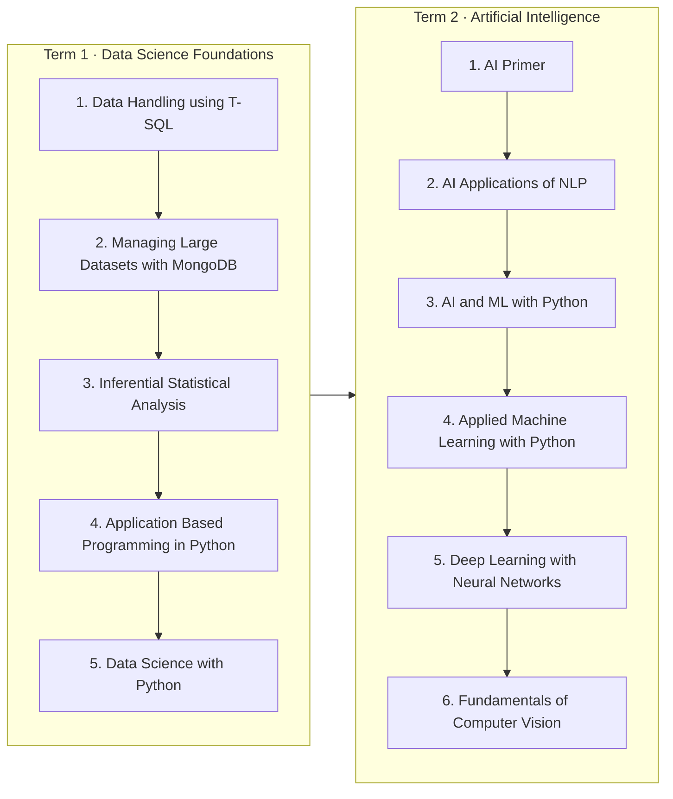

# Diploma in AI

Prepared by **Hamna Zahid Khan**, Junior Lecturer

## Overview

A two-term course in data science and artificial intelligence. Term 1 builds the foundations: SQL and MongoDB for data handling, statistics, and Python for applications and data science. Term 2 moves into AI itself: NLP, machine learning, deep learning and computer vision. Each module has session notes, runnable code and a practice test.

> 🚧 This course is being built module by module. Linked modules are ready; the rest are coming soon.

## Roadmap

## Contents

### [Term 1 · Data Science Foundations](term-1/README.md)

| # | Module | Hours | Sessions | Status |
|---|---|---|---|---|
| 1 | [Data Handling using T-SQL](term-1/01-data-handling-using-t-sql/) | 16 | 6 | ✅ Ready |
| 2 | [Managing Large Datasets with MongoDB](term-1/02-managing-large-datasets-with-mongodb/) | 32 | 12 | ✅ Ready |
| 3 | Inferential Statistical Analysis | 16 | 6 | 🕒 Coming soon |
| 4 | Application Based Programming in Python | 36 | 15 | 🕒 Coming soon |
| 5 | Data Science with Python | 36 | 15 | 🕒 Coming soon |

### Term 2 · Artificial Intelligence

| # | Module | Hours | Sessions | Status |
|---|---|---|---|---|
| 1 | AI Primer | 16 | 7 | 🕒 Coming soon |
| 2 | AI Applications of NLP | 40 | 15 | 🕒 Coming soon |
| 3 | AI and ML with Python | 24 | 8 | 🕒 Coming soon |
| 4 | Applied Machine Learning with Python | 36 | 12 | 🕒 Coming soon |
| 5 | Deep Learning with Neural Networks | 36 | 15 | 🕒 Coming soon |
| 6 | Fundamentals of Computer Vision | 24 | 8 | 🕒 Coming soon |

## How to use this repository

1. Open a module folder and start with its `README.md`.
2. Read the sessions in order; each one points to its scripts in `code/`.
3. Finish with the module's `practice-test.md`.

---
Prepared by Hamna Zahid Khan.
