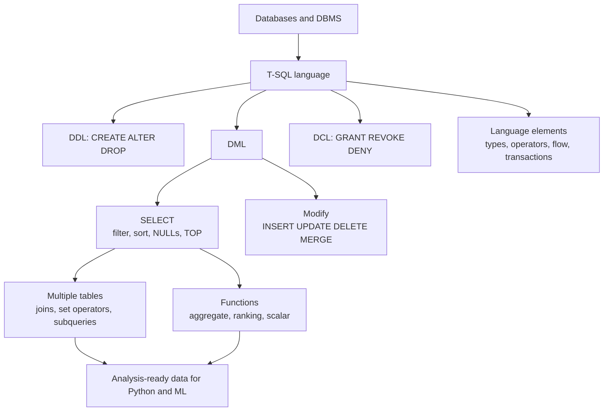

# Module 1: Data Handling using T-SQL

> 🧭 [Diploma in AI](../../README.md) › [Term 1](../README.md) › **Data Handling using T-SQL** &nbsp;·&nbsp; ⏱️ 16 instructional hours
>
> Prepared by **Hamna Zahid Khan**, Junior Lecturer

[⬅ Term 1 overview](../README.md) &nbsp;|&nbsp; [🏠 Course home](../../README.md)

---

## 🌟 Why this module matters

Almost every AI project starts with data that lives in a relational database. Before you can train a model you must **pull, join, clean and summarise** that data, and SQL is the language for it. This module teaches **Transact-SQL (T-SQL)**, the dialect used by Microsoft SQL Server and Azure SQL, using one small "Karachi Gadget Store" database throughout.

## 🎯 Module objectives

By the end of this module you will be able to:

- Explain databases, DBMS types and the role of T-SQL.
- Classify statements as DDL, DML, DCL and TCL, and use SSMS confidently.
- Use T-SQL data types, operators, expressions, control-of-flow, error handling and transactions.
- Query, filter, sort and format data with `SELECT`.
- Combine tables with set operators, joins and subqueries.
- Insert, update, delete and merge data safely.
- Summarise data with aggregate, ranking and scalar functions.

## 🗂️ Sessions

| # | Session |
|---|---|
| 1 | [Introduction to T-SQL and SQL Server](session-01-introduction-to-t-sql.md) |
| 2 | [T-SQL Language Elements](session-02-t-sql-language-elements.md) |
| 3 | [Querying and Filtering Data with SELECT](session-03-querying-with-select.md) |
| 4 | [Retrieving Data from Multiple Tables](session-04-retrieving-data-from-multiple-tables.md) |
| 5 | [Modifying Data: INSERT, UPDATE, DELETE and MERGE](session-05-modifying-data.md) |
| 6 | [Working with Built-in Functions](session-06-built-in-functions.md) |
| 📝 | [Module practice test](practice-test.md) |

## 🧭 Concept map

## 🛠️ Setup

- **Recommended:** SQL Server Express or Developer edition + SQL Server Management Studio (both free), or Azure Data Studio.
- **Zero-install option:** every example also runs on SQLite (built into Python, or use *DB Browser for SQLite*). Load the sample database from [`code/shop_db.sql`](code/shop_db.sql).

## 📄 One-page cheat-sheet

| Task | T-SQL |
|---|---|
| Switch database | `USE ShopDB;` |
| Create table | `CREATE TABLE T (Id INT PRIMARY KEY, Name NVARCHAR(50) NOT NULL);` |
| Change table | `ALTER TABLE T ADD City VARCHAR(30);` / `ALTER TABLE T DROP COLUMN City;` |
| Remove table / rows | `DROP TABLE T;` / `TRUNCATE TABLE T;` |
| Read | `SELECT [DISTINCT] [TOP (n)] cols FROM T WHERE … ORDER BY … ;` |
| Alias | `SELECT UnitPrice AS Price FROM Products AS p` |
| NULL handling | `IS NULL`, `ISNULL(x, d)`, `COALESCE(a, b, c)`, `a IS DISTINCT FROM b` |
| Patterns | `LIKE 'K%'`, `'_a%'`, `'[A-C]%'`; full text `CONTAINS(col, '"wire*"')` |
| Ranges / lists | `BETWEEN 10 AND 20`, `IN ('A','B')` |
| Paging | `ORDER BY x OFFSET 10 ROWS FETCH NEXT 10 ROWS ONLY` |
| Joins | `INNER`, `LEFT`, `RIGHT`, `FULL OUTER`, `CROSS`, self join with aliases |
| Set operators | `UNION`, `UNION ALL`, `INTERSECT`, `EXCEPT` |
| Subqueries | scalar `(SELECT AVG(..))`, `IN (SELECT ..)`, `EXISTS (SELECT 1 ..)`, derived table `FROM (…) AS t` |
| Insert | `INSERT INTO T (a,b) VALUES (1,'x'), (2,'y');` / `INSERT INTO T (a,b) SELECT …` |
| Update / delete | `UPDATE T SET a = a + 1 WHERE …;` / `DELETE FROM T WHERE …;` |
| Upsert | `MERGE T USING S ON … WHEN MATCHED THEN UPDATE … WHEN NOT MATCHED THEN INSERT …;` |
| Audit changes | `OUTPUT inserted.*, deleted.*` |
| Aggregates | `COUNT(*)`, `COUNT(col)`, `SUM`, `AVG`, `MIN`, `MAX`, `STRING_AGG` + `GROUP BY` / `HAVING` |
| Ranking | `ROW_NUMBER() / RANK() / DENSE_RANK() / NTILE(n) OVER (PARTITION BY … ORDER BY …)` |
| Strings | `LEN`, `UPPER`, `LOWER`, `LEFT`, `RIGHT`, `SUBSTRING`, `CHARINDEX`, `REPLACE`, `TRIM`, `CONCAT` |
| Dates | `GETDATE()`, `YEAR()`, `MONTH()`, `DATEADD(day, n, d)`, `DATEDIFF(day, d1, d2)`, `EOMONTH(d)` |
| Convert | `CAST(x AS INT)`, `CONVERT(VARCHAR, d, 23)`, `TRY_CAST(x AS INT)` |
| Variables / flow | `DECLARE @n INT = 0; SET @n += 1; IF … ELSE …; WHILE … BEGIN … END` |
| Errors | `BEGIN TRY … END TRY BEGIN CATCH SELECT ERROR_MESSAGE(); END CATCH` |
| Transactions | `BEGIN TRAN; … COMMIT;` or `ROLLBACK;` check `@@TRANCOUNT` |
| Permissions | `GRANT SELECT ON T TO u; DENY DELETE ON T TO u; REVOKE …` |

**Logical processing order:** `FROM → WHERE → GROUP BY → HAVING → SELECT → ORDER BY → TOP`.

## ✅ Progress checklist

- [ ] Session 1 · Introduction to T-SQL
- [ ] Session 2 · Language elements
- [ ] Session 3 · SELECT and filtering
- [ ] Session 4 · Multiple tables
- [ ] Session 5 · Modifying data
- [ ] Session 6 · Built-in functions
- [ ] Practice test (score ≥ 16/20)

---

[⬅ Term 1 overview](../README.md) &nbsp;|&nbsp; [🏠 Course home](../../README.md) &nbsp;|&nbsp; [Start Session 1 ➡](session-01-introduction-to-t-sql.md)

Prepared by **Hamna Zahid Khan**, Junior Lecturer · Diploma in AI
