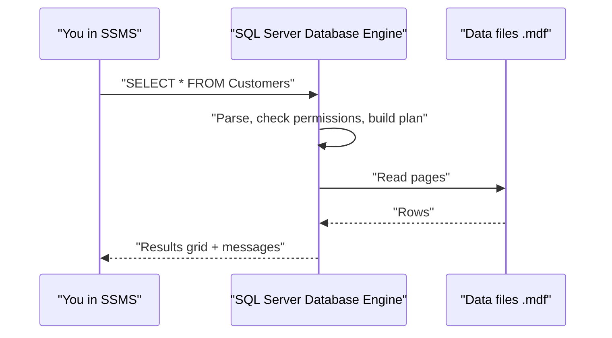
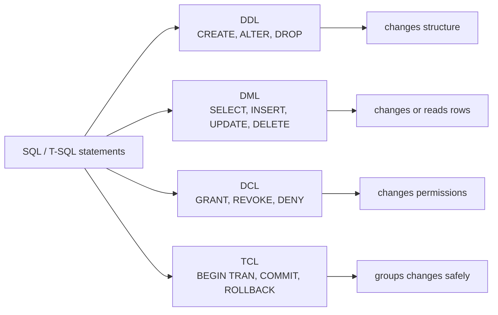
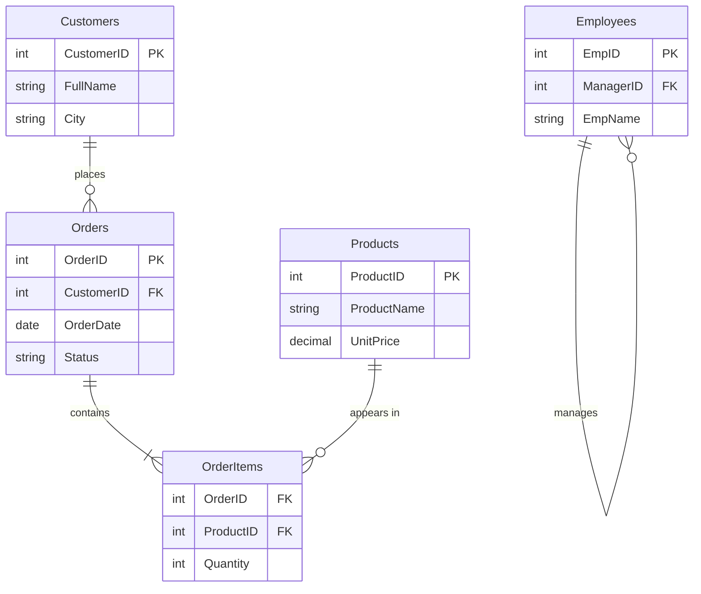

# Session 1: Introduction to T-SQL and SQL Server

> 🧭 [Diploma in AI](../../README.md) › [Term 1](../README.md) › [Data Handling using T-SQL](README.md) › **Session 1**
>
> ⏱️ **Estimated time:** 2 hours (1 h concepts + 1 h lab) &nbsp;|&nbsp; 📋 **Prerequisites:** None, this is the first session of the module
>
> Prepared by **Hamna Zahid Khan**, Junior Lecturer

[⬅ Module overview](README.md) &nbsp;|&nbsp; [🏠 Module home](README.md) &nbsp;|&nbsp; [Next: Session 2 ➡](session-02-t-sql-language-elements.md)

---

## 🎯 Learning objectives

By the end of this session you will be able to:

- Explain what a **database** and a **DBMS** are, and compare the main types of DBMS.
- Describe **T-SQL** and how it extends standard SQL.
- Sort SQL statements into **DDL**, **DML** and **DCL** families.
- Connect to a SQL Server instance with **SQL Server Management Studio (SSMS)** and use **Object Explorer**.
- Write and execute your first queries.

## 📖 Concepts

### 1. What is a database?

A **database** is an organised collection of related data, stored so that it can be found, updated and protected easily. Think of a university's admission office: a filing cabinet full of paper forms is a database too, but finding "all students from Hyderabad who applied for AI" means opening every folder. A digital database answers that question in milliseconds.

Key ideas:

- **Data** is raw facts (`Ayesha`, `Karachi`, `52000`).
- **Information** is data with meaning ("Ayesha from Karachi spent Rs 52,000 last month").
- A **Database Management System (DBMS)** is the software that stores the data, enforces rules on it, controls who can see it and answers queries. SQL Server, MySQL, PostgreSQL, Oracle and SQLite are all DBMSs.

### 2. Types of DBMS

| Type | How data is organised | Example products | Good for |
|---|---|---|---|
| **Hierarchical** | Tree of parent → child records | IBM IMS, Windows Registry | Fixed one-to-many structures |
| **Network** | Records linked as a graph (many parents allowed) | IDMS | Complex many-to-many links (legacy) |
| **Relational (RDBMS)** | Tables of rows and columns, linked by keys | SQL Server, MySQL, PostgreSQL | Business data, transactions, reporting |
| **Object-oriented** | Objects with attributes and methods | db4o, ObjectDB | Apps that store programming objects directly |
| **NoSQL** | Documents, key-value, column-family or graph | MongoDB, Redis, Cassandra, Neo4j | Huge, flexible or fast-changing data |

In a **relational** database every table has a **primary key** (a column that uniquely identifies a row) and tables are linked with **foreign keys** (a column that points at another table's primary key).

### 3. SQL and T-SQL

**SQL (Structured Query Language)** is the standard language for relational databases. **Transact-SQL (T-SQL)** is Microsoft's dialect of SQL used by SQL Server and Azure SQL. It keeps standard SQL and adds:

- **Variables** (`DECLARE @total INT`), **control flow** (`IF…ELSE`, `WHILE`) and **error handling** (`TRY…CATCH`).
- Extra functions (`GETDATE()`, `IIF()`, `FORMAT()`, `STRING_AGG()`), and the `TOP` keyword.
- Batches separated by `GO`, stored procedures, triggers and transactions.

> 💡 **Analogy:** SQL is "standard Urdu"; T-SQL is Urdu as spoken in one city: everyone understands the core, but there are local words you only find there.

### 4. Families of SQL statements

| Family | Stands for | Purpose | Key statements |
|---|---|---|---|
| **DDL** | Data Definition Language | Create or change the *structure* | `CREATE`, `ALTER`, `DROP`, `TRUNCATE` |
| **DML** | Data Manipulation Language | Read or change the *rows* | `SELECT`, `INSERT`, `UPDATE`, `DELETE`, `MERGE` |
| **DCL** | Data Control Language | Control *permissions* | `GRANT`, `REVOKE`, `DENY` |
| **TCL** | Transaction Control Language | Group changes safely | `BEGIN TRAN`, `COMMIT`, `ROLLBACK` |

A quick memory trick: **DDL builds the house, DML moves furniture in and out, DCL hands out the keys.**

### 5. SQL Server Management Studio (SSMS)

SSMS is Microsoft's free desktop tool for working with SQL Server. A typical first visit looks like this:

1. **Open SSMS** → the *Connect to Server* dialog appears.
2. **Server type:** Database Engine. **Server name:** `localhost`, `.\SQLEXPRESS` or a remote name such as `myserver.database.windows.net`.
3. **Authentication:** *Windows Authentication* (uses your Windows login) or *SQL Server Authentication* (a separate username/password such as `sa`).
4. Click **Connect**. The **Object Explorer** panel on the left now shows the instance.
5. Expand **Databases → YourDatabase → Tables** to browse tables, columns, keys and indexes. Right-click a table → *Select Top 1000 Rows* to peek at data.
6. Click **New Query** (or `Ctrl+N`), choose the database in the drop-down (or write `USE ShopDB;`), type a query and press **F5 / Execute**.
7. Results appear in the **Results** grid; row counts and errors appear in the **Messages** tab.

> 🧪 No SQL Server at home? Every example in this module also runs on **SQLite** (built into Python). The outputs you see below were produced exactly that way. Where T-SQL syntax differs from SQLite we show both.

## 🧭 Diagrams

How a query travels from you to the data and back:



The statement families at a glance:



The sample database used throughout this module:



## 💻 Worked examples

### Example 1: DDL and DML side by side

We create a table (DDL), add rows (DML), read them (DML), then change the structure again (DDL).

📄 [`code/session-01_first_queries.sql`](code/session-01_first_queries.sql)
```sql
-- DDL: define a structure
CREATE TABLE Students (
    StudentID  INT PRIMARY KEY,
    Name       VARCHAR(40) NOT NULL,
    Program    VARCHAR(30)
);

-- DML: put data in and read it back
INSERT INTO Students (StudentID, Name, Program) VALUES
 (1, 'Ali', 'AI'),
 (2, 'Maryam', 'Data Science'),
 (3, 'Hamza', 'AI');

SELECT * FROM Students;

SELECT Name FROM Students WHERE Program = 'AI';

-- DDL again: change the structure
ALTER TABLE Students ADD COLUMN City VARCHAR(30);
UPDATE Students SET City = 'Karachi';
SELECT StudentID, Name, City FROM Students;
```

**Output**

```text
(3 rows affected)

-- Result 1
StudentID | Name   | Program
----------+--------+-------------
1         | Ali    | AI
2         | Maryam | Data Science
3         | Hamza  | AI
(3 rows)

-- Result 2
Name
-----
Ali
Hamza
(2 rows)

(3 rows affected)

-- Result 3
StudentID | Name   | City
----------+--------+--------
1         | Ali    | Karachi
2         | Maryam | Karachi
3         | Hamza  | Karachi
(3 rows)
```


> In **T-SQL** the `ALTER` line is written without the word `COLUMN`: `ALTER TABLE Students ADD City VARCHAR(30);`

### Example 2: Explore the sample shop database

Create the database once with [`code/shop_db.sql`](code/shop_db.sql). In SSMS: `CREATE DATABASE ShopDB; GO USE ShopDB; GO` then run the file. Now count rows in every table:

📄 [`code/session-01_explore_shop.sql`](code/session-01_explore_shop.sql)
> Runs on the sample database from [`code/shop_db.sql`](code/shop_db.sql).

```sql
-- How many rows does each table hold?
SELECT 'Customers' AS TableName, COUNT(*) AS TotalRows FROM Customers
UNION ALL SELECT 'Products', COUNT(*) FROM Products
UNION ALL SELECT 'Orders', COUNT(*) FROM Orders
UNION ALL SELECT 'OrderItems', COUNT(*) FROM OrderItems
UNION ALL SELECT 'Employees', COUNT(*) FROM Employees;

-- Peek at the first three products
SELECT ProductID, ProductName, UnitPrice FROM Products LIMIT 3;
```

**Output**

```text
-- Result 1
TableName  | TotalRows
-----------+----------
Customers  | 6
Products   | 6
Orders     | 6
OrderItems | 9
Employees  | 5
(5 rows)

-- Result 2
ProductID | ProductName         | UnitPrice
----------+---------------------+----------
101       | Wireless Mouse      | 1500
102       | Mechanical Keyboard | 8500
103       | 27-inch Monitor     | 52000
(3 rows)
```


> T-SQL uses `TOP` instead of `LIMIT`: `SELECT TOP 3 ProductID, ProductName, UnitPrice FROM Products;`

### Example 3: DCL (read-only walkthrough)

DCL needs a real server with logins, so here is the T-SQL you would run in SSMS as an administrator:

```sql
-- create a login (server level) and a user (database level)
CREATE LOGIN analyst_login WITH PASSWORD = 'Str0ng!Pass2025';
USE ShopDB;
CREATE USER analyst FOR LOGIN analyst_login;

GRANT SELECT ON dbo.Products TO analyst;      -- may read products
DENY  DELETE ON dbo.Orders   TO analyst;      -- may never delete orders
REVOKE SELECT ON dbo.Products FROM analyst;   -- take the read right back
```

**Expected messages:** `Commands completed successfully.` after each statement. If `analyst` then tries `DELETE FROM Orders`, SQL Server replies with *"The DELETE permission was denied on the object 'Orders'"*.

## 📊 Where SQL skills are used

| Role | Typical daily SQL use |
|---|---|
| Data analyst | `SELECT` with filters, joins and aggregates for reports |
| Data scientist | Extract training data, join feature tables |
| Database administrator | DDL, DCL, backups, performance tuning |
| Backend developer | DML from application code, transactions |

## 🧪 Lab / practice tasks

**1. 🟢 Easy:** Install SQL Server Express + SSMS (or open DB Browser for SQLite) and connect. Take a screenshot of Object Explorer showing your database.

<details><summary>💡 Hint</summary>

In SSMS use server name `.\SQLEXPRESS` or `localhost` with Windows Authentication.

</details>

**2. 🟢 Easy:** Run `shop_db.sql`, then label each statement in it as DDL or DML.

<details><summary>💡 Hint</summary>

`CREATE TABLE` is DDL, every `INSERT` is DML.

</details>

**3. 🟡 Medium:** Create a table `Courses(CourseID, Title, CreditHours)` and insert four rows of your own. Show all courses with more than 2 credit hours.

<details><summary>💡 Hint</summary>

`WHERE CreditHours > 2`

</details>

**4. 🟠 Hard:** Add a column `Fee` to your `Courses` table and set different values with separate `UPDATE` statements.

<details><summary>💡 Hint</summary>

`ALTER TABLE Courses ADD Fee INT;` then `UPDATE Courses SET Fee = 30000 WHERE CourseID = 1;`

</details>

**5. 🔴 Challenge:** Write the DCL script that lets a user `intern` read `Customers` but not see the `Email` column.

<details><summary>💡 Hint</summary>

Column-level permissions exist: `GRANT SELECT ON Customers(CustomerID, FullName, City) TO intern;`

</details>


## ✅ Quick quiz

**Q1.** Which statement belongs to DDL?

- A) SELECT
- B) ALTER
- C) GRANT
- D) UPDATE

**Q2.** T-SQL is best described as…

- A) A NoSQL query language
- B) Microsoft's extension of SQL with variables, control flow and error handling
- C) A Python library
- D) A replacement for relational tables

**Q3.** In SSMS, where do you browse databases, tables and columns?

- A) Results grid
- B) Messages tab
- C) Object Explorer
- D) Query Designer only

**Q4.** Which DBMS type stores data in rows and columns linked by keys?

- A) Hierarchical
- B) Relational
- C) Key-value
- D) Graph

**Q5.** `DENY DELETE ON Orders TO analyst` is an example of…

- A) DML
- B) DDL
- C) DCL
- D) TCL

<details><summary>✅ Show answers</summary>

1. **B** — ALTER changes the structure of an object.
2. **B**
3. **C**
4. **B**
5. **C** — it controls permissions.

</details>


## 📝 Summary

- A **DBMS** stores, protects and serves data; **RDBMS** use tables, primary keys and foreign keys.
- **T-SQL** = standard SQL + variables, flow control, `TRY…CATCH`, `TOP`, `GO` batches and many built-in functions.
- **DDL** defines structure, **DML** works with rows, **DCL** grants/denies permissions, **TCL** controls transactions.
- **SSMS**: connect → Object Explorer → New Query → choose database → F5.

### 🎤 Interview / viva questions

1. What is the difference between a database and a DBMS?
2. Name two things T-SQL adds that ANSI SQL does not have.
3. Is `TRUNCATE` DDL or DML? Why might the answer surprise people?
4. What is the difference between Windows Authentication and SQL Server Authentication?
5. Why would a company choose a NoSQL database instead of an RDBMS?

---

[⬅ Module overview](README.md) &nbsp;|&nbsp; [🏠 Module home](README.md) &nbsp;|&nbsp; [Next: Session 2 ➡](session-02-t-sql-language-elements.md)

<sub>Prepared by **Hamna Zahid Khan**, Junior Lecturer · Diploma in AI</sub>
