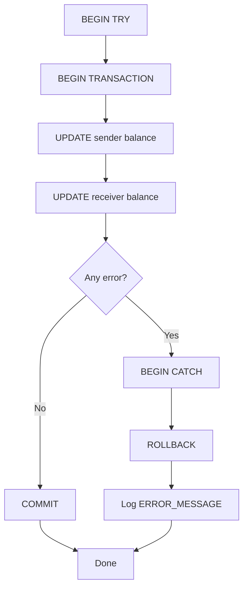
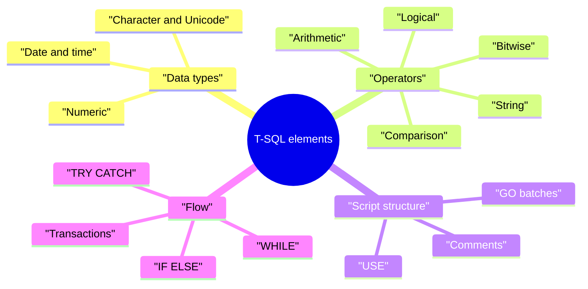
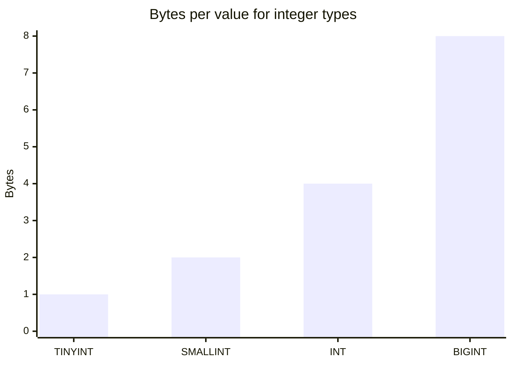

# Session 2: T-SQL Language Elements

> 🧭 [Diploma in AI](../../README.md) › [Term 1](../README.md) › [Data Handling using T-SQL](README.md) › **Session 2**
>
> ⏱️ **Estimated time:** 2 hours (1 h concepts + 1 h lab) &nbsp;|&nbsp; 📋 **Prerequisites:** Session 1 (DDL/DML basics), sample database `shop_db.sql`
>
> Prepared by **Hamna Zahid Khan**, Junior Lecturer

[⬅ Previous: Session 1](session-01-introduction-to-t-sql.md) &nbsp;|&nbsp; [🏠 Module home](README.md) &nbsp;|&nbsp; [Next: Session 3 ➡](session-03-querying-with-select.md)

---

## 🎯 Learning objectives

- Choose suitable **T-SQL data types** for columns and variables.
- Use **arithmetic, bitwise, comparison, compound, logical and string operators**.
- Write comments and organise scripts with **`USE`** and **`GO`**.
- Build **expressions**, including `CASE`.
- Control the flow of a script with `IF…ELSE`, `WHILE`, `TRY…CATCH` and **transactions**.

## 📖 Concepts

### 1. Data types

Every column, variable and expression has a **data type**. Picking the right one saves space and blocks bad data.

| Group | T-SQL types | Example value | Tip |
|---|---|---|---|
| Exact numbers | `TINYINT` (0-255), `SMALLINT`, `INT`, `BIGINT`, `DECIMAL(p,s)`, `MONEY` | `52000.00` | Use `DECIMAL(10,2)` for prices, never `FLOAT` |
| Approximate numbers | `FLOAT`, `REAL` | `3.14159` | Scientific values where tiny rounding is fine |
| Character | `CHAR(n)`, `VARCHAR(n)`, `VARCHAR(MAX)` | `'Karachi'` | `CHAR` is fixed width (pads with spaces) |
| Unicode | `NCHAR(n)`, `NVARCHAR(n)` | `N'کراچی'` | Needed for Urdu/Arabic text; prefix literals with `N` |
| Date/time | `DATE`, `TIME`, `DATETIME2`, `DATETIMEOFFSET` | `'2025-03-15'` | `DATETIMEOFFSET` stores the time zone (e.g. +05:00 for PKT) |
| Other | `BIT`, `UNIQUEIDENTIFIER`, `VARBINARY`, `XML`, `JSON` (SQL Server 2025) | `1` | `BIT` is SQL Server's yes/no |

### 2. Operators

| Kind | Operators | Example | Result |
|---|---|---|---|
| Arithmetic | `+ - * / %` | `17 % 5` | `2` |
| Bitwise | `& \| ^ ~` | `12 & 10` | `8` |
| Comparison | `= <> != > < >= <=` | `Stock <> 0` | true/false |
| Compound (T-SQL) | `+= -= *= /= %=` | `SET @n += 1` | adds 1 to `@n` |
| Logical | `AND OR NOT BETWEEN IN LIKE EXISTS ANY ALL` | `City IN ('Karachi','Lahore')` | true/false |
| String | `+` concatenation (T-SQL), `\|\|` (ANSI) | `'AI' + '-101'` | `'AI-101'` |

**Integer division trap:** `17 / 5` is `3` because both sides are integers. Write `17 / 5.0` to get `3.4`.

**Operator precedence** (highest first): `~` → `* / %` → `+ -` (and `&`) → comparisons → `NOT` → `AND` → `ALL ANY BETWEEN IN LIKE OR SOME` → `=` (assignment). When in doubt, add brackets.

### 3. Comments, `USE` and `GO`

```sql
-- single-line comment
/* block comment
   spanning several lines */
USE ShopDB;          -- switch the current database
GO                   -- end of batch (an SSMS/sqlcmd command, not T-SQL)
```

A **batch** is a group of statements sent to the server together. Variables live only inside their batch, and some statements (`CREATE VIEW`, `CREATE PROCEDURE`) must be first in their batch, which is why scripts are sprinkled with `GO`.

### 4. Expressions

An **expression** is anything that produces a value: a column, a literal, a variable, a function call, or a combination joined by operators. `UnitPrice * Stock`, `UPPER(FullName)` and a full `CASE … END` are all expressions.

### 5. Control of flow, errors and transactions

| Construct | Purpose |
|---|---|
| `DECLARE @x INT = 5;` | create a local variable |
| `IF … ELSE` | choose between two paths |
| `BEGIN … END` | group several statements into one block |
| `WHILE` + `BREAK`/`CONTINUE` | loop |
| `TRY … CATCH` | trap runtime errors; read `ERROR_NUMBER()`, `ERROR_MESSAGE()` |
| `THROW` / `RAISERROR` | raise your own error |
| `BEGIN TRAN … COMMIT / ROLLBACK` | all-or-nothing group of changes |

A **transaction** obeys **ACID**: **A**tomic (all or nothing), **C**onsistent (rules hold), **I**solated (others don't see half-done work), **D**urable (committed work survives a crash).

## 🧭 Diagrams





## 💻 Worked examples

### Example 1: Operators and expressions on the shop data

📄 [`code/session-02_operators.sql`](code/session-02_operators.sql)
> Runs on the sample database from [`code/shop_db.sql`](code/shop_db.sql).

```sql
-- Arithmetic operators
SELECT 17 + 5 AS AddResult, 17 - 5 AS SubResult, 17 * 5 AS MulResult,
       17 / 5 AS IntDivide, 17 % 5 AS Modulo, 17 / 5.0 AS RealDivide;

-- Bitwise operators: 12 = 1100, 10 = 1010 in binary
SELECT 12 & 10 AS BitAnd, 12 | 10 AS BitOr;

-- Comparison + logical operators on the shop data
SELECT ProductName, UnitPrice, Stock
FROM Products
WHERE UnitPrice >= 4000 AND NOT Stock = 0;

-- String concatenation (T-SQL uses + ; SQLite and ANSI use ||)
SELECT FullName || ' lives in ' || City AS Sentence
FROM Customers
WHERE City <> 'Karachi';

-- Expressions combine columns, literals, operators and functions
SELECT ProductName,
       UnitPrice,
       UnitPrice * 0.90           AS SalePrice,
       UnitPrice * Stock          AS StockValue,
       CASE WHEN Stock = 0 THEN 'Out of stock'
            WHEN Stock < 10 THEN 'Low'
            ELSE 'OK' END         AS StockLevel
FROM Products
ORDER BY StockValue DESC;
```

**Output**

```text
-- Result 1
AddResult | SubResult | MulResult | IntDivide | Modulo | RealDivide
----------+-----------+-----------+-----------+--------+-----------
22        | 12        | 85        | 3         | 2      | 3.40
(1 row)

-- Result 2
BitAnd | BitOr
-------+------
8      | 14
(1 row)

-- Result 3
ProductName          | UnitPrice | Stock
---------------------+-----------+------
Mechanical Keyboard  | 8500      | 15
27-inch Monitor      | 52000     | 6
USB-C Hub            | 4200      | 25
Noise-Cancel Headset | 18000     | 9
(4 rows)

-- Result 4
Sentence
------------------------------
Bilal Ahmed lives in Lahore
Usman Tariq lives in Islamabad
Zain Raza lives in Lahore
(3 rows)

-- Result 5
ProductName          | UnitPrice | SalePrice | StockValue | StockLevel
---------------------+-----------+-----------+------------+-------------
27-inch Monitor      | 52000     | 46800.00  | 312000     | Low
Noise-Cancel Headset | 18000     | 16200.00  | 162000     | Low
Mechanical Keyboard  | 8500      | 7650.00   | 127500     | OK
USB-C Hub            | 4200      | 3780.00   | 105000     | OK
Wireless Mouse       | 1500      | 1350.00   | 60000      | OK
Laptop Stand         | 3500      | 3150.00   | 0          | Out of stock
(6 rows)
```


> In T-SQL the string line becomes `SELECT FullName + ' lives in ' + City AS Sentence …` (or `CONCAT(FullName, ' lives in ', City)`, which also treats `NULL` as an empty string).

### Example 2: Transactions, commit, rollback and a broken rule

📄 [`code/session-02_transaction.sql`](code/session-02_transaction.sql)
```sql
-- A transfer that must be all-or-nothing
CREATE TABLE Wallet (Owner VARCHAR(20) PRIMARY KEY, Balance INT CHECK (Balance >= 0));
INSERT INTO Wallet VALUES ('Ayesha', 5000), ('Bilal', 1000);

-- 1) A successful transaction
BEGIN TRANSACTION;
UPDATE Wallet SET Balance = Balance - 2000 WHERE Owner = 'Ayesha';
UPDATE Wallet SET Balance = Balance + 2000 WHERE Owner = 'Bilal';
COMMIT;
SELECT * FROM Wallet;

-- 2) A transaction we cancel
BEGIN TRANSACTION;
UPDATE Wallet SET Balance = 0 WHERE Owner = 'Bilal';
ROLLBACK;
SELECT * FROM Wallet;

-- 3) A rule violation: Bilal cannot go below zero
UPDATE Wallet SET Balance = Balance - 99999 WHERE Owner = 'Bilal';
SELECT * FROM Wallet;
```

**Output**

```text
(2 rows affected)

(1 row affected)

(1 row affected)

-- Result 1
Owner  | Balance
-------+--------
Ayesha | 3000
Bilal  | 3000
(2 rows)

(1 row affected)

-- Result 2
Owner  | Balance
-------+--------
Ayesha | 3000
Bilal  | 3000
(2 rows)

Error: CHECK constraint failed: Balance >= 0

-- Result 3
Owner  | Balance
-------+--------
Ayesha | 3000
Bilal  | 3000
(2 rows)
```


Notice the final `UPDATE` failed (the `CHECK` constraint stopped it) and the data stayed safe.

### Example 3: Variables, IF, WHILE (T-SQL only, output traced by hand)

```sql
DECLARE @n INT = 1, @total INT = 0;
WHILE @n <= 5
BEGIN
    SET @total += @n;      -- compound operator
    SET @n += 1;
END;
IF @total > 10
    PRINT 'Sum 1..5 = ' + CAST(@total AS VARCHAR(10)) + ' (greater than 10)';
ELSE
    PRINT 'Small total';
```

**Output (Messages tab)**

```text
Sum 1..5 = 15 (greater than 10)
```

Trace: total goes 1 → 3 → 6 → 10 → 15, and the loop stops when `@n` becomes 6.

### Example 4: TRY…CATCH with a transaction (T-SQL only)

```sql
BEGIN TRY
    BEGIN TRANSACTION;
        UPDATE Products SET Stock = Stock - 1 WHERE ProductID = 101;
        SELECT 1 / 0;                 -- forces a runtime error
    COMMIT;
END TRY
BEGIN CATCH
    IF @@TRANCOUNT > 0 ROLLBACK;
    PRINT 'Error ' + CAST(ERROR_NUMBER() AS VARCHAR) + ': ' + ERROR_MESSAGE();
END CATCH;
```

**Output (Messages tab)**

```text
(1 row affected)
Error 8134: Divide by zero error encountered.
```

The stock change for product 101 is rolled back, so `Stock` is still 40.

## 📊 Choosing a type: storage cost

| Type | Bytes per value |
|---|---|
| `TINYINT` | 1 |
| `SMALLINT` | 2 |
| `INT` | 4 |
| `BIGINT` | 8 |
| `DATE` | 3 |
| `DATETIME2(7)` | 8 |
| `CHAR(10)` | 10 (always) |
| `VARCHAR(10)` holding `'AI'` | 2 + 2 overhead |



## 🧪 Lab / practice tasks

**1. 🟢 Easy:** Pick the best data type for: CNIC number, product price, Urdu product name, date of birth, "is active" flag.

<details><summary>💡 Hint</summary>

CNIC has dashes and leading zeros matter, so it is text: `CHAR(15)`.

</details>

**2. 🟢 Easy:** Predict, then run: `SELECT 7/2, 7/2.0, 7%2, 5 & 3, 5

<details><summary>💡 Hint</summary>

3;`

</details>

**3. 🟡 Medium:** List products whose price is BETWEEN 3000 and 20000 and whose category is IN ('Accessories','Audio').

<details><summary>💡 Hint</summary>

Combine `BETWEEN` and `IN` with `AND`.

</details>

**4. 🟠 Hard:** Write a T-SQL `WHILE` loop that prints the 7 times table (7 x 1 … 7 x 10).

<details><summary>💡 Hint</summary>

`PRINT CONCAT('7 x ', @i, ' = ', 7*@i);`

</details>

**5. 🔴 Challenge:** Wrap a two-step stock transfer between two products in `TRY…CATCH` with a transaction, and prove that an error rolls both steps back.

<details><summary>💡 Hint</summary>

Force an error with `THROW 50001, 'test', 1;` between the two updates.

</details>


## ✅ Quick quiz

**Q1.** What does `SELECT 17 / 5` return in T-SQL?

- A) 3.4
- B) 3
- C) 4
- D) 2

**Q2.** Which data type should store Urdu text?

- A) VARCHAR
- B) CHAR
- C) NVARCHAR
- D) TEXT

**Q3.** `GO` is…

- A) a T-SQL keyword that commits a transaction
- B) a batch separator understood by SSMS/sqlcmd
- C) a loop statement
- D) a comment marker

**Q4.** Which property of ACID means "all or nothing"?

- A) Atomicity
- B) Consistency
- C) Isolation
- D) Durability

**Q5.** Inside `BEGIN CATCH`, which function returns the error text?

- A) @@ERROR_TEXT
- B) ERROR_MESSAGE()
- C) GET_ERROR()
- D) RAISERROR()

<details><summary>✅ Show answers</summary>

1. **B** — integer divided by integer gives an integer.
2. **C**
3. **B**
4. **A**
5. **B**

</details>


## 📝 Summary

- Choose **exact** numeric types for money, **N**-types for Unicode, `DATE`/`DATETIME2` for time.
- Operators: arithmetic, bitwise, comparison, compound (`+=`), logical, string (`+`).
- `--` and `/* */` are comments; `USE` changes database; `GO` ends a batch.
- `IF…ELSE`, `WHILE`, `BEGIN…END`, `TRY…CATCH`, `THROW` give T-SQL procedural power.
- Transactions + ACID keep multi-step changes safe.

### 🎤 Interview / viva questions

1. Why is `FLOAT` a poor choice for currency?
2. Difference between `CHAR(10)` and `VARCHAR(10)`?
3. What does `@@TRANCOUNT` tell you?
4. Why does `CREATE VIEW` need to be the first statement in a batch?
5. Explain each letter of ACID with a banking example.

---

[⬅ Previous: Session 1](session-01-introduction-to-t-sql.md) &nbsp;|&nbsp; [🏠 Module home](README.md) &nbsp;|&nbsp; [Next: Session 3 ➡](session-03-querying-with-select.md)

<sub>Prepared by **Hamna Zahid Khan**, Junior Lecturer · Diploma in AI</sub>
