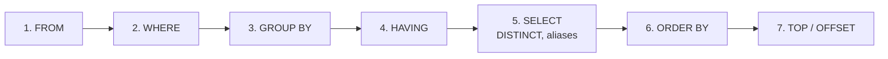
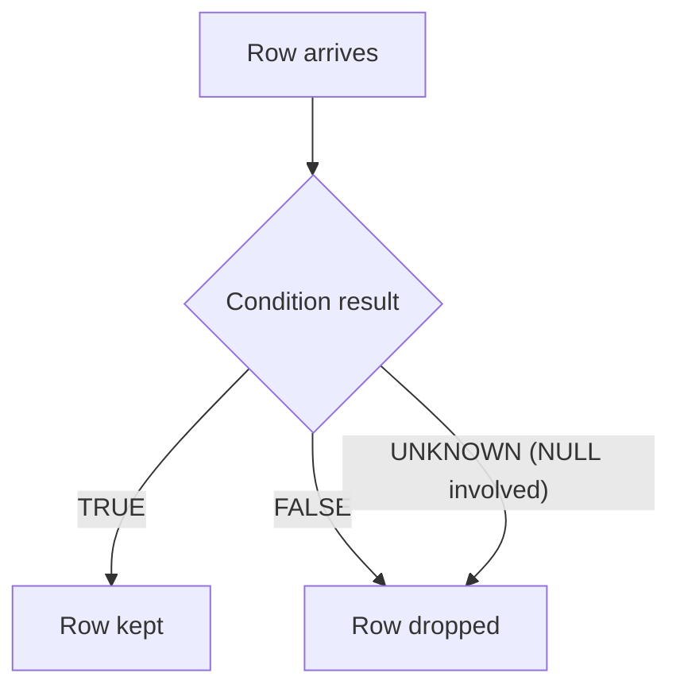
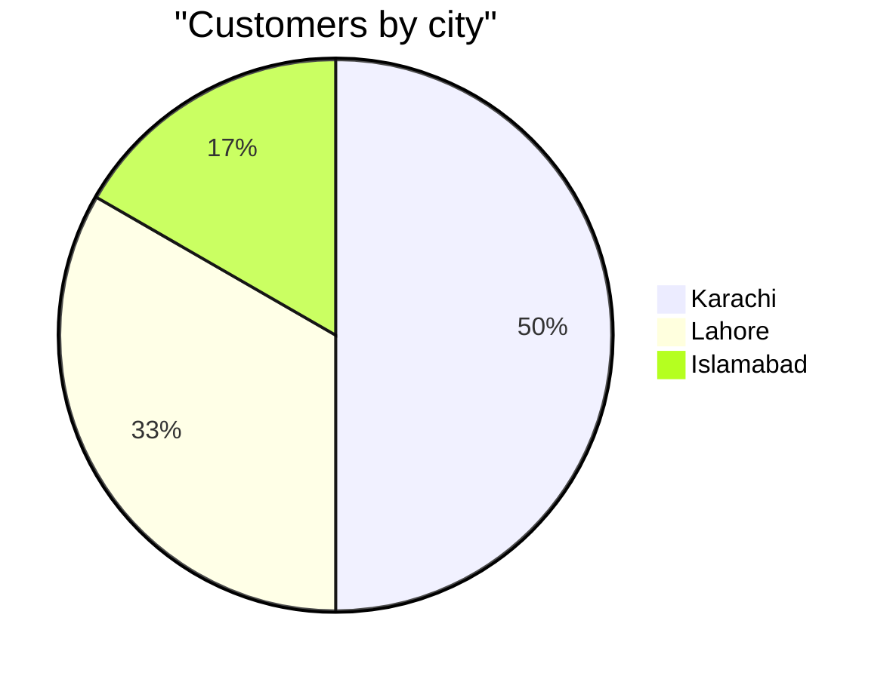

# Session 3: Querying and Filtering Data with SELECT

> 🧭 [Diploma in AI](../../README.md) › [Term 1](../README.md) › [Data Handling using T-SQL](README.md) › **Session 3**
>
> ⏱️ **Estimated time:** 2 hours (1 h concepts + 1 h lab) &nbsp;|&nbsp; 📋 **Prerequisites:** Sessions 1–2, sample database `shop_db.sql`
>
> Prepared by **Hamna Zahid Khan**, Junior Lecturer

[⬅ Previous: Session 2](session-02-t-sql-language-elements.md) &nbsp;|&nbsp; [🏠 Module home](README.md) &nbsp;|&nbsp; [Next: Session 4 ➡](session-04-retrieving-data-from-multiple-tables.md)

---

## 🎯 Learning objectives

- Describe the **elements of a `SELECT` statement** and the order SQL Server processes them.
- Select all columns, specific columns and **calculated expressions**, with **aliases**.
- Handle **NULL** values and remove **duplicate rows**.
- **Sort** results with `ORDER BY` and limit them with `TOP`.
- **Filter** rows with `WHERE`, logical operators, `LIKE`, `IS NULL`, `IS DISTINCT FROM`, and full-text `CONTAINS` / `FREETEXT`.

## 📖 Concepts

### 1. Anatomy of SELECT

```sql
SELECT   [DISTINCT] [TOP (n)] column_list      -- 5. what to show
FROM     table_source                          -- 1. where the rows come from
WHERE    row_filter                            -- 2. which rows to keep
GROUP BY grouping_columns                      -- 3. make groups (Session 6)
HAVING   group_filter                          -- 4. which groups to keep
ORDER BY sort_columns;                         -- 6. final order
```

You **write** `SELECT` first, but SQL Server **processes** `FROM` first. That is why a column alias created in `SELECT` cannot be used in `WHERE` (the alias does not exist yet) but *can* be used in `ORDER BY`.

### 2. Columns, expressions and aliases

- `SELECT *` returns every column. Handy for exploring; avoid it in production code because it breaks when columns are added and moves extra data over the network.
- List the columns you need: `SELECT FullName, City`.
- An **expression** can be a column: `UnitPrice * 1.18`.
- An **alias** renames a column or table: `UnitPrice AS Price`, `FROM Products AS p`. Use square brackets or quotes if the alias has spaces: `AS [Price With Tax]`.

### 3. NULL: "unknown", not zero

`NULL` means *missing or unknown*. Any comparison with NULL gives **UNKNOWN**, so `WHERE Email = NULL` returns nothing. Use:

| Need | T-SQL |
|---|---|
| Test for missing | `Email IS NULL` / `IS NOT NULL` |
| Replace missing | `ISNULL(Email, 'n/a')` (T-SQL) or `COALESCE(Email, Phone, 'n/a')` (standard, many args) |
| Compare two possibly-NULL values | `a IS [NOT] DISTINCT FROM b` (SQL Server 2022+) |

### 4. DISTINCT and TOP

- `SELECT DISTINCT City` keeps one copy of each different value (or combination of values).
- `SELECT TOP (3) …` returns the first 3 rows **of the sorted result**. Always pair `TOP` with `ORDER BY`, otherwise "first" is meaningless. Variants: `TOP (10) PERCENT`, `TOP (3) WITH TIES`.
- Standard SQL alternative: `ORDER BY … OFFSET 0 ROWS FETCH NEXT 3 ROWS ONLY` (SQL Server) or `LIMIT 3` (SQLite, MySQL).

### 5. Formatting queries

Readable SQL is easier to debug:

- Keywords in UPPER CASE, one clause per line, indent continuation lines.
- One column per line in long `SELECT` lists, commas at line ends (or starts, consistently).
- Meaningful aliases (`c` for Customers, `o` for Orders).

### 6. Filtering with WHERE

| Operator | Example | Meaning |
|---|---|---|
| `=, <>, <, >` | `Stock > 0` | comparison |
| `AND, OR, NOT` | `A AND (B OR C)` | combine conditions (`AND` before `OR`, use brackets) |
| `BETWEEN a AND b` | `UnitPrice BETWEEN 3000 AND 10000` | inclusive range |
| `IN (list)` | `City IN ('Lahore','Islamabad')` | any of the values |
| `LIKE` | `'%Hub'`, `'_a%'`, `'[A-C]%'` | pattern: `%` any text, `_` one character, `[ ]` a set (T-SQL) |
| `IS NULL` | `Email IS NULL` | missing value |

### 7. Full-text search: CONTAINS and FREETEXT

`LIKE '%word%'` scans every row and only matches exact text. SQL Server's **full-text index** understands words, prefixes and word forms:

```sql
-- one-time setup (DBA)
CREATE FULLTEXT CATALOG ShopCatalog;
CREATE FULLTEXT INDEX ON Products(ProductName) KEY INDEX PK_Products ON ShopCatalog;

SELECT ProductName FROM Products WHERE CONTAINS(ProductName, '"wire*"');          -- prefix
SELECT ProductName FROM Products WHERE CONTAINS(ProductName, 'mouse OR headset');  -- boolean
SELECT ProductName FROM Products WHERE FREETEXT(ProductName, 'cancelling noise');  -- meaning-based
```

| | `LIKE` | `CONTAINS` | `FREETEXT` |
|---|---|---|---|
| Needs full-text index | No | Yes | Yes |
| Matching | Character pattern | Precise words, prefixes, `AND/OR/NEAR` | Looser: word forms and thesaurus |
| Speed on large text | Slow | Fast | Fast |

## 🧭 Diagrams

Logical processing order of a query:



How a `WHERE` condition treats NULL (three-valued logic):



## 💻 Worked examples

### Example 1: Selecting, aliasing, NULLs, DISTINCT, ORDER BY

📄 [`code/session-03_select_basics.sql`](code/session-03_select_basics.sql)
> Runs on the sample database from [`code/shop_db.sql`](code/shop_db.sql).

```sql
-- 1) All columns
SELECT * FROM Customers;

-- 2) Specific columns, an expression and aliases
SELECT ProductName AS Product,
       UnitPrice   AS Price,
       UnitPrice * 1.18 AS PriceWithTax
FROM Products;

-- 3) Handling NULLs: replace a missing email with a message
SELECT FullName, COALESCE(Email, 'not provided') AS Email
FROM Customers;

-- 4) Eliminating duplicates
SELECT DISTINCT City FROM Customers;

-- 5) Sorting: by city A-Z, then newest member first
SELECT FullName, City, JoinDate
FROM Customers
ORDER BY City ASC, JoinDate DESC;
```

**Output**

```text
-- Result 1
CustomerID | FullName      | City      | Email           | JoinDate
-----------+---------------+-----------+-----------------+-----------
1          | Ayesha Khan   | Karachi   | ayesha@mail.com | 2024-01-15
2          | Bilal Ahmed   | Lahore    | bilal@mail.com  | 2024-03-02
3          | Sana Malik    | Karachi   | NULL            | 2024-05-20
4          | Usman Tariq   | Islamabad | usman@mail.com  | 2024-07-11
5          | Hira Siddiqui | Karachi   | hira@mail.com   | 2025-01-08
6          | Zain Raza     | Lahore    | NULL            | 2025-02-14
(6 rows)

-- Result 2
Product              | Price | PriceWithTax
---------------------+-------+-------------
Wireless Mouse       | 1500  | 1770.00
Mechanical Keyboard  | 8500  | 10030.00
27-inch Monitor      | 52000 | 61360.00
USB-C Hub            | 4200  | 4956.00
Laptop Stand         | 3500  | 4130.00
Noise-Cancel Headset | 18000 | 21240.00
(6 rows)

-- Result 3
FullName      | Email
--------------+----------------
Ayesha Khan   | ayesha@mail.com
Bilal Ahmed   | bilal@mail.com
Sana Malik    | not provided
Usman Tariq   | usman@mail.com
Hira Siddiqui | hira@mail.com
Zain Raza     | not provided
(6 rows)

-- Result 4
City
---------
Karachi
Lahore
Islamabad
(3 rows)

-- Result 5
FullName      | City      | JoinDate
--------------+-----------+-----------
Usman Tariq   | Islamabad | 2024-07-11
Hira Siddiqui | Karachi   | 2025-01-08
Sana Malik    | Karachi   | 2024-05-20
Ayesha Khan   | Karachi   | 2024-01-15
Zain Raza     | Lahore    | 2025-02-14
Bilal Ahmed   | Lahore    | 2024-03-02
(6 rows)
```


> T-SQL version of query 3: `SELECT FullName, ISNULL(Email, 'not provided') AS Email FROM Customers;`

### Example 2: Filtering rows

📄 [`code/session-03_filtering.sql`](code/session-03_filtering.sql)
> Runs on the sample database from [`code/shop_db.sql`](code/shop_db.sql).

```sql
-- Comparison + logical operators
SELECT ProductName, Category, UnitPrice
FROM Products
WHERE Category = 'Accessories' AND UnitPrice < 5000;

-- OR and brackets
SELECT ProductName, Category, Stock
FROM Products
WHERE (Category = 'Audio' OR Category = 'Displays') AND Stock > 0;

-- BETWEEN, IN, LIKE
SELECT ProductName, UnitPrice FROM Products WHERE UnitPrice BETWEEN 3000 AND 10000;
SELECT FullName, City FROM Customers WHERE City IN ('Lahore', 'Islamabad');
SELECT FullName FROM Customers WHERE FullName LIKE '%a_' ;

-- IS NULL / IS NOT NULL
SELECT FullName FROM Customers WHERE Email IS NULL;

-- IS [NOT] DISTINCT FROM treats two NULLs as equal
SELECT NULL = NULL                  AS EqualsSign,
       NULL IS NOT DISTINCT FROM NULL AS NullSafeEqual,
       'A' IS DISTINCT FROM NULL    AS Different;

-- "Top N": the 3 most expensive products
SELECT ProductName, UnitPrice FROM Products ORDER BY UnitPrice DESC LIMIT 3;
```

**Output**

```text
-- Result 1
ProductName    | Category    | UnitPrice
---------------+-------------+----------
Wireless Mouse | Accessories | 1500
USB-C Hub      | Accessories | 4200
(2 rows)

-- Result 2
ProductName          | Category | Stock
---------------------+----------+------
27-inch Monitor      | Displays | 6
Noise-Cancel Headset | Audio    | 9
(2 rows)

-- Result 3
ProductName         | UnitPrice
--------------------+----------
Mechanical Keyboard | 8500
USB-C Hub           | 4200
Laptop Stand        | 3500
(3 rows)

-- Result 4
FullName    | City
------------+----------
Bilal Ahmed | Lahore
Usman Tariq | Islamabad
Zain Raza   | Lahore
(3 rows)

-- Result 5
FullName
-----------
Ayesha Khan
(1 row)

-- Result 6
FullName
----------
Sana Malik
Zain Raza
(2 rows)

-- Result 7
EqualsSign | NullSafeEqual | Different
-----------+---------------+----------
NULL       | 1             | 1
(1 row)

-- Result 8
ProductName          | UnitPrice
---------------------+----------
27-inch Monitor      | 52000
Noise-Cancel Headset | 18000
Mechanical Keyboard  | 8500
(3 rows)
```


Points to notice:

- `NULL = NULL` gives NULL (unknown), never 1/true.
- `LIKE '%a_'` means "the second-last character is `a`". Only *Ayesha Khan* (…Kh**a**n) qualifies; *Sana Malik* ends in `ik`, so it does not.
- The last query is written `SELECT TOP (3) ProductName, UnitPrice FROM Products ORDER BY UnitPrice DESC;` in T-SQL.

### Example 3: TOP WITH TIES (T-SQL, traced)

```sql
SELECT TOP (2) WITH TIES City, COUNT(*) AS Customers
FROM Customers
GROUP BY City
ORDER BY COUNT(*) DESC;
```

```text
City      Customers
--------- ---------
Karachi   3
Lahore    2
```

Karachi has 3 customers and Lahore 2; Islamabad (1) is not tied with second place, so exactly two rows return.

## 📊 Filter selectivity on our data

| Filter | Rows kept (of 6 products) |
|---|---|
| `Category = 'Accessories'` | 3 |
| `UnitPrice BETWEEN 3000 AND 10000` | 3 |
| `Stock = 0` | 1 |



## 🧪 Lab / practice tasks

**1. 🟢 Easy:** Show `ProductName` and `Stock` for every product, with the columns renamed to *Item* and *Units Left*.

<details><summary>💡 Hint</summary>

`AS [Units Left]` in T-SQL, `AS "Units Left"` in SQLite.

</details>

**2. 🟢 Easy:** List the distinct order statuses, sorted alphabetically.

<details><summary>💡 Hint</summary>

`SELECT DISTINCT Status … ORDER BY Status;`

</details>

**3. 🟡 Medium:** Customers who joined in 2024 and live in Karachi, newest first.

<details><summary>💡 Hint</summary>

`JoinDate BETWEEN '2024-01-01' AND '2024-12-31'`

</details>

**4. 🟠 Hard:** Show every customer's name and email; if the email is missing show their city in brackets instead, e.g. `(Karachi)`.

<details><summary>💡 Hint</summary>

`COALESCE(Email, '(' + City + ')')` in T-SQL.

</details>

**5. 🔴 Challenge:** Return the second and third most expensive products only.

<details><summary>💡 Hint</summary>

T-SQL: `ORDER BY UnitPrice DESC OFFSET 1 ROWS FETCH NEXT 2 ROWS ONLY`.

</details>


## ✅ Quick quiz

**Q1.** Which clause does SQL Server process first?

- A) SELECT
- B) WHERE
- C) FROM
- D) ORDER BY

**Q2.** `WHERE Email = NULL` returns…

- A) rows with no email
- B) every row
- C) no rows
- D) an error

**Q3.** Which pattern matches names that start with "S"?

- A) '%S'
- B) 'S%'
- C) '_S%'
- D) 'S_'

**Q4.** `TOP (3)` without `ORDER BY`…

- A) always returns the three smallest keys
- B) returns any three rows; order is not guaranteed
- C) causes an error
- D) returns three random rows each time on purpose

**Q5.** Which search needs a full-text index?

- A) LIKE
- B) IN
- C) CONTAINS
- D) BETWEEN

<details><summary>✅ Show answers</summary>

1. **C**
2. **C** — comparisons with NULL are UNKNOWN; use IS NULL.
3. **B**
4. **B**
5. **C**

</details>


## 📝 Summary

- Written order: `SELECT → FROM → WHERE → GROUP BY → HAVING → ORDER BY`; processed order starts at `FROM`.
- Use aliases for readability; `*` only for exploration.
- NULL is unknown: test with `IS NULL`, replace with `ISNULL`/`COALESCE`, compare with `IS DISTINCT FROM`.
- `DISTINCT` removes duplicates; `TOP` (+ `ORDER BY`, `WITH TIES`) limits rows.
- `WHERE` with `AND/OR/NOT`, `BETWEEN`, `IN`, `LIKE`; full-text `CONTAINS`/`FREETEXT` for word search.

### 🎤 Interview / viva questions

1. Why can't you use a `SELECT` alias inside `WHERE`?
2. Difference between `ISNULL` and `COALESCE`?
3. What does `WITH TIES` change?
4. When would you choose `CONTAINS` over `LIKE`?
5. Why is `SELECT *` discouraged in production queries?

---

[⬅ Previous: Session 2](session-02-t-sql-language-elements.md) &nbsp;|&nbsp; [🏠 Module home](README.md) &nbsp;|&nbsp; [Next: Session 4 ➡](session-04-retrieving-data-from-multiple-tables.md)

<sub>Prepared by **Hamna Zahid Khan**, Junior Lecturer · Diploma in AI</sub>
