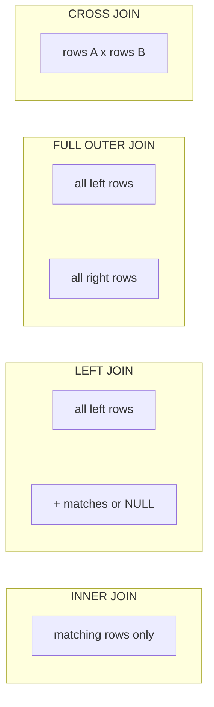
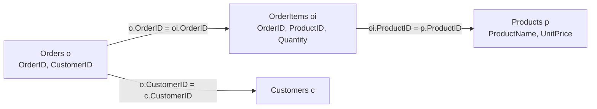
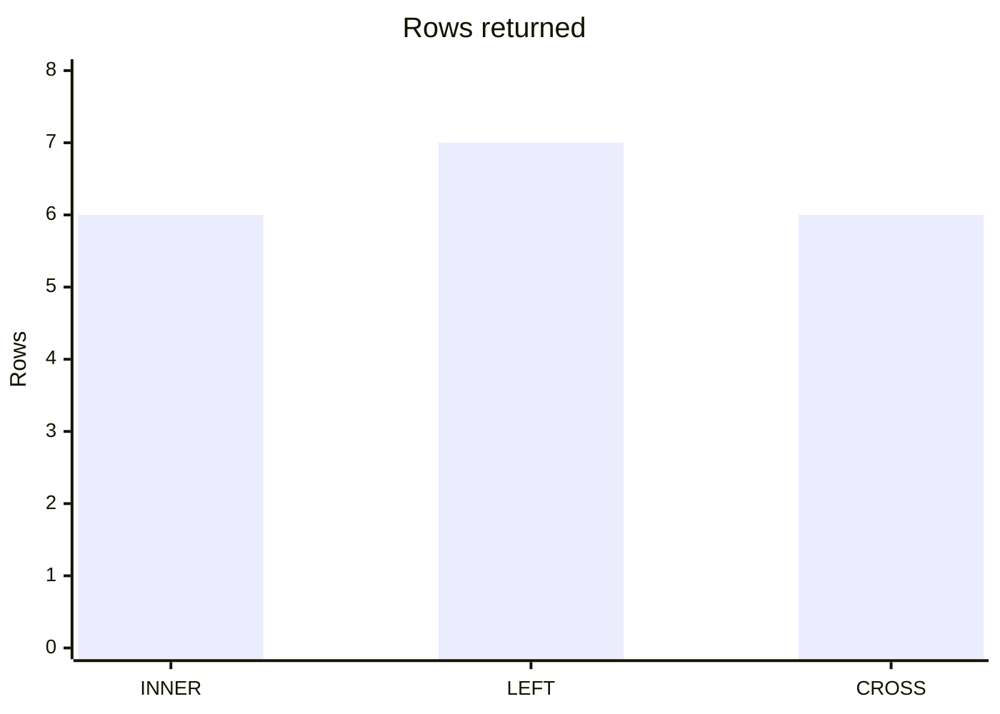

# Session 4: Retrieving Data from Multiple Tables

> 🧭 [Diploma in AI](../../README.md) › [Term 1](../README.md) › [Data Handling using T-SQL](README.md) › **Session 4**
>
> ⏱️ **Estimated time:** 2 hours (1 h concepts + 1 h lab) &nbsp;|&nbsp; 📋 **Prerequisites:** Session 3 (SELECT and WHERE)
>
> Prepared by **Hamna Zahid Khan**, Junior Lecturer

[⬅ Previous: Session 3](session-03-querying-with-select.md) &nbsp;|&nbsp; [🏠 Module home](README.md) &nbsp;|&nbsp; [Next: Session 5 ➡](session-05-modifying-data.md)

---

## 🎯 Learning objectives

- Combine result sets with **set operators**: `UNION`, `UNION ALL`, `INTERSECT`, `EXCEPT`.
- Retrieve related data with **inner, outer, cross and self joins**.
- Write **subqueries**: scalar, multi-valued, correlated (`EXISTS`) and derived tables.
- Choose between a join and a subquery for a given question.

## 📖 Concepts

### 1. Why several tables?

Good relational design (normalisation) stores each fact once: a customer's city lives only in `Customers`, a product's price only in `Products`. To answer real questions ("which products did Karachi customers buy?") we must **bring tables back together** at query time.

### 2. Set operators: stacking results vertically

Set operators combine the **rows** of two queries. Both queries must return the **same number of columns with compatible types**; column names come from the first query.

| Operator | Returns | Duplicates |
|---|---|---|
| `UNION` | rows in either query | removed |
| `UNION ALL` | rows in either query | kept (fastest) |
| `INTERSECT` | rows in both | removed |
| `EXCEPT` | rows in the first but not the second | removed |

### 3. Joins: combining columns side by side

A **join** matches rows from two tables using a condition, usually *foreign key = primary key*.

| Join | Keeps | Typical question |
|---|---|---|
| `INNER JOIN` | only matching pairs | "orders with their customer names" |
| `LEFT OUTER JOIN` | all left rows + matches (NULLs where none) | "all customers, with orders if any" |
| `RIGHT OUTER JOIN` | all right rows + matches | same as LEFT with tables swapped |
| `FULL OUTER JOIN` | everything from both sides | "reconcile two lists" |
| `CROSS JOIN` | every combination (rows × rows) | "every size with every colour" |
| **Self join** | a table joined to itself | "employee and their manager" |

**Table aliases** (`Orders AS o`) keep join queries short and are required for a self join.

> 💡 **Analogy:** an inner join is a wedding guest list made from *two families' lists*, keeping only guests both families invited. A left join keeps *everyone from the bride's list*, and writes "—" next to people the groom's family did not invite.

### 4. Subqueries

A **subquery** is a query inside another query, in brackets.

| Type | Returns | Used with |
|---|---|---|
| Scalar | one value | `=`, `>`, in the `SELECT` list |
| Multi-valued | one column, many rows | `IN`, `ANY`, `ALL` |
| Correlated | re-runs for each outer row, refers to it | `EXISTS`, `NOT EXISTS` |
| Derived table | a whole table | in `FROM`, must have an alias |

**Join or subquery?** Use a join when you need columns from both tables; use `EXISTS`/`IN` when you only need to *check* the other table. SQL Server's optimiser often produces the same plan for both.

## 🧭 Diagrams



How the three-table join in Example 2 links up:



## 💻 Worked examples

### Example 1: Set operators

📄 [`code/session-04_set_operators.sql`](code/session-04_set_operators.sql)
> Runs on the sample database from [`code/shop_db.sql`](code/shop_db.sql).

```sql
-- Cities where we have customers vs. a list of cities with branches
CREATE TABLE Branches (City VARCHAR(30));
INSERT INTO Branches VALUES ('Karachi'), ('Lahore'), ('Multan');

SELECT City FROM Customers UNION     SELECT City FROM Branches ORDER BY City;  -- no duplicates
SELECT City FROM Customers UNION ALL SELECT City FROM Branches;               -- keeps duplicates
SELECT City FROM Customers INTERSECT SELECT City FROM Branches;               -- in both
SELECT City FROM Branches  EXCEPT    SELECT City FROM Customers;              -- branch with no customers
```

**Output**

```text
(3 rows affected)

-- Result 1
City
---------
Islamabad
Karachi
Lahore
Multan
(4 rows)

-- Result 2
City
---------
Karachi
Lahore
Karachi
Islamabad
Karachi
Lahore
Karachi
Lahore
Multan
(9 rows)

-- Result 3
City
-------
Karachi
Lahore
(2 rows)

-- Result 4
City
------
Multan
(1 row)
```


### Example 2: Joins

📄 [`code/session-04_joins.sql`](code/session-04_joins.sql)
> Runs on the sample database from [`code/shop_db.sql`](code/shop_db.sql).

```sql
-- INNER JOIN: orders with the customer's name
SELECT o.OrderID, c.FullName, o.Status
FROM Orders AS o
INNER JOIN Customers AS c ON c.CustomerID = o.CustomerID;

-- Three tables: what did each order contain, and what was it worth?
SELECT o.OrderID, p.ProductName, oi.Quantity, oi.Quantity * p.UnitPrice AS LineTotal
FROM Orders o
JOIN OrderItems oi ON oi.OrderID = o.OrderID
JOIN Products  p  ON p.ProductID = oi.ProductID
WHERE o.Status = 'Delivered'
ORDER BY o.OrderID;

-- LEFT OUTER JOIN: every customer, even those who never ordered
SELECT c.FullName, o.OrderID
FROM Customers c
LEFT JOIN Orders o ON o.CustomerID = c.CustomerID
ORDER BY c.CustomerID;

-- Anti-join pattern: customers with NO orders
SELECT c.FullName
FROM Customers c
LEFT JOIN Orders o ON o.CustomerID = c.CustomerID
WHERE o.OrderID IS NULL;

-- CROSS JOIN: every size with every colour (Cartesian product)
CREATE TABLE Sizes (Size VARCHAR(5));   INSERT INTO Sizes VALUES ('S'),('M');
CREATE TABLE Colours (Colour VARCHAR(10)); INSERT INTO Colours VALUES ('Black'),('White'),('Red');
SELECT Size, Colour FROM Sizes CROSS JOIN Colours;

-- SELF JOIN: each employee with their manager
SELECT e.EmpName AS Employee, m.EmpName AS Manager
FROM Employees e
LEFT JOIN Employees m ON m.EmpID = e.ManagerID;
```

**Output**

```text
-- Result 1
OrderID | FullName      | Status
--------+---------------+----------
1001    | Ayesha Khan   | Delivered
1002    | Bilal Ahmed   | Delivered
1003    | Ayesha Khan   | Shipped
1004    | Sana Malik    | Pending
1005    | Usman Tariq   | Delivered
1006    | Hira Siddiqui | Cancelled
(6 rows)

-- Result 2
OrderID | ProductName     | Quantity | LineTotal
--------+-----------------+----------+----------
1001    | Wireless Mouse  | 2        | 3000
1001    | USB-C Hub       | 1        | 4200
1002    | 27-inch Monitor | 1        | 52000
1005    | Wireless Mouse  | 3        | 4500
1005    | 27-inch Monitor | 2        | 104000
(5 rows)

-- Result 3
FullName      | OrderID
--------------+--------
Ayesha Khan   | 1001
Ayesha Khan   | 1003
Bilal Ahmed   | 1002
Sana Malik    | 1004
Usman Tariq   | 1005
Hira Siddiqui | 1006
Zain Raza     | NULL
(7 rows)

-- Result 4
FullName
---------
Zain Raza
(1 row)

(2 rows affected)

(3 rows affected)

-- Result 5
Size | Colour
-----+-------
S    | Black
S    | White
S    | Red
M    | Black
M    | White
M    | Red
(6 rows)

-- Result 6
Employee     | Manager
-------------+-----------
Farah Naz    | NULL
Kamran Ali   | Farah Naz
Nida Hussain | Kamran Ali
Omer Shah    | Kamran Ali
Rabia Noor   | Farah Naz
(5 rows)
```


Read the results carefully:

- Zain Raza appears in the LEFT JOIN with `NULL` because he has no orders; the anti-join isolates exactly him.
- The CROSS JOIN of 2 sizes × 3 colours gives 6 rows.
- In the self join, Farah has no manager, so the LEFT JOIN shows `NULL` for her.

### Example 3: Subqueries

📄 [`code/session-04_subqueries.sql`](code/session-04_subqueries.sql)
> Runs on the sample database from [`code/shop_db.sql`](code/shop_db.sql).

```sql
-- Scalar subquery: products priced above the average price
SELECT ProductName, UnitPrice
FROM Products
WHERE UnitPrice > (SELECT AVG(UnitPrice) FROM Products);

-- Multi-valued subquery with IN: customers who bought a monitor
SELECT FullName FROM Customers
WHERE CustomerID IN (
    SELECT o.CustomerID FROM Orders o
    JOIN OrderItems oi ON oi.OrderID = o.OrderID
    WHERE oi.ProductID = 103);

-- Correlated subquery with EXISTS: products that have never been ordered
SELECT ProductName FROM Products p
WHERE NOT EXISTS (SELECT 1 FROM OrderItems oi WHERE oi.ProductID = p.ProductID);

-- Subquery in SELECT: number of orders per customer
SELECT FullName,
       (SELECT COUNT(*) FROM Orders o WHERE o.CustomerID = c.CustomerID) AS OrderCount
FROM Customers c;

-- Derived table (subquery in FROM)
SELECT Status, AVG(Items) AS AvgItemsPerOrder
FROM (SELECT o.OrderID, o.Status, SUM(oi.Quantity) AS Items
      FROM Orders o JOIN OrderItems oi ON oi.OrderID = o.OrderID
      GROUP BY o.OrderID, o.Status) AS t
GROUP BY Status;
```

**Output**

```text
-- Result 1
ProductName          | UnitPrice
---------------------+----------
27-inch Monitor      | 52000
Noise-Cancel Headset | 18000
(2 rows)

-- Result 2
FullName
-----------
Bilal Ahmed
Usman Tariq
(2 rows)

-- Result 3
ProductName
-----------
(0 rows)

-- Result 4
FullName      | OrderCount
--------------+-----------
Ayesha Khan   | 2
Bilal Ahmed   | 1
Sana Malik    | 1
Usman Tariq   | 1
Hira Siddiqui | 1
Zain Raza     | 0
(6 rows)

-- Result 5
Status    | AvgItemsPerOrder
----------+-----------------
Cancelled | 1.00
Delivered | 3.00
Pending   | 1.00
Shipped   | 2.00
(4 rows)
```


Query 3 returns **0 rows** because every product appears in at least one order, which is a valid and useful answer. The average price is (1500 + 8500 + 52000 + 4200 + 3500 + 18000) / 6 = 14,616.67, which is why only the monitor and the headset pass the first query.

## 📊 Rows returned by each join on our data

| Query | Rows |
|---|---|
| Orders INNER JOIN Customers | 6 |
| Customers LEFT JOIN Orders | 7 (Ayesha has 2 orders, Zain has none) |
| Sizes CROSS JOIN Colours | 6 |



## 🧪 Lab / practice tasks

**1. 🟢 Easy:** List each order ID with the customer's city.

<details><summary>💡 Hint</summary>

`Orders JOIN Customers ON …`

</details>

**2. 🟢 Easy:** Use `UNION` to produce one list of all people: customer names and employee names.

<details><summary>💡 Hint</summary>

Both queries must return one text column.

</details>

**3. 🟡 Medium:** Show the total value of every order (sum of quantity × price), highest first.

<details><summary>💡 Hint</summary>

Join `OrderItems` and `Products`, then `GROUP BY OrderID`.

</details>

**4. 🟠 Hard:** Find products that were ordered by customers from Karachi. Write it once with joins and once with a subquery.

<details><summary>💡 Hint</summary>

Subquery version: `ProductID IN (SELECT … WHERE City = 'Karachi')`.

</details>

**5. 🔴 Challenge:** List employees who earn more than their own manager.

<details><summary>💡 Hint</summary>

Self join `e` to `m` and compare `e.Salary > m.Salary` (expect zero rows; change a salary to test).

</details>


## ✅ Quick quiz

**Q1.** Which operator keeps duplicate rows?

- A) UNION
- B) UNION ALL
- C) INTERSECT
- D) EXCEPT

**Q2.** A LEFT JOIN returns…

- A) only matching rows
- B) all rows from the left table plus matches from the right
- C) all rows from both tables
- D) every combination of rows

**Q3.** A CROSS JOIN between tables of 4 and 5 rows returns…

- A) 9 rows
- B) 5 rows
- C) 20 rows
- D) 4 rows

**Q4.** Which subquery type refers to a column of the outer query?

- A) Scalar
- B) Derived table
- C) Correlated
- D) Multi-valued

**Q5.** To find customers with no orders, a common pattern is…

- A) INNER JOIN … WHERE OrderID IS NULL
- B) LEFT JOIN … WHERE o.OrderID IS NULL
- C) CROSS JOIN … WHERE o.OrderID = 0
- D) UNION … WHERE o.OrderID IS NULL

<details><summary>✅ Show answers</summary>

1. **B**
2. **B**
3. **C**
4. **C**
5. **B**

</details>


## 📝 Summary

- Set operators stack rows: `UNION` (distinct), `UNION ALL`, `INTERSECT`, `EXCEPT`. Same column count and compatible types.
- Joins line up columns: `INNER`, `LEFT/RIGHT/FULL OUTER`, `CROSS`, self join with aliases.
- Subqueries: scalar, multi-valued (`IN`), correlated (`EXISTS`), derived tables in `FROM`.
- `LEFT JOIN … WHERE right.key IS NULL` finds "missing" relationships.

### 🎤 Interview / viva questions

1. Difference between `UNION` and `UNION ALL`, and which is faster?
2. When does an outer join produce NULLs?
3. Write a self join for an employee–manager table.
4. `IN` vs `EXISTS`: which handles NULLs in the subquery more safely?
5. What is a derived table and why must it have an alias?

---

[⬅ Previous: Session 3](session-03-querying-with-select.md) &nbsp;|&nbsp; [🏠 Module home](README.md) &nbsp;|&nbsp; [Next: Session 5 ➡](session-05-modifying-data.md)

<sub>Prepared by **Hamna Zahid Khan**, Junior Lecturer · Diploma in AI</sub>
