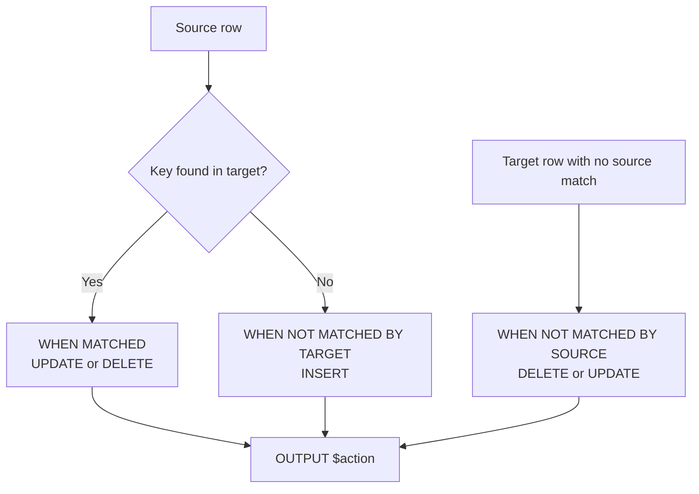
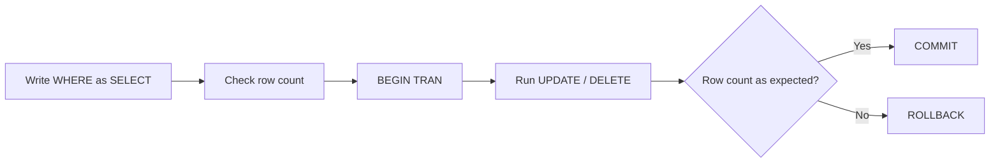
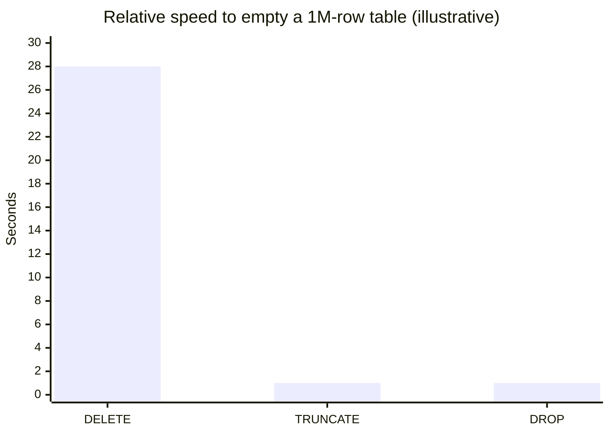

# Session 5: Modifying Data: INSERT, UPDATE, DELETE and MERGE

> 🧭 [Diploma in AI](../../README.md) › [Term 1](../README.md) › [Data Handling using T-SQL](README.md) › **Session 5**
>
> ⏱️ **Estimated time:** 2 hours (1 h concepts + 1 h lab) &nbsp;|&nbsp; 📋 **Prerequisites:** Sessions 3–4 (SELECT, WHERE, joins, subqueries)
>
> Prepared by **Hamna Zahid Khan**, Junior Lecturer

[⬅ Previous: Session 4](session-04-retrieving-data-from-multiple-tables.md) &nbsp;|&nbsp; [🏠 Module home](README.md) &nbsp;|&nbsp; [Next: Session 6 ➡](session-06-built-in-functions.md)

---

## 🎯 Learning objectives

- **Insert** single rows, multiple rows and query results into tables.
- **Update** one or many columns safely, including updates driven by other tables.
- **Delete** rows and explain `DELETE` vs `TRUNCATE` vs `DROP`.
- **Merge** a source table into a target with `MERGE` (insert, update and delete in one statement).
- Use the `OUTPUT` clause and transactions to make data changes auditable and reversible.

## 📖 Concepts

### 1. INSERT

```sql
INSERT INTO table (col1, col2, …) VALUES (v1, v2, …);           -- one row
INSERT INTO table (col1, col2) VALUES (…), (…), (…);            -- many rows
INSERT INTO table (col1, col2) SELECT a, b FROM other WHERE …;  -- from a query
SELECT col1, col2 INTO NewTable FROM other;                      -- T-SQL: create + fill
```

- Always **name the columns**: the statement keeps working if someone adds a column later.
- Columns you skip get their **DEFAULT** or NULL. `IDENTITY` columns fill themselves (`SCOPE_IDENTITY()` returns the new value).
- Constraints (`PRIMARY KEY`, `CHECK`, `FOREIGN KEY`, `NOT NULL`) are checked on every insert.

### 2. UPDATE

```sql
UPDATE table SET col1 = expr, col2 = expr WHERE condition;
```

> ⚠️ **Golden rule:** write the `WHERE` first, and test it as a `SELECT` before turning it into an `UPDATE`. An `UPDATE` without `WHERE` changes **every** row.

T-SQL can also update from a join:

```sql
UPDATE o SET o.Status = 'Priority'
FROM Orders AS o JOIN Customers AS c ON c.CustomerID = o.CustomerID
WHERE c.City = 'Lahore';
```

### 3. DELETE, TRUNCATE, DROP

| Statement | Removes | WHERE allowed | Logged | Resets IDENTITY | Family |
|---|---|---|---|---|---|
| `DELETE FROM t WHERE …` | chosen rows | ✅ | each row | ❌ | DML |
| `TRUNCATE TABLE t` | all rows | ❌ | page deallocations only (fast) | ✅ | DDL |
| `DROP TABLE t` | the table itself | ❌ | – | – | DDL |

Child rows must be deleted before parent rows when a foreign key links them (or the key must be declared `ON DELETE CASCADE`).

### 4. MERGE: synchronise two tables

`MERGE` compares a **source** with a **target** on a key and, in one statement, decides per row:

```sql
MERGE INTO Products AS t
USING StockFeed     AS s
   ON t.ProductID = s.ProductID
WHEN MATCHED AND t.Stock <> s.Stock THEN
     UPDATE SET t.Stock = s.Stock
WHEN NOT MATCHED BY TARGET THEN
     INSERT (ProductID, ProductName, Category, UnitPrice, Stock)
     VALUES (s.ProductID, s.ProductName, 'New Arrivals', 0, s.Stock)
WHEN NOT MATCHED BY SOURCE AND t.Stock = 0 THEN
     DELETE
OUTPUT $action, inserted.ProductID, deleted.Stock AS OldStock, inserted.Stock AS NewStock;
```

The statement **must end with a semicolon**. `OUTPUT $action` reports `INSERT`, `UPDATE` or `DELETE` for each affected row, which is perfect for audit logs.

### 5. The OUTPUT clause

Any `INSERT`, `UPDATE`, `DELETE` or `MERGE` can return the changed rows: `inserted.*` holds new values, `deleted.*` holds old values.

```sql
UPDATE Products SET UnitPrice = UnitPrice * 1.10
OUTPUT deleted.ProductName, deleted.UnitPrice AS OldPrice, inserted.UnitPrice AS NewPrice
WHERE Category = 'Audio';
```

## 🧭 Diagrams



Safe-change workflow used by professionals:



## 💻 Worked examples

### Example 1: INSERT, UPDATE and DELETE

📄 [`code/session-05_insert_update_delete.sql`](code/session-05_insert_update_delete.sql)
> Runs on the sample database from [`code/shop_db.sql`](code/shop_db.sql).

```sql
-- INSERT a single row, naming the columns (best practice)
INSERT INTO Products (ProductID, ProductName, Category, UnitPrice, Stock)
VALUES (107, 'Webcam HD', 'Accessories', 6500, 12);

-- INSERT several rows at once
INSERT INTO Customers (CustomerID, FullName, City, Email, JoinDate) VALUES
 (7, 'Mahnoor Ali', 'Hyderabad', 'mahnoor@mail.com', '2025-04-01'),
 (8, 'Saad Qureshi', 'Karachi', NULL, '2025-04-03');

-- INSERT ... SELECT: copy rows from a query into another table
CREATE TABLE KarachiCustomers (CustomerID INT, FullName VARCHAR(50));
INSERT INTO KarachiCustomers (CustomerID, FullName)
SELECT CustomerID, FullName FROM Customers WHERE City = 'Karachi';
SELECT * FROM KarachiCustomers;

-- UPDATE with a WHERE clause: 10% price rise for accessories
UPDATE Products SET UnitPrice = UnitPrice * 1.10 WHERE Category = 'Accessories';
SELECT ProductName, UnitPrice FROM Products WHERE Category = 'Accessories';

-- UPDATE several columns
UPDATE Customers SET Email = 'saad.q@mail.com', City = 'Karachi' WHERE CustomerID = 8;

-- UPDATE using another table: mark orders of Lahore customers as 'Priority'
UPDATE Orders SET Status = 'Priority'
WHERE CustomerID IN (SELECT CustomerID FROM Customers WHERE City = 'Lahore')
  AND Status = 'Delivered';
SELECT OrderID, CustomerID, Status FROM Orders;

-- DELETE specific rows
DELETE FROM OrderItems WHERE OrderID = 1006;
DELETE FROM Orders WHERE Status = 'Cancelled';
SELECT COUNT(*) AS OrdersLeft FROM Orders;
```

**Output**

```text
(1 row affected)

(2 rows affected)

(4 rows affected)

-- Result 1
CustomerID | FullName
-----------+--------------
1          | Ayesha Khan
3          | Sana Malik
5          | Hira Siddiqui
8          | Saad Qureshi
(4 rows)

(4 rows affected)

-- Result 2
ProductName         | UnitPrice
--------------------+----------
Wireless Mouse      | 1650.00
Mechanical Keyboard | 9350
USB-C Hub           | 4620
Webcam HD           | 7150.00
(4 rows)

(1 row affected)

(1 row affected)

-- Result 3
OrderID | CustomerID | Status
--------+------------+----------
1001    | 1          | Delivered
1002    | 2          | Priority
1003    | 1          | Shipped
1004    | 3          | Pending
1005    | 4          | Delivered
1006    | 5          | Cancelled
(6 rows)

(1 row affected)

(1 row affected)

-- Result 4
OrdersLeft
----------
5
(1 row)
```


Notice Accessory prices rose by 10% (1500 → 1650 and so on) and Bilal's delivered order 1002 became `Priority`. The cancelled order had to lose its `OrderItems` first because of the foreign key.

### Example 2: MERGE-style upsert

SQLite has no `MERGE`, so this example uses its **upsert** (`INSERT … ON CONFLICT DO UPDATE`), which performs the matched/not-matched logic of the T-SQL `MERGE` shown above:

📄 [`code/session-05_merge_upsert.sql`](code/session-05_merge_upsert.sql)
> Runs on the sample database from [`code/shop_db.sql`](code/shop_db.sql).

```sql
-- Today's stock feed from the warehouse
CREATE TABLE StockFeed (ProductID INT PRIMARY KEY, ProductName VARCHAR(50), Stock INT);
INSERT INTO StockFeed VALUES
 (101, 'Wireless Mouse', 55),     -- existing product, new stock level
 (105, 'Laptop Stand', 20),       -- existing product, back in stock
 (108, 'Portable SSD 1TB', 10);   -- brand-new product

-- SQLite / PostgreSQL "upsert" (the MERGE idea): insert, or update on key conflict
INSERT INTO Products (ProductID, ProductName, Category, UnitPrice, Stock)
SELECT ProductID, ProductName, 'New Arrivals', 0, Stock FROM StockFeed WHERE true
ON CONFLICT(ProductID) DO UPDATE SET Stock = excluded.Stock;

SELECT ProductID, ProductName, Category, Stock FROM Products ORDER BY ProductID;
```

**Output**

```text
(3 rows affected)

(3 rows affected)

-- Result 1
ProductID | ProductName          | Category     | Stock
----------+----------------------+--------------+------
101       | Wireless Mouse       | Accessories  | 55
102       | Mechanical Keyboard  | Accessories  | 15
103       | 27-inch Monitor      | Displays     | 6
104       | USB-C Hub            | Accessories  | 25
105       | Laptop Stand         | Furniture    | 20
106       | Noise-Cancel Headset | Audio        | 9
108       | Portable SSD 1TB     | New Arrivals | 10
(7 rows)
```


**The T-SQL `MERGE` from section 4, run on SQL Server against the original data, prints (traced):**

```text
$action  ProductID  OldStock  NewStock
-------  ---------  --------  --------
UPDATE   101        40        55
UPDATE   105        0         20
INSERT   108        NULL      10
(3 rows affected)
```

No row is deleted, because the only zero-stock product (105) *is* in the feed.

## 📊 Statement comparison



> Numbers are illustrative only; the point is that `DELETE` logs every row while `TRUNCATE` and `DROP` do not.

## 🧪 Lab / practice tasks

**1. 🟢 Easy:** Insert two new products in one statement and show them.

<details><summary>💡 Hint</summary>

Multi-row `VALUES (…), (…)`.

</details>

**2. 🟢 Easy:** Increase the stock of product 103 by 5.

<details><summary>💡 Hint</summary>

`SET Stock = Stock + 5 WHERE ProductID = 103`

</details>

**3. 🟡 Medium:** Create `ArchivedOrders` with the same columns as `Orders`, copy all delivered orders into it with `INSERT … SELECT`, then delete them from `Orders` (remember their items!).

<details><summary>💡 Hint</summary>

Delete from `OrderItems` first, using `OrderID IN (SELECT …)`.

</details>

**4. 🟠 Hard:** Run an UPDATE inside `BEGIN TRAN`, look at the result, then `ROLLBACK` and prove the data is unchanged.

<details><summary>💡 Hint</summary>

`SELECT` before and after.

</details>

**5. 🔴 Challenge:** In SQL Server, write a `MERGE` that syncs a `PriceList(ProductID, NewPrice)` table into `Products`, logging every change into a `PriceAudit` table with `OUTPUT … INTO PriceAudit`.

<details><summary>💡 Hint</summary>

`OUTPUT $action, inserted.ProductID, deleted.UnitPrice, inserted.UnitPrice INTO PriceAudit;`

</details>


## ✅ Quick quiz

**Q1.** What happens if you run `UPDATE Products SET Stock = 0;`?

- A) Only the first row changes
- B) An error is raised
- C) Every row's Stock becomes 0
- D) Nothing, WHERE is mandatory

**Q2.** Which statement removes all rows fastest and resets IDENTITY?

- A) DELETE
- B) TRUNCATE TABLE
- C) DROP TABLE
- D) MERGE

**Q3.** In `MERGE`, which clause handles source rows that do not exist in the target?

- A) WHEN MATCHED
- B) WHEN NOT MATCHED BY TARGET
- C) WHEN NOT MATCHED BY SOURCE
- D) OUTPUT

**Q4.** Inside an `OUTPUT` clause of an UPDATE, the old values are in…

- A) inserted
- B) deleted
- C) updated
- D) $action

**Q5.** Why name the columns in an INSERT statement?

- A) It is faster
- B) It keeps working if the table's column order or count changes
- C) SQL Server requires it
- D) It disables constraints

<details><summary>✅ Show answers</summary>

1. **C**
2. **B**
3. **B**
4. **B**
5. **B**

</details>


## 📝 Summary

- `INSERT` single/multi-row or `INSERT … SELECT`; `SELECT … INTO` creates a new table (T-SQL).
- `UPDATE … SET … WHERE`; test the WHERE as a SELECT first; T-SQL allows `UPDATE … FROM … JOIN`.
- `DELETE` (rows, logged) vs `TRUNCATE` (all rows, fast) vs `DROP` (table).
- `MERGE` = insert + update + delete in one statement, ends with `;`, reports with `OUTPUT $action`.
- Wrap risky changes in a transaction.

### 🎤 Interview / viva questions

1. Why is `TRUNCATE` classed as DDL?
2. How do you find out which ID an `IDENTITY` column just generated?
3. What are `inserted` and `deleted` in the `OUTPUT` clause?
4. Give a real use case for `WHEN NOT MATCHED BY SOURCE … DELETE`.
5. How would you safely delete duplicate customer rows?

---

[⬅ Previous: Session 4](session-04-retrieving-data-from-multiple-tables.md) &nbsp;|&nbsp; [🏠 Module home](README.md) &nbsp;|&nbsp; [Next: Session 6 ➡](session-06-built-in-functions.md)

<sub>Prepared by **Hamna Zahid Khan**, Junior Lecturer · Diploma in AI</sub>
