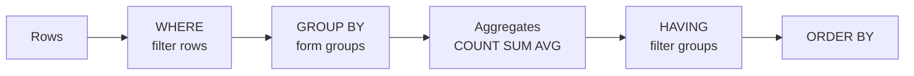
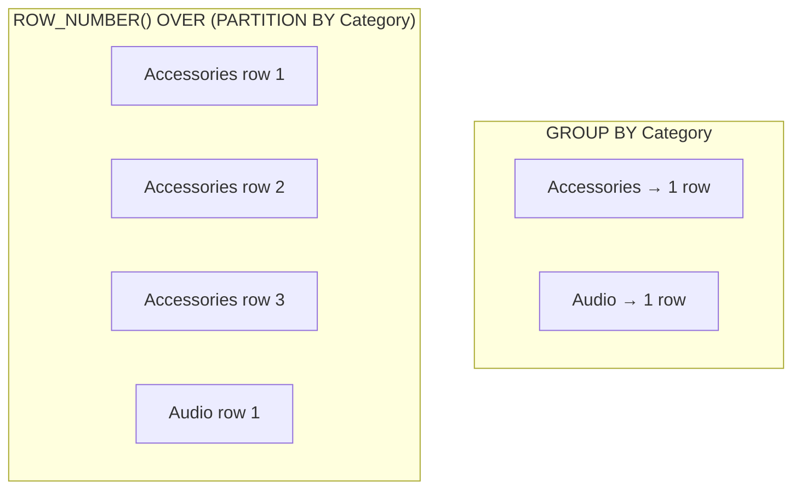
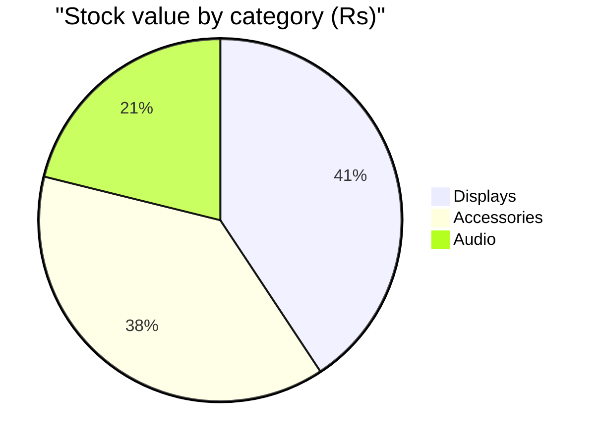

# Session 6: Working with Built-in Functions

> 🧭 [Diploma in AI](../../README.md) › [Term 1](../README.md) › [Data Handling using T-SQL](README.md) › **Session 6**
>
> ⏱️ **Estimated time:** 2 hours (1 h concepts + 1 h lab) &nbsp;|&nbsp; 📋 **Prerequisites:** Sessions 3–5
>
> Prepared by **Hamna Zahid Khan**, Junior Lecturer

[⬅ Previous: Session 5](session-05-modifying-data.md) &nbsp;|&nbsp; [🏠 Module home](README.md) &nbsp;|&nbsp; [Module practice test ➡](practice-test.md)

---

## 🎯 Learning objectives

- Summarise data with **aggregate functions** and `GROUP BY` / `HAVING`.
- Number and rank rows with **ranking (window) functions**: `ROW_NUMBER`, `RANK`, `DENSE_RANK`, `NTILE`.
- Use **scalar functions**: mathematical, string, and date & time.
- Combine functions to answer real business questions.

## 📖 Concepts

### 1. Aggregate functions

An **aggregate** turns many rows into one value.

| Function | Returns | NULL handling |
|---|---|---|
| `COUNT(*)` | number of rows | counts NULL rows too |
| `COUNT(col)` | number of non-NULL values | ignores NULL |
| `SUM`, `AVG` | total, mean | ignore NULL |
| `MIN`, `MAX` | smallest, largest | ignore NULL |
| `STRING_AGG(col, ', ')` (T-SQL) | values joined into one string | ignores NULL |

**`GROUP BY`** makes one output row per group. Every column in the `SELECT` list must be either **in the `GROUP BY`** or **inside an aggregate**.

**`WHERE` vs `HAVING`:** `WHERE` removes *rows* before grouping; `HAVING` removes *groups* after grouping (so it can use aggregates).

### 2. Ranking functions

Ranking functions are **window functions**: they compute a value for each row while still seeing the other rows, without collapsing them like `GROUP BY` does.

```sql
function() OVER ( [PARTITION BY group_cols] ORDER BY sort_cols )
```

| Function | Ties (two equal values) | Example sequence |
|---|---|---|
| `ROW_NUMBER()` | always unique numbers | 1, 2, 3, 4 |
| `RANK()` | same rank, then a **gap** | 1, 2, 2, 4 |
| `DENSE_RANK()` | same rank, **no gap** | 1, 2, 2, 3 |
| `NTILE(n)` | splits rows into *n* nearly equal buckets | 1, 1, 2, 2, 3, 3 |

`PARTITION BY` restarts the numbering for each group: "top product **per** category".

### 3. Scalar functions

A **scalar** function returns one value per row.

| Group | T-SQL functions | Example | Result |
|---|---|---|---|
| Math | `ROUND`, `ABS`, `CEILING`, `FLOOR`, `POWER`, `SQRT`, `RAND` | `ROUND(1234.5678, 2)` | `1234.5700` |
| String | `LEN`, `UPPER`, `LOWER`, `LEFT`, `RIGHT`, `SUBSTRING`, `CHARINDEX`, `REPLACE`, `TRIM`, `CONCAT`, `FORMAT` | `LEFT('Karachi', 3)` | `'Kar'` |
| Date | `GETDATE()`, `SYSDATETIME()`, `YEAR`, `MONTH`, `DAY`, `DATEPART`, `DATEADD`, `DATEDIFF`, `EOMONTH`, `FORMAT` | `DATEADD(day, 7, '2025-03-01')` | `2025-03-08` |
| Conversion | `CAST`, `CONVERT`, `TRY_CAST`, `TRY_CONVERT` | `TRY_CAST('abc' AS INT)` | `NULL` (no error) |
| Logical | `IIF`, `CHOOSE`, `ISNULL`, `COALESCE` | `IIF(Stock = 0, 'Out', 'In')` | `'Out'` |

**T-SQL ↔ SQLite names used in the examples**

| T-SQL | SQLite (used to run examples here) |
|---|---|
| `LEN(s)` | `LENGTH(s)` |
| `SUBSTRING(s, start, n)` | `SUBSTR(s, start, n)` |
| `CHARINDEX(' ', s)` | `INSTR(s, ' ')` |
| `CEILING(x)` | `CEIL(x)` |
| `YEAR(d)` / `MONTH(d)` | `strftime('%Y', d)` / `strftime('%m', d)` |
| `DATEADD(day, 7, d)` | `date(d, '+7 days')` |
| `DATEDIFF(day, d1, d2)` | `julianday(d2) - julianday(d1)` |

## 🧭 Diagrams





`GROUP BY` collapses rows; window functions keep every row and add a column.

## 💻 Worked examples

### Example 1: Aggregates, GROUP BY and HAVING

📄 [`code/session-06_aggregates.sql`](code/session-06_aggregates.sql)
> Runs on the sample database from [`code/shop_db.sql`](code/shop_db.sql).

```sql
-- Whole-table aggregates
SELECT COUNT(*)        AS Products,
       COUNT(Stock)    AS WithStockValue,
       SUM(Stock)      AS UnitsInStock,
       MIN(UnitPrice)  AS Cheapest,
       MAX(UnitPrice)  AS Dearest,
       ROUND(AVG(UnitPrice), 2) AS AvgPrice
FROM Products;

-- GROUP BY: one row per category
SELECT Category, COUNT(*) AS Items, SUM(UnitPrice * Stock) AS StockValue
FROM Products
GROUP BY Category
ORDER BY StockValue DESC;

-- HAVING filters groups (WHERE filters rows)
SELECT c.City, COUNT(o.OrderID) AS Orders
FROM Customers c JOIN Orders o ON o.CustomerID = c.CustomerID
WHERE o.Status <> 'Cancelled'
GROUP BY c.City
HAVING COUNT(o.OrderID) >= 2;

-- Revenue per customer from delivered orders
SELECT c.FullName, SUM(oi.Quantity * p.UnitPrice) AS Revenue
FROM Customers c
JOIN Orders o      ON o.CustomerID = c.CustomerID
JOIN OrderItems oi ON oi.OrderID = o.OrderID
JOIN Products p    ON p.ProductID = oi.ProductID
WHERE o.Status = 'Delivered'
GROUP BY c.FullName
ORDER BY Revenue DESC;
```

**Output**

```text
-- Result 1
Products | WithStockValue | UnitsInStock | Cheapest | Dearest | AvgPrice
---------+----------------+--------------+----------+---------+---------
6        | 6              | 95           | 1500     | 52000   | 14616.67
(1 row)

-- Result 2
Category    | Items | StockValue
------------+-------+-----------
Displays    | 1     | 312000
Accessories | 3     | 292500
Audio       | 1     | 162000
Furniture   | 1     | 0
(4 rows)

-- Result 3
City    | Orders
--------+-------
Karachi | 3
(1 row)

-- Result 4
FullName    | Revenue
------------+--------
Usman Tariq | 108500
Bilal Ahmed | 52000
Ayesha Khan | 7200
(3 rows)
```


### Example 2: Ranking functions

📄 [`code/session-06_ranking.sql`](code/session-06_ranking.sql)
> Runs on the sample database from [`code/shop_db.sql`](code/shop_db.sql).

```sql
-- Ranking functions are window functions: OVER (ORDER BY ...)
SELECT ProductName, Category, UnitPrice,
       ROW_NUMBER() OVER (ORDER BY UnitPrice DESC)  AS RowNum,
       RANK()       OVER (ORDER BY Category)        AS RankByCat,
       DENSE_RANK() OVER (ORDER BY Category)        AS DenseRankByCat,
       NTILE(3)     OVER (ORDER BY UnitPrice DESC)  AS PriceBand
FROM Products;

-- PARTITION BY restarts the numbering for each group:
-- most expensive product in every category
SELECT Category, ProductName, UnitPrice FROM (
    SELECT Category, ProductName, UnitPrice,
           ROW_NUMBER() OVER (PARTITION BY Category ORDER BY UnitPrice DESC) AS rn
    FROM Products) t
WHERE rn = 1;
```

**Output**

```text
-- Result 1
ProductName          | Category    | UnitPrice | RowNum | RankByCat | DenseRankByCat | PriceBand
---------------------+-------------+-----------+--------+-----------+----------------+----------
27-inch Monitor      | Displays    | 52000     | 1      | 5         | 3              | 1
Noise-Cancel Headset | Audio       | 18000     | 2      | 4         | 2              | 1
Mechanical Keyboard  | Accessories | 8500      | 3      | 1         | 1              | 2
USB-C Hub            | Accessories | 4200      | 4      | 1         | 1              | 2
Laptop Stand         | Furniture   | 3500      | 5      | 6         | 4              | 3
Wireless Mouse       | Accessories | 1500      | 6      | 1         | 1              | 3
(6 rows)

-- Result 2
Category    | ProductName          | UnitPrice
------------+----------------------+----------
Accessories | Mechanical Keyboard  | 8500
Audio       | Noise-Cancel Headset | 18000
Displays    | 27-inch Monitor      | 52000
Furniture   | Laptop Stand         | 3500
(4 rows)
```


Look at `RANK` vs `DENSE_RANK`: the three Accessories tie at rank 1, so `RANK` jumps to 4 for Audio while `DENSE_RANK` continues at 2.

### Example 3: Math, string and date functions

📄 [`code/session-06_scalar_functions.sql`](code/session-06_scalar_functions.sql)
> Runs on the sample database from [`code/shop_db.sql`](code/shop_db.sql).

```sql
-- Mathematical
SELECT ROUND(1234.5678, 2) AS Rounded, ABS(-42) AS Absolute,
       CEIL(4.1) AS Ceiling, FLOOR(4.9) AS Floored, POWER(2, 10) AS PowerOf2,
       SQRT(144) AS SquareRoot, 17 % 4 AS Remainder;

-- String
SELECT FullName,
       UPPER(FullName)                       AS Upper,
       LENGTH(FullName)                      AS Len,
       SUBSTR(FullName, 1, INSTR(FullName, ' ') - 1) AS FirstName,
       REPLACE(City, 'Karachi', 'KHI')       AS CityCode,
       TRIM('   padded   ')                  AS Trimmed
FROM Customers LIMIT 3;

-- Date and time (SQLite date functions; T-SQL names in the lesson)
SELECT OrderID, OrderDate,
       strftime('%Y', OrderDate)                     AS OrderYear,
       strftime('%m', OrderDate)                     AS OrderMonth,
       date(OrderDate, '+7 days')                    AS DueDate,
       julianday('2025-04-01') - julianday(OrderDate) AS DaysBeforeApril
FROM Orders LIMIT 3;
```

**Output**

```text
-- Result 1
Rounded | Absolute | Ceiling | Floored | PowerOf2 | SquareRoot | Remainder
--------+----------+---------+---------+----------+------------+----------
1234.57 | 42       | 5.00    | 4.00    | 1024.00  | 12.00      | 1
(1 row)

-- Result 2
FullName    | Upper       | Len | FirstName | CityCode | Trimmed
------------+-------------+-----+-----------+----------+--------
Ayesha Khan | AYESHA KHAN | 11  | Ayesha    | KHI      | padded
Bilal Ahmed | BILAL AHMED | 11  | Bilal     | Lahore   | padded
Sana Malik  | SANA MALIK  | 10  | Sana      | KHI      | padded
(3 rows)

-- Result 3
OrderID | OrderDate  | OrderYear | OrderMonth | DueDate    | DaysBeforeApril
--------+------------+-----------+------------+------------+----------------
1001    | 2025-03-01 | 2025      | 03         | 2025-03-08 | 31.00
1002    | 2025-03-03 | 2025      | 03         | 2025-03-10 | 29.00
1003    | 2025-03-10 | 2025      | 03         | 2025-03-17 | 22.00
(3 rows)
```


**The same date query in T-SQL:**

```sql
SELECT TOP (3) OrderID, OrderDate,
       YEAR(OrderDate) AS OrderYear, MONTH(OrderDate) AS OrderMonth,
       DATEADD(day, 7, OrderDate) AS DueDate,
       DATEDIFF(day, OrderDate, '2025-04-01') AS DaysBeforeApril
FROM Orders ORDER BY OrderID;
```

## 📊 Stock value by category

From Example 1 (`UnitPrice × Stock`):



## 🧪 Lab / practice tasks

**1. 🟢 Easy:** How many customers live in each city?

<details><summary>💡 Hint</summary>

`GROUP BY City`

</details>

**2. 🟢 Easy:** Show every product name in capitals with its name length.

<details><summary>💡 Hint</summary>

`UPPER`, `LEN` (`LENGTH` in SQLite).

</details>

**3. 🟡 Medium:** Which categories have an average price above Rs 5,000?

<details><summary>💡 Hint</summary>

`HAVING AVG(UnitPrice) > 5000`

</details>

**4. 🟠 Hard:** Rank customers by total revenue with `DENSE_RANK`.

<details><summary>💡 Hint</summary>

Aggregate in a subquery, then rank in the outer query.

</details>

**5. 🔴 Challenge:** For every order show its date, the month name and how many days it has been since the order (use `GETDATE()` in T-SQL).

<details><summary>💡 Hint</summary>

`DATENAME(month, OrderDate)`, `DATEDIFF(day, OrderDate, GETDATE())`.

</details>


## ✅ Quick quiz

**Q1.** `COUNT(Email)` on a table with 6 rows where 2 emails are NULL returns…

- A) 6
- B) 4
- C) 2
- D) NULL

**Q2.** Which clause can filter on `SUM(Quantity) > 10`?

- A) WHERE
- B) HAVING
- C) ORDER BY
- D) FROM

**Q3.** For values 90, 85, 85, 70 ordered descending, `RANK()` gives…

- A) 1, 2, 3, 4
- B) 1, 2, 2, 3
- C) 1, 2, 2, 4
- D) 1, 1, 2, 3

**Q4.** Which T-SQL function returns NULL instead of an error for a bad conversion?

- A) CAST
- B) CONVERT
- C) TRY_CAST
- D) FORMAT

**Q5.** `DATEDIFF(day, '2025-03-01', '2025-03-15')` returns…

- A) 15
- B) 14
- C) -14
- D) 2

<details><summary>✅ Show answers</summary>

1. **B** — COUNT(column) ignores NULLs.
2. **B**
3. **C**
4. **C**
5. **B**

</details>


## 📝 Summary

- Aggregates: `COUNT`, `SUM`, `AVG`, `MIN`, `MAX`, `STRING_AGG`; `GROUP BY` + `HAVING`.
- Window ranking: `ROW_NUMBER`, `RANK` (gaps), `DENSE_RANK` (no gaps), `NTILE`; `PARTITION BY` for per-group numbering.
- Scalar families: math, string, date/time, conversion (`TRY_CAST`), logical (`IIF`).

### 🎤 Interview / viva questions

1. Why does `SELECT City, FullName, COUNT(*) FROM Customers GROUP BY City` fail?
2. Find the 2nd highest salary using a ranking function.
3. Difference between `RANK` and `DENSE_RANK`?
4. `ISNULL` vs `COALESCE` vs `IIF`: when would you use each?
5. How do window functions differ from `GROUP BY`?

---

[⬅ Previous: Session 5](session-05-modifying-data.md) &nbsp;|&nbsp; [🏠 Module home](README.md) &nbsp;|&nbsp; [Module practice test ➡](practice-test.md)

<sub>Prepared by **Hamna Zahid Khan**, Junior Lecturer · Diploma in AI</sub>
