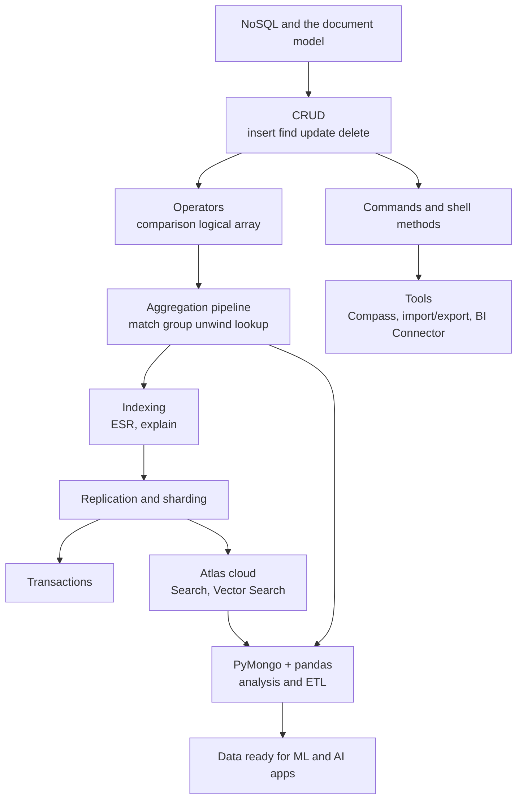

# Module 2: Managing Large Datasets with MongoDB

> 🧭 [Diploma in AI](../../README.md) › [Term 1](../README.md) › **Managing Large Datasets with MongoDB** &nbsp;·&nbsp; ⏱️ 32 instructional hours
>
> Prepared by **Hamna Zahid Khan**, Junior Lecturer

[⬅ Term 1 overview](../README.md) &nbsp;|&nbsp; [🏠 Course home](../../README.md)

---

## 🌟 Why this module matters

AI systems feed on data that rarely fits neat tables: product catalogues with different attributes, user activity logs, chat histories, sensor readings, and the embeddings behind semantic search. **MongoDB** stores this kind of data as flexible JSON-like documents and scales it across many servers. This module takes you from your first document to aggregation pipelines, indexing, replication, sharding, transactions, the cloud (Atlas) and Python, using one **Karachi Gadget Store** database throughout.

## 🎯 Module objectives

By the end of this module you will be able to:

- Explain NoSQL families and MongoDB's document model, and decide when to embed or reference.
- Perform CRUD operations and bulk writes in mongosh and Python.
- Write filters with comparison, logical, element, evaluation and array operators.
- Build reports with the aggregation pipeline (`$match`, `$group`, `$unwind`, `$lookup`, `$facet`, …).
- Run database commands and shell methods for administration and diagnostics.
- Design indexes with the ESR rule and read `explain()` output.
- Explain replica sets, write concern, sharding and shard-key choice.
- Keep multi-document changes consistent with transactions.
- Use Compass, the Database Tools and the BI Connector; deploy on MongoDB Atlas.
- Build Python data-access code, pandas analyses and ETL jobs with PyMongo.

## 🗂️ Sessions

| # | Session |
|---|---|
| 1 | [Introduction to MongoDB](session-01-introduction-to-mongodb.md) |
| 2 | [Working with MongoDB Databases (CRUD)](session-02-working-with-mongodb-databases.md) |
| 3 | [MongoDB Operators](session-03-mongodb-operators.md) |
| 4 | [The Aggregation Pipeline](session-04-aggregation-pipeline.md) |
| 5 | [Database Commands](session-05-database-commands.md) |
| 6 | [MongoDB Shell Methods](session-06-mongodb-shell-methods.md) |
| 7 | [MongoDB Indexing](session-07-mongodb-indexing.md) |
| 8 | [Replication and Sharding](session-08-replication-and-sharding.md) |
| 9 | [Transaction Management](session-09-transaction-management.md) |
| 10 | [MongoDB Tools: Compass and BI Connector](session-10-mongodb-tools.md) |
| 11 | [MongoDB in the Cloud with Atlas](session-11-mongodb-cloud-atlas.md) |
| 12 | [Connecting Python to MongoDB with PyMongo](session-12-python-connectivity-pymongo.md) |
| 📝 | [Module practice test](practice-test.md) |

## 🧭 Concept map

## 🛠️ Setup

- **Zero-install (recommended to start):** every session has a Colab notebook. Examples use **mongomock**, an in-memory imitation of MongoDB, plus PyMongo; the notebook installs both. Sample data comes from [`code/store_db.py`](code/store_db.py).
- **Local server:** MongoDB Community Server + **mongosh** + **Compass** (all free). Each session shows the mongosh version of every example.
- **Cloud:** a free **MongoDB Atlas M0** cluster (Session 11). Set `MONGODB_URI` and the same Python code runs against Atlas.

| Collection | Docs | Fields |
|---|---|---|
| `products` | 10 | `_id, name, category, price, stock, tags[], specs{brand, warrantyMonths, ramGB?}` |
| `customers` | 6 | `_id, name, city, email?, joined, loyalty` |
| `orders` | 10 | `_id, customerId, orderDate, status, payment, items[{productId, qty, price}]` |

## 📄 One-page cheat-sheet

| Task | mongosh | PyMongo |
|---|---|---|
| Connect | `mongosh "mongodb+srv://…"` | `MongoClient(uri)` |
| Switch / list | `use kgs` · `show dbs` · `show collections` | `client["kgs"]` · `list_database_names()` · `list_collection_names()` |
| Insert | `insertOne({...})` · `insertMany([...])` | `insert_one` · `insert_many(…, ordered=False)` |
| Find | `find({city: "Karachi"}, {name: 1, _id: 0})` | `find({"city": "Karachi"}, {"name": 1, "_id": 0})` |
| Sort / page | `.sort({price: -1}).skip(10).limit(10)` | `.sort("price", -1).skip(10).limit(10)` |
| Count / distinct | `countDocuments(f)` · `distinct("city")` | `count_documents(f)` · `distinct("city")` |
| Update | `updateOne(f, {$set: {a: 1}, $inc: {n: 1}})` | `update_one(f, {"$set": {...}, "$inc": {...}})` |
| Upsert | `updateOne(f, u, {upsert: true})` | `update_one(f, u, upsert=True)` |
| Delete | `deleteOne(f)` · `deleteMany(f)` | `delete_one` · `delete_many` |
| Atomic read-modify | `findOneAndUpdate(f, u, {returnDocument: "after"})` | `find_one_and_update(f, u, return_document=ReturnDocument.AFTER)` |
| Bulk | `bulkWrite([{insertOne: …}, {updateOne: …}])` | `bulk_write([InsertOne(…), UpdateOne(…)])` |

| Operators | |
|---|---|
| Comparison | `$eq $ne $gt $gte $lt $lte $in $nin` |
| Logical | `$and $or $nor $not` (fields in one filter are ANDed) |
| Element / evaluation | `$exists $type` · `$regex $expr $mod` · `{f: null}` = null **or** missing |
| Array query | `$all $size $elemMatch` · `{"tags.0": "x"}` |
| Update | `$set $unset $inc $mul $min $max $rename $currentDate $setOnInsert` |
| Array update | `$push {$each, $slice, $sort}` `$addToSet $pull $pop` · `$` `$[]` `$[id]` + `arrayFilters` |

| Aggregation stage | Role |
|---|---|
| `$match` → `$project` / `$addFields` | filter, shape, compute |
| `$group {_id: "$k", n: {$sum: 1}, avg: {$avg: "$x"}}` | group and accumulate (`$sum $avg $min $max $push $addToSet $first $last`) |
| `$sort $limit $skip $count` | order, page, count |
| `$unwind "$arr"` · `$lookup {from, localField, foreignField, as}` | flatten arrays · left outer join |
| `$bucket` · `$facet` · `$out` / `$merge` | ranges · multi-report · save results |

| Admin and performance | |
|---|---|
| Indexes | `createIndex({a: 1, b: -1}, {unique, sparse, partialFilterExpression, expireAfterSeconds})` · `getIndexes()` · `dropIndex()` |
| ESR rule | Equality → Sort → Range fields in a compound index |
| Explain | `find(…).explain("executionStats")` → want `IXSCAN`, keys ≈ docs ≈ nReturned |
| Commands | `db.runCommand({...})` · `db.adminCommand({...})` · `db.stats()` · `db.coll.stats()` · `db.currentOp()` |
| Users | `db.createUser({user, pwd, roles: [{role: "read", db: "kgs"}]})` |
| Replica set | `rs.initiate()` · `rs.status()` · `rs.stepDown()` · `{w: "majority"}` · `readPreference` |
| Sharding | `sh.shardCollection("kgs.orders", {customerId: 1})` · `{_id: "hashed"}` · `sh.status()` |
| Transactions | `session.withTransaction(fn)` / `with_transaction(cb)` (replica set or Atlas) |
| Tools | `mongoimport` · `mongoexport` · `mongodump --gzip` · `mongorestore` · Compass · BI Connector (port 3307) |

**Design rule of thumb:** data that is read together is stored together; embed bounded children, reference shared or unbounded ones.

## ✅ Progress checklist

- [ ] Session 1 · Introduction to MongoDB
- [ ] Session 2 · Databases and CRUD
- [ ] Session 3 · Operators
- [ ] Session 4 · Aggregation pipeline
- [ ] Session 5 · Database commands
- [ ] Session 6 · Shell methods
- [ ] Session 7 · Indexing
- [ ] Session 8 · Replication and sharding
- [ ] Session 9 · Transactions
- [ ] Session 10 · Compass and BI Connector
- [ ] Session 11 · Atlas
- [ ] Session 12 · PyMongo
- [ ] Practice test (score ≥ 16/20)

---

[⬅ Term 1 overview](../README.md) &nbsp;|&nbsp; [🏠 Course home](../../README.md) &nbsp;|&nbsp; [Start Session 1 ➡](session-01-introduction-to-mongodb.md)

Prepared by **Hamna Zahid Khan**, Junior Lecturer · Diploma in AI
