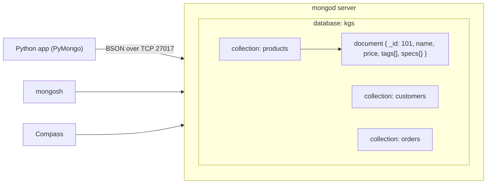
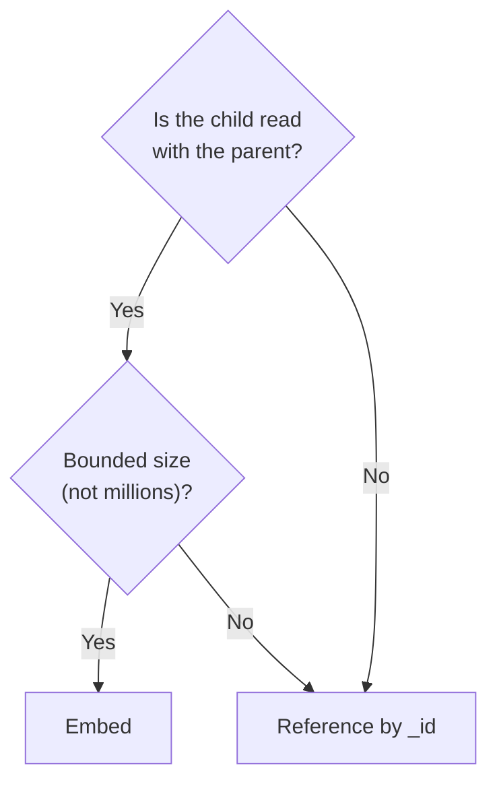

[](https://colab.research.google.com/github/Hamnakhan123/Diploma-in-AI/blob/main/term-1/02-managing-large-datasets-with-mongodb/code/session-01-introduction-to-mongodb.ipynb) &nbsp; 📓 [Notebook](code/session-01-introduction-to-mongodb.ipynb)

# Session 1: Introduction to MongoDB

> 🧭 [Diploma in AI](../../README.md) › [Term 1](../README.md) › [Managing Large Datasets with MongoDB](README.md) › **Session 1**
>
> ⏱️ **Estimated time:** 2.5 hours (1 h concepts + 1.5 h lab) &nbsp;|&nbsp; 📋 **Prerequisites:** Module 1 (relational databases and SQL), basic Python
>
> Prepared by **Hamna Zahid Khan**, Junior Lecturer

[⬅ Module overview](README.md) &nbsp;|&nbsp; [🏠 Module home](README.md) &nbsp;|&nbsp; [Next: Session 2 ➡](session-02-working-with-mongodb-databases.md)

---

## 🎯 Learning objectives

- Explain what **NoSQL** means and name the four main NoSQL families.
- Describe MongoDB's building blocks: **document, collection, database, BSON, `_id`**.
- Compare a relational design with a document design and decide when each fits.
- Install MongoDB (or use the zero-install route) and run first commands in **mongosh**.
- Insert and read your first documents from Python.

## 📖 Concepts

### 1. Why NoSQL?

Relational databases are excellent when the structure is fixed and data fits on one server. Modern AI and web apps often break those assumptions: data arrives in **huge volumes** (clickstreams, sensor readings, chat logs), **changes shape** often (a new product type needs new fields), and must be served to millions of users. **NoSQL** ("not only SQL") databases trade some relational features for **flexible schemas** and **horizontal scaling** (adding more servers instead of a bigger one).

| NoSQL family | Data model | Examples | Good for |
|---|---|---|---|
| **Document** | JSON-like documents | MongoDB, Couchbase | catalogues, user profiles, content, app back ends |
| **Key-value** | key → opaque value | Redis, DynamoDB | caching, sessions, counters |
| **Wide-column** | rows with dynamic column families | Cassandra, HBase | time-series and write-heavy logs |
| **Graph** | nodes and edges | Neo4j | social networks, recommendations, fraud rings |

The **CAP theorem** says a distributed system facing a network partition must choose between **C**onsistency and **A**vailability. MongoDB defaults to consistency (reads go to the primary), and lets you relax it per query.

### 2. MongoDB vocabulary

| RDBMS | MongoDB | Note |
|---|---|---|
| Database | Database | a container of collections |
| Table | **Collection** | no fixed columns |
| Row | **Document** | JSON-like object, max **16 MB** |
| Column | **Field** | can hold arrays and sub-documents |
| Primary key | **`_id`** | every document has one; auto-generated `ObjectId` if you omit it |
| JOIN | **Embedding** or `$lookup` | embed data that is read together |

**BSON** (Binary JSON) is how MongoDB stores documents. It adds types JSON lacks: `ObjectId`, `Date`, `Int32/Int64`, `Decimal128`, `BinData`. An **ObjectId** is 12 bytes: a 4-byte timestamp, 5 random bytes and a 3-byte counter, so it is roughly sortable by creation time.

### 3. Embedding versus referencing

- **Embed** when the child is owned by the parent and read with it (order → items, post → comments up to a few hundred).
- **Reference** (store an id) when the child is shared, large, or grows without limit (orders → customer, product → reviews in the millions).

Rule of thumb: *"data that is accessed together should be stored together."*

### 4. Editions and tools

| Item | What it is |
|---|---|
| **MongoDB Community Server** | free server (`mongod`) for Windows, macOS, Linux |
| **MongoDB Enterprise** | adds LDAP/Kerberos, auditing, encryption at rest, in-memory engine |
| **MongoDB Atlas** | managed cloud service, free M0 tier (Session 11) |
| **mongosh** | the modern JavaScript shell |
| **Compass** | GUI for browsing, querying and aggregation (Session 10) |
| **Database Tools** | `mongoimport`, `mongoexport`, `mongodump`, `mongorestore` |

**Install (Windows):** download the MSI from mongodb.com → *Complete* setup → tick *Install MongoDB as a Service* → install mongosh separately → open a terminal and type `mongosh`. On Ubuntu use the official `mongodb-org` apt repository. **Zero-install route for this course:** every example runs in Python with **mongomock**, an in-memory imitation of MongoDB, so you can follow along in Colab.

### 5. First mongosh commands

```javascript
show dbs                       // list databases
use kgs                        // switch to (or lazily create) the kgs database
db                             // which database am I in?
db.products.insertOne({ name: "Wireless Mouse", price: 1500 })
show collections
db.products.find()
db.products.countDocuments()
```

A database or collection is created **lazily**: it appears only when the first document is written.

## 🧭 Diagrams





## 💻 Worked examples

### Example 1: Databases, collections and a flexible schema


📄 [`code/session-01_first_look.py`](code/session-01_first_look.py)

```python
# Session 1 · A first look at documents, collections and databases
import mongomock
from store_db import show

client = mongomock.MongoClient()          # real server: pymongo.MongoClient("mongodb://localhost:27017")
db = client["kgs"]                        # mongosh: use kgs
print("Databases before any insert:", client.list_database_names())

# A document is a JSON-like object. Fields can hold arrays and sub-documents.
doc = {
    "name": "Wireless Mouse",
    "category": "Accessories",
    "price": 1500,
    "tags": ["wireless", "office"],          # array
    "specs": {"brand": "Logi", "dpi": 1600}, # embedded document
}
result = db.products.insert_one(doc)      # mongosh: db.products.insertOne({...})
print("Inserted _id:", result.inserted_id, "| type:", type(result.inserted_id).__name__)

# Flexible schema: the next document has different fields and that is allowed.
db.products.insert_one({"name": "Gift Card", "category": "Vouchers", "value": 5000, "expires": "2026-12-31"})

print("Databases after insert:", client.list_database_names())
print("Collections in kgs:", db.list_collection_names())
print("Documents in products:", db.products.count_documents({}))

print("\nAll products (without _id):")
show(db.products.find({}, {"_id": 0}))   # mongosh: db.products.find({}, {_id: 0})

# Read the embedded field with dot notation
print("\nBrand of the mouse:", db.products.find_one({"name": "Wireless Mouse"})["specs"]["brand"])
```

**Output**

```text
Databases before any insert: []
Inserted _id: 6adcbc7f3d6bddc50ab6de63 | type: ObjectId
Databases after insert: ['kgs']
Collections in kgs: ['products']
Documents in products: 2

All products (without _id):
{"name": "Wireless Mouse", "category": "Accessories", "price": 1500, "tags": ["wireless", "office"], "specs": {"brand": "Logi", "dpi": 1600}}
{"name": "Gift Card", "category": "Vouchers", "value": 5000, "expires": "2026-12-31"}
(2 documents)

Brand of the mouse: Logi
```


**mongosh equivalent**

```javascript
use kgs
db.products.insertOne({ name: "Wireless Mouse", category: "Accessories", price: 1500,
                        tags: ["wireless", "office"], specs: { brand: "Logi", dpi: 1600 } })
db.products.insertOne({ name: "Gift Card", category: "Vouchers", value: 5000, expires: "2026-12-31" })
db.products.find({}, { _id: 0 })
db.products.findOne({ name: "Wireless Mouse" }).specs.brand
```

> Your `ObjectId` will differ: it is generated from the clock and random bytes each time.

### Example 2: One order, two designs

📄 [`code/session-01_relational_vs_document.py`](code/session-01_relational_vs_document.py)

```python
# Session 1 · The same order as relational rows and as one MongoDB document
import json

# Relational design: 3 tables, joined by keys
orders      = [{"OrderID": 5001, "CustomerID": 1, "OrderDate": "2025-03-02"}]
order_items = [{"OrderID": 5001, "ProductID": 101, "Qty": 2, "Price": 1500},
               {"OrderID": 5001, "ProductID": 107, "Qty": 1, "Price": 4500}]
customers   = [{"CustomerID": 1, "Name": "Ayesha Khan", "City": "Karachi"}]
print("Relational: rows spread over", 3, "tables ->",
      len(orders) + len(order_items) + len(customers), "rows to read with 2 joins")

# Document design: everything one screen needs lives in one document
cust = customers[0]
document = {
    "_id": orders[0]["OrderID"],
    "orderDate": orders[0]["OrderDate"],
    "customer": {"id": cust["CustomerID"], "name": cust["Name"], "city": cust["City"]},  # embedded copy
    "items": [{"productId": r["ProductID"], "qty": r["Qty"], "price": r["Price"]} for r in order_items],
}
document["total"] = sum(i["qty"] * i["price"] for i in document["items"])
print("Document: 1 read, no joins\n")
print(json.dumps(document, indent=2))

# Terminology map
pairs = [("Database", "Database"), ("Table", "Collection"), ("Row", "Document"),
         ("Column", "Field"), ("Primary key", "_id"), ("JOIN", "Embedding or $lookup"),
         ("Index", "Index")]
print("\n{:<12} | {}".format("RDBMS", "MongoDB"))
print("-" * 13 + "+" + "-" * 22)
for a, b in pairs:
    print("{:<12} | {}".format(a, b))
```

**Output**

```text
Relational: rows spread over 3 tables -> 4 rows to read with 2 joins
Document: 1 read, no joins

{
  "_id": 5001,
  "orderDate": "2025-03-02",
  "customer": {
    "id": 1,
    "name": "Ayesha Khan",
    "city": "Karachi"
  },
  "items": [
    {
      "productId": 101,
      "qty": 2,
      "price": 1500
    },
    {
      "productId": 107,
      "qty": 1,
      "price": 4500
    }
  ],
  "total": 7500
}

RDBMS        | MongoDB
-------------+----------------------
Database     | Database
Table        | Collection
Row          | Document
Column       | Field
Primary key  | _id
JOIN         | Embedding or $lookup
Index        | Index
```


The document version answers "show me order 5001" in a single read. The price is copied into each item on purpose: an order must remember the price **at the time of sale** even if the catalogue price changes later.

## 🧪 Lab / practice tasks

**1. 🟢 Easy:** Install MongoDB Community + mongosh (or open the Colab notebook). Run `show dbs`, then `use labdb` and `db.notes.insertOne({text: "hello"})`. Run `show dbs` again: what changed and why?

<details><summary>💡 Hint</summary>

Databases appear only after the first write.

</details>

**2. 🟢 Easy:** Write three student documents for a `students` collection with `name`, `rollNo`, `courses` (array) and `address` (embedded). Insert them from Python.

<details><summary>💡 Hint</summary>

`insert_many([...])`

</details>

**3. 🟡 Medium:** For each pair decide embed or reference, and justify: (a) blog post and its comments, (b) student and their university, (c) invoice and its line items, (d) product and its 2 million reviews.

<details><summary>💡 Hint</summary>

Use the decision diagram above.

</details>

**4. 🟠 Hard:** Take the three Module 1 tables `Customers`, `Orders`, `OrderItems` and write a Python function that converts them into order documents with an embedded customer summary.

<details><summary>💡 Hint</summary>

Loop over orders, filter items by `OrderID`.

</details>

**5. 🔴 Challenge:** Generate 5 ObjectIds in a loop with `bson.ObjectId()` and print `generation_time` for each. Explain why ObjectIds sort roughly by creation time.

<details><summary>💡 Hint</summary>

The first 4 bytes are a Unix timestamp.

</details>


## ✅ Quick quiz

**Q1.** In MongoDB, the equivalent of a relational *row* is a…

- A) collection
- B) document
- C) field
- D) database

**Q2.** What is the maximum size of a single BSON document?

- A) 4 MB
- B) 16 MB
- C) 64 MB
- D) No limit

**Q3.** Which NoSQL family is the best fit for a friend-of-a-friend recommendation query?

- A) Key-value
- B) Document
- C) Graph
- D) Wide-column

**Q4.** What happens if you insert a document without an `_id`?

- A) The insert fails
- B) MongoDB generates an ObjectId
- C) The document gets `_id: null`
- D) The first field becomes the key

**Q5.** When is *referencing* better than embedding?

- A) When the child is always read with the parent
- B) When the child is small and fixed
- C) When the child is shared or grows without bound
- D) Never

<details><summary>✅ Show answers</summary>

1. **B**
2. **B**
3. **C**
4. **B**
5. **C**

</details>


## 📝 Summary

- NoSQL databases offer flexible schemas and horizontal scaling; MongoDB is the leading **document** database.
- Database → collections → documents → fields; every document has a unique `_id`.
- Documents are stored as **BSON**, which adds types such as `ObjectId`, `Date` and `Decimal128`.
- **Embed** what is read together and bounded; **reference** what is shared or unbounded.
- mongosh, Compass, Atlas and the Database Tools make up the toolset; mongomock lets us practise anywhere.

### 🎤 Interview / viva questions

1. What problems with relational databases led to NoSQL?
2. Explain the CAP theorem in one minute.
3. What is BSON and why not store plain JSON?
4. How is an ObjectId built, and what can you learn from it?
5. Give one case where you would still choose SQL Server over MongoDB.

---

[⬅ Module overview](README.md) &nbsp;|&nbsp; [🏠 Module home](README.md) &nbsp;|&nbsp; [Next: Session 2 ➡](session-02-working-with-mongodb-databases.md)

<sub>Prepared by **Hamna Zahid Khan**, Junior Lecturer · Diploma in AI</sub>
