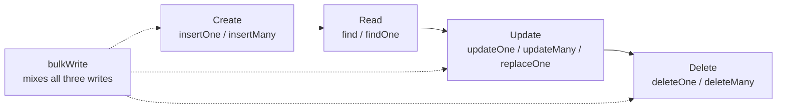
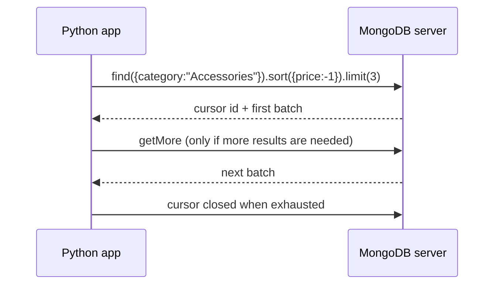

[](https://colab.research.google.com/github/Hamnakhan123/Diploma-in-AI/blob/main/term-1/02-managing-large-datasets-with-mongodb/code/session-02-working-with-mongodb-databases.ipynb) &nbsp; 📓 [Notebook](code/session-02-working-with-mongodb-databases.ipynb)

# Session 2: Working with MongoDB Databases (CRUD)

> 🧭 [Diploma in AI](../../README.md) › [Term 1](../README.md) › [Managing Large Datasets with MongoDB](README.md) › **Session 2**
>
> ⏱️ **Estimated time:** 3 hours (1 h concepts + 2 h lab) &nbsp;|&nbsp; 📋 **Prerequisites:** Session 1, the sample data in `code/store_db.py`
>
> Prepared by **Hamna Zahid Khan**, Junior Lecturer

[⬅ Previous: Session 1](session-01-introduction-to-mongodb.md) &nbsp;|&nbsp; [🏠 Module home](README.md) &nbsp;|&nbsp; [Next: Session 3 ➡](session-03-mongodb-operators.md)

---

## 🎯 Learning objectives

- Create, list, switch and drop **databases** and **collections**.
- **Insert** single documents and batches, and handle duplicate `_id` errors.
- **Read** with filters, projections, sorting, `limit` and `skip`.
- **Update** with `$set`, `$inc`, upserts and whole-document replacement.
- **Delete** single and multiple documents, and run several writes in one **bulk** call.

## 📖 Concepts

### 1. The sample database

From this session on we use the **Karachi Gadget Store** database `kgs`, built by `get_db()` in [`code/store_db.py`](code/store_db.py):

| Collection | Docs | Shape |
|---|---|---|
| `products` | 10 | `_id, name, category, price, stock, tags[], specs{brand, warrantyMonths, ramGB?}` |
| `customers` | 6 | `_id, name, city, email (may be null or missing), joined (Date), loyalty` |
| `orders` | 10 | `_id, customerId, orderDate, status, payment, items[{productId, qty, price}]` |

### 2. Databases and collections

```javascript
show dbs                      // list
use kgs                       // switch / create lazily
db.createCollection("staff")  // explicit creation (optional; needed for options like capped or validation)
show collections
db.staff.drop()               // remove a collection
db.dropDatabase()             // remove the current database
```

**Naming rules:** database names cannot contain `/\. "$*<>:|?` and are case-sensitive; collection names must not start with `system.` and cannot contain `$`.

### 3. CRUD at a glance

| Operation | mongosh | PyMongo |
|---|---|---|
| Create one / many | `insertOne(doc)` / `insertMany([..])` | `insert_one` / `insert_many` |
| Read many / one | `find(filter, projection)` / `findOne(...)` | `find` / `find_one` |
| Count | `countDocuments(filter)` | `count_documents(filter)` |
| Update one / many | `updateOne(filter, update)` / `updateMany(...)` | `update_one` / `update_many` |
| Replace | `replaceOne(filter, newDoc)` | `replace_one` |
| Delete one / many | `deleteOne(filter)` / `deleteMany(filter)` | `delete_one` / `delete_many` |
| Read and modify atomically | `findOneAndUpdate(...)` | `find_one_and_update` |
| Mixed batch | `bulkWrite([...])` | `bulk_write([...])` |

### 4. Reading: filter, projection, cursor

- **Filter** `{city: "Karachi"}` matches documents; `{}` matches all.
- **Projection** `{name: 1, price: 1}` includes fields (and `_id` unless you say `_id: 0`); `{specs: 0}` excludes. Don't mix 1 and 0 except for `_id`.
- `find()` returns a **cursor**: a lazy pointer that fetches results in batches (default 101 docs, then 16 MB batches). Chain `.sort({price: -1})`, `.skip(n)`, `.limit(n)`. MongoDB always applies **sort → skip → limit** whatever order you write them.
- **Dot notation** reaches inside sub-documents (`"specs.brand"`) and arrays: `{tags: "office"}` matches any document whose `tags` array contains `"office"`.

### 5. Writing: update operators and options

| Operator | Effect |
|---|---|
| `$set` / `$unset` | set a field / remove a field |
| `$inc` / `$mul` | add to / multiply a number |
| `$min` / `$max` | update only if the new value is smaller / larger |
| `$rename` | rename a field |
| `$currentDate` | set to the current date |
| `$setOnInsert` | set only when an upsert inserts |

Options: **`upsert: true`** inserts when nothing matches; **`ordered: false`** in `insertMany`/`bulkWrite` keeps going past errors. Without an operator, `replaceOne` swaps the whole document. **Write concern** `{w: "majority"}` waits until most replica-set members have the write (Session 8).

## 🧭 Diagrams





## 💻 Worked examples

### Example 1: Create and read


📄 [`code/session-02_create_read.py`](code/session-02_create_read.py)

```python
# Session 2 · Create and Read
from store_db import get_db, show

db = get_db()
db.drop_collection("staff")                        # start clean

# CREATE ------------------------------------------------------------
r1 = db.staff.insert_one({"_id": "E01", "name": "Zara", "role": "Cashier", "salary": 60000})
print("insert_one ->", r1.inserted_id)
r2 = db.staff.insert_many([
    {"_id": "E02", "name": "Kamran", "role": "Technician", "salary": 85000, "skills": ["laptops", "phones"]},
    {"_id": "E03", "name": "Mehwish", "role": "Manager", "salary": 150000},
    {"_id": "E04", "name": "Danish", "role": "Technician", "salary": 78000, "skills": ["phones"]},
])
print("insert_many ->", r2.inserted_ids)

# READ --------------------------------------------------------------
print("\n1) find_one by _id")
show(db.staff.find_one({"_id": "E03"}))

print("\n2) equality filter + projection (only name and salary)")
show(db.staff.find({"role": "Technician"}, {"_id": 0, "name": 1, "salary": 1}))

print("\n3) products: Accessories, sort by price descending, top 3")
show(db.products.find({"category": "Accessories"}, {"name": 1, "price": 1})
                .sort("price", -1).limit(3))

print("\n4) paging: skip 3, limit 3 (page 2 of products ordered by _id)")
show(db.products.find({}, {"name": 1}).sort("_id", 1).skip(3).limit(3))

print("\n5) query inside an embedded document and an array")
show(db.products.find({"specs.brand": "Logi", "tags": "office"}, {"name": 1, "specs.brand": 1}))

print("\n6) counting")
print("all customers:", db.customers.count_documents({}),
      "| Karachi customers:", db.customers.count_documents({"city": "Karachi"}))
print("distinct cities:", sorted(db.customers.distinct("city")))
```

**Output**

```text
insert_one -> E01
insert_many -> ['E02', 'E03', 'E04']

1) find_one by _id
{"_id": "E03", "name": "Mehwish", "role": "Manager", "salary": 150000}
(1 document)

2) equality filter + projection (only name and salary)
{"name": "Kamran", "salary": 85000}
{"name": "Danish", "salary": 78000}
(2 documents)

3) products: Accessories, sort by price descending, top 3
{"name": "Mechanical Keyboard", "price": 7500, "_id": 102}
{"name": "Webcam HD", "price": 4500, "_id": 107}
{"name": "USB-C Hub", "price": 4200, "_id": 104}
(3 documents)

4) paging: skip 3, limit 3 (page 2 of products ordered by _id)
{"name": "USB-C Hub", "_id": 104}
{"name": "Noise-Cancelling Headphones", "_id": 105}
{"name": "Bluetooth Speaker", "_id": 106}
(3 documents)

5) query inside an embedded document and an array
{"name": "Wireless Mouse", "specs": {"brand": "Logi"}, "_id": 101}
{"name": "Webcam HD", "specs": {"brand": "Logi"}, "_id": 107}
(2 documents)

6) counting
all customers: 6 | Karachi customers: 3
distinct cities: ['Islamabad', 'Karachi', 'Lahore']
```


**mongosh equivalent**

```javascript
use kgs
db.staff.insertOne({ _id: "E01", name: "Zara", role: "Cashier", salary: 60000 })
db.staff.insertMany([ { _id: "E02", name: "Kamran", role: "Technician", salary: 85000, skills: ["laptops","phones"] },
                      { _id: "E03", name: "Mehwish", role: "Manager", salary: 150000 },
                      { _id: "E04", name: "Danish", role: "Technician", salary: 78000, skills: ["phones"] } ])
db.staff.findOne({ _id: "E03" })
db.staff.find({ role: "Technician" }, { _id: 0, name: 1, salary: 1 })
db.products.find({ category: "Accessories" }, { name: 1, price: 1 }).sort({ price: -1 }).limit(3)
db.products.find({}, { name: 1 }).sort({ _id: 1 }).skip(3).limit(3)
db.products.find({ "specs.brand": "Logi", tags: "office" }, { name: 1, "specs.brand": 1 })
db.customers.countDocuments({ city: "Karachi" })
db.customers.distinct("city")
```

### Example 2: Update and delete

📄 [`code/session-02_update_delete.py`](code/session-02_update_delete.py)

```python
# Session 2 · Update and Delete
from pymongo import ReturnDocument
from store_db import get_db, show

db = get_db()

print("1) update_one with $set and $inc")
r = db.products.update_one({"_id": 104}, {"$set": {"stock": 25}, "$inc": {"price": 300}})
print("matched", r.matched_count, "modified", r.modified_count)
show(db.products.find({"_id": 104}, {"name": 1, "price": 1, "stock": 1}))

print("\n2) update_many: Rs 500 off every Audio product")
r = db.products.update_many({"category": "Audio"}, {"$inc": {"price": -500}})
print("modified", r.modified_count)
show(db.products.find({"category": "Audio"}, {"name": 1, "price": 1}))

print("\n3) upsert: update if exists, otherwise insert")
r = db.customers.update_one({"email": "noor@example.pk"},
                            {"$set": {"name": "Noor Fatima", "city": "Hyderabad"}}, upsert=True)
print("matched", r.matched_count, "upserted_id", r.upserted_id is not None)

print("\n4) replace_one swaps the whole document (except _id)")
db.customers.replace_one({"_id": 6}, {"name": "Fahad Raza", "city": "Multan"})
show(db.customers.find_one({"_id": 6}))

print("\n5) find_one_and_update returns the document in one atomic step")
doc = db.products.find_one_and_update({"_id": 101}, {"$inc": {"stock": -1}},
                                      projection={"name": 1, "stock": 1},
                                      return_document=ReturnDocument.AFTER)
show(doc)

print("\n6) delete_one and delete_many")
print("cancelled orders deleted:", db.orders.delete_many({"status": "Cancelled"}).deleted_count)
print("one pending order deleted:", db.orders.delete_one({"status": "Pending"}).deleted_count)
print("orders left:", db.orders.count_documents({}))
```

**Output**

```text
1) update_one with $set and $inc
matched 1 modified 1
{"name": "USB-C Hub", "price": 4500, "stock": 25, "_id": 104}
(1 document)

2) update_many: Rs 500 off every Audio product
modified 2
{"name": "Noise-Cancelling Headphones", "price": 18000, "_id": 105}
{"name": "Bluetooth Speaker", "price": 6000, "_id": 106}
(2 documents)

3) upsert: update if exists, otherwise insert
matched 0 upserted_id True

4) replace_one swaps the whole document (except _id)
{"_id": 6, "name": "Fahad Raza", "city": "Multan"}
(1 document)

5) find_one_and_update returns the document in one atomic step
{"name": "Wireless Mouse", "stock": 39, "_id": 101}
(1 document)

6) delete_one and delete_many
cancelled orders deleted: 1
one pending order deleted: 1
orders left: 8
```


**mongosh equivalent**

```javascript
db.products.updateOne({ _id: 104 }, { $set: { stock: 25 }, $inc: { price: 300 } })
db.products.updateMany({ category: "Audio" }, { $inc: { price: -500 } })
// a true percentage discount uses $mul:  { $mul: { price: 0.9 } }
db.customers.updateOne({ email: "noor@example.pk" },
                       { $set: { name: "Noor Fatima", city: "Hyderabad" } }, { upsert: true })
db.customers.replaceOne({ _id: 6 }, { name: "Fahad Raza", city: "Multan" })
db.products.findOneAndUpdate({ _id: 101 }, { $inc: { stock: -1 } },
                             { projection: { name: 1, stock: 1 }, returnDocument: "after" })
db.orders.deleteMany({ status: "Cancelled" })
db.orders.deleteOne({ status: "Pending" })
```

> `replaceOne` removed `email`, `joined` and `loyalty` from customer 6. That is the classic beginner mistake: use `$set` when you mean "change these fields".

### Example 3: Bulk writes and duplicate keys

📄 [`code/session-02_bulk_write.py`](code/session-02_bulk_write.py)

```python
# Session 2 · Bulk writes and handling duplicate keys
from pymongo import InsertOne, UpdateOne, DeleteOne
from pymongo.errors import BulkWriteError, DuplicateKeyError
from store_db import get_db

db = get_db()

ops = [
    InsertOne({"_id": 111, "name": "Graphics Tablet", "category": "Accessories", "price": 12000, "stock": 4}),
    UpdateOne({"_id": 102}, {"$set": {"stock": 30}}),
    DeleteOne({"_id": 104}),
]
res = db.products.bulk_write(ops)
print("bulk result -> inserted:", res.inserted_count, "modified:", res.modified_count, "deleted:", res.deleted_count)

# _id must be unique
try:
    db.products.insert_one({"_id": 101, "name": "Duplicate mouse"})
except DuplicateKeyError:
    print("DuplicateKeyError: _id 101 already exists")

# ordered=True (default) stops at the first error; ordered=False carries on
docs = [{"_id": 201}, {"_id": 101}, {"_id": 202}]
for ordered in (True, False):
    db.products.delete_many({"_id": {"$in": [201, 202]}})
    try:
        db.products.insert_many(docs, ordered=ordered)
    except BulkWriteError as e:
        print(f"ordered={ordered}: inserted {e.details['nInserted']} of 3, errors: {len(e.details['writeErrors'])}")
```

**Output**

```text
bulk result -> inserted: 1 modified: 1 deleted: 1
DuplicateKeyError: _id 101 already exists
ordered=True: inserted 1 of 3, errors: 1
ordered=False: inserted 2 of 3, errors: 1
```


**mongosh equivalent**

```javascript
db.products.bulkWrite([
  { insertOne: { document: { _id: 111, name: "Graphics Tablet", category: "Accessories", price: 12000, stock: 4 } } },
  { updateOne: { filter: { _id: 102 }, update: { $set: { stock: 30 } } } },
  { deleteOne: { filter: { _id: 104 } } }
])
db.products.insertMany([{ _id: 201 }, { _id: 101 }, { _id: 202 }], { ordered: false })
```

With `ordered: true` the batch stopped at the duplicate, so `202` was never inserted; with `ordered: false` only the bad document was skipped.

## 🧪 Lab / practice tasks

**1. 🟢 Easy:** Create a database `college` and a collection `students`. Insert 5 students with `rollNo` as `_id`, `name`, `semester`, `cgpa` and `city`.

<details><summary>💡 Hint</summary>

`insert_many` with your own `_id` values.

</details>

**2. 🟢 Easy:** Show only `name` and `cgpa` of students in semester 3, highest CGPA first.

<details><summary>💡 Hint</summary>

Projection `{"_id": 0, "name": 1, "cgpa": 1}` plus `.sort("cgpa", -1)`.

</details>

**3. 🟡 Medium:** Promote every semester-3 student to semester 4 in one command, and print how many changed.

<details><summary>💡 Hint</summary>

`update_many(..., {"$inc": {"semester": 1}})`

</details>

**4. 🟡 Medium:** Use an upsert to record attendance: increase `attendance.present` by 1 for roll number 7 even if that student does not exist yet.

<details><summary>💡 Hint</summary>

`{"$inc": {"attendance.present": 1}}, upsert=True`

</details>

**5. 🟠 Hard:** Write a function `page(coll, n, size=3)` that returns page *n* of products sorted by price, and print pages 1-4.

<details><summary>💡 Hint</summary>

`skip((n-1)*size).limit(size)`

</details>

**6. 🔴 Challenge:** Use one `bulk_write` to insert a new product, restock product 104 to 10 units and delete all cancelled orders. Print the counts from the result object.

<details><summary>💡 Hint</summary>

`DeleteMany` exists alongside `DeleteOne`.

</details>


## ✅ Quick quiz

**Q1.** Which method inserts several documents in one call?

- A) insertOne
- B) insertMany
- C) bulkInsert
- D) addAll

**Q2.** What does the projection `{name: 1, _id: 0}` return?

- A) every field except name
- B) only the name field
- C) name and _id
- D) an error

**Q3.** You write `.limit(5).sort({price: 1}).skip(10)`. What does MongoDB actually run?

- A) limit, sort, skip
- B) sort, skip, limit
- C) skip, sort, limit
- D) it raises an error

**Q4.** Which option makes `updateOne` insert a document when no match is found?

- A) insert: true
- B) create: true
- C) upsert: true
- D) multi: true

**Q5.** Why can `replaceOne` lose data by accident?

- A) It deletes the whole collection
- B) It replaces every field except `_id` with the new document
- C) It ignores the filter
- D) It changes the `_id`

<details><summary>✅ Show answers</summary>

1. **B**
2. **B**
3. **B**
4. **C**
5. **B**

</details>


## 📝 Summary

- Databases and collections are created lazily; `drop()` and `dropDatabase()` remove them.
- `insert_one` / `insert_many` create; `_id` must be unique, and `ordered=False` skips bad documents.
- `find(filter, projection)` returns a cursor; MongoDB applies sort → skip → limit.
- Use **operators** (`$set`, `$inc`, …) for partial updates, `upsert` for insert-or-update, `replace_one` only for full replacement.
- `bulk_write` sends many mixed operations in one round trip.

### 🎤 Interview / viva questions

1. What is a cursor and why is it lazy?
2. Difference between `updateOne` with `$set` and `replaceOne`?
3. When would you use `ordered: false`?
4. How does `findOneAndUpdate` help avoid race conditions?
5. Why is `skip` slow for very deep pages, and what is the alternative?

---

[⬅ Previous: Session 1](session-01-introduction-to-mongodb.md) &nbsp;|&nbsp; [🏠 Module home](README.md) &nbsp;|&nbsp; [Next: Session 3 ➡](session-03-mongodb-operators.md)

<sub>Prepared by **Hamna Zahid Khan**, Junior Lecturer · Diploma in AI</sub>
