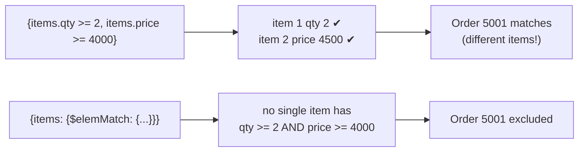

[](https://colab.research.google.com/github/Hamnakhan123/Diploma-in-AI/blob/main/term-1/02-managing-large-datasets-with-mongodb/code/session-03-mongodb-operators.ipynb) &nbsp; 📓 [Notebook](code/session-03-mongodb-operators.ipynb)

# Session 3: MongoDB Operators

> 🧭 [Diploma in AI](../../README.md) › [Term 1](../README.md) › [Managing Large Datasets with MongoDB](README.md) › **Session 3**
>
> ⏱️ **Estimated time:** 3 hours (1 h concepts + 2 h lab) &nbsp;|&nbsp; 📋 **Prerequisites:** Session 2 (CRUD)
>
> Prepared by **Hamna Zahid Khan**, Junior Lecturer

[⬅ Previous: Session 2](session-02-working-with-mongodb-databases.md) &nbsp;|&nbsp; [🏠 Module home](README.md) &nbsp;|&nbsp; [Next: Session 4 ➡](session-04-aggregation-pipeline.md)

---

## 🎯 Learning objectives

- Filter with **comparison** (`$eq $ne $gt $gte $lt $lte $in $nin`) and **logical** (`$and $or $nor $not`) operators.
- Test field presence and type with **element** operators (`$exists`, `$type`).
- Use **evaluation** operators: `$regex`, `$expr`, `$mod`.
- Query and modify **arrays** (`$all $size $elemMatch`, `$push $addToSet $pull $pop`, positional `$`).
- Trim results with **projection** operators (`$slice`, `$elemMatch`).

## 📖 Concepts

### 1. Operator families

Operators start with `$`. In a filter they sit **inside** the field (`{price: {$gt: 100}}`), except logical operators, which sit at the **top** and take an array of conditions (`{$or: [{…}, {…}]}`).

| Family | Operators | Example |
|---|---|---|
| Comparison | `$eq $ne $gt $gte $lt $lte $in $nin` | `{price: {$gte: 1000, $lt: 5000}}` |
| Logical | `$and $or $nor $not` | `{$or: [{city: "Karachi"}, {loyalty: "Gold"}]}` |
| Element | `$exists $type` | `{email: {$exists: false}}`, `{price: {$type: "double"}}` |
| Evaluation | `$regex $expr $mod $jsonSchema $text $where` | `{name: {$regex: "^U", $options: "i"}}` |
| Array (query) | `$all $size $elemMatch` | `{tags: {$all: ["office", "4k"]}}` |
| Array (update) | `$push $addToSet $pull $pullAll $pop`, modifiers `$each $slice $sort $position` | `{$push: {tags: {$each: ["a","b"], $slice: -5}}}` |
| Positional | `$` (first match), `$[]` (all), `$[id]` + `arrayFilters` | `{$set: {"items.$.price": 1400}}` |
| Projection | `$slice $elemMatch $` | `{items: {$slice: 2}}` |
| Field update | `$set $unset $inc $mul $min $max $rename $currentDate $setOnInsert` | see Session 2 |

### 2. Things that trip people up

- **Implicit AND:** `{category: "Audio", price: {$lt: 10000}}` already means AND. You need explicit `$and` only when the **same key** would repeat, e.g. two `$or` blocks.
- **Null semantics:** `{email: null}` matches documents where `email` is `null` **or missing**. Use `{email: {$exists: false}}` for "missing only" and `{email: {$type: "null"}}` for "null only".
- **Arrays and multiple conditions:** `{"items.qty": {$gte: 2}, "items.price": {$gte: 4000}}` can be satisfied by **different** elements. `$elemMatch` forces one element to satisfy all conditions.
- **`$regex` with a leading `^`** can use an index; a pattern like `/phone/` must scan every value.
- **`$expr`** lets a query use aggregation expressions, so you can compare two fields of the same document (`$price * $stock`).
- `$where` runs JavaScript on the server: slow and disabled on many hosted clusters. Prefer `$expr`.

### 3. Arrays at a glance

| Goal | Query / update |
|---|---|
| contains a value | `{tags: "office"}` |
| contains all of these | `{tags: {$all: ["office", "travel"]}}` |
| exact array (order matters) | `{tags: ["office", "travel"]}` |
| has exactly n elements | `{tags: {$size: 2}}` |
| element by position | `{"tags.0": "office"}` |
| one element meets several rules | `{items: {$elemMatch: {qty: {$gte: 2}, price: {$gte: 4000}}}}` |
| add, keep last 5 | `{$push: {log: {$each: [x], $slice: -5}}}` |
| add only if missing | `{$addToSet: {tags: "sale"}}` |
| remove matches | `{$pull: {tags: "sale"}}`, `{$pull: {items: {qty: 0}}}` |
| update all elements | `{$inc: {"items.$[].qty": 1}}` |
| update chosen elements | `{$set: {"items.$[i].price": 0}}` with `arrayFilters: [{"i.productId": 104}]` |

## 🧭 Diagrams

```mermaid
mindmap
  root(("MongoDB operators"))
    "Query"
      "Comparison: $eq $gt $in"
      "Logical: $and $or $nor $not"
      "Element: $exists $type"
      "Evaluation: $regex $expr $mod"
      "Array: $all $size $elemMatch"
    "Update"
      "Fields: $set $unset $inc $mul $rename"
      "Arrays: $push $addToSet $pull $pop"
      "Positional: $ $[] $[id]"
    "Projection"
      "$slice"
      "$elemMatch"
```



## 💻 Worked examples

### Example 1: Query operators


📄 [`code/session-03_query_operators.py`](code/session-03_query_operators.py)

```python
# Session 3 · Comparison, logical, element and evaluation operators
from store_db import get_db, show

db = get_db()
P = {"_id": 0, "name": 1, "price": 1, "stock": 1}

print("1) $gt / $lte: price above 15,000 and at most 60,000")
show(db.products.find({"price": {"$gt": 15000, "$lte": 60000}}, P))

print("\n2) $in / $nin: categories Audio or Storage")
show(db.products.find({"category": {"$in": ["Audio", "Storage"]}}, P))

print("\n3) $ne: products that are not out of stock (count)")
print(db.products.count_documents({"stock": {"$ne": 0}}))

print("\n4) $or: cheap (< 2,000) OR nearly sold out (stock <= 3)")
show(db.products.find({"$or": [{"price": {"$lt": 2000}}, {"stock": {"$lte": 3}}]}, P))

print("\n5) $and on the same field (two conditions on price)")
show(db.products.find({"$and": [{"price": {"$gte": 4000}}, {"price": {"$lte": 7000}}]}, P))

print("\n6) $nor: neither Accessories nor priced over 100,000")
show(db.products.find({"$nor": [{"category": "Accessories"}, {"price": {"$gt": 100000}}]}, P))

print("\n7) $not: name does NOT start with a capital M")
print([d["name"] for d in db.products.find({"name": {"$not": {"$regex": "^M"}}})])

print("\n8) $exists vs null: customers with no usable email")
print("field missing   :", [c["name"] for c in db.customers.find({"email": {"$exists": False}})])
print("missing OR null :", [c["name"] for c in db.customers.find({"email": None})])

print("\n9) $type: documents where price is stored as an int")
print(db.products.count_documents({"price": {"$type": "int"}}), "of", db.products.count_documents({}))

print("\n10) $regex (case-insensitive) on name")
print([d["name"] for d in db.products.find({"name": {"$regex": "phone", "$options": "i"}})])

print("\n11) $expr compares two fields of the same document: stock value over 200,000")
show(db.products.find({"$expr": {"$gt": [{"$multiply": ["$price", "$stock"]}, 200000]}}, P))

print("\n12) $mod inside $expr: even product ids")
print([d["_id"] for d in db.products.find({"$expr": {"$eq": [{"$mod": ["$_id", 2]}, 0]}})])
```

**Output**

```text
1) $gt / $lte: price above 15,000 and at most 60,000
{"name": "27-inch Monitor", "price": 52000, "stock": 6}
{"name": "Noise-Cancelling Headphones", "price": 18500, "stock": 9}
{"name": "Portable SSD 1TB", "price": 16000, "stock": 18}
(3 documents)

2) $in / $nin: categories Audio or Storage
{"name": "Noise-Cancelling Headphones", "price": 18500, "stock": 9}
{"name": "Bluetooth Speaker", "price": 6500, "stock": 22}
{"name": "Portable SSD 1TB", "price": 16000, "stock": 18}
(3 documents)

3) $ne: products that are not out of stock (count)
9

4) $or: cheap (< 2,000) OR nearly sold out (stock <= 3)
{"name": "Wireless Mouse", "price": 1500, "stock": 40}
{"name": "USB-C Hub", "price": 4200, "stock": 0}
{"name": "Gaming Laptop", "price": 285000, "stock": 3}
(3 documents)

5) $and on the same field (two conditions on price)
{"name": "USB-C Hub", "price": 4200, "stock": 0}
{"name": "Bluetooth Speaker", "price": 6500, "stock": 22}
{"name": "Webcam HD", "price": 4500, "stock": 12}
(3 documents)

6) $nor: neither Accessories nor priced over 100,000
{"name": "27-inch Monitor", "price": 52000, "stock": 6}
{"name": "Noise-Cancelling Headphones", "price": 18500, "stock": 9}
{"name": "Bluetooth Speaker", "price": 6500, "stock": 22}
{"name": "Portable SSD 1TB", "price": 16000, "stock": 18}
(4 documents)

7) $not: name does NOT start with a capital M
['Wireless Mouse', '27-inch Monitor', 'USB-C Hub', 'Noise-Cancelling Headphones', 'Bluetooth Speaker', 'Webcam HD', 'Gaming Laptop', 'Ultrabook', 'Portable SSD 1TB']

8) $exists vs null: customers with no usable email
field missing   : ['Fahad Raza']
missing OR null : ['Sana Malik', 'Fahad Raza']

9) $type: documents where price is stored as an int
10 of 10

10) $regex (case-insensitive) on name
['Noise-Cancelling Headphones']

11) $expr compares two fields of the same document: stock value over 200,000
{"name": "27-inch Monitor", "price": 52000, "stock": 6}
{"name": "Gaming Laptop", "price": 285000, "stock": 3}
{"name": "Ultrabook", "price": 210000, "stock": 5}
{"name": "Portable SSD 1TB", "price": 16000, "stock": 18}
(4 documents)

12) $mod inside $expr: even product ids
[102, 104, 106, 108, 110]
```


**mongosh equivalent**

```javascript
const P = { _id: 0, name: 1, price: 1, stock: 1 }
db.products.find({ price: { $gt: 15000, $lte: 60000 } }, P)
db.products.find({ category: { $in: ["Audio", "Storage"] } }, P)
db.products.countDocuments({ stock: { $ne: 0 } })
db.products.find({ $or: [{ price: { $lt: 2000 } }, { stock: { $lte: 3 } }] }, P)
db.products.find({ $and: [{ price: { $gte: 4000 } }, { price: { $lte: 7000 } }] }, P)
db.products.find({ $nor: [{ category: "Accessories" }, { price: { $gt: 100000 } }] }, P)
db.products.find({ name: { $not: /^M/ } })
db.customers.find({ email: { $exists: false } })
db.customers.find({ email: null })
db.products.countDocuments({ price: { $type: "int" } })
db.products.find({ name: { $regex: "phone", $options: "i" } })
db.products.find({ $expr: { $gt: [{ $multiply: ["$price", "$stock"] }, 200000] } }, P)
db.products.find({ _id: { $mod: [2, 0] } })        // classic query form of $mod
```

> mongomock does not implement the query form `{_id: {$mod: [2, 0]}}`, so the Python file uses the equivalent `$expr` version. On a real server both work.

### Example 2: Array operators

📄 [`code/session-03_array_operators.py`](code/session-03_array_operators.py)

```python
# Session 3 · Array query, update and projection operators
from store_db import get_db, show

db = get_db()

print("1) $all: tagged BOTH wireless and office")
print([d["name"] for d in db.products.find({"tags": {"$all": ["wireless", "office"]}})])

print("\n2) $size: exactly one tag")
print([d["name"] for d in db.products.find({"tags": {"$size": 1}})])

print("\n3) $elemMatch: orders with ONE item that has qty >= 2 AND price >= 4000")
print([o["_id"] for o in db.orders.find({"items": {"$elemMatch": {"qty": {"$gte": 2}, "price": {"$gte": 4000}}}})])
print("   without $elemMatch the two conditions may match different items:")
print([o["_id"] for o in db.orders.find({"items.qty": {"$gte": 2}, "items.price": {"$gte": 4000}})])

print("\n4) $push with $each and $slice: keep only the 3 newest tags")
db.products.update_one({"_id": 101}, {"$push": {"tags": {"$each": ["ergonomic", "sale"], "$slice": -3}}})
print(db.products.find_one({"_id": 101})["tags"])

print("\n5) $addToSet adds only if missing")
db.products.update_one({"_id": 101}, {"$addToSet": {"tags": {"$each": ["sale", "bestseller"]}}})
print(db.products.find_one({"_id": 101})["tags"])

print("\n6) $pull removes matching elements; $pop removes first (-1) or last (1)")
db.products.update_one({"_id": 101}, {"$pull": {"tags": "sale"}})
db.products.update_one({"_id": 101}, {"$pop": {"tags": -1}})
print(db.products.find_one({"_id": 101})["tags"])

print("\n7) positional $: change the price of product 101 inside order 5001 only")
db.orders.update_one({"_id": 5001, "items.productId": 101}, {"$set": {"items.$.price": 1400}})
show(db.orders.find({"_id": 5001}, {"items": 1}))

print("\n8) projection $slice: first item of each delivered order")
show(db.orders.find({"status": "Delivered"}, {"items": {"$slice": 1}, "customerId": 1}).limit(3))
```

**Output**

```text
1) $all: tagged BOTH wireless and office
['Wireless Mouse']

2) $size: exactly one tag
['Gaming Laptop']

3) $elemMatch: orders with ONE item that has qty >= 2 AND price >= 4000
[5006, 5007, 5009]
   without $elemMatch the two conditions may match different items:
[5001, 5006, 5007, 5009]

4) $push with $each and $slice: keep only the 3 newest tags
['office', 'ergonomic', 'sale']

5) $addToSet adds only if missing
['office', 'ergonomic', 'sale', 'bestseller']

6) $pull removes matching elements; $pop removes first (-1) or last (1)
['ergonomic', 'bestseller']

7) positional $: change the price of product 101 inside order 5001 only
{"items": [{"productId": 101, "qty": 2, "price": 1400}, {"productId": 107, "qty": 1, "price": 4500}], "_id": 5001}
(1 document)

8) projection $slice: first item of each delivered order
{"customerId": 1, "_id": 5001, "items": [{"productId": 101, "qty": 2, "price": 1400}]}
{"customerId": 2, "_id": 5002, "items": [{"productId": 103, "qty": 1, "price": 52000}]}
{"customerId": 3, "_id": 5004, "items": [{"productId": 102, "qty": 1, "price": 7500}]}
(3 documents)
```


**mongosh equivalent**

```javascript
db.products.find({ tags: { $all: ["wireless", "office"] } })
db.products.find({ tags: { $size: 1 } })
db.orders.find({ items: { $elemMatch: { qty: { $gte: 2 }, price: { $gte: 4000 } } } })
db.products.updateOne({ _id: 101 }, { $push: { tags: { $each: ["ergonomic", "sale"], $slice: -3 } } })
db.products.updateOne({ _id: 101 }, { $addToSet: { tags: { $each: ["sale", "bestseller"] } } })
db.products.updateOne({ _id: 101 }, { $pull: { tags: "sale" } })
db.products.updateOne({ _id: 101 }, { $pop: { tags: -1 } })
db.orders.updateOne({ _id: 5001, "items.productId": 101 }, { $set: { "items.$.price": 1400 } })
db.orders.find({ status: "Delivered" }, { items: { $slice: 1 }, customerId: 1 }).limit(3)
// filtered positional (real server):
db.orders.updateMany({}, { $set: { "items.$[i].price": 4000 } }, { arrayFilters: [{ "i.productId": 104 }] })
```

Look at step 3: order **5001** is returned without `$elemMatch` because one item has `qty 2` and a *different* item costs 4,500.

## 🧪 Lab / practice tasks

**1. 🟢 Easy:** Find customers from Karachi **or** with Gold loyalty. Print names only.

<details><summary>💡 Hint</summary>

`$or` with two conditions.

</details>

**2. 🟢 Easy:** List products whose price is **not** in the range 5,000-50,000.

<details><summary>💡 Hint</summary>

`$or` of `$lt` and `$gt`, or `$not` around a range.

</details>

**3. 🟡 Medium:** Find orders paid by COD whose status is in `["Pending", "Shipped"]`, and count them.

<details><summary>💡 Hint</summary>

Implicit AND plus `$in`.

</details>

**4. 🟡 Medium:** Find products with `specs.ramGB` present, then those where it is missing.

<details><summary>💡 Hint</summary>

`$exists`

</details>

**5. 🟠 Hard:** Find orders containing product 101 **and** product 102 (in any items).

<details><summary>💡 Hint</summary>

`{"items.productId": {"$all": [101, 102]}}`

</details>

**6. 🟠 Hard:** Add a `"clearance"` tag to every product with stock under 5, without creating duplicates if you run it twice.

<details><summary>💡 Hint</summary>

`update_many` + `$addToSet`

</details>

**7. 🔴 Challenge:** Find products whose total stock value (`price * stock`) is below 50,000 **and** whose name contains a digit.

<details><summary>💡 Hint</summary>

Combine `$expr` with `$regex: "[0-9]"`.

</details>


## ✅ Quick quiz

**Q1.** Which filter matches documents where `email` is missing **or** null?

- A) {email: {$exists: false}}
- B) {email: null}
- C) {email: {$type: "null"}}
- D) {email: ""}

**Q2.** Which operator makes several conditions apply to the **same** array element?

- A) $all
- B) $in
- C) $elemMatch
- D) $size

**Q3.** Which update adds `"sale"` to `tags` only if it is not already there?

- A) $push
- B) $addToSet
- C) $set
- D) $each

**Q4.** How do you compare two fields of the same document in a query?

- A) $where only
- B) $expr
- C) $cmp at top level
- D) It is impossible

**Q5.** In `{$set: {"items.$.price": 1400}}`, the `$` refers to…

- A) every element of items
- B) the first element matched by the filter
- C) the last element
- D) a new element

<details><summary>✅ Show answers</summary>

1. **B**
2. **C**
3. **B**
4. **B**
5. **B**

</details>


## 📝 Summary

- Comparison and logical operators build filters; fields in one filter object are ANDed.
- `null` matches missing fields too; use `$exists` / `$type` to be precise.
- `$regex`, `$expr` and `$mod` evaluate values; prefer `$expr` over `$where`.
- Arrays have their own query (`$all $size $elemMatch`), update (`$push $addToSet $pull $pop`) and positional (`$ $[] $[id]`) operators.
- Projection operators like `$slice` return only part of an array.

### 🎤 Interview / viva questions

1. Explain implicit versus explicit `$and` with an example where explicit is required.
2. Why might a query without `$elemMatch` return a "wrong" order?
3. What is the difference between `$push` and `$addToSet`?
4. When can a `$regex` query use an index?
5. Why are `$where` queries discouraged?

---

[⬅ Previous: Session 2](session-02-working-with-mongodb-databases.md) &nbsp;|&nbsp; [🏠 Module home](README.md) &nbsp;|&nbsp; [Next: Session 4 ➡](session-04-aggregation-pipeline.md)

<sub>Prepared by **Hamna Zahid Khan**, Junior Lecturer · Diploma in AI</sub>
