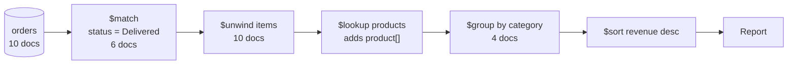
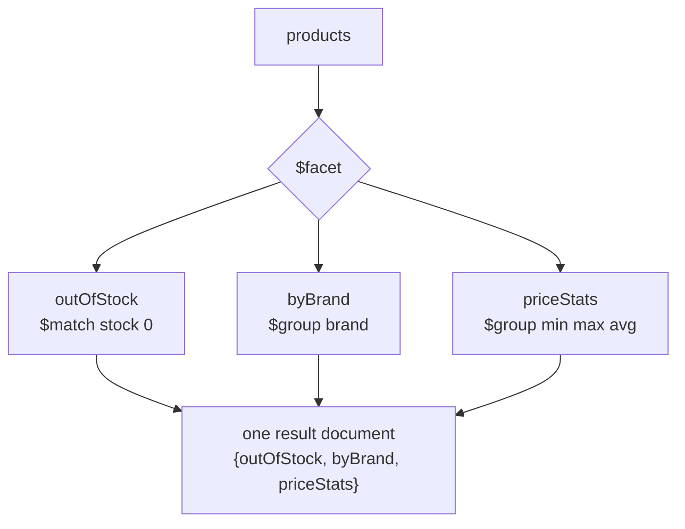

[](https://colab.research.google.com/github/Hamnakhan123/Diploma-in-AI/blob/main/term-1/02-managing-large-datasets-with-mongodb/code/session-04-aggregation-pipeline.ipynb) &nbsp; 📓 [Notebook](code/session-04-aggregation-pipeline.ipynb)

# Session 4: The Aggregation Pipeline

> 🧭 [Diploma in AI](../../README.md) › [Term 1](../README.md) › [Managing Large Datasets with MongoDB](README.md) › **Session 4**
>
> ⏱️ **Estimated time:** 3 hours (1 h concepts + 2 h lab) &nbsp;|&nbsp; 📋 **Prerequisites:** Session 3 (operators)
>
> Prepared by **Hamna Zahid Khan**, Junior Lecturer

[⬅ Previous: Session 3](session-03-mongodb-operators.md) &nbsp;|&nbsp; [🏠 Module home](README.md) &nbsp;|&nbsp; [Next: Session 5 ➡](session-05-database-commands.md)

---

## 🎯 Learning objectives

- Explain the **aggregation pipeline** and how documents flow through stages.
- Use the core stages `$match`, `$group`, `$project`, `$sort`, `$limit`, `$skip`, `$count`.
- Flatten arrays with **`$unwind`** and join collections with **`$lookup`**.
- Build reports with `$addFields`, `$cond`, date expressions, **`$bucket`** and **`$facet`**.
- Save results with **`$out`** / `$merge` and order stages for performance.

## 📖 Concepts

### 1. The pipeline idea

An aggregation is a **list of stages**. Each stage receives a stream of documents, transforms it, and passes the result on, like a production line or a Unix pipe (`cat | grep | sort`). It is MongoDB's answer to SQL's `GROUP BY`, `JOIN`, `HAVING` and computed columns.

```javascript
db.orders.aggregate([
  { $match: { status: "Delivered" } },               // WHERE
  { $unwind: "$items" },                               // one document per item
  { $group: { _id: "$customerId",                      // GROUP BY
              spent: { $sum: { $multiply: ["$items.qty", "$items.price"] } } } },
  { $sort: { spent: -1 } },                            // ORDER BY
  { $limit: 3 }                                        // TOP 3
])
```

### 2. Stage reference

| Stage | SQL idea | Purpose |
|---|---|---|
| `$match` | `WHERE` / `HAVING` | filter documents (same syntax as `find`) |
| `$project` | `SELECT` list | include, exclude, rename, compute fields |
| `$addFields` / `$set` | computed column | add fields, keep the rest |
| `$group` | `GROUP BY` | `_id` is the group key; accumulators compute per group |
| `$sort`, `$limit`, `$skip` | `ORDER BY`, `TOP`, `OFFSET` | ordering and paging |
| `$count` | `COUNT(*)` | number of documents reaching the stage |
| `$unwind` | (no direct equivalent) | one output document per array element |
| `$lookup` | `LEFT OUTER JOIN` | pull matching documents from another collection into an array |
| `$bucket` / `$bucketAuto` | `CASE` + `GROUP BY` | group into ranges |
| `$facet` | several queries at once | run sub-pipelines on the same input |
| `$sortByCount` | `GROUP BY … ORDER BY COUNT DESC` | shortcut for group + sort |
| `$out` / `$merge` | `SELECT INTO` / `MERGE` | write results to a collection |
| `$setWindowFields` | window functions | running totals, ranks (MongoDB 5.0+) |

### 3. Accumulators and expressions

**Accumulators** (inside `$group`): `$sum`, `$avg`, `$min`, `$max`, `$first`, `$last`, `$push`, `$addToSet`, `$count`, `$stdDevPop`. `{$sum: 1}` counts documents.

**Expressions** (anywhere a value is computed) refer to fields with a `$` prefix (`"$price"`) and to variables with `$$` (`"$$i.qty"` inside `$map`):

| Kind | Examples |
|---|---|
| Arithmetic | `$add $subtract $multiply $divide $mod $floor $ceil $round` |
| Comparison / logic | `$eq $gt $lt $and $or $not $cmp` |
| Conditional | `$cond: [if, then, else]`, `$ifNull`, `$switch` |
| String | `$concat $toUpper $toLower $substr $split $trim` |
| Date | `$year $month $dayOfWeek $dateToString $dateDiff` |
| Array | `$size $arrayElemAt $filter $map $reduce $in` |
| Type | `$toString $toInt $toDouble $toDate $convert` |

### 4. Performance rules

1. Put **`$match` and `$sort` first** so they can use indexes and shrink the stream early.
2. `$project` away fields you don't need before heavy stages.
3. Each stage may use **100 MB of RAM**; pass `{allowDiskUse: true}` for big sorts and groups (default `true` from MongoDB 6.0).
4. `$lookup` on a large collection needs an index on `foreignField`.
5. Use `explain("executionStats")` on the aggregate to see what happened (Session 7).

## 🧭 Diagrams





## 💻 Worked examples

### Example 1: Pipeline basics


📄 [`code/session-04_pipeline_basics.py`](code/session-04_pipeline_basics.py)

```python
# Session 4 · Pipeline basics: $match, $group, $sort, $project, $limit, $count
from store_db import get_db, show

db = get_db()

print("1) Products per category with average and max price")
show(db.products.aggregate([
    {"$group": {"_id": "$category",
                "products": {"$sum": 1},
                "avgPrice": {"$avg": "$price"},
                "maxPrice": {"$max": "$price"}}},
    {"$sort": {"products": -1, "_id": 1}},
]))

print("\n2) Orders per status, but only non-cancelled ones ($match first)")
show(db.orders.aggregate([
    {"$match": {"status": {"$ne": "Cancelled"}}},
    {"$group": {"_id": "$status", "orders": {"$sum": 1}}},
    {"$sort": {"orders": -1, "_id": 1}},
]))

print("\n3) $project with computed fields: stock value, in whole thousands")
show(db.products.aggregate([
    {"$project": {"_id": 0, "name": 1,
                  "stockValue": {"$multiply": ["$price", "$stock"]},
                  "inThousands": {"$floor": {"$divide": [{"$multiply": ["$price", "$stock"]}, 1000]}}}},
    {"$sort": {"stockValue": -1}},
    {"$limit": 3},
]))

print("\n4) $count: how many Karachi customers")
show(db.customers.aggregate([{"$match": {"city": "Karachi"}}, {"$count": "karachiCustomers"}]))

print("\n5) $push / $addToSet collect values per group")
show(db.customers.aggregate([
    {"$group": {"_id": "$city", "names": {"$push": "$name"}, "tiers": {"$addToSet": "$loyalty"}}},
    {"$sort": {"_id": 1}},
]))
```

**Output**

```text
1) Products per category with average and max price
{"products": 4, "avgPrice": 4425.0, "maxPrice": 7500, "_id": "Accessories"}
{"products": 2, "avgPrice": 12500.0, "maxPrice": 18500, "_id": "Audio"}
{"products": 2, "avgPrice": 247500.0, "maxPrice": 285000, "_id": "Computers"}
{"products": 1, "avgPrice": 52000.0, "maxPrice": 52000, "_id": "Displays"}
{"products": 1, "avgPrice": 16000.0, "maxPrice": 16000, "_id": "Storage"}
(5 documents)

2) Orders per status, but only non-cancelled ones ($match first)
{"orders": 6, "_id": "Delivered"}
{"orders": 2, "_id": "Shipped"}
{"orders": 1, "_id": "Pending"}
(3 documents)

3) $project with computed fields: stock value, in whole thousands
{"name": "Ultrabook", "stockValue": 1050000, "inThousands": 1050}
{"name": "Gaming Laptop", "stockValue": 855000, "inThousands": 855}
{"name": "27-inch Monitor", "stockValue": 312000, "inThousands": 312}
(3 documents)

4) $count: how many Karachi customers
{"karachiCustomers": 3}
(1 document)

5) $push / $addToSet collect values per group
{"names": ["Usman Tariq"], "tiers": ["Silver"], "_id": "Islamabad"}
{"names": ["Ayesha Khan", "Sana Malik", "Hira Siddiqui"], "tiers": ["Gold", "Bronze"], "_id": "Karachi"}
{"names": ["Bilal Ahmed", "Fahad Raza"], "tiers": ["Silver", "Bronze"], "_id": "Lahore"}
(3 documents)
```


**mongosh equivalent**

```javascript
db.products.aggregate([
  { $group: { _id: "$category", products: { $sum: 1 }, avgPrice: { $avg: "$price" }, maxPrice: { $max: "$price" } } },
  { $sort: { products: -1, _id: 1 } }
])
db.orders.aggregate([
  { $match: { status: { $ne: "Cancelled" } } },
  { $group: { _id: "$status", orders: { $sum: 1 } } },
  { $sort: { orders: -1, _id: 1 } }
])
db.products.aggregate([
  { $project: { _id: 0, name: 1, stockValue: { $multiply: ["$price", "$stock"] },
                inThousands: { $floor: { $divide: [{ $multiply: ["$price", "$stock"] }, 1000] } } } },
  { $sort: { stockValue: -1 } }, { $limit: 3 }
])
db.customers.aggregate([{ $match: { city: "Karachi" } }, { $count: "karachiCustomers" }])
db.customers.aggregate([{ $group: { _id: "$city", names: { $push: "$name" }, tiers: { $addToSet: "$loyalty" } } }])
```

> `$addToSet` does not promise an order, so the `tiers` arrays may list values in a different order on a real server.

### Example 2: `$unwind` and `$lookup`

📄 [`code/session-04_unwind_lookup.py`](code/session-04_unwind_lookup.py)

```python
# Session 4 · $unwind and $lookup: revenue reports across collections
from store_db import get_db, show

db = get_db()
delivered = {"$match": {"status": "Delivered"}}

print("1) $unwind turns one order with 2 items into 2 documents")
show(db.orders.aggregate([{"$match": {"_id": 5001}}, {"$unwind": "$items"},
                          {"$project": {"items": 1}}]))

print("\n2) Revenue per category from delivered orders ($unwind + $lookup + $group)")
show(db.orders.aggregate([
    delivered,
    {"$unwind": "$items"},
    {"$lookup": {"from": "products", "localField": "items.productId",
                 "foreignField": "_id", "as": "product"}},
    {"$unwind": "$product"},
    {"$group": {"_id": "$product.category",
                "units": {"$sum": "$items.qty"},
                "revenue": {"$sum": {"$multiply": ["$items.qty", "$items.price"]}}}},
    {"$sort": {"revenue": -1}},
]))

print("\n3) Top 3 customers by spend, with their names")
show(db.orders.aggregate([
    delivered,
    {"$unwind": "$items"},
    {"$group": {"_id": "$customerId",
                "spent": {"$sum": {"$multiply": ["$items.qty", "$items.price"]}},
                "orders": {"$addToSet": "$_id"}}},
    {"$lookup": {"from": "customers", "localField": "_id", "foreignField": "_id", "as": "c"}},
    {"$project": {"_id": 0, "name": {"$arrayElemAt": ["$c.name", 0]},
                  "city": {"$arrayElemAt": ["$c.city", 0]},
                  "spent": 1, "orderCount": {"$size": "$orders"}}},
    {"$sort": {"spent": -1}},
    {"$limit": 3},
]))

print("\n4) Products that were never part of a DELIVERED order")
show(db.products.aggregate([
    {"$lookup": {"from": "orders", "localField": "_id", "foreignField": "items.productId", "as": "o"}},
    {"$project": {"_id": 0, "name": 1,
                  "delivered": {"$filter": {"input": "$o", "as": "x",
                                            "cond": {"$eq": ["$$x.status", "Delivered"]}}}}},
    {"$match": {"delivered": {"$size": 0}}},
    {"$project": {"name": 1}},
]))
```

**Output**

```text
1) $unwind turns one order with 2 items into 2 documents
{"_id": 5001, "items": {"productId": 101, "qty": 2, "price": 1500}}
{"_id": 5001, "items": {"productId": 107, "qty": 1, "price": 4500}}
(2 documents)

2) Revenue per category from delivered orders ($unwind + $lookup + $group)
{"units": 1, "revenue": 210000, "_id": "Computers"}
{"units": 2, "revenue": 104000, "_id": "Displays"}
{"units": 2, "revenue": 32000, "_id": "Storage"}
{"units": 7, "revenue": 25500, "_id": "Accessories"}
(4 documents)

3) Top 3 customers by spend, with their names
{"spent": 243500, "name": "Hira Siddiqui", "city": "Karachi", "orderCount": 2}
{"spent": 67000, "name": "Ayesha Khan", "city": "Karachi", "orderCount": 2}
{"spent": 52000, "name": "Bilal Ahmed", "city": "Lahore", "orderCount": 1}
(3 documents)

4) Products that were never part of a DELIVERED order
{"name": "USB-C Hub"}
{"name": "Noise-Cancelling Headphones"}
{"name": "Bluetooth Speaker"}
{"name": "Gaming Laptop"}
(4 documents)
```


**mongosh equivalent** (the category report)

```javascript
db.orders.aggregate([
  { $match: { status: "Delivered" } },
  { $unwind: "$items" },
  { $lookup: { from: "products", localField: "items.productId", foreignField: "_id", as: "product" } },
  { $unwind: "$product" },
  { $group: { _id: "$product.category", units: { $sum: "$items.qty" },
              revenue: { $sum: { $multiply: ["$items.qty", "$items.price"] } } } },
  { $sort: { revenue: -1 } }
])
```

Check by hand: Displays = orders 5002 + 5010 = 2 monitors × 52,000 = **104,000**. ✔

### Example 3: Reporting stages

📄 [`code/session-04_reports.py`](code/session-04_reports.py)

```python
# Session 4 · Reporting stages: $addFields, $cond, dates, $bucket, $facet, $out
from store_db import get_db, show

db = get_db()

print("1) Monthly sales (all non-cancelled orders)")
show(db.orders.aggregate([
    {"$match": {"status": {"$ne": "Cancelled"}}},
    {"$addFields": {"lineTotals": {"$map": {"input": "$items", "as": "i",
                                            "in": {"$multiply": ["$$i.qty", "$$i.price"]}}},
                    "month": {"$dateToString": {"format": "%Y-%m", "date": "$orderDate"}}}},
    {"$addFields": {"total": {"$sum": "$lineTotals"}}},
    {"$group": {"_id": "$month", "orders": {"$sum": 1}, "sales": {"$sum": "$total"}}},
    {"$sort": {"_id": 1}},
]))

print("\n2) $cond labels each product as Budget / Mid / Premium")
show(db.products.aggregate([
    {"$project": {"_id": 0, "name": 1, "price": 1,
                  "band": {"$cond": [{"$lt": ["$price", 10000]}, "Budget",
                           {"$cond": [{"$lt": ["$price", 100000]}, "Mid", "Premium"]}]}}},
    {"$sort": {"price": 1}},
]))

print("\n3) $bucket: how many products fall in each price range")
show(db.products.aggregate([
    {"$bucket": {"groupBy": "$price", "boundaries": [0, 5000, 20000, 100000, 1000000],
                 "default": "other", "output": {"count": {"$sum": 1}, "names": {"$push": "$name"}}}},
]))

print("\n4) $facet: several summaries in one pass")
show(db.products.aggregate([
    {"$facet": {
        "outOfStock": [{"$match": {"stock": 0}}, {"$project": {"_id": 0, "name": 1}}],
        "byBrand":    [{"$group": {"_id": "$specs.brand", "n": {"$sum": 1}}}, {"$match": {"n": {"$gt": 1}}}],
        "priceStats": [{"$group": {"_id": None, "min": {"$min": "$price"}, "max": {"$max": "$price"},
                                   "avg": {"$avg": "$price"}}}],
    }},
]))

print("\n5) $out writes the result to a new collection (a materialised report)")
list(db.orders.aggregate([{"$match": {"status": "Delivered"}},
                          {"$project": {"customerId": 1, "orderDate": 1}},
                          {"$out": "delivered_orders"}]))
print("collections now:", sorted(db.list_collection_names()))
print("documents in delivered_orders:", db.delivered_orders.count_documents({}))
```

**Output**

```text
1) Monthly sales (all non-cancelled orders)
{"orders": 3, "sales": 84500, "_id": "2025-03"}
{"orders": 2, "sales": 41000, "_id": "2025-04"}
{"orders": 3, "sales": 237100, "_id": "2025-05"}
{"orders": 1, "sales": 59500, "_id": "2025-06"}
(4 documents)

2) $cond labels each product as Budget / Mid / Premium
{"name": "Wireless Mouse", "price": 1500, "band": "Budget"}
{"name": "USB-C Hub", "price": 4200, "band": "Budget"}
{"name": "Webcam HD", "price": 4500, "band": "Budget"}
{"name": "Bluetooth Speaker", "price": 6500, "band": "Budget"}
{"name": "Mechanical Keyboard", "price": 7500, "band": "Budget"}
{"name": "Portable SSD 1TB", "price": 16000, "band": "Mid"}
{"name": "Noise-Cancelling Headphones", "price": 18500, "band": "Mid"}
{"name": "27-inch Monitor", "price": 52000, "band": "Mid"}
{"name": "Ultrabook", "price": 210000, "band": "Premium"}
{"name": "Gaming Laptop", "price": 285000, "band": "Premium"}
(10 documents)

3) $bucket: how many products fall in each price range
{"count": 3, "names": ["Wireless Mouse", "USB-C Hub", "Webcam HD"], "_id": 0}
{"count": 4, "names": ["Mechanical Keyboard", "Noise-Cancelling Headphones", "Bluetooth Speaker", "Portable SSD 1TB"], "_id": 5000}
{"count": 1, "names": ["27-inch Monitor"], "_id": 20000}
{"count": 2, "names": ["Gaming Laptop", "Ultrabook"], "_id": 100000}
(4 documents)

4) $facet: several summaries in one pass
{"outOfStock": [{"name": "USB-C Hub"}], "byBrand": [{"n": 2, "_id": "Logi"}], "priceStats": [{"min": 1500, "max": 285000, "avg": 60570.0, "_id": null}]}
(1 document)

5) $out writes the result to a new collection (a materialised report)
collections now: ['customers', 'delivered_orders', 'orders', 'products']
documents in delivered_orders: 6
```


**mongosh equivalent** (monthly sales and buckets)

```javascript
db.orders.aggregate([
  { $match: { status: { $ne: "Cancelled" } } },
  { $addFields: { total: { $sum: { $map: { input: "$items", as: "i", in: { $multiply: ["$$i.qty", "$$i.price"] } } } },
                  month: { $dateToString: { format: "%Y-%m", date: "$orderDate" } } } },
  { $group: { _id: "$month", orders: { $sum: 1 }, sales: { $sum: "$total" } } },
  { $sort: { _id: 1 } }
])
db.products.aggregate([{ $bucket: { groupBy: "$price", boundaries: [0, 5000, 20000, 100000, 1000000],
                                    default: "other", output: { count: { $sum: 1 }, names: { $push: "$name" } } } }])
db.products.aggregate([{ $sortByCount: "$category" }])     // shortcut, real server
```

> On a real server `$sum` can take the `$map` result directly in one `$addFields`; the Python file splits it into two stages because mongomock needs that.

## 🧪 Lab / practice tasks

**1. 🟢 Easy:** Count customers per loyalty tier, most common first.

<details><summary>💡 Hint</summary>

`$group` with `{"$sum": 1}`, then `$sort`.

</details>

**2. 🟢 Easy:** Show each product as `"Wireless Mouse (Accessories)"` in a single field called `label`.

<details><summary>💡 Hint</summary>

`$concat` inside `$project`.

</details>

**3. 🟡 Medium:** For each payment method (Card / COD), show the number of orders and total value, excluding cancelled orders.

<details><summary>💡 Hint</summary>

`$unwind` items or `$map` + `$sum` for order totals.

</details>

**4. 🟡 Medium:** Find the average number of items (lines) per order.

<details><summary>💡 Hint</summary>

`$project: {n: {"$size": "$items"}}` then `$group` with `_id: None`.

</details>

**5. 🟠 Hard:** List every customer with the number of orders they placed, including customers with zero orders.

<details><summary>💡 Hint</summary>

Start from `customers`, `$lookup` into `orders`, then `$size`.

</details>

**6. 🟠 Hard:** Build a `$bucket` of customers by join month (Jan-Mar, Apr-Jun, Jul-Sep).

<details><summary>💡 Hint</summary>

`groupBy: {"$month": "$joined"}`, boundaries `[1, 4, 7, 10]`.

</details>

**7. 🔴 Challenge:** In one `$facet`, return: top 2 products by units sold, revenue per city, and total delivered revenue. Save the city report with `$out` to `city_revenue`.

<details><summary>💡 Hint</summary>

You need `$lookup` to customers for city.

</details>


## ✅ Quick quiz

**Q1.** Which stage is the aggregation equivalent of SQL's `WHERE`?

- A) $project
- B) $match
- C) $group
- D) $filter

**Q2.** An order has 3 items. How many documents leave `{$unwind: "$items"}` for that order?

- A) 1
- B) 3
- C) 0
- D) it depends on qty

**Q3.** In `$group`, what does `{$sum: 1}` compute?

- A) the sum of field "1"
- B) the number of documents in each group
- C) always 1
- D) the first value

**Q4.** `$lookup` behaves most like which SQL join?

- A) INNER JOIN
- B) LEFT OUTER JOIN
- C) CROSS JOIN
- D) FULL OUTER JOIN

**Q5.** Why should `$match` usually come first?

- A) It is required by syntax
- B) It reduces documents early and can use an index
- C) It sorts the output
- D) It enables `$out`

<details><summary>✅ Show answers</summary>

1. **B**
2. **B**
3. **B**
4. **B**
5. **B**

</details>


## 📝 Summary

- A pipeline is an ordered list of stages; each stage transforms the document stream.
- `$match`, `$project`, `$group`, `$sort`, `$limit` cover most SQL-style reports.
- `$unwind` flattens arrays; `$lookup` joins another collection (left outer join).
- `$addFields`, `$cond`, date and array expressions compute values; `$bucket` and `$facet` build dashboards.
- `$out` / `$merge` save results; filter and sort early, and use `allowDiskUse` for large jobs.

### 🎤 Interview / viva questions

1. Translate `SELECT city, COUNT(*) FROM customers GROUP BY city HAVING COUNT(*) > 1` into a pipeline.
2. What does `$unwind` do to a document whose array is empty, and how do you keep it?
3. Difference between `$out` and `$merge`?
4. Why can `$lookup` be slow, and how do you speed it up?
5. When would you use `$facet`?

---

[⬅ Previous: Session 3](session-03-mongodb-operators.md) &nbsp;|&nbsp; [🏠 Module home](README.md) &nbsp;|&nbsp; [Next: Session 5 ➡](session-05-database-commands.md)

<sub>Prepared by **Hamna Zahid Khan**, Junior Lecturer · Diploma in AI</sub>
