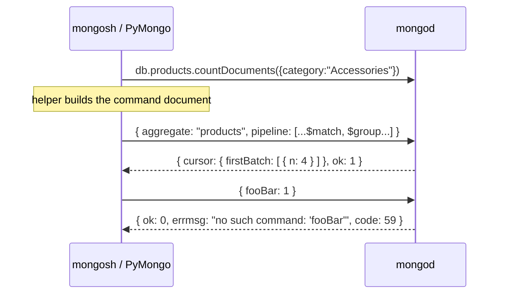
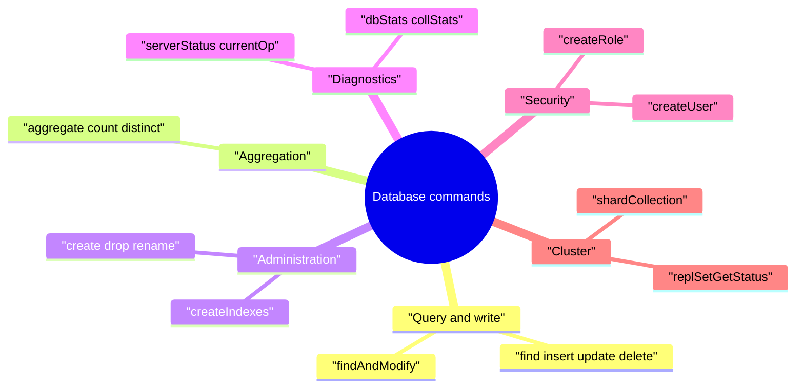

[](https://colab.research.google.com/github/Hamnakhan123/Diploma-in-AI/blob/main/term-1/02-managing-large-datasets-with-mongodb/code/session-05-database-commands.ipynb) &nbsp; 📓 [Notebook](code/session-05-database-commands.ipynb)

# Session 5: Database Commands

> 🧭 [Diploma in AI](../../README.md) › [Term 1](../README.md) › [Managing Large Datasets with MongoDB](README.md) › **Session 5**
>
> ⏱️ **Estimated time:** 2.5 hours (1 h concepts + 1.5 h lab) &nbsp;|&nbsp; 📋 **Prerequisites:** Sessions 2-4
>
> Prepared by **Hamna Zahid Khan**, Junior Lecturer

[⬅ Previous: Session 4](session-04-aggregation-pipeline.md) &nbsp;|&nbsp; [🏠 Module home](README.md) &nbsp;|&nbsp; [Next: Session 6 ➡](session-06-mongodb-shell-methods.md)

---

## 🎯 Learning objectives

- Explain what a **database command** is and how helpers such as `countDocuments()` map to commands.
- Run commands with `db.runCommand()` / `db.adminCommand()` in mongosh and `db.command()` in PyMongo.
- Use the main command groups: **query and write**, **aggregation**, **administration**, **diagnostics**, **user and role management**, **replication**.
- Read a command's reply (`ok`, `errmsg`, `code`, `cursor`).
- Inspect a database's size with `dbStats` and `collStats`.

## 📖 Concepts

### 1. Commands are documents

Under the hood every operation is a **command document** sent to the server. The **first key** names the command, and its value is usually the target collection:

```javascript
db.runCommand({ count: "products", query: { category: "Accessories" } })   // { n: 4, ok: 1 }
db.runCommand({ distinct: "customers", key: "city" })
db.adminCommand({ listDatabases: 1 })      // admin commands run against the admin database
```

The reply always contains **`ok: 1`** (success) or **`ok: 0`** with `errmsg` and a numeric `code`. Commands that return many documents reply with a **`cursor`** (`firstBatch`, then `getMore`).

In PyMongo: `db.command("count", "products", query={...})` or `db.command({"count": "products", ...})`.

### 2. Command groups

| Group | Commands | mongosh helper |
|---|---|---|
| **Query and write** | `find`, `insert`, `update`, `delete`, `findAndModify`, `getMore`, `count`, `distinct` | `find()`, `insertOne()`, `findOneAndUpdate()` |
| **Aggregation** | `aggregate`, `count`, `distinct`, `mapReduce` (deprecated) | `aggregate()` |
| **Administration** | `create`, `drop`, `dropDatabase`, `renameCollection`, `createIndexes`, `dropIndexes`, `listCollections`, `listDatabases`, `compact`, `collMod`, `killOp`, `shutdown` | `createCollection()`, `drop()`, `renameCollection()` |
| **Diagnostics** | `ping`, `serverStatus`, `dbStats`, `collStats`, `currentOp`, `top`, `buildInfo`, `hostInfo`, `explain` | `db.stats()`, `db.coll.stats()`, `db.serverStatus()` |
| **Users** | `createUser`, `updateUser`, `dropUser`, `usersInfo`, `grantRolesToUser` | `db.createUser()` |
| **Roles** | `createRole`, `grantPrivilegesToRole`, `rolesInfo` | `db.createRole()` |
| **Replication** | `replSetInitiate`, `replSetGetStatus`, `replSetStepDown`, `hello` | `rs.initiate()`, `rs.status()` |
| **Sharding** | `addShard`, `shardCollection`, `balancerStatus` | `sh.addShard()`, `sh.shardCollection()` |

### 3. Diagnostics you will actually use

| Command | Tells you |
|---|---|
| `db.stats()` (`dbStats`) | number of collections, objects, `dataSize`, `storageSize`, `indexSize` |
| `db.products.stats()` (`collStats`) | `count`, `size`, `avgObjSize`, `nindexes`, `totalIndexSize` |
| `db.serverStatus()` | uptime, connections, operation counters, memory, WiredTiger cache |
| `db.currentOp()` / `db.killOp(id)` | running operations, and stopping a runaway one |
| `db.setProfilingLevel(1, {slowms: 100})` | records slow queries in `system.profile` |
| `db.version()`, `db.hello()` | server version, whether this node is primary |

### 4. Users and roles (security basics)

MongoDB uses **role-based access control**. Enable it with `security.authorization: enabled` in `mongod.conf`.

```javascript
use admin
db.createUser({ user: "siteAdmin", pwd: passwordPrompt(), roles: [ "userAdminAnyDatabase", "readWriteAnyDatabase" ] })
use kgs
db.createUser({ user: "reportBot", pwd: passwordPrompt(), roles: [ { role: "read", db: "kgs" } ] })
db.grantRolesToUser("reportBot", [ { role: "readWrite", db: "analytics" } ])
db.getUsers()
db.createRole({ role: "stockKeeper", privileges: [ { resource: { db: "kgs", collection: "products" },
                actions: [ "find", "update" ] } ], roles: [] })
```

| Built-in role | Can |
|---|---|
| `read` / `readWrite` | read / read and write one database |
| `dbAdmin` | indexes, stats, schema tasks (no user admin) |
| `userAdmin` | create and manage users and roles |
| `clusterAdmin` | replication and sharding |
| `root` | everything |

Follow **least privilege**: an analytics script needs `read`, not `root`.

## 🧭 Diagrams





## 💻 Worked examples

### Example 1: Administrative helpers and a home-made `collStats`


📄 [`code/session-05_admin_helpers.py`](code/session-05_admin_helpers.py)

```python
# Session 5 · Administrative work through driver helpers
import bson
from store_db import get_db

db = get_db()
client = db.client

print("ping           ->", client.admin.command("ping"))
print("databases      ->", client.list_database_names())
print("collections    ->", sorted(db.list_collection_names()))

db.create_collection("audit_log")
db.audit_log.insert_one({"event": "price_change", "productId": 101})
print("after create   ->", sorted(db.list_collection_names()))

db.audit_log.rename("price_audit")                  # renameCollection
print("after rename   ->", sorted(db.list_collection_names()))

db.drop_collection("price_audit")                   # drop
print("after drop     ->", sorted(db.list_collection_names()))

# A home-made version of dbStats / collStats using BSON sizes
def coll_stats(name):
    docs = list(db[name].find())
    sizes = [len(bson.encode(d)) for d in docs]
    return {"ns": f"{db.name}.{name}", "count": len(docs), "size": sum(sizes),
            "avgObjSize": round(sum(sizes) / len(sizes)), "nindexes": len(db[name].index_information())}

print("\n{:<14} {:>5} {:>7} {:>10} {:>8}".format("collection", "count", "bytes", "avgObjSize", "indexes"))
total = 0
for name in sorted(db.list_collection_names()):
    s = coll_stats(name); total += s["size"]
    print("{:<14} {:>5} {:>7} {:>10} {:>8}".format(name, s["count"], s["size"], s["avgObjSize"], s["nindexes"]))
print("dbStats-style total data size:", total, "bytes")
```

**Output**

```text
ping           -> {'ok': 1.0}
databases      -> ['kgs']
collections    -> ['customers', 'orders', 'products']
after create   -> ['audit_log', 'customers', 'orders', 'products']
after rename   -> ['customers', 'orders', 'price_audit', 'products']
after drop     -> ['customers', 'orders', 'products']

collection     count   bytes avgObjSize  indexes
customers          6     655        109        1
orders            10    1645        164        1
products          10    1742        174        1
dbStats-style total data size: 4042 bytes
```


**mongosh equivalent**

```javascript
db.adminCommand({ ping: 1 })
show dbs                              // db.adminCommand({ listDatabases: 1 })
db.createCollection("audit_log")
db.audit_log.insertOne({ event: "price_change", productId: 101 })
db.audit_log.renameCollection("price_audit")
db.price_audit.drop()
db.stats()                            // dbStats
db.products.stats()                   // collStats: count, size, avgObjSize, nindexes ...
```

> mongomock has no `dbStats`/`collStats`, so the script measures each document's BSON size itself. A real server also reports `storageSize` (compressed bytes on disk) and `indexSize`, which are usually quite different from the raw data size.

### Example 2: Command documents and their replies

📄 [`code/session-05_run_command.py`](code/session-05_run_command.py)

```python
# Session 5 · What a database command looks like
# Every helper (count, distinct, create, drop…) is sent to the server as a COMMAND DOCUMENT:
# the first key is the command name, its value is usually the collection.
# mongomock implements only a few raw commands, so this file includes a tiny dispatcher
# that maps command documents to driver calls. On a real server you would simply call
#     db.command(cmd)            (PyMongo)      or      db.runCommand(cmd)   (mongosh)
from store_db import get_db

db = get_db()

def run_command(cmd):
    name, target = next(iter(cmd.items()))
    if name == "count":
        return {"n": db[target].count_documents(cmd.get("query", {})), "ok": 1}
    if name == "distinct":
        return {"values": sorted(db[target].distinct(cmd["key"], cmd.get("query", {}))), "ok": 1}
    if name == "create":
        db.create_collection(target); return {"ok": 1}
    if name == "drop":
        db.drop_collection(target); return {"ns": f"{db.name}.{target}", "ok": 1}
    if name == "listCollections":
        return {"cursor": {"firstBatch": [{"name": n} for n in sorted(db.list_collection_names())]}, "ok": 1}
    if name == "createIndexes":
        made = [db[target].create_index(list(ix["key"].items()), name=ix["name"]) for ix in cmd["indexes"]]
        return {"createdIndexes": made, "ok": 1}
    if name == "find":
        docs = list(db[target].find(cmd.get("filter", {}), cmd.get("projection")).limit(cmd.get("limit", 0)))
        return {"cursor": {"firstBatch": docs, "ns": f"{db.name}.{target}"}, "ok": 1}
    return {"ok": 0, "errmsg": f"no such command: '{name}'", "code": 59}

commands = [
    {"count": "products", "query": {"category": "Accessories"}},
    {"distinct": "customers", "key": "city", "query": {"loyalty": {"$ne": "Bronze"}}},
    {"create": "wishlists"},
    {"listCollections": 1},
    {"createIndexes": "products", "indexes": [{"key": {"category": 1, "price": -1}, "name": "cat_price"}]},
    {"find": "products", "filter": {"stock": 0}, "projection": {"name": 1}, "limit": 1},
    {"drop": "wishlists"},
    {"fsyncUnlockEverything": 1},
]
for c in commands:
    print("db.runCommand(", c, ")")
    print("   ->", run_command(c), "\n")
```

**Output**

```text
db.runCommand( {'count': 'products', 'query': {'category': 'Accessories'}} )
   -> {'n': 4, 'ok': 1} 

db.runCommand( {'distinct': 'customers', 'key': 'city', 'query': {'loyalty': {'$ne': 'Bronze'}}} )
   -> {'values': ['Islamabad', 'Karachi', 'Lahore'], 'ok': 1} 

db.runCommand( {'create': 'wishlists'} )
   -> {'ok': 1} 

db.runCommand( {'listCollections': 1} )
   -> {'cursor': {'firstBatch': [{'name': 'customers'}, {'name': 'orders'}, {'name': 'products'}, {'name': 'wishlists'}]}, 'ok': 1} 

db.runCommand( {'createIndexes': 'products', 'indexes': [{'key': {'category': 1, 'price': -1}, 'name': 'cat_price'}]} )
   -> {'createdIndexes': ['cat_price'], 'ok': 1} 

db.runCommand( {'find': 'products', 'filter': {'stock': 0}, 'projection': {'name': 1}, 'limit': 1} )
   -> {'cursor': {'firstBatch': [{'name': 'USB-C Hub', '_id': 104}], 'ns': 'kgs.products'}, 'ok': 1} 

db.runCommand( {'drop': 'wishlists'} )
   -> {'ns': 'kgs.wishlists', 'ok': 1} 

db.runCommand( {'fsyncUnlockEverything': 1} )
   -> {'ok': 0, 'errmsg': "no such command: 'fsyncUnlockEverything'", 'code': 59} 
```


**mongosh equivalent**

```javascript
db.runCommand({ count: "products", query: { category: "Accessories" } })
db.runCommand({ distinct: "customers", key: "city", query: { loyalty: { $ne: "Bronze" } } })
db.runCommand({ create: "wishlists" })
db.runCommand({ listCollections: 1, nameOnly: true })
db.runCommand({ createIndexes: "products", indexes: [ { key: { category: 1, price: -1 }, name: "cat_price" } ] })
db.runCommand({ find: "products", filter: { stock: 0 }, projection: { name: 1 }, limit: 1 })
db.runCommand({ drop: "wishlists" })
db.runCommand({ fsyncUnlockEverything: 1 })     // ok: 0, code 59 CommandNotFound
```

## 🧪 Lab / practice tasks

**1. 🟢 Easy:** In mongosh run `db.version()`, `db.stats()` and `db.products.stats()` on your own server. Note `dataSize`, `storageSize` and `nindexes`.

<details><summary>💡 Hint</summary>

On Atlas M0 some diagnostics are restricted; use a local server.

</details>

**2. 🟢 Easy:** Rewrite `db.orders.countDocuments({status: "Delivered"})` as a `runCommand` document using `count`.

<details><summary>💡 Hint</summary>

`{count: "orders", query: {...}}`

</details>

**3. 🟡 Medium:** Extend `run_command()` in the Python file with a `renameCollection`-style command and a `dropIndexes` command. Test both.

<details><summary>💡 Hint</summary>

`db[target].drop_index(name)`

</details>

**4. 🟡 Medium:** Create two users on a local server: `analyst` with `read` on `kgs` and `clerk` with `readWrite` on `kgs`. Log in as `analyst` and try an insert: what error do you get?

<details><summary>💡 Hint</summary>

`mongosh -u analyst -p --authenticationDatabase kgs`

</details>

**5. 🟠 Hard:** Turn on the profiler with `slowms: 0`, run three queries, then read `db.system.profile.find().sort({ts: -1}).limit(3)`. What does `millis` show?

<details><summary>💡 Hint</summary>

Turn it off afterwards with `db.setProfilingLevel(0)`.

</details>

**6. 🔴 Challenge:** Write a Python report that prints, for every collection, the count, average document size and the field names seen in the first 5 documents.

<details><summary>💡 Hint</summary>

Use the `coll_stats` idea plus a `set()` of keys.

</details>


## ✅ Quick quiz

**Q1.** In a command document, what does the first key represent?

- A) the database name
- B) the command name
- C) the user name
- D) the index name

**Q2.** What does a failed command reply contain?

- A) ok: 1 and a cursor
- B) ok: 0 with errmsg and code
- C) nothing
- D) an empty document

**Q3.** Which command shows the number of documents and average object size of one collection?

- A) dbStats
- B) collStats
- C) serverStatus
- D) hostInfo

**Q4.** Which built-in role should a read-only reporting script get?

- A) root
- B) dbAdmin
- C) read
- D) readWrite

**Q5.** Which mongosh method runs a command against the `admin` database?

- A) db.runAdmin()
- B) db.adminCommand()
- C) db.sudo()
- D) use admin only

<details><summary>✅ Show answers</summary>

1. **B**
2. **B**
3. **B**
4. **C**
5. **B**

</details>


## 📝 Summary

- Every operation is a **command document**; the first key names the command.
- `runCommand` / `adminCommand` (mongosh) and `db.command` (PyMongo) send commands directly.
- Replies carry `ok`, plus `errmsg`/`code` on failure or a `cursor` for result sets.
- `dbStats`, `collStats`, `serverStatus`, `currentOp` and the profiler are the core diagnostics.
- Users and roles implement least-privilege security.

### 🎤 Interview / viva questions

1. What is the difference between `runCommand` and `adminCommand`?
2. Why can `storageSize` be smaller than `dataSize`?
3. How would you find and stop a long-running query in production?
4. Explain role-based access control in MongoDB with an example.
5. Which command tells you whether a node is the primary?

---

[⬅ Previous: Session 4](session-04-aggregation-pipeline.md) &nbsp;|&nbsp; [🏠 Module home](README.md) &nbsp;|&nbsp; [Next: Session 6 ➡](session-06-mongodb-shell-methods.md)

<sub>Prepared by **Hamna Zahid Khan**, Junior Lecturer · Diploma in AI</sub>
