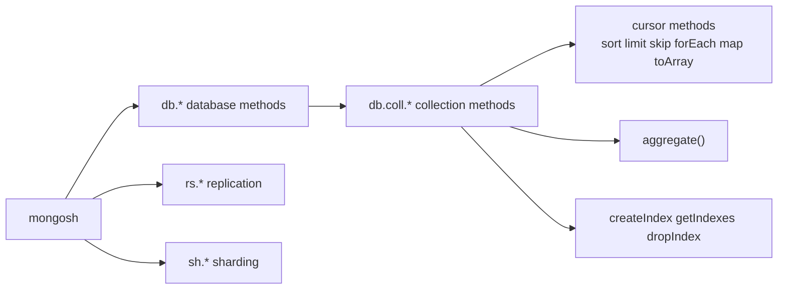
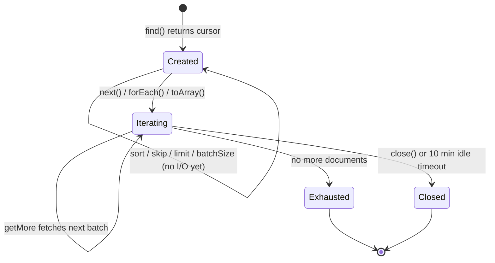

[](https://colab.research.google.com/github/Hamnakhan123/Diploma-in-AI/blob/main/term-1/02-managing-large-datasets-with-mongodb/code/session-06-mongodb-shell-methods.ipynb) &nbsp; 📓 [Notebook](code/session-06-mongodb-shell-methods.ipynb)

# Session 6: MongoDB Shell Methods

> 🧭 [Diploma in AI](../../README.md) › [Term 1](../README.md) › [Managing Large Datasets with MongoDB](README.md) › **Session 6**
>
> ⏱️ **Estimated time:** 2.5 hours (1 h concepts + 1.5 h lab) &nbsp;|&nbsp; 📋 **Prerequisites:** Sessions 2-5
>
> Prepared by **Hamna Zahid Khan**, Junior Lecturer

[⬅ Previous: Session 5](session-05-database-commands.md) &nbsp;|&nbsp; [🏠 Module home](README.md) &nbsp;|&nbsp; [Next: Session 7 ➡](session-07-mongodb-indexing.md)

---

## 🎯 Learning objectives

- Navigate the **mongosh** shell: help, history, editing, scripts and `load()`.
- Use **collection methods** beyond CRUD: `findOneAndDelete`, `findOneAndReplace`, `distinct`, index and rename methods.
- Use **cursor methods**: `sort`, `limit`, `skip`, `forEach`, `map`, `toArray`, `next`, `hasNext`, `batchSize`, `hint`, `explain`.
- Call **database**, **connection**, **user**, **replication** and **sharding** shell helpers.
- Write a small **JavaScript automation script** and its Python equivalent.

## 📖 Concepts

### 1. mongosh is a JavaScript (Node.js) REPL

Anything valid in JavaScript works: variables, loops, functions, template strings, `Date`, `Math`. Useful built-ins:

| Command | Purpose |
|---|---|
| `help`, `db.help()`, `db.products.help()` | list available methods |
| `show dbs / collections / users / roles / profile` | quick listings |
| `it` | show the next 20 results of the last cursor |
| `print()`, `printjson()`, `console.log()` | output |
| `load("file.js")` / `mongosh kgs file.js` | run a script |
| `.editor` | multi-line editor mode |
| `config.set("displayBatchSize", 50)` | change shell settings |
| `cls` / `exit` | clear screen / quit |
| `~/.mongoshrc.js` | code run every time the shell starts |

### 2. Method families

| Family | Typical methods |
|---|---|
| **Collection** `db.coll.*` | `insertOne/Many`, `find/findOne`, `updateOne/Many`, `replaceOne`, `deleteOne/Many`, `findOneAndUpdate/Replace/Delete`, `bulkWrite`, `aggregate`, `countDocuments`, `estimatedDocumentCount`, `distinct`, `createIndex`, `getIndexes`, `dropIndex`, `renameCollection`, `drop`, `stats`, `watch` |
| **Cursor** `find(...).*` | `sort`, `limit`, `skip`, `count`*, `forEach`, `map`, `toArray`, `next`, `hasNext`, `batchSize`, `hint`, `collation`, `comment`, `explain`, `pretty`, `close` |
| **Database** `db.*` | `getName`, `getCollectionNames`, `createCollection`, `createView`, `dropDatabase`, `stats`, `runCommand`, `adminCommand`, `getSiblingDB`, `currentOp`, `killOp`, `serverStatus`, `version` |
| **Connection** | `Mongo("mongodb://…")`, `connect()`, `db.getMongo()`, `getSiblingDB` |
| **User / role** | `db.createUser`, `db.getUsers`, `db.dropUser`, `db.createRole`, `db.grantRolesToUser` |
| **Replication** `rs.*` | `rs.initiate`, `rs.add`, `rs.status`, `rs.conf`, `rs.stepDown`, `rs.printReplicationInfo` |
| **Sharding** `sh.*` | `sh.enableSharding`, `sh.shardCollection`, `sh.status`, `sh.addShard`, `sh.balancerStatus` |

\* `cursor.count()` is deprecated: use `countDocuments()` (exact, runs a query) or `estimatedDocumentCount()` (fast, reads metadata, whole collection only).

### 3. Atomic "find-and-modify" methods

| Method | Does in one atomic step | Typical use |
|---|---|---|
| `findOneAndUpdate` | update + return document | counters, claim a job |
| `findOneAndReplace` | replace + return document | swap a config document |
| `findOneAndDelete` | delete + return document | pop the next task from a queue |

Each accepts `sort` (which match to take), `projection`, and `returnDocument: "before" | "after"`.

### 4. Views

A **view** is a saved, read-only aggregation: `db.createView("deliveredOrders", "orders", [{ $match: { status: "Delivered" } }])`. Query it like a collection; it always shows live data.

## 🧭 Diagrams





## 💻 Worked examples

### Example 1: Cursor methods


📄 [`code/session-06_cursor_methods.py`](code/session-06_cursor_methods.py)

```python
# Session 6 · Cursor methods (mongosh -> PyMongo)
from store_db import get_db

db = get_db()

cur = db.products.find({"stock": {"$gt": 0}}, {"name": 1, "price": 1}).sort([("price", -1)]).skip(1).limit(4)
print("1) sort + skip + limit, iterated like cursor.forEach():")
for d in cur:                                  # mongosh: .forEach(d => print(d.name))
    print("  ", d["name"], d["price"])

print("\n2) next() and hasNext()-style iteration")
cur = db.customers.find({}, {"name": 1}).sort("name", 1)
first = next(cur)                              # mongosh: cur.next()
print("   first:", first["name"])
print("   remaining:", [c["name"] for c in cur])  # mongosh: while (cur.hasNext()) ...

print("\n3) map(): build a list of strings from a cursor")
labels = [f"{d['name']} - Rs {d['price']:,}" for d in db.products.find({"category": "Audio"})]
print("  ", labels)                            # mongosh: .map(d => d.name + " - Rs " + d.price)

print("\n4) toArray() + length versus count methods")
arr = list(db.orders.find({"payment": "COD"}))  # mongosh: .toArray()
print("   COD orders (toArray().length):", len(arr))
print("   countDocuments:", db.orders.count_documents({"payment": "COD"}))
print("   estimatedDocumentCount (metadata, whole collection):", db.orders.estimated_document_count())

print("\n5) batch_size(): how many documents travel per network round trip")
cur = db.orders.find().batch_size(3)           # mongosh: .batchSize(3)
print("   documents fetched:", sum(1 for _ in cur), "(4 batches of up to 3 on a real server)")

print("\n6) hint() forces a particular index")
db.products.create_index("price")
print("  ", [d["name"] for d in db.products.find({"price": {"$lt": 5000}}).hint("price_1")])
```

**Output**

```text
1) sort + skip + limit, iterated like cursor.forEach():
   Ultrabook 210000
   27-inch Monitor 52000
   Noise-Cancelling Headphones 18500
   Portable SSD 1TB 16000

2) next() and hasNext()-style iteration
   first: Ayesha Khan
   remaining: ['Bilal Ahmed', 'Fahad Raza', 'Hira Siddiqui', 'Sana Malik', 'Usman Tariq']

3) map(): build a list of strings from a cursor
   ['Noise-Cancelling Headphones - Rs 18,500', 'Bluetooth Speaker - Rs 6,500']

4) toArray() + length versus count methods
   COD orders (toArray().length): 4
   countDocuments: 4
   estimatedDocumentCount (metadata, whole collection): 10

5) batch_size(): how many documents travel per network round trip
   documents fetched: 10 (4 batches of up to 3 on a real server)

6) hint() forces a particular index
   ['Wireless Mouse', 'USB-C Hub', 'Webcam HD']
```


**mongosh equivalent**

```javascript
db.products.find({ stock: { $gt: 0 } }, { name: 1, price: 1 }).sort({ price: -1 }).skip(1).limit(4)
  .forEach(d => print(d.name, d.price))
const cur = db.customers.find({}, { name: 1 }).sort({ name: 1 })
cur.next().name
while (cur.hasNext()) print(cur.next().name)
db.products.find({ category: "Audio" }).map(d => `${d.name} - Rs ${d.price}`)
db.orders.find({ payment: "COD" }).toArray().length
db.orders.countDocuments({ payment: "COD" })
db.orders.estimatedDocumentCount()
db.orders.find().batchSize(3)
db.products.createIndex({ price: 1 })
db.products.find({ price: { $lt: 5000 } }).hint("price_1").comment("cheap-items")
```

### Example 2: Collection methods

📄 [`code/session-06_collection_methods.py`](code/session-06_collection_methods.py)

```python
# Session 6 · Collection methods beyond basic CRUD
from pymongo import ReturnDocument
from store_db import get_db, show

db = get_db()

print("1) findOneAndDelete: take the oldest open (Pending/Shipped) order off a queue")
show(db.orders.find_one_and_delete({"status": {"$in": ["Pending", "Shipped"]}}, sort=[("orderDate", 1)],
                                   projection={"status": 1, "orderDate": 1}))

print("\n2) findOneAndReplace returning the new document")
show(db.customers.find_one_and_replace({"_id": 3}, {"name": "Sana Malik", "city": "Karachi", "loyalty": "Silver"},
                                       return_document=ReturnDocument.AFTER))

print("\n3) distinct with a filter")
print("   brands of products under Rs 10,000:", sorted(db.products.distinct("specs.brand", {"price": {"$lt": 10000}})))

print("\n4) createIndex / getIndexes / dropIndex")
db.products.create_index([("category", 1), ("price", -1)], name="cat_price")
print("   indexes:", list(db.products.index_information()))
db.products.drop_index("cat_price")
print("   after drop:", list(db.products.index_information()))

print("\n5) renameCollection and drop")
db.orders.aggregate([{"$match": {"status": "Cancelled"}}, {"$out": "tmp_cancelled"}])
db.tmp_cancelled.rename("cancelled_2025")
print("   collections:", sorted(db.list_collection_names()))
db.cancelled_2025.drop()
print("   after drop :", sorted(db.list_collection_names()))
```

**Output**

```text
1) findOneAndDelete: take the oldest open (Pending/Shipped) order off a queue
{"orderDate": "2025-03-18", "status": "Shipped", "_id": 5003}
(1 document)

2) findOneAndReplace returning the new document
{"_id": 3, "name": "Sana Malik", "city": "Karachi", "loyalty": "Silver"}
(1 document)

3) distinct with a filter
   brands of products under Rs 10,000: ['Anker', 'JBL', 'Logi', 'Redragon']

4) createIndex / getIndexes / dropIndex
   indexes: ['_id_', 'cat_price']
   after drop: ['_id_']

5) renameCollection and drop
   collections: ['cancelled_2025', 'customers', 'orders', 'products']
   after drop : ['customers', 'orders', 'products']
```


**mongosh equivalent**

```javascript
db.orders.findOneAndDelete({ status: { $in: ["Pending", "Shipped"] } },
                           { sort: { orderDate: 1 }, projection: { status: 1, orderDate: 1 } })
db.customers.findOneAndReplace({ _id: 3 }, { name: "Sana Malik", city: "Karachi", loyalty: "Silver" },
                               { returnDocument: "after" })
db.products.distinct("specs.brand", { price: { $lt: 10000 } })
db.products.createIndex({ category: 1, price: -1 }, { name: "cat_price" })
db.products.getIndexes()
db.products.dropIndex("cat_price")
db.orders.aggregate([{ $match: { status: "Cancelled" } }, { $out: "tmp_cancelled" }])
db.tmp_cancelled.renameCollection("cancelled_2025")
db.cancelled_2025.drop()
```

### Example 3: A shell script and its Python twin

📄 [`code/session-06_restock.js`](code/session-06_restock.js)

```javascript
// session-06_restock.js · run with:  mongosh kgs session-06_restock.js
// or inside mongosh:                 load("session-06_restock.js")
const LOW = 5;                                   // JavaScript variable
const today = new Date();

print(`Low-stock report for ${db.getName()} on ${today.toISOString().slice(0, 10)}`);

const low = db.products.find({ stock: { $lt: LOW } }, { name: 1, stock: 1 }).sort({ stock: 1 });
low.forEach(p => {
  const order = LOW * 2 - p.stock;              // bring stock up to 10
  print(`  ${p.name.padEnd(28)} stock ${String(p.stock).padStart(2)} -> reorder ${order}`);
  db.reorders.insertOne({ productId: p._id, qty: order, createdAt: today });
});

printjson(db.reorders.aggregate([{ $group: { _id: null, lines: { $sum: 1 }, units: { $sum: "$qty" } } }]).toArray());
```


📄 [`code/session-06_restock.py`](code/session-06_restock.py)

```python
# Session 6 · The same restock script in Python (compare with session-06_restock.js)
from datetime import datetime
from store_db import get_db

db = get_db()
LOW = 5
today = datetime(2025, 6, 30)                    # fixed date so the output is repeatable

print(f"Low-stock report for {db.name} on {today:%Y-%m-%d}")
for p in db.products.find({"stock": {"$lt": LOW}}, {"name": 1, "stock": 1}).sort("stock", 1):
    order = LOW * 2 - p["stock"]
    print(f"  {p['name']:<28} stock {p['stock']:>2} -> reorder {order}")
    db.reorders.insert_one({"productId": p["_id"], "qty": order, "createdAt": today})

print(list(db.reorders.aggregate([{"$group": {"_id": None, "lines": {"$sum": 1}, "units": {"$sum": "$qty"}}}])))
```

**Output**

```text
Low-stock report for kgs on 2025-06-30
  USB-C Hub                    stock  0 -> reorder 10
  Gaming Laptop                stock  3 -> reorder 7
[{'lines': 2, 'units': 17, '_id': None}]
```


The JavaScript file uses today's date; the Python twin fixes the date so its output is repeatable. Both produce the same reorder lines.

## 🧪 Lab / practice tasks

**1. 🟢 Easy:** In mongosh, type `db.products.help()` and list five methods you have not used yet. Try `db.products.find().size()` versus `db.products.countDocuments()`.

<details><summary>💡 Hint</summary>

`size()` respects `skip`/`limit`.

</details>

**2. 🟢 Easy:** Print the names of all Karachi customers using `forEach` in mongosh and a `for` loop in Python.

<details><summary>💡 Hint</summary>

`.forEach(c => print(c.name))`

</details>

**3. 🟡 Medium:** Use `map()` to produce strings like `"5001: Delivered"` for every order, then `toArray()` the result.

<details><summary>💡 Hint</summary>

In Python, a list comprehension does the same job.

</details>

**4. 🟡 Medium:** Create a view `lowStock` on `products` showing name and stock where stock < 10, sorted by stock. Query it.

<details><summary>💡 Hint</summary>

`db.createView(name, source, pipeline)`

</details>

**5. 🟠 Hard:** Build a job queue: insert 5 `{task, status: "new", createdAt}` documents, then write a loop that claims jobs one by one with `findOneAndUpdate` (status → "running", oldest first) until none are left.

<details><summary>💡 Hint</summary>

`sort: {createdAt: 1}` and `returnDocument: "after"`.

</details>

**6. 🔴 Challenge:** Write `report.js` that prints, for every collection in `kgs`, its name, document count and indexes, then run it with `mongosh kgs report.js`.

<details><summary>💡 Hint</summary>

`db.getCollectionNames().forEach(...)`

</details>


## ✅ Quick quiz

**Q1.** Which method returns an exact count for a filter?

- A) estimatedDocumentCount()
- B) countDocuments()
- C) cursor.size() only
- D) stats().count

**Q2.** Which method removes a document and returns it in one atomic step?

- A) deleteOne
- B) findOneAndDelete
- C) remove
- D) pop

**Q3.** What does `it` do in mongosh?

- A) iterates the next batch of results of the last cursor
- B) inserts a test document
- C) shows indexes
- D) exits the shell

**Q4.** Which shell helper family manages replica sets?

- A) sh.*
- B) rs.*
- C) db.repl.*
- D) cluster.*

**Q5.** A view in MongoDB is…

- A) a copy of the data refreshed nightly
- B) a read-only saved aggregation over live data
- C) an index type
- D) a backup

<details><summary>✅ Show answers</summary>

1. **B**
2. **B**
3. **A**
4. **B**
5. **B**

</details>


## 📝 Summary

- mongosh is a JavaScript REPL with helpers such as `help`, `show`, `it`, `load()` and `.mongoshrc.js`.
- Collection methods cover CRUD, find-and-modify, indexes, renaming and stats.
- Cursor methods shape (`sort`, `skip`, `limit`) and consume (`forEach`, `map`, `toArray`, `next`) results lazily.
- `db.*`, `rs.*` and `sh.*` cover databases, replication and sharding.
- Shell scripts automate admin tasks; PyMongo offers the same methods in snake_case.

### 🎤 Interview / viva questions

1. Why is `cursor.count()` deprecated, and what replaced it?
2. When would you use `findOneAndUpdate` instead of `updateOne`?
3. What is the default cursor timeout, and how does it affect long loops?
4. Difference between a view and a collection created with `$out`?
5. How do you run a mongosh script non-interactively in a scheduled job?

---

[⬅ Previous: Session 5](session-05-database-commands.md) &nbsp;|&nbsp; [🏠 Module home](README.md) &nbsp;|&nbsp; [Next: Session 7 ➡](session-07-mongodb-indexing.md)

<sub>Prepared by **Hamna Zahid Khan**, Junior Lecturer · Diploma in AI</sub>
