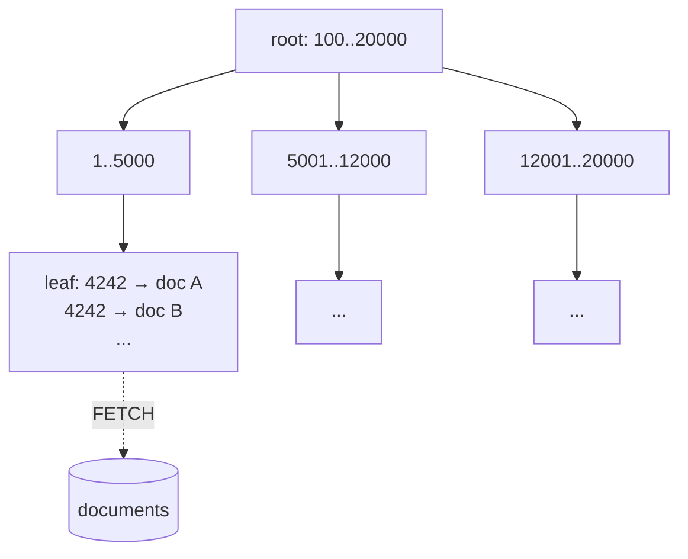
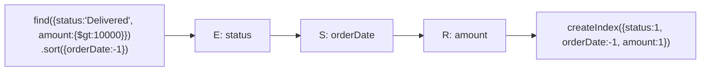

[](https://colab.research.google.com/github/Hamnakhan123/Diploma-in-AI/blob/main/term-1/02-managing-large-datasets-with-mongodb/code/session-07-mongodb-indexing.ipynb) &nbsp; 📓 [Notebook](code/session-07-mongodb-indexing.ipynb)

# Session 7: MongoDB Indexing

> 🧭 [Diploma in AI](../../README.md) › [Term 1](../README.md) › [Managing Large Datasets with MongoDB](README.md) › **Session 7**
>
> ⏱️ **Estimated time:** 3 hours (1 h concepts + 2 h lab) &nbsp;|&nbsp; 📋 **Prerequisites:** Sessions 2-6
>
> Prepared by **Hamna Zahid Khan**, Junior Lecturer

[⬅ Previous: Session 6](session-06-mongodb-shell-methods.md) &nbsp;|&nbsp; [🏠 Module home](README.md) &nbsp;|&nbsp; [Next: Session 8 ➡](session-08-replication-and-sharding.md)

---

## 🎯 Learning objectives

- Explain how a **B-tree index** speeds up queries and what it costs.
- Create **single-field, compound, multikey, text, geospatial, hashed, wildcard, unique, sparse, partial and TTL** indexes.
- Read **`explain("executionStats")`**: `COLLSCAN` vs `IXSCAN`, keys and documents examined.
- Order compound index fields with the **ESR rule** and build **covered queries**.
- Manage indexes: list, hide, drop, and build them on large collections.

## 📖 Concepts

### 1. What an index is

Without an index MongoDB must read **every document** (a *collection scan*, `COLLSCAN`). An index is a separate, **sorted B-tree** of field values, each pointing to its document. The server walks the tree to the matching keys (`IXSCAN`), then fetches only those documents (`FETCH`).

| Benefit | Cost |
|---|---|
| fast equality and range queries | extra disk and RAM |
| sorted results without an in-memory sort | every insert/update/delete must update each index |
| uniqueness enforcement | too many indexes slow down writes |

Every collection gets a unique index on **`_id`** automatically. Keep your **working set** (hot data + indexes) in RAM.

### 2. Index types

| Type | Create with | Use for |
|---|---|---|
| Single field | `{price: 1}` | equality, range, sort on one field |
| Compound | `{category: 1, price: -1}` | filters/sorts on several fields (order matters) |
| Multikey | `{tags: 1}` (array field) | one key per array element, created automatically |
| Text | `{name: "text", description: "text"}` | word search with `$text` (Atlas Search is richer) |
| 2dsphere | `{location: "2dsphere"}` | `$near`, `$geoWithin` on GeoJSON points |
| Hashed | `{customerId: "hashed"}` | even spread for hashed sharding |
| Wildcard | `{"specs.$**": 1}` | unpredictable field names |
| **Options** | | |
| Unique | `{unique: true}` | no duplicates (emails, usernames) |
| Sparse | `{sparse: true}` | only documents that have the field |
| Partial | `{partialFilterExpression: {stock: {$gt: 0}}}` | index a useful subset only |
| TTL | `{expireAfterSeconds: 3600}` on a Date | auto-delete sessions, logs, OTPs |
| Hidden | `db.coll.hideIndex(name)` | test the impact of dropping without dropping |

### 3. Compound indexes and the ESR rule

A compound index `{a: 1, b: 1, c: 1}` supports queries on its **prefixes** `{a}`, `{a, b}`, `{a, b, c}`, but not `{b}` or `{c}` alone. Order the fields by the **ESR rule**:

1. **E**quality fields first (`status: "Delivered"`)
2. **S**ort fields next (`orderDate: -1`)
3. **R**ange fields last (`amount: {$gt: 10000}`)

For `find({status: "Delivered", amount: {$gt: 10000}}).sort({orderDate: -1})` the best index is `{status: 1, orderDate: -1, amount: 1}`.

### 4. Reading `explain()`

```javascript
db.orders.find({ customerId: 4242 }).explain("executionStats")
```

| Field | Healthy sign |
|---|---|
| `winningPlan.stage` | `IXSCAN` (+ `FETCH`), not `COLLSCAN` |
| `totalKeysExamined` | close to `nReturned` |
| `totalDocsExamined` | close to `nReturned` (0 for a **covered** query) |
| `executionTimeMillis` | small and stable |
| `SORT` stage present | means an in-memory sort: consider an index that matches the sort |

A **covered query** filters and projects only indexed fields (and excludes `_id`), so the server never reads the documents.

### 5. Managing indexes

```javascript
db.orders.getIndexes()
db.orders.createIndex({ customerId: 1, orderDate: -1 }, { name: "cust_date" })
db.orders.hideIndex("cust_date");  db.orders.unhideIndex("cust_date")
db.orders.dropIndex("cust_date")
db.orders.aggregate([{ $indexStats: {} }])     // how often each index is used
```

Since MongoDB 4.2, index builds hold an exclusive lock only briefly at the start and end, so building on a live collection is safe; on replica sets, build during quiet hours or use a rolling build.

## 🧭 Diagrams





## 💻 Worked examples

### Example 1: Creating index types


📄 [`code/session-07_index_types.py`](code/session-07_index_types.py)

```python
# Session 7 · Creating the main index types
from pymongo import ASCENDING, DESCENDING
from pymongo.errors import DuplicateKeyError
from store_db import get_db

db = get_db()

made = [
    db.products.create_index("category"),                                         # single field
    db.products.create_index([("category", ASCENDING), ("price", DESCENDING)]),    # compound
    db.products.create_index("tags"),                                             # multikey (array field)
    db.products.create_index("specs.brand", name="brand_idx"),                    # embedded field, custom name
    db.orders.create_index([("customerId", 1), ("orderDate", -1)]),               # supports "my latest orders"
    db.customers.create_index("joined", expireAfterSeconds=60 * 60 * 24 * 365),   # TTL (on a date field)
]
print("created:", made)

print("\nproducts indexes:")
for name, info in db.products.index_information().items():
    print(f"  {name:<22} key={info['key']}")

print("\nUnique index on usernames")
db.users.create_index("username", unique=True)
db.users.insert_one({"username": "ayesha.k"})
try:
    db.users.insert_one({"username": "ayesha.k"})
except DuplicateKeyError:
    print("  DuplicateKeyError: username 'ayesha.k' is taken")

print("\nDropping an index")
db.products.drop_index("brand_idx")
print("  remaining:", list(db.products.index_information()))
```

**Output**

```text
created: ['category_1', 'category_1_price_-1', 'tags_1', 'brand_idx', 'customerId_1_orderDate_-1', 'joined_1']

products indexes:
  _id_                   key=[('_id', 1)]
  category_1             key=[('category', 1)]
  category_1_price_-1    key=[('category', 1), ('price', -1)]
  tags_1                 key=[('tags', 1)]
  brand_idx              key=[('specs.brand', 1)]

Unique index on usernames
  DuplicateKeyError: username 'ayesha.k' is taken

Dropping an index
  remaining: ['_id_', 'category_1', 'category_1_price_-1', 'tags_1']
```


**mongosh equivalent**

```javascript
db.products.createIndex({ category: 1 })
db.products.createIndex({ category: 1, price: -1 })
db.products.createIndex({ tags: 1 })                                 // multikey
db.products.createIndex({ "specs.brand": 1 }, { name: "brand_idx" })
db.orders.createIndex({ customerId: 1, orderDate: -1 })
db.customers.createIndex({ joined: 1 }, { expireAfterSeconds: 31536000 })   // TTL
db.products.getIndexes()
db.users.createIndex({ username: 1 }, { unique: true })
db.users.insertOne({ username: "ayesha.k" }); db.users.insertOne({ username: "ayesha.k" })  // E11000 duplicate key
db.products.dropIndex("brand_idx")
// types mongomock cannot build, for a real server:
db.products.createIndex({ name: "text" });          db.products.find({ $text: { $search: "wireless mouse" } })
db.stores.createIndex({ location: "2dsphere" })
db.products.createIndex({ name: 1 }, { partialFilterExpression: { stock: { $gt: 0 } } })
```

> A TTL index on `joined` would really delete customers a year after joining. It is here only to show the syntax; in practice use TTL for sessions, OTP codes and logs.

### Example 2: Collection scan versus index scan

📄 [`code/session-07_scan_vs_index.py`](code/session-07_scan_vs_index.py)

```python
# Session 7 · Why indexes matter: a collection scan versus an index scan
# mongomock has no query planner, so this file models what MongoDB does with
# 200,000 synthetic orders and reports the same counters you see in explain():
# totalDocsExamined, totalKeysExamined and nReturned.
import bisect, random, time

random.seed(7)
N = 200_000
cities = ["Karachi", "Lahore", "Islamabad", "Peshawar", "Quetta", "Multan"]
orders = [{"_id": i, "customerId": random.randint(1, 20_000),
           "city": random.choice(cities), "amount": random.randint(500, 300_000)} for i in range(N)]

def collscan(pred):
    t = time.perf_counter()
    out = [d for d in orders if pred(d)]
    return out, {"stage": "COLLSCAN", "docsExamined": N, "keysExamined": 0,
                 "nReturned": len(out), "ms": round((time.perf_counter() - t) * 1000, 1)}

# Build a B-tree-like index on customerId: sorted (key, position) pairs
index = sorted((d["customerId"], pos) for pos, d in enumerate(orders))
keys = [k for k, _ in index]

def ixscan(value):
    t = time.perf_counter()
    lo, hi = bisect.bisect_left(keys, value), bisect.bisect_right(keys, value)
    out = [orders[index[i][1]] for i in range(lo, hi)]
    return out, {"stage": "IXSCAN -> FETCH", "docsExamined": len(out), "keysExamined": hi - lo,
                 "nReturned": len(out), "ms": round((time.perf_counter() - t) * 1000, 3)}

target = 4242
_, s1 = collscan(lambda d: d["customerId"] == target)
_, s2 = ixscan(target)
print(f"Query: find({{customerId: {target}}}) on {N:,} orders\n")
for s in (s1, s2):
    print(f"  {s['stage']:<16} docsExamined={s['docsExamined']:>7,}  keysExamined={s['keysExamined']:>3}  "
          f"nReturned={s['nReturned']}")
print("\n  Selectivity: the index read", s2["keysExamined"], "keys instead of", f"{N:,}", "documents.")
print("  Timing on this machine: collection scan is roughly",
      max(1, round(s1["ms"] / max(s2["ms"], 0.001))), "times slower (exact numbers vary per run).")

# Covered query: everything needed is in the index, so no FETCH at all
covered = [k for k in keys[bisect.bisect_left(keys, 100):bisect.bisect_right(keys, 105)]]
print(f"\nCovered query find({{customerId: {{$gte: 100, $lte: 105}}}}, {{_id: 0, customerId: 1}}):")
print(f"  keysExamined={len(covered)}  docsExamined=0  (answered from the index alone)")

# Low selectivity: an index on city still touches 1/6 of the collection
per_city = sum(1 for d in orders if d["city"] == "Karachi")
print(f"\nLow-selectivity field: city = 'Karachi' matches {per_city:,} of {N:,} "
      f"({per_city / N:.0%}). An index helps far less here.")
```

**Output**

```text
Query: find({customerId: 4242}) on 200,000 orders

  COLLSCAN         docsExamined=200,000  keysExamined=  0  nReturned=7
  IXSCAN -> FETCH  docsExamined=      7  keysExamined=  7  nReturned=7

  Selectivity: the index read 7 keys instead of 200,000 documents.
  Timing on this machine: collection scan is roughly 490 times slower (exact numbers vary per run).

Covered query find({customerId: {$gte: 100, $lte: 105}}, {_id: 0, customerId: 1}):
  keysExamined=55  docsExamined=0  (answered from the index alone)

Low-selectivity field: city = 'Karachi' matches 33,215 of 200,000 (17%). An index helps far less here.
```


**On a real server**

```javascript
db.orders.find({ customerId: 4242 }).explain("executionStats").executionStats
// before the index: stage COLLSCAN, totalDocsExamined 200000, nReturned 7
db.orders.createIndex({ customerId: 1 })
// after:            stage IXSCAN → FETCH, totalKeysExamined 7, totalDocsExamined 7
db.orders.find({ customerId: { $gte: 100, $lte: 105 } }, { _id: 0, customerId: 1 }).explain("executionStats")
// covered: totalDocsExamined 0
```

## 🧪 Lab / practice tasks

**1. 🟢 Easy:** Create an index on `customers.city`, then list all indexes with `index_information()` / `getIndexes()`.

<details><summary>💡 Hint</summary>

Name is `city_1` by default.

</details>

**2. 🟢 Easy:** Add a unique index on `customers.email` in a fresh collection and prove that a duplicate insert fails.

<details><summary>💡 Hint</summary>

Catch `DuplicateKeyError`.

</details>

**3. 🟡 Medium:** For `find({category: "Accessories"}).sort({price: -1})`, which index helps most: `{price: -1}`, `{category: 1}` or `{category: 1, price: -1}`? Explain using ESR.

<details><summary>💡 Hint</summary>

Equality then sort.

</details>

**4. 🟡 Medium:** On a real server, load 100,000 random orders, run `explain("executionStats")` before and after indexing `customerId`, and record `totalDocsExamined` and `executionTimeMillis`.

<details><summary>💡 Hint</summary>

Use a loop with `insertMany` in batches of 10,000.

</details>

**5. 🟠 Hard:** Design indexes for: (a) latest 10 orders of a customer, (b) all products with a tag, (c) delete login tokens after 15 minutes, (d) search product names by word.

<details><summary>💡 Hint</summary>

One index per need; think about the type.

</details>

**6. 🔴 Challenge:** Extend `session-07_scan_vs_index.py` with a compound index on `(city, amount)` and count keys examined for `city = 'Lahore' AND amount > 250000` compared with a single index on `city`.

<details><summary>💡 Hint</summary>

Sort tuples `(city, amount, pos)` and bisect on `("Lahore", 250001)`.

</details>


## ✅ Quick quiz

**Q1.** Which explain stage means MongoDB read every document?

- A) IXSCAN
- B) FETCH
- C) COLLSCAN
- D) SORT_MERGE

**Q2.** Index `{a: 1, b: 1, c: 1}` can support a query filtering only on…

- A) b
- B) c
- C) a and b
- D) b and c

**Q3.** In the ESR rule, which fields come first?

- A) range
- B) sort
- C) equality
- D) text

**Q4.** Which index option deletes documents automatically after a time?

- A) sparse
- B) TTL (expireAfterSeconds)
- C) hidden
- D) partial

**Q5.** A covered query has `totalDocsExamined` equal to…

- A) nReturned
- B) 0
- C) the collection size
- D) totalKeysExamined

<details><summary>✅ Show answers</summary>

1. **C**
2. **C**
3. **C**
4. **B**
5. **B**

</details>


## 📝 Summary

- Indexes are sorted B-trees; they turn `COLLSCAN` into `IXSCAN` at the cost of storage and write speed.
- Choose the right type: single, compound, multikey, text, 2dsphere, hashed, wildcard; add unique, sparse, partial or TTL options as needed.
- Order compound fields with **Equality → Sort → Range**; queries can use index **prefixes**.
- Check `explain("executionStats")`: keys and docs examined should be close to `nReturned`.
- Monitor usage with `$indexStats`, hide before dropping, and avoid unused indexes.

### 🎤 Interview / viva questions

1. Why not index every field?
2. Explain the ESR rule with a real query.
3. What is a multikey index and what limitation do compound multikey indexes have?
4. What makes a query "covered"?
5. How does a TTL index decide when to delete a document?

---

[⬅ Previous: Session 6](session-06-mongodb-shell-methods.md) &nbsp;|&nbsp; [🏠 Module home](README.md) &nbsp;|&nbsp; [Next: Session 8 ➡](session-08-replication-and-sharding.md)

<sub>Prepared by **Hamna Zahid Khan**, Junior Lecturer · Diploma in AI</sub>
