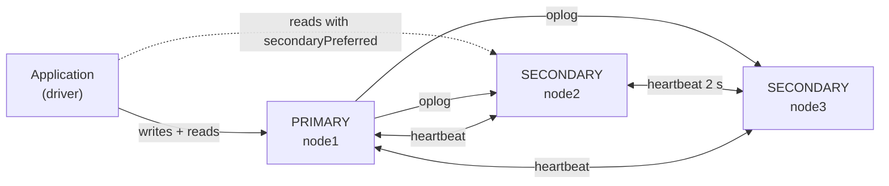
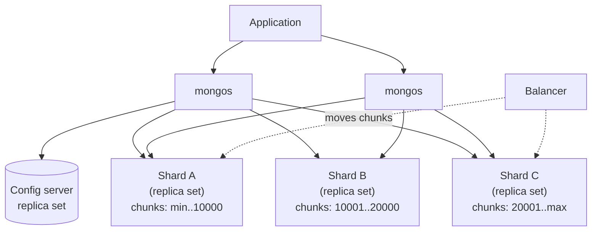

[](https://colab.research.google.com/github/Hamnakhan123/Diploma-in-AI/blob/main/term-1/02-managing-large-datasets-with-mongodb/code/session-08-replication-and-sharding.ipynb) &nbsp; 📓 [Notebook](code/session-08-replication-and-sharding.ipynb)

# Session 8: Replication and Sharding

> 🧭 [Diploma in AI](../../README.md) › [Term 1](../README.md) › [Managing Large Datasets with MongoDB](README.md) › **Session 8**
>
> ⏱️ **Estimated time:** 3 hours (1.5 h concepts + 1.5 h lab) &nbsp;|&nbsp; 📋 **Prerequisites:** Sessions 5-7
>
> Prepared by **Hamna Zahid Khan**, Junior Lecturer

[⬅ Previous: Session 7](session-07-mongodb-indexing.md) &nbsp;|&nbsp; [🏠 Module home](README.md) &nbsp;|&nbsp; [Next: Session 9 ➡](session-09-transaction-management.md)

---

## 🎯 Learning objectives

- Explain **replication**: primary, secondaries, arbiters, the **oplog** and automatic **failover**.
- Choose **write concern** and **read preference** settings for durability and read scaling.
- Set up a local 3-member replica set and inspect it with `rs.*` helpers.
- Explain **sharding**: shards, `mongos` routers, config servers, chunks and the balancer.
- Pick a good **shard key** (cardinality, frequency, monotonic growth) and compare ranged and hashed sharding.

## 📖 Concepts

### 1. Replication = copies for availability

A **replica set** is a group of `mongod` processes holding the same data.

| Member | Role |
|---|---|
| **Primary** | the only member that accepts writes; records every change in its **oplog** |
| **Secondary** | copies the primary's oplog and replays it; can serve reads |
| **Arbiter** | votes in elections, holds no data (use sparingly) |
| Hidden / delayed | invisible to apps; delayed member keeps an "undo" copy N hours behind |

**Failover:** members send heartbeats every 2 s. If the primary is unreachable for `electionTimeoutMillis` (10 s), an eligible secondary calls an **election**; the member with the most recent oplog and a **majority of votes** becomes primary. Without a majority (e.g. 1 of 3 alive), no primary exists and the set is read-only. Use an **odd number** of voting members (3, 5, 7; max 7 voters, 50 members).

**Write concern** (`w`) says how many members must confirm a write: `w: 1` (primary only, fast), `w: "majority"` (survives failover, default since 5.0), plus `j: true` (written to the on-disk journal) and `wtimeout`.

**Read preference** says where reads go: `primary` (default, always fresh), `primaryPreferred`, `secondary`, `secondaryPreferred`, `nearest`. Reads from secondaries may be slightly **stale** (replication lag). **Read concern** (`local`, `majority`, `linearizable`, `snapshot`) says how committed the data must be.

### 2. Sharding = splitting for scale

When one server can't hold the data or handle the writes, **shard**: split a collection across several replica sets.

| Component | Job |
|---|---|
| **Shard** | a replica set holding a subset of the data |
| **mongos** | query router; apps connect to it, never to shards directly |
| **Config servers** | a replica set storing metadata: which chunk lives on which shard |
| **Chunk** | a contiguous range of shard-key values (default max 128 MB) |
| **Balancer** | background process that moves chunks to even out shards |

### 3. The shard key decides everything

| Property | Good | Bad |
|---|---|---|
| **Cardinality** | many distinct values (`customerId`) | few values (`city`, `status`) → jumbo chunks |
| **Frequency** | values evenly used | one value dominates (`"Karachi"`) |
| **Monotonic growth** | random or hashed | `_id` ObjectId, timestamps → every insert hits the last chunk (hot shard) |
| **Query isolation** | most queries include the key → **targeted** | key missing → **scatter-gather** to all shards |

| Strategy | Pros | Cons |
|---|---|---|
| **Ranged** `{customerId: 1}` | efficient range queries | hot spots with growing keys |
| **Hashed** `{_id: "hashed"}` | even write spread | range queries hit every shard |
| **Zoned** | pin ranges to regions (e.g. Pakistan data on a Karachi data centre) | more admin |

Since MongoDB 5.0 you can **reshard** (`reshardCollection`) and since 4.4 refine a key by adding suffix fields, but choosing well up front is still cheapest.

### 4. Replication versus sharding

| | Replication | Sharding |
|---|---|---|
| Goal | high availability, read scaling, backups | horizontal scale of data and writes |
| Data per node | full copy | a slice |
| Minimum production setup | 3 members | 2+ shards (each a replica set) + 3 config servers + mongos |

## 🧭 Diagrams





## 💻 Worked examples

### Example 1: A replica set in miniature

📄 [`code/session-08_replica_set_sim.py`](code/session-08_replica_set_sim.py)

```python
# Session 8 · A replica set in miniature: oplog, write concern and failover
# This is a teaching model (no real servers): it mimics how a 3-member replica set behaves.

class Member:
    def __init__(self, name, priority=1):
        self.name, self.priority, self.up = name, priority, True
        self.data, self.oplog = {}, []          # oplog = ordered list of operations applied

    def apply(self, op):
        self.oplog.append(op)
        kind, key, val = op
        if kind == "set": self.data[key] = val
        elif kind == "del": self.data.pop(key, None)

class ReplicaSet:
    def __init__(self, members):
        self.members = members
        self.primary = max(members, key=lambda m: m.priority)
        print(f"rs.initiate(): {self.primary.name} elected PRIMARY")

    def write(self, key, val, w=1):
        if not self.primary or not self.primary.up:
            raise RuntimeError("NotWritablePrimary: no primary available")
        op = ("set", key, val)
        self.primary.apply(op)
        acks = 1
        for m in self.members:                   # secondaries tail the primary's oplog
            if m is not self.primary and m.up:
                m.apply(op); acks += 1
        needed = len(self.members) // 2 + 1 if w == "majority" else w
        status = "acknowledged" if acks >= needed else "WriteConcernError (waiting for replication)"
        print(f"  write {key}={val!r:<10} w={w!s:<8} acks={acks}/{len(self.members)} -> {status}")

    def elect(self):
        alive = [m for m in self.members if m.up]
        if len(alive) <= len(self.members) // 2:
            self.primary = None
            print(f"  election FAILED: only {len(alive)} of {len(self.members)} members up (no majority) -> read-only")
            return
        # the most up-to-date member with the highest priority wins
        self.primary = max(alive, key=lambda m: (len(m.oplog), m.priority))
        print(f"  election: {self.primary.name} is the new PRIMARY")

    def status(self):
        for m in self.members:
            role = "PRIMARY" if m is self.primary else ("SECONDARY" if m.up else "DOWN")
            print(f"    {m.name:<6} {role:<9} oplog={len(m.oplog)} data={m.data}")

rs = ReplicaSet([Member("node1", priority=2), Member("node2"), Member("node3")])
rs.write("stock:101", 40)
rs.write("stock:102", 15, w="majority")
rs.status()

print("\nnode1 crashes")
rs.members[0].up = False
rs.elect()
rs.write("stock:101", 39, w="majority")
rs.status()

print("\nnode3 also goes down")
rs.members[2].up = False
rs.write("stock:103", 6, w=1)
rs.write("stock:104", 0, w="majority")
rs.elect()
try:
    rs.write("stock:105", 9)
except RuntimeError as e:
    print("  ", e)
```

**Output**

```text
rs.initiate(): node1 elected PRIMARY
  write stock:101=40         w=1        acks=3/3 -> acknowledged
  write stock:102=15         w=majority acks=3/3 -> acknowledged
    node1  PRIMARY   oplog=2 data={'stock:101': 40, 'stock:102': 15}
    node2  SECONDARY oplog=2 data={'stock:101': 40, 'stock:102': 15}
    node3  SECONDARY oplog=2 data={'stock:101': 40, 'stock:102': 15}

node1 crashes
  election: node2 is the new PRIMARY
  write stock:101=39         w=majority acks=2/3 -> acknowledged
    node1  DOWN      oplog=2 data={'stock:101': 40, 'stock:102': 15}
    node2  PRIMARY   oplog=3 data={'stock:101': 39, 'stock:102': 15}
    node3  SECONDARY oplog=3 data={'stock:101': 39, 'stock:102': 15}

node3 also goes down
  write stock:103=6          w=1        acks=1/3 -> acknowledged
  write stock:104=0          w=majority acks=1/3 -> WriteConcernError (waiting for replication)
  election FAILED: only 1 of 3 members up (no majority) -> read-only
   NotWritablePrimary: no primary available
```


What happened: with 2 of 3 members up, a new primary was elected and `w: "majority"` writes still succeeded. With only 1 member up, a `w: 1` write reached the old primary but could not be confirmed by a majority; a real primary that loses contact with the majority **steps down** within seconds, so the set becomes read-only. Writes that were never replicated to a majority can be **rolled back** when the old primary rejoins, which is exactly why `w: "majority"` is the default.

**Real setup on one laptop** (three ports, three data folders):

```bash
mkdir -p rs/1 rs/2 rs/3
mongod --replSet rs0 --port 27017 --dbpath rs/1 --bind_ip localhost &
mongod --replSet rs0 --port 27018 --dbpath rs/2 --bind_ip localhost &
mongod --replSet rs0 --port 27019 --dbpath rs/3 --bind_ip localhost &
```

```javascript
// mongosh --port 27017
rs.initiate({ _id: "rs0", members: [
  { _id: 0, host: "localhost:27017", priority: 2 },
  { _id: 1, host: "localhost:27018" },
  { _id: 2, host: "localhost:27019" } ] })
rs.status().members.map(m => `${m.name} ${m.stateStr}`)
db.products.insertOne({ _id: 101, stock: 40 }, { writeConcern: { w: "majority", wtimeout: 5000 } })
db.getMongo().setReadPref("secondaryPreferred")
rs.printSecondaryReplicationInfo()       // replication lag
rs.stepDown()                            // force an election to practise failover
```

Connection string from Python: `MongoClient("mongodb://localhost:27017,localhost:27018,localhost:27019/?replicaSet=rs0&w=majority&readPreference=secondaryPreferred")`.

### Example 2: Ranged versus hashed shard keys

📄 [`code/session-08_sharding_sim.py`](code/session-08_sharding_sim.py)

```python
# Session 8 · How the shard key decides where documents live
# Teaching model of 3 shards, comparing a ranged key on a growing value with a hashed key.
import hashlib
from collections import Counter

SHARDS = ["shardA", "shardB", "shardC"]
order_ids = list(range(1, 30_001))              # monotonically increasing _id values
new_ids = list(range(30_001, 33_001))           # the next 3,000 inserts

# Ranged sharding: chunks own contiguous ranges of the key
ranges = [(1, 10_000, "shardA"), (10_001, 20_000, "shardB"), (20_001, float("inf"), "shardC")]
def ranged(k):
    for lo, hi, s in ranges:
        if lo <= k <= hi: return s

def hashed(k):
    h = int(hashlib.md5(str(k).encode()).hexdigest(), 16)
    return SHARDS[h % len(SHARDS)]

def report(title, fn, keys):
    c = Counter(fn(k) for k in keys)
    print(f"  {title:<34}" + "  ".join(f"{s}={c.get(s, 0):>6,}" for s in SHARDS))

print("Existing 30,000 orders")
report("ranged on _id", ranged, order_ids)
report("hashed on _id", hashed, order_ids)
print("\nNext 3,000 inserts (where does the write load go?)")
report("ranged on _id  (HOT SHARD!)", ranged, new_ids)
report("hashed on _id  (spread out)", hashed, new_ids)

print("\nQuery routing by mongos")
print("  find({_id: 15000})            ranged ->", ranged(15000), "(targeted, 1 shard)")
print("  find({_id: {$gte: 100, $lte: 200}}) ranged ->", sorted({ranged(k) for k in range(100, 201)}), "(targeted)")
print("  same range query, hashed      ->", sorted({hashed(k) for k in range(100, 201)}), "(scatter-gather)")
print("  find({city: 'Lahore'})        -> all shards (field is not the shard key)")

# A low-cardinality key cannot be split further: jumbo chunks
cities = ["Karachi"] * 18_000 + ["Lahore"] * 8_000 + ["Islamabad"] * 4_000
c = Counter(cities)
print("\nShard key {city: 1}: only", len(c), "distinct values ->", dict(c))
print("  The 'Karachi' chunk can never be split, so one shard holds 60% of the data (a jumbo chunk).")
```

**Output**

```text
Existing 30,000 orders
  ranged on _id                     shardA=10,000  shardB=10,000  shardC=10,000
  hashed on _id                     shardA= 9,926  shardB=10,101  shardC= 9,973

Next 3,000 inserts (where does the write load go?)
  ranged on _id  (HOT SHARD!)       shardA=     0  shardB=     0  shardC= 3,000
  hashed on _id  (spread out)       shardA=   986  shardB= 1,028  shardC=   986

Query routing by mongos
  find({_id: 15000})            ranged -> shardB (targeted, 1 shard)
  find({_id: {$gte: 100, $lte: 200}}) ranged -> ['shardA'] (targeted)
  same range query, hashed      -> ['shardA', 'shardB', 'shardC'] (scatter-gather)
  find({city: 'Lahore'})        -> all shards (field is not the shard key)

Shard key {city: 1}: only 3 distinct values -> {'Karachi': 18000, 'Lahore': 8000, 'Islamabad': 4000}
  The 'Karachi' chunk can never be split, so one shard holds 60% of the data (a jumbo chunk).
```


**Real commands** (connected to a `mongos`):

```javascript
sh.addShard("shardA/hostA1:27018,hostA2:27018,hostA3:27018")
sh.enableSharding("kgs")                                   // optional from 6.0
db.orders.createIndex({ customerId: 1, orderDate: 1 })
sh.shardCollection("kgs.orders", { customerId: 1, orderDate: 1 })     // ranged, compound
sh.shardCollection("kgs.clicks", { _id: "hashed" })                    // hashed
sh.status()                                                            // chunks per shard
db.orders.getShardDistribution()
sh.addShardToZone("shardA", "PK");  sh.updateZoneKeyRange("kgs.users", { country: "PK" }, { country: "PL" }, "PK")
```

## 🧪 Lab / practice tasks

**1. 🟢 Easy:** Draw a 5-member replica set. How many members can fail while it still elects a primary? Repeat for 4 members.

<details><summary>💡 Hint</summary>

Majority of 5 is 3; of 4 is also 3.

</details>

**2. 🟢 Easy:** For each workload choose `w` and read preference: (a) bank transfer, (b) product page views, (c) analytics dashboard that may be a minute behind.

<details><summary>💡 Hint</summary>

Durability vs freshness vs speed.

</details>

**3. 🟡 Medium:** Set up the 3-member local replica set above. Insert a document, read it from a secondary (`db.getMongo().setReadPref("secondary")`), then `rs.stepDown()` and watch who becomes primary.

<details><summary>💡 Hint</summary>

`rs.status()` before and after.

</details>

**4. 🟡 Medium:** In `session-08_replica_set_sim.py` add an **arbiter** (votes, no data) and show that a set of 2 data members + 1 arbiter survives one data member failing.

<details><summary>💡 Hint</summary>

An arbiter counts as up but never applies writes.

</details>

**5. 🟠 Hard:** Rate each shard key for an e-commerce `orders` collection: `_id` (ObjectId), `status`, `customerId`, `{customerId: 1, orderDate: 1}`, `{_id: "hashed"}`. Consider cardinality, frequency, growth and common queries.

<details><summary>💡 Hint</summary>

Most queries are "orders of customer X".

</details>

**6. 🔴 Challenge:** Extend the sharding simulation: add a fourth shard and write a "balancer" that moves ranges until every shard holds within 10% of the average. Print each move.

<details><summary>💡 Hint</summary>

Move the top quarter of the largest shard's range.

</details>


## ✅ Quick quiz

**Q1.** Which member of a replica set accepts writes?

- A) any secondary
- B) the primary
- C) the arbiter
- D) the config server

**Q2.** What does a secondary replay to stay in sync?

- A) the journal
- B) the primary's oplog
- C) the profiler
- D) config.chunks

**Q3.** Why is a monotonically increasing value a poor ranged shard key?

- A) it has low cardinality
- B) all new inserts go to the same shard (hot spot)
- C) it cannot be indexed
- D) it breaks replication

**Q4.** Which component routes queries in a sharded cluster?

- A) mongod
- B) mongos
- C) arbiter
- D) balancer

**Q5.** With 3 voting members, how many can fail while a primary can still be elected?

- A) 0
- B) 1
- C) 2
- D) 3

<details><summary>✅ Show answers</summary>

1. **B**
2. **B**
3. **B**
4. **B**
5. **B**

</details>


## 📝 Summary

- A **replica set** (primary + secondaries) copies data through the **oplog** and fails over automatically when a majority agrees.
- **Write concern** controls durability (`w: "majority"`), **read preference** controls where reads go, **read concern** controls how committed reads must be.
- **Sharding** splits a collection across shards; `mongos` routes, config servers track chunks, the balancer evens them out.
- The **shard key** should have high cardinality, even frequency, non-monotonic growth and appear in most queries.
- Ranged keys favour range queries; hashed keys favour even writes; zones pin data to locations.

### 🎤 Interview / viva questions

1. Walk through what happens, second by second, when a primary crashes.
2. What is a rollback in a replica set and how does `w: "majority"` prevent it?
3. Why should a replica set have an odd number of voting members?
4. Targeted versus scatter-gather queries: give an example of each.
5. You picked `status` as a shard key. What goes wrong and how do you fix it?

---

[⬅ Previous: Session 7](session-07-mongodb-indexing.md) &nbsp;|&nbsp; [🏠 Module home](README.md) &nbsp;|&nbsp; [Next: Session 9 ➡](session-09-transaction-management.md)

<sub>Prepared by **Hamna Zahid Khan**, Junior Lecturer · Diploma in AI</sub>
