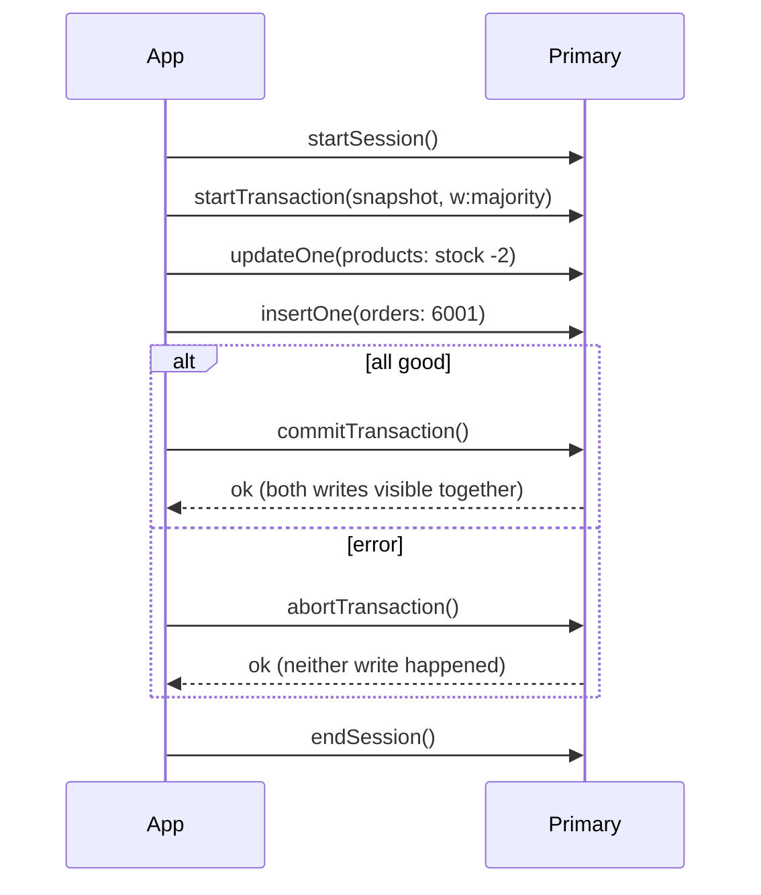
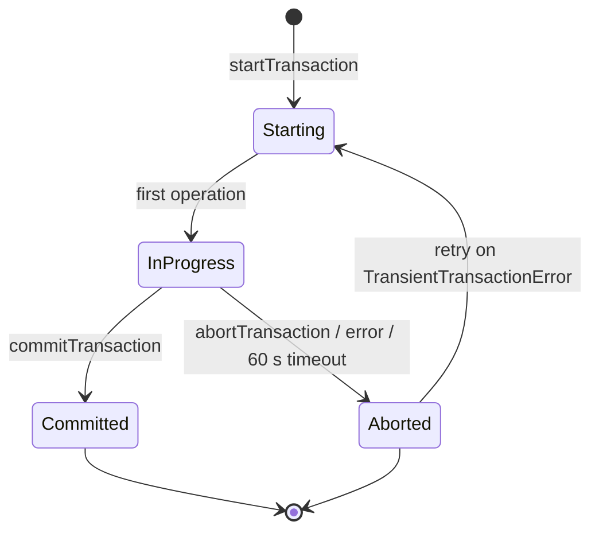

[](https://colab.research.google.com/github/Hamnakhan123/Diploma-in-AI/blob/main/term-1/02-managing-large-datasets-with-mongodb/code/session-09-transaction-management.ipynb) &nbsp; 📓 [Notebook](code/session-09-transaction-management.ipynb)

# Session 9: Transaction Management

> 🧭 [Diploma in AI](../../README.md) › [Term 1](../README.md) › [Managing Large Datasets with MongoDB](README.md) › **Session 9**
>
> ⏱️ **Estimated time:** 2.5 hours (1 h concepts + 1.5 h lab) &nbsp;|&nbsp; 📋 **Prerequisites:** Session 8 (replica sets, write concern)
>
> Prepared by **Hamna Zahid Khan**, Junior Lecturer

[⬅ Previous: Session 8](session-08-replication-and-sharding.md) &nbsp;|&nbsp; [🏠 Module home](README.md) &nbsp;|&nbsp; [Next: Session 10 ➡](session-10-mongodb-tools.md)

---

## 🎯 Learning objectives

- Explain **atomicity** in MongoDB: always for one document, by transaction for many.
- Describe **ACID** properties as MongoDB implements them.
- Write a multi-document transaction with **sessions**, `startTransaction`, `commitTransaction`, `abortTransaction`.
- Use the **callback API** (`with_transaction`) and handle **TransientTransactionError** retries.
- Choose read concern, write concern and design patterns that reduce the need for transactions.

## 📖 Concepts

### 1. Atomicity starts with the document

Any write to **one document**, including its embedded arrays and sub-documents, is **atomic**: other clients see all of it or none of it. Good schema design (embedding) solves many problems without transactions. A **conditional update** (`{_id: 108, stock: {$gte: 2}}` + `$inc: {stock: -2}`) checks and changes in one step, so two buyers can never both take the last laptop.

You need a **multi-document transaction** when one business action changes **several documents or collections** that must stay consistent: placing an order (stock + order), a wallet transfer (two balances), enrolling a student (seat count + enrolment).

### 2. ACID in MongoDB (4.0 replica sets, 4.2 sharded clusters)

| Property | How MongoDB provides it |
|---|---|
| **Atomicity** | a transaction's writes commit together or are discarded together |
| **Consistency** | validation rules and unique indexes hold at commit |
| **Isolation** | snapshot isolation: the transaction reads one consistent point in time; others don't see its writes until commit |
| **Durability** | with `w: "majority"` the commit survives failover |

### 3. The transaction API

```javascript
// mongosh (replica set or Atlas)
const session = db.getMongo().startSession()
const kgs = session.getDatabase("kgs")
session.startTransaction({ readConcern: { level: "snapshot" }, writeConcern: { w: "majority" } })
try {
  kgs.products.updateOne({ _id: 106, stock: { $gte: 2 } }, { $inc: { stock: -2 } })
  kgs.orders.insertOne({ _id: 6001, customerId: 2, status: "Pending",
                         items: [{ productId: 106, qty: 2, price: 6500 }] })
  session.commitTransaction()
} catch (e) {
  session.abortTransaction()
  throw e
} finally {
  session.endSession()
}
```

| Step | Purpose |
|---|---|
| `startSession()` | a session ties operations together (also gives causal consistency) |
| `startTransaction(opts)` | begin; set read/write concern |
| operations with `session` | every read/write inside must pass the session |
| `commitTransaction()` | make everything visible at once |
| `abortTransaction()` | discard everything |

**Callback API (recommended):** `session.withTransaction(fn)` in mongosh, `session.with_transaction(fn)` in PyMongo. It starts, commits, and **retries** automatically on errors labelled `TransientTransactionError` (e.g. write conflict, primary stepped down) and `UnknownTransactionCommitResult`.

### 4. Limits and good practice

- Default time limit **60 seconds** (`transactionLifetimeLimitSeconds`); keep transactions short.
- Keep each transaction under about **1,000 modified documents**; split big batch jobs.
- Not allowed inside: creating a collection on a sharded cluster (allowed on replica sets from 4.4), writes to `system.*`, `$out`/`$merge` to the same collection being read in the transaction (and some admin commands).
- A **write conflict** happens when two transactions modify the same document; the later one aborts and is retried.
- Transactions cost more than single writes: **model data to need them rarely**, then use them where correctness demands it.

## 🧭 Diagrams





## 💻 Worked examples

### Example 1: Single-document atomicity, and what goes wrong without a transaction


📄 [`code/session-09_single_doc_atomicity.py`](code/session-09_single_doc_atomicity.py)

```python
# Session 9 · Single-document atomicity and why multi-document work needs transactions
from store_db import get_db

db = get_db()

print("1) A single-document update is always atomic: conditional stock decrement")
def buy(product_id, qty):
    r = db.products.update_one({"_id": product_id, "stock": {"$gte": qty}},   # check and change in ONE step
                               {"$inc": {"stock": -qty}})
    return "sold" if r.modified_count else "rejected (not enough stock)"
for q in (2, 2, 2):
    print(f"   buy 2 x Gaming Laptop -> {buy(108, q)}; stock now {db.products.find_one({'_id': 108})['stock']}")

print("\n2) Multi-document work WITHOUT a transaction: a crash in the middle")
db.orders.delete_many({"_id": 6001})
def place_order_unsafe(crash):
    db.products.update_one({"_id": 106}, {"$inc": {"stock": -2}})          # step 1: reserve stock
    if crash:
        raise ConnectionError("network dropped before the order was saved")
    db.orders.insert_one({"_id": 6001, "customerId": 2, "status": "Pending",
                          "items": [{"productId": 106, "qty": 2, "price": 6500}]})  # step 2
before = db.products.find_one({"_id": 106})["stock"]
try:
    place_order_unsafe(crash=True)
except ConnectionError as e:
    print("   error:", e)
after = db.products.find_one({"_id": 106})["stock"]
print(f"   speaker stock {before} -> {after}, order 6001 exists: {db.orders.count_documents({'_id': 6001}) == 1}")
print("   => 2 speakers vanished from stock with no order: the data is now inconsistent.")
```

**Output**

```text
1) A single-document update is always atomic: conditional stock decrement
   buy 2 x Gaming Laptop -> sold; stock now 1
   buy 2 x Gaming Laptop -> rejected (not enough stock); stock now 1
   buy 2 x Gaming Laptop -> rejected (not enough stock); stock now 1

2) Multi-document work WITHOUT a transaction: a crash in the middle
   error: network dropped before the order was saved
   speaker stock 22 -> 20, order 6001 exists: False
   => 2 speakers vanished from stock with no order: the data is now inconsistent.
```


**mongosh equivalent**

```javascript
db.products.updateOne({ _id: 108, stock: { $gte: 2 } }, { $inc: { stock: -2 } })   // modifiedCount 1, then 0
db.products.updateOne({ _id: 106 }, { $inc: { stock: -2 } })
// ...connection lost here: the order insert never runs
```

### Example 2: All-or-nothing with a transaction

📄 [`code/session-09_transaction_sim.py`](code/session-09_transaction_sim.py)

```python
# Session 9 · All-or-nothing with a transaction (simulated)
# mongomock has no sessions, so this file builds a small Transaction helper that
# snapshots the collections it touches and restores them on error. It follows the
# same shape as PyMongo's  session.with_transaction(callback)  so the code you write
# inside the callback is the code you would write against a real replica set.
import copy
from store_db import get_db

db = get_db()

class TransientTransactionError(Exception):
    """Stands in for errors labelled TransientTransactionError (e.g. a write conflict)."""

class Transaction:
    def __init__(self, db, collections):
        self.db, self.names = db, collections
    def __enter__(self):
        self.snapshot = {n: copy.deepcopy(list(self.db[n].find())) for n in self.names}
        return self
    def __exit__(self, exc_type, exc, tb):
        if exc_type:                                  # abortTransaction: restore every touched collection
            for n, docs in self.snapshot.items():
                self.db[n].delete_many({})
                if docs: self.db[n].insert_many(docs)
            print(f"   abortTransaction -> rolled back ({exc_type.__name__}: {exc})")
        else:
            print("   commitTransaction -> all changes visible together")
        return False

def with_transaction(callback, retries=3):
    """Retry the whole callback on transient errors, like session.with_transaction()."""
    for attempt in range(1, retries + 1):
        try:
            with Transaction(db, ["products", "orders"]):
                return callback(attempt)
        except TransientTransactionError:
            print(f"   attempt {attempt} hit a transient error, retrying")
    raise RuntimeError("gave up after retries")

def place_order(order_id, product_id, qty, crash=False):
    def callback(attempt):
        p = db.products.find_one({"_id": product_id})
        if p["stock"] < qty:
            raise ValueError(f"only {p['stock']} in stock")
        db.products.update_one({"_id": product_id}, {"$inc": {"stock": -qty}})
        if crash:
            raise ConnectionError("network dropped before the order was saved")
        db.orders.insert_one({"_id": order_id, "customerId": 2, "status": "Pending",
                              "items": [{"productId": product_id, "qty": qty, "price": p["price"]}]})
        return order_id
    return callback

def state(pid, oid):
    return f"stock={db.products.find_one({'_id': pid})['stock']}, order {oid} exists={db.orders.count_documents({'_id': oid}) == 1}"

print("1) Successful order")
print("   before:", state(106, 6001)); with_transaction(place_order(6001, 106, 2)); print("   after :", state(106, 6001))

print("\n2) Crash between the two writes")
try:
    with_transaction(place_order(6002, 106, 2, crash=True))
except ConnectionError:
    pass
print("   after :", state(106, 6002))

print("\n3) Business rule fails (not enough stock)")
try:
    with_transaction(place_order(6003, 108, 5))
except ValueError:
    pass
print("   after :", state(108, 6003))

print("\n4) Transient write conflict on the first attempt, success on the retry")
calls = {"n": 0}
def flaky(attempt):
    calls["n"] += 1
    db.products.update_one({"_id": 110}, {"$inc": {"stock": -1}})
    if attempt == 1:
        raise TransientTransactionError("WriteConflict")
    db.orders.insert_one({"_id": 6004, "customerId": 5, "status": "Pending", "items": [{"productId": 110, "qty": 1, "price": 16000}]})
print("   before:", state(110, 6004)); with_transaction(flaky); print("   after :", state(110, 6004), f"(callback ran {calls['n']} times, stock fell by 1 only)")
```

**Output**

```text
1) Successful order
   before: stock=22, order 6001 exists=False
   commitTransaction -> all changes visible together
   after : stock=20, order 6001 exists=True

2) Crash between the two writes
   abortTransaction -> rolled back (ConnectionError: network dropped before the order was saved)
   after : stock=20, order 6002 exists=False

3) Business rule fails (not enough stock)
   abortTransaction -> rolled back (ValueError: only 3 in stock)
   after : stock=3, order 6003 exists=False

4) Transient write conflict on the first attempt, success on the retry
   before: stock=18, order 6004 exists=False
   abortTransaction -> rolled back (TransientTransactionError: WriteConflict)
   attempt 1 hit a transient error, retrying
   commitTransaction -> all changes visible together
   after : stock=17, order 6004 exists=True (callback ran 2 times, stock fell by 1 only)
```


> mongomock does not support sessions, so this example uses a small helper that snapshots and restores the collections. The callback functions are written exactly as they would be for a real cluster.

### Example 3: The real PyMongo code (run it against Atlas or a replica set)

📄 [`code/session-09_transaction_real.py`](code/session-09_transaction_real.py)

```python
# Session 9 · The real thing: a multi-document transaction with PyMongo
# Needs a replica set or sharded cluster (a free Atlas M0 cluster works; a single
# standalone mongod does NOT support transactions).
from pymongo import MongoClient, ReadPreference
from pymongo.read_concern import ReadConcern
from pymongo.write_concern import WriteConcern

client = MongoClient("mongodb+srv://<user>:<password>@<cluster>.mongodb.net/?retryWrites=true&w=majority")
db = client.kgs

def place_order(session):
    product = db.products.find_one({"_id": 106}, session=session)
    if product["stock"] < 2:
        raise ValueError("not enough stock")              # any exception aborts the transaction
    db.products.update_one({"_id": 106}, {"$inc": {"stock": -2}}, session=session)
    db.orders.insert_one({"_id": 6001, "customerId": 2, "status": "Pending",
                          "items": [{"productId": 106, "qty": 2, "price": product["price"]}]},
                         session=session)

with client.start_session() as session:
    # with_transaction starts, commits, and retries on TransientTransactionError /
    # UnknownTransactionCommitResult for up to 120 seconds
    session.with_transaction(
        place_order,
        read_concern=ReadConcern("snapshot"),
        write_concern=WriteConcern(w="majority"),
        read_preference=ReadPreference.PRIMARY,
    )
print("order placed atomically")
```


The callback receives the `session` and passes it to every operation. If it raises, `with_transaction` aborts; if the server reports a transient error, it calls the callback again.

## 🧪 Lab / practice tasks

**1. 🟢 Easy:** List three business actions in a university system that need a multi-document transaction and two that do not.

<details><summary>💡 Hint</summary>

Does one action change more than one document?

</details>

**2. 🟢 Easy:** Rewrite "decrease stock only if enough is left" for product 105 as a single conditional `update_one`. Show what happens when stock runs out.

<details><summary>💡 Hint</summary>

Put the condition in the filter.

</details>

**3. 🟡 Medium:** Using the `Transaction` helper, implement a wallet transfer of Rs 5,000 between two customers stored in a `wallets` collection. Make it fail when the sender's balance is too low and prove nothing changed.

<details><summary>💡 Hint</summary>

Read the sender inside the callback before updating.

</details>

**4. 🟡 Medium:** Redesign the order so that stock reservation and order creation need **no** transaction. What trade-off did you make?

<details><summary>💡 Hint</summary>

Hint: an embedded `reservations` array on the product, or an order status workflow.

</details>

**5. 🟠 Hard:** On Atlas (free M0) run `session-09_transaction_real.py`. Then run two shells that update the same product inside transactions at the same time and observe the `WriteConflict` error.

<details><summary>💡 Hint</summary>

Leave the first transaction open while running the second.

</details>

**6. 🔴 Challenge:** Add a "course enrolment" transaction: decrement `courses.seats`, insert into `enrolments`, and push the course code into `students.courses`, rolling back if seats are 0 or the student is already enrolled.

<details><summary>💡 Hint</summary>

Check both rules inside the callback.

</details>


## ✅ Quick quiz

**Q1.** An update to one document that changes three embedded fields is…

- A) atomic only inside a transaction
- B) always atomic
- C) never atomic
- D) atomic only with w: majority

**Q2.** Which deployment does NOT support multi-document transactions?

- A) a 3-member replica set
- B) a sharded cluster (4.2+)
- C) a standalone mongod
- D) an Atlas M0 cluster

**Q3.** What does `with_transaction` do on a `TransientTransactionError`?

- A) aborts and gives up
- B) retries the whole callback
- C) commits anyway
- D) switches to w: 1

**Q4.** What is the default maximum lifetime of a transaction?

- A) 1 second
- B) 60 seconds
- C) 10 minutes
- D) unlimited

**Q5.** Which isolation does a MongoDB transaction read with when using readConcern "snapshot"?

- A) read uncommitted
- B) a consistent snapshot of committed data
- C) serializable locks on every collection
- D) no isolation

<details><summary>✅ Show answers</summary>

1. **B**
2. **C**
3. **B**
4. **B**
5. **B**

</details>


## 📝 Summary

- Single-document writes are always atomic; embedding and conditional updates avoid many transactions.
- Multi-document transactions (replica sets 4.0+, sharded 4.2+) give ACID guarantees with snapshot isolation.
- API: session → `startTransaction` → operations with the session → `commitTransaction` / `abortTransaction`.
- Prefer the callback API (`with_transaction`), which retries transient errors.
- Keep transactions short and small; use `w: "majority"` for durable commits.

### 🎤 Interview / viva questions

1. Why did MongoDB manage for years without multi-document transactions?
2. What is a write conflict and how is it resolved?
3. Explain `TransientTransactionError` versus `UnknownTransactionCommitResult`.
4. Why must every operation inside a transaction receive the session?
5. Give an example where a better schema removes the need for a transaction.

---

[⬅ Previous: Session 8](session-08-replication-and-sharding.md) &nbsp;|&nbsp; [🏠 Module home](README.md) &nbsp;|&nbsp; [Next: Session 10 ➡](session-10-mongodb-tools.md)

<sub>Prepared by **Hamna Zahid Khan**, Junior Lecturer · Diploma in AI</sub>
