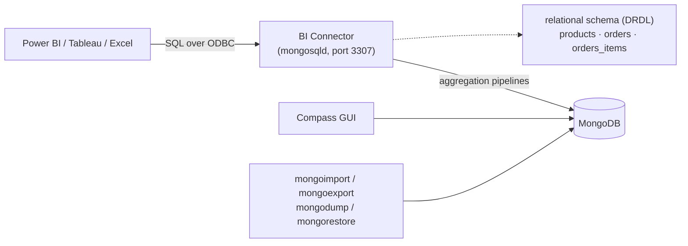
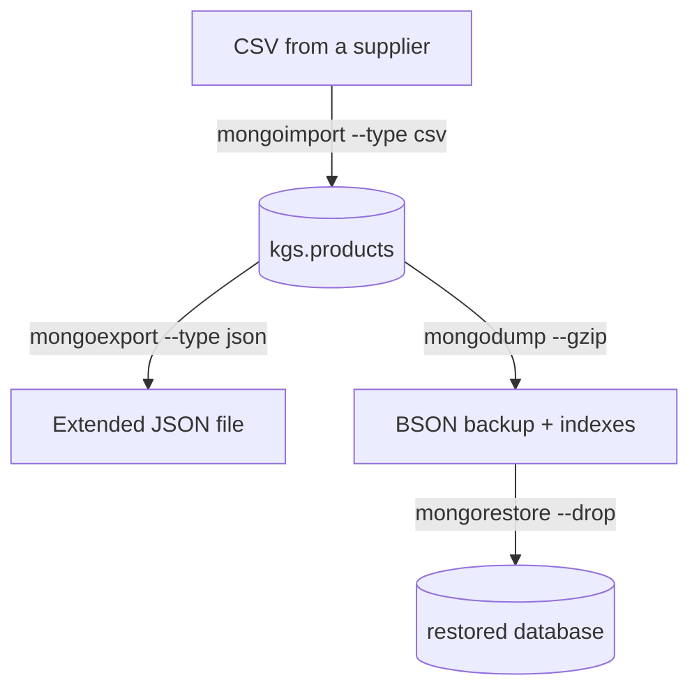

[](https://colab.research.google.com/github/Hamnakhan123/Diploma-in-AI/blob/main/term-1/02-managing-large-datasets-with-mongodb/code/session-10-mongodb-tools.ipynb) &nbsp; 📓 [Notebook](code/session-10-mongodb-tools.ipynb)

# Session 10: MongoDB Tools: Compass and BI Connector

> 🧭 [Diploma in AI](../../README.md) › [Term 1](../README.md) › [Managing Large Datasets with MongoDB](README.md) › **Session 10**
>
> ⏱️ **Estimated time:** 2.5 hours (1 h concepts + 1.5 h lab) &nbsp;|&nbsp; 📋 **Prerequisites:** Sessions 2-7
>
> Prepared by **Hamna Zahid Khan**, Junior Lecturer

[⬅ Previous: Session 9](session-09-transaction-management.md) &nbsp;|&nbsp; [🏠 Module home](README.md) &nbsp;|&nbsp; [Next: Session 11 ➡](session-11-mongodb-cloud-atlas.md)

---

## 🎯 Learning objectives

- Connect to MongoDB with **Compass** and use its Documents, Schema, Indexes, Explain Plan, Aggregations and Validation tabs.
- Import and export data with **`mongoimport` / `mongoexport`**, and back up with **`mongodump` / `mongorestore`**.
- Add **schema validation** rules (`$jsonSchema`) to a collection.
- Explain what the **BI Connector** (and its successor, the Atlas SQL Interface) does and connect a BI tool to MongoDB with SQL.
- Know the rest of the toolbox: `mongostat`, `mongotop`, `bsondump`, the VS Code extension.

## 📖 Concepts

### 1. MongoDB Compass

Compass is the free official GUI (Windows, macOS, Linux). Connect with a **connection string** such as `mongodb://localhost:27017` or an Atlas `mongodb+srv://…` URI.

| Tab | What you do there |
|---|---|
| **Documents** | browse, filter (`{city: "Karachi"}`), project, sort, insert, edit, clone, delete; list / JSON / table views |
| **Aggregations** | build a pipeline stage by stage with live previews; export it to Python, Java, C#, Node code |
| **Schema** | sample documents and chart each field's types, frequency and value ranges |
| **Explain Plan** | visual `explain()`: COLLSCAN vs IXSCAN, docs examined, time |
| **Indexes** | create, hide and drop indexes; see usage counts |
| **Validation** | add `$jsonSchema` rules; choose `strict`/`moderate` level and `error`/`warn` action |
| **mongosh** (bottom panel) | the embedded shell |

Compass also offers **import/export** (JSON/CSV) from the *Add Data* and *Export* buttons, performance charts for a running server, and natural-language query generation when connected to Atlas.

### 2. Command-line Database Tools

| Tool | Purpose | Example |
|---|---|---|
| `mongoimport` | load JSON, CSV or TSV | `mongoimport --db kgs --collection products --type csv --headerline --file products.csv` |
| `mongoexport` | write JSON or CSV | `mongoexport --db kgs --collection products --type csv --fields name,price --out products.csv` |
| `mongodump` | binary BSON backup | `mongodump --db kgs --out backup/` (add `--gzip`, `--archive`) |
| `mongorestore` | restore a dump | `mongorestore --db kgs_copy backup/kgs` (add `--drop`) |
| `mongostat` | per-second server counters | `mongostat --rowcount 5` |
| `mongotop` | time spent reading/writing per collection | `mongotop 5` |
| `bsondump` | turn a `.bson` dump file into readable JSON | `bsondump backup/kgs/products.bson` |

**JSON vs BSON:** `mongoexport` writes **Extended JSON** (`{"$date": "…"}`) so types survive a round trip if you re-import with `mongoimport`; CSV loses types unless you use `--columnsHaveTypes` (`price.int32()`). Use `mongodump`/`mongorestore` for real backups: they keep every BSON type and the indexes.

### 3. Schema validation

```javascript
db.createCollection("students", { validator: { $jsonSchema: {
  bsonType: "object", required: ["rollNo", "name", "cgpa"],
  properties: {
    rollNo: { bsonType: "string", pattern: "^[0-9]{2}K-[0-9]{4}$" },
    name:   { bsonType: "string", minLength: 2 },
    cgpa:   { bsonType: ["double", "int"], minimum: 0, maximum: 4 },
    email:  { bsonType: "string", pattern: "@" } } } },
  validationLevel: "strict", validationAction: "error" })
db.students.insertOne({ rollNo: "24K-0042", name: "Ali", cgpa: 4.5 })   // MongoServerError: Document failed validation
db.runCommand({ collMod: "products", validator: { … } })               // add rules to an existing collection
```

### 4. BI Connector and the Atlas SQL Interface

Business-intelligence tools (Power BI, Tableau, Excel, Looker) speak **SQL over ODBC/JDBC**. The **MongoDB Connector for BI** is a translation layer: it samples collections to build a relational schema (a DRDL file), presents each collection as a **table**, flattens embedded fields into columns (`specs.brand`), turns arrays into **child tables** (`orders_items`), and converts incoming SQL into aggregation pipelines. It speaks the **MySQL wire protocol** (default port 3307), so a MySQL ODBC driver connects to it.

| Option | Where | Notes |
|---|---|---|
| BI Connector (self-managed) | Enterprise Advanced, on-premises | run `mongosqld --mongo-uri … --addr 0.0.0.0:3307` |
| BI Connector for Atlas | Atlas M10+ clusters | toggle in cluster settings |
| **Atlas SQL Interface** | Atlas (all tiers) | MongoDB's recommended successor; JDBC/ODBC drivers and Power BI / Tableau connectors |

## 🧭 Diagrams





## 💻 Worked examples

### Example 1: Import and export from Python


📄 [`code/session-10_import_export.py`](code/session-10_import_export.py)

```python
# Session 10 · Doing what mongoexport / mongoimport do, from Python
import csv, json, os, tempfile
from datetime import datetime
from bson import json_util
from store_db import get_db

def ext_json(v):
    """Encode BSON types the way mongoexport writes Extended JSON (relaxed mode)."""
    if isinstance(v, datetime):
        return {"$date": v.strftime("%Y-%m-%dT%H:%M:%S.000Z")}
    raise TypeError(type(v))

db = get_db()
HOME = os.getcwd()
os.chdir(tempfile.mkdtemp())                     # work in a scratch folder
os.makedirs("exports", exist_ok=True)

# mongoexport --db kgs --collection customers --out exports/customers.json   (one JSON doc per line)
with open("exports/customers.json", "w") as f:
    for d in db.customers.find():
        f.write(json.dumps(d, default=ext_json) + "\n")   # Extended JSON keeps BSON types like dates
print("customers.json (first 2 lines):")
print("".join(open("exports/customers.json").readlines()[:2]))

# mongoexport --type=csv --fields name,category,price,specs.brand --out exports/products.csv
fields = ["_id", "name", "category", "price", "specs.brand"]
with open("exports/products.csv", "w", newline="") as f:
    w = csv.writer(f); w.writerow(fields)
    for d in db.products.find():
        w.writerow([d["_id"], d["name"], d["category"], d["price"], d["specs"]["brand"]])
print("products.csv (first 4 lines):")
print("".join(open("exports/products.csv").readlines()[:4]))

# mongoimport --type=csv --headerline --columnsHaveTypes  (types must be converted on import)
with open("exports/new_products.csv", "w") as f:
    f.write("_id,name,category,price,stock\n112,Smart Watch,Wearables,24000,7\n113,Fitness Band,Wearables,6500,15\n")
with open("exports/new_products.csv") as f:
    rows = [{**r, "_id": int(r["_id"]), "price": int(r["price"]), "stock": int(r["stock"])} for r in csv.DictReader(f)]
db.products.insert_many(rows)
print("imported", len(rows), "rows; Wearables now:",
      [d["name"] for d in db.products.find({"category": "Wearables"})])

# Round trip: re-import the JSON export into a new collection (mongoimport --collection customers_copy)
with open("exports/customers.json") as f:
    db.customers_copy.insert_many([json_util.loads(line) for line in f])
c = db.customers_copy.find_one({"_id": 1})
print("round-trip check: joined is still a", type(c["joined"]).__name__)
os.chdir(HOME)
```

**Output**

```text
customers.json (first 2 lines):
{"_id": 1, "name": "Ayesha Khan", "city": "Karachi", "email": "ayesha@example.pk", "joined": {"$date": "2025-01-12T00:00:00.000Z"}, "loyalty": "Gold"}
{"_id": 2, "name": "Bilal Ahmed", "city": "Lahore", "email": "bilal@example.pk", "joined": {"$date": "2025-02-03T00:00:00.000Z"}, "loyalty": "Silver"}

products.csv (first 4 lines):
_id,name,category,price,specs.brand
101,Wireless Mouse,Accessories,1500,Logi
102,Mechanical Keyboard,Accessories,7500,Redragon
103,27-inch Monitor,Displays,52000,Dell

imported 2 rows; Wearables now: ['Smart Watch', 'Fitness Band']
round-trip check: joined is still a datetime
```


**Database Tools equivalent**

```bash
mongoexport --db kgs --collection customers --out exports/customers.json
mongoexport --db kgs --collection products --type csv --fields _id,name,category,price,specs.brand --out exports/products.csv
mongoimport --db kgs --collection products --type csv --headerline --file exports/new_products.csv
#   (CSV numbers arrive as numbers when they look numeric; use --columnsHaveTypes to be explicit)
mongoimport --db kgs --collection customers_copy --file exports/customers.json
mongodump --db kgs --gzip --out backup/
mongorestore --gzip --nsFrom "kgs.*" --nsTo "kgs_copy.*" backup/
```

### Example 2: The Compass Schema tab, by hand

📄 [`code/session-10_schema_analysis.py`](code/session-10_schema_analysis.py)

```python
# Session 10 · What Compass's Schema tab shows, computed by hand
from collections import Counter, defaultdict
from store_db import get_db

db = get_db()

def analyse(coll):
    docs = list(coll.find())
    seen, types, values = Counter(), defaultdict(Counter), defaultdict(list)
    def walk(d, prefix=""):
        for k, v in d.items():
            path = prefix + k
            seen[path] += 1
            types[path][type(v).__name__ if v is not None else "null"] += 1
            if isinstance(v, dict):
                walk(v, path + ".")
            elif isinstance(v, (int, float)) and not isinstance(v, bool):
                values[path].append(v)
    for d in docs:
        walk(d)
    print(f"{coll.name}: {len(docs)} documents")
    print(f"  {'field':<22}{'present':>8}  types                     range")
    for path in sorted(seen):
        t = ", ".join(f"{k} {v / len(docs):.0%}" for k, v in types[path].items())
        rng = f"{min(values[path]):,} .. {max(values[path]):,}" if values[path] else ""
        print(f"  {path:<22}{seen[path] / len(docs):>8.0%}  {t:<25} {rng}")
    print()

analyse(db.products)
analyse(db.customers)
```

**Output**

```text
products: 10 documents
  field                  present  types                     range
  _id                       100%  int 100%                  101 .. 110
  category                  100%  str 100%                  
  name                      100%  str 100%                  
  price                     100%  int 100%                  1,500 .. 285,000
  specs                     100%  dict 100%                 
  specs.brand               100%  str 100%                  
  specs.ramGB                20%  int 20%                   16 .. 16
  specs.warrantyMonths      100%  int 100%                  12 .. 36
  stock                     100%  int 100%                  0 .. 40
  tags                      100%  list 100%                 

customers: 6 documents
  field                  present  types                     range
  _id                       100%  int 100%                  1 .. 6
  city                      100%  str 100%                  
  email                      83%  str 67%, null 17%         
  joined                    100%  datetime 100%             
  loyalty                   100%  str 100%                  
  name                      100%  str 100%                  
```


Compass's Schema view would show the same facts as charts: `specs.ramGB` exists on only 20% of products, and `email` is a string in 67% of customers, `null` in 17% and missing in the rest. Spotting this before analysis saves you from silent errors in pandas later.

### Example 3: What the BI Connector does

📄 [`code/session-10_bi_sql.py`](code/session-10_bi_sql.py)

```python
# Session 10 · What the BI Connector does: present documents as SQL tables
# The BI Connector (and the newer Atlas SQL Interface) maps each collection to a table,
# flattens sub-documents into columns and turns arrays into child tables, so tools such as
# Power BI, Tableau or Excel can query MongoDB with SQL. This file performs the same mapping
# into SQLite and runs the kind of SQL a BI tool would send.
import sqlite3
from store_db import get_db

db = get_db()
sql = sqlite3.connect(":memory:")

sql.execute("CREATE TABLE products (_id INT, name TEXT, category TEXT, price INT, stock INT, `specs.brand` TEXT)")
sql.execute("CREATE TABLE orders (_id INT, customerId INT, orderDate TEXT, status TEXT, payment TEXT)")
sql.execute("CREATE TABLE orders_items (_id INT, items_idx INT, `items.productId` INT, `items.qty` INT, `items.price` INT)")
sql.execute("CREATE TABLE customers (_id INT, name TEXT, city TEXT, loyalty TEXT)")

for p in db.products.find():
    sql.execute("INSERT INTO products VALUES (?,?,?,?,?,?)", (p["_id"], p["name"], p["category"], p["price"], p["stock"], p["specs"]["brand"]))
for o in db.orders.find():
    sql.execute("INSERT INTO orders VALUES (?,?,?,?,?)", (o["_id"], o["customerId"], o["orderDate"].date().isoformat(), o["status"], o["payment"]))
    for i, it in enumerate(o["items"]):                  # array -> child table with an index column
        sql.execute("INSERT INTO orders_items VALUES (?,?,?,?,?)", (o["_id"], i, it["productId"], it["qty"], it["price"]))
for c in db.customers.find():
    sql.execute("INSERT INTO customers VALUES (?,?,?,?)", (c["_id"], c["name"], c["city"], c["loyalty"]))

print("Tables a BI tool would see:", [r[0] for r in sql.execute("SELECT name FROM sqlite_master")])

query = """
SELECT c.city,
       COUNT(DISTINCT o._id)                      AS orders,
       SUM(i.`items.qty` * i.`items.price`)       AS revenue
FROM orders o
JOIN orders_items i ON i._id = o._id
JOIN customers   c ON c._id = o.customerId
WHERE o.status = 'Delivered'
GROUP BY c.city
ORDER BY revenue DESC;
"""
print("\nSQL sent by a dashboard:\n" + query.strip())
print("\n{:<10} {:>6} {:>10}".format("city", "orders", "revenue"))
for city, n, rev in sql.execute(query):
    print("{:<10} {:>6} {:>10,}".format(city, n, rev))
```

**Output**

```text
Tables a BI tool would see: ['products', 'orders', 'orders_items', 'customers']

SQL sent by a dashboard:
SELECT c.city,
       COUNT(DISTINCT o._id)                      AS orders,
       SUM(i.`items.qty` * i.`items.price`)       AS revenue
FROM orders o
JOIN orders_items i ON i._id = o._id
JOIN customers   c ON c._id = o.customerId
WHERE o.status = 'Delivered'
GROUP BY c.city
ORDER BY revenue DESC;

city       orders    revenue
Karachi         5    319,500
Lahore          1     52,000
```


In Power BI you would choose *Get Data → MySQL database* (BI Connector) or the *MongoDB Atlas SQL* connector, select the `orders`, `orders_items` and `customers` tables, and build this chart with drag and drop; the connector turns the SQL into a `$lookup` + `$group` pipeline.

## 🧪 Lab / practice tasks

**1. 🟢 Easy:** Install Compass, connect to your local server (or Atlas), open `kgs.products` and filter `{price: {$lt: 5000}}` with projection `{name: 1, price: 1}`.

<details><summary>💡 Hint</summary>

Use the *Options* button for projection and sort.

</details>

**2. 🟢 Easy:** In Compass's Aggregations tab rebuild the "revenue per category" pipeline from Session 4, then use *Export to language → Python*.

<details><summary>💡 Hint</summary>

Compare the generated code with ours.

</details>

**3. 🟡 Medium:** Export `orders` to JSON with `mongoexport`, drop the collection, and restore it with `mongoimport`. Check that `orderDate` is still a Date, not a string.

<details><summary>💡 Hint</summary>

Look for `{"$date": …}` in the file.

</details>

**4. 🟡 Medium:** Add a `$jsonSchema` validator to a `students` collection (rollNo pattern, cgpa 0-4) and show one insert that passes and one that fails.

<details><summary>💡 Hint</summary>

`validationAction: "error"`.

</details>

**5. 🟠 Hard:** Use `mongodump --gzip` to back up `kgs`, then `mongorestore` it into `kgs_backup_test` and compare document counts per collection.

<details><summary>💡 Hint</summary>

`--nsFrom`/`--nsTo` renames on restore.

</details>

**6. 🔴 Challenge:** Extend `session-10_bi_sql.py` to also flatten the `tags` array into a `products_tags` table and write SQL that counts products per tag.

<details><summary>💡 Hint</summary>

One row per (product, tag).

</details>


## ✅ Quick quiz

**Q1.** Which Compass tab shows field types and how often each field appears?

- A) Documents
- B) Schema
- C) Indexes
- D) Validation

**Q2.** Which tool should you use for a full backup that keeps all BSON types and indexes?

- A) mongoexport
- B) mongodump
- C) mongoimport
- D) Compass Export

**Q3.** How does the BI Connector expose an array field such as `items`?

- A) it drops it
- B) as a JSON string column
- C) as a separate child table
- D) as many numbered columns only

**Q4.** The BI Connector speaks which wire protocol to BI tools?

- A) PostgreSQL
- B) MySQL
- C) SQL Server TDS
- D) HTTP only

**Q5.** Which `$jsonSchema` keyword lists fields that must be present?

- A) mandatory
- B) required
- C) notNull
- D) fields

<details><summary>✅ Show answers</summary>

1. **B**
2. **B**
3. **C**
4. **B**
5. **B**

</details>


## 📝 Summary

- **Compass** gives a GUI for documents, aggregations, schema analysis, explain plans, indexes and validation.
- `mongoimport`/`mongoexport` move JSON/CSV; `mongodump`/`mongorestore` make faithful BSON backups.
- `$jsonSchema` validators enforce structure on a flexible-schema database.
- The **BI Connector** (and Atlas SQL Interface) lets SQL-based BI tools read MongoDB by flattening documents into tables.
- `mongostat`, `mongotop` and `bsondump` round out the toolkit.

### 🎤 Interview / viva questions

1. When would you use `mongoexport` versus `mongodump`?
2. Why does a CSV round trip lose information?
3. How do validation levels `strict` and `moderate` differ?
4. Explain how a SQL `JOIN` reaches MongoDB through the BI Connector.
5. What does the Schema tab sample, and why might it miss rare fields?

---

[⬅ Previous: Session 9](session-09-transaction-management.md) &nbsp;|&nbsp; [🏠 Module home](README.md) &nbsp;|&nbsp; [Next: Session 11 ➡](session-11-mongodb-cloud-atlas.md)

<sub>Prepared by **Hamna Zahid Khan**, Junior Lecturer · Diploma in AI</sub>
