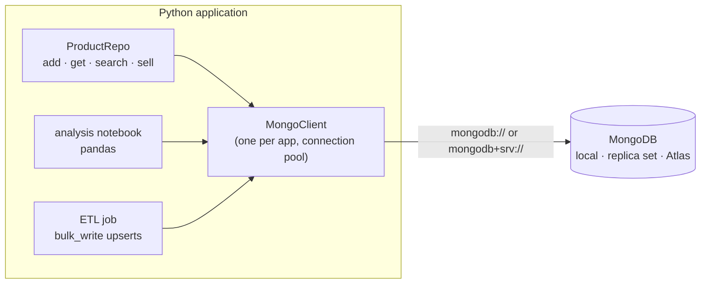
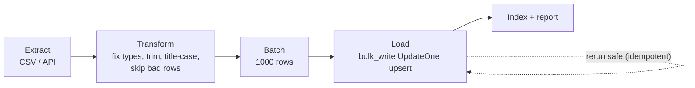

[](https://colab.research.google.com/github/Hamnakhan123/Diploma-in-AI/blob/main/term-1/02-managing-large-datasets-with-mongodb/code/session-12-python-connectivity-pymongo.ipynb) &nbsp; 📓 [Notebook](code/session-12-python-connectivity-pymongo.ipynb)

# Session 12: Connecting Python to MongoDB with PyMongo

> 🧭 [Diploma in AI](../../README.md) › [Term 1](../README.md) › [Managing Large Datasets with MongoDB](README.md) › **Session 12**
>
> ⏱️ **Estimated time:** 3 hours (1 h concepts + 2 h lab) &nbsp;|&nbsp; 📋 **Prerequisites:** Sessions 2-11, Python functions and classes
>
> Prepared by **Hamna Zahid Khan**, Junior Lecturer

[⬅ Previous: Session 11](session-11-mongodb-cloud-atlas.md) &nbsp;|&nbsp; [🏠 Module home](README.md) &nbsp;|&nbsp; [Module practice test ➡](practice-test.md)

---

## 🎯 Learning objectives

- Install **PyMongo** and connect with `MongoClient` to a local server, a replica set or Atlas.
- Map mongosh syntax to PyMongo (snake_case methods, Python dicts, `datetime`, `ObjectId`).
- Organise database code in a small **repository class** with proper error handling.
- Move data between MongoDB and **pandas** for analysis, and write results back.
- Build a batched, **idempotent ETL** job with `bulk_write` and upserts.

## 📖 Concepts

### 1. Install and connect

```bash
pip install "pymongo[srv]"        # [srv] adds DNS support for mongodb+srv:// URIs
pip install mongomock             # optional: in-memory test double used in this course
```

```python
from pymongo import MongoClient
client = MongoClient("mongodb://localhost:27017")                 # local
client = MongoClient(os.environ["MONGODB_URI"])                  # Atlas / replica set
db = client["kgs"]            # or client.kgs
products = db["products"]     # or db.products
client.admin.command("ping")
```

`MongoClient` is **thread-safe and holds a connection pool** (default 100 connections). Create **one** per application and reuse it; don't open a client per request.

### 2. mongosh → PyMongo cheat-sheet

| mongosh | PyMongo |
|---|---|
| `db.products.insertOne({...})` | `db.products.insert_one({...})` |
| `find({price: {$lt: 5000}}, {name: 1})` | `find({"price": {"$lt": 5000}}, {"name": 1})` |
| `.sort({price: -1})` | `.sort("price", -1)` or `.sort([("price", -1), ("name", 1)])` |
| `countDocuments({})` | `count_documents({})` |
| `updateMany(f, {$set: {...}})` | `update_many(f, {"$set": {...}})` |
| `findOneAndUpdate(f, u, {returnDocument: "after"})` | `find_one_and_update(f, u, return_document=ReturnDocument.AFTER)` |
| `aggregate([...])` | `aggregate([...])` (returns a cursor) |
| `createIndex({a: 1}, {unique: true})` | `create_index([("a", 1)], unique=True)` |
| `ObjectId("...")` | `from bson import ObjectId; ObjectId("...")` |
| `new Date()` / `ISODate(...)` | `datetime.datetime(...)` (store UTC) |
| `true / false / null` | `True / False / None` |

Key names **must be quoted strings** in Python, including operators (`"$gt"`).

### 3. Results and errors

| Call | Returns |
|---|---|
| `insert_one` / `insert_many` | `InsertOneResult.inserted_id` / `InsertManyResult.inserted_ids` |
| `update_*` / `replace_one` | `UpdateResult.matched_count`, `.modified_count`, `.upserted_id` |
| `delete_*` | `DeleteResult.deleted_count` |
| `bulk_write` | `BulkWriteResult.inserted_count`, `.upserted_count`, `.modified_count`, `.deleted_count` |

| Exception (`pymongo.errors`) | When |
|---|---|
| `DuplicateKeyError` | unique index violated |
| `BulkWriteError` | one or more writes in a batch failed (`e.details`) |
| `ServerSelectionTimeoutError` | cannot reach the server (wrong URI, IP not allowed, server down) |
| `OperationFailure` | server rejected the command (auth, bad operator, validation) |
| `PyMongoError` | base class of all of the above |

### 4. Working with pandas

- **MongoDB first, pandas second:** filter, join and aggregate in a pipeline, then build a DataFrame from the small result: `pd.DataFrame(list(cursor))`.
- **Nested documents:** `pd.json_normalize(docs)` turns `specs.brand` into a column; arrays stay as lists (use `$unwind` or `explode()`).
- **Back to MongoDB:** `coll.insert_many(df.to_dict("records"))`. Convert NumPy types and `NaN` first if needed.
- **Large data:** iterate the cursor in chunks (`batch_size`), or use `pymongoarrow` (`find_pandas_all`) for fast columnar loading.

### 5. Production habits

- One `MongoClient` per process; set `serverSelectionTimeoutMS` and `appName`.
- Secrets in environment variables; least-privilege database users.
- Indexes created at start-up (`create_index` is a no-op if it exists).
- **Idempotent writes** (upserts keyed on a natural id) so a failed job can simply rerun.
- `bulk_write(..., ordered=False)` in batches of 500-5,000 for bulk loads.

## 🧭 Diagrams





## 💻 Worked examples

### Example 1: A repository class with error handling


📄 [`code/session-12_repository.py`](code/session-12_repository.py)

```python
# Session 12 · A small data-access layer with PyMongo
from datetime import datetime
from pymongo import ASCENDING, ReturnDocument
from pymongo.errors import DuplicateKeyError, PyMongoError
from store_db import get_db

class ProductRepo:
    """All product database access in one place: the rest of the app never writes queries."""
    def __init__(self, db):
        self.col = db.products
        self.col.create_index([("category", ASCENDING), ("price", ASCENDING)])

    def add(self, doc):
        try:
            return self.col.insert_one(doc).inserted_id
        except DuplicateKeyError:
            raise ValueError(f"product {doc['_id']} already exists") from None

    def get(self, pid):
        return self.col.find_one({"_id": pid}, {"_id": 1, "name": 1, "price": 1, "stock": 1})

    def search(self, category=None, max_price=None, in_stock=True, page=1, size=2):
        q = {}
        if category: q["category"] = category
        if max_price is not None: q["price"] = {"$lte": max_price}
        if in_stock: q["stock"] = {"$gt": 0}
        cur = self.col.find(q, {"name": 1, "price": 1}).sort("price", 1).skip((page - 1) * size).limit(size)
        return list(cur)

    def sell(self, pid, qty):
        doc = self.col.find_one_and_update({"_id": pid, "stock": {"$gte": qty}},
                                           {"$inc": {"stock": -qty}, "$set": {"lastSold": datetime(2025, 6, 30)}},
                                           projection={"name": 1, "stock": 1},
                                           return_document=ReturnDocument.AFTER)
        if not doc:
            raise ValueError(f"cannot sell {qty} of product {pid}: not enough stock")
        return doc

repo = ProductRepo(get_db())
print("add:", repo.add({"_id": 114, "name": "Laptop Stand", "category": "Accessories", "price": 3500, "stock": 10}))
try:
    repo.add({"_id": 114, "name": "Duplicate"})
except ValueError as e:
    print("add again:", e)
print("get:", repo.get(114))
print("search Accessories <= 5000, page 1:", [p["name"] for p in repo.search("Accessories", 5000)])
print("search Accessories <= 5000, page 2:", [p["name"] for p in repo.search("Accessories", 5000, page=2)])
print("sell 3:", repo.sell(114, 3))
try:
    repo.sell(104, 1)
except ValueError as e:
    print("sell out-of-stock:", e)
except PyMongoError as e:                       # network/server problems land here on a real server
    print("database error:", e)
```

**Output**

```text
add: 114
add again: product 114 already exists
get: {'name': 'Laptop Stand', 'price': 3500, 'stock': 10, '_id': 114}
search Accessories <= 5000, page 1: ['Wireless Mouse', 'Laptop Stand']
search Accessories <= 5000, page 2: ['Webcam HD']
sell 3: {'name': 'Laptop Stand', 'stock': 7, '_id': 114}
sell out-of-stock: cannot sell 1 of product 104: not enough stock
```


The rest of an application (a Flask route, a Tkinter screen, a notebook) calls `repo.search(...)` and `repo.sell(...)` and never needs to know MongoDB syntax. `sell` uses a single conditional `find_one_and_update`, so two cashiers can't oversell.

### Example 2: MongoDB → pandas → MongoDB

📄 [`code/session-12_to_pandas.py`](code/session-12_to_pandas.py)

```python
# Session 12 · From MongoDB to pandas for analysis
import pandas as pd
from store_db import get_db

db = get_db()
pd.set_option("display.width", 120)

# 1) Let MongoDB do the heavy lifting, then hand pandas a small, tidy result
pipeline = [
    {"$match": {"status": {"$ne": "Cancelled"}}},
    {"$unwind": "$items"},
    {"$lookup": {"from": "products", "localField": "items.productId", "foreignField": "_id", "as": "p"}},
    {"$unwind": "$p"},
    {"$lookup": {"from": "customers", "localField": "customerId", "foreignField": "_id", "as": "c"}},
    {"$unwind": "$c"},
    {"$project": {"_id": 0, "orderId": "$_id", "date": "$orderDate", "city": "$c.city",
                  "category": "$p.category", "qty": "$items.qty",
                  "revenue": {"$multiply": ["$items.qty", "$items.price"]}}},
]
df = pd.DataFrame(list(db.orders.aggregate(pipeline)))
print("Order lines:", df.shape)
print(df.head().to_string(index=False))

print("\nRevenue by city and category (pivot table):")
print(df.pivot_table(index="city", columns="category", values="revenue", aggfunc="sum", fill_value=0).to_string())

print("\nMonthly revenue:")
print(df.groupby(df["date"].dt.to_period("M"))["revenue"].sum().to_string())

# 2) Nested documents -> flat columns with json_normalize
prod = pd.json_normalize(list(db.products.find({}, {"tags": 0})))
print("\nProducts flattened:", list(prod.columns))
print(prod.groupby("specs.brand")["price"].agg(["count", "mean"]).sort_values("count", ascending=False).head(3).to_string())

# 3) Write analysis results back to MongoDB
summary = df.groupby("category", as_index=False)["revenue"].sum()
db.category_summary.insert_many(summary.to_dict("records"))
print("\nSaved", db.category_summary.count_documents({}), "summary documents to kgs.category_summary")
```

**Output**

```text
Order lines: (14, 6)
 orderId       date    city    category  qty  revenue
    5001 2025-03-02 Karachi Accessories    2     3000
    5001 2025-03-02 Karachi Accessories    1     4500
    5002 2025-03-05  Lahore    Displays    1    52000
    5003 2025-03-18 Karachi       Audio    1    18500
    5003 2025-03-18 Karachi       Audio    1     6500

Revenue by city and category (pivot table):
category  Accessories  Audio  Computers  Displays  Storage
city                                                      
Karachi         25500  25000     210000     52000    32000
Lahore          12600  13000          0     52000        0

Monthly revenue:
date
2025-03     84500
2025-04     41000
2025-05    237100
2025-06     59500
Freq: M

Products flattened: ['_id', 'name', 'category', 'price', 'stock', 'specs.brand', 'specs.warrantyMonths', 'specs.ramGB']
             count      mean
specs.brand                 
Logi             2    3000.0
ASUS             1  285000.0
Anker            1    4200.0

Saved 5 summary documents to kgs.category_summary
```


**mongosh equivalent** (the pipeline part)

```javascript
db.orders.aggregate([
  { $match: { status: { $ne: "Cancelled" } } },
  { $unwind: "$items" },
  { $lookup: { from: "products", localField: "items.productId", foreignField: "_id", as: "p" } }, { $unwind: "$p" },
  { $lookup: { from: "customers", localField: "customerId", foreignField: "_id", as: "c" } }, { $unwind: "$c" },
  { $project: { _id: 0, orderId: "$_id", date: "$orderDate", city: "$c.city", category: "$p.category",
                qty: "$items.qty", revenue: { $multiply: ["$items.qty", "$items.price"] } } } ])
```

### Example 3: A batched, idempotent ETL job

📄 [`code/session-12_etl_batch.py`](code/session-12_etl_batch.py)

```python
# Session 12 · A small ETL job: extract CSV, clean, load in batches with upserts
import csv, io, random
from itertools import islice
from pymongo import UpdateOne
from store_db import get_db

db = get_db()
random.seed(12)

# Extract: pretend this CSV arrived from a point-of-sale system (with some dirty rows)
raw = io.StringIO()
w = csv.writer(raw); w.writerow(["sku", "name", "price", "stock", "city"])
for i in range(1, 2501):
    price = random.choice([str(random.randint(500, 90000)), "", "N/A"]) if i % 50 == 0 else str(random.randint(500, 90000))
    w.writerow([f"SKU{i:05d}", f"Item {i}", price, random.randint(0, 100), random.choice(["karachi", "Karachi ", "LAHORE", "Islamabad"])])
raw.seek(0)

def clean(rows):
    """Transform: fix types and casing, skip rows that cannot be repaired."""
    for r in rows:
        try:
            price = int(r["price"])
        except ValueError:
            clean.skipped += 1
            continue
        yield {"_id": r["sku"], "name": r["name"].strip(), "price": price,
               "stock": int(r["stock"]), "city": r["city"].strip().title()}
clean.skipped = 0

def batches(it, size):
    it = iter(it)
    while chunk := list(islice(it, size)):
        yield chunk

loaded = 0
for n, chunk in enumerate(batches(clean(csv.DictReader(raw)), 1000), 1):
    ops = [UpdateOne({"_id": d["_id"]}, {"$set": d}, upsert=True) for d in chunk]   # idempotent: safe to rerun
    res = db.pos_items.bulk_write(ops, ordered=False)
    loaded += res.upserted_count + res.modified_count
    print(f"batch {n}: {len(chunk)} rows -> upserted {res.upserted_count}, modified {res.modified_count}")

print(f"\nloaded {loaded}, skipped {clean.skipped} dirty rows")

# Rerun the first batch: upserts make the job idempotent (nothing is duplicated)
raw.seek(0)
first = next(batches(clean(csv.DictReader(raw)), 1000))
res = db.pos_items.bulk_write([UpdateOne({"_id": d["_id"]}, {"$set": d}, upsert=True) for d in first])
print(f"rerun batch 1: upserted {res.upserted_count}, modified {res.modified_count}, total docs {db.pos_items.count_documents({})}")
db.pos_items.create_index("city")
print("rows per city:", {r["_id"]: r["n"] for r in db.pos_items.aggregate(
    [{"$group": {"_id": "$city", "n": {"$sum": 1}}}, {"$sort": {"_id": 1}}])})
```

**Output**

```text
batch 1: 1000 rows -> upserted 1000, modified 0
batch 2: 1000 rows -> upserted 1000, modified 0
batch 3: 460 rows -> upserted 460, modified 0

loaded 2460, skipped 40 dirty rows
rerun batch 1: upserted 0, modified 0, total docs 2460
rows per city: {'Islamabad': 615, 'Karachi': 1224, 'Lahore': 621}
```


Rerunning batch 1 changed nothing (`upserted 0, modified 0`): because each row is keyed on its `sku`, the job can be restarted after a crash without creating duplicates.

## 🧪 Lab / practice tasks

**1. 🟢 Easy:** Write a script that connects (mongomock or Atlas), prints all database and collection names, and pings the server. Handle `ServerSelectionTimeoutError` with a friendly message.

<details><summary>💡 Hint</summary>

Set `serverSelectionTimeoutMS=3000` to fail fast.

</details>

**2. 🟢 Easy:** Translate these mongosh lines into PyMongo: `db.customers.find({city: "Lahore"}, {name: 1, _id: 0}).sort({name: 1})` and `db.products.updateMany({stock: 0}, {$set: {status: "out"}})`.

<details><summary>💡 Hint</summary>

Quote every key.

</details>

**3. 🟡 Medium:** Add `restock(pid, qty)` and `low_stock(threshold)` methods to `ProductRepo`, with tests that print before/after values.

<details><summary>💡 Hint</summary>

`$inc` and a `stock: {"$lt": threshold}` filter.

</details>

**4. 🟡 Medium:** Load the delivered-order lines into pandas and plot revenue per category as a bar chart with matplotlib.

<details><summary>💡 Hint</summary>

`df.groupby("category")["revenue"].sum().plot.bar()`

</details>

**5. 🟠 Hard:** Extend the ETL job to log skipped rows into a `etl_rejects` collection with the reason and the raw row, and create a `{city: 1, price: -1}` index at the end.

<details><summary>💡 Hint</summary>

Yield rejects from `clean()` into a second list.

</details>

**6. 🔴 Challenge:** Build a mini command-line app (`argparse`) with sub-commands `add`, `search`, `sell` and `report` that uses `ProductRepo` and reads the URI from `MONGODB_URI`. Run it against Atlas.

<details><summary>💡 Hint</summary>

`python shop.py search --category Audio --max-price 20000`

</details>


## ✅ Quick quiz

**Q1.** How many `MongoClient` objects should a typical web application create?

- A) one per request
- B) one per collection
- C) one for the whole process, reused
- D) one per query

**Q2.** Which PyMongo method matches mongosh's `countDocuments()`?

- A) count()
- B) count_documents()
- C) countDocuments()
- D) len()

**Q3.** Which exception tells you the server could not be reached in time?

- A) DuplicateKeyError
- B) ServerSelectionTimeoutError
- C) OperationFailure
- D) BulkWriteError

**Q4.** Which pandas function flattens nested fields like `specs.brand` into columns?

- A) pd.read_json
- B) pd.json_normalize
- C) df.explode
- D) pd.melt

**Q5.** Why are upserts keyed on a natural id useful in ETL jobs?

- A) they are faster than inserts
- B) they make reruns idempotent (no duplicates)
- C) they skip validation
- D) they avoid indexes

<details><summary>✅ Show answers</summary>

1. **C**
2. **B**
3. **B**
4. **B**
5. **B**

</details>


## 📝 Summary

- `pip install "pymongo[srv]"`; one `MongoClient` per app, reused, with the URI from the environment.
- PyMongo mirrors mongosh in snake_case with Python dicts, `datetime` and `ObjectId`.
- Result objects report counts and ids; catch `DuplicateKeyError`, `BulkWriteError`, `ServerSelectionTimeoutError`, `PyMongoError`.
- Aggregate in MongoDB, analyse in pandas (`DataFrame`, `json_normalize`), write summaries back with `insert_many`.
- Batched `bulk_write` upserts make ETL jobs fast and safe to rerun.

### 🎤 Interview / viva questions

1. Why is `MongoClient` created once and shared?
2. How do you convert a cursor into a DataFrame, and when is that a bad idea?
3. What is an idempotent write and why does it matter for data pipelines?
4. How would you test MongoDB code without a server?
5. Which errors should a production script retry, and which should it report immediately?

---

[⬅ Previous: Session 11](session-11-mongodb-cloud-atlas.md) &nbsp;|&nbsp; [🏠 Module home](README.md) &nbsp;|&nbsp; [Module practice test ➡](practice-test.md)

<sub>Prepared by **Hamna Zahid Khan**, Junior Lecturer · Diploma in AI</sub>
