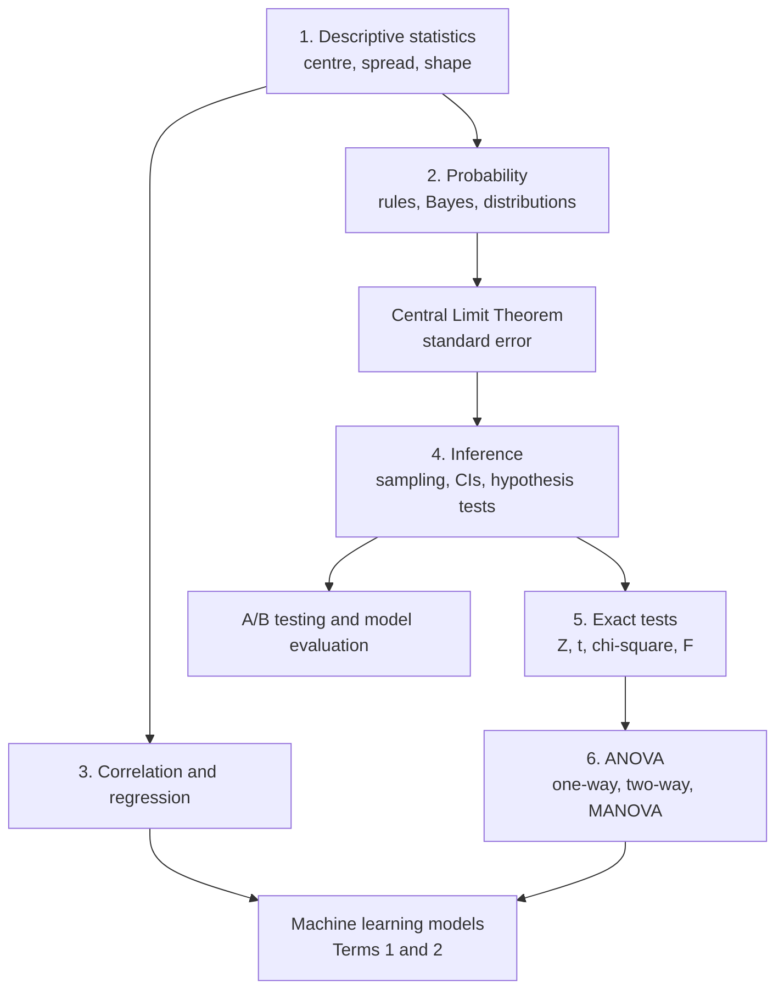

# Module 3: Inferential Statistical Analysis

> 🧭 [Diploma in AI](../../README.md) › [Term 1](../README.md) › **Inferential Statistical Analysis** &nbsp;·&nbsp; ⏱️ 16 instructional hours
>
> Prepared by **Hamna Zahid Khan**, Junior Lecturer

[⬅ Term 1 overview](../README.md) &nbsp;|&nbsp; [🏠 Course home](../../README.md)

---

## 🌟 Why this module matters

Every AI model is a statistical claim: "this model is 92 % accurate", "the new recommendation engine increased sales", "customers in group A churn more". **Inferential statistics** is how you decide whether such claims are real or just luck. This module takes you from describing data, through probability and regression, to confidence intervals, hypothesis tests and ANOVA, with every idea implemented in runnable Python on realistic Karachi-flavoured data: exam marks, delivery times, rents, help-line calls and A/B tests.

## 🎯 Module objectives

By the end of this module you will be able to:

- Summarise data with measures of centre, spread, position and shape, and detect outliers.
- Apply probability rules and Bayes' theorem, and model data with Binomial, Poisson, Normal and other distributions.
- Explain the Central Limit Theorem and the standard error.
- Measure association with Pearson and Spearman correlation and build simple, multiple, polynomial and logistic regressions.
- Choose a sampling method, build confidence intervals and plan sample sizes.
- Run and interpret hypothesis tests (Z, t, chi-square, F), report effect sizes and avoid common traps such as peeking and multiple testing.
- Compare several groups with one-way and two-way ANOVA, post-hoc tests and MANOVA.

## 🗂️ Sessions

| # | Session |
|---|---|
| 1 | [Introduction to Statistics](session-01-introduction-to-statistics.md) |
| 2 | [Introduction to Probability](session-02-introduction-to-probability.md) |
| 3 | [Correlation and Regression](session-03-correlation-and-regression.md) |
| 4 | [Inferential Statistics: Sampling, Hypotheses and Confidence](session-04-inferential-statistics.md) |
| 5 | [Exact Sampling Distributions: Chi-Square, t, Z and F Tests](session-05-exact-sampling-distributions.md) |
| 6 | [Analysis of Variance (ANOVA and MANOVA)](session-06-analysis-of-variance.md) |
| 📝 | [Module practice test](practice-test.md) |

## 🧭 Concept map

## 🛠️ Setup

- **Zero-install:** every session has a Colab notebook with all its examples and charts already executed.
- **Local:** Python 3.10+ with `pip install numpy pandas scipy statsmodels matplotlib`. See [`code/README.md`](code/README.md) for every file and how to run it.
- Each session contains: concepts with analogies and step-by-step walkthroughs, Mermaid diagrams, worked examples (basic → advanced) with real output, charts generated by the code, a real-life coding problem, a mini project, common mistakes, best practices, a lab with hints and solutions, a quiz and viva questions.

## 📄 One-page cheat-sheet

**Descriptive statistics**

| Measure | Formula / Python |
|---|---|
| Mean, median, mode | `np.mean`, `np.median`, `statistics.multimode` |
| Sample variance / sd | Σ(x − x̄)²/(n − 1) · `np.var(x, ddof=1)` · `np.std(x, ddof=1)` |
| IQR, outliers | Q3 − Q1 · outside Q1 − 1.5·IQR or Q3 + 1.5·IQR |
| z-score | (x − x̄)/s |
| CV | s / x̄ × 100 % |
| Skewness, excess kurtosis | `scipy.stats.skew`, `scipy.stats.kurtosis` |

**Probability**

| Rule / distribution | Formula / Python |
|---|---|
| Addition | P(A ∪ B) = P(A) + P(B) − P(A ∩ B) |
| Conditional | P(A \| B) = P(A ∩ B)/P(B) |
| Bayes | P(H \| E) = P(E \| H)P(H)/P(E) |
| Expectation | E[X] = Σ x p(x); Var = Σ(x − μ)² p(x) |
| Binomial(n, p) | mean np, var np(1 − p) · `stats.binom(n, p)` |
| Poisson(λ) | mean = var = λ · `stats.poisson(lam)` |
| Normal(μ, σ) | `stats.norm(mu, sigma)` · `.cdf .sf .ppf` |
| CLT | x̄ ≈ N(μ, σ/√n) |

**Correlation and regression**

| Item | Formula / Python |
|---|---|
| Pearson r | cov/(sₓs_y) · `stats.pearsonr` |
| Spearman ρ | 1 − 6Σd²/(n(n² − 1)) · `stats.spearmanr` |
| Slope, intercept | b₁ = Sxy/Sxx, b₀ = ȳ − b₁x̄ · `stats.linregress` |
| R² | SSR/SST = 1 − SSE/SST |
| Multiple / logistic | `smf.ols("y ~ x1 + x2", df)` · `sm.Logit(y, X)` |

**Inference**

| Item | Formula / Python |
|---|---|
| SE of mean / proportion | s/√n · √(p̂(1 − p̂)/n) |
| CI for mean | x̄ ± t\*·s/√n · `stats.t.interval(0.95, n-1, loc, scale)` |
| Sample size (proportion) | n = z\*²·p(1 − p)/E² (1,068 for ±3 %) |
| Decision rule | reject H₀ if p < α |
| Type I / II, power | α / β / 1 − β |

**Which test?**

| Situation | Test | SciPy |
|---|---|---|
| mean vs value, σ unknown | one-sample t | `ttest_1samp` |
| two independent groups | Welch t | `ttest_ind(a, b, equal_var=False)` |
| before/after, same units | paired t | `ttest_rel` |
| proportions | Z test | formula (see Session 4-5) |
| counts vs expected | χ² goodness of fit | `chisquare` |
| two categorical variables | χ² independence / Fisher | `chi2_contingency` / `fisher_exact` |
| two variances | F test / Levene | `stats.f`, `levene` |
| 3+ group means | one-way ANOVA → Tukey | `f_oneway`, `pairwise_tukeyhsd` |
| two factors | two-way ANOVA | `anova_lm(smf.ols("y ~ C(a)*C(b)"))` |
| several outcomes | MANOVA | `MANOVA.from_formula` |
| non-normal data | Wilcoxon / Mann-Whitney / Kruskal-Wallis | `wilcoxon`, `mannwhitneyu`, `kruskal` |

**Effect sizes:** Cohen's d (0.2 / 0.5 / 0.8) · Cramér's V (0.1 / 0.3 / 0.5) · η² (0.01 / 0.06 / 0.14).

## ✅ Progress checklist

- [ ] Session 1 · Introduction to statistics
- [ ] Session 2 · Probability
- [ ] Session 3 · Correlation and regression
- [ ] Session 4 · Inferential statistics
- [ ] Session 5 · Exact sampling distributions
- [ ] Session 6 · ANOVA and MANOVA
- [ ] Practice test (score ≥ 16/20)

---

[⬅ Term 1 overview](../README.md) &nbsp;|&nbsp; [🏠 Course home](../../README.md) &nbsp;|&nbsp; [Start Session 1 ➡](session-01-introduction-to-statistics.md)

Prepared by **Hamna Zahid Khan**, Junior Lecturer · Diploma in AI
