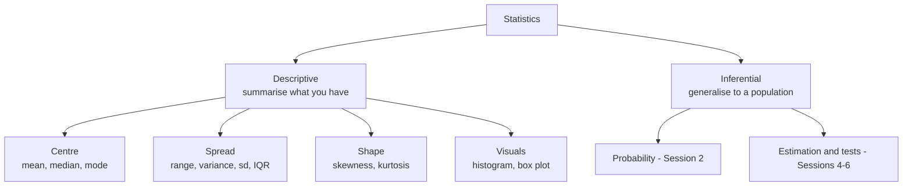
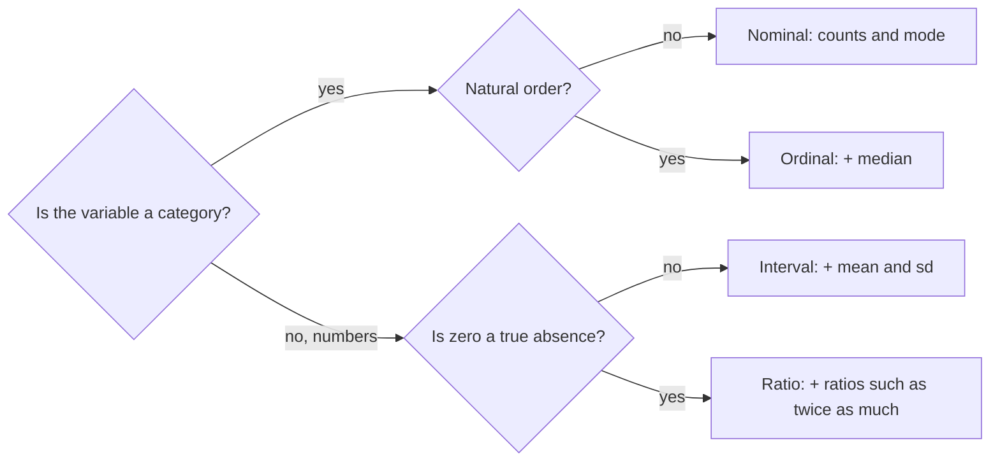
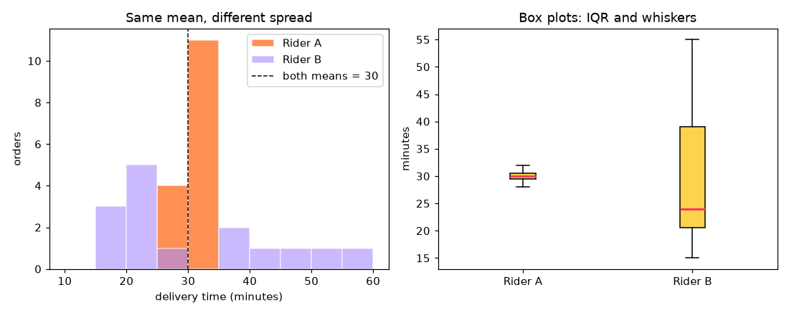

[](https://colab.research.google.com/github/Hamnakhan123/Diploma-in-AI/blob/main/term-1/03-inferential-statistical-analysis/code/session-01-introduction-to-statistics.ipynb) &nbsp; 📓 [Notebook](code/session-01-introduction-to-statistics.ipynb)

# Session 1: Introduction to Statistics

> 🧭 [Diploma in AI](../../README.md) › [Term 1](../README.md) › [Inferential Statistical Analysis](README.md) › **Session 1**
>
> ⏱️ **Estimated time:** 2.5 hours (1 h concepts + 1.5 h lab) &nbsp;|&nbsp; 📋 **Prerequisites:** Basic Python (variables, lists, loops). No statistics background needed.
>
> Prepared by **Hamna Zahid Khan**, Junior Lecturer

[⬅ Module overview](README.md) &nbsp;|&nbsp; [🏠 Module home](README.md) &nbsp;|&nbsp; [Next: Session 2 ➡](session-02-introduction-to-probability.md)

---

## 🎯 Learning objectives

By the end of this session you will be able to:

- Define **statistics** and tell **descriptive** statistics apart from **inferential** statistics.
- Explain where statistics shows up in **data science and AI** work, from cleaning data to judging a model.
- Classify a variable by its **level of measurement** (nominal, ordinal, interval, ratio) and pick valid summaries for it.
- Compute and interpret **mean, median, mode**, weighted, geometric and harmonic means, by hand and in Python.
- Measure **spread** (range, variance, standard deviation, IQR, coefficient of variation) and **shape** (skewness, kurtosis).
- Find **outliers** with the 1.5 × IQR rule and z-scores, and read a **histogram** and a **box plot**.

## 📖 Concepts

### 1. What is statistics?

**Statistics** is the science of collecting, organising, summarising and interpreting data so that we can make decisions when we are not certain. It has two halves:

| Branch | Question it answers | Example |
|---|---|---|
| **Descriptive statistics** | "What does this data look like?" | "The 40 students in Section A scored a median of 73." |
| **Inferential statistics** | "What can this sample tell us about the bigger population?" | "Based on 400 surveyed riders, between 61 % and 70 % of all Karachi riders prefer cash on delivery." |

> 🧠 **Analogy:** Descriptive statistics is the **photo** of the guests at a wedding. Inferential statistics is guessing the mood of **the whole city** from that photo. The photo is exact; the guess comes with a margin of error. This module starts with the photo (today) and ends with careful guessing (Sessions 4-6).

Key vocabulary:

- **Population**: every unit you care about (all bank customers in Pakistan).
- **Sample**: the subset you actually measure (2,000 customers who answered the survey).
- **Parameter**: a number describing the population (true average balance, written **μ**). Usually unknown.
- **Statistic**: a number computed from the sample (sample average, written **x̄**). Used to estimate the parameter.
- **Variable**: a characteristic that changes from unit to unit (age, city, income).
- **Observation**: one row of data, one unit measured.

### 2. Why data scientists need statistics

Machine-learning libraries make it easy to train a model; statistics tells you whether the result means anything.

| Stage of an AI project | Statistics used |
|---|---|
| Understand the data (EDA) | mean, median, spread, histograms, correlation |
| Clean the data | outlier detection with IQR / z-scores, missing-value imputation with median or mode |
| Prepare features | standardisation (z-scores), log transform for skewed data |
| Train models | linear/logistic regression, Naive Bayes, all built on probability |
| Evaluate models | confidence intervals for accuracy, hypothesis tests comparing two models |
| Run experiments | A/B tests on a website or app feature (Session 4) |

Real examples: a bank flags a transaction as fraud because its amount has a z-score of 6; a ride-hailing app compares two pricing screens with a hypothesis test; a hospital reports a vaccine's effect with a 95 % confidence interval.

### 3. Types of data and levels of measurement

First split data into **qualitative** (categories) and **quantitative** (numbers). Then go one step deeper:

| Level | Order? | Equal steps? | True zero? | Example | Valid summaries |
|---|---|---|---|---|---|
| **Nominal** | ❌ | ❌ | ❌ | city, blood group, payment method | counts, %, mode |
| **Ordinal** | ✅ | ❌ | ❌ | grade A/B/C, rating 1-5, education level | + median, percentiles |
| **Interval** | ✅ | ✅ | ❌ | temperature °C, calendar year | + mean, std, differences |
| **Ratio** | ✅ | ✅ | ✅ | salary, weight, commute minutes | everything, including ratios |

Quantitative data is also **discrete** (counted: siblings, orders) or **continuous** (measured: height, time).

> ⚠️ A column of numbers is not automatically quantitative. Postal codes and roll numbers are **nominal** even though they are digits; averaging them is meaningless.

### 4. Measures of central tendency

These answer "what is a typical value?"

| Measure | Formula / rule | Best for | Weakness |
|---|---|---|---|
| **Mean** x̄ | Σx / n | symmetric numeric data | pulled by outliers |
| **Median** | middle of sorted data | skewed data (salaries, prices) | ignores exact values |
| **Mode** | most frequent value | nominal data, "most popular size" | may be several or none |
| **Weighted mean** | Σwx / Σw | GPA, portfolio returns | needs correct weights |
| **Geometric mean** | (Πx)^(1/n) | growth rates, ratios | only positive values |
| **Harmonic mean** | n / Σ(1/x) | rates such as speed, price per unit | sensitive to small values |

**Step-by-step: median of an even-sized list** `[12, 7, 3, 9, 15, 4]`

1. Sort: `3, 4, 7, 9, 12, 15`.
2. n = 6 is even, so the median is the average of the 3rd and 4th values.
3. (7 + 9) / 2 = **8**.

**Mean, median and skew together:** in a **right-skewed** distribution (a long tail of big values, like incomes) mean > median > mode. In a **left-skewed** one (an easy exam where most score high) mean < median. In a symmetric one they are about equal.

### 5. Measures of dispersion (spread)

Two riders who both average 30 minutes are not equally reliable. Spread tells you how far values stray from the centre.

| Measure | Formula | Notes |
|---|---|---|
| **Range** | max − min | uses only two values; very outlier-sensitive |
| **Variance** | s² = Σ(x − x̄)² / (n − 1) | average squared distance; units are squared |
| **Standard deviation** | s = √s² | same units as the data; most used |
| **IQR** | Q3 − Q1 | spread of the middle 50 %; robust to outliers |
| **Coefficient of variation** | CV = s / x̄ × 100 % | compares spread of variables on different scales |

**Why divide by n − 1?** The sample mean is computed from the same data, so deviations from it are a little too small. Dividing by **n − 1** (Bessel's correction) makes the sample variance an unbiased estimate of the population variance σ². Use **n** only when you truly have the whole population. In NumPy this is the `ddof` argument: `np.var(x)` divides by n, `np.var(x, ddof=1)` by n − 1. pandas uses n − 1 by default, which surprises many people.

**Step-by-step variance** of `2, 4, 4, 4, 5, 5, 7, 9`:

1. Mean = 40 / 8 = 5.
2. Deviations: −3, −1, −1, −1, 0, 0, 2, 4.
3. Squares: 9, 1, 1, 1, 0, 0, 4, 16 → sum = 32.
4. Population variance = 32 / 8 = 4 (σ = 2). Sample variance = 32 / 7 = 4.571 (s = 2.138).

**Empirical (68-95-99.7) rule:** for roughly bell-shaped data about 68 % of values lie within 1 sd of the mean, 95 % within 2 sd and 99.7 % within 3 sd. **Chebyshev's theorem** gives a weaker guarantee for *any* shape: at least 1 − 1/k² of values lie within k sd (75 % within 2 sd).

### 6. Position: percentiles, quartiles and z-scores

- The **p-th percentile** has p % of the data at or below it. **Q1** = 25th, **Q2** = median, **Q3** = 75th percentile.
- The **five-number summary** is min, Q1, median, Q3, max: exactly what a box plot draws.
- A **z-score** says how many standard deviations a value is from the mean: **z = (x − x̄) / s**. A mark of 85 in a class with mean 70 and sd 10 has z = 1.5. Z-scores let you compare apples and oranges (a maths mark against an English mark).

**Outlier rules**

| Rule | Flag a value if… | Use when |
|---|---|---|
| Tukey fences | x < Q1 − 1.5·IQR or x > Q3 + 1.5·IQR | any shape, robust (default choice) |
| z-score | \|z\| > 3 (or 2.5 for small samples) | data roughly normal |

An outlier is a question, not an automatic delete: it may be a typing error (12 instead of 72), an absent student, or the most interesting customer you have.

### 7. Shape: skewness and kurtosis

- **Skewness** measures asymmetry. 0 = symmetric, positive = long right tail, negative = long left tail. As a rough guide |skew| < 0.5 is fairly symmetric and > 1 is highly skewed.
- **Kurtosis** measures how heavy the tails are. SciPy and pandas report **excess** kurtosis, where the normal distribution scores 0; positive values mean heavier tails (more extreme values) than normal.

### 8. Showing data: tables and charts

| Chart | Data type | What it shows |
|---|---|---|
| Bar chart / pie chart | nominal, ordinal | counts per category |
| Histogram | continuous | shape, centre, spread, gaps |
| Box plot | numeric | five-number summary and outliers; great for comparing groups |
| Stem-and-leaf | small numeric sets | shape while keeping every value |
| Frequency table | any | counts, relative and cumulative frequency |

## 🧭 Diagrams





## 💻 Worked examples

### Example 1: Classify variables and build frequency tables (basic)

Every analysis starts by asking what kind of variable each column is. The script prints the valid summaries for each level and builds simple and grouped frequency tables.

📄 [`code/session-01_data_types.py`](code/session-01_data_types.py) &nbsp;·&nbsp; run: `python session-01_data_types.py`

```python
"""
Session 1 · Example 1: Types of data and frequency tables
---------------------------------------------------------
Before computing any statistic you must know WHAT KIND of variable you have.
This script builds a small survey of 12 students, labels every column with its
level of measurement, and prints the summaries that are valid for each level.

Run:  python session-01_data_types.py
"""
import pandas as pd

# A tiny survey from a Karachi classroom (made-up but realistic values).
survey = pd.DataFrame({
    "student":      ["Ali", "Sara", "Bilal", "Hira", "Usman", "Zoya",
                     "Hamza", "Iqra", "Saad", "Maha", "Fahad", "Noor"],
    "area":         ["Gulshan", "Clifton", "Gulshan", "DHA", "Saddar", "Clifton",
                     "Gulshan", "DHA", "Saddar", "Gulshan", "Clifton", "DHA"],
    "grade":        ["B", "A", "C", "A", "B", "A", "C", "B", "B", "A", "C", "B"],
    "temp_c":       [31, 29, 33, 30, 34, 28, 32, 30, 35, 31, 29, 30],      # room temperature at home
    "siblings":     [2, 1, 3, 0, 4, 1, 2, 2, 5, 1, 3, 0],
    "commute_min":  [35, 20, 40, 15, 55, 25, 30, 18, 60, 33, 22, 16],
})

# Level of measurement for each variable, and what you are allowed to do with it.
levels = {
    "area":        ("Nominal",  "categories, no order -> counts, mode"),
    "grade":       ("Ordinal",  "ordered categories -> counts, mode, median"),
    "temp_c":      ("Interval", "equal steps, no true zero -> mean, std (no ratios)"),
    "siblings":    ("Ratio (discrete)",   "true zero, counts -> every statistic"),
    "commute_min": ("Ratio (continuous)", "true zero, measured -> every statistic"),
}
print("Variable      Level                Valid summaries")
print("-" * 72)
for col, (lvl, ok) in levels.items():
    print(f"{col:<13} {lvl:<20} {ok}")

# 1) Nominal: a frequency table with relative and percentage frequency
freq = survey["area"].value_counts().rename("count").to_frame()
freq["relative"] = (freq["count"] / freq["count"].sum()).round(3)
freq["percent"] = (freq["relative"] * 100).round(1)
print("\nFrequency table for 'area' (nominal):")
print(freq.to_string())
print("Mode of area:", survey["area"].mode().tolist())

# 2) Ordinal: keep the natural order A > B > C, then the median makes sense
grade_order = pd.CategoricalDtype(["C", "B", "A"], ordered=True)
grades = survey["grade"].astype(grade_order)
counts = grades.value_counts(sort=False)
print("\nGrade counts in order (ordinal):", {k: int(v) for k, v in counts.items()})
median_code = int(grades.cat.codes.median())          # codes: C=0, B=1, A=2
print("Median grade:", grade_order.categories[median_code])

# 3) Interval vs ratio: 35 C is NOT "1.25x as hot" as 28 C (0 C is not "no heat"),
#    but a 60-minute commute IS 4x a 15-minute one (0 minutes really means none).
print(f"\nCommute ratio Saad/Hira = {survey.commute_min[8] / survey.commute_min[3]:.1f}x (valid: ratio scale)")

# 4) Grouped frequency table (class intervals) for a continuous variable
bins = [10, 20, 30, 40, 50, 60]
classes = pd.cut(survey["commute_min"], bins=bins, right=True)
grouped = classes.value_counts(sort=False).rename("students").to_frame()
grouped["cumulative"] = grouped["students"].cumsum()
print("\nGrouped frequency table for commute (minutes):")
print(grouped.to_string())
```

**Output**

```text
Variable      Level                Valid summaries
------------------------------------------------------------------------
area          Nominal              categories, no order -> counts, mode
grade         Ordinal              ordered categories -> counts, mode, median
temp_c        Interval             equal steps, no true zero -> mean, std (no ratios)
siblings      Ratio (discrete)     true zero, counts -> every statistic
commute_min   Ratio (continuous)   true zero, measured -> every statistic

Frequency table for 'area' (nominal):
         count  relative  percent
area                             
Gulshan      4     0.333     33.3
Clifton      3     0.250     25.0
DHA          3     0.250     25.0
Saddar       2     0.167     16.7
Mode of area: ['Gulshan']

Grade counts in order (ordinal): {'C': 3, 'B': 5, 'A': 4}
Median grade: B

Commute ratio Saad/Hira = 4.0x (valid: ratio scale)

Grouped frequency table for commute (minutes):
             students  cumulative
commute_min                      
(10, 20]            4           4
(20, 30]            3           7
(30, 40]            3          10
(40, 50]            0          10
(50, 60]            2          12
```


**What to notice:** the median grade is computed on the *order* of the categories (C < B < A), not on letters. The grouped table shows an empty 40-50 minute class; a histogram would show this as a gap.

### Example 2: Every kind of average, and the outlier test (intermediate)

📄 [`code/session-01_central_tendency.py`](code/session-01_central_tendency.py) &nbsp;·&nbsp; run: `python session-01_central_tendency.py`

```python
"""
Session 1 · Example 2: Mean, median, mode and the effect of an outlier
----------------------------------------------------------------------
We compute every measure of central tendency TWICE: once by hand with plain
Python (so you see the formula) and once with the library (so you trust it).
Then one CEO salary is added to show why the median is 'robust'.

Run:  python session-01_central_tendency.py
"""
from collections import Counter
import statistics as st
import numpy as np

# Monthly salaries (thousand PKR) of 9 employees at a small software house
salaries = [85, 90, 95, 95, 110, 120, 130, 140, 160]

def mean(xs):
    """Arithmetic mean: sum of values divided by how many there are."""
    return sum(xs) / len(xs)

def median(xs):
    """Middle value of the SORTED data (average of the two middles if n is even)."""
    s = sorted(xs)
    n = len(s)
    mid = n // 2
    return s[mid] if n % 2 == 1 else (s[mid - 1] + s[mid]) / 2

def modes(xs):
    """All values that occur most often (data can be multimodal)."""
    c = Counter(xs)
    top = max(c.values())
    return [v for v, k in c.items() if k == top]

print("Salaries (k PKR):", salaries)
print(f"By hand  -> mean {mean(salaries):.2f}, median {median(salaries)}, mode {modes(salaries)}")
print(f"Library  -> mean {np.mean(salaries):.2f}, median {np.median(salaries)}, mode {st.multimode(salaries)}")

# Weighted mean: a student's GPA where courses carry different credit hours
grades_points = [4.0, 3.3, 3.7, 2.7]
credit_hours = [3, 4, 3, 1]
gpa = sum(g * w for g, w in zip(grades_points, credit_hours)) / sum(credit_hours)
print(f"\nWeighted mean (GPA) = {gpa:.3f}   (np.average gives {np.average(grades_points, weights=credit_hours):.3f})")

# Geometric mean: the right average for growth rates
growth = [1.10, 1.25, 0.95]          # +10 %, +25 %, -5 % yearly growth of a shop's revenue
gm = st.geometric_mean(growth)
print(f"Geometric mean growth factor = {gm:.4f} -> average growth {100 * (gm - 1):.2f}% per year")
print(f"(The arithmetic mean would wrongly say {100 * (mean(growth) - 1):.2f}% per year)")

# Harmonic mean: the right average for rates such as speed over equal distances
speeds = [60, 40]                      # km/h there and back on the same road
print(f"Harmonic mean speed = {st.harmonic_mean(speeds):.1f} km/h (not {mean(speeds):.0f})")

# The outlier test: the owner adds her own salary
with_ceo = salaries + [1500]
print("\nAdd one owner salary of 1500k:")
print(f"  mean   {mean(salaries):7.2f} -> {mean(with_ceo):7.2f}   (jumps by {mean(with_ceo) - mean(salaries):.1f})")
print(f"  median {median(salaries):7.2f} -> {median(with_ceo):7.2f}   (moves by {median(with_ceo) - median(salaries):.1f})")
print(f"  trimmed mean (drop top & bottom 10%): {st.mean(sorted(with_ceo)[1:-1]):.2f}")
print("Conclusion: report the MEDIAN for skewed data such as salaries or house prices.")
```

**Output**

```text
Salaries (k PKR): [85, 90, 95, 95, 110, 120, 130, 140, 160]
By hand  -> mean 113.89, median 110, mode [95]
Library  -> mean 113.89, median 110.0, mode [95]

Weighted mean (GPA) = 3.545   (np.average gives 3.545)
Geometric mean growth factor = 1.0931 -> average growth 9.31% per year
(The arithmetic mean would wrongly say 10.00% per year)
Harmonic mean speed = 48.0 km/h (not 50)

Add one owner salary of 1500k:
  mean    113.89 ->  252.50   (jumps by 138.6)
  median  110.00 ->  115.00   (moves by 5.0)
  trimmed mean (drop top & bottom 10%): 117.50
Conclusion: report the MEDIAN for skewed data such as salaries or house prices.
```


**Walkthrough:**

1. The by-hand functions and the library agree, so you know exactly what `np.mean` and `np.median` do.
2. The **weighted mean** counts a 4-credit course four times as heavily as a 1-credit course.
3. Revenue that grows 10 %, 25 %, then falls 5 % does **not** grow 10 % a year on average; the geometric mean (9.31 %) compounds correctly: 1.0931³ ≈ 1.10 × 1.25 × 0.95.
4. Driving 60 km/h one way and 40 km/h back averages **48 km/h**, because you spend longer at the slow speed.
5. One huge salary more than doubles the mean but moves the median by only 5 thousand rupees.

### Example 3: Spread and shape, with a chart (advanced)

Two riders, identical mean of 30 minutes. Which one would you hire?

📄 [`code/session-01_dispersion_shape.py`](code/session-01_dispersion_shape.py) &nbsp;·&nbsp; run: `python session-01_dispersion_shape.py`

```python
"""
Session 1 · Example 3: Spread and shape, with a chart
-----------------------------------------------------
Two food-delivery riders have the SAME average delivery time but very different
reliability. Measures of dispersion (range, variance, standard deviation, IQR,
coefficient of variation) and shape (skewness, kurtosis) reveal the difference.
The script also saves a histogram + box plot: session-01_dispersion_shape.png

Run:  python session-01_dispersion_shape.py
"""
import numpy as np
import matplotlib
matplotlib.use("Agg")                      # draw to a file, no window needed
import matplotlib.pyplot as plt
from scipy import stats

# Delivery times in minutes for 15 orders each (deterministic data, no randomness)
rider_a = np.array([28, 29, 30, 30, 31, 29, 30, 31, 30, 32, 29, 30, 31, 30, 30])
rider_b = np.array([15, 18, 45, 20, 50, 22, 25, 40, 19, 38, 21, 55, 24, 23, 35])

def summary(name, x):
    q1, q3 = np.percentile(x, [25, 75])
    var_pop = np.var(x)              # divide by n      (population)
    var_smp = np.var(x, ddof=1)      # divide by n - 1  (sample, Bessel's correction)
    sd = np.std(x, ddof=1)
    print(f"{name}: n={len(x)}  mean={x.mean():.2f}  median={np.median(x):.1f}")
    print(f"   range={x.max() - x.min()}  IQR={q3 - q1:.1f}  (Q1={q1:.1f}, Q3={q3:.1f})")
    print(f"   variance pop={var_pop:.2f}  sample={var_smp:.2f}  std(sample)={sd:.2f}")
    print(f"   coefficient of variation = {100 * sd / x.mean():.1f}%")
    print(f"   skewness={stats.skew(x):.3f}  excess kurtosis={stats.kurtosis(x):.3f}")
    print(f"   five-number summary: {x.min()}, {q1:.1f}, {np.median(x):.1f}, {q3:.1f}, {x.max()}")

summary("Rider A", rider_a)
summary("Rider B", rider_b)

# Variance by hand for Rider A, step by step
dev = rider_a - rider_a.mean()
print("\nRider A by hand: sum of squared deviations =", round(float((dev ** 2).sum()), 2),
      "-> / (n-1) =", round(float((dev ** 2).sum() / (len(rider_a) - 1)), 3))

# Empirical rule check on Rider B (how many orders within 1 standard deviation?)
m, s = rider_b.mean(), rider_b.std(ddof=1)
inside = ((rider_b >= m - s) & (rider_b <= m + s)).sum()
print(f"Rider B: {inside}/{len(rider_b)} orders lie within mean +/- 1 sd "
      f"({m - s:.1f} to {m + s:.1f} min)")

# ---- Chart: histogram and box plot side by side --------------------------------
fig, (ax1, ax2) = plt.subplots(1, 2, figsize=(10, 4))
bins = np.arange(10, 61, 5)
ax1.hist(rider_a, bins=bins, alpha=0.75, color="#FF6B1A", label="Rider A", edgecolor="white")
ax1.hist(rider_b, bins=bins, alpha=0.6, color="#A78BFA", label="Rider B", edgecolor="white")
ax1.axvline(rider_a.mean(), color="#0A0716", linestyle="--", linewidth=1, label="both means = 30")
ax1.set_title("Same mean, different spread")
ax1.set_xlabel("delivery time (minutes)"); ax1.set_ylabel("orders"); ax1.legend()
ax2.boxplot([rider_a, rider_b], patch_artist=True,
            boxprops=dict(facecolor="#FCD34D"), medianprops=dict(color="#F43F5E", linewidth=2))
ax2.set_xticks([1, 2]); ax2.set_xticklabels(["Rider A", "Rider B"])
ax2.set_title("Box plots: IQR and whiskers"); ax2.set_ylabel("minutes")
fig.tight_layout()
fig.savefig("session-01_dispersion_shape.png", dpi=110)
print("\nSaved chart: session-01_dispersion_shape.png")
```

**Output**

```text
Rider A: n=15  mean=30.00  median=30.0
   range=4  IQR=1.0  (Q1=29.5, Q3=30.5)
   variance pop=0.93  sample=1.00  std(sample)=1.00
   coefficient of variation = 3.3%
   skewness=0.000  excess kurtosis=-0.092
   five-number summary: 28, 29.5, 30.0, 30.5, 32
Rider B: n=15  mean=30.00  median=24.0
   range=40  IQR=18.5  (Q1=20.5, Q3=39.0)
   variance pop=152.27  sample=163.14  std(sample)=12.77
   coefficient of variation = 42.6%
   skewness=0.684  excess kurtosis=-0.910
   five-number summary: 15, 20.5, 24.0, 39.0, 55

Rider A by hand: sum of squared deviations = 14.0 -> / (n-1) = 1.0
Rider B: 11/15 orders lie within mean +/- 1 sd (17.2 to 42.8 min)

Saved chart: session-01_dispersion_shape.png
```




**Reading the result:**

- Rider A's standard deviation is **1 minute** (CV 3.3 %); Rider B's is **12.77 minutes** (CV 42.6 %). Same mean, completely different service.
- Rider B's median (24) is below the mean (30) and skewness is positive: a few very late deliveries drag the mean up.
- The box plot makes the comparison obvious in a second; this is why box plots are the standard way to compare groups.

## 🌍 Real-life coding problem: the exam-result report

**Scenario.** You are the lecturer. The head of department asks for a one-page summary of two sections' final marks: descriptive statistics, outliers by two methods, the grade distribution and a verdict on which section did better and which was more consistent.

**Plan before coding:**

1. Put each section in a pandas Series.
2. Compute centre (mean, median), spread (std, IQR) and the five-number summary.
3. Flag outliers with Tukey fences **and** with |z| > 2.5; compare the two lists.
4. Map marks to letters and count each grade.
5. Re-compute Section A without its outlier to show its effect, and write the verdict from the **median** and **IQR** (robust choices).

The heart of the solution is the per-section function; the rest of the file formats the report:

```python
def describe_section(name, values):
    x = pd.Series(values, name=name)
    q1, q3 = x.quantile([0.25, 0.75]); iqr = q3 - q1
    lo, hi = q1 - 1.5 * iqr, q3 + 1.5 * iqr          # Tukey fences
    z = (x - x.mean()) / x.std(ddof=1)                 # standard scores
    report = {"n": len(x), "mean": x.mean(), "median": x.median(), "std": x.std(ddof=1),
              "IQR": iqr, "IQR outliers": x[(x < lo) | (x > hi)].tolist(),
              "z outliers": x[z.abs() > 2.5].tolist()}
    grades = x.map(grade).value_counts().reindex(list("ABCDF"), fill_value=0)
    return report, grades
```

📄 Full solution (64 lines, fully commented): [`code/session-01_problem_exam_report.py`](code/session-01_problem_exam_report.py) &nbsp;·&nbsp; run: `python session-01_problem_exam_report.py` &nbsp;·&nbsp; also in the session notebook

**Output**

```text
Descriptive report
              Section A  Section B
n                    18         18
mean          72.055556  70.666667
median             73.5       70.5
std           18.421446    3.06786
min                  12         65
Q1                68.25       69.0
Q3                 82.5      72.75
max                  95         76
IQR               14.25       3.75
IQR outliers       [12]         []
z outliers         [12]         []

Grade distribution
           A   B  C  D  F
Section A  4   8  4  1  1
Section B  0  12  6  0  0

Section A without outliers: mean 75.59, median 74.0, std 11.04

Verdict: Section A has the higher median mark; Section B is the more consistent section (smaller IQR). Check the outlier in Section A before publishing.
```


**Interpretation.** Section A has the higher median (73.5 vs 70.5) but a standard deviation six times larger, partly because of a single mark of 12. Before publishing, the lecturer should check whether 12 is a typing error or an absent student; without it Section A's sd falls from 18.4 to 11.0. Section B is remarkably uniform: every student scored between 65 and 76.

## 🛠️ Mini project: build your own `describe()`

Re-implementing a library function is the best way to understand it. This toolkit computes the same numbers as `pandas.Series.describe()` (plus skewness and outliers) in plain Python, then proves it matches pandas value by value.

The class keeps the data sorted once in `__init__`, so quantiles are a simple index calculation: position = q × (n − 1), then linear interpolation between the two neighbouring values (the same rule pandas uses). Skewness uses the adjusted Fisher-Pearson formula, so the numbers match pandas exactly.

```python
def quantile(self, q):
    pos = q * (self.n - 1)                 # e.g. q = 0.25, n = 30 -> 7.25
    lo = math.floor(pos); hi = min(lo + 1, self.n - 1)
    return self.x[lo] + (pos - lo) * (self.x[hi] - self.x[lo])
```

📄 Full solution (103 lines, fully commented): [`code/session-01_project_stats_toolkit.py`](code/session-01_project_stats_toolkit.py) &nbsp;·&nbsp; run: `python session-01_project_stats_toolkit.py` &nbsp;·&nbsp; also in the session notebook

**Output**

```text
statistic    toolkit     pandas  match
count        30.000     30.000  yes
mean         16.633     16.633  yes
std           3.479      3.479  yes
min          13.000     13.000  yes
25%          15.000     15.000  yes
50%          16.000     16.000  yes
75%          17.750     17.750  yes
max          31.000     31.000  yes
skew          2.652      2.652  yes
modes: [15.0, 16.0]   IQR: 2.75   outliers: [22.0, 31.0]

Text histogram of daily units:
    13.0-  16.0 | ############################## 13
    16.0-  19.0 | ############################   12
    19.0-  22.0 | #######                        3
    22.0-  25.0 | ##                             1
    25.0-  28.0 |                                0
    28.0-  31.0 | ##                             1
```


**Extension ideas:** add `kurtosis()`, a `zscores()` method, and a `compare(other)` method that prints two data sets side by side. Then point it at a CSV column of your choice.

## ⚠️ Common mistakes

| Mistake | Why it is wrong | Fix |
|---|---|---|
| Averaging codes such as roll numbers, postal codes or Likert labels stored as text | They are nominal; the mean has no meaning | Use counts and the mode (median for ordinal) |
| Reporting the mean salary or house price | One extreme value distorts it | Report the median (and IQR) for skewed data |
| Mixing `np.std(x)` and `df.std()` | NumPy divides by n, pandas by n − 1 | Always pass `ddof=1` for samples |
| Deleting every outlier automatically | You may delete the most important records | Investigate first; document any removal |
| Comparing standard deviations of variables with different units | 10 kg and 10 cm are not comparable | Use the coefficient of variation or z-scores |
| Using a pie chart with 12 slices | Angles are hard to compare | Use a sorted bar chart |
| Trusting a mean without looking at a chart | Very different data sets can share a mean and sd | Always plot a histogram or box plot |

## ✅ Best practices

- **Look before you calculate:** plot a histogram or box plot first; it tells you which summaries are honest.
- Report **centre + spread together** (e.g. "median 24 min, IQR 18.5 min"), never a centre alone.
- State **n** every time. "80 % satisfied" means little if n = 5.
- Keep raw data untouched; do cleaning (outlier removal, imputation) in a copy and record each step.
- Prefer **robust** statistics (median, IQR) when the data is skewed or messy.
- Round only at the end, and to a sensible precision (marks to 1 decimal, not 6).

## 🧪 Lab / practice tasks

**1. 🟢 Easy:** Classify each variable as nominal, ordinal, interval or ratio: blood group, shoe size, exam rank, temperature in °F, monthly bill in PKR, customer rating 1-5, CNIC number.

<details><summary>💡 Hint</summary>

Ask: is it a category? Is there an order? Does zero mean "none"?

</details>

<details><summary>✅ Solution</summary>

Blood group: nominal · shoe size: ratio (a true zero length exists, though sizes are discrete) · exam rank: ordinal · °F: interval · bill: ratio · rating 1-5: ordinal · CNIC number: nominal (an identifier).

</details>

**2. 🟢 Easy:** For `[4, 8, 6, 5, 3, 8, 9, 5, 8]` compute mean, median, mode, range and sample standard deviation by hand, then check with NumPy.

<details><summary>💡 Hint</summary>

Sort first. n = 9, so the median is the 5th sorted value. Sum of squared deviations is 34.

</details>

<details><summary>✅ Solution</summary>

```python
import numpy as np, statistics as st
x = [4, 8, 6, 5, 3, 8, 9, 5, 8]
print(np.mean(x), np.median(x), st.mode(x), max(x) - min(x), round(np.std(x, ddof=1), 3))
# 6.222... 6.0 8 6 2.108
```

Mean = 56/9 = 6.22, median = 6, mode = 8, range = 6, s = √(35.56/8) ≈ 2.108.

</details>

**3. 🟡 Medium:** A shop's yearly revenue changed by +20 %, −10 %, +15 % and +5 %. What is the average yearly growth rate? Why is the arithmetic mean of the percentages wrong?

<details><summary>💡 Hint</summary>

Convert to growth factors (1.20, 0.90, …) and use `statistics.geometric_mean`.

</details>

<details><summary>✅ Solution</summary>

```python
import statistics as st
g = st.geometric_mean([1.20, 0.90, 1.15, 1.05])
print(round((g - 1) * 100, 2))   # 6.93
```

Average growth ≈ 6.93 % per year. The arithmetic mean (7.5 %) ignores compounding: 1.0693⁴ equals the true total growth, 1.075⁴ does not.

</details>

**4. 🟡 Medium:** Using the rider data from Example 3, compute the z-score of a 55-minute delivery by Rider B and say whether it is an outlier by the |z| > 2.5 rule and by Tukey fences.

<details><summary>💡 Hint</summary>

Mean 30, sd 12.77; Q1 = 20.5, Q3 = 39, IQR = 18.5.

</details>

<details><summary>✅ Solution</summary>

z = (55 − 30) / 12.77 ≈ 1.96, so **not** an outlier by the z rule. Upper fence = 39 + 1.5 × 18.5 = 66.75, so **not** an outlier by Tukey either. It is slow, but within Rider B's (already wide) normal range.

</details>

**5. 🟠 Hard:** Load any CSV with a numeric column (for example, a Kaggle housing file) into pandas, print `describe()`, the skewness, the IQR outliers, and save a histogram and a box plot side by side.

<details><summary>💡 Hint</summary>

Reuse the plotting block at the end of `session-01_dispersion_shape.py`; replace the two arrays with `df["column"]`.

</details>

<details><summary>✅ Solution</summary>

```python
import pandas as pd, matplotlib.pyplot as plt
df = pd.read_csv("houses.csv")             # any file
x = df["price"].dropna()
print(x.describe(), "\nskew:", round(x.skew(), 3))
q1, q3 = x.quantile([.25, .75]); iqr = q3 - q1
print("outliers:", x[(x < q1 - 1.5 * iqr) | (x > q3 + 1.5 * iqr)].size)
fig, ax = plt.subplots(1, 2, figsize=(10, 4))
ax[0].hist(x, bins=30); ax[1].boxplot(x); fig.savefig("price_shape.png")
```

</details>

**6. 🔴 Challenge:** Add a `kurtosis()` method to the mini-project `Describe` class that matches `pandas.Series.kurt()` (bias-corrected excess kurtosis) to 9 decimal places.

<details><summary>💡 Hint</summary>

pandas uses G2 = [(n+1)n / ((n−1)(n−2)(n−3))] · Σ((x−x̄)/s)⁴ − 3(n−1)² / ((n−2)(n−3)), with s the sample sd.

</details>

<details><summary>✅ Solution</summary>

```python
def kurtosis(self):
    m, s, n = self.mean(), self.std(), self.n
    g = sum(((v - m) / s) ** 4 for v in self.x)
    return (n + 1) * n / ((n - 1) * (n - 2) * (n - 3)) * g - 3 * (n - 1) ** 2 / ((n - 2) * (n - 3))
# check: math.isclose(Describe(units).kurtosis(), pd.Series(units).kurt())  -> True
```

</details>

## ✅ Quick quiz

**Q1.** "The average of our 500 surveyed customers is 4.2 stars." The number 4.2 is a…

- A) parameter
- B) statistic
- C) population
- D) variable

**Q2.** Which level of measurement is "customer satisfaction: poor / fair / good / excellent"?

- A) nominal
- B) ordinal
- C) interval
- D) ratio

**Q3.** Salaries in a company are strongly right-skewed. Which statement is most likely true?

- A) mean < median
- B) mean = median
- C) mean > median
- D) the mode is the largest

**Q4.** For the data 10, 12, 14, 16, 18 the sample variance is…

- A) 8
- B) 10
- C) 4
- D) 2.83

**Q5.** Q1 = 40 and Q3 = 60. Which values are outliers by the 1.5 × IQR rule?

- A) 15 and 85
- B) only 5
- C) only 95
- D) both 5 and 95

<details><summary>✅ Show answers</summary>

1. **B** — it is computed from a sample, so it is a statistic.
2. **B** — ordered categories without equal steps.
3. **C** — the long right tail pulls the mean above the median.
4. **B** — squared deviations sum to 40, divided by n − 1 = 4.
5. **D** — IQR = 20, so the fences are 40 − 30 = 10 and 60 + 30 = 90; 5 and 95 fall outside, 15 and 85 do not.

</details>


## 📝 Summary

- **Statistics** turns data into decisions under uncertainty: **descriptive** summarises a data set, **inferential** generalises from a sample to a population.
- Always identify the **level of measurement** first; it decides which summaries are valid.
- **Centre:** mean (symmetric data), median (skewed data), mode (categories); weighted, geometric and harmonic means for special cases.
- **Spread:** range, variance, standard deviation (use n − 1 for samples), IQR, coefficient of variation.
- **Position and outliers:** quartiles, five-number summary, z-scores, Tukey fences.
- **Shape:** skewness (asymmetry) and excess kurtosis (tail weight); always confirm with a histogram or box plot.

### 🎤 Interview / viva questions

1. What is the difference between a parameter and a statistic? Give one example of each.
2. Why do we divide by n − 1 for the sample variance?
3. When would you report the median instead of the mean? Give a real data example.
4. Explain the 1.5 × IQR rule. Why is it called robust?
5. What does a coefficient of variation of 40 % tell you that a standard deviation of 12 does not?
6. How do skewness values of +1.8 and −0.1 differ in practice?
7. Name three places in a machine-learning project where descriptive statistics are used.

---

[⬅ Module overview](README.md) &nbsp;|&nbsp; [🏠 Module home](README.md) &nbsp;|&nbsp; [Next: Session 2 ➡](session-02-introduction-to-probability.md)

<sub>Prepared by **Hamna Zahid Khan**, Junior Lecturer · Diploma in AI</sub>
