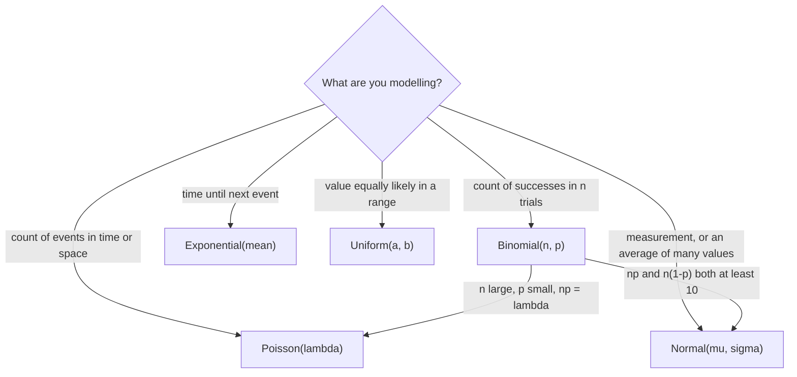
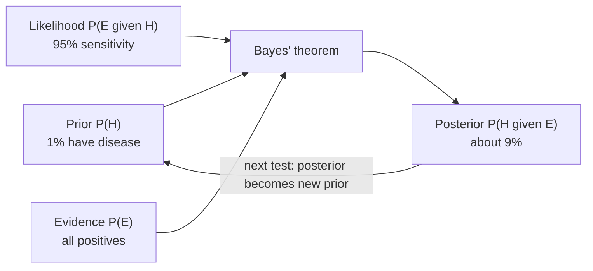
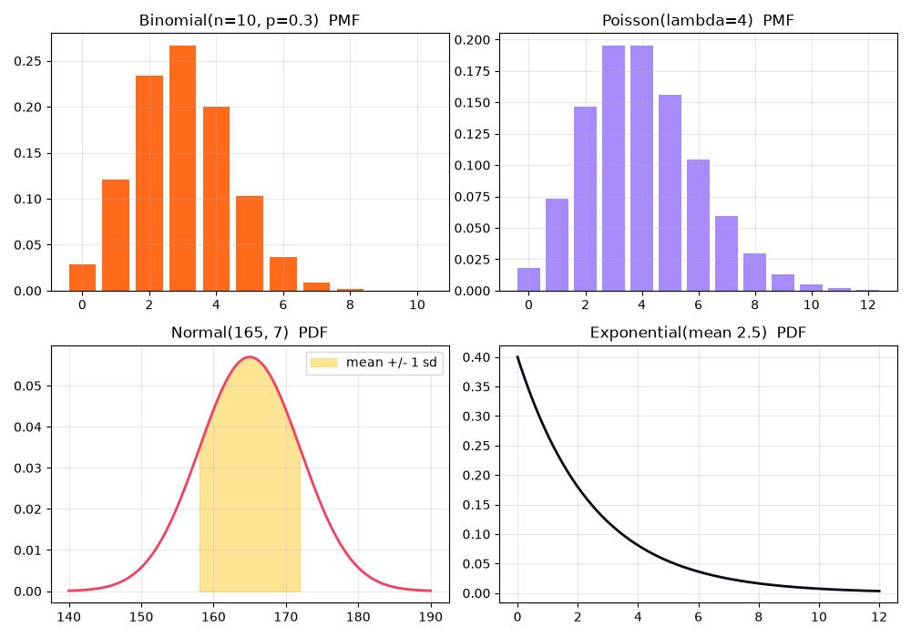
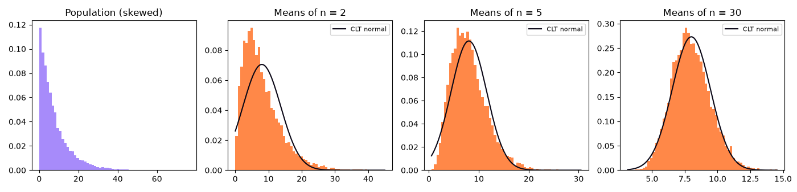
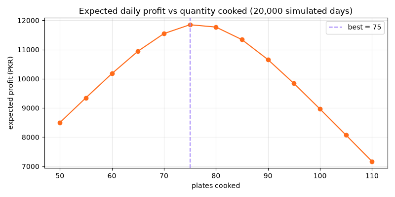

[](https://colab.research.google.com/github/Hamnakhan123/Diploma-in-AI/blob/main/term-1/03-inferential-statistical-analysis/code/session-02-introduction-to-probability.ipynb) &nbsp; 📓 [Notebook](code/session-02-introduction-to-probability.ipynb)

# Session 2: Introduction to Probability

> 🧭 [Diploma in AI](../../README.md) › [Term 1](../README.md) › [Inferential Statistical Analysis](README.md) › **Session 2**
>
> ⏱️ **Estimated time:** 2.5 hours (1 h concepts + 1.5 h lab) &nbsp;|&nbsp; 📋 **Prerequisites:** Session 1 (mean, variance, standard deviation)
>
> Prepared by **Hamna Zahid Khan**, Junior Lecturer

[⬅ Previous: Session 1](session-01-introduction-to-statistics.md) &nbsp;|&nbsp; [🏠 Module home](README.md) &nbsp;|&nbsp; [Next: Session 3 ➡](session-03-correlation-and-regression.md)

---

## 🎯 Learning objectives

- Define **sample space, event and probability**, and compare **classical, empirical and axiomatic** approaches.
- Apply the **addition, multiplication, complement and conditional** probability rules, and test **independence**.
- Use **Bayes' theorem** to update a belief with evidence (medical tests, spam filters).
- Describe **discrete and continuous random variables**, and compute **expectation E[X]** and **variance**.
- Choose and use the **Binomial, Poisson, Uniform, Normal and Exponential** distributions in `scipy.stats`.
- Explain the **Central Limit Theorem** and use it to answer questions about averages.

## 📖 Concepts

### 1. The language of probability

| Term | Meaning | Two-dice example |
|---|---|---|
| **Experiment** | a process with an uncertain result | throw two dice |
| **Sample space S** | the set of all possible outcomes | 36 ordered pairs (1,1) … (6,6) |
| **Event** | a subset of S | "the sum is 7" = {(1,6), (2,5), …, (6,1)} |
| **Probability P(A)** | a number from 0 (impossible) to 1 (certain) | P(sum = 7) = 6/36 = 1/6 |

Three ways to assign probability:

1. **Classical (a priori):** P(A) = favourable outcomes / total outcomes, valid when outcomes are **equally likely** (fair dice, shuffled cards).
2. **Empirical (relative frequency):** P(A) ≈ times A happened / number of trials. "Out of 2,000 past orders, 140 were returned, so P(return) ≈ 0.07."
3. **Subjective:** an expert's degree of belief ("a 30 % chance this startup succeeds").

All three obey the **axioms** (Kolmogorov): P(A) ≥ 0; P(S) = 1; for mutually exclusive events P(A ∪ B) = P(A) + P(B).

> 🧠 **Analogy:** probability is the **weather forecast** of data. "70 % chance of rain" doesn't tell you whether it rains tomorrow, but over many days with that forecast it should rain on about 70 % of them. That long-run idea is the **law of large numbers**.

### 2. The rules you will use every day

| Rule | Formula | When |
|---|---|---|
| Complement | P(not A) = 1 − P(A) | "at least one" problems are easier as 1 − P(none) |
| Addition (general) | P(A ∪ B) = P(A) + P(B) − P(A ∩ B) | "A **or** B" |
| Addition (mutually exclusive) | P(A ∪ B) = P(A) + P(B) | A and B cannot both happen |
| Conditional | P(A \| B) = P(A ∩ B) / P(B) | "A **given** B already happened" |
| Multiplication (general) | P(A ∩ B) = P(A) · P(B \| A) | "A **and** B" |
| Multiplication (independent) | P(A ∩ B) = P(A) · P(B) | one event tells you nothing about the other |

**Mutually exclusive ≠ independent.** "Sum = 7" and "double" can never happen together (exclusive), so knowing one happened tells you the other did *not*: they are strongly **dependent**.

**Counting helps compute classical probabilities:** permutations **nPr = n! / (n − r)!** when order matters (gold/silver/bronze); combinations **nCr = n! / (r!(n − r)!)** when it doesn't (a committee).

### 3. Bayes' theorem: updating beliefs

**P(H | E) = P(E | H) · P(H) / P(E)**, where P(E) = P(E | H)P(H) + P(E | not H)P(not H).

- **Prior P(H):** what you believed before the evidence (1 % of people have the disease).
- **Likelihood P(E | H):** how likely the evidence is if H is true (test sensitivity 95 %).
- **Posterior P(H | E):** your updated belief (only about 9 % after one positive test!).

**Step-by-step with natural frequencies** (prevalence 1 %, sensitivity 95 %, false-positive rate 10 %):

1. Imagine 100,000 people → 1,000 sick, 99,000 healthy.
2. Sick and positive: 1,000 × 0.95 = **950**.
3. Healthy but positive: 99,000 × 0.10 = **9,900**.
4. P(sick | positive) = 950 / (950 + 9,900) ≈ **0.088**.

The rare condition is swamped by false alarms from the huge healthy group: the **base-rate fallacy**. Bayes is the engine of **Naive Bayes classifiers**, spam filters and medical decision support.

### 4. Random variables and expectation

A **random variable** X assigns a number to each outcome.

| | Discrete | Continuous |
|---|---|---|
| Values | countable (0, 1, 2, …) | any value in an interval |
| Described by | **PMF** p(x) = P(X = x) | **PDF** f(x); probability = area under the curve |
| Example | number of defective bulbs in a box | time until the next bus |
| P(X = exact value) | can be > 0 | always 0 (only intervals have probability) |

Both have a **CDF** F(x) = P(X ≤ x).

- **Expectation (mean):** E[X] = Σ x·p(x) — the long-run average if you repeated the experiment forever.
- **Variance:** Var(X) = Σ (x − E[X])² p(x) = E[X²] − (E[X])².
- **Linearity:** E[aX + b] = a·E[X] + b and Var(aX + b) = a²·Var(X). Very handy for profit = price × sales − fixed cost.

### 5. The distributions you must know

| Distribution | Models | Parameters | Mean | Variance | Real example |
|---|---|---|---|---|---|
| **Bernoulli** | one yes/no trial | p | p | p(1 − p) | does this visitor click? |
| **Binomial** | # successes in n independent trials | n, p | np | np(1 − p) | conversions out of 10 sales calls |
| **Poisson** | # events in a fixed interval | λ | λ | λ | calls per hour, typos per page |
| **Uniform** | every value in [a, b] equally likely | a, b | (a+b)/2 | (b−a)²/12 | random arrival within a time window |
| **Normal** | sums/averages of many small effects | μ, σ | μ | σ² | heights, measurement errors, exam marks |
| **Exponential** | waiting time between Poisson events | mean β = 1/λ | β | β² | minutes until the next order |

`scipy.stats` gives every distribution the same methods: `pmf`/`pdf` (height), `cdf` (P(X ≤ x)), `sf` (P(X > x) = 1 − cdf), `ppf` (inverse cdf: the value at a percentile), `mean`, `var`, `rvs` (random samples).

**Standard normal and z-scores:** any normal X can be standardised as Z = (X − μ)/σ ~ N(0, 1). Then P(X > 180) for N(165, 7) is P(Z > 2.14) ≈ 0.016.

### 6. The Central Limit Theorem (CLT)

> If you take many random samples of size n from **any** population with mean μ and standard deviation σ, the distribution of the **sample mean x̄** is approximately **Normal(μ, σ/√n)**, and the approximation improves as n grows.

Why it matters:

- It is the reason the normal distribution is everywhere in statistics, even when raw data is skewed.
- σ/√n is the **standard error**: averages are less variable than individual values, and four times the sample gives half the error.
- Confidence intervals and most hypothesis tests (Sessions 4-5) are built on it.
- Rule of thumb: n ≥ 30 is usually enough; very skewed populations need more.

## 🧭 Diagrams





## 💻 Worked examples

### Example 1: Probability rules on two dice (basic)

Using Python's `Fraction` keeps answers exact, just like working on paper.

📄 [`code/session-02_probability_rules.py`](code/session-02_probability_rules.py) &nbsp;·&nbsp; run: `python session-02_probability_rules.py`

```python
"""
Session 2 · Example 1: Classical vs empirical probability, and the basic rules
------------------------------------------------------------------------------
* Classical probability counts equally likely outcomes in a sample space.
* Empirical probability counts how often something happened in trials.
* The law of large numbers says the second approaches the first as trials grow.
We also check the addition rule, the multiplication rule for independent
events, the complement rule and conditional probability on two dice.

Run:  python session-02_probability_rules.py
"""
from fractions import Fraction
from itertools import product
import numpy as np

rng = np.random.default_rng(seed=7)          # fixed seed -> same output every run

# ---- 1. Sample space of two dice: 36 equally likely ordered pairs ------------------
space = list(product(range(1, 7), repeat=2))
def P(event):
    """Classical probability: favourable outcomes / total outcomes (exact fraction)."""
    fav = [o for o in space if event(o)]
    return Fraction(len(fav), len(space))

sum7 = lambda o: o[0] + o[1] == 7
double = lambda o: o[0] == o[1]
first6 = lambda o: o[0] == 6
print("Sample space size:", len(space))
print("P(sum = 7)            =", P(sum7))
print("P(double)             =", P(double))
print("P(sum=7 or double)    =", P(lambda o: sum7(o) or double(o)),
      "  (addition rule: 1/6 + 1/6 - 0, the events are mutually exclusive)")
print("P(first=6 or double)  =", P(lambda o: first6(o) or double(o)),
      "  (= 1/6 + 1/6 - 1/36 because (6,6) is counted twice)")
print("P(no six at all)      =", P(lambda o: 6 not in o), "  complement of P(at least one six) =",
      1 - P(lambda o: 6 not in o))

# ---- 2. Conditional probability: P(A | B) = P(A and B) / P(B) ----------------------
sum_ge_10 = lambda o: o[0] + o[1] >= 10
print("\nP(sum >= 10)                 =", P(sum_ge_10))
print("P(sum >= 10 | first die = 6) =", P(lambda o: sum_ge_10(o) and first6(o)) / P(first6),
      "  knowing the first die is 6 makes a big sum much more likely")

# ---- 3. Independence: P(A and B) = P(A) * P(B) ---------------------------------------
even_first = lambda o: o[0] % 2 == 0
second_gt4 = lambda o: o[1] > 4
lhs = P(lambda o: even_first(o) and second_gt4(o))
print("\nIndependent? P(A and B) =", lhs, " P(A)*P(B) =", P(even_first) * P(second_gt4),
      "->", lhs == P(even_first) * P(second_gt4))

# ---- 4. Law of large numbers: empirical -> classical --------------------------------
print("\nEmpirical P(sum = 7) as the number of throws grows (true value 0.1667):")
for n in [10, 100, 1_000, 10_000, 100_000]:
    d = rng.integers(1, 7, size=(n, 2))
    print(f"  n = {n:>7,}:  {np.mean(d.sum(axis=1) == 7):.4f}")

# ---- 5. Counting: permutations and combinations -------------------------------------
from math import comb, perm
print("\nWays to choose a 3-person committee from 10 students: C(10,3) =", comb(10, 3))
print("Ways to award gold, silver, bronze among 10 students:  P(10,3) =", perm(10, 3))
print("P(a 4-digit PIN guessed in one try)  =", Fraction(1, 10 ** 4))
```

**Output**

```text
Sample space size: 36
P(sum = 7)            = 1/6
P(double)             = 1/6
P(sum=7 or double)    = 1/3   (addition rule: 1/6 + 1/6 - 0, the events are mutually exclusive)
P(first=6 or double)  = 11/36   (= 1/6 + 1/6 - 1/36 because (6,6) is counted twice)
P(no six at all)      = 25/36   complement of P(at least one six) = 11/36

P(sum >= 10)                 = 1/6
P(sum >= 10 | first die = 6) = 1/2   knowing the first die is 6 makes a big sum much more likely

Independent? P(A and B) = 1/6  P(A)*P(B) = 1/6 -> True

Empirical P(sum = 7) as the number of throws grows (true value 0.1667):
  n =      10:  0.1000
  n =     100:  0.1500
  n =   1,000:  0.1530
  n =  10,000:  0.1700
  n = 100,000:  0.1663

Ways to choose a 3-person committee from 10 students: C(10,3) = 120
Ways to award gold, silver, bronze among 10 students:  P(10,3) = 720
P(a 4-digit PIN guessed in one try)  = 1/10000
```


Notice how the empirical estimate wanders at n = 10 and 100, then settles near 1/6 as n grows: the **law of large numbers** in action.

### Example 2: Bayes' theorem and a tiny spam filter (intermediate)

📄 [`code/session-02_bayes.py`](code/session-02_bayes.py) &nbsp;·&nbsp; run: `python session-02_bayes.py`

```python
"""
Session 2 · Example 2: Bayes' theorem in medicine and spam filtering
-------------------------------------------------------------------
Bayes' theorem turns P(evidence | cause) into P(cause | evidence):

        P(H | E) = P(E | H) * P(H) / P(E)
        P(E)     = P(E | H) P(H) + P(E | not H) P(not H)     (total probability)

Part 1 solves the classic 'positive test' puzzle with the formula AND with a
table of 100,000 imaginary people (natural frequencies).
Part 2 trains a tiny word-based spam filter (naive Bayes) on 8 messages.

Run:  python session-02_bayes.py
"""
from collections import Counter
import math

# ---------------- Part 1: a screening test -------------------------------------------
prevalence = 0.01        # P(disease): 1 in 100 people has it
sensitivity = 0.95       # P(positive | disease)
specificity = 0.90       # P(negative | healthy) -> false-positive rate 0.10

p_pos = sensitivity * prevalence + (1 - specificity) * (1 - prevalence)
p_disease_given_pos = sensitivity * prevalence / p_pos
print("Screening test")
print(f"  P(positive)           = {p_pos:.4f}")
print(f"  P(disease | positive) = {p_disease_given_pos:.4f}  <- only about 9 %!")

# Natural frequencies: the same answer with counting, which most people find intuitive
N = 100_000
sick = N * prevalence
true_pos = sick * sensitivity
false_pos = (N - sick) * (1 - specificity)
print(f"  Of {N:,} people: {sick:,.0f} sick -> {true_pos:,.0f} test positive; "
      f"{N - sick:,.0f} healthy -> {false_pos:,.0f} false alarms")
print(f"  {true_pos:,.0f} / ({true_pos:,.0f} + {false_pos:,.0f}) = {true_pos / (true_pos + false_pos):.4f}")

# A second, independent positive test: yesterday's posterior becomes today's prior
prior = p_disease_given_pos
p_pos2 = sensitivity * prior + (1 - specificity) * (1 - prior)
print(f"  After a SECOND positive test: P(disease) = {sensitivity * prior / p_pos2:.4f}")

# ---------------- Part 2: a naive Bayes spam filter ----------------------------------
train = [
    ("win a free prize now", "spam"), ("free cash offer click now", "spam"),
    ("claim your free reward", "spam"), ("cheap loan offer now", "spam"),
    ("meeting moved to monday", "ham"), ("please send the lab report", "ham"),
    ("lunch at the cafe on monday", "ham"), ("your assignment marks are out", "ham"),
]
classes = Counter(label for _, label in train)
words = {c: Counter() for c in classes}
for text, label in train:
    words[label].update(text.split())
vocab = {w for c in words for w in words[c]}

def log_posterior(text, c):
    """log P(c) + sum log P(word | c), with Laplace (+1) smoothing for unseen words."""
    total = sum(words[c].values())
    lp = math.log(classes[c] / len(train))
    for w in text.split():
        lp += math.log((words[c][w] + 1) / (total + len(vocab)))
    return lp

print("\nNaive Bayes spam filter")
for msg in ["free prize offer", "lab report on monday", "click now for cheap marks"]:
    scores = {c: log_posterior(msg, c) for c in classes}
    # convert log scores back to probabilities that sum to 1
    m = max(scores.values())
    exp = {c: math.exp(s - m) for c, s in scores.items()}
    p_spam = exp["spam"] / sum(exp.values())
    print(f"  {msg!r:<30} P(spam) = {p_spam:.3f} -> {'SPAM' if p_spam > 0.5 else 'ham'}")
```

**Output**

```text
Screening test
  P(positive)           = 0.1085
  P(disease | positive) = 0.0876  <- only about 9 %!
  Of 100,000 people: 1,000 sick -> 950 test positive; 99,000 healthy -> 9,900 false alarms
  950 / (950 + 9,900) = 0.0876
  After a SECOND positive test: P(disease) = 0.4769

Naive Bayes spam filter
  'free prize offer'             P(spam) = 0.964 -> SPAM
  'lab report on monday'         P(spam) = 0.047 -> ham
  'click now for cheap marks'    P(spam) = 0.908 -> SPAM
```


**Walkthrough:** a second positive test raises the probability from 9 % to 48 % because the first posterior becomes the new prior. In the spam filter, each word multiplies the evidence; logs turn the product into a sum to avoid tiny numbers, and **Laplace smoothing** (+1) stops a single unseen word from making a probability zero.

### Example 3: Expectation and the main distributions (intermediate)

📄 [`code/session-02_distributions.py`](code/session-02_distributions.py) &nbsp;·&nbsp; run: `python session-02_distributions.py`

```python
"""
Session 2 · Example 3: Random variables, expectation and common distributions
-----------------------------------------------------------------------------
A random variable maps each outcome to a number. Its distribution tells us how
likely each value is. We compute E[X] and Var(X) by hand for a discrete
variable, then use scipy.stats for the Binomial, Poisson, Uniform, Normal and
Exponential distributions, and save a 4-panel chart: session-02_distributions.png

Run:  python session-02_distributions.py
"""
import numpy as np
from scipy import stats
import matplotlib
matplotlib.use("Agg")
import matplotlib.pyplot as plt

# ---- 1. A discrete random variable by hand ------------------------------------------
# X = number of customers who buy something, out of the next few visitors to a stall
values = np.array([0, 1, 2, 3, 4])
probs = np.array([0.10, 0.25, 0.35, 0.20, 0.10])
assert np.isclose(probs.sum(), 1.0), "probabilities must sum to 1"
EX = (values * probs).sum()                      # E[X]   = sum x p(x)
VarX = ((values - EX) ** 2 * probs).sum()        # Var(X) = sum (x - E[X])^2 p(x)
print(f"E[X] = {EX:.2f} buyers,  Var(X) = {VarX:.4f},  SD = {np.sqrt(VarX):.4f}")
print(f"Linearity: if profit = 500*X - 200, E[profit] = 500*{EX:.2f} - 200 = {500 * EX - 200:.0f} PKR")

# ---- 2. Binomial: number of successes in n independent yes/no trials -----------------
n, p = 10, 0.3                                   # 10 calls, each converts with prob 0.3
B = stats.binom(n, p)
print(f"\nBinomial(n={n}, p={p}): mean={B.mean():.1f}, var={B.var():.2f}")
print(f"  P(X = 3) = {B.pmf(3):.4f}   P(X <= 2) = {B.cdf(2):.4f}   P(X >= 5) = {B.sf(4):.4f}")

# ---- 3. Poisson: number of events in a fixed interval (rate lambda) ------------------
lam = 4                                          # 4 orders per 10 minutes on average
Po = stats.poisson(lam)
print(f"Poisson(lambda={lam}): P(X = 0) = {Po.pmf(0):.4f}   P(X >= 8) = {Po.sf(7):.4f}")

# ---- 4. Continuous: Uniform, Normal, Exponential -------------------------------------
U = stats.uniform(loc=10, scale=20)             # bus arrives uniformly between 10 and 30 min
print(f"Uniform(10, 30): P(wait < 15) = {U.cdf(15):.3f}, mean = {U.mean():.0f}")
heights = stats.norm(loc=165, scale=7)          # adult heights in cm
print(f"Normal(165, 7): P(height > 180) = {heights.sf(180):.4f}; 90th percentile = {heights.ppf(0.90):.1f} cm")
print(f"  P(158 < H < 172) = {heights.cdf(172) - heights.cdf(158):.4f}  (the 68 % of the empirical rule)")
E = stats.expon(scale=2.5)                       # time between orders, mean 2.5 minutes
print(f"Exponential(mean 2.5): P(gap > 5 min) = {E.sf(5):.4f}")

# ---- 5. Chart ----------------------------------------------------------------------
fig, axes = plt.subplots(2, 2, figsize=(10, 7))
k = np.arange(0, 11)
axes[0, 0].bar(k, B.pmf(k), color="#FF6B1A"); axes[0, 0].set_title("Binomial(n=10, p=0.3)  PMF")
k2 = np.arange(0, 13)
axes[0, 1].bar(k2, Po.pmf(k2), color="#A78BFA"); axes[0, 1].set_title("Poisson(lambda=4)  PMF")
xs = np.linspace(140, 190, 300)
axes[1, 0].plot(xs, heights.pdf(xs), color="#F43F5E", lw=2)
mask = (xs > 158) & (xs < 172)
axes[1, 0].fill_between(xs[mask], heights.pdf(xs[mask]), color="#FCD34D", alpha=0.6, label="mean +/- 1 sd")
axes[1, 0].set_title("Normal(165, 7)  PDF"); axes[1, 0].legend()
xe = np.linspace(0, 12, 300)
axes[1, 1].plot(xe, E.pdf(xe), color="#0A0716", lw=2); axes[1, 1].set_title("Exponential(mean 2.5)  PDF")
for ax in axes.flat:
    ax.grid(alpha=0.3)
fig.tight_layout(); fig.savefig("session-02_distributions.png", dpi=100)
print("\nSaved chart: session-02_distributions.png")
```

**Output**

```text
E[X] = 1.95 buyers,  Var(X) = 1.2475,  SD = 1.1169
Linearity: if profit = 500*X - 200, E[profit] = 500*1.95 - 200 = 775 PKR

Binomial(n=10, p=0.3): mean=3.0, var=2.10
  P(X = 3) = 0.2668   P(X <= 2) = 0.3828   P(X >= 5) = 0.1503
Poisson(lambda=4): P(X = 0) = 0.0183   P(X >= 8) = 0.0511
Uniform(10, 30): P(wait < 15) = 0.250, mean = 20
Normal(165, 7): P(height > 180) = 0.0161; 90th percentile = 174.0 cm
  P(158 < H < 172) = 0.6827  (the 68 % of the empirical rule)
Exponential(mean 2.5): P(gap > 5 min) = 0.1353

Saved chart: session-02_distributions.png
```




**Reading the output:** `sf(4)` means P(X > 4) = P(X ≥ 5) for a discrete variable; mixing up `> ` and `≥` is the most common slip. The normal probability between 158 and 172 cm (μ ± σ) is 0.6827, the 68 % of the empirical rule from Session 1.

### Example 4: The Central Limit Theorem by simulation (advanced)

📄 [`code/session-02_clt.py`](code/session-02_clt.py) &nbsp;·&nbsp; run: `python session-02_clt.py`

```python
"""
Session 2 · Example 4: The Central Limit Theorem, seen with your own eyes
------------------------------------------------------------------------
Population: waiting times at a bank, which are strongly RIGHT-SKEWED
(exponential with mean 8 minutes). We draw thousands of samples of size
n = 2, 5, 30 and look at the distribution of the SAMPLE MEANS.

CLT: whatever the population shape, the sample mean is approximately
Normal(mu, sigma / sqrt(n)) when n is large enough (n >= 30 is a common rule).
Chart saved to: session-02_clt.png

Run:  python session-02_clt.py
"""
import numpy as np
from scipy import stats
import matplotlib
matplotlib.use("Agg")
import matplotlib.pyplot as plt

rng = np.random.default_rng(42)
mu = sigma = 8.0                    # for an exponential distribution, sd = mean
reps = 10_000

print(f"Population: exponential, mean {mu}, sd {sigma}, skewness 2.0")
print(f"{'n':>4} {'mean of means':>14} {'sd of means':>12} {'sigma/sqrt(n)':>14} {'skewness':>9}")
fig, axes = plt.subplots(1, 4, figsize=(14, 3.4))
pop = rng.exponential(mu, size=reps)
axes[0].hist(pop, bins=60, color="#A78BFA", density=True)
axes[0].set_title("Population (skewed)")
for ax, n in zip(axes[1:], [2, 5, 30]):
    means = rng.exponential(mu, size=(reps, n)).mean(axis=1)
    print(f"{n:>4} {means.mean():>14.3f} {means.std(ddof=1):>12.3f} {sigma / np.sqrt(n):>14.3f} "
          f"{stats.skew(means):>9.3f}")
    ax.hist(means, bins=60, density=True, color="#FF6B1A", alpha=0.8)
    xs = np.linspace(means.min(), means.max(), 200)
    ax.plot(xs, stats.norm.pdf(xs, mu, sigma / np.sqrt(n)), color="#0A0716", lw=1.5, label="CLT normal")
    ax.set_title(f"Means of n = {n}"); ax.legend(fontsize=8)
fig.tight_layout(); fig.savefig("session-02_clt.png", dpi=100)

# Using the CLT: probability that the AVERAGE wait of 36 customers exceeds 10 minutes
se = sigma / np.sqrt(36)
z = (10 - mu) / se
print(f"\nP(mean wait of 36 customers > 10 min) ~ P(Z > {z:.2f}) = {stats.norm.sf(z):.4f}")
sim = rng.exponential(mu, size=(reps, 36)).mean(axis=1)
print(f"Simulation check: {np.mean(sim > 10):.4f}")
print("Saved chart: session-02_clt.png")
```

**Output**

```text
Population: exponential, mean 8.0, sd 8.0, skewness 2.0
   n  mean of means  sd of means  sigma/sqrt(n)  skewness
   2          8.052        5.770          5.657     1.477
   5          8.026        3.586          3.578     0.906
  30          7.982        1.466          1.461     0.336

P(mean wait of 36 customers > 10 min) ~ P(Z > 1.50) = 0.0668
Simulation check: 0.0723
Saved chart: session-02_clt.png
```




**What to notice:** the population is very skewed (skewness 2), yet means of 30 waits are almost symmetric (skewness 0.34) and their spread matches σ/√n. The CLT approximation (0.0668) is close to the simulation (0.0723); the small gap is leftover skewness, which shrinks as n grows.

## 🌍 Real-life coding problem: staffing a bank help-line

**Scenario.** A help-line averages 18 calls between 9 and 10 am and each agent handles 4 calls an hour. How many agents keep the chance of being overloaded at or below 5 %? And how often will 3 or more of the calls be complaints, if 6 % of calls are complaints?

**Plan:** model calls as **Poisson(18)** (independent random arrivals) and complaints as **Binomial(18, 0.06)**; use `sf` for tail probabilities; loop over team sizes until P(overload) ≤ 0.05; confirm everything with a simulation.

📄 [`code/session-02_problem_call_centre.py`](code/session-02_problem_call_centre.py) &nbsp;·&nbsp; run: `python session-02_problem_call_centre.py`

```python
"""
Session 2 · Real-life problem: how many agents does the help-line need?
----------------------------------------------------------------------
PROBLEM
A bank's help-line receives on average 18 calls per hour between 9 and 10 am.
Each agent can handle 4 calls per hour. Management asks:
  1. What is the probability of more than 25 calls in that hour?
  2. How many agents are needed so that the chance of more calls than the team
     can handle is at most 5 %?
  3. A quality check finds 6 % of calls are complaints. Out of 18 calls,
     what is P(at least 3 complaints)? What is the expected number?
  4. Verify the answers with a Monte Carlo simulation of 100,000 mornings.

MODEL
Calls in an hour  ~ Poisson(lambda = 18)    (random, independent arrivals)
Complaints        ~ Binomial(n = 18, p = 0.06)

Run:  python session-02_problem_call_centre.py
"""
import math
import numpy as np
from scipy import stats

lam, per_agent = 18, 4
calls = stats.poisson(lam)

# 1. Tail probability
print(f"1. P(calls > 25) = {calls.sf(25):.4f}")

# 2. Smallest team whose capacity covers demand at least 95 % of the time
for agents in range(1, 15):
    capacity = agents * per_agent
    p_overload = calls.sf(capacity)          # P(calls > capacity)
    print(f"   {agents} agents -> capacity {capacity:>2} calls, P(overload) = {p_overload:.4f}")
    if p_overload <= 0.05:
        break
print(f"2. Hire {agents} agents (the 95th percentile of demand is {calls.ppf(0.95):.0f} calls).")

# 3. Complaints
comp = stats.binom(18, 0.06)
print(f"3. P(>= 3 complaints) = {comp.sf(2):.4f}, expected complaints = {comp.mean():.2f}")
# The same answer from the formula, to show there is no magic:
p_le2 = sum(math.comb(18, k) * 0.06 ** k * 0.94 ** (18 - k) for k in range(3))
print(f"   by formula: 1 - P(X <= 2) = {1 - p_le2:.4f}")

# 4. Monte Carlo check
rng = np.random.default_rng(2026)
mornings = rng.poisson(lam, size=100_000)
print(f"4. Simulated P(calls > 25)        = {np.mean(mornings > 25):.4f}")
print(f"   Simulated P(overload, {agents} agents) = {np.mean(mornings > agents * per_agent):.4f}")
complaints = rng.binomial(18, 0.06, size=100_000)
print(f"   Simulated P(>= 3 complaints)    = {np.mean(complaints >= 3):.4f}")
```

**Output**

```text
1. P(calls > 25) = 0.0446
   1 agents -> capacity  4 calls, P(overload) = 0.9999
   2 agents -> capacity  8 calls, P(overload) = 0.9929
   3 agents -> capacity 12 calls, P(overload) = 0.9083
   4 agents -> capacity 16 calls, P(overload) = 0.6249
   5 agents -> capacity 20 calls, P(overload) = 0.2693
   6 agents -> capacity 24 calls, P(overload) = 0.0683
   7 agents -> capacity 28 calls, P(overload) = 0.0103
2. Hire 7 agents (the 95th percentile of demand is 25 calls).
3. P(>= 3 complaints) = 0.0898, expected complaints = 1.08
   by formula: 1 - P(X <= 2) = 0.0898
4. Simulated P(calls > 25)        = 0.0446
   Simulated P(overload, 7 agents) = 0.0101
   Simulated P(>= 3 complaints)    = 0.0892
```


**Answer for management:** 6 agents would be overloaded on about 7 % of mornings; **7 agents** bring it down to about 1 %. The simulation agrees with the formulas to three decimal places, which is the best evidence that the model is coded correctly. Expect roughly one complaint per morning, and 3 or more on about 9 % of mornings.

## 🛠️ Mini project: Monte Carlo profit simulator

How many plates of biryani should a student stall cook when visitors and buyers are both random? Too few and you lose sales; too many and food is wasted. The simulator draws 20,000 random days, evaluates each cooking quantity on the **same** simulated demand (so comparisons are fair), and checks the answer against the textbook **newsvendor** formula.

```python
visitors = rng.poisson(220, size=DAYS)          # random footfall
demand = rng.binomial(visitors, 0.35)           # each visitor buys with p = 0.35
def profit_for(cooked):
    sold = np.minimum(demand, cooked)           # cannot sell more than you cooked
    return sold * PRICE - cooked * COST         # unsold plates are a pure cost
```

📄 Full solution (59 lines, fully commented): [`code/session-02_project_monte_carlo.py`](code/session-02_project_monte_carlo.py) &nbsp;·&nbsp; run: `python session-02_project_monte_carlo.py` &nbsp;·&nbsp; also in the session notebook

**Output**

```text
Demand per day: mean 77.1, sd 8.9, min 46, max 118

cooked  E[profit]  5th pct  95th pct  P(loss) P(sold out)
    50      8,500    8,500     8,500    0.000       1.000
    55      9,347    9,350     9,350    0.000       0.997
    60     10,176   10,200    10,200    0.000       0.979
    65     10,942   10,350    11,050    0.000       0.927
    70     11,546    9,450    11,900    0.000       0.804
    75     11,850    8,550    12,750    0.000       0.603
    80     11,771    7,650    13,600    0.000       0.382
    85     11,340    6,750    14,450    0.000       0.199
    90     10,656    5,850    15,300    0.000       0.083
    95      9,838    4,950    15,100    0.000       0.029
   100      8,964    4,050    14,200    0.001       0.008
   105      8,070    3,150    13,300    0.002       0.001
   110      7,171    2,250    12,400    0.008       0.000

Best quantity by simulation: 75 plates (expected profit 11,850 PKR)
Newsvendor theory: cook the 0.486 quantile of demand = 76 plates
Saved chart: session-02_project_monte_carlo.png
```




**Business answer:** cook about **75 plates**. Simulation and theory agree (75 vs 76). Cooking 110 plates looks attractive on a lucky day, but its expected profit is 40 % lower.

## ⚠️ Common mistakes

| Mistake | Fix |
|---|---|
| Adding probabilities of events that can happen together | Subtract the overlap: P(A ∪ B) = P(A) + P(B) − P(A ∩ B) |
| Confusing P(A \| B) with P(B \| A) ("prosecutor's fallacy") | Write both out; use Bayes to convert one into the other |
| Ignoring the base rate | Always start from the prior (prevalence) |
| Treating "mutually exclusive" as "independent" | Exclusive events with non-zero probability are always dependent |
| Using `cdf(k)` when you need P(X ≥ k) | P(X ≥ k) = `sf(k − 1)` for discrete variables |
| Asking a continuous variable for P(X = x) | Use an interval: `cdf(b) − cdf(a)` |
| Thinking the CLT makes the **data** normal | It makes the **sample mean** approximately normal |
| "Gambler's fallacy": after 5 heads, tails is "due" | Independent trials have no memory |

## ✅ Best practices

- Write the **sample space** or a probability tree before you calculate.
- For "at least one" questions use the **complement**.
- Check that your PMF sums to 1 (`assert np.isclose(p.sum(), 1)`).
- Always **verify a formula with a simulation** using a fixed random seed; disagreements reveal bugs.
- Prefer natural frequencies ("950 out of 10,850") when explaining Bayes results to non-specialists.
- State model assumptions (independence, constant rate) next to the answer.

## 🧪 Lab / practice tasks

**1. 🟢 Easy:** A card is drawn from a standard 52-card deck. Find P(heart), P(king), P(heart or king), P(not a face card).

<details><summary>💡 Hint</summary>

There is one king of hearts, so the "or" needs the overlap subtracted. Face cards are J, Q, K.

</details>

<details><summary>✅ Solution</summary>

P(heart) = 13/52 = 1/4; P(king) = 4/52 = 1/13; P(heart or king) = 13/52 + 4/52 − 1/52 = 16/52 = 4/13; P(not face) = 1 − 12/52 = 40/52 = 10/13.

</details>

**2. 🟢 Easy:** 8 % of products from a factory are defective. In a box of 20, find P(no defects), P(exactly 2), P(at least 3), and the expected number of defects.

<details><summary>💡 Hint</summary>

Binomial(20, 0.08). "At least 3" is `sf(2)`.

</details>

<details><summary>✅ Solution</summary>

```python
from scipy import stats
X = stats.binom(20, 0.08)
print(X.pmf(0), X.pmf(2), X.sf(2), X.mean())
# 0.1887  0.2711  0.2121  1.6
```

</details>

**3. 🟡 Medium:** An e-mail filter flags 98 % of spam and wrongly flags 3 % of genuine e-mails. 20 % of all e-mail is spam. What fraction of flagged e-mails is actually spam?

<details><summary>💡 Hint</summary>

P(flag) = 0.98 × 0.20 + 0.03 × 0.80.

</details>

<details><summary>✅ Solution</summary>

P(flag) = 0.196 + 0.024 = 0.22; P(spam | flag) = 0.196 / 0.22 ≈ **0.891**. About 11 % of flagged mail is genuine.

</details>

**4. 🟡 Medium:** A website gets on average 3 sign-ups per hour. What is the probability of no sign-ups in an hour? Of waiting more than 30 minutes for the next sign-up?

<details><summary>💡 Hint</summary>

Count → Poisson(3). Waiting time → Exponential with mean 1/3 hour = 20 minutes.

</details>

<details><summary>✅ Solution</summary>

P(0) = e⁻³ ≈ 0.0498. P(wait > 30 min) = e^(−30/20) = e^(−1.5) ≈ 0.223. In code: `stats.poisson(3).pmf(0)`, `stats.expon(scale=20).sf(30)`.

</details>

**5. 🟠 Hard:** Exam marks are N(62, 11). What mark is needed for the top 10 %? What fraction of students fail (below 40)? If 25 students are picked at random, what is P(their average > 65)?

<details><summary>💡 Hint</summary>

Use `ppf(0.90)`, `cdf(40)`, and the CLT with standard error 11/√25 = 2.2.

</details>

<details><summary>✅ Solution</summary>

```python
from scipy import stats
M = stats.norm(62, 11)
print(round(M.ppf(0.90), 1), round(M.cdf(40), 4), round(stats.norm(62, 11 / 5).sf(65), 4))
# 76.1  0.0228  0.0863
```

</details>

**6. 🔴 Challenge:** Modify `session-02_clt.py` to use a **uniform** population on [0, 10] and a **heavily skewed** log-normal population. For which one does the sample-mean distribution look normal at a smaller n? Explain why.

<details><summary>💡 Hint</summary>

Replace `rng.exponential(mu, size=...)` with `rng.uniform(0, 10, size=...)` and `rng.lognormal(0, 1.2, size=...)`; update μ and σ (`np.mean`/`np.std` of a big sample is fine).

</details>

<details><summary>✅ Solution</summary>

The uniform population is already symmetric, so means of even n = 5 look normal (skewness ≈ 0). The log-normal population is very skewed, so even n = 30 still shows clear right skew (skewness well above 0.5). The CLT always works eventually, but **how fast** depends on the population's skewness.

</details>

## ✅ Quick quiz

**Q1.** Two events A and B are independent, P(A) = 0.4 and P(B) = 0.5. P(A and B) is…

- A) 0.9
- B) 0.2
- C) 0.1
- D) cannot be found

**Q2.** A disease affects 1 in 1,000 people. A test is 99 % sensitive with a 5 % false-positive rate. After a positive result the probability of disease is closest to…

- A) 99 %
- B) 95 %
- C) 50 %
- D) 2 %

**Q3.** The number of accidents per week at a junction is best modelled by…

- A) Binomial
- B) Poisson
- C) Normal
- D) Uniform

**Q4.** For X ~ Binomial(n = 50, p = 0.2), E[X] and Var(X) are…

- A) 10 and 8
- B) 10 and 10
- C) 0.2 and 0.16
- D) 50 and 10

**Q5.** According to the CLT, increasing the sample size from 25 to 100 changes the standard error of the mean by a factor of…

- A) 1/4
- B) 1/2
- C) 2
- D) it does not change

<details><summary>✅ Show answers</summary>

1. **B** — for independent events multiply: 0.4 × 0.5.
2. **D** — 0.99 × 0.001 / (0.99 × 0.001 + 0.05 × 0.999) ≈ 0.019.
3. **B** — counts of events in a fixed interval at a steady average rate.
4. **A** — np = 10 and np(1 − p) = 8.
5. **B** — SE = σ/√n, and √100 / √25 = 2, so the error halves.

</details>


## 📝 Summary

- Probability measures uncertainty on a 0-1 scale; classical (counting), empirical (frequency) and subjective approaches all obey the same axioms.
- Core rules: complement, addition (subtract the overlap), conditional probability, multiplication; independence means P(A ∩ B) = P(A)P(B).
- **Bayes' theorem** updates a prior with evidence; always respect the base rate.
- Random variables are discrete (PMF) or continuous (PDF); E[X] is the long-run average and variance its spread; expectation is linear.
- Know when to use Binomial, Poisson, Uniform, Normal and Exponential, and the `pmf/pdf, cdf, sf, ppf` methods of `scipy.stats`.
- **CLT:** sample means are approximately Normal(μ, σ/√n), which powers the inference in the rest of this module.

### 🎤 Interview / viva questions

1. Explain the difference between mutually exclusive and independent events with an example.
2. Why is a positive result from an accurate test for a rare disease often a false alarm?
3. How does a Naive Bayes classifier use Bayes' theorem, and what is "naive" about it?
4. Give a real situation for each: Binomial, Poisson, Exponential.
5. What is the difference between a PMF, a PDF and a CDF?
6. State the Central Limit Theorem and explain why it matters for A/B testing.
7. Why do we check analytical answers with Monte Carlo simulation?

---

[⬅ Previous: Session 1](session-01-introduction-to-statistics.md) &nbsp;|&nbsp; [🏠 Module home](README.md) &nbsp;|&nbsp; [Next: Session 3 ➡](session-03-correlation-and-regression.md)

<sub>Prepared by **Hamna Zahid Khan**, Junior Lecturer · Diploma in AI</sub>
