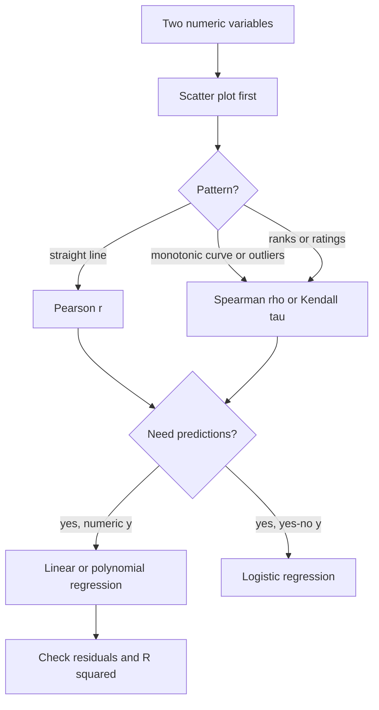
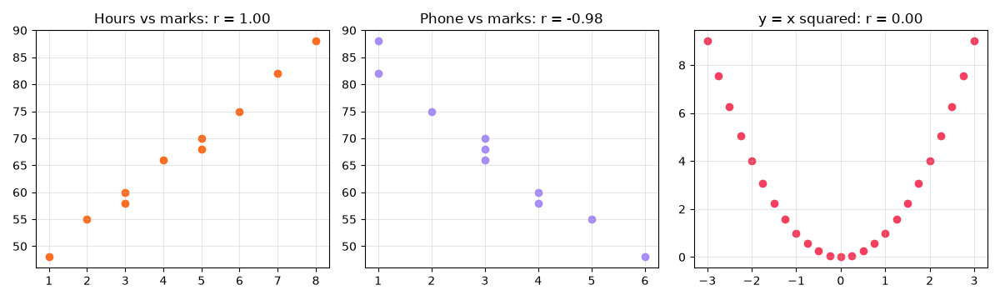
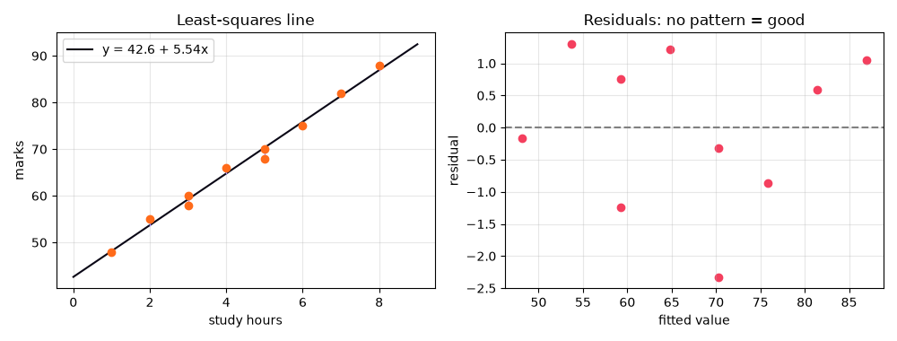
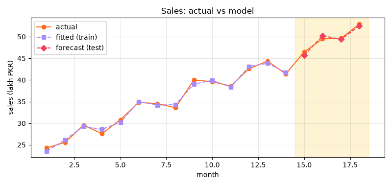

[](https://colab.research.google.com/github/Hamnakhan123/Diploma-in-AI/blob/main/term-1/03-inferential-statistical-analysis/code/session-03-correlation-and-regression.ipynb) &nbsp; 📓 [Notebook](code/session-03-correlation-and-regression.ipynb)

# Session 3: Correlation and Regression

> 🧭 [Diploma in AI](../../README.md) › [Term 1](../README.md) › [Inferential Statistical Analysis](README.md) › **Session 3**
>
> ⏱️ **Estimated time:** 3 hours (1 h concepts + 2 h lab) &nbsp;|&nbsp; 📋 **Prerequisites:** Sessions 1-2 (mean, standard deviation, z-scores, normal distribution)
>
> Prepared by **Hamna Zahid Khan**, Junior Lecturer

[⬅ Previous: Session 2](session-02-introduction-to-probability.md) &nbsp;|&nbsp; [🏠 Module home](README.md) &nbsp;|&nbsp; [Next: Session 4 ➡](session-04-inferential-statistics.md)

---

## 🎯 Learning objectives

- Explain **covariance** and **Pearson's correlation coefficient r**, and interpret its sign, size and r².
- Use **rank correlation** (Spearman's ρ, Kendall's τ) for ordinal data, outliers and monotonic curves.
- Separate **correlation from causation** and spot confounders and spurious correlations.
- Fit a **simple linear regression** by least squares, by hand and in Python, and interpret slope, intercept and R².
- Check a model with **residuals**, and know the dangers of **extrapolation**.
- Describe the **types of regression** (simple, multiple, polynomial, logistic) and pick the right one.

## 📖 Concepts

### 1. Two variables at once

Session 1 described one variable at a time. Most interesting questions involve **two**: does study time relate to marks? Does advertising relate to sales? Does a flat's area relate to its rent? The first step is always a **scatter plot**: one point per observation, x on the horizontal axis, y on the vertical.

Look for:

| Feature | What to ask |
|---|---|
| **Direction** | Does y tend to rise (positive) or fall (negative) as x rises? |
| **Form** | Straight line, curve, clusters? |
| **Strength** | Do points hug a line tightly or spread like a cloud? |
| **Outliers** | Is any point far from the pattern? |

### 2. Covariance

**Covariance** measures whether two variables move together:

cov(x, y) = Σ (x − x̄)(y − ȳ) / (n − 1)

- When x is above its mean and y is above its mean at the same time, the product is positive; many such pairs give a **positive** covariance.
- The problem: covariance depends on **units**. Measuring study time in minutes instead of hours multiplies the covariance by 60, although the relationship has not changed. So covariance tells you the **direction** but not the **strength**.

### 3. Pearson's correlation coefficient r

Dividing by both standard deviations removes the units:

**r = cov(x, y) / (sₓ · s_y)**, always between −1 and +1.

| r | Typical description |
|---|---|
| ±0.9 to ±1.0 | very strong |
| ±0.7 to ±0.9 | strong |
| ±0.4 to ±0.7 | moderate |
| ±0.2 to ±0.4 | weak |
| 0 to ±0.2 | very weak / none |

- **r²** (coefficient of determination) is the fraction of the variation in y explained by a straight line in x. r = 0.8 means r² = 0.64: 64 % explained.
- Pearson's r measures **linear** association only. y = x² on a symmetric range has r = 0 although y is perfectly determined by x.
- r is sensitive to **outliers**; one extreme point can create or destroy a correlation.
- **Significance:** with n pairs, t = r√((n − 2)/(1 − r²)) follows a t distribution with n − 2 degrees of freedom when the true correlation is 0. A tiny p-value means the correlation is unlikely to be pure chance (hypothesis testing is covered properly in Session 4).

> 🧠 **Analogy:** correlation is like two friends walking in a crowded market. If they always move in the same direction they are strongly correlated, even if one takes big steps (large units) and the other small ones. Covariance would be fooled by the step sizes; correlation is not.

### 4. Rank correlation

When data is **ordinal** (rankings, ratings), has **outliers**, or follows a **curved but always-increasing** (monotonic) pattern, rank the values and correlate the ranks.

**Spearman's ρ** (no ties): ρ = 1 − 6Σd² / (n(n² − 1)), where d is the difference between the two ranks of each item.

**Step by step** for two judges ranking 5 entries, Judge 1 = (1, 2, 3, 4, 5) and Judge 2 = (2, 1, 3, 5, 4):

1. d = (−1, 1, 0, −1, 1), d² = (1, 1, 0, 1, 1), Σd² = 4.
2. n(n² − 1) = 5 × 24 = 120.
3. ρ = 1 − 6 × 4 / 120 = 1 − 0.2 = **0.80**: strong agreement.

**Ties** get the average of the ranks they occupy (two values tied for 5th and 6th both get 5.5). **Kendall's τ** counts concordant and discordant pairs; it is smaller in size than ρ but has nicer statistical properties for small samples.

| Use | Pearson r | Spearman ρ / Kendall τ |
|---|---|---|
| Data type | interval / ratio | ordinal or numeric |
| Relationship | linear | any monotonic |
| Outliers | sensitive | robust |

### 5. Correlation is not causation

A strong correlation does **not** prove that x causes y. Alternatives:

- **Confounding (lurking) variable:** ice-cream sales and drowning deaths rise together because both rise in **summer**.
- **Reverse causation:** do hospitals make people ill, or do ill people go to hospitals?
- **Coincidence:** with thousands of variables, some pairs correlate by chance (spurious correlations).

Causation needs a **controlled experiment** (randomised A/B test) or careful causal-inference methods, which you meet in Term 2.

### 6. Simple linear regression

Correlation measures strength; **regression** gives an **equation** for prediction:

ŷ = b₀ + b₁x

- **b₁ (slope):** the change in predicted y for a one-unit increase in x.
- **b₀ (intercept):** predicted y when x = 0 (often just a mathematical anchor).
- **Residual eᵢ = yᵢ − ŷᵢ:** the vertical miss for each point.

**Least squares** chooses b₀ and b₁ to minimise the sum of squared residuals. The closed-form solution:

b₁ = Σ(x − x̄)(y − ȳ) / Σ(x − x̄)² = r · (s_y / sₓ)  b₀ = ȳ − b₁x̄

The line always passes through (x̄, ȳ).

**Step-by-step mini example:** x = (1, 2, 3), y = (2, 4, 5).

1. x̄ = 2, ȳ = 11/3 ≈ 3.667.
2. Σ(x − x̄)(y − ȳ) = (−1)(−1.667) + 0 + (1)(1.333) = 3.0; Σ(x − x̄)² = 2.
3. b₁ = 3/2 = 1.5; b₀ = 3.667 − 1.5 × 2 = 0.667. Line: ŷ = 0.667 + 1.5x.

**Goodness of fit:** SST (total) = SSR (explained) + SSE (errors), and **R² = SSR/SST = 1 − SSE/SST**. For simple regression R² = r².

**Assumptions (LINE):** **L**inear relationship, **I**ndependent errors, **N**ormally distributed errors, **E**qual variance of errors (homoscedasticity). A **residual plot** (residuals vs fitted values) should look like random noise around 0; a curve means the relationship is not linear, and a funnel means unequal variance.

**Extrapolation** (predicting outside the observed range of x) is risky: the straight line may not continue. A model fitted on 1-8 study hours may predict an impossible 153 marks for 20 hours.

### 7. Types of regression

| Type | Equation | Use when | Example |
|---|---|---|---|
| **Simple linear** | ŷ = b₀ + b₁x | one predictor, straight-line pattern | marks from hours |
| **Multiple linear** | ŷ = b₀ + b₁x₁ + … + b_kx_k | several predictors | rent from area, rooms, age |
| **Polynomial** | ŷ = b₀ + b₁x + b₂x² | curved pattern | fuel use vs speed |
| **Logistic** | P(y = 1) = 1 / (1 + e^−(b₀ + b₁x)) | yes/no outcome | pass/fail, churn, fraud |
| Regularised (ridge, lasso) | least squares + penalty | many predictors, overfitting | Term 2 machine learning |

In **multiple regression** each coefficient is the effect of its variable **holding the others constant**. Use **adjusted R²** to compare models with different numbers of predictors, because plain R² never decreases when you add a variable, even a useless one.

In **logistic regression** e^(b₁) is an **odds ratio**: how many times the odds of "yes" multiply for each one-unit increase in x.

## 🧭 Diagrams




## 💻 Worked examples

### Example 1: Covariance and Pearson's r (basic)

📄 [`code/session-03_correlation.py`](code/session-03_correlation.py) &nbsp;·&nbsp; run: `python session-03_correlation.py`

```python
"""
Session 3 · Example 1: Covariance and Pearson correlation, by hand and with SciPy
-------------------------------------------------------------------------------
Do students who study more hours score higher? We compute covariance and
Pearson's r step by step, test whether r is significantly different from 0,
and draw a 3-panel chart of positive, negative and 'no linear' relationships
(session-03_correlation.png), including a curved pattern where r is near 0
even though the variables are strongly related.

Run:  python session-03_correlation.py
"""
import numpy as np
from scipy import stats
import matplotlib
matplotlib.use("Agg")
import matplotlib.pyplot as plt

hours = np.array([2, 3, 5, 1, 4, 6, 7, 3, 5, 8])            # weekly study hours
marks = np.array([55, 60, 70, 48, 66, 75, 82, 58, 68, 88])   # exam marks

# ---- Step by step -----------------------------------------------------------------
dx, dy = hours - hours.mean(), marks - marks.mean()
cov = (dx * dy).sum() / (len(hours) - 1)                       # sample covariance
r = cov / (hours.std(ddof=1) * marks.std(ddof=1))              # Pearson r = cov / (sx * sy)
print(f"mean hours = {hours.mean():.1f}, mean marks = {marks.mean():.1f}")
print(f"sum of cross-products = {(dx * dy).sum():.1f}")
print(f"covariance  = {cov:.3f}    (np.cov gives {np.cov(hours, marks)[0, 1]:.3f})")
print(f"Pearson r   = {r:.4f}   (r^2 = {r * r:.4f}: {100 * r * r:.1f}% of the variation in marks is linearly explained)")

# ---- Library + significance test --------------------------------------------------
res = stats.pearsonr(hours, marks)
t = r * np.sqrt((len(hours) - 2) / (1 - r ** 2))               # t statistic with n-2 df
print(f"scipy: r = {res.statistic:.4f}, p-value = {res.pvalue:.2e}; by hand t = {t:.2f} on {len(hours) - 2} df")

# ---- Covariance depends on units, correlation does not ----------------------------
minutes = hours * 60
print(f"\nStudy time in MINUTES: covariance = {np.cov(minutes, marks)[0, 1]:.1f} (60x bigger), "
      f"r = {np.corrcoef(minutes, marks)[0, 1]:.4f} (unchanged)")

# ---- Correlation matrix of several variables --------------------------------------
sleep = np.array([8, 7, 6, 9, 7, 6, 5, 8, 6, 5])               # hours of sleep
phone = np.array([5, 4, 3, 6, 3, 2, 1, 4, 3, 1])               # hours on phone per day
M = np.corrcoef([hours, marks, sleep, phone])
names = ["hours", "marks", "sleep", "phone"]
print("\nCorrelation matrix")
print(" " * 7 + "".join(f"{n:>8}" for n in names))
for n, row in zip(names, M):
    print(f"{n:<7}" + "".join(f"{v:>8.2f}" for v in row))

# ---- A strong but NON-linear relationship: r misses it ----------------------------
x = np.linspace(-3, 3, 25)
y = x ** 2
print(f"\ny = x^2 on [-3, 3]: Pearson r = {np.corrcoef(x, y)[0, 1]:.3f}  <- 'no LINEAR relationship', not 'no relationship'")

fig, axes = plt.subplots(1, 3, figsize=(12, 3.6))
axes[0].scatter(hours, marks, color="#FF6B1A"); axes[0].set_title(f"Hours vs marks: r = {r:.2f}")
axes[1].scatter(phone, marks, color="#A78BFA"); axes[1].set_title(f"Phone vs marks: r = {np.corrcoef(phone, marks)[0, 1]:.2f}")
axes[2].scatter(x, y, color="#F43F5E"); axes[2].set_title("y = x squared: r = 0.00")
for ax in axes:
    ax.grid(alpha=0.3)
fig.tight_layout(); fig.savefig("session-03_correlation.png", dpi=100)
print("Saved chart: session-03_correlation.png")
```

**Output**

```text
mean hours = 4.4, mean marks = 67.0
sum of cross-products = 246.0
covariance  = 27.333    (np.cov gives 27.333)
Pearson r   = 0.9953   (r^2 = 0.9905: 99.1% of the variation in marks is linearly explained)
scipy: r = 0.9953, p-value = 2.21e-09; by hand t = 28.93 on 8 df

Study time in MINUTES: covariance = 1640.0 (60x bigger), r = 0.9953 (unchanged)

Correlation matrix
          hours   marks   sleep   phone
hours      1.00    1.00   -0.96   -0.98
marks      1.00    1.00   -0.96   -0.98
sleep     -0.96   -0.96    1.00    0.95
phone     -0.98   -0.98    0.95    1.00

y = x^2 on [-3, 3]: Pearson r = 0.000  <- 'no LINEAR relationship', not 'no relationship'
Saved chart: session-03_correlation.png
```




**What to notice:** converting hours to minutes multiplies covariance by 60 but leaves r unchanged. The y = x² data has r = 0.000 although it is a perfect relationship, which is why you **always plot first**.

> The study data here is intentionally clean so the arithmetic is easy to follow; real classroom data usually gives r around 0.3-0.6.

### Example 2: Rank correlation for judges and outliers (intermediate)

📄 [`code/session-03_rank_correlation.py`](code/session-03_rank_correlation.py) &nbsp;·&nbsp; run: `python session-03_rank_correlation.py`

```python
"""
Session 3 · Example 2: Rank correlation (Spearman and Kendall)
--------------------------------------------------------------
Two judges rank 8 entries in a university poster competition. Ranks are
ORDINAL, so Pearson's r is not appropriate; we use Spearman's rho:

      rho = 1 - 6 * sum(d^2) / (n (n^2 - 1))      (valid when there are no ties)

We also show that Spearman is robust to an outlier and measures any MONOTONIC
relationship, and handle tied values with average ranks.

Run:  python session-03_rank_correlation.py
"""
import numpy as np
from scipy import stats

entries = ["A", "B", "C", "D", "E", "F", "G", "H"]
judge1 = np.array([1, 2, 3, 4, 5, 6, 7, 8])
judge2 = np.array([2, 1, 4, 3, 6, 5, 8, 7])

d = judge1 - judge2
n = len(d)
rho = 1 - 6 * (d ** 2).sum() / (n * (n ** 2 - 1))
print("entry  J1  J2   d  d^2")
for e, a, b, di in zip(entries, judge1, judge2, d):
    print(f"  {e}    {a}   {b}  {di:+d}   {di * di}")
print(f"sum d^2 = {(d ** 2).sum()}  ->  rho = 1 - 6*{(d ** 2).sum()}/({n}*{n * n - 1}) = {rho:.4f}")
print(f"scipy spearmanr = {stats.spearmanr(judge1, judge2).statistic:.4f}, "
      f"kendalltau = {stats.kendalltau(judge1, judge2).statistic:.4f}")

# ---- Ties: give tied values the AVERAGE of the ranks they occupy -------------------
scores = np.array([70, 85, 85, 60, 90, 70, 75])
print("\nScores:", scores.tolist())
print("Average ranks:", stats.rankdata(scores).tolist(), " (the two 85s share ranks 5 and 6 -> 5.5)")

# ---- Robustness and monotonic relationships ---------------------------------------
income = np.array([30, 35, 40, 45, 50, 55, 60, 65, 70, 900])   # one billionaire-style outlier
spend = np.array([20, 24, 27, 30, 33, 35, 38, 41, 43, 60])
print(f"\nWith an outlier: Pearson r = {stats.pearsonr(income, spend).statistic:.3f}, "
      f"Spearman rho = {stats.spearmanr(income, spend).statistic:.3f}")
x = np.arange(1, 11)
y = np.exp(x / 2)                                              # monotonic but curved
print(f"Exponential curve: Pearson r = {stats.pearsonr(x, y).statistic:.3f}, "
      f"Spearman rho = {stats.spearmanr(x, y).statistic:.3f} (perfectly monotonic)")
```

**Output**

```text
entry  J1  J2   d  d^2
  A    1   2  -1   1
  B    2   1  +1   1
  C    3   4  -1   1
  D    4   3  +1   1
  E    5   6  -1   1
  F    6   5  +1   1
  G    7   8  -1   1
  H    8   7  +1   1
sum d^2 = 8  ->  rho = 1 - 6*8/(8*63) = 0.9048
scipy spearmanr = 0.9048, kendalltau = 0.7143

Scores: [70, 85, 85, 60, 90, 70, 75]
Average ranks: [2.5, 5.5, 5.5, 1.0, 7.0, 2.5, 4.0]  (the two 85s share ranks 5 and 6 -> 5.5)

With an outlier: Pearson r = 0.796, Spearman rho = 1.000
Exponential curve: Pearson r = 0.865, Spearman rho = 1.000 (perfectly monotonic)
```


**What to notice:** one extreme income drags Pearson's r down to 0.80 even though spending rises with income in every single case; Spearman's ρ = 1 sees the perfect order.

### Example 3: Least-squares regression from scratch (intermediate)

📄 [`code/session-03_simple_regression.py`](code/session-03_simple_regression.py) &nbsp;·&nbsp; run: `python session-03_simple_regression.py`

```python
"""
Session 3 · Example 3: Simple linear regression with least squares
-----------------------------------------------------------------
Fit  marks = b0 + b1 * hours  using the closed-form least-squares formulas

      b1 = sum((x - x_bar)(y - y_bar)) / sum((x - x_bar)^2)
      b0 = y_bar - b1 * x_bar

then compute fitted values, residuals, SST = SSR + SSE, R^2, the standard
error of the slope, a 95% CI for the slope, and predictions. Compare with
scipy.stats.linregress and save a fit + residual chart (session-03_simple_regression.png).

Run:  python session-03_simple_regression.py
"""
import numpy as np
from scipy import stats
import matplotlib
matplotlib.use("Agg")
import matplotlib.pyplot as plt

x = np.array([2, 3, 5, 1, 4, 6, 7, 3, 5, 8], dtype=float)       # study hours
y = np.array([55, 60, 70, 48, 66, 75, 82, 58, 68, 88], dtype=float)
n = len(x)

# ---- 1. Coefficients ----------------------------------------------------------------
Sxy = ((x - x.mean()) * (y - y.mean())).sum()
Sxx = ((x - x.mean()) ** 2).sum()
b1 = Sxy / Sxx
b0 = y.mean() - b1 * x.mean()
print(f"Sxy = {Sxy:.2f}, Sxx = {Sxx:.2f}")
print(f"Fitted line: marks = {b0:.3f} + {b1:.3f} * hours")
print(f"Meaning: each extra weekly study hour is associated with {b1:.2f} more marks.")

# ---- 2. Goodness of fit -------------------------------------------------------------
y_hat = b0 + b1 * x
resid = y - y_hat
SST = ((y - y.mean()) ** 2).sum()          # total variation
SSR = ((y_hat - y.mean()) ** 2).sum()      # explained by the line
SSE = (resid ** 2).sum()                   # left over (errors)
print(f"\nSST = {SST:.2f} = SSR {SSR:.2f} + SSE {SSE:.2f}")
print(f"R^2 = SSR/SST = {SSR / SST:.4f}")
s = np.sqrt(SSE / (n - 2))                 # residual standard error
se_b1 = s / np.sqrt(Sxx)
t_crit = stats.t.ppf(0.975, n - 2)
print(f"Residual standard error = {s:.3f} marks")
print(f"SE(b1) = {se_b1:.4f}; 95% CI for slope = [{b1 - t_crit * se_b1:.3f}, {b1 + t_crit * se_b1:.3f}]")
print(f"Residuals sum to {resid.sum():.1e} (always ~0 for least squares)")

# ---- 3. Check with SciPy ------------------------------------------------------------
lr = stats.linregress(x, y)
print(f"\nlinregress: slope {lr.slope:.3f}, intercept {lr.intercept:.3f}, r {lr.rvalue:.4f}, "
      f"p {lr.pvalue:.2e}, stderr {lr.stderr:.4f}")

# ---- 4. Prediction (and the danger of extrapolation) --------------------------------
for h in [4.5, 9, 20]:
    pred = b0 + b1 * h
    note = "" if h <= 8 else "  <- extrapolation: outside the observed 1-8 h, treat with caution"
    if pred > 100:
        note = "  <- IMPOSSIBLE: marks cannot exceed 100; the straight line does not hold out here"
    print(f"Predicted marks for {h:>4} h: {b0 + b1 * h:6.1f}{note}")

fig, (a1, a2) = plt.subplots(1, 2, figsize=(10, 3.8))
a1.scatter(x, y, color="#FF6B1A", zorder=3)
xs = np.linspace(0, 9, 50)
a1.plot(xs, b0 + b1 * xs, color="#0A0716", label=f"y = {b0:.1f} + {b1:.2f}x")
for xi, yi, yh in zip(x, y, y_hat):
    a1.plot([xi, xi], [yi, yh], color="#A78BFA", lw=1)          # residual segments
a1.set_xlabel("study hours"); a1.set_ylabel("marks"); a1.set_title("Least-squares line"); a1.legend()
a2.scatter(y_hat, resid, color="#F43F5E"); a2.axhline(0, color="grey", ls="--")
a2.set_xlabel("fitted value"); a2.set_ylabel("residual"); a2.set_title("Residuals: no pattern = good")
for ax in (a1, a2):
    ax.grid(alpha=0.3)
fig.tight_layout(); fig.savefig("session-03_simple_regression.png", dpi=100)
print("Saved chart: session-03_simple_regression.png")
```

**Output**

```text
Sxy = 246.00, Sxx = 44.40
Fitted line: marks = 42.622 + 5.541 * hours
Meaning: each extra weekly study hour is associated with 5.54 more marks.

SST = 1376.00 = SSR 1362.97 + SSE 13.03
R^2 = SSR/SST = 0.9905
Residual standard error = 1.276 marks
SE(b1) = 0.1915; 95% CI for slope = [5.099, 5.982]
Residuals sum to 2.1e-14 (always ~0 for least squares)

linregress: slope 5.541, intercept 42.622, r 0.9953, p 2.21e-09, stderr 0.1915
Predicted marks for  4.5 h:   67.6
Predicted marks for    9 h:   92.5  <- extrapolation: outside the observed 1-8 h, treat with caution
Predicted marks for   20 h:  153.4  <- IMPOSSIBLE: marks cannot exceed 100; the straight line does not hold out here
Saved chart: session-03_simple_regression.png
```




**Walkthrough:**

1. Slope 5.54: each extra weekly study hour goes with about 5.5 more marks. Intercept 42.6: the predicted mark with zero study.
2. SST = SSR + SSE holds exactly, and R² = 0.99 equals r² from Example 1.
3. The 95 % confidence interval for the slope (5.10 to 5.98) does not contain 0, so the relationship is significant.
4. The residual plot shows no pattern, so a straight line is adequate. The 20-hour prediction shows why extrapolation is dangerous.

### Example 4: Multiple, polynomial and logistic regression (advanced)

📄 [`code/session-03_regression_types.py`](code/session-03_regression_types.py) &nbsp;·&nbsp; run: `python session-03_regression_types.py`

```python
"""
Session 3 · Example 4: Types of regression - multiple, polynomial and logistic
-----------------------------------------------------------------------------
1. Multiple linear regression with statsmodels (two predictors, full summary numbers)
2. Polynomial regression: a curved relationship fitted with numpy.polyfit
3. Logistic regression: predicting a yes/no outcome (pass/fail) as a probability

Run:  python session-03_regression_types.py
"""
import numpy as np
import pandas as pd
import statsmodels.api as sm
import statsmodels.formula.api as smf

rng = np.random.default_rng(3)

# ---- 1. Multiple regression: marks ~ hours + attendance ----------------------------
df = pd.DataFrame({
    "hours":      [2, 3, 5, 1, 4, 6, 7, 3, 5, 8, 2, 6, 4, 7, 1],
    "attendance": [70, 80, 85, 60, 75, 90, 95, 65, 88, 98, 85, 70, 92, 80, 75],
})
df["marks"] = (20 + 4.5 * df.hours + 0.35 * df.attendance + rng.normal(0, 2.5, len(df))).round(1)
model = smf.ols("marks ~ hours + attendance", data=df).fit()
print("1) Multiple regression: marks ~ hours + attendance")
print(model.params.round(3).to_string())
print(f"R^2 = {model.rsquared:.3f}, adjusted R^2 = {model.rsquared_adj:.3f}, F p-value = {model.f_pvalue:.2e}")
print("p-values:", model.pvalues.round(4).to_dict())
new = pd.DataFrame({"hours": [5], "attendance": [90]})
print(f"Prediction for 5 h and 90% attendance: {model.predict(new).iloc[0]:.1f} marks")

# ---- 2. Polynomial regression: fuel use vs speed is U-shaped ------------------------
speed = np.array([20, 30, 40, 50, 60, 70, 80, 90, 100, 110, 120])
litres = np.array([9.8, 8.1, 6.9, 6.2, 5.9, 6.0, 6.4, 7.1, 8.0, 9.2, 10.6])  # litres per 100 km
lin = np.polyfit(speed, litres, 1)
quad = np.polyfit(speed, litres, 2)
def r2(y, yh):
    return 1 - ((y - yh) ** 2).sum() / ((y - y.mean()) ** 2).sum()
print("\n2) Polynomial regression: fuel use vs speed")
print(f"straight line R^2 = {r2(litres, np.polyval(lin, speed)):.3f}")
print(f"quadratic      R^2 = {r2(litres, np.polyval(quad, speed)):.3f}  "
      f"(litres = {quad[0]:.5f}v^2 {quad[1]:+.4f}v {quad[2]:+.2f})")
print(f"most efficient speed = {-quad[1] / (2 * quad[0]):.0f} km/h (vertex of the parabola)")

# ---- 3. Logistic regression: P(pass) from study hours -------------------------------
hours = np.array([0.5, 1, 1.5, 2, 2.5, 3, 3.5, 4, 4.5, 5, 5.5, 6, 6.5, 7])
passed = np.array([0, 0, 0, 0, 1, 0, 1, 0, 1, 1, 1, 1, 1, 1])
logit = sm.Logit(passed, sm.add_constant(hours)).fit(disp=False)
b0, b1 = logit.params
print("\n3) Logistic regression: P(pass) = 1 / (1 + exp(-(b0 + b1*hours)))")
print(f"b0 = {b0:.3f}, b1 = {b1:.3f}; odds of passing multiply by {np.exp(b1):.2f} per extra hour")
for h in [1, 3, 5]:
    print(f"  P(pass | {h} h) = {1 / (1 + np.exp(-(b0 + b1 * h))):.3f}")
print(f"  50% chance at {-b0 / b1:.2f} hours")
```

**Output**

```text
1) Multiple regression: marks ~ hours + attendance
Intercept     17.846
hours          4.745
attendance     0.357
R^2 = 0.938, adjusted R^2 = 0.927, F p-value = 5.96e-08
p-values: {'Intercept': 0.0488, 'hours': 0.0, 'attendance': 0.0103}
Prediction for 5 h and 90% attendance: 73.7 marks

2) Polynomial regression: fuel use vs speed
straight line R^2 = 0.068
quadratic      R^2 = 0.989  (litres = 0.00168v^2 -0.2229v +13.33)
most efficient speed = 66 km/h (vertex of the parabola)

3) Logistic regression: P(pass) = 1 / (1 + exp(-(b0 + b1*hours)))
b0 = -4.705, b1 = 1.451; odds of passing multiply by 4.27 per extra hour
  P(pass | 1 h) = 0.037
  P(pass | 3 h) = 0.413
  P(pass | 5 h) = 0.927
  50% chance at 3.24 hours
```


**Reading the output:**

- **Multiple:** holding attendance fixed, each study hour adds about 4.7 marks; holding hours fixed, each attendance percentage point adds about 0.36 marks.
- **Polynomial:** a straight line explains only 7 % of fuel-use variation (R² = 0.068), a parabola 99 %. Always try a curve when the scatter plot bends.
- **Logistic:** the odds of passing multiply by 4.27 per extra hour, and a student needs about 3.2 hours to have an even chance.

## 🌍 Real-life coding problem: is this flat's rent fair?

**Scenario.** A friend is offered a 1,150 sq ft, 3-room flat in an 8-year-old building for 95k a month. Using 24 comparable listings, decide whether the rent is fair.

**Plan:**

1. Correlate every variable with rent (Pearson and Spearman should agree if there are no outliers).
2. Fit a simple model (area only) and a multiple model (area, rooms, age); compare adjusted R² and residual error.
3. Interpret coefficients in rupees.
4. Use a **prediction interval** (for one new flat), not a confidence interval (for the average flat), to judge the offer.

📄 [`code/session-03_problem_rent_model.py`](code/session-03_problem_rent_model.py) &nbsp;·&nbsp; run: `python session-03_problem_rent_model.py`

```python
"""
Session 3 · Real-life problem: is this flat's rent fair?
-------------------------------------------------------
PROBLEM
A property website has 24 listings of two-to-four room flats in one Karachi
area (rent in thousand PKR per month, covered area in square feet, rooms,
age of the building in years). A friend is offered a 1,150 sq ft, 3-room flat in
an 8-year-old building at 95k per month. Build a model and answer:
  1. Which variable is most strongly correlated with rent (Pearson and Spearman)?
  2. Fit rent ~ area (simple) and rent ~ area + rooms + age (multiple). Which is better?
  3. Interpret each coefficient in plain words.
  4. Predict the fair rent with a 95% prediction interval. Is 95k fair?

The listings are generated from a known formula plus noise so the script is
self-contained and reproducible (seed 21).
Run:  python session-03_problem_rent_model.py
"""
import numpy as np
import pandas as pd
import statsmodels.formula.api as smf

rng = np.random.default_rng(21)
n = 24
area = rng.integers(750, 1800, n)
rooms = np.clip((area / 450).round().astype(int) + rng.integers(-1, 2, n), 2, 4)
age = rng.integers(1, 25, n)
rent = (15 + 0.055 * area + 4 * rooms - 0.9 * age + rng.normal(0, 5, n)).round(1)
df = pd.DataFrame({"area": area, "rooms": rooms, "age": age, "rent": rent})
print(df.describe().round(1).loc[["mean", "std", "min", "max"]].to_string())

# 1. Correlations with rent
print("\n1) Correlation with rent")
print(pd.DataFrame({"pearson": df.corr()["rent"], "spearman": df.corr(method="spearman")["rent"]})
      .drop("rent").round(3).to_string())

# 2. Two models
simple = smf.ols("rent ~ area", df).fit()
multi = smf.ols("rent ~ area + rooms + age", df).fit()
print(f"\n2) simple  : R^2 {simple.rsquared:.3f}, adj R^2 {simple.rsquared_adj:.3f}, "
      f"residual SE {np.sqrt(simple.mse_resid):.2f}k")
print(f"   multiple: R^2 {multi.rsquared:.3f}, adj R^2 {multi.rsquared_adj:.3f}, "
      f"residual SE {np.sqrt(multi.mse_resid):.2f}k")

# 3. Interpretation
p = multi.params
print("\n3) Coefficients (multiple model)")
print(f"   +100 sq ft  -> {100 * p['area']:+.2f}k rent, other things equal")
print(f"   +1 room     -> {p['rooms']:+.2f}k   (p = {multi.pvalues['rooms']:.2g})")
print(f"   +1 year old -> {p['age']:+.2f}k   (p = {multi.pvalues['age']:.2g})")

# 4. Prediction interval for the offered flat
flat = pd.DataFrame({"area": [1150], "rooms": [3], "age": [8]})
pred = multi.get_prediction(flat).summary_frame(alpha=0.05).iloc[0]
print(f"\n4) Fair rent estimate: {pred['mean']:.1f}k "
      f"(95% prediction interval {pred['obs_ci_lower']:.1f}k to {pred['obs_ci_upper']:.1f}k)")
offer = 95
verdict = "ABOVE the plausible range: negotiate" if offer > pred["obs_ci_upper"] else \
          "within the plausible range" if offer >= pred["obs_ci_lower"] else "a bargain"
print(f"   Offer of {offer}k is {verdict}.")
```

**Output**

```text
        area  rooms   age   rent
mean  1349.1    3.0  12.2   89.8
std    292.3    0.9   6.2   19.6
min    843.0    2.0   2.0   62.2
max   1779.0    4.0  22.0  122.8

1) Correlation with rent
       pearson  spearman
area     0.924     0.931
rooms    0.539     0.531
age     -0.466    -0.464

2) simple  : R^2 0.853, adj R^2 0.847, residual SE 7.68k
   multiple: R^2 0.960, adj R^2 0.954, residual SE 4.18k

3) Coefficients (multiple model)
   +100 sq ft  -> +4.77k rent, other things equal
   +1 room     -> +5.84k   (p = 6.7e-05)
   +1 year old -> -1.06k   (p = 1.2e-06)

4) Fair rent estimate: 84.5k (95% prediction interval 75.3k to 93.7k)
   Offer of 95k is ABOVE the plausible range: negotiate.
```


**Answer.** Area is the strongest single predictor (r = 0.92), but adding rooms and age raises adjusted R² from 0.85 to 0.95 and halves the typical error. The model's fair rent is about 84.5k, and even the top of the 95 % prediction interval (93.7k) is below the 95k offer, so the friend should **negotiate**.

## 🛠️ Mini project: advertising-spend sales forecaster

You build multiple regression **from scratch** with the normal equation β = (XᵀX)⁻¹Xᵀy, prove it matches NumPy, evaluate it honestly on the last four months it has never seen, and answer a budget question.

```python
X1 = np.column_stack([np.ones(len(X)), X])          # intercept column + predictors
self.beta = np.linalg.solve(X1.T @ X1, X1.T @ y)    # normal equation, solved stably
```

📄 Full solution (80 lines, fully commented): [`code/session-03_project_sales_forecaster.py`](code/session-03_project_sales_forecaster.py) &nbsp;·&nbsp; run: `python session-03_project_sales_forecaster.py` &nbsp;·&nbsp; also in the session notebook

**Output**

```text
Coefficients (intercept, social, search)
  scratch: [12.0638  0.3042  0.5404]
  lstsq  : [12.0638  0.3042  0.5404] -> match: True
  R^2 = 0.9955, adjusted R^2 = 0.9949

Train on months 1-14, test on 15-18
  month 15: actual  46.50  predicted  45.70  error +0.80
  month 16: actual  49.50  predicted  50.22  error -0.72
  month 17: actual  49.60  predicted  49.38  error +0.22
  month 18: actual  52.90  predicted  52.51  error +0.39
  test RMSE = 0.584 lakh, MAPE = 1.09%

Next 10k on social adds about 3.04 lakh; on search about 5.40 lakh.
Recommendation: search ads (within the observed spending range only - returns usually diminish at higher spend).
Saved chart: session-03_project_sales_forecaster.png
```




**Business answer:** within the range of spending seen so far, each extra 10k on search ads brings about 5.4 lakh in sales, compared with about 3.0 lakh from social media, so the next 10k should go to search. The test-month error (MAPE about 1 %) shows the model generalises, but its advice holds only inside the observed spending range.

## ⚠️ Common mistakes

| Mistake | Fix |
|---|---|
| Concluding causation from correlation | Look for confounders; run an experiment for causal claims |
| Reporting r without a scatter plot | Plot first; curves and outliers hide behind one number |
| Using Pearson on ranks or ratings | Use Spearman or Kendall |
| Interpreting the intercept literally when x = 0 is impossible | Treat it as an anchor for the line, not a real prediction |
| Comparing models with plain R² | Use adjusted R² or test-set error |
| Predicting far outside the data range | State the valid range; collect more data |
| Ignoring the residual plot | A curve or funnel means the model is wrong for the data |
| Linear regression for a yes/no target | Use logistic regression; probabilities must stay in [0, 1] |

## ✅ Best practices

- Scatter plot → correlation → model → residual check → interpretation, in that order.
- Report the slope **with units and a confidence interval** ("5.5 marks per hour, 95 % CI 5.1 to 6.0").
- Hold out test data (or use cross-validation) to measure real predictive accuracy.
- Keep a model simple: add a predictor only if it improves adjusted R² or test error and makes sense.
- Use `np.linalg.solve` or `lstsq`, never an explicit matrix inverse, for numerical stability.
- Write the valid range of the inputs next to any prediction you publish.

## 🧪 Lab / practice tasks

**1. 🟢 Easy:** For x = (1, 2, 3, 4, 5) and y = (2, 4, 5, 4, 5), compute the covariance and Pearson's r by hand, then with `np.corrcoef`.

<details><summary>💡 Hint</summary>

x̄ = 3, ȳ = 4. The sum of cross-products is 6; Σ(x − x̄)² = 10; Σ(y − ȳ)² = 6.

</details>

<details><summary>✅ Solution</summary>

cov = 6/4 = 1.5; r = 6 / √(10 × 6) = 0.7746.

```python
import numpy as np
print(np.cov([1,2,3,4,5], [2,4,5,4,5])[0, 1], np.corrcoef([1,2,3,4,5], [2,4,5,4,5])[0, 1])  # 1.5 0.7746
```

</details>

**2. 🟢 Easy:** Two tasters rank 6 biryanis: A = (1, 2, 3, 4, 5, 6), B = (3, 1, 2, 6, 4, 5). Compute Spearman's ρ.

<details><summary>💡 Hint</summary>

d = (−2, 1, 1, −2, 1, 1).

</details>

<details><summary>✅ Solution</summary>

Σd² = 4 + 1 + 1 + 4 + 1 + 1 = 12; ρ = 1 − 6 × 12 / (6 × 35) = 1 − 72/210 = **0.657**.

</details>

**3. 🟡 Medium:** Fit a regression line to the Task 1 data by hand and with `scipy.stats.linregress`. Predict y at x = 6 and say whether that prediction is safe.

<details><summary>💡 Hint</summary>

b₁ = Sxy / Sxx = 6/10.

</details>

<details><summary>✅ Solution</summary>

b₁ = 0.6, b₀ = 4 − 0.6 × 3 = 2.2; ŷ(6) = 5.8. x = 6 is just outside the observed 1-5 range, so it is a mild extrapolation: report it with caution.

</details>

**4. 🟡 Medium:** Give a likely confounder for each correlation: (a) shoe size and reading ability in children; (b) number of firefighters at a fire and damage caused; (c) coffee drinking and heart disease in an older study.

<details><summary>💡 Hint</summary>

Ask what could drive **both** variables.

</details>

<details><summary>✅ Solution</summary>

(a) **age**; (b) **size of the fire**; (c) **smoking**, which was common among heavy coffee drinkers.

</details>

**5. 🟠 Hard:** In `session-03_problem_rent_model.py`, add a variable `floor` (random integers 0-10) that has **no** effect on rent. Refit. What happens to R² and adjusted R²? Is `floor` significant?

<details><summary>💡 Hint</summary>

`df["floor"] = rng.integers(0, 11, n)` before fitting; add `+ floor` to the formula.

</details>

<details><summary>✅ Solution</summary>

R² rises slightly (it always does) while adjusted R² stays about the same or falls, and the p-value for `floor` is large (typically > 0.05). This is exactly why adjusted R² and p-values are used to decide whether a variable belongs in the model.

</details>

**6. 🔴 Challenge:** Extend `LinearRegressionScratch` with a `summary()` method that prints standard errors, t statistics and p-values for every coefficient, and check them against `statsmodels`.

<details><summary>💡 Hint</summary>

σ̂² = SSE/(n − k − 1); Cov(β) = σ̂²(XᵀX)⁻¹; SE = √diag; t = β/SE; p = 2·`stats.t.sf(|t|, n − k − 1)`.

</details>

<details><summary>✅ Solution</summary>

```python
from scipy import stats
def summary(self, X, y):
    X1 = np.column_stack([np.ones(len(X)), X])
    resid = y - X1 @ self.beta
    df = self.n - self.k - 1
    sigma2 = (resid ** 2).sum() / df
    se = np.sqrt(np.diag(sigma2 * np.linalg.inv(X1.T @ X1)))
    t = self.beta / se
    p = 2 * stats.t.sf(np.abs(t), df)
    for name, b, s, ti, pi in zip(["const", "x1", "x2"], self.beta, se, t, p):
        print(f"{name:<6} {b:9.4f} {s:8.4f} {ti:8.2f} {pi:.2e}")
# compare: sm.OLS(y, sm.add_constant(X)).fit().summary()
```

</details>

## ✅ Quick quiz

**Q1.** Pearson's r between two variables is −0.85. This means…

- A) weak negative linear relationship
- B) strong negative linear relationship
- C) x causes y to decrease
- D) 85 % of points lie on the line

**Q2.** Which statement about covariance is true?

- A) it is always between −1 and 1
- B) it does not depend on units
- C) its sign shows the direction of the relationship
- D) it measures non-linear relationships

**Q3.** A regression of salary (k PKR) on years of experience gives ŷ = 45 + 6.5x. The slope means…

- A) every employee earns 6.5k
- B) each extra year is associated with 6.5k more predicted salary
- C) salary is 45k after 6.5 years
- D) experience explains 6.5 % of salary

**Q4.** Which method suits rankings given by two judges?

- A) Pearson r
- B) Spearman's ρ
- C) simple linear regression
- D) covariance

**Q5.** Adding a useless predictor to a multiple regression will…

- A) always lower R²
- B) never change R²
- C) raise R² slightly but may lower adjusted R²
- D) make all p-values significant

<details><summary>✅ Show answers</summary>

1. **B** — the sign shows direction and |r| = 0.85 is strong; correlation says nothing about cause.
2. **C** — covariance shows direction but its size depends on units.
3. **B** — the slope is the change in predicted y per unit of x.
4. **B** — rankings are ordinal data.
5. **C** — R² never decreases, adjusted R² penalises extra predictors.

</details>


## 📝 Summary

- Start with a **scatter plot**; describe direction, form, strength and outliers.
- **Covariance** gives direction (unit-dependent); **Pearson's r** gives direction and strength of a **linear** relationship, with r² the share of variation explained.
- **Spearman/Kendall** rank correlations handle ordinal data, outliers and monotonic curves.
- **Correlation ≠ causation:** check for confounders, reverse causation and chance.
- **Least squares** gives b₁ = Sxy/Sxx and b₀ = ȳ − b₁x̄; judge fit with R², residual SE and residual plots; avoid extrapolation.
- Choose the regression type by the shape of the relationship and the target: simple, multiple, polynomial or logistic.

### 🎤 Interview / viva questions

1. Why is correlation preferred over covariance for measuring strength?
2. Give an example where r ≈ 0 but the variables are strongly related.
3. When would you choose Spearman over Pearson?
4. Explain what "least squares" minimises and why squares are used.
5. What is the difference between R² and adjusted R²?
6. How do a confidence interval and a prediction interval for a regression differ?
7. Why can't linear regression be used directly for a yes/no outcome?

---

[⬅ Previous: Session 2](session-02-introduction-to-probability.md) &nbsp;|&nbsp; [🏠 Module home](README.md) &nbsp;|&nbsp; [Next: Session 4 ➡](session-04-inferential-statistics.md)

<sub>Prepared by **Hamna Zahid Khan**, Junior Lecturer · Diploma in AI</sub>
