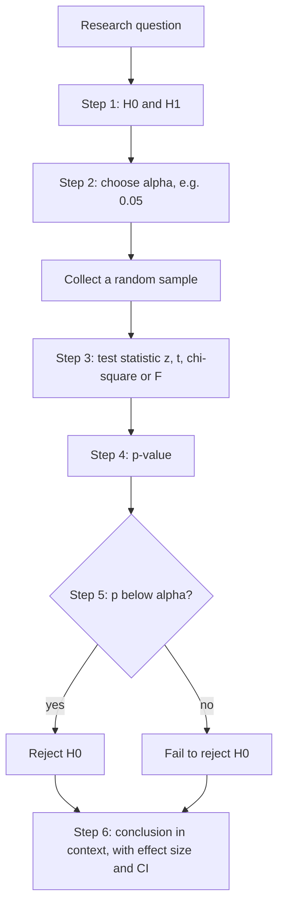
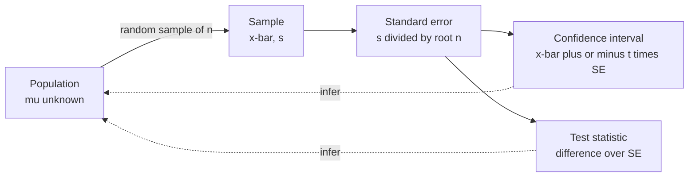
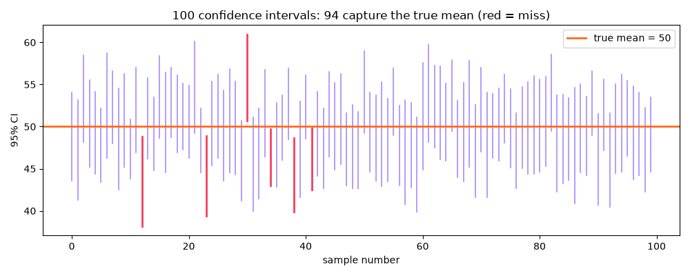
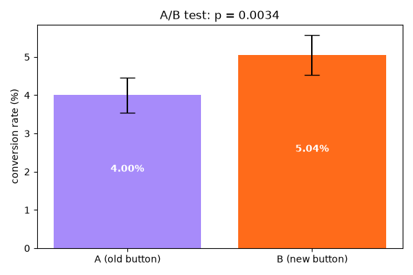

[](https://colab.research.google.com/github/Hamnakhan123/Diploma-in-AI/blob/main/term-1/03-inferential-statistical-analysis/code/session-04-inferential-statistics.ipynb) &nbsp; 📓 [Notebook](code/session-04-inferential-statistics.ipynb)

# Session 4: Inferential Statistics: Sampling, Hypotheses and Confidence

> 🧭 [Diploma in AI](../../README.md) › [Term 1](../README.md) › [Inferential Statistical Analysis](README.md) › **Session 4**
>
> ⏱️ **Estimated time:** 3 hours (1 h concepts + 2 h lab) &nbsp;|&nbsp; 📋 **Prerequisites:** Sessions 1-3, especially the normal distribution and the Central Limit Theorem (Session 2)
>
> Prepared by **Hamna Zahid Khan**, Junior Lecturer

[⬅ Previous: Session 3](session-03-correlation-and-regression.md) &nbsp;|&nbsp; [🏠 Module home](README.md) &nbsp;|&nbsp; [Next: Session 5 ➡](session-05-exact-sampling-distributions.md)

---

## 🎯 Learning objectives

- Explain **sampling theory**: population vs sample, sampling frame, and **probability vs non-probability** sampling methods.
- Describe the **sampling distribution** of a statistic and compute the **standard error**.
- Build and interpret **confidence intervals** for a mean and a proportion, and plan a **sample size**.
- Carry out a **hypothesis test** in six steps: H₀/H₁, α, test statistic, p-value or critical value, decision, conclusion.
- Distinguish **one-tailed and two-tailed** tests, **Type I and Type II errors**, and **power**.
- Run a complete **A/B test** and avoid the "peeking" trap.

## 📖 Concepts

### 1. Why we sample

Measuring an entire population is usually impossible (all mobile users in Pakistan), too expensive (testing every bottle), or destructive (crash-testing every car). We measure a **sample** and **infer** the population value, with an honest statement of uncertainty.

| Term | Meaning | Example |
|---|---|---|
| Population | every unit of interest | all 5,000 students of a university |
| Sampling frame | the list you actually sample from | the registrar's enrolment list |
| Sample | units measured | 100 students who complete the survey |
| Parameter (μ, σ, p) | true population value, unknown | true average monthly spending |
| Statistic (x̄, s, p̂) | value from the sample | average of the 100 responses |
| Sampling error | statistic − parameter, due to chance | x̄ = 31.4 when μ = 31.07 |
| Bias | systematic error that more data does not fix | surveying only the hostel students |

### 2. Sampling methods

| Method | How | Strength | Weakness |
|---|---|---|---|
| **Simple random** | every unit equally likely (random numbers) | unbiased, simple | needs a full list; may miss small groups |
| **Systematic** | every k-th unit after a random start | easy in the field (every 10th customer) | fails if the list has a repeating pattern |
| **Stratified** | split into groups (strata), random sample in each | more precise; guarantees every group appears | needs stratum information |
| **Cluster** | randomly choose whole groups (schools, blocks) and measure everyone in them | cheap when units are spread out | less precise if clusters differ |
| Convenience *(non-probability)* | whoever is easy to reach | fast | usually biased |
| Quota / snowball / voluntary | fill quotas, referrals, self-selection | useful for hard-to-reach groups | cannot compute a valid margin of error |

> 🧠 **Analogy:** tasting a pot of daal. Stir it well and take one spoonful (**simple random**). If it has distinct layers, take a little from each layer (**stratified**). If you only taste the top because it is convenient, you'll miss the salt that sank to the bottom (**bias**).

### 3. Sampling distributions and the standard error

If you took every possible sample of size n and computed x̄ each time, the x̄ values would form the **sampling distribution of the mean**. From the CLT (Session 2):

- its centre is μ (x̄ is **unbiased**);
- its spread is the **standard error** SE = σ/√n, estimated by **s/√n**;
- its shape is approximately normal for large n.

For a proportion: SE(p̂) = √(p(1 − p)/n).

The standard error shrinks with √n, so **four times the sample halves the error**, which is why huge samples give diminishing returns.

### 4. Estimation and confidence intervals

- A **point estimate** is a single best guess (x̄ = 2.57 GB).
- An **interval estimate** gives a range: **estimate ± critical value × SE**.

| Interval | Formula | Use when |
|---|---|---|
| Mean, σ known (rare) | x̄ ± z\* · σ/√n | large-scale quality-control processes |
| Mean, σ unknown | x̄ ± t\*₍ₙ₋₁₎ · s/√n | almost always |
| Proportion | p̂ ± z\* · √(p̂(1 − p̂)/n) | np̂ and n(1 − p̂) both ≥ 10 |

Common critical values: z\* = 1.645 (90 %), **1.960 (95 %)**, 2.576 (99 %). The **t distribution** looks like the normal but has heavier tails for small samples; with df = n − 1 it approaches the normal as n grows.

**What "95 % confidence" means:** if we repeated the sampling many times, about 95 % of the intervals built this way would contain the true μ. It does **not** mean "there is a 95 % probability that μ is in this particular interval": μ is fixed; the interval is what varies.

**Sample size planning** for a margin of error E: for a mean, n = (z\*σ/E)²; for a proportion, n = z\*² p(1 − p)/E² (use p = 0.5 if unknown). A ±3 % poll needs about **1,068** people, regardless of whether the population is a city or a country.

### 5. Hypothesis testing

A hypothesis test is a **trial**. The **null hypothesis H₀** (no effect, no difference, the claim holds) is "innocent until proven guilty". The data is the evidence. We reject H₀ only if the evidence would be very surprising were H₀ true.

**The six-step procedure**

1. **State hypotheses.** H₀: μ = 500 ml; H₁: μ ≠ 500 ml (two-tailed), or μ < 500 (lower-tailed), or μ > 500 (upper-tailed). H₁ is what you hope to show and must be chosen **before** seeing the data.
2. **Choose α**, the significance level (usually 0.05): the risk of rejecting a true H₀ that you accept.
3. **Compute the test statistic**, e.g. t = (x̄ − μ₀)/(s/√n): "how many standard errors is the sample from the claim?"
4. **Find the p-value** (probability, if H₀ were true, of a statistic at least this extreme) or the **critical value**.
5. **Decide:** reject H₀ if p < α (equivalently, if the statistic falls in the rejection region).
6. **Conclude in context**, in plain words.

**Errors and power**

| | H₀ actually true | H₀ actually false |
|---|---|---|
| **Reject H₀** | ❌ **Type I error** (false alarm), probability α | ✅ correct, probability = **power** = 1 − β |
| **Fail to reject H₀** | ✅ correct | ❌ **Type II error** (missed effect), probability β |

- Lowering α reduces false alarms but increases misses (β).
- Power increases with **larger n**, a **larger true effect**, **less variability** and a larger α. Aim for power ≥ 0.80 when planning.
- "Fail to reject" is not "accept": absence of evidence is not evidence of absence.

**Tests and intervals agree:** a two-sided test at α = 0.05 rejects H₀: μ = μ₀ exactly when the 95 % CI excludes μ₀.

**Statistical vs practical significance:** with a million users, a 0.01 % lift can be "significant" yet worthless. Always report the **effect size** and its CI, not just the p-value.

## 🧭 Diagrams





## 💻 Worked examples

### Example 1: Four sampling methods, compared by simulation (basic)

📄 [`code/session-04_sampling_methods.py`](code/session-04_sampling_methods.py) &nbsp;·&nbsp; run: `python session-04_sampling_methods.py`

```python
"""
Session 4 · Example 1: Sampling methods compared
-----------------------------------------------
Population: 5,000 university students in three faculties with different
average monthly spending (thousand PKR). We draw samples of 100 with four
methods and compare their estimates of the true mean, repeating each method
2,000 times to see which is most PRECISE (smallest spread of estimates).

  * simple random sampling   - every student equally likely
  * systematic sampling      - every k-th student from a random start
  * stratified sampling      - proportional random samples from each faculty
  * cluster sampling         - pick whole tutorial groups (clusters) at random

Run:  python session-04_sampling_methods.py
"""
import numpy as np
import pandas as pd

rng = np.random.default_rng(5)
sizes = {"Engineering": 2000, "Business": 1800, "Arts": 1200}
means = {"Engineering": 28, "Business": 40, "Arts": 22}
pop = pd.concat([pd.DataFrame({"faculty": f, "spend": rng.normal(means[f], 6, n).round(1)})
                 for f, n in sizes.items()], ignore_index=True)
pop["group"] = np.arange(len(pop)) // 25                 # 200 tutorial groups of 25 students (sorted by faculty)
pop = pop.sample(frac=1, random_state=1).reset_index(drop=True)   # shuffle the register
mu = pop.spend.mean()
print(f"Population: N = {len(pop)}, true mean = {mu:.3f}, true sd = {pop.spend.std(ddof=0):.3f}")
print(pop.groupby("faculty").spend.agg(["count", "mean"]).round(2).to_string())

n = 100
def simple(): return pop.spend.sample(n, random_state=rng.integers(1e9)).mean()
def systematic():
    k = len(pop) // n
    start = rng.integers(k)
    return pop.spend.iloc[start::k].iloc[:n].mean()
def stratified():
    parts = [g.spend.sample(round(n * len(g) / len(pop)), random_state=rng.integers(1e9))
             for _, g in pop.groupby("faculty")]
    return pd.concat(parts).mean()
def cluster():
    chosen = rng.choice(pop.group.unique(), size=4, replace=False)   # 4 groups x 25 = 100 students
    return pop.spend[pop.group.isin(chosen)].mean()

print(f"\n{'method':<12} {'mean of estimates':>18} {'bias':>7} {'SE (sd of estimates)':>21}")
for name, fn in [("simple", simple), ("systematic", systematic), ("stratified", stratified), ("cluster", cluster)]:
    est = np.array([fn() for _ in range(2000)])
    print(f"{name:<12} {est.mean():>18.3f} {est.mean() - mu:>+7.3f} {est.std(ddof=1):>21.3f}")
print("\nAll four are unbiased; stratified is most precise (it removes between-faculty variation),")
print("cluster is least precise here because each tutorial group contains students of one faculty only.")
```

**Output**

```text
Population: N = 5000, true mean = 31.071, true sd = 9.408
             count   mean
faculty                  
Arts          1200  22.25
Business      1800  40.20
Engineering   2000  28.14

method        mean of estimates    bias  SE (sd of estimates)
simple                   31.046  -0.025                 0.924
systematic               31.079  +0.008                 0.881
stratified               31.067  -0.004                 0.603
cluster                  30.983  -0.087                 3.728

All four are unbiased; stratified is most precise (it removes between-faculty variation),
cluster is least precise here because each tutorial group contains students of one faculty only.
```


**What to notice:** all four methods are unbiased (bias near 0), but the **standard error** differs a lot. Stratifying by faculty cuts it by a third compared with simple random sampling; sampling 4 whole tutorial groups is four times worse, because each group comes from a single faculty.

### Example 2: Standard errors and confidence intervals (intermediate)

📄 [`code/session-04_confidence_intervals.py`](code/session-04_confidence_intervals.py) &nbsp;·&nbsp; run: `python session-04_confidence_intervals.py`

```python
"""
Session 4 · Example 2: Standard error and confidence intervals
-------------------------------------------------------------
1. Build a 95% confidence interval for a mean, step by step (t interval).
2. A confidence interval for a proportion.
3. How sample size and confidence level change the width.
4. What '95% confidence' really means: draw 100 samples from a known
   population and count how many intervals capture the true mean.
   Chart saved to session-04_confidence_intervals.png

Run:  python session-04_confidence_intervals.py
"""
import numpy as np
from scipy import stats
import matplotlib
matplotlib.use("Agg")
import matplotlib.pyplot as plt

# ---- 1. CI for a mean: daily mobile-data use (GB) of 12 students -----------------
x = np.array([1.8, 2.4, 3.1, 2.2, 2.9, 1.5, 3.6, 2.7, 2.0, 3.3, 2.5, 2.8])
n, xbar, s = len(x), x.mean(), x.std(ddof=1)
se = s / np.sqrt(n)
t_crit = stats.t.ppf(0.975, df=n - 1)
print("1) 95% CI for mean data use")
print(f"   n = {n}, x_bar = {xbar:.3f}, s = {s:.3f}, SE = s/sqrt(n) = {se:.4f}")
print(f"   t* (df = {n - 1}) = {t_crit:.3f}, margin of error = {t_crit * se:.3f}")
print(f"   CI = [{xbar - t_crit * se:.3f}, {xbar + t_crit * se:.3f}] GB")
print("   scipy:", tuple(round(float(v), 3) for v in stats.t.interval(0.95, n - 1, loc=xbar, scale=se)))

# ---- 2. CI for a proportion: 312 of 520 surveyed customers prefer digital payment -
k, m = 312, 520
p_hat = k / m
se_p = np.sqrt(p_hat * (1 - p_hat) / m)
z = stats.norm.ppf(0.975)
print(f"\n2) Proportion: p_hat = {p_hat:.3f}, SE = {se_p:.4f}, "
      f"95% CI = [{p_hat - z * se_p:.3f}, {p_hat + z * se_p:.3f}]")
# Sample size needed for a +/- 3 percentage-point margin (worst case p = 0.5)
print(f"   Sample size for a +/-3% margin: n = {int(np.ceil((z / 0.03) ** 2 * 0.25))}")

# ---- 3. Width vs n and confidence level -----------------------------------------
print("\n3) Width of a CI for a mean with s = 10")
print("   n      90%     95%     99%")
for nn in [10, 40, 160, 640]:
    w = [2 * stats.t.ppf(1 - a / 2, nn - 1) * 10 / np.sqrt(nn) for a in (0.10, 0.05, 0.01)]
    print(f"   {nn:<5}" + "".join(f"{v:8.2f}" for v in w))
print("   4x the sample -> about half the width; more confidence -> wider interval")

# ---- 4. Coverage simulation --------------------------------------------------------
rng = np.random.default_rng(8)
mu, sigma, nn = 50, 12, 25
hits, rows = 0, []
for i in range(100):
    smp = rng.normal(mu, sigma, nn)
    lo, hi = stats.t.interval(0.95, nn - 1, loc=smp.mean(), scale=smp.std(ddof=1) / np.sqrt(nn))
    ok = lo <= mu <= hi
    hits += ok
    rows.append((lo, hi, ok))
print(f"\n4) {hits} of 100 intervals contain the true mean {mu} (expected about 95)")

fig, ax = plt.subplots(figsize=(10, 4))
for i, (lo, hi, ok) in enumerate(rows):
    ax.plot([i, i], [lo, hi], color="#A78BFA" if ok else "#F43F5E", lw=2 if not ok else 1.2)
ax.axhline(mu, color="#FF6B1A", lw=2, label="true mean = 50")
ax.set_xlabel("sample number"); ax.set_ylabel("95% CI")
ax.set_title(f"100 confidence intervals: {hits} capture the true mean (red = miss)")
ax.legend(); fig.tight_layout(); fig.savefig("session-04_confidence_intervals.png", dpi=100)
print("Saved chart: session-04_confidence_intervals.png")
```

**Output**

```text
1) 95% CI for mean data use
   n = 12, x_bar = 2.567, s = 0.624, SE = s/sqrt(n) = 0.1802
   t* (df = 11) = 2.201, margin of error = 0.397
   CI = [2.170, 2.963] GB
   scipy: (2.17, 2.963)

2) Proportion: p_hat = 0.600, SE = 0.0215, 95% CI = [0.558, 0.642]
   Sample size for a +/-3% margin: n = 1068

3) Width of a CI for a mean with s = 10
   n      90%     95%     99%
   10      11.59   14.31   20.55
   40       5.33    6.40    8.56
   160      2.62    3.12    4.12
   640      1.30    1.55    2.04
   4x the sample -> about half the width; more confidence -> wider interval

4) 94 of 100 intervals contain the true mean 50 (expected about 95)
Saved chart: session-04_confidence_intervals.png
```




**Walkthrough:**

1. With n = 12 the t critical value is 2.201, a bit bigger than 1.96, so the interval is a little wider to account for estimating σ.
2. 60 % of 520 customers prefer digital payment, with a margin of about ±4.2 points.
3. The width table shows the √n law and the price of extra confidence.
4. In the simulation 94 of 100 intervals capture μ = 50, close to the promised 95; each red line is an interval that missed.

### Example 3: A full hypothesis test, plus Type I error and power (advanced)

📄 [`code/session-04_hypothesis_test.py`](code/session-04_hypothesis_test.py) &nbsp;·&nbsp; run: `python session-04_hypothesis_test.py`

```python
"""
Session 4 · Example 3: The hypothesis-testing procedure, step by step
--------------------------------------------------------------------
A juice factory claims each bottle holds 500 ml. An inspector measures 15
bottles. Is the true mean different from 500 ml?  (two-tailed one-sample t test)

Then we SIMULATE:
  * Type I error rate  - how often we wrongly reject a TRUE H0 at alpha = 0.05
  * Power              - how often we correctly reject a FALSE H0, for several n

Run:  python session-04_hypothesis_test.py
"""
import numpy as np
from scipy import stats

ml = np.array([497.2, 499.1, 495.8, 498.4, 500.3, 496.9, 497.7, 499.6,
               494.9, 498.1, 497.4, 501.0, 496.2, 498.8, 497.5])
mu0, alpha = 500, 0.05

print("Step 1. Hypotheses:  H0: mu = 500 ml    H1: mu != 500 ml   (two-tailed)")
print(f"Step 2. Significance level alpha = {alpha}")
n, xbar, s = len(ml), ml.mean(), ml.std(ddof=1)
se = s / np.sqrt(n)
t = (xbar - mu0) / se
print(f"Step 3. Test statistic: t = (x_bar - mu0) / (s / sqrt(n)) = ({xbar:.3f} - {mu0}) / {se:.4f} = {t:.3f}")
crit = stats.t.ppf(1 - alpha / 2, n - 1)
p = 2 * stats.t.sf(abs(t), n - 1)
print(f"Step 4. Critical values +/-{crit:.3f} (df = {n - 1});  p-value = {p:.5f}")
decision = "REJECT H0" if p < alpha else "FAIL TO REJECT H0"
print(f"Step 5. Decision: |t| = {abs(t):.2f} {'>' if abs(t) > crit else '<='} {crit:.2f} and p "
      f"{'<' if p < alpha else '>='} {alpha} -> {decision}")
print("Step 6. Conclusion: the bottles hold less than the labelled 500 ml on average." if p < alpha
      else "Step 6. Conclusion: no evidence the mean differs from 500 ml.")
res = stats.ttest_1samp(ml, mu0)
print(f"Check with scipy: t = {res.statistic:.3f}, p = {res.pvalue:.5f}")
lo, hi = stats.t.interval(0.95, n - 1, loc=xbar, scale=se)
print(f"95% CI [{lo:.2f}, {hi:.2f}] does not contain 500 -> same decision as the test" if not lo <= 500 <= hi
      else f"95% CI [{lo:.2f}, {hi:.2f}] contains 500")

# One-tailed version: consumer group suspects UNDER-filling (H1: mu < 500)
p_one = stats.t.cdf(t, n - 1)
print(f"\nOne-tailed (H1: mu < 500): p = {p_one:.5f}  (half the two-tailed p because t is negative)")

# ---- Simulating Type I error and power -------------------------------------------
rng = np.random.default_rng(1)
reps = 5000
true_h0 = rng.normal(500, 2, size=(reps, 15))
p_vals = stats.ttest_1samp(true_h0, 500, axis=1).pvalue
print(f"\nType I error rate when H0 is true: {np.mean(p_vals < alpha):.3f}  (should be about {alpha})")
print("Power to detect a real mean of 499 ml (sd 2):")
for nn in [10, 25, 50, 100]:
    smp = rng.normal(499, 2, size=(reps, nn))
    power = np.mean(stats.ttest_1samp(smp, 500, axis=1).pvalue < alpha)
    print(f"   n = {nn:>3}: power = {power:.3f}   P(Type II error) = {1 - power:.3f}")
```

**Output**

```text
Step 1. Hypotheses:  H0: mu = 500 ml    H1: mu != 500 ml   (two-tailed)
Step 2. Significance level alpha = 0.05
Step 3. Test statistic: t = (x_bar - mu0) / (s / sqrt(n)) = (497.927 - 500) / 0.4311 = -4.809
Step 4. Critical values +/-2.145 (df = 14);  p-value = 0.00028
Step 5. Decision: |t| = 4.81 > 2.14 and p < 0.05 -> REJECT H0
Step 6. Conclusion: the bottles hold less than the labelled 500 ml on average.
Check with scipy: t = -4.809, p = 0.00028
95% CI [497.00, 498.85] does not contain 500 -> same decision as the test

One-tailed (H1: mu < 500): p = 0.00014  (half the two-tailed p because t is negative)

Type I error rate when H0 is true: 0.043  (should be about 0.05)
Power to detect a real mean of 499 ml (sd 2):
   n =  10: power = 0.293   P(Type II error) = 0.707
   n =  25: power = 0.675   P(Type II error) = 0.325
   n =  50: power = 0.930   P(Type II error) = 0.070
   n = 100: power = 0.998   P(Type II error) = 0.002
```


**Reading the output:** the sample mean is 4.8 standard errors below 500 ml; such a result would occur by chance only about 3 times in 10,000 bottles if the claim were true, so we reject H₀. The simulation confirms that a 5 % test makes false alarms about 5 % of the time, and that with only 10 bottles we would miss a real 1 ml shortfall 71 % of the time; 50 bottles give 93 % power.

## 🌍 Real-life coding problem: testing a power-bank seller's claim

**Scenario.** A seller claims "at least 20 hours of use" and "no more than 5 % faulty". The tech club tested 40 units. Do the data contradict the claims?

**Plan:**

1. The claim becomes H₀ (μ ≥ 20; p ≤ 0.05); the suspicion becomes a **one-tailed** H₁.
2. Mean: one-sample t test with `alternative="less"`.
3. Proportion: z test, but n·p₀ = 2 is too small for the normal approximation, so confirm with an **exact binomial test**.
4. Add 95 % intervals and write a verdict a non-statistician understands.

📄 [`code/session-04_problem_battery_claim.py`](code/session-04_problem_battery_claim.py) &nbsp;·&nbsp; run: `python session-04_problem_battery_claim.py`

```python
"""
Session 4 · Real-life problem: testing a power-bank seller's claim
-----------------------------------------------------------------
PROBLEM
An online seller claims its 10,000 mAh power bank gives AT LEAST 20 hours of
phone use on average, and that NO MORE than 5% of units are faulty.
A university tech club tests 40 units:
  * hours of use (data below)
  * 5 of the 40 units were faulty
At alpha = 0.05:
  1. Is there evidence that mean battery life is LESS than 20 hours? (one-tailed t)
  2. Is there evidence that the fault rate is MORE than 5%?        (one-tailed z for a proportion,
     plus an exact binomial test because n*p0 = 2 is small)
  3. Give 95% confidence intervals for both.
  4. Write a short, non-technical verdict.

Run:  python session-04_problem_battery_claim.py
"""
import numpy as np
from scipy import stats

hours = np.array([19.2, 20.5, 18.7, 19.9, 21.1, 18.4, 19.6, 20.2, 18.9, 19.4,
                  20.8, 19.1, 18.6, 19.8, 20.1, 19.3, 18.8, 21.0, 19.5, 19.0,
                  20.4, 18.5, 19.7, 20.0, 19.2, 18.9, 20.6, 19.4, 19.1, 20.3,
                  18.7, 19.9, 19.6, 20.9, 18.8, 19.3, 20.2, 19.0, 19.5, 18.6])
alpha = 0.05

# ---- 1. Mean battery life -----------------------------------------------------------
n, xbar, s = len(hours), hours.mean(), hours.std(ddof=1)
t = (xbar - 20) / (s / np.sqrt(n))
p1 = stats.t.cdf(t, n - 1)                       # lower-tailed
print("1) H0: mu >= 20 h   vs   H1: mu < 20 h")
print(f"   n = {n}, mean = {xbar:.3f} h, sd = {s:.3f}, t = {t:.3f}, p = {p1:.5f}")
print("   ->", "reject H0: mean life is below 20 h" if p1 < alpha else "not enough evidence")
res = stats.ttest_1samp(hours, 20, alternative="less")
print(f"   scipy check: t = {res.statistic:.3f}, p = {res.pvalue:.5f}")

# ---- 2. Fault rate ---------------------------------------------------------------------
k, p0 = 5, 0.05
p_hat = k / n
z = (p_hat - p0) / np.sqrt(p0 * (1 - p0) / n)    # SE uses p0 under H0
p_z = stats.norm.sf(z)
p_exact = stats.binomtest(k, n, p0, alternative="greater").pvalue
print("\n2) H0: p <= 0.05   vs   H1: p > 0.05")
print(f"   p_hat = {p_hat:.3f}, z = {z:.3f}, normal-approx p = {p_z:.4f}")
print(f"   n*p0 = {n * p0:.0f} < 10, so the normal approximation is shaky; exact binomial p = {p_exact:.4f}")
print("   ->", "reject H0" if p_exact < alpha else "fail to reject H0: 5/40 is suspicious but not conclusive")

# ---- 3. Confidence intervals ----------------------------------------------------------
lo, hi = stats.t.interval(0.95, n - 1, loc=xbar, scale=s / np.sqrt(n))
ci_p = stats.binomtest(k, n).proportion_ci(confidence_level=0.95, method="wilson")
print(f"\n3) 95% CI mean life: [{lo:.2f}, {hi:.2f}] h")
print(f"   95% CI fault rate (Wilson): [{ci_p.low:.3f}, {ci_p.high:.3f}]")

# ---- 4. Verdict -------------------------------------------------------------------------
print(f"\n4) Verdict: average life is about {xbar:.1f} h, significantly below the advertised 20 h. "
      f"The fault rate in our sample ({p_hat:.1%}) is also significantly above 5% "
      f"(exact p = {p_exact:.3f}), but only just, and the plausible range is wide "
      f"({ci_p.low:.0%} to {ci_p.high:.0%}); test more units before a formal complaint about faults.")
```

**Output**

```text
1) H0: mu >= 20 h   vs   H1: mu < 20 h
   n = 40, mean = 19.562 h, sd = 0.750, t = -3.690, p = 0.00034
   -> reject H0: mean life is below 20 h
   scipy check: t = -3.690, p = 0.00034

2) H0: p <= 0.05   vs   H1: p > 0.05
   p_hat = 0.125, z = 2.176, normal-approx p = 0.0148
   n*p0 = 2 < 10, so the normal approximation is shaky; exact binomial p = 0.0480
   -> reject H0

3) 95% CI mean life: [19.32, 19.80] h
   95% CI fault rate (Wilson): [0.055, 0.261]

4) Verdict: average life is about 19.6 h, significantly below the advertised 20 h. The fault rate in our sample (12.5%) is also significantly above 5% (exact p = 0.048), but only just, and the plausible range is wide (5% to 26%); test more units before a formal complaint about faults.
```


**Interpretation.** The battery result is clear (p = 0.0003; CI 19.3-19.8 h is entirely below 20). The fault result is borderline: the approximate z test says p = 0.015, the exact test p = 0.048. When an approximation's conditions fail, trust the exact test, and when a result is borderline, collect more data.

## 🛠️ Mini project: an A/B testing toolkit

An online bookshop wants to know whether a new "Buy now" button lifts conversion from 4 % to 5 %. The toolkit **plans** the sample size, **analyses** the result with a two-proportion z test and a CI for the lift, **confirms** with a permutation test, and **demonstrates** why stopping early when p < 0.05 is dangerous.

```python
pool = (xa + xb) / (na + nb)                                  # pooled rate under H0
se0 = np.sqrt(pool * (1 - pool) * (1 / na + 1 / nb))
z = (pb - pa) / se0
p = 2 * stats.norm.sf(abs(z))                                 # two-sided p-value
```

📄 Full solution (83 lines, fully commented): [`code/session-04_project_ab_test.py`](code/session-04_project_ab_test.py) &nbsp;·&nbsp; run: `python session-04_project_ab_test.py` &nbsp;·&nbsp; also in the session notebook

**Output**

```text
1) To detect 4.0% -> 5.0% with alpha 0.05 and power 0.80: 6,745 visitors per group

2) A: 272/6800 = 4.00%   B: 343/6800 = 5.04%
   z = 2.930, p = 0.0034, lift = +1.04% (95% CI +0.35% to +1.74%), relative lift = +26.1%
   -> B is significantly better: ship it

3) Permutation test: p = 0.0025 (2,000 shuffles)

4) Peeking 20 times when there is NO real difference: false 'winner' in 26.8% of experiments (should be 5%)
Saved chart: session-04_project_ab_test.png
```




**Business answer:** button B lifts conversion from 4.00 % to 5.04 % (p = 0.003, CI for the lift +0.35 to +1.74 points), so ship it. The peeking simulation is the lesson for every product team: checking 20 times and stopping at the first p < 0.05 produced a false winner in about 27 % of experiments with **no real difference**. Fix the sample size in advance (step 1) and analyse once.

## ⚠️ Common mistakes

| Mistake | Fix |
|---|---|
| "95 % probability that μ is in this interval" | 95 % of such intervals would contain μ; this one either does or doesn't |
| "p = 0.03 means a 3 % chance H₀ is true" | p is P(data this extreme \| H₀), not P(H₀ \| data) |
| Accepting H₀ when p > 0.05 | Say "not enough evidence to reject H₀"; check power |
| Choosing one- vs two-tailed after seeing the data | Decide H₁ before collecting data |
| Using z with a small sample and unknown σ | Use the t distribution with n − 1 df |
| Using the normal approximation for proportions when np < 10 | Use an exact binomial test or Wilson interval |
| Peeking at an A/B test and stopping early | Fix n in advance, or use sequential methods designed for it |
| Large convenience sample = good sample | Size cannot fix bias; randomise |

## ✅ Best practices

- Write H₀, H₁ and α **before** collecting data, and pre-register the sample size.
- Report the **estimate, CI and p-value** together, plus the effect in real units.
- Check assumptions: random sampling, independence, approximate normality (or large n).
- Do a **power analysis** to choose n; underpowered studies waste everyone's time.
- Simulate your procedure on fake data where you know the truth; it catches errors in reasoning and code.
- Separate statistical significance from **business significance**.

## 🧪 Lab / practice tasks

**1. 🟢 Easy:** For each situation name the sampling method: (a) every 20th car through a toll plaza; (b) 5 random schools, every teacher surveyed; (c) 30 random students from each year of study; (d) asking people in a mall food court.

<details><summary>💡 Hint</summary>

Is a fixed interval used? Are whole groups taken? Is each group sampled separately? Is it random at all?

</details>

<details><summary>✅ Solution</summary>

(a) systematic; (b) cluster; (c) stratified; (d) convenience (non-probability, likely biased).

</details>

**2. 🟢 Easy:** A sample of 64 delivery times has x̄ = 34 min and s = 8 min. Compute the SE and a 95 % CI (use z\* ≈ 1.96 or t\*).

<details><summary>💡 Hint</summary>

SE = 8/√64 = 1.

</details>

<details><summary>✅ Solution</summary>

SE = 1; CI ≈ 34 ± 1.96 = [32.04, 35.96] min (with t\*₆₃ = 1.998: [32.00, 36.00]).

</details>

**3. 🟡 Medium:** A university wants to estimate the proportion of students who use AI tools for assignments within ±4 percentage points at 95 % confidence. How many students should it survey?

<details><summary>💡 Hint</summary>

n = 1.96² × 0.5 × 0.5 / 0.04².

</details>

<details><summary>✅ Solution</summary>

n = 3.8416 × 0.25 / 0.0016 = 600.25 → **601** students.

</details>

**4. 🟡 Medium:** A cereal box should weigh 750 g. A sample of 20 boxes gives x̄ = 746 g, s = 9 g. Test at α = 0.05 whether boxes are under-filled. Show all six steps.

<details><summary>💡 Hint</summary>

Lower-tailed t test with df = 19; t\* = −1.729.

</details>

<details><summary>✅ Solution</summary>

H₀: μ ≥ 750, H₁: μ < 750; t = (746 − 750)/(9/√20) = −1.988; p = `stats.t.cdf(-1.988, 19)` ≈ 0.031 < 0.05 → reject H₀: evidence of under-filling.

</details>

**5. 🟠 Hard:** Using `session-04_hypothesis_test.py`, find (by simulation) the smallest n that gives power ≥ 0.90 to detect a true mean of 499 ml when σ = 2. Compare with the formula n ≈ ((z₀.₉₇₅ + z₀.₉₀)σ/δ)².

<details><summary>💡 Hint</summary>

Loop n from 30 to 60; δ = 1, σ = 2.

</details>

<details><summary>✅ Solution</summary>

Formula: ((1.960 + 1.282) × 2 / 1)² = 42.0 → **43**; simulation (20,000 repetitions per n) first reaches 0.90 at about **n = 44**, because the t test is slightly less powerful than the z approximation for small n.

</details>

**6. 🔴 Challenge:** Extend the A/B toolkit with a **Bonferroni** correction for testing three new buttons (B, C, D) against A, and simulate the family-wise false-positive rate with and without the correction when none of the buttons truly differs.

<details><summary>💡 Hint</summary>

Use α/3 for each comparison. Without correction the family-wise rate is about 1 − 0.95³.

</details>

<details><summary>✅ Solution</summary>

Without correction, at least one false "winner" appears in about 13 % of experiments (1 − 0.95³ = 0.143, slightly less because comparisons share group A); with α = 0.05/3 per test it drops to about 5 %. Code idea: generate four identical groups, run three `two_prop_test` calls, count experiments with any p < threshold.

</details>

## ✅ Quick quiz

**Q1.** Doubling the sample size changes the standard error of the mean by a factor of…

- A) 1/2
- B) 1/√2 ≈ 0.71
- C) 2
- D) it stays the same

**Q2.** Which sampling method divides the population into groups and samples randomly within every group?

- A) cluster
- B) systematic
- C) stratified
- D) convenience

**Q3.** A Type I error is…

- A) failing to reject a false H₀
- B) rejecting a true H₀
- C) choosing the wrong test
- D) a calculation mistake

**Q4.** A 95 % CI for a mean is [12.1, 15.3]. A two-sided test of H₀: μ = 16 at α = 0.05 will…

- A) reject H₀
- B) fail to reject H₀
- C) be impossible to decide
- D) reject only if n > 30

**Q5.** Which change does NOT increase the power of a test?

- A) larger sample size
- B) larger true effect
- C) smaller α (e.g. 0.01 instead of 0.05)
- D) less variable measurements

<details><summary>✅ Show answers</summary>

1. **B** — SE = σ/√n, so it shrinks by √2.
2. **C** — stratified sampling.
3. **B** — a false alarm, probability α.
4. **A** — 16 lies outside the 95 % interval.
5. **C** — a smaller α makes rejection harder, reducing power.

</details>


## 📝 Summary

- Inference moves from a **sample statistic** to a **population parameter**; random sampling makes this valid, and bias cannot be fixed by size.
- Probability sampling methods: simple random, systematic, stratified (most precise when strata differ), cluster (cheapest).
- The **standard error** (s/√n, √(p̂(1 − p̂)/n)) measures sampling variability; it drives both intervals and tests.
- **Confidence interval** = estimate ± critical value × SE; 95 % refers to the method's long-run success rate.
- **Hypothesis test:** H₀/H₁ → α → statistic → p-value → decision → conclusion; watch Type I/II errors and power.
- In A/B tests, plan n in advance, analyse once, and report the lift with its CI.

### 🎤 Interview / viva questions

1. What is the difference between sampling error and bias? Which one does a bigger sample fix?
2. Explain what a 95 % confidence interval means to a non-technical manager.
3. Define the p-value precisely. What does it not tell you?
4. When do you use a t distribution instead of the normal?
5. How are Type I error, Type II error and power related?
6. Why is "peeking" at an A/B test a problem, and how do you avoid it?
7. Give an example of a result that is statistically significant but not practically important.

---

[⬅ Previous: Session 3](session-03-correlation-and-regression.md) &nbsp;|&nbsp; [🏠 Module home](README.md) &nbsp;|&nbsp; [Next: Session 5 ➡](session-05-exact-sampling-distributions.md)

<sub>Prepared by **Hamna Zahid Khan**, Junior Lecturer · Diploma in AI</sub>
