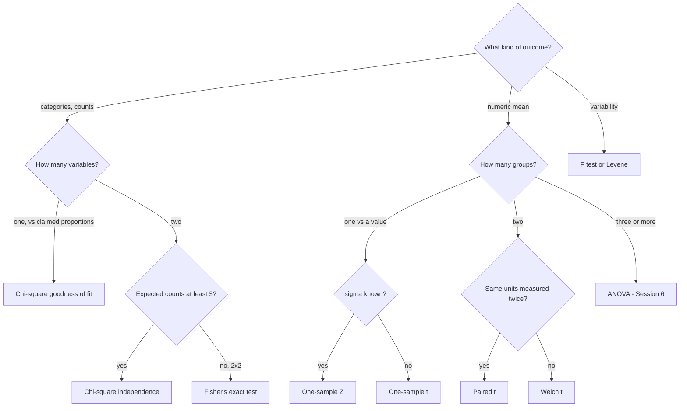
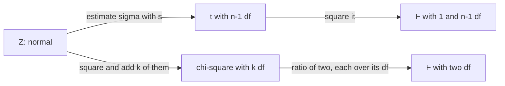
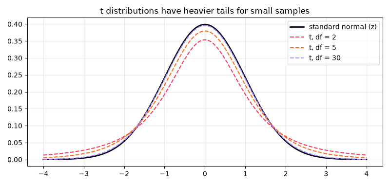
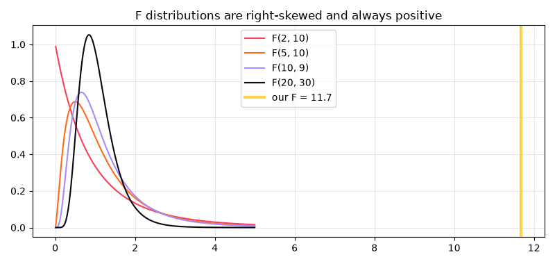

[](https://colab.research.google.com/github/Hamnakhan123/Diploma-in-AI/blob/main/term-1/03-inferential-statistical-analysis/code/session-05-exact-sampling-distributions.ipynb) &nbsp; 📓 [Notebook](code/session-05-exact-sampling-distributions.ipynb)

# Session 5: Exact Sampling Distributions: Chi-Square, t, Z and F Tests

> 🧭 [Diploma in AI](../../README.md) › [Term 1](../README.md) › [Inferential Statistical Analysis](README.md) › **Session 5**
>
> ⏱️ **Estimated time:** 3 hours (1 h concepts + 2 h lab) &nbsp;|&nbsp; 📋 **Prerequisites:** Session 4 (hypotheses, p-values, standard error, Type I and II errors)
>
> Prepared by **Hamna Zahid Khan**, Junior Lecturer

[⬅ Previous: Session 4](session-04-inferential-statistics.md) &nbsp;|&nbsp; [🏠 Module home](README.md) &nbsp;|&nbsp; [Next: Session 6 ➡](session-06-analysis-of-variance.md)

---

## 🎯 Learning objectives

- Explain what an **exact sampling distribution** is and why the **χ², t and F** distributions arise from normal samples.
- Run **chi-square tests** for goodness of fit and for independence, and measure effect size with **Cramér's V**.
- Choose between the **one-sample, independent (Student/Welch) and paired t tests**, and report **Cohen's d**.
- Use **Z tests** for a mean with known σ and for proportions.
- Compare two variances with the **F test** (and Levene's robust alternative).
- Check assumptions and fall back to **non-parametric** tests when they fail.

## 📖 Concepts

### 1. Exact sampling distributions

Session 4 used the normal approximation from the CLT, which needs fairly large samples. When the population is (approximately) normal, statisticians have worked out the **exact** distribution of several statistics for **any** sample size. Each one is a family of curves indexed by **degrees of freedom (df)**: roughly, the number of independent pieces of information left after estimating what you had to estimate.

| Distribution | Built from | Shape | Used for |
|---|---|---|---|
| **Z (standard normal)** | (x̄ − μ)/(σ/√n) with σ known | symmetric, fixed | means with known σ, large-sample proportions |
| **t (Student)** | (x̄ − μ)/(s/√n), σ estimated | symmetric, heavier tails; → Z as df grows | means with unknown σ |
| **χ² (chi-square)** | sum of squared standard normals | right-skewed, ≥ 0; mean = df | counts in categories, a single variance |
| **F** | ratio of two χ²'s, each divided by its df | right-skewed, ≥ 0; two df values | comparing variances, ANOVA (Session 6) |

> 🧠 **Analogy:** the t distribution is the normal curve "with a safety margin". When you estimate σ from only a few values you might be unlucky, so t widens the tails to protect you. With 30+ values the margin is tiny and t is almost Z.

### 2. Chi-square tests: is the pattern of counts what we expected?

**Statistic:** χ² = Σ (O − E)² / E, summed over every cell, where O = observed count and E = expected count under H₀.

**(a) Goodness of fit**: one categorical variable against a claimed distribution.

- H₀: the data follow the stated proportions (e.g. a fair die, or 10/10/10/10/20/20/20 % across the week).
- df = k − 1 (k categories), minus one more for each parameter estimated from the data.

**(b) Test of independence**: two categorical variables in a contingency table.

- H₀: the variables are independent (payment method does not depend on age group).
- Expected count: **E = (row total × column total) / grand total**.
- df = (rows − 1)(columns − 1).

**Step-by-step mini example.** 60 customers: 2 × 2 table of gender × product.

| | Product X | Product Y | Total |
|---|---|---|---|
| Female | 20 | 10 | 30 |
| Male | 10 | 20 | 30 |
| Total | 30 | 30 | 60 |

1. Every expected count = 30 × 30 / 60 = 15.
2. Each cell contributes (20 − 15)²/15 or (10 − 15)²/15 = 1.667; χ² = 4 × 1.667 = 6.67.
3. df = 1; critical value at α = 0.05 is 3.841; 6.67 > 3.841 → reject independence (p ≈ 0.0098, without the continuity correction).

**Conditions:** observations independent, and expected counts ≥ 5 in (nearly) every cell. For small 2 × 2 tables use **Fisher's exact test**. SciPy applies **Yates' continuity correction** to 2 × 2 tables by default.

**Effect size:** Cramér's V = √(χ² / (n(min(r, c) − 1))), from 0 (no association) to 1.

### 3. t tests: comparing means

| Test | Question | Statistic | df |
|---|---|---|---|
| **One-sample** | Is μ equal to a target μ₀? | (x̄ − μ₀)/(s/√n) | n − 1 |
| **Independent, pooled (Student)** | Do two separate groups have the same mean (equal variances assumed)? | (x̄₁ − x̄₂)/(s_p√(1/n₁ + 1/n₂)) | n₁ + n₂ − 2 |
| **Independent, Welch** | Same question, variances may differ | (x̄₁ − x̄₂)/√(s₁²/n₁ + s₂²/n₂) | Welch-Satterthwaite (fractional) |
| **Paired** | Did the **same** units change (before/after, twins, left/right)? | d̄/(s_d/√n) on the differences | n − 1 |

- Pooled variance: s_p² = ((n₁ − 1)s₁² + (n₂ − 1)s₂²)/(n₁ + n₂ − 2).
- **Welch's test is the safe default** for independent groups; it loses almost nothing when variances are equal.
- **Pairing removes person-to-person variability**, so it is far more powerful when the design is paired. Analysing paired data as independent groups is a classic error.
- **Assumptions:** independent observations; roughly normal data (or differences, for paired), especially for small n; check with a histogram/Q-Q plot or the Shapiro-Wilk test.
- **Effect size:** Cohen's d = (x̄₁ − x̄₂)/s_p (0.2 small, 0.5 medium, 0.8 large).

### 4. Z tests

Use Z when the population σ is **known** (long-running industrial processes) or for **proportions** with large samples.

| Z test | Statistic |
|---|---|
| One mean, σ known | z = (x̄ − μ₀)/(σ/√n) |
| One proportion | z = (p̂ − p₀)/√(p₀(1 − p₀)/n) |
| Two proportions | z = (p̂₁ − p̂₂)/√(p̄(1 − p̄)(1/n₁ + 1/n₂)), p̄ = pooled proportion |

Critical values: ±1.960 (two-tailed, 5 %), 1.645 (one-tailed, 5 %), ±2.576 (two-tailed, 1 %).

### 5. The F test for two variances

Consistency often matters as much as the average (a filling machine, delivery times, a drug's dose). With two normal samples:

**F = s₁² / s₂²** (put the larger variance on top), with (n₁ − 1, n₂ − 1) df.

- H₀: σ₁² = σ₂². A large F means the variances differ.
- The F test is **very sensitive to non-normality**; **Levene's test** (or Brown-Forsythe) is the robust choice in practice.
- F also powers ANOVA (Session 6) and the overall test in regression.

### 6. Parametric vs non-parametric

| Parametric test | Non-parametric alternative (uses ranks) |
|---|---|
| one-sample / paired t | Wilcoxon signed-rank |
| independent t | Mann-Whitney U |
| one-way ANOVA | Kruskal-Wallis |
| Pearson correlation | Spearman correlation |

Non-parametric tests need fewer assumptions (no normality) but are slightly less powerful when the data **is** normal.

## 🧭 Diagrams





## 💻 Worked examples

### Example 1: Chi-square goodness of fit and independence (basic → intermediate)

📄 [`code/session-05_chi_square.py`](code/session-05_chi_square.py) &nbsp;·&nbsp; run: `python session-05_chi_square.py`

```python
"""
Session 5 · Example 1: Chi-square tests (goodness of fit and independence)
------------------------------------------------------------------------
  chi2 = sum (Observed - Expected)^2 / Expected

1. Goodness of fit: is a die fair? Do weekly orders follow the expected pattern?
2. Test of independence: is preferred payment method related to age group?
   Expected counts are computed by hand: E = row total * column total / grand total.
3. Effect size: Cramer's V.

Run:  python session-05_chi_square.py
"""
import numpy as np
import pandas as pd
from scipy import stats

# ---- 1a. Goodness of fit: 120 rolls of a die ----------------------------------------
obs = np.array([16, 25, 17, 14, 28, 20])
exp = np.full(6, obs.sum() / 6)
chi2 = ((obs - exp) ** 2 / exp).sum()
df = len(obs) - 1
print("1a) Is the die fair?  H0: every face has probability 1/6")
print("    observed:", obs.tolist(), " expected: 20 each")
print(f"    chi2 = {chi2:.3f}, df = {df}, critical (alpha .05) = {stats.chi2.ppf(0.95, df):.3f}, "
      f"p = {stats.chi2.sf(chi2, df):.4f}")
print("    scipy:", tuple(round(float(v), 4) for v in stats.chisquare(obs, exp)))

# ---- 1b. Goodness of fit with unequal expected proportions --------------------------
# A cafe plans staff assuming 10% of weekly orders Mon-Thu each, 20% Fri, 20% Sat, 20% Sun.
orders = np.array([52, 48, 61, 45, 98, 120, 76])
props = np.array([0.10, 0.10, 0.10, 0.10, 0.20, 0.20, 0.20])
res = stats.chisquare(orders, props * orders.sum())
print(f"\n1b) Weekly order pattern: chi2 = {res.statistic:.2f}, p = {res.pvalue:.4f} "
      f"-> {'pattern differs from the plan' if res.pvalue < 0.05 else 'consistent with the plan'}")
print("    largest contributions:", dict(zip(["Mon", "Tue", "Wed", "Thu", "Fri", "Sat", "Sun"],
      [round(float(v), 1) for v in (orders - props * orders.sum()) ** 2 / (props * orders.sum())])))

# ---- 2. Test of independence --------------------------------------------------------
table = pd.DataFrame([[48, 30, 22], [35, 42, 28], [18, 28, 49]],
                     index=["18-25", "26-40", "41+"], columns=["Wallet app", "Card", "Cash"])
print("\n2) Payment method by age group (observed)")
print(table.to_string())
row, col, N = table.sum(axis=1).values, table.sum(axis=0).values, table.values.sum()
expected = np.outer(row, col) / N
chi2 = ((table.values - expected) ** 2 / expected).sum()
dof = (table.shape[0] - 1) * (table.shape[1] - 1)
print("Expected counts if independent:")
print(pd.DataFrame(expected.round(1), index=table.index, columns=table.columns).to_string())
print(f"chi2 = {chi2:.3f}, df = {dof}, p = {stats.chi2.sf(chi2, dof):.6f}")
c2, p, d, _ = stats.chi2_contingency(table)
print(f"scipy chi2_contingency: chi2 = {c2:.3f}, p = {p:.6f}, df = {d}")

# ---- 3. Effect size -------------------------------------------------------------------
V = np.sqrt(chi2 / (N * (min(table.shape) - 1)))
print(f"Cramer's V = {V:.3f}  (about 0.1 small, 0.3 medium, 0.5 large)")
```

**Output**

```text
1a) Is the die fair?  H0: every face has probability 1/6
    observed: [16, 25, 17, 14, 28, 20]  expected: 20 each
    chi2 = 7.500, df = 5, critical (alpha .05) = 11.070, p = 0.1860
    scipy: (7.5, 0.186)

1b) Weekly order pattern: chi2 = 12.88, p = 0.0450 -> pattern differs from the plan
    largest contributions: {'Mon': 0.1, 'Tue': 0.1, 'Wed': 2.4, 'Thu': 0.5, 'Fri': 0.0, 'Sat': 4.0, 'Sun': 5.8}

2) Payment method by age group (observed)
       Wallet app  Card  Cash
18-25          48    30    22
26-40          35    42    28
41+            18    28    49
Expected counts if independent:
       Wallet app  Card  Cash
18-25        33.7  33.3  33.0
26-40        35.4  35.0  34.6
41+          32.0  31.7  31.4
chi2 = 29.257, df = 4, p = 0.000007
scipy chi2_contingency: chi2 = 29.257, p = 0.000007, df = 4
Cramer's V = 0.221  (about 0.1 small, 0.3 medium, 0.5 large)
```


**What to notice:** the die looks uneven (28 fives!) but χ² = 7.5 is well below the critical 11.07, so 120 rolls are not enough evidence of bias. In the payment table the "Cash" column for 41+ contributes most: older customers prefer cash. V = 0.22 says the association is real but modest.

### Example 2: One-sample, independent and paired t tests (intermediate)

📄 [`code/session-05_t_tests.py`](code/session-05_t_tests.py) &nbsp;·&nbsp; run: `python session-05_t_tests.py`

```python
"""
Session 5 · Example 2: The three t tests
---------------------------------------
1. One-sample t test   - is the mean equal to a target value?
2. Independent two-sample t test (Student's pooled and Welch's) - do two groups differ?
3. Paired t test       - did the same people change between 'before' and 'after'?
Each test is done by hand and checked with SciPy. Cohen's d is reported as
the effect size. Chart of t vs normal tails: session-05_t_tests.png

Run:  python session-05_t_tests.py
"""
import numpy as np
from scipy import stats
import matplotlib
matplotlib.use("Agg")
import matplotlib.pyplot as plt

# ---- 1. One-sample: average sleep of 10 students vs the recommended 8 h -------------
sleep = np.array([6.5, 7.0, 5.5, 8.0, 6.0, 7.5, 6.5, 5.0, 7.0, 6.5])
t1 = (sleep.mean() - 8) / (sleep.std(ddof=1) / np.sqrt(len(sleep)))
print(f"1) One-sample: mean = {sleep.mean():.2f} h, t = {t1:.3f}, df = {len(sleep) - 1}, "
      f"p = {2 * stats.t.sf(abs(t1), len(sleep) - 1):.5f}")
print("   scipy:", round(float(stats.ttest_1samp(sleep, 8).pvalue), 5))

# ---- 2. Independent: marks with online vs classroom teaching -------------------------
online = np.array([68, 72, 65, 70, 74, 69, 71, 66, 73, 67, 70, 72])
classroom = np.array([75, 78, 72, 80, 74, 77, 79, 73, 76, 81])
n1, n2 = len(online), len(classroom)
m1, m2 = online.mean(), classroom.mean()
v1, v2 = online.var(ddof=1), classroom.var(ddof=1)
sp2 = ((n1 - 1) * v1 + (n2 - 1) * v2) / (n1 + n2 - 2)            # pooled variance
t_pooled = (m1 - m2) / np.sqrt(sp2 * (1 / n1 + 1 / n2))
se_w = np.sqrt(v1 / n1 + v2 / n2)                                  # Welch: no equal-variance assumption
t_welch = (m1 - m2) / se_w
df_w = se_w ** 4 / ((v1 / n1) ** 2 / (n1 - 1) + (v2 / n2) ** 2 / (n2 - 1))   # Welch-Satterthwaite df
d = (m1 - m2) / np.sqrt(sp2)
print(f"\n2) Independent: online mean {m1:.2f}, classroom mean {m2:.2f}")
print(f"   Student (pooled): t = {t_pooled:.3f}, df = {n1 + n2 - 2}, "
      f"p = {2 * stats.t.sf(abs(t_pooled), n1 + n2 - 2):.6f}")
print(f"   Welch:            t = {t_welch:.3f}, df = {df_w:.2f}, p = {2 * stats.t.sf(abs(t_welch), df_w):.6f}")
print(f"   scipy Welch p = {stats.ttest_ind(online, classroom, equal_var=False).pvalue:.6f}")
print(f"   Levene test for equal variances: p = {stats.levene(online, classroom).pvalue:.3f}")
print(f"   Cohen's d = {d:.2f}  (0.2 small, 0.5 medium, 0.8 large)")

# ---- 3. Paired: typing speed (wpm) before and after a 2-week course ---------------
before = np.array([32, 41, 28, 35, 45, 30, 38, 33, 40, 29])
after = np.array([38, 44, 35, 37, 52, 36, 41, 39, 43, 33])
diff = after - before
t3 = diff.mean() / (diff.std(ddof=1) / np.sqrt(len(diff)))
print(f"\n3) Paired: mean gain = {diff.mean():.1f} wpm, sd of gains = {diff.std(ddof=1):.3f}, t = {t3:.3f}, "
      f"p = {2 * stats.t.sf(abs(t3), len(diff) - 1):.7f}")
print(f"   scipy ttest_rel p = {stats.ttest_rel(after, before).pvalue:.7f}")
wrong = stats.ttest_ind(after, before).pvalue
print(f"   WRONG analysis (treating them as independent groups): p = {wrong:.4f}  <- pairing matters!")

# ---- Chart: t distributions vs the standard normal --------------------------------
xs = np.linspace(-4, 4, 400)
fig, ax = plt.subplots(figsize=(8, 3.8))
ax.plot(xs, stats.norm.pdf(xs), color="#0A0716", lw=2, label="standard normal (z)")
for dfv, c in [(2, "#F43F5E"), (5, "#FF6B1A"), (30, "#A78BFA")]:
    ax.plot(xs, stats.t.pdf(xs, dfv), color=c, ls="--", label=f"t, df = {dfv}")
ax.set_title("t distributions have heavier tails for small samples"); ax.legend(); ax.grid(alpha=0.3)
fig.tight_layout(); fig.savefig("session-05_t_tests.png", dpi=100)
print("\nCritical values (two-tailed 5%): z = 1.960, " +
      ", ".join(f"t(df={k}) = {stats.t.ppf(0.975, k):.3f}" for k in (2, 5, 30)))
print("Saved chart: session-05_t_tests.png")
```

**Output**

```text
1) One-sample: mean = 6.55 h, t = -5.118, df = 9, p = 0.00063
   scipy: 0.00063

2) Independent: online mean 69.75, classroom mean 76.50
   Student (pooled): t = -5.395, df = 20, p = 0.000028
   Welch:            t = -5.361, df = 18.75, p = 0.000037
   scipy Welch p = 0.000037
   Levene test for equal variances: p = 0.711
   Cohen's d = -2.31  (0.2 small, 0.5 medium, 0.8 large)

3) Paired: mean gain = 4.7 wpm, sd of gains = 1.889, t = 7.870, p = 0.0000252
   scipy ttest_rel p = 0.0000252
   WRONG analysis (treating them as independent groups): p = 0.0774  <- pairing matters!

Critical values (two-tailed 5%): z = 1.960, t(df=2) = 4.303, t(df=5) = 2.571, t(df=30) = 2.042
Saved chart: session-05_t_tests.png
```




**Walkthrough:**

1. Average sleep is 6.55 h, significantly below 8 h (p = 0.0006).
2. Student and Welch give almost the same answer because Levene finds no difference in variances (p = 0.71).
3. The typing course raised speed by 4.7 wpm. Analysed correctly as **paired**, p = 0.000025; analysed wrongly as two independent groups, p = 0.077 and you would miss the effect. Each person's own baseline is noise that pairing removes.

### Example 3: Z tests and the F test (advanced)

📄 [`code/session-05_z_and_f_tests.py`](code/session-05_z_and_f_tests.py) &nbsp;·&nbsp; run: `python session-05_z_and_f_tests.py`

```python
"""
Session 5 · Example 3: Z tests and the F test
--------------------------------------------
Z tests use the standard normal distribution and need a KNOWN population sd
(or a large sample, or proportions):
  1. one-sample z test for a mean with known sigma
  2. two-sample z test for proportions
F test compares two VARIANCES (F = s1^2 / s2^2):
  3. are two machines equally consistent?
  4. a chart of F distributions for several degrees of freedom: session-05_z_and_f_tests.png

Run:  python session-05_z_and_f_tests.py
"""
import numpy as np
from scipy import stats
import matplotlib
matplotlib.use("Agg")
import matplotlib.pyplot as plt

# ---- 1. One-sample z: a flour mill's bags, sigma = 0.15 kg known from years of data -------
n, xbar, mu0, sigma = 50, 9.94, 10.0, 0.15
z = (xbar - mu0) / (sigma / np.sqrt(n))
print(f"1) z = ({xbar} - {mu0}) / ({sigma}/sqrt({n})) = {z:.3f}, two-sided p = {2 * stats.norm.sf(abs(z)):.5f}")

# ---- 2. Two-proportion z: pass rate in two campuses --------------------------------------
x1, n1, x2, n2 = 168, 200, 141, 190
p1, p2 = x1 / n1, x2 / n2
pool = (x1 + x2) / (n1 + n2)
z2 = (p1 - p2) / np.sqrt(pool * (1 - pool) * (1 / n1 + 1 / n2))
print(f"2) Campus A {p1:.1%} vs Campus B {p2:.1%}: z = {z2:.3f}, p = {2 * stats.norm.sf(abs(z2)):.4f}")

# ---- 3. F test for equal variances: fill volumes (ml) from two machines --------------------
m_a = np.array([250.2, 249.8, 250.5, 249.6, 250.1, 250.4, 249.9, 250.0, 250.3, 249.7])
m_b = np.array([251.0, 248.9, 250.8, 249.2, 251.4, 248.6, 250.2, 249.5, 251.1, 248.8, 250.6])
s2a, s2b = m_a.var(ddof=1), m_b.var(ddof=1)
F = s2b / s2a                                   # put the larger variance on top
dfn, dfd = len(m_b) - 1, len(m_a) - 1
p_f = 2 * min(stats.f.sf(F, dfn, dfd), stats.f.cdf(F, dfn, dfd))
print(f"3) Variances: machine A {s2a:.4f}, machine B {s2b:.4f}")
print(f"   F = {F:.3f} with ({dfn}, {dfd}) df; critical F(0.975) = {stats.f.ppf(0.975, dfn, dfd):.3f}; "
      f"two-sided p = {p_f:.5f}")
print("   -> machine B is significantly less consistent" if p_f < 0.05 else "   -> no evidence of a difference")
print(f"   Levene (robust to non-normality) p = {stats.levene(m_a, m_b).pvalue:.5f}")

# ---- 4. Chart of F distributions --------------------------------------------------------
xs = np.linspace(0.01, 5, 400)
fig, ax = plt.subplots(figsize=(8, 3.8))
for (a, b), c in zip([(2, 10), (5, 10), (10, 9), (20, 30)], ["#F43F5E", "#FF6B1A", "#A78BFA", "#0A0716"]):
    ax.plot(xs, stats.f.pdf(xs, a, b), color=c, label=f"F({a}, {b})")
ax.axvline(F, color="#FCD34D", lw=3, label=f"our F = {F:.1f}")
ax.set_title("F distributions are right-skewed and always positive"); ax.legend(); ax.grid(alpha=0.3)
fig.tight_layout(); fig.savefig("session-05_z_and_f_tests.png", dpi=100)
print("Saved chart: session-05_z_and_f_tests.png")
```

**Output**

```text
1) z = (9.94 - 10.0) / (0.15/sqrt(50)) = -2.828, two-sided p = 0.00468
2) Campus A 84.0% vs Campus B 74.2%: z = 2.382, p = 0.0172
3) Variances: machine A 0.0917, machine B 1.0709
   F = 11.683 with (10, 9) df; critical F(0.975) = 3.964; two-sided p = 0.00105
   -> machine B is significantly less consistent
   Levene (robust to non-normality) p = 0.00050
Saved chart: session-05_z_and_f_tests.png
```




**Reading the output:** both machines may fill 250 ml on average, but machine B's variance is about 12 times larger; the F test and Levene's test both flag it. On a production line that means more under-filled and over-filled bottles from B.

## 🌍 Real-life coding problem: did the peer-tutoring programme work?

**Scenario.** The department must decide whether to fund peer tutoring next year. You have pre/post scores, final-exam scores for tutored and non-tutored students, and a pass/fail table.

**Plan:**

1. Same students before/after → **paired t test** (check that the differences look normal).
2. Two different groups → **Welch t test**, one-sided because the claim is "tutoring helps".
3. Two categorical variables → **chi-square**, but expected counts are below 5, so use **Fisher's exact test**.
4. Report effect sizes, then a recommendation that names the study's weakness.

📄 [`code/session-05_problem_tutoring.py`](code/session-05_problem_tutoring.py) &nbsp;·&nbsp; run: `python session-05_problem_tutoring.py`

```python
"""
Session 5 · Real-life problem: did the peer-tutoring programme work?
-------------------------------------------------------------------
PROBLEM
A department ran a 6-week peer-tutoring programme for first-year programming
students. It has:
  * pre-test and post-test scores for the same 15 tutored students
  * final exam scores for 15 tutored and 14 non-tutored students
  * a pass/fail table by group
Questions (alpha = 0.05):
  1. Did tutored students improve from pre-test to post-test?      -> paired t test
  2. Did tutored students score higher in the final exam?          -> one-sided Welch t test
  3. Is passing associated with being tutored?                     -> chi-square independence
  4. Report effect sizes and a one-paragraph recommendation.
Assumption checks (Shapiro-Wilk normality of differences, Levene) are included.

Run:  python session-05_problem_tutoring.py
"""
import numpy as np
from scipy import stats

pre = np.array([42, 55, 38, 61, 47, 50, 35, 58, 44, 52, 40, 63, 49, 46, 54])
post = np.array([51, 60, 47, 66, 55, 54, 45, 61, 52, 58, 46, 70, 53, 55, 59])
final_tut = np.array([68, 74, 61, 80, 70, 66, 58, 77, 69, 72, 63, 84, 71, 67, 75])
final_not = np.array([62, 70, 55, 66, 59, 73, 52, 64, 61, 58, 68, 57, 65, 60])
passfail = np.array([[13, 2],     # tutored:     pass, fail
                     [9, 5]])     # not tutored: pass, fail

# 1. Paired t test
d = post - pre
sw = stats.shapiro(d)
r1 = stats.ttest_rel(post, pre)
dz = d.mean() / d.std(ddof=1)
print("1) Pre vs post (same students)")
print(f"   mean gain {d.mean():.2f} points, Shapiro p = {sw.pvalue:.3f} (differences look normal)")
print(f"   t = {r1.statistic:.3f}, p = {r1.pvalue:.2e}, effect size d_z = {dz:.2f}")
ci = stats.t.interval(0.95, len(d) - 1, loc=d.mean(), scale=d.std(ddof=1) / np.sqrt(len(d)))
print(f"   95% CI for the gain: [{ci[0]:.2f}, {ci[1]:.2f}]")

# 2. Welch t test, one-sided (tutored > not tutored)
lev = stats.levene(final_tut, final_not)
r2 = stats.ttest_ind(final_tut, final_not, equal_var=False, alternative="greater")
sp = np.sqrt(((len(final_tut) - 1) * final_tut.var(ddof=1) + (len(final_not) - 1) * final_not.var(ddof=1))
             / (len(final_tut) + len(final_not) - 2))
d2 = (final_tut.mean() - final_not.mean()) / sp
print("\n2) Final exam: tutored vs not tutored")
print(f"   means {final_tut.mean():.2f} vs {final_not.mean():.2f}; Levene p = {lev.pvalue:.3f}")
print(f"   Welch t = {r2.statistic:.3f}, one-sided p = {r2.pvalue:.4f}, Cohen's d = {d2:.2f}")

# 3. Chi-square (with Fisher's exact test because some expected counts are < 5)
c2, p3, dof, exp = stats.chi2_contingency(passfail)
print("\n3) Pass/fail by group")
print("   expected counts:", exp.round(2).tolist())
print(f"   chi2 (Yates corrected) = {c2:.3f}, p = {p3:.4f}")
print(f"   Fisher's exact p = {stats.fisher_exact(passfail).pvalue:.4f}  (preferred: expected counts below 5)")

# 4. Recommendation
print(f"\n4) Recommendation: tutored students improved by about {d.mean():.1f} points (d_z = {dz:.1f}, very large)")
print(f"   and scored {final_tut.mean() - final_not.mean():.1f} points higher in the final exam (d = {d2:.2f}, large).")
rates = passfail[:, 0] / passfail.sum(axis=1)
print(f"   The pass-rate difference ({rates[0]:.0%} vs {rates[1]:.0%}) is not significant with groups this small.")
print("   Caveat: students CHOSE to join, so motivation may explain part of the gap; a randomised")
print("   pilot next semester would give stronger evidence. Continue and expand the programme.")
```

**Output**

```text
1) Pre vs post (same students)
   mean gain 6.53 points, Shapiro p = 0.356 (differences look normal)
   t = 11.504, p = 1.61e-08, effect size d_z = 2.97
   95% CI for the gain: [5.32, 7.75]

2) Final exam: tutored vs not tutored
   means 70.33 vs 62.14; Levene p = 0.638
   Welch t = 3.403, one-sided p = 0.0011, Cohen's d = 1.26

3) Pass/fail by group
   expected counts: [[11.38, 3.62], [10.62, 3.38]]
   chi2 (Yates corrected) = 0.947, p = 0.3304
   Fisher's exact p = 0.2148  (preferred: expected counts below 5)

4) Recommendation: tutored students improved by about 6.5 points (d_z = 3.0, very large)
   and scored 8.2 points higher in the final exam (d = 1.26, large).
   The pass-rate difference (87% vs 64%) is not significant with groups this small.
   Caveat: students CHOSE to join, so motivation may explain part of the gap; a randomised
   pilot next semester would give stronger evidence. Continue and expand the programme.
```


**Interpretation.** Both mean-based results are strong. The pass/fail result is not significant: with only 29 students a 23-point gap in pass rates can arise by chance. The biggest caveat is **self-selection**: motivated students may be the ones who join, so the next step is a randomised pilot.

## 🛠️ Mini project: an automatic test-selection assistant

The `analyse()` function encodes the decision tree above: it looks at what you pass (one sample, two samples, paired, or a table), **checks assumptions** (Shapiro-Wilk, Levene, expected counts), chooses the test or its non-parametric fallback, and prints a plain-English result with an effect size.

```python
normal = stats.shapiro(a).pvalue > alpha and stats.shapiro(b).pvalue > alpha
equal_var = stats.levene(a, b).pvalue > alpha
if normal:
    p = stats.ttest_ind(a, b, equal_var=equal_var).pvalue      # Student or Welch
else:
    p = stats.mannwhitneyu(a, b).pvalue                        # rank-based fallback
```

📄 Full solution (70 lines, fully commented): [`code/session-05_project_test_selector.py`](code/session-05_project_test_selector.py) &nbsp;·&nbsp; run: `python session-05_project_test_selector.py` &nbsp;·&nbsp; also in the session notebook

**Output**

```text

=== Do students sleep less than 8 h? ===
Test chosen : one-sample t test
Result      : p = 4.315e-06 -> significant at alpha = 0.05; d = -1.18

=== Website load time before/after a CDN (s) ===
Test chosen : paired t test
Result      : p = 8.737e-09 -> significant at alpha = 0.05; d_z = 2.17

=== Delivery minutes: rider app A vs B ===
Test chosen : Mann-Whitney U (data not normal)
Result      : p = 0.1188 -> not significant at alpha = 0.05; Cohen's d = -0.41

=== Customer spending (very skewed) in two cities ===
Test chosen : Mann-Whitney U (data not normal)
Result      : p = 0.006189 -> significant at alpha = 0.05; Cohen's d = -0.48

=== Gender vs choice of elective ===
Test chosen : chi-square test of independence (df = 2)
Result      : p = 0.02287 -> significant at alpha = 0.05; Cramer's V = 0.23

=== Small trial: new drug vs placebo cured ===
Test chosen : Fisher's exact test (expected counts < 5)
Result      : p = 0.05728 -> not significant at alpha = 0.05; Cramer's V = 0.42
```


**What to notice:** skewed spending data automatically switched to Mann-Whitney; the small drug trial switched to Fisher's exact test and, despite 90 % vs 40 % cure rates, is just short of significance with only 20 patients: a reminder that small studies are underpowered. (Automatic assumption checks are a teaching aid; in real projects also look at plots, because Shapiro-Wilk is over-sensitive with large n and weak with small n.)

## ⚠️ Common mistakes

| Mistake | Fix |
|---|---|
| Running chi-square on percentages or means | Chi-square needs raw **counts** |
| Ignoring small expected counts | Merge categories or use Fisher's exact test |
| Analysing before/after data as independent groups | Use the paired t test on the differences |
| Always using Student's pooled t | Default to Welch unless you have reason to assume equal variances |
| Using Z with a small sample and unknown σ | Use t |
| Running many t tests to compare 4 groups | Use ANOVA (Session 6) to control the Type I error |
| Relying on the F test with skewed data | Use Levene's test |
| Reporting p without an effect size | Add Cohen's d, Cramér's V or a CI for the difference |

## ✅ Best practices

- Choose the test from the **design** (variable types, groups, pairing) before looking at results.
- Check assumptions with plots first, formal tests second.
- Report: test name, statistic, df, p-value, effect size, CI, e.g. "Welch t(18.8) = −5.36, p < 0.001, d = 2.3".
- When in doubt between parametric and non-parametric, run both; if they agree, report the parametric one with a note.
- Keep the number of tests small and planned; many unplanned tests inflate false positives.

## 🧪 Lab / practice tasks

**1. 🟢 Easy:** A sweet shop expects its four flavours to sell in the ratio 40 : 30 : 20 : 10 %. One day it sells 95, 60, 30, 15 boxes. Run a goodness-of-fit test.

<details><summary>💡 Hint</summary>

Total 200 → expected 80, 60, 40, 20; df = 3.

</details>

<details><summary>✅ Solution</summary>

χ² = 225/80 + 0 + 100/40 + 25/20 = 2.8125 + 0 + 2.5 + 1.25 = **6.5625**; p = `stats.chi2.sf(6.5625, 3)` ≈ 0.087 > 0.05 → sales are consistent with the expected ratio.

</details>

**2. 🟢 Easy:** Which test? (a) Same 12 patients' blood pressure before and after a drug; (b) salaries of 40 men and 35 women; (c) smoker (yes/no) vs lung condition (yes/no) in 500 people; (d) is a new machine more variable than the old one?

<details><summary>💡 Hint</summary>

Look for pairing, the type of outcome and whether it is about means or spread.

</details>

<details><summary>✅ Solution</summary>

(a) paired t; (b) Welch t (or Mann-Whitney if salaries are very skewed); (c) chi-square independence; (d) F test / Levene.

</details>

**3. 🟡 Medium:** Verify the 2 × 2 mini example in Concept 2 with `stats.chi2_contingency`, first with the default settings, then with `correction=False`. Explain the difference.

<details><summary>💡 Hint</summary>

Yates' correction subtracts 0.5 from each |O − E| for 2 × 2 tables.

</details>

<details><summary>✅ Solution</summary>

```python
from scipy import stats
print(stats.chi2_contingency([[20, 10], [10, 20]])[:2])                    # (5.4, 0.0201)
print(stats.chi2_contingency([[20, 10], [10, 20]], correction=False)[:2])  # (6.667, 0.0098)
```

The correction makes the test more conservative (smaller χ², larger p) for small 2 × 2 tables.

</details>

**4. 🟡 Medium:** Two rider teams' delivery times: A = [31, 29, 35, 30, 33, 28, 32], B = [36, 41, 30, 44, 38, 35, 46, 33]. Test for a difference in means (Welch) and in variances (Levene). Report Cohen's d.

<details><summary>💡 Hint</summary>

`stats.ttest_ind(A, B, equal_var=False)`, `stats.levene(A, B)`; reuse `cohen_d` from the mini project.

</details>

<details><summary>✅ Solution</summary>

Means 31.14 vs 37.88; Welch t ≈ −3.14 (df ≈ 9.9), p ≈ 0.011 (significant). Levene p ≈ 0.063, so the larger spread in team B is not quite significant. d ≈ −1.55 (very large). Team A is faster.

</details>

**5. 🟠 Hard:** Simulate why paired designs are powerful: generate 20 people with baseline ~ N(60, 15) and a true improvement of 3 points (individual noise sd 3). Over 2,000 repetitions, compare the power of the paired t test and the independent t test.

<details><summary>💡 Hint</summary>

`after = before + 3 + rng.normal(0, 3, 20)`; count p < 0.05 for `ttest_rel` and `ttest_ind`.

</details>

<details><summary>✅ Solution</summary>

The paired test detects the effect in about 99 % of repetitions; the (wrong) independent test almost never does (under 1 %), because the 15-point differences between people swamp a 3-point change.

</details>

**6. 🔴 Challenge:** Add to `analyse()` a branch for **three or more independent groups** that chooses one-way ANOVA (normal, equal variances), Welch's ANOVA idea (report that it is needed), or Kruskal-Wallis (non-normal).

<details><summary>💡 Hint</summary>

Accept `groups=[g1, g2, g3]`; use `stats.f_oneway(*groups)` and `stats.kruskal(*groups)`.

</details>

<details><summary>✅ Solution</summary>

```python
def analyse_groups(groups, alpha=0.05):
    normal = all(stats.shapiro(g).pvalue > alpha for g in groups)
    equal = stats.levene(*groups).pvalue > alpha
    if normal and equal:
        r, test = stats.f_oneway(*groups), "one-way ANOVA"
    elif normal:
        r, test = stats.f_oneway(*groups), "ANOVA (variances differ: confirm with Welch's ANOVA, statsmodels anova_oneway)"
    else:
        r, test = stats.kruskal(*groups), "Kruskal-Wallis"
    print(test, f"p = {r.pvalue:.4g}")
```

</details>

## ✅ Quick quiz

**Q1.** A 3 × 4 contingency table is tested for independence. The degrees of freedom are…

- A) 12
- B) 7
- C) 6
- D) 11

**Q2.** The same 15 employees take a skills test before and after training. The right test is…

- A) independent t test
- B) paired t test
- C) chi-square test
- D) F test

**Q3.** As the degrees of freedom increase, the t distribution…

- A) gets heavier tails
- B) becomes skewed
- C) approaches the standard normal
- D) approaches the F distribution

**Q4.** The F statistic for two sample variances 18 and 6 is…

- A) 12
- B) 3
- C) 0.33
- D) 1.73

**Q5.** In a 2 × 2 table two expected counts are below 5. You should use…

- A) a paired t test
- B) Fisher's exact test
- C) a Z test for a mean
- D) Levene's test

<details><summary>✅ Show answers</summary>

1. **C** — (3 − 1)(4 − 1) = 6.
2. **B** — the same people measured twice.
3. **C** — with large df, t ≈ Z.
4. **B** — larger variance over the smaller: 18 / 6.
5. **B** — Fisher's exact test does not rely on the large-count approximation.

</details>


## 📝 Summary

- Exact sampling distributions (t, χ², F) let us test hypotheses with small normal samples; each has degrees of freedom.
- **Chi-square:** goodness of fit (df = k − 1) and independence (df = (r − 1)(c − 1)); E = row × column / total; needs counts ≥ 5, else Fisher's exact test; effect size Cramér's V.
- **t tests:** one-sample, independent (Welch by default) and paired; report Cohen's d.
- **Z tests:** means with known σ and proportions with large n.
- **F test:** ratio of variances; prefer Levene's test when normality is doubtful.
- Check assumptions; use Wilcoxon, Mann-Whitney or Kruskal-Wallis when they fail.

### 🎤 Interview / viva questions

1. What are degrees of freedom, intuitively?
2. Why does the t distribution have heavier tails than the normal?
3. How do you compute expected counts in a test of independence, and why must they be at least 5?
4. When would you choose Welch's t test over Student's?
5. Why is a paired design more powerful than an independent design?
6. What does Cramér's V add to a chi-square p-value?
7. Name the non-parametric alternatives to the t tests and when you would use them.

---

[⬅ Previous: Session 4](session-04-inferential-statistics.md) &nbsp;|&nbsp; [🏠 Module home](README.md) &nbsp;|&nbsp; [Next: Session 6 ➡](session-06-analysis-of-variance.md)

<sub>Prepared by **Hamna Zahid Khan**, Junior Lecturer · Diploma in AI</sub>
