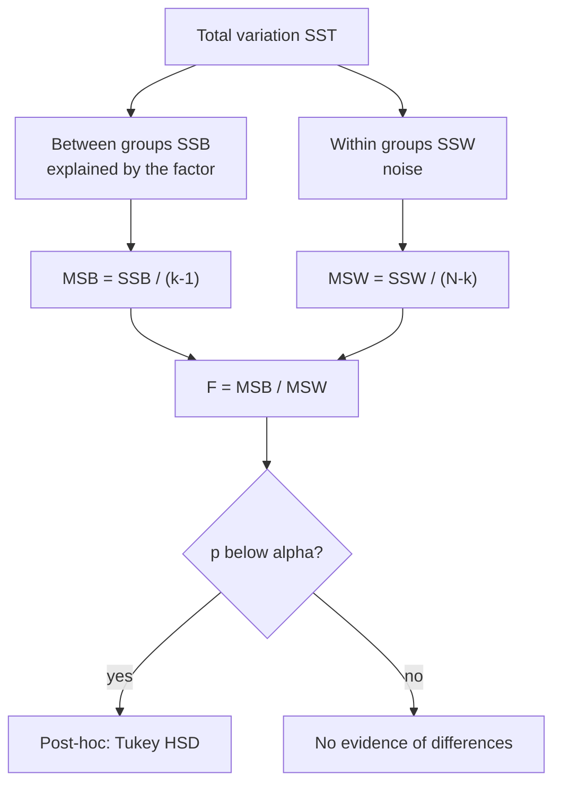
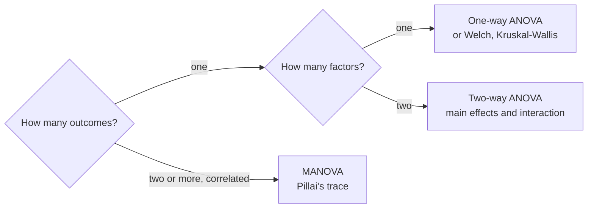
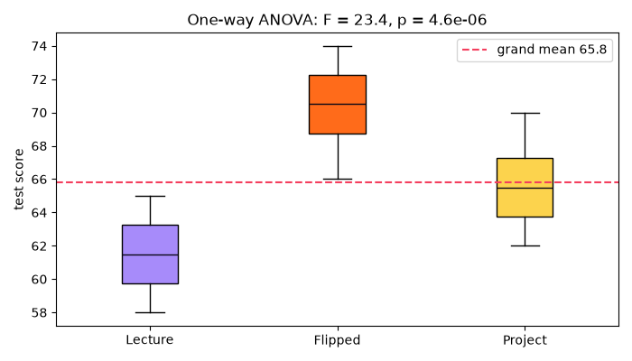
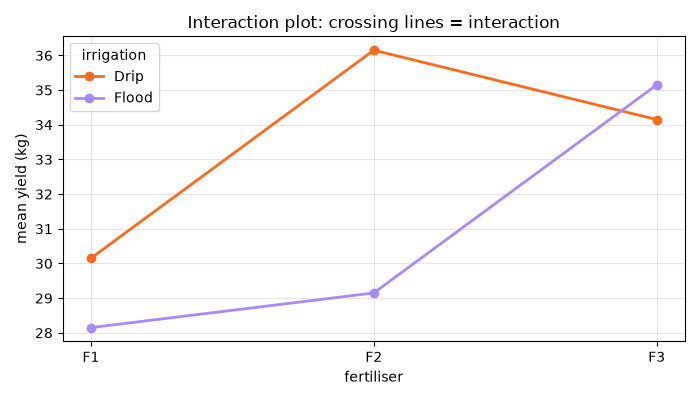

[](https://colab.research.google.com/github/Hamnakhan123/Diploma-in-AI/blob/main/term-1/03-inferential-statistical-analysis/code/session-06-analysis-of-variance.ipynb) &nbsp; 📓 [Notebook](code/session-06-analysis-of-variance.ipynb)

# Session 6: Analysis of Variance (ANOVA and MANOVA)

> 🧭 [Diploma in AI](../../README.md) › [Term 1](../README.md) › [Inferential Statistical Analysis](README.md) › **Session 6**
>
> ⏱️ **Estimated time:** 3 hours (1 h concepts + 2 h lab) &nbsp;|&nbsp; 📋 **Prerequisites:** Sessions 4-5 (hypothesis testing, t and F distributions)
>
> Prepared by **Hamna Zahid Khan**, Junior Lecturer

[⬅ Previous: Session 5](session-05-exact-sampling-distributions.md) &nbsp;|&nbsp; [🏠 Module home](README.md) &nbsp;|&nbsp; [Module practice test ➡](practice-test.md)

---

## 🎯 Learning objectives

- Explain why **ANOVA** is used instead of many t tests when comparing three or more groups.
- Build a **one-way ANOVA table** (SS, df, MS, F, p) by hand and in Python, and report **η²**.
- Use **post-hoc tests** (Tukey HSD, Bonferroni) to find which groups differ.
- Run a **two-way ANOVA** (two-way classification) with and without replication, and interpret **interaction**.
- Explain **MANOVA** for several outcome variables and read Wilks' lambda and Pillai's trace.
- Check ANOVA **assumptions** and choose Welch's ANOVA or Kruskal-Wallis when they fail.

## 📖 Concepts

### 1. Why not just run lots of t tests?

To compare 5 groups you would need 10 pairwise t tests. Each has a 5 % false-alarm risk, so the chance of **at least one** false "difference" is about 1 − 0.95¹⁰ ≈ **40 %** (somewhat less in practice because the tests share data). **ANOVA (Analysis of Variance)** asks one overall question with a single 5 % risk:

H₀: μ₁ = μ₂ = … = μ_k  H₁: at least one mean is different.

> 🧠 **Analogy:** imagine three cricket teams' batting averages. If players **within** each team vary wildly but the **team averages** are close, the teams are probably equally good. If team averages are far apart **compared with** the variation inside teams, the teams genuinely differ. ANOVA turns this intuition into a ratio: **between-group variation ÷ within-group variation**.

### 2. One-way ANOVA (one-way classification)

One **factor** (teaching method) with k **levels** (lecture, flipped, project). The total variation splits exactly into two parts:

| Source | Sum of squares | df | Mean square | F |
|---|---|---|---|---|
| Between groups (factor) | SSB = Σ nⱼ(x̄ⱼ − x̄)² | k − 1 | MSB = SSB/(k − 1) | **F = MSB/MSW** |
| Within groups (error) | SSW = ΣΣ(x − x̄ⱼ)² | N − k | MSW = SSW/(N − k) | |
| Total | SST = ΣΣ(x − x̄)² | N − 1 | | |

- **SST = SSB + SSW** always.
- If H₀ is true, MSB and MSW both estimate the same noise variance and F ≈ 1. A large F means group means are further apart than noise explains.
- Under H₀, F follows the **F distribution** with (k − 1, N − k) df (Session 5).
- **Effect size:** η² = SSB/SST, the share of variation explained by the factor (≈ 0.01 small, 0.06 medium, 0.14 large).

**Step-by-step mini example.** Groups A = (4, 5, 6), B = (6, 7, 8), C = (8, 9, 10); grand mean 7.

1. Group means 5, 7, 9. SSB = 3(5 − 7)² + 3(7 − 7)² + 3(9 − 7)² = 12 + 0 + 12 = **24**.
2. Within each group the squared deviations are 1 + 0 + 1 = 2, so SSW = **6**.
3. SST = 30 = 24 + 6 ✔.
4. MSB = 24/2 = 12, MSW = 6/6 = 1, **F = 12** with (2, 6) df; critical F₀.₀₅ = 5.14 → reject H₀ (p ≈ 0.008).

**Assumptions:** independent observations; residuals approximately normal within groups; **equal variances** (homogeneity), checked with Levene's test. ANOVA is fairly robust to mild non-normality with equal group sizes. If variances differ, use **Welch's ANOVA**; if data are clearly non-normal or ordinal, use **Kruskal-Wallis**.

### 3. Post-hoc tests: which groups differ?

A significant F says "not all equal", not *which* ones. Post-hoc procedures compare pairs while keeping the **family-wise error rate** at α:

| Method | Idea | Use |
|---|---|---|
| **Tukey HSD** | uses the studentised range distribution for all pairs | the standard choice after one-way ANOVA |
| **Bonferroni** | test each of m pairs at α/m (or multiply p by m) | few planned comparisons; conservative |
| Dunnett | compares each group to a single control | treatment vs control designs |
| Games-Howell | Tukey-like without equal variances | after Welch's ANOVA |

### 4. Two-way ANOVA (two-way classification)

Two factors at once, e.g. **fertiliser** (3 levels) × **irrigation** (2 levels). It tests three hypotheses:

1. **Main effect of factor A** (does fertiliser matter, averaging over irrigation?)
2. **Main effect of factor B** (does irrigation matter?)
3. **Interaction A × B** (does the effect of fertiliser **depend on** irrigation?)

| Design | Data | Model |
|---|---|---|
| **Without replication** | one observation per cell (e.g. 4 shops × 3 weeks) | y = A + B + error (no interaction can be estimated) |
| **With replication** | several observations per cell | y = A + B + A×B + error |

**Interaction plots:** plot the cell means with one line per level of B. **Parallel lines** → no interaction; **crossing or diverging lines** → interaction. When the interaction is significant, interpret main effects with care: "fertiliser F2 is best **with drip irrigation**, but F3 is best with flooding".

Two-way ANOVA is more efficient than two separate one-way studies: the second factor removes variation that would otherwise sit in the error term, and you learn about the interaction for free.

### 5. MANOVA: several outcomes at once

**Multivariate ANOVA** compares groups on **two or more correlated outcomes** together (exam **and** project score; blood pressure **and** cholesterol).

- H₀: the **vector** of means is the same in every group.
- Test statistics: **Wilks' lambda** (smaller = stronger effect), **Pillai's trace** (most robust; recommended when assumptions are shaky or groups are unequal), Hotelling-Lawley trace, Roy's largest root.
- Advantages: one test controls the error rate across outcomes, and it can detect differences in the **combination** of outcomes that univariate tests miss.
- Follow a significant MANOVA with univariate ANOVAs (or discriminant analysis) to see which outcomes drive it.
- Extra assumptions: multivariate normality and equal covariance matrices (Box's M test).

| | ANOVA | Two-way ANOVA | MANOVA |
|---|---|---|---|
| Factors | 1 | 2 | 1 or more |
| Outcomes | 1 | 1 | 2 or more |
| Answers | do group means differ? | main effects + interaction | do mean vectors differ? |

## 🧭 Diagrams





## 💻 Worked examples

### Example 1: One-way ANOVA table by hand (basic)

📄 [`code/session-06_one_way_anova.py`](code/session-06_one_way_anova.py) &nbsp;·&nbsp; run: `python session-06_one_way_anova.py`

```python
"""
Session 6 · Example 1: One-way ANOVA (one-way classification), by hand
---------------------------------------------------------------------
Three teaching methods were used with three groups of students. Do the mean
test scores differ?  H0: mu_lecture = mu_flipped = mu_project

We build the full ANOVA table by hand:
   SST (total) = SSB (between groups) + SSW (within groups)
   MSB = SSB / (k - 1),  MSW = SSW / (N - k),  F = MSB / MSW
then check it with scipy.stats.f_oneway, test the assumptions, compute eta
squared, and save a box plot: session-06_one_way_anova.png

Run:  python session-06_one_way_anova.py
"""
import numpy as np
from scipy import stats
import matplotlib
matplotlib.use("Agg")
import matplotlib.pyplot as plt

groups = {
    "Lecture": np.array([62, 58, 65, 60, 63, 59, 61, 64]),
    "Flipped": np.array([70, 68, 74, 71, 66, 72, 69, 73]),
    "Project": np.array([66, 63, 70, 65, 68, 62, 67, 64]),
}
allx = np.concatenate(list(groups.values()))
N, k, grand = len(allx), len(groups), allx.mean()

print("Group means:", {g: round(float(x.mean()), 2) for g, x in groups.items()}, f" grand mean = {grand:.3f}")
SSB = sum(len(x) * (x.mean() - grand) ** 2 for x in groups.values())
SSW = sum(((x - x.mean()) ** 2).sum() for x in groups.values())
SST = ((allx - grand) ** 2).sum()
dfb, dfw = k - 1, N - k
MSB, MSW = SSB / dfb, SSW / dfw
F = MSB / MSW
p = stats.f.sf(F, dfb, dfw)

print("\nANOVA table")
print(f"{'Source':<16}{'SS':>10}{'df':>5}{'MS':>10}{'F':>9}{'p':>11}")
print(f"{'Between groups':<16}{SSB:>10.3f}{dfb:>5}{MSB:>10.3f}{F:>9.3f}{p:>11.2e}")
print(f"{'Within groups':<16}{SSW:>10.3f}{dfw:>5}{MSW:>10.3f}")
print(f"{'Total':<16}{SST:>10.3f}{N - 1:>5}")
print(f"Check: SSB + SSW = {SSB + SSW:.3f} = SST")
print(f"Critical F(0.95; {dfb}, {dfw}) = {stats.f.ppf(0.95, dfb, dfw):.3f}")
print("scipy f_oneway:", tuple(round(float(v), 6) for v in stats.f_oneway(*groups.values())))

eta2 = SSB / SST
print(f"\nEffect size eta^2 = SSB/SST = {eta2:.3f} -> {100 * eta2:.0f}% of score variation is explained by method")
print("Assumptions:")
for g, x in groups.items():
    print(f"   Shapiro-Wilk {g:<8} p = {stats.shapiro(x).pvalue:.3f}")
print(f"   Levene (equal variances) p = {stats.levene(*groups.values()).pvalue:.3f}")
print(f"Non-parametric check: Kruskal-Wallis p = {stats.kruskal(*groups.values()).pvalue:.5f}")

fig, ax = plt.subplots(figsize=(7, 4))
bp = ax.boxplot(list(groups.values()), patch_artist=True, medianprops=dict(color="#0A0716"))
for patch, c in zip(bp["boxes"], ["#A78BFA", "#FF6B1A", "#FCD34D"]):
    patch.set_facecolor(c)
ax.set_xticks([1, 2, 3]); ax.set_xticklabels(list(groups))
ax.axhline(grand, color="#F43F5E", ls="--", label=f"grand mean {grand:.1f}")
ax.set_ylabel("test score"); ax.set_title(f"One-way ANOVA: F = {F:.1f}, p = {p:.1e}"); ax.legend()
fig.tight_layout(); fig.savefig("session-06_one_way_anova.png", dpi=100)
print("Saved chart: session-06_one_way_anova.png")
```

**Output**

```text
Group means: {'Lecture': 61.5, 'Flipped': 70.38, 'Project': 65.62}  grand mean = 65.833

ANOVA table
Source                  SS   df        MS        F          p
Between groups     315.583    2   157.792   23.377   4.56e-06
Within groups      141.750   21     6.750
Total              457.333   23
Check: SSB + SSW = 457.333 = SST
Critical F(0.95; 2, 21) = 3.467
scipy f_oneway: (23.376543, 5e-06)

Effect size eta^2 = SSB/SST = 0.690 -> 69% of score variation is explained by method
Assumptions:
   Shapiro-Wilk Lecture  p = 0.933
   Shapiro-Wilk Flipped  p = 0.978
   Shapiro-Wilk Project  p = 0.978
   Levene (equal variances) p = 0.977
Non-parametric check: Kruskal-Wallis p = 0.00031
Saved chart: session-06_one_way_anova.png
```




**What to notice:** F = 23.4 is far beyond the critical 3.47, and η² = 0.69 means teaching method explains about 69 % of score variation in this (deliberately clear) example. Assumptions look fine, and Kruskal-Wallis agrees.

### Example 2: Post-hoc tests (intermediate)

📄 [`code/session-06_tukey_posthoc.py`](code/session-06_tukey_posthoc.py) &nbsp;·&nbsp; run: `python session-06_tukey_posthoc.py`

```python
"""
Session 6 · Example 2: Which groups differ? Post-hoc tests after ANOVA
---------------------------------------------------------------------
A significant ANOVA only says 'not all means are equal'. Post-hoc tests find
WHICH pairs differ while controlling the family-wise error rate.
  1. Why not just run three t tests? (simulation of the inflated error)
  2. Tukey's HSD with statsmodels
  3. Bonferroni-corrected pairwise t tests for comparison

Run:  python session-06_tukey_posthoc.py
"""
from itertools import combinations
import numpy as np
from scipy import stats
from statsmodels.stats.multicomp import pairwise_tukeyhsd

groups = {
    "Lecture": np.array([62, 58, 65, 60, 63, 59, 61, 64]),
    "Flipped": np.array([70, 68, 74, 71, 66, 72, 69, 73]),
    "Project": np.array([66, 63, 70, 65, 68, 62, 67, 64]),
}

# 1. Multiple t tests inflate the Type I error: 5 identical groups -> 10 pairwise tests
rng = np.random.default_rng(4)
false_alarm = 0
for _ in range(2000):
    g = rng.normal(60, 5, size=(5, 10))
    if any(stats.ttest_ind(g[i], g[j]).pvalue < 0.05 for i, j in combinations(range(5), 2)):
        false_alarm += 1
print(f"1) 5 identical groups, 10 t tests at 0.05: at least one false 'difference' in "
      f"{false_alarm / 20:.1f}% of studies (ANOVA keeps it at 5%)")

# 2. Tukey HSD
scores = np.concatenate(list(groups.values()))
labels = np.repeat(list(groups), [len(v) for v in groups.values()])
tukey = pairwise_tukeyhsd(scores, labels, alpha=0.05)
print("\n2) Tukey HSD")
print(tukey.summary())

# 3. Bonferroni
pairs = list(combinations(groups, 2))
print(f"\n3) Bonferroni: compare each p with 0.05/{len(pairs)} = {0.05 / len(pairs):.4f}")
for a, b in pairs:
    p = stats.ttest_ind(groups[a], groups[b]).pvalue
    print(f"   {a} vs {b}: p = {p:.5f}, adjusted p = {min(1, p * len(pairs)):.5f} "
          f"-> {'different' if p < 0.05 / len(pairs) else 'not different'}")
```

**Output**

```text
1) 5 identical groups, 10 t tests at 0.05: at least one false 'difference' in 28.8% of studies (ANOVA keeps it at 5%)

2) Tukey HSD
  Multiple Comparison of Means - Tukey HSD, FWER=0.05  
=======================================================
 group1  group2 meandiff p-adj   lower    upper  reject
-------------------------------------------------------
Flipped Lecture   -8.875    0.0 -12.1493 -5.6007   True
Flipped Project    -4.75  0.004  -8.0243 -1.4757   True
Lecture Project    4.125 0.0121   0.8507  7.3993   True
-------------------------------------------------------

3) Bonferroni: compare each p with 0.05/3 = 0.0167
   Lecture vs Flipped: p = 0.00001, adjusted p = 0.00002 -> different
   Lecture vs Project: p = 0.00616, adjusted p = 0.01849 -> different
   Flipped vs Project: p = 0.00314, adjusted p = 0.00943 -> different
```


**Reading the output:** the simulation shows the danger: ten unplanned t tests produce a false "difference" in about 29 % of studies. Tukey then shows that **all three** pairs differ: flipped > project > lecture. Bonferroni agrees here but is more conservative in general.

### Example 3: Two-way ANOVA and interaction (intermediate → advanced)

📄 [`code/session-06_two_way_anova.py`](code/session-06_two_way_anova.py) &nbsp;·&nbsp; run: `python session-06_two_way_anova.py`

```python
"""
Session 6 · Example 3: Two-way ANOVA (two-way classification) with interaction
-----------------------------------------------------------------------------
Crop yield (kg per plot) for 3 fertilisers x 2 irrigation methods, 4 plots per
combination. Two-way ANOVA tests:
   * main effect of fertiliser
   * main effect of irrigation
   * the INTERACTION (does the best fertiliser depend on irrigation?)
Also shown: two-way ANOVA WITHOUT replication (one value per cell, no
interaction term), and an interaction plot: session-06_two_way_anova.png

Run:  python session-06_two_way_anova.py
"""
import numpy as np
import pandas as pd
import statsmodels.api as sm
import statsmodels.formula.api as smf
import matplotlib
matplotlib.use("Agg")
import matplotlib.pyplot as plt

rows = []
cell_means = {("F1", "Drip"): 30, ("F2", "Drip"): 36, ("F3", "Drip"): 34,
              ("F1", "Flood"): 28, ("F2", "Flood"): 29, ("F3", "Flood"): 35}
offsets = [-1.5, 0.5, 1.2, -0.2]                 # fixed within-cell variation (deterministic)
for (fert, irr), m in cell_means.items():
    for i, o in enumerate(offsets):
        rows.append({"fertiliser": fert, "irrigation": irr, "yield_kg": m + o + 0.3 * (i % 2)})
df = pd.DataFrame(rows)

print("Cell means (kg):")
print(df.pivot_table(values="yield_kg", index="fertiliser", columns="irrigation", aggfunc="mean").round(2).to_string())

model = smf.ols("yield_kg ~ C(fertiliser) * C(irrigation)", data=df).fit()
table = sm.stats.anova_lm(model, typ=2)
table["eta_sq"] = table["sum_sq"] / table["sum_sq"].sum()
print("\nTwo-way ANOVA with interaction (Type II sums of squares)")
print(table.assign(**{"PR(>F)": lambda t: t["PR(>F)"].map(lambda v: "" if v != v else f"{v:.2e}")}).round(4).to_string())

# Without replication: one observation per cell (e.g. 4 shops x 3 weeks of sales)
sales = pd.DataFrame({"shop": np.repeat(["S1", "S2", "S3", "S4"], 3),
                      "week": ["W1", "W2", "W3"] * 4,
                      "sales": [52, 58, 61, 47, 50, 56, 60, 66, 70, 45, 49, 53]})
m2 = smf.ols("sales ~ C(shop) + C(week)", data=sales).fit()
print("\nTwo-way ANOVA without replication (no interaction term possible)")
print(sm.stats.anova_lm(m2, typ=2).assign(**{"PR(>F)": lambda t: t["PR(>F)"].map(lambda v: "" if v != v else f"{v:.2e}")}).round(4).to_string())

fig, ax = plt.subplots(figsize=(7, 4))
means = df.groupby(["fertiliser", "irrigation"]).yield_kg.mean().unstack()
for irr, c in zip(means.columns, ["#FF6B1A", "#A78BFA"]):
    ax.plot(means.index, means[irr], marker="o", color=c, lw=2, label=irr)
ax.set_xlabel("fertiliser"); ax.set_ylabel("mean yield (kg)")
ax.set_title("Interaction plot: crossing lines = interaction"); ax.legend(title="irrigation"); ax.grid(alpha=0.3)
fig.tight_layout(); fig.savefig("session-06_two_way_anova.png", dpi=100)
print("Saved chart: session-06_two_way_anova.png")
```

**Output**

```text
Cell means (kg):
irrigation   Drip  Flood
fertiliser              
F1          30.15  28.15
F2          36.15  29.15
F3          34.15  35.15

Two-way ANOVA with interaction (Type II sums of squares)
                               sum_sq    df        F    PR(>F)  eta_sq
C(fertiliser)                124.0000   2.0  43.7647  1.22e-07  0.4816
C(irrigation)                 42.6667   1.0  30.1176  3.27e-05  0.1657
C(fertiliser):C(irrigation)   65.3333   2.0  23.0588  1.08e-05  0.2537
Residual                      25.5000  18.0      NaN            0.0990

Two-way ANOVA without replication (no interaction term possible)
            sum_sq   df         F    PR(>F)
C(shop)   484.2500  3.0  215.2222  1.70e-06
C(week)   162.1667  2.0  108.1111  1.97e-05
Residual    4.5000  6.0       NaN          
Saved chart: session-06_two_way_anova.png
```




**Walkthrough:** all three effects are significant. The interaction (η² = 0.25) is the key business finding: F2 is excellent with drip irrigation but no better than F1 with flooding, while F3 works well with both. The interaction plot's crossing lines show it at a glance. The "without replication" table shows the shop × week design, where shops differ a lot and sales also changed over the weeks.

### Example 4: MANOVA for two correlated outcomes (advanced)

📄 [`code/session-06_manova.py`](code/session-06_manova.py) &nbsp;·&nbsp; run: `python session-06_manova.py`

```python
"""
Session 6 · Example 4: MANOVA - several outcomes at once
-------------------------------------------------------
Three study programmes are compared on TWO outcomes measured on the same
students: exam score and project score. MANOVA tests whether the vector of
means (exam, project) differs between programmes, using the correlation
between the outcomes. We report Wilks' lambda, Pillai's trace and friends,
then follow up with one univariate ANOVA per outcome.

Run:  python session-06_manova.py
"""
import numpy as np
import pandas as pd
import statsmodels.formula.api as smf
import statsmodels.api as sm
from statsmodels.multivariate.manova import MANOVA

rng = np.random.default_rng(17)
centres = {"Evening": (62, 70), "Weekend": (64, 64), "Regular": (70, 72)}
cov = [[25, 12], [12, 25]]                         # exam and project scores are correlated
frames = []
for prog, mu in centres.items():
    xy = rng.multivariate_normal(mu, cov, size=15).round(1)
    frames.append(pd.DataFrame({"programme": prog, "exam": xy[:, 0], "project": xy[:, 1]}))
df = pd.concat(frames, ignore_index=True)

print("Means by programme")
print(df.groupby("programme")[["exam", "project"]].mean().round(2).to_string())
print(f"Correlation between exam and project: {df.exam.corr(df.project):.2f}")

mv = MANOVA.from_formula("exam + project ~ programme", data=df)
res = mv.mv_test()
stat = res.results["programme"]["stat"]
print("\nMANOVA (effect: programme)")
print(stat.round(4).to_string())

print("\nFollow-up univariate ANOVAs")
for dv in ["exam", "project"]:
    t = sm.stats.anova_lm(smf.ols(f"{dv} ~ C(programme)", data=df).fit(), typ=2)
    print(f"   {dv:<8} F = {t.loc['C(programme)', 'F']:.3f}, p = {t.loc['C(programme)', 'PR(>F)']:.5f}")
```

**Output**

```text
Means by programme
            exam  project
programme                
Evening    64.17    72.43
Regular    70.07    73.64
Weekend    65.76    64.25
Correlation between exam and project: 0.51

MANOVA (effect: programme)
                           Value Num DF     Den DF    F Value    Pr > F
Wilks' lambda           0.480694      4       82.0    9.06782  0.000004
Pillai's trace           0.60498    4.0       84.0   9.107097  0.000004
Hotelling-Lawley trace  0.902093      4  48.179104   9.176331  0.000014
Roy's greatest root      0.60983      2         42  12.806422  0.000045

Follow-up univariate ANOVAs
   exam     F = 6.229, p = 0.00427
   project  F = 9.893, p = 0.00030
```


**Reading the output:** all four multivariate statistics agree (p < 0.0001). The follow-up ANOVAs show both outcomes contribute: the regular programme leads on exams, while the weekend programme lags on projects.

## 🌍 Real-life coding problem: delivery times by zone and time of day

**Scenario.** A delivery start-up's operations lead wants to know where and when to add riders. You have 48 orders across 4 zones and 2 meal times.

**Plan:**

1. One-way ANOVA by zone, then Tukey to see which zones differ.
2. Two-way ANOVA with interaction: does dinner slow every zone equally?
3. Check assumptions on the residuals.
4. Turn the statistics into an action list.

📄 [`code/session-06_problem_delivery_zones.py`](code/session-06_problem_delivery_zones.py) &nbsp;·&nbsp; run: `python session-06_problem_delivery_zones.py`

```python
"""
Session 6 · Real-life problem: do delivery times differ by zone and time of day?
-------------------------------------------------------------------------------
PROBLEM
A food-delivery start-up in Karachi recorded delivery times (minutes) for
orders in 4 zones (Clifton, Gulshan, Saddar, North Nazimabad) at 2 times of
day (Lunch, Dinner), 6 orders per combination (48 orders).
Operations wants to know:
  1. Do mean delivery times differ by zone? (one-way ANOVA + Tukey)
  2. Does time of day matter, and does its effect depend on the zone? (two-way ANOVA)
  3. Are the assumptions reasonable? (Levene, Shapiro on residuals)
  4. Which zone-time combinations need extra riders?

Run:  python session-06_problem_delivery_zones.py
"""
import numpy as np
import pandas as pd
from scipy import stats
import statsmodels.api as sm
import statsmodels.formula.api as smf
from statsmodels.stats.multicomp import pairwise_tukeyhsd

rng = np.random.default_rng(99)
base = {"Clifton": 28, "Gulshan": 34, "Saddar": 38, "North Nazimabad": 33}
dinner_extra = {"Clifton": 2, "Gulshan": 3, "Saddar": 9, "North Nazimabad": 3}   # Saddar traffic at night
rows = [{"zone": z, "time": t, "minutes": round(base[z] + (dinner_extra[z] if t == "Dinner" else 0)
                                              + rng.normal(0, 3), 1)}
        for z in base for t in ["Lunch", "Dinner"] for _ in range(6)]
df = pd.DataFrame(rows)

print("Mean minutes by zone and time")
print(df.pivot_table(values="minutes", index="zone", columns="time", aggfunc="mean").round(1).to_string())

# 1. One-way ANOVA by zone + Tukey
f1 = stats.f_oneway(*[g.minutes for _, g in df.groupby("zone")])
print(f"\n1) One-way ANOVA by zone: F = {f1.statistic:.2f}, p = {f1.pvalue:.2e}")
print(pairwise_tukeyhsd(df.minutes, df.zone).summary())

# 2. Two-way ANOVA with interaction
model = smf.ols("minutes ~ C(zone) * C(time)", data=df).fit()
print("\n2) Two-way ANOVA")
print(sm.stats.anova_lm(model, typ=2).assign(**{"PR(>F)": lambda t: t["PR(>F)"].map(lambda v: "" if v != v else f"{v:.2e}")}).round(4).to_string())

# 3. Assumptions
print(f"\n3) Levene across the 8 cells p = {stats.levene(*[g.minutes for _, g in df.groupby(['zone', 'time'])]).pvalue:.3f}; "
      f"Shapiro on residuals p = {stats.shapiro(model.resid).pvalue:.3f}")

# 4. Action list: cells more than 3 minutes above the overall mean
cells = df.groupby(["zone", "time"]).minutes.mean()
overall = df.minutes.mean()
print(f"\n4) Overall mean {overall:.1f} min. Cells that need extra riders (> mean + 3 min):")
for (z, t), m in cells.items():
    if m > overall + 3:
        print(f"   {z} at {t}: {m:.1f} min")
```

**Output**

```text
Mean minutes by zone and time
time             Dinner  Lunch
zone                          
Clifton            30.4   28.2
Gulshan            37.5   34.8
North Nazimabad    37.4   33.9
Saddar             48.9   37.8

1) One-way ANOVA by zone: F = 23.20, p = 3.69e-09
         Multiple Comparison of Means - Tukey HSD, FWER=0.05          
======================================================================
     group1          group2     meandiff p-adj   lower   upper  reject
----------------------------------------------------------------------
        Clifton         Gulshan   6.8917  0.001  2.3895 11.3939   True
        Clifton North Nazimabad   6.4083 0.0024  1.9061 10.9105   True
        Clifton          Saddar    14.05    0.0  9.5478 18.5522   True
        Gulshan North Nazimabad  -0.4833 0.9917 -4.9855  4.0189  False
        Gulshan          Saddar   7.1583 0.0006  2.6561 11.6605   True
North Nazimabad          Saddar   7.6417 0.0003  3.1395 12.1439   True
----------------------------------------------------------------------

2) Two-way ANOVA
                    sum_sq    df        F    PR(>F)
C(zone)          1187.5042   3.0  51.6037  8.18e-14
C(time)           286.1633   1.0  37.3062  3.33e-07
C(zone):C(time)   157.6450   3.0   6.8506  7.83e-04
Residual          306.8267  40.0      NaN          

3) Levene across the 8 cells p = 0.904; Shapiro on residuals p = 0.492

4) Overall mean 36.1 min. Cells that need extra riders (> mean + 3 min):
   Saddar at Dinner: 48.9 min
```


**Answer for operations:** zone, time of day and their interaction are all significant. Clifton is fastest; Gulshan and North Nazimabad are statistically indistinguishable; Saddar is slowest. The interaction is driven by **Saddar at dinner** (about 49 min, 11 minutes slower than its lunch time), so that is where extra riders should go first.

## 🛠️ Mini project: one-click ANOVA experiment report

`anova_report(df, outcome, factors)` produces the full analysis a supervisor expects: descriptives, assumption checks, the right test (ANOVA, Welch's ANOVA or Kruskal-Wallis), η², Tukey HSD when needed, and a conclusion.

```python
formula = f"{outcome} ~ " + " * ".join(f"C({f})" for f in factors)   # 'y ~ C(a) * C(b)'
model = smf.ols(formula, data=df).fit()
table = sm.stats.anova_lm(model, typ=2)                                # ANOVA table
table["eta_sq"] = table["sum_sq"] / table["sum_sq"].sum()
```

📄 Full solution (74 lines, fully commented): [`code/session-06_project_experiment_report.py`](code/session-06_project_experiment_report.py) &nbsp;·&nbsp; run: `python session-06_project_experiment_report.py` &nbsp;·&nbsp; also in the session notebook

**Output**

```text
======================================================================
Outcome: minutes   Factor(s): layout   N = 60
             count  mean   std
layout                        
Cards           20  7.44  1.19
Classic         20  6.20  1.61
Video-first     20  7.05  1.51
Assumptions: Levene p = 0.196 (ok), Shapiro residuals p = 0.529 (ok)
             sum_sq    df       F    PR(>F)  eta_sq
C(layout)   15.9052   2.0  3.7934  2.84e-02  0.1175
Residual   119.4967  57.0     NaN            0.8825
   Multiple Comparison of Means - Tukey HSD, FWER=0.05    
==========================================================
 group1    group2   meandiff p-adj   lower   upper  reject
----------------------------------------------------------
  Cards     Classic   -1.233 0.0248 -2.3348 -0.1312   True
  Cards Video-first   -0.387 0.6767 -1.4888  0.7148  False
Classic Video-first    0.846 0.1635 -0.2558  1.9478  False
----------------------------------------------------------
Conclusion: at least one group differs (alpha = 0.05); highest mean: Cards
======================================================================
Outcome: yield_kg   Factor(s): fertiliser, soil   N = 30
                  count   mean   std
fertiliser soil                     
Organic    Clay       5  40.24  1.02
           Loam       5  44.33  0.56
           Sandy      5  40.30  1.22
Urea       Clay       5  41.06  0.17
           Loam       5  46.54  1.14
           Sandy      5  39.40  1.63
Assumptions: Levene p = 0.214 (ok), Shapiro residuals p = 0.663 (ok)
                         sum_sq    df        F    PR(>F)  eta_sq
C(fertiliser)            3.7644   1.0   3.3096  8.14e-02  0.0167
C(soil)                182.4288   2.0  80.1934  2.36e-11  0.8087
C(fertiliser):C(soil)   12.0840   2.0   5.3120  1.23e-02  0.0536
Residual                27.2983  24.0      NaN            0.1210
Conclusion: at least one group differs (alpha = 0.05); highest mean: ('Urea', 'Loam')
```


**What to notice:** in the website experiment the overall F is significant (p = 0.028), but Tukey finds only one clear pair (Cards vs Classic). In the crop trial soil type dominates (η² = 0.81), fertiliser alone is not significant (p = 0.08), but the interaction is (p = 0.012): organic fertiliser helps relatively more on sandy soil. A good report always reads main effects in the light of the interaction.

## ⚠️ Common mistakes

| Mistake | Fix |
|---|---|
| Running many t tests instead of ANOVA | One ANOVA first, then a post-hoc test |
| Stopping at "F is significant" | Use Tukey (or planned contrasts) to say which groups differ |
| Interpreting main effects when the interaction is strong | Describe the effect of one factor **at each level** of the other |
| Ignoring unequal variances with unequal group sizes | Use Welch's ANOVA / Games-Howell |
| Using ANOVA on ordinal ratings or very skewed data | Kruskal-Wallis |
| Running separate ANOVAs on several correlated outcomes | MANOVA first, then follow-ups |
| Reporting only p | Add η² (or partial η²) and group means with CIs |
| Two-way ANOVA without replication with an interaction term | Not estimable; use the additive model |

## ✅ Best practices

- Plan the design: balanced groups (equal n) make ANOVA more robust and easier to interpret.
- Plot first: box plots for one factor, interaction plots for two.
- Report the full table: "F(2, 21) = 23.38, p < 0.001, η² = 0.69", then the post-hoc results.
- Check residuals, not raw data, for normality in multi-factor designs.
- Randomise which units receive which treatment; ANOVA shows differences, randomisation lets you call them **effects**.
- Use statsmodels formulas (`y ~ C(a) * C(b)`) so the same code scales to more factors.

## 🧪 Lab / practice tasks

**1. 🟢 Easy:** Complete the ANOVA table: k = 4 groups, N = 24, SSB = 84, SST = 204. Find SSW, the df, MSB, MSW, F, and decide at α = 0.05 (critical F(3, 20) = 3.10).

<details><summary>💡 Hint</summary>

SSW = SST − SSB; df = 3 and 20.

</details>

<details><summary>✅ Solution</summary>

SSW = 120; MSB = 84/3 = 28; MSW = 120/20 = 6; F = 4.67 > 3.10 → reject H₀; η² = 84/204 = 0.41.

</details>

**2. 🟢 Easy:** Verify the mini example (A = 4, 5, 6; B = 6, 7, 8; C = 8, 9, 10) with `stats.f_oneway`.

<details><summary>💡 Hint</summary>

Pass three lists.

</details>

<details><summary>✅ Solution</summary>

```python
from scipy import stats
print(stats.f_oneway([4, 5, 6], [6, 7, 8], [8, 9, 10]))   # F = 12.0, p ≈ 0.0080
```

</details>

**3. 🟡 Medium:** Three call-centre shifts handled these calls per hour: Morning (22, 25, 27, 24, 26), Evening (28, 30, 27, 31, 29), Night (20, 23, 21, 22, 24). Run ANOVA and Tukey HSD. Which shifts differ?

<details><summary>💡 Hint</summary>

Use `pairwise_tukeyhsd(values, labels)` as in Example 2.

</details>

<details><summary>✅ Solution</summary>

Means 24.8, 29.0, 22.0; F ≈ 21.4, p ≈ 0.0001. Tukey: Evening differs from Morning (p ≈ 0.006) and from Night (p ≈ 0.0001); Morning vs Night (2.8 calls) is **not** significant (p ≈ 0.056). Evening is the busiest shift.

</details>

**4. 🟡 Medium:** Sketch (or plot) the interaction plot for these cell means and say whether there is an interaction: Drug A: 10 (low dose), 14 (high dose); Drug B: 12 (low), 16 (high).

<details><summary>💡 Hint</summary>

Compare the change from low to high for each drug.

</details>

<details><summary>✅ Solution</summary>

Both drugs rise by 4 → **parallel lines → no interaction**. Drug B is 2 units better at both doses (a main effect of drug), and high dose is 4 units better (a main effect of dose).

</details>

**5. 🟠 Hard:** Modify `session-06_two_way_anova.py` so that the cell means have **no interaction** (make the F2 Flood mean 34 so that F2 is 6 kg above F1 under both irrigation methods). Re-run and compare the interaction p-value and plot.

<details><summary>💡 Hint</summary>

Change `("F2", "Flood"): 29` to `34`, and make F3 Flood = 32 (2 below drip, like F1 and F2).

</details>

<details><summary>✅ Solution</summary>

With every fertiliser 2 kg lower under flooding, the lines are parallel and the interaction sum of squares becomes exactly 0 (F = 0, p = 1), while both main effects stay significant. This is what "no interaction" looks like in numbers and in the plot.

</details>

**6. 🔴 Challenge:** Extend `anova_report` to print **partial η²** for every effect in two-way designs and to run **Games-Howell** post-hoc comparisons when Levene's test fails (hint: `pingouin` provides it, or implement Welch t tests with a Bonferroni correction).

<details><summary>💡 Hint</summary>

Partial η² = SS_effect / (SS_effect + SS_residual).

</details>

<details><summary>✅ Solution</summary>

```python
res_ss = table.loc["Residual", "sum_sq"]
table["partial_eta_sq"] = table["sum_sq"] / (table["sum_sq"] + res_ss)
table.loc["Residual", "partial_eta_sq"] = float("nan")
# unequal variances, simple fallback:
from itertools import combinations
labels = df[factors[0]].unique()
for a, b in combinations(labels, 2):
    p = stats.ttest_ind(df[df[factors[0]] == a][outcome], df[df[factors[0]] == b][outcome],
                        equal_var=False).pvalue
    print(a, b, min(1, p * len(labels) * (len(labels) - 1) / 2))
```

</details>

## ✅ Quick quiz

**Q1.** In a one-way ANOVA with 4 groups and 40 observations, the degrees of freedom are…

- A) (4, 40)
- B) (3, 36)
- C) (3, 39)
- D) (4, 36)

**Q2.** The F ratio in ANOVA compares…

- A) the largest and smallest group means
- B) between-group variance to within-group variance
- C) two sample sizes
- D) the median and the mean

**Q3.** A significant ANOVA F test tells you that…

- A) all group means differ
- B) at least one group mean differs
- C) the data are normal
- D) the first group is largest

**Q4.** In a two-way ANOVA the interaction plot shows clearly crossing lines. This suggests…

- A) no main effects
- B) the effect of one factor depends on the level of the other
- C) the assumptions are violated
- D) the design has no replication

**Q5.** Which statistic is usually recommended as the most robust in MANOVA?

- A) Wilks' lambda
- B) Roy's largest root
- C) Pillai's trace
- D) Cohen's d

<details><summary>✅ Show answers</summary>

1. **B** — between = k − 1 = 3, within = N − k = 36.
2. **B** — MSB / MSW.
3. **B** — use a post-hoc test to find which ones.
4. **B** — crossing lines indicate interaction.
5. **C** — Pillai's trace is the most robust to assumption violations.

</details>


## 📝 Summary

- ANOVA compares 3+ means with one test: **F = MSB/MSW**, with SST = SSB + SSW; report η².
- A significant F needs a **post-hoc** test (Tukey HSD, Bonferroni, Dunnett).
- **Two-way ANOVA** tests two main effects and their **interaction**; without replication only main effects can be estimated.
- **MANOVA** handles several correlated outcomes; Pillai's trace is the robust choice; follow up with univariate ANOVAs.
- Check independence, normal residuals and equal variances; fall back to **Welch's ANOVA** or **Kruskal-Wallis**.
- These tools underpin experiment analysis everywhere, from agriculture to A/B/n tests of app features.

### 🎤 Interview / viva questions

1. Why does running multiple t tests inflate the Type I error?
2. Explain SSB and SSW in plain words. What happens to F when H₀ is true?
3. What is the difference between η² and partial η²?
4. What does an interaction mean in a two-way ANOVA? Give a real example.
5. When would you choose MANOVA over several ANOVAs?
6. What would you do if Levene's test is significant before an ANOVA?
7. How is ANOVA related to linear regression?

---

[⬅ Previous: Session 5](session-05-exact-sampling-distributions.md) &nbsp;|&nbsp; [🏠 Module home](README.md) &nbsp;|&nbsp; [Module practice test ➡](practice-test.md)

<sub>Prepared by **Hamna Zahid Khan**, Junior Lecturer · Diploma in AI</sub>
