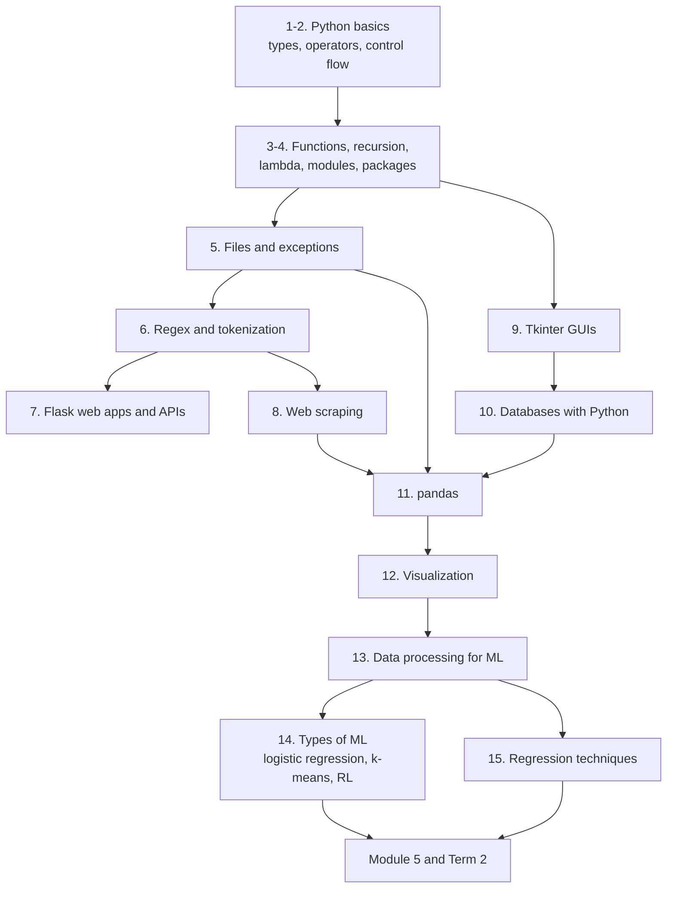

# Module 4: Application Based Programming in Python

> 🧭 [Diploma in AI](../../README.md) › [Term 1](../README.md) › **Application Based Programming in Python** &nbsp;·&nbsp; ⏱️ 36 instructional hours
>
> Prepared by **Hamna Zahid Khan**, Junior Lecturer

[⬅ Term 1 overview](../README.md) &nbsp;|&nbsp; [🏠 Course home](../../README.md)

---

## 🌟 Why this module matters

Python is the working language of data science and AI. This module takes you from your first variable to your first machine-learning models, through everything a practitioner builds along the way: command-line tools, file and data pipelines, regular expressions for text, a **Flask** web app and JSON API, **web scrapers**, **Tkinter** desktop apps, **database**-backed applications, **pandas** analysis, **visualization** dashboards, **data preprocessing** pipelines, and **classification, clustering, reinforcement learning and regression** with scikit-learn. Every session is built around runnable code with real output, a real-life problem with a full solution and a mini project.

## 🎯 Module objectives

By the end of this module you will be able to:

- Write clean, idiomatic Python: data types, operators, control flow, functions, recursion, lambdas, modules and packages.
- Read and write files (text, CSV, JSON), handle errors robustly, and process text with regular expressions and tokenization.
- Build web applications and REST APIs with Flask, and collect data responsibly with requests and BeautifulSoup.
- Create desktop GUIs with Tkinter and connect Python applications to SQLite and MySQL databases.
- Clean, transform, summarise and visualise data with pandas, Matplotlib and seaborn.
- Prepare data for machine learning (imputation, encoding, scaling, pipelines, avoiding leakage).
- Train and evaluate supervised, unsupervised and reinforcement-learning models, and regression models for numeric prediction.

## 🗂️ Sessions

| # | Session |
|---|---|
| 1 | [Basics of Python](session-01-basics-of-python.md) |
| 2 | [Programming Language Constructs](session-02-programming-language-constructs.md) |
| 3 | [Introduction to Functions](session-03-introduction-to-functions.md) |
| 4 | [Functions, Modules and Packages](session-04-functions-modules-and-packages.md) |
| 5 | [File Handling and Exception Handling](session-05-file-and-exception-handling.md) |
| 6 | [Regular Expressions and Tokenization](session-06-regular-expressions-and-tokenization.md) |
| 7 | [Web Development Using Flask](session-07-web-development-with-flask.md) |
| 8 | [Web Scraping in Python](session-08-web-scraping.md) |
| 9 | [GUI Programming with Tkinter](session-09-gui-programming-with-tkinter.md) |
| 10 | [Database Integration with Python](session-10-database-integration.md) |
| 11 | [Data Handling Using Pandas](session-11-data-handling-with-pandas.md) |
| 12 | [Data Visualization in Python](session-12-data-visualization.md) |
| 13 | [Data Processing Techniques for Machine Learning](session-13-data-processing-for-machine-learning.md) |
| 14 | [Types of Machine Learning in Python](session-14-types-of-machine-learning.md) |
| 15 | [Regression Techniques for Machine Learning](session-15-regression-techniques.md) |
| 📝 | [Module practice test](practice-test.md) |

## 🧭 Concept map

## 🛠️ Setup

- **Zero-install:** every session has an **Open in Colab** notebook with all its examples and charts already executed.
- **Local:** Python 3.10+ and `pip install numpy pandas matplotlib seaborn scikit-learn flask requests beautifulsoup4 lxml joblib`. Tkinter ships with Python on Windows and macOS (Linux: `sudo apt install python3-tk`). See [`code/README.md`](code/README.md) for every file and how to run it.
- **Sessions 7-10 run anywhere:** Flask examples test themselves with Flask's test client (add `--serve` to open them in a browser); scraping examples use a local practice website that starts on your own computer; Tkinter examples switch to a text **test mode** when no screen is available; database examples use SQLite, with MySQL equivalents shown alongside.
- Each session contains: concepts with analogies, Mermaid diagrams, worked examples (basic → advanced) with real output, charts generated by the code, a real-life coding problem with a full solution, a mini project, common mistakes, best practices, a lab with hints and solutions, a quiz and viva questions.

## 📄 One-page cheat-sheet

**Core Python**

| Topic | Syntax |
|---|---|
| f-string | `f"{name:<10} {price:,.2f} {ratio:.0%}"` |
| Conditional expression | `"pass" if mark >= 50 else "fail"` |
| match / case | `match cmd.split(): case ["add", item]: ...` |
| Loop helpers | `enumerate(seq, 1)`, `zip(a, b)`, `range(start, stop, step)`, loop `else` |
| Comprehensions | `[x * x for x in xs if x > 0]`, `{k: v for k, v in pairs}` |
| Function signature | `def f(pos, /, normal, *args, kw_only, **kwargs):` |
| Lambda as key | `sorted(rows, key=lambda r: (-r["cgpa"], r["name"]))` |
| Memoise recursion | `@functools.lru_cache(maxsize=None)` |
| Script guard | `if __name__ == "__main__": main()` |

**Files, errors, regex**

| Topic | Syntax |
|---|---|
| Open safely | `with open(p, "a", encoding="utf-8") as f:` (modes r, w, a, x, +, b) |
| CSV / JSON | `csv.DictReader(f)`, `csv.DictWriter`, `json.load(f)`, `json.dump(obj, f, indent=2)` |
| Exceptions | `try / except ValueError as e / else / finally`, `raise X from e`, custom `class MyError(Exception)` |
| Regex | `re.fullmatch(r"\d{5}-\d{7}-\d", cnic)`, `re.findall`, `re.sub(p, repl, s)`, `re.compile(p, re.X)` |
| Named groups | `(?P<year>\d{4})` → `m.groupdict()` |

**Web, scraping, GUI, databases**

| Topic | Syntax |
|---|---|
| Flask route | `@app.get("/api/books/<int:id>")` → `return jsonify(book), 200` |
| Templates | `render_template("page.html", items=items)`; `{{ var }}`, ``, `` |
| Test a Flask app | `app.test_client().post("/api", json={...})` |
| requests | `requests.get(url, params=..., headers=..., timeout=10).raise_for_status()` |
| BeautifulSoup | `soup.select("div.product .price")`, `select_one`, `get_text(" ", strip=True)`, `tag["href"]` |
| Tkinter | `root = tk.Tk()` → widgets → `pack / grid` → `root.mainloop()`; `command=lambda k=k: f(k)` |
| DB-API | `conn = sqlite3.connect(p)`; `cur.execute(sql, params)`; `fetchall()`; `with conn:` commits; MySQL uses `%s` |

**Data and machine learning**

| Topic | Syntax |
|---|---|
| Select | `df.loc[rows, cols]`, `df.iloc[0:5]`, `df[(df.a > 1) & (df.b == "x")]` |
| Clean | `dropna`, `fillna`, `drop_duplicates`, `astype`, `.str.strip().str.title()` |
| Summarise | `df.groupby("k").agg(total=("v", "sum"))`, `pivot_table`, `merge(how="left")` |
| Plot | `fig, ax = plt.subplots()`; `sns.boxplot(data=df, x=..., y=..., hue=...)`; `fig.savefig(p)` |
| Preprocess | `ColumnTransformer([("num", Pipeline([...]), num), ("cat", OneHotEncoder(handle_unknown="ignore"), cat)])` |
| Split | `train_test_split(X, y, test_size=0.2, stratify=y, random_state=42)` |
| Classify | `LogisticRegression().fit(X, y).predict_proba(X_new)`; confusion matrix, precision, recall |
| Cluster | `KMeans(n_clusters=k, n_init=10).fit(X_scaled)`; elbow + silhouette |
| Regress | `LinearRegression`, `Ridge`, `Lasso`, `RandomForestRegressor`; MAE, RMSE, R² |
| Save a model | `joblib.dump(pipeline, "model.joblib")` |

## ✅ Progress checklist

- [ ] Session 1 · Basics of Python
- [ ] Session 2 · Programming language constructs
- [ ] Session 3 · Introduction to functions
- [ ] Session 4 · Functions, modules and packages
- [ ] Session 5 · File and exception handling
- [ ] Session 6 · Regular expressions and tokenization
- [ ] Session 7 · Web development with Flask
- [ ] Session 8 · Web scraping
- [ ] Session 9 · GUI programming with Tkinter
- [ ] Session 10 · Database integration
- [ ] Session 11 · Data handling with pandas
- [ ] Session 12 · Data visualization
- [ ] Session 13 · Data processing for machine learning
- [ ] Session 14 · Types of machine learning
- [ ] Session 15 · Regression techniques
- [ ] Practice test (score ≥ 16/20)

---

[⬅ Term 1 overview](../README.md) &nbsp;|&nbsp; [🏠 Course home](../../README.md) &nbsp;|&nbsp; [Start Session 1 ➡](session-01-basics-of-python.md)

Prepared by **Hamna Zahid Khan**, Junior Lecturer · Diploma in AI
