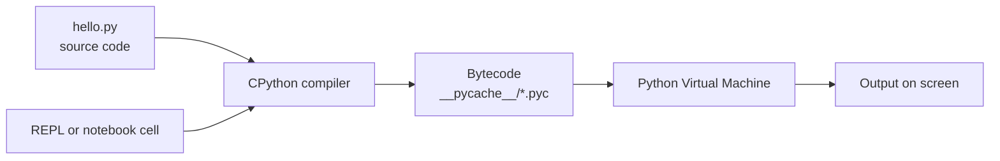
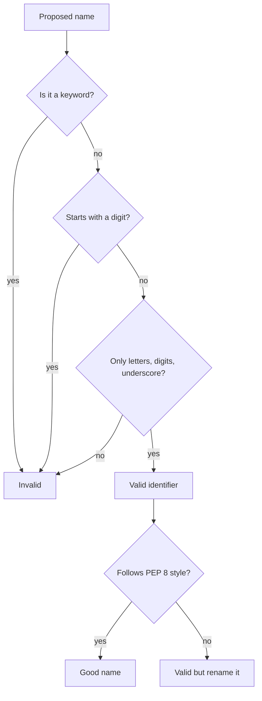
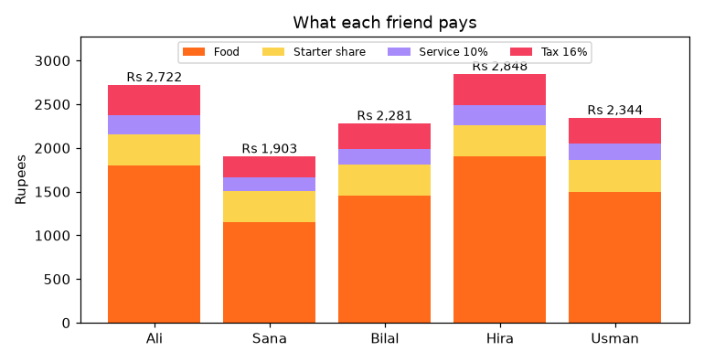

[](https://colab.research.google.com/github/Hamnakhan123/Diploma-in-AI/blob/main/term-1/04-application-based-programming-in-python/code/session-01-basics-of-python.ipynb) &nbsp; 📓 [Notebook](code/session-01-basics-of-python.ipynb)

# Session 1: Basics of Python

> 🧭 [Diploma in AI](../../README.md) › [Term 1](../README.md) › [Application Based Programming in Python](README.md) › **Session 1**
>
> ⏱️ **Estimated time:** 2.5 hours (1 h concepts + 1.5 h lab) &nbsp;|&nbsp; 📋 **Prerequisites:** None. A computer with Python 3.10+ (or a Google account for Colab).
>
> Prepared by **Hamna Zahid Khan**, Junior Lecturer

[⬅ Module overview](README.md) &nbsp;|&nbsp; [🏠 Module home](README.md) &nbsp;|&nbsp; [Next: Session 2 ➡](session-02-programming-language-constructs.md)

---

## 🎯 Learning objectives

By the end of this session you will be able to:

- Explain what **Python** is, why it dominates data science and AI, and how the interpreter runs your code.
- List Python's **keywords** and apply the rules for naming **identifiers**, following PEP 8 style.
- Write correct **statements**, **comments**, **docstrings** and **indentation**, and read an `IndentationError`.
- Create **variables**, assign values (single, multiple, unpacking, swapping, augmented) and explain **dynamic typing**.
- Read user input safely and print formatted output with **f-strings**.

## 📖 Concepts

### 1. What is Python?

**Python** is a high-level, general-purpose programming language created by Guido van Rossum and first released in 1991. "High-level" means you describe *what* you want in near-English code and Python handles memory, CPU registers and other low-level details for you.

| Feature | What it means for you |
|---|---|
| **Interpreted** | You run a `.py` file directly; no separate compile-and-link step. |
| **Dynamically typed** | You never declare `int x`; the type belongs to the value, not the name. |
| **Readable syntax** | Blocks are marked by indentation, not braces, so code looks like an outline. |
| **Batteries included** | A huge standard library: files, dates, JSON, maths, web servers, databases. |
| **Huge ecosystem** | NumPy, pandas, scikit-learn, TensorFlow, PyTorch, Flask, Django and 500,000+ packages on PyPI. |
| **Multi-paradigm** | Procedural, object-oriented and functional styles all work. |
| **Cross-platform** | The same script runs on Windows, macOS, Linux and in the browser-based Colab. |

> 🧠 **Analogy:** Programming in C is like driving a manual car: full control, but you change every gear yourself. Python is an automatic: you still steer, but the gearbox (memory management, type handling) is done for you. For data science you want to spend your attention on the road, which is the data.

**Where Python is used:** data analysis and AI (this whole diploma), web back-ends (Session 7), automation and scraping (Session 8), desktop tools (Session 9), scientific computing, DevOps scripts and teaching.

### 2. How Python runs your code

When you type `python hello.py`:

1. The **interpreter** (CPython, the standard one) reads the source text.
2. It **compiles** it to **bytecode**, a compact set of instructions (cached in `__pycache__/*.pyc`).
3. The **Python Virtual Machine (PVM)** executes the bytecode line by line.

You can also work in **interactive mode** (the `>>>` prompt, called the REPL: Read-Eval-Print Loop) or in a **Jupyter notebook**, which mixes code, output, charts and notes. Each session in this module has a notebook with the outputs already saved.

| Way to run | Best for |
|---|---|
| REPL (`python` then `>>>`) | trying one line quickly |
| Script (`python file.py`) | real programs, automation, anything you rerun |
| Notebook (Jupyter / Colab) | data exploration, teaching, reports with charts |
| IDE (VS Code, PyCharm) | larger projects with debugging and auto-complete |

### 3. Keywords

**Keywords** are reserved words with a fixed meaning: `if`, `for`, `def`, `class`, `return`, `True`, `None` and so on. Python 3.12 has **35** of them, plus a few **soft keywords** (`match`, `case`, `type`, `_`) that are reserved only in specific positions. You cannot use a keyword as a variable name: `class = "AI-1"` is a `SyntaxError`.

| Group | Keywords |
|---|---|
| Values | `True`, `False`, `None` |
| Logic | `and`, `or`, `not`, `is`, `in` |
| Decisions and loops | `if`, `elif`, `else`, `for`, `while`, `break`, `continue`, `pass` |
| Functions and classes | `def`, `return`, `lambda`, `yield`, `class`, `global`, `nonlocal` |
| Modules | `import`, `from`, `as` |
| Errors | `try`, `except`, `finally`, `raise`, `assert` |
| Context and async | `with`, `async`, `await`, `del` |

### 4. Identifiers and naming rules

An **identifier** is any name you create: a variable, function, class or module.

**Rules (enforced by Python):**

1. Use letters (a-z, A-Z), digits (0-9) and underscores `_` only.
2. Do **not** start with a digit: `2nd_place` is invalid, `place_2` is fine.
3. No spaces or symbols (`$`, `-`, `@`, `.`).
4. Not a keyword.
5. **Case-sensitive:** `total`, `Total` and `TOTAL` are three different names.

**Conventions (PEP 8, the official style guide):**

| Kind of name | Style | Example |
|---|---|---|
| variable, function | `snake_case` | `student_name`, `calculate_gpa()` |
| constant | `UPPER_SNAKE_CASE` | `MAX_MARKS = 100` |
| class | `PascalCase` | `StudentRecord` |
| "internal" helper | leading underscore | `_cache` |
| Python's own magic names | double underscores both sides | `__init__`, `__name__` |

> ⚠️ Avoid names that **shadow** built-ins: `list = [1, 2]` or `sum = 10` work, but you then lose the real `list()` and `sum()` functions for the rest of the program.

### 5. Statements, comments and indentation

- A **statement** is one instruction: `x = 5`, `print(x)`, `import math`. Normally one per line.
- A long statement can continue over several lines **inside brackets** `()`, `[]`, `{}` (preferred) or with a trailing backslash `\` (fragile).
- A **compound statement** (`if`, `for`, `while`, `def`, `class`, `try`, `with`) has a **header** ending in a colon `:` and an **indented block** (the body).
- **Indentation** is part of the grammar. Use **4 spaces** per level and never mix tabs and spaces.
- A **comment** starts with `#`. A **docstring** is a string literal placed first in a module, function or class; tools such as `help()` display it.

> 🧠 **Analogy:** Indentation is like the numbering in an outline. "2.1" and "2.2" belong under heading 2 because of their position. In Python, lines belong to the `if` above them because they are indented under it.

### 6. Variables and assignment

A **variable** is a **name bound to an object**. The assignment `marks = 78` creates an integer object `78` and attaches the label `marks` to it.

| Form | Example | Effect |
|---|---|---|
| Simple | `city = "Karachi"` | binds one name |
| Multiple targets | `x = y = 0` | three names, same object |
| Unpacking | `name, age = "Ali", 21` | assigns in order |
| Swap | `a, b = b, a` | no temporary variable needed |
| Augmented | `total += 5` | same as `total = total + 5` |
| Delete | `del temp` | removes the name |

**Dynamic typing:** the **type lives with the object**, not with the name. `marks = 78` then `marks = "A+"` is legal; `type(marks)` changes from `int` to `str`. This is flexible but means you must convert input deliberately: `input()` always returns a `str`, so `int(input("Age: "))` is needed before doing arithmetic.

> 🧠 **Analogy:** A variable is a **sticky note**, not a box. Writing `b = a` puts a second sticky note on the same object; it does not copy it. That is why changing a list through `b` also changes what `a` shows (Example 3).

### 7. Basic input and output

```python
name = input("Your name: ")          # always a str
age = int(input("Your age: "))       # convert to int
print("Hello", name, "you will be", age + 1, "next year")
print(f"Hello {name}, next year you will be {age + 1}")   # f-string: cleaner
print(f"{3.14159:.2f} | {1234567:,} | {'left':<8}| {'right':>8}")
```

Useful f-string format specs: `.2f` two decimals, `,` thousands separator, `%` percentage, `<8 >8 ^8` align left, right, centre in 8 characters.

## 🧭 Diagrams





## 💻 Worked examples

### Example 1: Keywords and identifier rules (basic)

The `keyword` module lists the reserved words of whichever Python you are running, and `str.isidentifier()` applies the naming rules for you.

📄 [`code/session-01_keywords_identifiers.py`](code/session-01_keywords_identifiers.py) &nbsp;·&nbsp; run: `python session-01_keywords_identifiers.py`

```python
"""
Session 1 · Example 1: keywords and identifiers
-----------------------------------------------
Shows the reserved words of the running Python version and tests a list of
candidate variable names against Python's naming rules.
Run:  python session-01_keywords_identifiers.py
"""
import keyword

# 1. Keywords: words with a fixed meaning that you can never use as names
print("Python has", len(keyword.kwlist), "keywords:")
for i in range(0, len(keyword.kwlist), 9):          # print 9 per line
    print("  ", ", ".join(keyword.kwlist[i:i + 9]))

# Soft keywords (match, case, type, _) are reserved only in certain places
print("Soft keywords:", keyword.softkwlist)

# 2. Identifier rules: start with a letter or _, then letters, digits or _,
#    no spaces or symbols, not a keyword. Python is case-sensitive.
def check_name(name):
    """Return (is_valid, reason) for a proposed variable name."""
    if keyword.iskeyword(name):
        return False, "is a keyword"
    if not name.isidentifier():
        if name[:1].isdigit():
            return False, "starts with a digit"
        return False, "contains a space or symbol"
    if name.startswith("__") and name.endswith("__"):
        return True, "valid, but dunder names are reserved for Python itself"
    return True, "valid"

candidates = ["student_name", "Marks2025", "_total", "2nd_place", "first name",
              "class", "price$", "StudentName", "__init__", "cgpa"]
print("\nName check")
for c in candidates:
    ok, why = check_name(c)
    print(f"  {c!r:16} {'OK ' if ok else 'BAD'}  {why}")

# 3. Case sensitivity: three different variables
total, Total, TOTAL = 1, 2, 3
print("\ntotal, Total, TOTAL ->", total, Total, TOTAL)
```

**Output**

```text
Python has 35 keywords:
   False, None, True, and, as, assert, async, await, break
   class, continue, def, del, elif, else, except, finally, for
   from, global, if, import, in, is, lambda, nonlocal, not
   or, pass, raise, return, try, while, with, yield
Soft keywords: ['_', 'case', 'match', 'type']

Name check
  'student_name'   OK   valid
  'Marks2025'      OK   valid
  '_total'         OK   valid
  '2nd_place'      BAD  starts with a digit
  'first name'     BAD  contains a space or symbol
  'class'          BAD  is a keyword
  'price$'         BAD  contains a space or symbol
  'StudentName'    OK   valid
  '__init__'       OK   valid, but dunder names are reserved for Python itself
  'cgpa'           OK   valid

total, Total, TOTAL -> 1 2 3
```


**What to notice:** `__init__` is technically valid, but names wrapped in double underscores are reserved for Python's own special methods. `price$` fails because `$` is not allowed anywhere in a Python name.

### Example 2: Statements, comments and indentation (intermediate)

📄 [`code/session-01_statements_comments.py`](code/session-01_statements_comments.py) &nbsp;·&nbsp; run: `python session-01_statements_comments.py`

```python
"""
Session 1 · Example 2: statements, comments and indentation
------------------------------------------------------------
Run:  python session-01_statements_comments.py
"""
# A comment starts with # and runs to the end of the line. Python ignores it.

# --- Simple statements: one per line (a ; joins two, but avoid it) ---
city = "Karachi"
population_m = 20.4          # inline comment: millions, rough figure for the demo
a = 1; b = 2                 # legal, but harder to read

# --- A long statement split over lines ---
# Implicit continuation inside (), [] or {} is the preferred style
fee_breakdown = [
    "tuition",
    "lab",
    "library",
]
total_fee = (45_000      # underscores make big numbers readable
             + 5_000
             + 1_500)
# Explicit continuation with a backslash also works, but breaks easily
message = "Fees for " + city + \
          " campus"

# --- Compound statements: a header ending in ':' and an indented block ---
def describe(fee):
    """Docstring: the first string in a function documents it."""
    if fee > 50_000:
        level = "high"           # 4 spaces = one level
    else:
        level = "normal"
    return level

print(message, "->", total_fee, describe(total_fee))
print("Items:", fee_breakdown, "| a + b =", a + b)
print("Docstring of describe():", describe.__doc__)

# --- Indentation errors are caught before the program runs ---
bad_code = "if True:\nprint('no indent')"
try:
    compile(bad_code, "<demo>", "exec")
except IndentationError as e:
    print("IndentationError:", e.msg, "on line", e.lineno)

mixed = "if True:\n    x = 1\n  y = 2"      # inconsistent dedent
try:
    compile(mixed, "<demo>", "exec")
except IndentationError as e:
    print("IndentationError:", e.msg, "on line", e.lineno)
```

**Output**

```text
Fees for Karachi campus -> 51500 high
Items: ['tuition', 'lab', 'library'] | a + b = 3
Docstring of describe(): Docstring: the first string in a function documents it.
IndentationError: expected an indented block after 'if' statement on line 1 on line 2
IndentationError: unindent does not match any outer indentation level on line 3
```


**Walkthrough:**

1. `45_000` is just `45000`; underscores are a readability aid for long numbers.
2. The list and the bracketed sum continue across lines without any backslash.
3. `compile()` checks syntax without running code, so we can show the two most common indentation errors safely: a missing indent after `if`, and a dedent that matches no outer level.

### Example 3: Variables and dynamic typing (advanced)

📄 [`code/session-01_variables.py`](code/session-01_variables.py) &nbsp;·&nbsp; run: `python session-01_variables.py`

```python
"""
Session 1 · Example 3: variables, assignment and dynamic typing
---------------------------------------------------------------
Run:  python session-01_variables.py
"""
# 1. A variable is a name bound to an object
marks = 78
print("marks =", marks, "| type:", type(marks).__name__, "| isinstance int:", isinstance(marks, int))

# 2. Dynamic typing: the same name can later point to another type
marks = "seventy-eight"
print("marks =", marks, "| type:", type(marks).__name__)

# 3. Multiple assignment and unpacking
x = y = z = 0                         # one object, three names
name, age, cgpa = "Ayesha", 21, 3.62  # tuple unpacking
print("x, y, z =", x, y, z, "|", name, age, cgpa)

# 4. Swapping without a temporary variable
left, right = "tea", "coffee"
left, right = right, left
print("after swap:", left, right)

# 5. Augmented assignment
balance = 1_000
balance += 250        # balance = balance + 250
balance -= 100
balance *= 2
print("balance:", balance)

# 6. Names are labels, not boxes: two names can share one list
a = [1, 2, 3]
b = a                 # b is another label on the SAME list
b.append(4)
print("a:", a, "| a is b:", a is b)
c = a.copy()          # a new list
c.append(5)
print("a:", a, "| c:", c, "| a is c:", a is c)

# 7. Constants are a naming convention (ALL_CAPS); Python does not enforce them
GST_RATE = 0.18
price = 2_500
print(f"price with GST: Rs {price * (1 + GST_RATE):,.2f}")

# 8. del removes the name, not necessarily the object
temp = 42
del temp
print("'temp' still defined?", "temp" in dir())

# 9. Reading input safely (simulated here so the script runs unattended)
def ask(prompt, default):
    """Use input() in real programs; this demo returns a fixed answer."""
    print(prompt + default)
    return default

age_text = ask("Enter your age: ", "21")
age = int(age_text)               # input() always returns a str: convert it
print("Next year you will be", age + 1)
```

**Output**

```text
marks = 78 | type: int | isinstance int: True
marks = seventy-eight | type: str
x, y, z = 0 0 0 | Ayesha 21 3.62
after swap: coffee tea
balance: 2300
a: [1, 2, 3, 4] | a is b: True
a: [1, 2, 3, 4] | c: [1, 2, 3, 4, 5] | a is c: False
price with GST: Rs 2,950.00
'temp' still defined? False
Enter your age: 21
Next year you will be 22
```


**Key lessons:**

- `b = a` did **not** copy the list; `a is b` is `True`, so appending through `b` changed `a`. Use `.copy()` (or `list(a)`) for an independent copy.
- `GST_RATE` is a constant only by convention; Python would let you reassign it, so the capital letters are a promise to other programmers.
- `input()` gives text. Forgetting `int(...)` would make `age + 1` raise `TypeError: can only concatenate str (not "int") to str`.

## 🌍 Real-life coding problem: the dinner bill splitter

**Scenario.** Five friends eat out in Karachi. Prices exclude 16 % sales tax and a 10 % service charge, and everyone shares one starter. Each person wants to know exactly what to pay.

**Plan before coding:**

1. Store the orders in a dictionary: person → list of (item, price).
2. Constants for the two rates, written once at the top.
3. For each person: food total + equal share of the starter = subtotal; add service and tax.
4. Print an aligned table with f-strings and check that the rounded shares match the bill.

Core calculation:

```python
for person in people:
    food = sum(price for _, price in orders[person])
    subtotal = food + starter_share
    owes = subtotal * (1 + SERVICE_RATE + TAX_RATE)
```

📄 Full solution (73 lines, fully commented): [`code/session-01_problem_bill_splitter.py`](code/session-01_problem_bill_splitter.py) &nbsp;·&nbsp; run: `python session-01_problem_bill_splitter.py` &nbsp;·&nbsp; also in the session notebook

**Output**

```text
Person       Food  Starter  Service      Tax     Owes
------------------------------------------------------
Ali         1,800      360      216      346    2,722
Sana        1,150      360      151      242    1,903
Bilal       1,450      360      181      290    2,281
Hira        1,900      360      226      362    2,848
Usman       1,500      360      186      298    2,344
------------------------------------------------------
Bill                                           12,096
Sum of rounded shares = 12,098 (difference Rs +2, caused by rounding)
Highest share: Hira (Rs 2,848)
Chart saved: session-01_problem_bill_splitter.png
```




**Interpretation.** Rounding each share to whole rupees makes the shares total Rs 2 more than the bill. This is a classic real-world issue: banks and payment apps handle it by giving the leftover paisa to one person. Spotting it is a sign of a careful programmer.

## 🛠️ Mini project: student profile card generator

Web forms send every field as **text**, often messy. This project cleans, converts and validates raw form data, then prints an aligned ID card. It uses only today's tools plus a few string methods (`split`, `title`, `strip`, `upper`, `ljust`, `center`).

```python
name = " ".join(raw.split()).title()          # "  hamza   ali RAZA " -> "Hamza Ali Raza"
cgpa = round(float(form["cgpa"]), 2)          # "3.456" -> 3.46
valid = user.isidentifier() and not keyword.iskeyword(user)
```

📄 Full solution (67 lines, fully commented): [`code/session-01_project_student_card.py`](code/session-01_project_student_card.py) &nbsp;·&nbsp; run: `python session-01_project_student_card.py` &nbsp;·&nbsp; also in the session notebook

**Output**

```text
+----------------------------------------------+
|               STUDENT PROFILE                |
+----------------------------------------------+
| Name      : Hamza Ali Raza                   |
| Roll no   : AI-2026-0147                     |
| Program   : Diploma in AI                    |
| Semester  : 1                                |
| CGPA      : 3.46  ***                        |
| Email     : hamza.raza@example.com           |
| Username  : @hamza_raza                      |
+----------------------------------------------+
Validation: all fields OK
Types after conversion: {'name': 'str', 'semester': 'int', 'cgpa': 'float'}
```


**Extension ideas:** read the fields with real `input()` calls; add a check that the roll number has the pattern `AI-YYYY-NNNN` (you will learn regular expressions for this in Session 6); print the card in two colours with ANSI codes.

## ⚠️ Common mistakes

| Mistake | Error you see | Fix |
|---|---|---|
| Using a keyword as a name: `class = "AI"` | `SyntaxError: invalid syntax` | Rename: `class_name`, `section` |
| Starting a name with a digit: `1st = 5` | `SyntaxError: invalid decimal literal` | `first = 5` |
| Forgetting the colon: `if x > 3` | `SyntaxError: expected ':'` | `if x > 3:` |
| Mixing tabs and spaces | `TabError` or `IndentationError` | Configure the editor to insert 4 spaces |
| Arithmetic on `input()` text | `TypeError: can only concatenate str...` | Wrap with `int()` or `float()` |
| `print "hi"` (Python 2 style) | `SyntaxError: Missing parentheses` | `print("hi")` |
| Shadowing built-ins: `list = [...]` | later `list()` fails: `'list' object is not callable` | Use `items`, `marks_list` |
| Thinking `b = a` copies a list | changes "leak" between variables | `b = a.copy()` |

## ✅ Best practices

- Follow **PEP 8**: 4-space indentation, `snake_case` names, lines under about 79-99 characters.
- Choose **descriptive names**: `monthly_salary` beats `ms` or `x1`.
- Write comments that explain **why**, not what: `# tax is on the pre-discount price (FBR rule)` is useful, `# add 1` is noise.
- Give every function a one-line **docstring**.
- Put constants in `UPPER_CASE` at the top of the file so they are easy to change.
- Convert user input **once**, immediately after reading it, and validate it.
- Use **f-strings** for output; they are faster and clearer than `+` concatenation or `%` formatting.

## 🧪 Lab / practice tasks

**1. 🟢 Easy:** Which of these are valid identifiers? `_temp`, `3d_model`, `total-marks`, `None`, `myVar2`, `for_loop`, `email@id`. Check your answers with `str.isidentifier()` and `keyword.iskeyword()`.

<details><summary>💡 Hint</summary>

A name must be an identifier **and** not a keyword. `None` is a keyword.

</details>

<details><summary>✅ Solution</summary>

```python
import keyword
for n in ["_temp", "3d_model", "total-marks", "None", "myVar2", "for_loop", "email@id"]:
    print(n, n.isidentifier() and not keyword.iskeyword(n))
# valid: _temp, myVar2, for_loop
```

</details>

**2. 🟢 Easy:** Write a script that stores your name, city and age in variables and prints: `Hamna from Karachi will be 26 in 2027.` using an f-string (calculate the age, do not type it).

<details><summary>💡 Hint</summary>

`f"{name} from {city} will be {age + 1} in {year + 1}."`

</details>

<details><summary>✅ Solution</summary>

```python
name, city, age, year = "Hamna", "Karachi", 25, 2026
print(f"{name} from {city} will be {age + 1} in {year + 1}.")
```

</details>

**3. 🟡 Medium:** Swap the values of three variables in a rotation (`a` gets `b`, `b` gets `c`, `c` gets `a`) in a single line, then print them.

<details><summary>💡 Hint</summary>

Tuple unpacking evaluates the whole right side first.

</details>

<details><summary>✅ Solution</summary>

```python
a, b, c = 1, 2, 3
a, b, c = b, c, a
print(a, b, c)   # 2 3 1
```

</details>

**4. 🟡 Medium:** A temperature converter: read a Celsius value with `input()`, convert it to Fahrenheit (`F = C × 9/5 + 32`) and Kelvin (`K = C + 273.15`), and print both with 1 decimal place.

<details><summary>💡 Hint</summary>

Convert with `float()` because temperatures can have decimals. Use `:.1f` in the f-string.

</details>

<details><summary>✅ Solution</summary>

```python
c = float(input("Celsius: "))     # e.g. 36.6
print(f"{c:.1f} C = {c * 9 / 5 + 32:.1f} F = {c + 273.15:.1f} K")
# 36.6 C = 97.9 F = 309.8 K
```

</details>

**5. 🟠 Hard:** Predict the output, then run it to check. Explain line 4.

```python
marks = [70, 80]
backup = marks
marks += [90]
print(backup)
marks = marks + [100]
print(backup, marks)
```

<details><summary>💡 Hint</summary>

`+=` on a list changes the list in place; `marks + [...]` builds a new list and rebinds the name.

</details>

<details><summary>✅ Solution</summary>

`[70, 80, 90]` then `[70, 80, 90] [70, 80, 90, 100]`. Line 3 extended the shared list in place, so `backup` sees 90. Line 5 created a **new** list and moved only the `marks` label to it, so `backup` stays as it was.

</details>

**6. 🔴 Challenge:** Extend the bill splitter so that one person can be marked as "birthday", pays nothing, and their share is divided among the others. Make sure the rounded shares still add up to the bill by giving any leftover rupees to the first person.

<details><summary>💡 Hint</summary>

Compute everybody's share first, total the birthday person's amount, divide it by `len(people) - 1` and add it to the others. Then compute `diff = round(bill) - sum(shares.values())` and add `diff` to one share.

</details>

<details><summary>✅ Solution</summary>

```python
birthday = "Hira"
extra = shares.pop(birthday) / len(shares)
shares = {p: round(v + extra) for p, v in shares.items()}
first = next(iter(shares))
shares[first] += round(bill) - sum(shares.values())
print(shares, sum(shares.values()), round(bill))   # sums now match exactly
```

</details>

## ✅ Quick quiz

**Q1.** Which statement about Python is correct?

- A) Variables must be declared with a type before use
- B) Blocks of code are marked with curly braces
- C) The type belongs to the object, so a name can refer to values of different types over time
- D) Python code must be compiled to an .exe before it runs

**Q2.** Which of these is a valid identifier?

- A) 2023_sales
- B) sales-2023
- C) _sales2023
- D) for

**Q3.** What is printed? `x = "5"; y = 2; print(x * y)`

- A) 10
- B) 55
- C) 7
- D) TypeError

**Q4.** After `a = [1, 2]; b = a; b.append(3)`, what is `a`?

- A) [1, 2]
- B) [1, 2, 3]
- C) [3]
- D) an error

**Q5.** Which character starts a single-line comment in Python?

- A) //
- B) --
- C) #
- D) /*

<details><summary>✅ Show answers</summary>

1. **C** — Python is dynamically typed.
2. **C** — it starts with an underscore and uses only letters, digits and underscores.
3. **B** — a string times an integer repeats the string.
4. **B** — `a` and `b` refer to the same list.
5. **C** — everything after # on that line is ignored.

</details>


## 📝 Summary

- **Python** is a high-level, interpreted, dynamically typed, readable language with a huge ecosystem, which makes it the default language of data science and AI.
- Source code is compiled to **bytecode** and run by the **PVM**; you can work in the REPL, scripts, notebooks or an IDE.
- **Keywords** (35 in Python 3.12) are reserved; **identifiers** use letters, digits and underscores, cannot start with a digit and are case-sensitive.
- **Indentation** (4 spaces) defines blocks; a colon ends every compound-statement header.
- A **variable** is a name bound to an object; assignment supports multiple targets, unpacking, swapping and augmented forms.
- `input()` returns text, so convert it; format output with **f-strings**.

### 🎤 Interview / viva questions

1. Python is called "interpreted", yet it creates `.pyc` files. Explain both facts.
2. What is the difference between a keyword and an identifier? Give two examples of each.
3. What does "dynamically typed" mean? What is one advantage and one risk?
4. Why does Python use indentation instead of braces? What error appears if it is wrong?
5. After `b = a` where `a` is a list, is `b` a copy? How would you make a real copy?
6. What is a docstring and how is it different from a comment?
7. Why is `list = [1, 2, 3]` a bad idea even though it runs?

---

[⬅ Module overview](README.md) &nbsp;|&nbsp; [🏠 Module home](README.md) &nbsp;|&nbsp; [Next: Session 2 ➡](session-02-programming-language-constructs.md)

<sub>Prepared by **Hamna Zahid Khan**, Junior Lecturer · Diploma in AI</sub>
