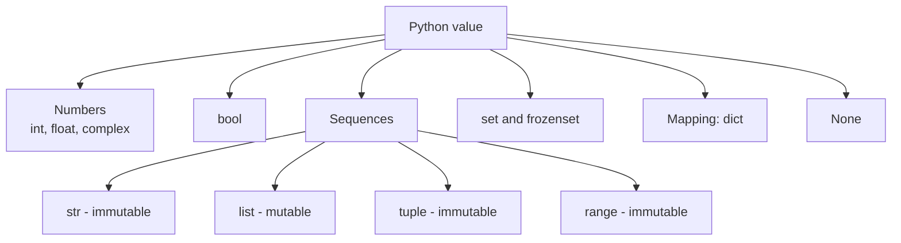
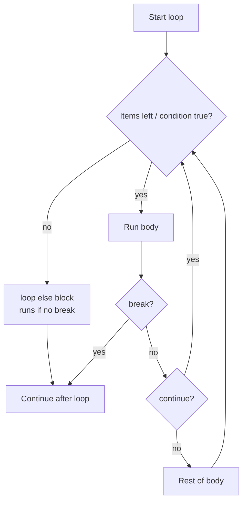
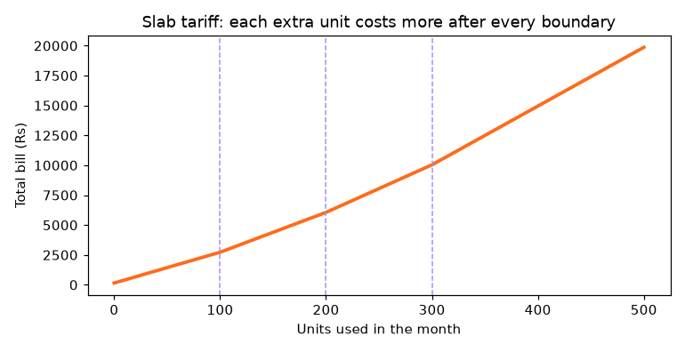

[](https://colab.research.google.com/github/Hamnakhan123/Diploma-in-AI/blob/main/term-1/04-application-based-programming-in-python/code/session-02-programming-language-constructs.ipynb) &nbsp; 📓 [Notebook](code/session-02-programming-language-constructs.ipynb)

# Session 2: Programming Language Constructs

> 🧭 [Diploma in AI](../../README.md) › [Term 1](../README.md) › [Application Based Programming in Python](README.md) › **Session 2**
>
> ⏱️ **Estimated time:** 3 hours (1 h concepts + 2 h lab) &nbsp;|&nbsp; 📋 **Prerequisites:** Session 1 (variables, input/output, indentation).
>
> Prepared by **Hamna Zahid Khan**, Junior Lecturer

[⬅ Previous: Session 1](session-01-basics-of-python.md) &nbsp;|&nbsp; [🏠 Module home](README.md) &nbsp;|&nbsp; [Next: Session 3 ➡](session-03-introduction-to-functions.md)

---

## 🎯 Learning objectives

By the end of this session you will be able to:

- Describe Python's built-in **data types** (numbers, `bool`, `str`, `list`, `tuple`, `set`, `dict`, `None`) and say which are **mutable** and which are **ordered**.
- Convert between types explicitly and predict the **truthiness** of any value.
- Use all operator families: **arithmetic, comparison, logical, assignment, bitwise, membership, identity**, and apply **precedence** rules.
- Control program flow with `if / elif / else`, conditional expressions and `match / case`.
- Repeat work with `for` and `while`, `range()`, `enumerate()`, `zip()`, `break`, `continue`, `pass`, loop `else` and **comprehensions**.

## 📖 Concepts

### 1. Data types: what kind of value is it?

Every value in Python is an **object** with a **type**. The type decides what operations are allowed: you can divide numbers but not strings, and append to a list but not to a tuple.

| Category | Type | Example | Mutable? | Ordered / indexable? | Typical use |
|---|---|---|---|---|---|
| Numeric | `int` | `42`, `-7`, `2**100` | ❌ | – | counts, IDs, whole rupees |
| | `float` | `3.75`, `1e-3` | ❌ | – | measurements, averages |
| | `complex` | `2+3j` | ❌ | – | signal processing, engineering |
| Boolean | `bool` | `True`, `False` | ❌ | – | flags, conditions |
| Text | `str` | `"Karachi"` | ❌ | ✅ | names, messages, raw data |
| Sequence | `list` | `[85, 90, 78]` | ✅ | ✅ | collections that change |
| | `tuple` | `(24.86, 67.01)` | ❌ | ✅ | fixed records, coordinates |
| | `range` | `range(1, 11)` | ❌ | ✅ | counting in loops |
| Set | `set` | `{"python", "sql"}` | ✅ | ❌ (unique items) | removing duplicates, fast lookups |
| Mapping | `dict` | `{"name": "Ali", "cgpa": 3.4}` | ✅ | ✅ (insertion order) | records, lookups by key |
| Nothing | `NoneType` | `None` | ❌ | – | "no value yet" |

> 🧠 **Analogy:** A **list** is a shopping list on a whiteboard (you can erase and add). A **tuple** is a printed receipt (fixed once issued). A **set** is the guest list at a wedding gate (each name once, order irrelevant, fast "is this person invited?" check). A **dict** is a phone book (look up a number by the name).

**Integers** have unlimited size (`2**100` works). **Floats** are binary approximations, so `0.1 + 0.2` prints `0.30000000000000004`. For money use `round(x, 2)` for display or the `decimal` module for exact arithmetic.

**Truthiness:** in an `if` or `while`, every value counts as `True` or `False`. **Falsy** values: `0`, `0.0`, `""`, `[]`, `()`, `{}`, `set()`, `None`, `False`. Everything else is truthy, including `"0"` and `[0]`.

**Type conversion (casting):** `int()`, `float()`, `str()`, `bool()`, `list()`, `tuple()`, `set()`, `dict()`. Python converts automatically only in safe cases (`3 + 2.5` → `5.5`); otherwise you must convert yourself. `int(9.99)` **truncates** to 9; `int("12.5")` raises `ValueError` (use `int(float("12.5"))`).

### 2. Operators

| Family | Operators | Example → result |
|---|---|---|
| **Arithmetic** | `+ - * / // % **` | `17 // 5 → 3`, `17 % 5 → 2`, `2 ** 10 → 1024` |
| **Comparison** | `== != < > <= >=` | `0 <= 72 <= 100 → True` (chaining allowed) |
| **Logical** | `and or not` | `age >= 18 and has_cnic` |
| **Assignment** | `= += -= *= /= //= %= **=` | `total += 5` |
| **Bitwise** | `& \| ^ ~ << >>` | `12 & 10 → 8` |
| **Membership** | `in`, `not in` | `"sql" in skills → True` |
| **Identity** | `is`, `is not` | `x is None` |

Key details:

- `/` **always** returns a float (`4 / 2 → 2.0`). `//` is **floor** division: it rounds toward minus infinity, so `-17 // 5 → -4`.
- `%` gives the remainder; use it to test divisibility (`n % 2 == 0` means even) or to wrap around (hour `(h + 5) % 24`).
- `and` / `or` **short-circuit**: `False and anything` never evaluates `anything`. They return one of their operands, so `name or "guest"` is a neat default.
- `==` compares **values**, `is` compares **identity** (same object in memory). Use `is` only with `None`, `True`, `False`.

**Precedence (high → low):** `()` → `**` → unary `-` `+` `~` → `* / // %` → `+ -` → `<< >>` → `&` → `^` → `|` → comparisons, `in`, `is` → `not` → `and` → `or`. `**` groups right-to-left: `2 ** 3 ** 2 = 2 ** 9 = 512`. When in doubt, add parentheses: they cost nothing and help the reader.

### 3. Decisions: `if`, `elif`, `else`, `match`

```python
if condition_1:
    ...            # runs when condition_1 is true
elif condition_2:
    ...            # checked only if condition_1 was false
else:
    ...            # runs when nothing above matched
```

- Python checks branches **top to bottom** and runs only the **first** true one, so order thresholds from strictest to loosest (`>= 85` before `>= 70`).
- **Conditional expression:** `label = "pass" if mark >= 50 else "fail"`.
- **`match / case`** (Python 3.10+) compares one value against **patterns**, including literal values, sequences (`["add", item]`) and a wildcard `_`. It is cleaner than a long `elif` chain for menus and command parsers.

### 4. Loops: `for` and `while`

| Loop | Use when | Example |
|---|---|---|
| `for` | you iterate over a known collection or count | `for name in students:` |
| `while` | you repeat until a condition changes and do not know how many times | `while balance < target:` |

Helpers: `range(start, stop, step)` (stop excluded), `enumerate(seq, start=1)` gives index + item, `zip(a, b)` walks two sequences together, `reversed()` and `sorted()`.

Loop control:

- `break` leaves the loop immediately.
- `continue` skips the rest of this iteration.
- `pass` does nothing; a placeholder where a block is required.
- A loop's **`else`** block runs only when the loop finished **without** `break`; perfect for "search and report not found".

**Comprehensions** build a collection from a loop in one readable line:

```python
[expr for x in iterable if condition]          # list
{k: v for k, v in pairs}                        # dict
{expr for x in iterable}                        # set
```

> 🧠 **Analogy:** A `for` loop is a teacher calling the attendance register name by name: the list decides when it ends. A `while` loop is waiting for the bus: you keep checking until the condition ("bus arrived") becomes true, and you cannot know in advance how many checks it takes.

## 🧭 Diagrams





## 💻 Worked examples

### Example 1: Data types, truthiness and conversion (basic)

📄 [`code/session-02_data_types.py`](code/session-02_data_types.py) &nbsp;·&nbsp; run: `python session-02_data_types.py`

```python
"""
Session 2 · Example 1: Python's built-in data types and conversions
-------------------------------------------------------------------
Run:  python session-02_data_types.py
"""
samples = {
    "int": 42,
    "float": 3.75,
    "complex": 2 + 3j,
    "bool": True,
    "str": "Karachi",
    "list": [85, 90, 78],
    "tuple": (24.86, 67.01),          # latitude, longitude
    "set": {"python", "sql", "python"},
    "dict": {"name": "Ali", "cgpa": 3.4},
    "NoneType": None,
}
print(f"{'type':9} {'value':28} {'mutable?':9} {'ordered?':9}")
mutable = {"list", "set", "dict"}
ordered = {"str", "list", "tuple", "dict"}
for name, value in samples.items():
    shown = "{" + ", ".join(map(repr, sorted(value))) + "}" if isinstance(value, set) else str(value)  # sets have no order: sort for a stable display
    print(f"{type(value).__name__:9} {shown:28} {str(name in mutable):9} {str(name in ordered):9}")

# Numbers
print("\n7 / 2 =", 7 / 2, "| 7 // 2 =", 7 // 2, "| 2 ** 100 has", len(str(2 ** 100)), "digits")
print("0.1 + 0.2 =", 0.1 + 0.2, "-> use round() or decimal for money:", round(0.1 + 0.2, 2))
print("complex parts:", samples["complex"].real, samples["complex"].imag)

# bool is a subclass of int; 'truthiness' of values
print("True + True =", True + True)
for v in [0, 1, "", "0", [], [0], None, 0.0]:
    print(f"  bool({v!r:5}) = {bool(v)}")

# Strings are sequences
s = "Diploma in AI"
print("\nindex/slice:", s[0], s[-2:], s[:7], "| upper:", s.upper(), "| words:", s.split())

# Explicit conversion (casting)
print("\nint('42') + 1 =", int("42") + 1)
print("float('3.5') * 2 =", float("3.5") * 2)
print("int(9.99) =", int(9.99), "(truncates, does not round)")
print("str(2026) + '!' =", str(2026) + "!")
print("list('abc') =", list("abc"), "| tuple([1, 2]) =", tuple([1, 2]), "| set([1, 1, 2]) =", set([1, 1, 2]))
print("dict([('a', 1), ('b', 2)]) =", dict([("a", 1), ("b", 2)]))
try:
    int("12.5")
except ValueError as e:
    print("int('12.5') fails:", e)
```

**Output**

```text
type      value                        mutable?  ordered? 
int       42                           False     False    
float     3.75                         False     False    
complex   (2+3j)                       False     False    
bool      True                         False     False    
str       Karachi                      False     True     
list      [85, 90, 78]                 True      True     
tuple     (24.86, 67.01)               False     True     
set       {'python', 'sql'}            True      False    
dict      {'name': 'Ali', 'cgpa': 3.4} True      True     
NoneType  None                         False     False    

7 / 2 = 3.5 | 7 // 2 = 3 | 2 ** 100 has 31 digits
0.1 + 0.2 = 0.30000000000000004 -> use round() or decimal for money: 0.3
complex parts: 2.0 3.0
True + True = 2
  bool(0    ) = False
  bool(1    ) = True
  bool(''   ) = False
  bool('0'  ) = True
  bool([]   ) = False
  bool([0]  ) = True
  bool(None ) = False
  bool(0.0  ) = False

index/slice: D AI Diploma | upper: DIPLOMA IN AI | words: ['Diploma', 'in', 'AI']

int('42') + 1 = 43
float('3.5') * 2 = 7.0
int(9.99) = 9 (truncates, does not round)
str(2026) + '!' = 2026!
list('abc') = ['a', 'b', 'c'] | tuple([1, 2]) = (1, 2) | set([1, 1, 2]) = {1, 2}
dict([('a', 1), ('b', 2)]) = {'a': 1, 'b': 2}
int('12.5') fails: invalid literal for int() with base 10: '12.5'
```


**What to notice:** the set printed only one `'python'`, because sets keep unique items. `bool("0")` is `True`: a non-empty string is truthy even if it contains the character zero, a common bug when reading form data.

### Example 2: All operator families (intermediate)

📄 [`code/session-02_operators.py`](code/session-02_operators.py) &nbsp;·&nbsp; run: `python session-02_operators.py`

```python
"""
Session 2 · Example 2: every family of operators, plus precedence
-----------------------------------------------------------------
Run:  python session-02_operators.py
"""
a, b = 17, 5
print("Arithmetic")
for sym, val in [("+", a + b), ("-", a - b), ("*", a * b), ("/", a / b),
                 ("//", a // b), ("%", a % b), ("**", a ** b)]:
    print(f"  {a} {sym:2} {b} = {val}")
print("  negative floor division: -17 // 5 =", -17 // 5, "and -17 % 5 =", -17 % 5)

print("\nComparison (always give a bool)")
print("  17 > 5:", a > b, "| 17 == 17.0:", 17 == 17.0, "| 'apple' < 'banana':", "apple" < "banana")
print("  chained: 0 <= 72 <= 100 ->", 0 <= 72 <= 100)

print("\nLogical (short-circuit)")
age, has_cnic = 19, False
print("  age >= 18 and has_cnic:", age >= 18 and has_cnic)
print("  age >= 18 or has_cnic:", age >= 18 or has_cnic)
print("  not has_cnic:", not has_cnic)
print("  'and'/'or' return an operand: '' or 'guest' ->", "" or "guest", "| 0 and 1/0 ->", 0 and 1 / 0)

print("\nAssignment operators")
x = 10
x += 5;  print("  x += 5  ->", x)
x -= 3;  print("  x -= 3  ->", x)
x *= 2;  print("  x *= 2  ->", x)
x //= 4; print("  x //= 4 ->", x)
x **= 2; print("  x **= 2 ->", x)
x %= 7;  print("  x %= 7  ->", x)

print("\nBitwise (on the binary form)")
p, q = 12, 10          # 1100 and 1010
print(f"  {p:04b} & {q:04b} = {p & q:04b} ({p & q})")
print(f"  {p:04b} | {q:04b} = {p | q:04b} ({p | q})")
print(f"  {p:04b} ^ {q:04b} = {p ^ q:04b} ({p ^ q})")
print(f"  {p} << 1 = {p << 1}, {p} >> 2 = {p >> 2}, ~{p} = {~p}")

print("\nMembership and identity")
skills = ["python", "sql", "git"]
print("  'sql' in skills:", "sql" in skills, "| 'java' not in skills:", "java" not in skills)
print("  'AI' in 'Diploma in AI':", "AI" in "Diploma in AI", "| key in dict:", "cgpa" in {"cgpa": 3.1})
m1 = [1, 2]; m2 = [1, 2]
print("  m1 == m2:", m1 == m2, "| m1 is m2:", m1 is m2, "| x is None:", x is None)

print("\nPrecedence: ** > unary - > * / // % > + - > comparisons > not > and > or")
print("  2 + 3 * 4 ** 2 =", 2 + 3 * 4 ** 2)
print("  -3 ** 2 =", -3 ** 2, " vs (-3) ** 2 =", (-3) ** 2)
print("  not True or True =", not True or True, " vs not (True or True) =", not (True or True))
print("  2 ** 3 ** 2 =", 2 ** 3 ** 2, "(right-to-left)")
```

**Output**

```text
Arithmetic
  17 +  5 = 22
  17 -  5 = 12
  17 *  5 = 85
  17 /  5 = 3.4
  17 // 5 = 3
  17 %  5 = 2
  17 ** 5 = 1419857
  negative floor division: -17 // 5 = -4 and -17 % 5 = 3

Comparison (always give a bool)
  17 > 5: True | 17 == 17.0: True | 'apple' < 'banana': True
  chained: 0 <= 72 <= 100 -> True

Logical (short-circuit)
  age >= 18 and has_cnic: False
  age >= 18 or has_cnic: True
  not has_cnic: True
  'and'/'or' return an operand: '' or 'guest' -> guest | 0 and 1/0 -> 0

Assignment operators
  x += 5  -> 15
  x -= 3  -> 12
  x *= 2  -> 24
  x //= 4 -> 6
  x **= 2 -> 36
  x %= 7  -> 1

Bitwise (on the binary form)
  1100 & 1010 = 1000 (8)
  1100 | 1010 = 1110 (14)
  1100 ^ 1010 = 0110 (6)
  12 << 1 = 24, 12 >> 2 = 3, ~12 = -13

Membership and identity
  'sql' in skills: True | 'java' not in skills: True
  'AI' in 'Diploma in AI': True | key in dict: True
  m1 == m2: True | m1 is m2: False | x is None: False

Precedence: ** > unary - > * / // % > + - > comparisons > not > and > or
  2 + 3 * 4 ** 2 = 50
  -3 ** 2 = -9  vs (-3) ** 2 = 9
  not True or True = True  vs not (True or True) = False
  2 ** 3 ** 2 = 512 (right-to-left)
```


**Walkthrough:**

1. `-17 // 5` is `-4`, not `-3`: floor division always rounds **down**. Then `-17 % 5` is `3` because `-4 × 5 + 3 = -17`.
2. `0 and 1 / 0` returns `0` without crashing: short-circuiting skipped the division by zero.
3. `m1 == m2` is `True` (same contents) while `m1 is m2` is `False` (two separate lists).
4. `-3 ** 2` is `-9` because `**` binds tighter than unary minus.

### Example 3: Decisions and loops (advanced)

📄 [`code/session-02_control_flow.py`](code/session-02_control_flow.py) &nbsp;·&nbsp; run: `python session-02_control_flow.py`

```python
"""
Session 2 · Example 3: decisions and loops
------------------------------------------
Run:  python session-02_control_flow.py
"""
# 1. if / elif / else : the first true branch wins
def grade(mark):
    if mark >= 85:
        return "A"
    elif mark >= 70:
        return "B"
    elif mark >= 55:
        return "C"
    else:
        return "F"
print("grades:", {m: grade(m) for m in [92, 85, 71, 40]})

# Conditional expression (one-line if)
temp = 38
print("weather:", "hot" if temp > 35 else "pleasant")

# 2. match / case (Python 3.10+): compare a value against patterns
def command(text):
    match text.split():
        case ["add", item]:
            return f"adding {item}"
        case ["remove", item]:
            return f"removing {item}"
        case ["list"]:
            return "listing all items"
        case _:
            return "unknown command"
for c in ["add milk", "remove eggs", "list", "fly away"]:
    print(f"  {c!r:14} -> {command(c)}")

# 3. for loop over a sequence, with enumerate and zip
students = ["Ali", "Sana", "Bilal"]
marks = [78, 91, 64]
for rank, (name, m) in enumerate(sorted(zip(students, marks), key=lambda t: -t[1]), start=1):
    print(f"  #{rank} {name:6} {m}")

# range(start, stop, step): stop is excluded
print("range(1, 11, 3):", list(range(1, 11, 3)), "| countdown:", list(range(5, 0, -1)))

# 4. while loop: repeat until a condition fails
balance, months = 50_000, 0
while balance < 100_000:          # savings grow 2 % per month
    balance *= 1.02
    months += 1
print(f"Rs 50,000 doubles at 2%/month after {months} months (Rs {balance:,.0f})")

# 5. break, continue, pass and the loop 'else'
for n in range(2, 30):
    if n % 2 == 0:
        continue                  # skip even numbers
    for d in range(3, int(n ** 0.5) + 1, 2):
        if n % d == 0:
            break                 # not prime: leave the inner loop
    else:
        print(n, end=" ")         # runs only if the inner loop did NOT break
print("<- odd primes below 30")

def todo():
    pass                          # placeholder: a block cannot be empty

# 6. Nested loops: a multiplication grid
for i in range(1, 4):
    print("  " + " ".join(f"{i * j:3}" for j in range(1, 6)))

# 7. Comprehensions: a loop that builds a collection in one expression
squares = [n * n for n in range(1, 8)]
evens = [n for n in squares if n % 2 == 0]
lengths = {name: len(name) for name in students}
print("squares:", squares, "| even squares:", evens, "| lengths:", lengths)
```

**Output**

```text
grades: {92: 'A', 85: 'A', 71: 'B', 40: 'F'}
weather: hot
  'add milk'     -> adding milk
  'remove eggs'  -> removing eggs
  'list'         -> listing all items
  'fly away'     -> unknown command
  #1 Sana   91
  #2 Ali    78
  #3 Bilal  64
range(1, 11, 3): [1, 4, 7, 10] | countdown: [5, 4, 3, 2, 1]
Rs 50,000 doubles at 2%/month after 36 months (Rs 101,994)
3 5 7 11 13 17 19 23 29 <- odd primes below 30
    1   2   3   4   5
    2   4   6   8  10
    3   6   9  12  15
squares: [1, 4, 9, 16, 25, 36, 49] | even squares: [4, 16, 36] | lengths: {'Ali': 3, 'Sana': 4, 'Bilal': 5}
```


**Key lessons:**

- The nested-loop prime finder uses the **loop `else`**: the number is printed only when no divisor caused a `break`.
- The `while` loop answers a "how long until" question (36 months to double at 2 % a month), which a `for` loop cannot do without knowing the answer first.
- `match` with sequence patterns (`["add", item]`) both checks the shape and pulls out `item`.

## 🌍 Real-life coding problem: slab-based electricity bill

**Scenario.** Utility companies charge by **slabs**: the first 100 units are cheap, the next 100 cost more, and so on. A household wants an itemised bill and the answer to "how many units can we use on a Rs 8,000 budget?". The rates below are **illustrative practice values**, not an official tariff.

**Plan before coding:**

1. Store the tariff as a list of tuples `(slab size, rate)`; `None` means "no upper limit".
2. A `for` loop walks the slabs, charging `min(remaining, size)` units at each rate, and `break`s when nothing is left.
3. Add tax and meter rent; an `if` adds the late surcharge.
4. A `while` loop increases units one by one until the next unit would exceed the budget.

```python
for size, rate in SLABS:
    if remaining <= 0:
        break
    used = remaining if size is None else min(remaining, size)
    charge += used * rate
    remaining -= used
```

📄 Full solution (74 lines, fully commented): [`code/session-02_problem_electricity_bill.py`](code/session-02_problem_electricity_bill.py) &nbsp;·&nbsp; run: `python session-02_problem_electricity_bill.py` &nbsp;·&nbsp; also in the session notebook

**Output**

```text
Flat A-12: 85 units
    units   1-85  x Rs 22.00 = Rs  1,870.00
    energy Rs 1,870.00 + tax Rs 317.90 + rent Rs 150 = Rs 2,338

House 47: 260 units
    units   1-100 x Rs 22.00 = Rs  2,200.00
    units 101-200 x Rs 28.50 = Rs  2,850.00
    units 201-260 x Rs 34.00 = Rs  2,040.00
    energy Rs 7,090.00 + tax Rs 1,205.30 + rent Rs 150 = Rs 8,445

Shop 3: 410 units (paid late)
    units   1-100 x Rs 22.00 = Rs  2,200.00
    units 101-200 x Rs 28.50 = Rs  2,850.00
    units 201-300 x Rs 34.00 = Rs  3,400.00
    units 301-410 x Rs 42.00 = Rs  4,620.00
    energy Rs 13,070.00 + tax Rs 2,221.90 + rent Rs 150 + 5% late = Rs 16,214

Max units within a Rs 8,000 budget: 248 (bill Rs 7,968)
Chart saved: session-02_problem_electricity_bill.png
```




**Interpretation.** House 47 uses about three times the units of Flat A-12 but pays about 3.6 times as much, because its last 60 units fall in the third slab. The chart shows the slope increasing at each dashed boundary: that is the whole idea of slab pricing, encouraging people to save energy.

## 🛠️ Mini project: menu-driven ATM simulator

A console ATM is the classic exercise that uses **every** construct of this session at once: a `for ... else` for three PIN attempts, a `while True` menu loop, `match / case` for the options, `continue` to reject bad input, `break` to exit, a dictionary for the account and a greedy `divmod` loop to choose banknotes.

```python
def dispense(amount):
    plan = {}
    for note in NOTES:                 # 5000, 1000, 500
        plan[note], amount = divmod(amount, note)
    return None if amount else {n: c for n, c in plan.items() if c}
```

📄 Full solution (73 lines, fully commented): [`code/session-02_project_atm.py`](code/session-02_project_atm.py) &nbsp;·&nbsp; run: `python session-02_project_atm.py` &nbsp;·&nbsp; also in the session notebook

**Output**

```text
Enter PIN: 1111
  wrong PIN (2 attempts left)
Enter PIN: 4321
Welcome, Sana Tariq!

[1] Balance [2] Withdraw [3] Deposit [4] Mini statement [5] Exit > 1
  Balance: Rs 82,500.00
[1] Balance [2] Withdraw [3] Deposit [4] Mini statement [5] Exit > 2
  Amount: 12500
  Dispensed: 2 x Rs 5000, 2 x Rs 1000, 1 x Rs 500
[1] Balance [2] Withdraw [3] Deposit [4] Mini statement [5] Exit > 2
  Amount: 7300
  Amount must be a multiple of 500
[1] Balance [2] Withdraw [3] Deposit [4] Mini statement [5] Exit > 3
  Deposit amount: 5000
  Deposited Rs 5,000.00
[1] Balance [2] Withdraw [3] Deposit [4] Mini statement [5] Exit > 2
  Amount: 60000
  Daily limit Rs 50,000 exceeded
[1] Balance [2] Withdraw [3] Deposit [4] Mini statement [5] Exit > 4
  withdraw    -12,500.00
  deposit      +5,000.00
  balance      75,000.00
[1] Balance [2] Withdraw [3] Deposit [4] Mini statement [5] Exit > 9
  Invalid option, choose 1-5
[1] Balance [2] Withdraw [3] Deposit [4] Mini statement [5] Exit > 5
Thank you. Please take your card.
```


**Extension ideas:** lock the card after three wrong PINs across runs (save a counter to a file, Session 5); add a "transfer" option between two accounts; refuse withdrawals when the machine has run out of a note type.

## ⚠️ Common mistakes

| Mistake | What happens | Fix |
|---|---|---|
| `if x = 5:` | `SyntaxError` (assignment, not comparison) | `if x == 5:` |
| Thresholds in the wrong order (`>= 55` before `>= 85`) | everyone above 55 gets "C" | Check the strictest condition first |
| `if name == "Ali" or "Sara":` | always true, because `"Sara"` is truthy | `if name in ("Ali", "Sara"):` |
| Comparing floats with `==`: `0.1 + 0.2 == 0.3` | `False` | `math.isclose(a, b)` or `round()` |
| Using `is` to compare numbers or strings | works by accident for small values only | Use `==`; keep `is` for `None` |
| Forgetting to update the `while` condition | infinite loop | Change the loop variable inside the body |
| `range(1, 10)` expecting 10 | stop value is excluded | `range(1, 11)` |
| Modifying a list while looping over it | items get skipped | Loop over a copy `for x in items[:]` or build a new list |
| `int("3.5")` | `ValueError` | `int(float("3.5"))` or keep it a float |

## ✅ Best practices

- Pick the **right container**: tuple for fixed records, list for changing sequences, set for uniqueness and fast membership, dict for lookups by key.
- Prefer `for item in items` over `for i in range(len(items))`; use `enumerate()` when you also need the index.
- Keep conditions readable: name complex tests (`is_eligible = age >= 18 and has_cnic`) before the `if`.
- Use **comprehensions** for simple transformations; switch back to a normal loop when the logic needs more than one `if` or nested calls.
- Avoid deep nesting (more than 3 levels); return early or move logic into a function (Session 3).
- Add parentheses whenever precedence might confuse a reader.

## 🧪 Lab / practice tasks

**1. 🟢 Easy:** Predict the type and value of each expression, then check in Python: `7 / 7`, `7 // 2.0`, `"3" + "4"`, `3 * "ab"`, `bool([])`, `int(True) + 1`, `10 % 3 ** 2`.

<details><summary>💡 Hint</summary>

`/` always gives a float; `//` with a float operand gives a float; `**` is evaluated before `%`.

</details>

<details><summary>✅ Solution</summary>

`1.0` (float), `3.0` (float), `"34"` (str), `"ababab"` (str), `False` (bool), `2` (int), `1` (int, because `10 % 9`).

</details>

**2. 🟢 Easy:** Write a program that reads a year and prints whether it is a leap year (divisible by 4, except centuries unless divisible by 400). Test with 2024, 1900, 2000, 2026.

<details><summary>💡 Hint</summary>

`(y % 4 == 0 and y % 100 != 0) or y % 400 == 0`

</details>

<details><summary>✅ Solution</summary>

```python
for y in [2024, 1900, 2000, 2026]:
    leap = (y % 4 == 0 and y % 100 != 0) or y % 400 == 0
    print(y, "leap" if leap else "not leap")
# 2024 leap, 1900 not leap, 2000 leap, 2026 not leap
```

</details>

**3. 🟡 Medium:** FizzBuzz with a twist: for 1-30 print "Fizz" for multiples of 3, "Buzz" for multiples of 5, "FizzBuzz" for both, otherwise the number. Then do it again as a one-line list comprehension.

<details><summary>💡 Hint</summary>

`"Fizz" * (n % 3 == 0) + "Buzz" * (n % 5 == 0) or n` uses string repetition by a bool and `or` for the default.

</details>

<details><summary>✅ Solution</summary>

```python
for n in range(1, 31):
    if n % 15 == 0: print("FizzBuzz")
    elif n % 3 == 0: print("Fizz")
    elif n % 5 == 0: print("Buzz")
    else: print(n)
print(["Fizz" * (n % 3 == 0) + "Buzz" * (n % 5 == 0) or n for n in range(1, 31)])
```

</details>

**4. 🟡 Medium:** Given `marks = {"Ali": 78, "Sana": 91, "Bilal": 45, "Hira": 66}`, use a dict comprehension to build `{"Ali": "pass", ...}` (pass ≥ 50), then print the names of those who passed in alphabetical order.

<details><summary>💡 Hint</summary>

`{k: ("pass" if v >= 50 else "fail") for k, v in marks.items()}`

</details>

<details><summary>✅ Solution</summary>

```python
marks = {"Ali": 78, "Sana": 91, "Bilal": 45, "Hira": 66}
status = {k: ("pass" if v >= 50 else "fail") for k, v in marks.items()}
print(status)
print(sorted(k for k, s in status.items() if s == "pass"))   # ['Ali', 'Hira', 'Sana']
```

</details>

**5. 🟠 Hard:** Number-guessing game: the secret is `random.Random(7).randint(1, 100)`. Give the player at most 7 guesses with "higher"/"lower" hints, using `while`, `break` and the loop `else` for "out of guesses". Play it with a scripted list of guesses using binary search.

<details><summary>💡 Hint</summary>

Keep `low, high = 1, 100`; each guess is `(low + high) // 2`, then move `low` or `high`.

</details>

<details><summary>✅ Solution</summary>

```python
import random
secret = random.Random(7).randint(1, 100)
low, high, tries = 1, 100, 0
while tries < 7:
    guess = (low + high) // 2; tries += 1
    if guess == secret:
        print(f"Got it: {guess} in {tries} tries"); break
    elif guess < secret: low = guess + 1; print(guess, "higher")
    else: high = guess - 1; print(guess, "lower")
else:
    print("Out of guesses, it was", secret)
```

Binary search always finds a number in 1-100 within 7 guesses because 2⁷ = 128 > 100.

</details>

**6. 🔴 Challenge:** Add a **budget mode** to the electricity problem that prints, for budgets Rs 3,000, 6,000, 10,000 and 15,000, the maximum units. Replace the one-unit-at-a-time `while` loop with a faster approach that works slab by slab.

<details><summary>💡 Hint</summary>

Convert the budget back to an energy charge: `(budget - METER_RENT) / (1 + TAX)`. Then walk the slabs subtracting `size * rate` until the money left is smaller than a full slab, and divide the remainder by that slab's rate.

</details>

<details><summary>✅ Solution</summary>

```python
def max_units(budget):
    money = (budget - METER_RENT) / (1 + TAX)
    units = 0
    for size, rate in SLABS:
        cost = float("inf") if size is None else size * rate
        if money >= cost:
            units += size; money -= cost
        else:
            return units + int(money // rate)
for b in [3000, 6000, 10000, 15000]:
    print(b, max_units(b))      # 8000 gives 248, matching the while-loop answer
```

</details>

## ✅ Quick quiz

**Q1.** Which of these types is mutable?

- A) tuple
- B) str
- C) list
- D) int

**Q2.** What is the value of `-7 // 2`?

- A) -3
- B) -4
- C) -3.5
- D) 3

**Q3.** What does `bool("False")` return?

- A) False
- B) True
- C) None
- D) an error

**Q4.** In `for n in range(3): ... else: print("done")`, when does "done" print?

- A) never
- B) only if the loop runs zero times
- C) when the loop ends without a break
- D) after every iteration

**Q5.** What is `2 + 3 * 2 ** 2`?

- A) 14
- B) 20
- C) 100
- D) 36

<details><summary>✅ Show answers</summary>

1. **C** — lists can be changed in place.
2. **B** — floor division rounds toward minus infinity.
3. **B** — any non-empty string is truthy.
4. **C** — the loop else runs when no break happened.
5. **A** — 2 ** 2 = 4, 3 * 4 = 12, 2 + 12 = 14.

</details>


## 📝 Summary

- Built-in types: `int`, `float`, `complex`, `bool`, `str`, `list`, `tuple`, `range`, `set`, `dict`, `None`. Know which are **mutable** (list, set, dict) and which are **ordered**.
- Convert explicitly with `int()`, `float()`, `str()` and friends; know the **falsy** values.
- Operator families: arithmetic (`//` floors, `%` remainder), comparison (chainable), logical (short-circuit), assignment, bitwise, membership (`in`), identity (`is`).
- **Precedence:** `**` > unary minus > `* / // %` > `+ -` > comparisons > `not` > `and` > `or`; use parentheses for clarity.
- **Decisions:** `if / elif / else` (first true branch wins), conditional expressions and `match / case`.
- **Loops:** `for` over collections, `while` until a condition changes, `break`, `continue`, `pass`, loop `else` and comprehensions.

### 🎤 Interview / viva questions

1. What is the difference between a list and a tuple? When would you choose a tuple?
2. Why does `0.1 + 0.2 == 0.3` return `False`? How do you compare floats safely?
3. Explain the difference between `==` and `is` with an example.
4. What does short-circuit evaluation mean? Show a case where it prevents an error.
5. When is the `else` block of a loop executed? Give a practical use.
6. When would you use `while` instead of `for`?
7. What advantages does `match / case` have over a long `if / elif` chain?

---

[⬅ Previous: Session 1](session-01-basics-of-python.md) &nbsp;|&nbsp; [🏠 Module home](README.md) &nbsp;|&nbsp; [Next: Session 3 ➡](session-03-introduction-to-functions.md)

<sub>Prepared by **Hamna Zahid Khan**, Junior Lecturer · Diploma in AI</sub>
