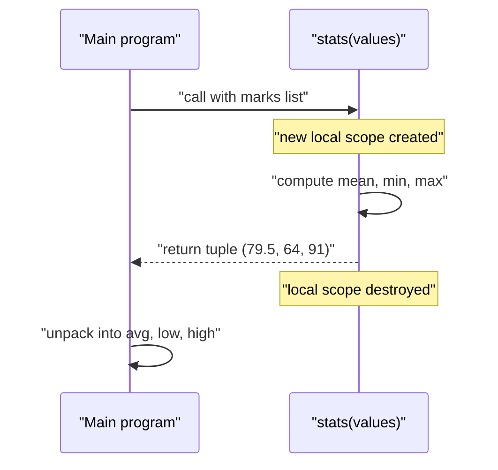
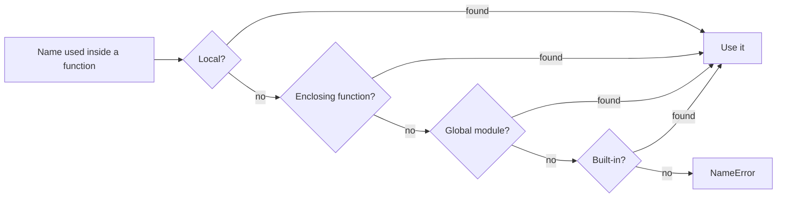
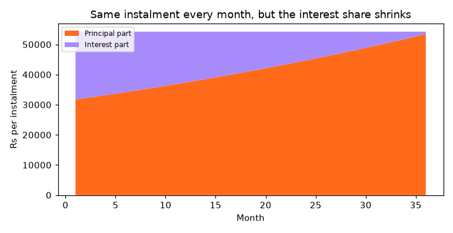

[](https://colab.research.google.com/github/Hamnakhan123/Diploma-in-AI/blob/main/term-1/04-application-based-programming-in-python/code/session-03-introduction-to-functions.ipynb) &nbsp; 📓 [Notebook](code/session-03-introduction-to-functions.ipynb)

# Session 3: Introduction to Functions

> 🧭 [Diploma in AI](../../README.md) › [Term 1](../README.md) › [Application Based Programming in Python](README.md) › **Session 3**
>
> ⏱️ **Estimated time:** 2.5 hours (1 h concepts + 1.5 h lab) &nbsp;|&nbsp; 📋 **Prerequisites:** Sessions 1-2 (variables, data types, operators, loops).
>
> Prepared by **Hamna Zahid Khan**, Junior Lecturer

[⬅ Previous: Session 2](session-02-programming-language-constructs.md) &nbsp;|&nbsp; [🏠 Module home](README.md) &nbsp;|&nbsp; [Next: Session 4 ➡](session-04-functions-modules-and-packages.md)

---

## 🎯 Learning objectives

By the end of this session you will be able to:

- Explain what a **function** is, why we use them, and the difference between **built-in**, **module**, **user-defined** and **anonymous** functions.
- **Define** and **call** functions, use `return` (including several values and early returns) and document them with **docstrings** and **type hints**.
- Explain **variable scope** with the **LEGB** rule and use `global` and `nonlocal` correctly.
- Distinguish **parameters** from **arguments**.
- Use every kind of argument: **positional, keyword, default, `*args`, `**kwargs`, keyword-only and positional-only**, and avoid the mutable-default trap.

## 📖 Concepts

### 1. What is a function and why use one?

A **function** is a named, reusable block of code that performs one task. You define it once and **call** it as many times as you like.

| Benefit | What it means |
|---|---|
| **Reuse** (DRY: Don't Repeat Yourself) | Write the GPA formula once, use it for 500 students. |
| **Abstraction** | Callers need to know *what* `emi()` does, not *how*. |
| **Readability** | `print_slip(slip)` tells the story; 20 lines of formatting do not. |
| **Testing** | A small function with clear input and output is easy to check. |
| **Teamwork** | Different people can write different functions. |

> 🧠 **Analogy:** A function is a **recipe card**. The ingredients you list on the card are the **parameters**; the actual flour and sugar you use today are the **arguments**; the cake you get out is the **return value**. You can follow the same card every weekend without rewriting it.

**Types of functions:**

| Type | Example | Where it comes from |
|---|---|---|
| Built-in | `len()`, `print()`, `max()`, `sorted()`, `round()` | always available |
| Module (library) | `math.sqrt()`, `random.randint()` | after `import` |
| User-defined | `def emi(...)` | you write it with `def` |
| Anonymous (lambda) | `lambda x: x * 2` | one-expression functions (Session 4) |
| Recursive | a function that calls itself | Session 4 |

### 2. Defining and calling a function

```python
def function_name(param1, param2="default"):
    """Docstring: one line saying what the function does."""
    # body: indented statements
    result = param1 + param2
    return result               # optional; sends a value back

value = function_name("a", "b")  # the call
```

- `def` starts the definition; the header ends with `:`; the body is indented.
- A function must be **defined before it is called** (above the call in a script).
- `return` sends a value back **and ends the function**. Code after it does not run.
- With no `return` (or a bare `return`), the function returns **`None`**.
- `return a, b` returns a **tuple**, which the caller can unpack: `mean, low, high = stats(x)`.
- **Type hints** (`def bmi(weight: float, height: float) -> float:`) document the expected types for readers and tools; Python does not enforce them.

**Functions are first-class objects:** you can store them in variables, lists and dicts, pass them to other functions (`sorted(data, key=len)`) and return them from functions. This idea powers callbacks in Flask (Session 7) and Tkinter buttons (Session 9).

### 3. Variable scope: the LEGB rule

**Scope** is the region of code where a name is visible. When Python meets a name, it searches four scopes in order:

| Letter | Scope | Example |
|---|---|---|
| **L** | Local: inside the current function | variables assigned in the function |
| **E** | Enclosing: the outer function, for nested functions | `count` in `make_counter()` |
| **G** | Global: the module (file) level | `course = "Diploma in AI"` at the top |
| **B** | Built-in | `len`, `print`, `range` |

Rules to remember:

1. A function can **read** a global name freely.
2. **Assigning** to a name inside a function makes it **local** for the *whole* function, even lines above the assignment. Reading it before assigning raises `UnboundLocalError`.
3. `global name` lets a function rebind a module-level variable; `nonlocal name` lets a nested function rebind a variable of its enclosing function.
4. Local variables are created fresh on every call and disappear when the function returns, **except** when an inner function keeps a reference to them: that is a **closure**.

> 🧠 **Analogy:** Scope is like looking for your keys: first in your pocket (local), then in your bag (enclosing), then in the house (global), and finally at the building reception (built-in). You stop at the first place you find them.

> ⚠️ Prefer **passing values in and returning results** over `global`. Functions that silently change globals are hard to test and debug.

### 4. Parameters vs arguments

- **Parameter:** the variable name in the function **definition**: `def order(item, qty, price)`.
- **Argument:** the actual value supplied in the **call**: `order("biryani", 2, 450)`.

### 5. Kinds of arguments

| Kind | Definition | Call | Notes |
|---|---|---|---|
| **Positional** | `def f(a, b)` | `f(1, 2)` | matched by order |
| **Keyword** | `def f(a, b)` | `f(b=2, a=1)` | matched by name; order free; positional must come first |
| **Default** | `def f(a, b=10)` | `f(1)` | defaults must come after non-defaults |
| **Variable positional** `*args` | `def f(*args)` | `f(1, 2, 3)` | extras arrive as a **tuple** |
| **Variable keyword** `**kwargs` | `def f(**kw)` | `f(x=1, y=2)` | extras arrive as a **dict** |
| **Keyword-only** | `def f(a, *, b)` | `f(1, b=2)` | anything after `*` must be named |
| **Positional-only** | `def f(a, /, b)` | `f(1, 2)` or `f(1, b=2)` | anything before `/` cannot be named |

Full order in a definition: `def f(pos_only, /, normal, *args, kw_only, **kwargs)`.

You can also **unpack** into a call: `f(*my_list)` spreads a list into positional arguments and `f(**my_dict)` spreads a dict into keyword arguments.

**Passing mechanism:** Python passes **references to objects** ("call by object reference"). Rebinding a parameter inside the function never affects the caller, but **mutating** a mutable argument (appending to a list) does.

**The mutable-default trap:** default values are created **once**, when `def` runs. `def add(item, basket=[])` shares one list across every call. Use `None` as the default and create the list inside.

## 🧭 Diagrams





## 💻 Worked examples

### Example 1: Define, call and return (basic)

📄 [`code/session-03_define_call.py`](code/session-03_define_call.py) &nbsp;·&nbsp; run: `python session-03_define_call.py`

```python
"""
Session 3 · Example 1: defining, calling and returning
------------------------------------------------------
Run:  python session-03_define_call.py
"""
import math

# 1. Built-in functions are always available
marks = [78, 91, 64, 85]
print("built-ins:", len(marks), max(marks), min(marks), sum(marks), round(sum(marks) / len(marks), 1))
# Functions from a module need an import
print("math module:", math.sqrt(144), math.ceil(4.1), round(math.pi, 4))

# 2. A user-defined function: def, name, parameters, colon, indented body
def greet(name):
    """Return a greeting for one person."""
    return f"Assalam-o-Alaikum, {name}!"

print(greet("Ayesha"))            # call it with an argument

# 3. A function with no return statement returns None
def show_line(width):
    print("-" * width)

result = show_line(20)
print("show_line returned:", result)

# 4. Returning several values (really a tuple) and unpacking them
def stats(values):
    """Return mean, min and max of a list of numbers."""
    mean = sum(values) / len(values)
    return mean, min(values), max(values)

avg, low, high = stats(marks)
print(f"mean {avg:.2f}, lowest {low}, highest {high}")
print("raw return value:", stats(marks))

# 5. return ends the function early (guard clauses)
def safe_divide(a, b):
    if b == 0:
        return None               # leave immediately, skip the rest
    return a / b
print("safe_divide:", safe_divide(10, 4), safe_divide(1, 0))

# 6. Functions are objects: store them, pass them, return them
def square(x): return x * x
def cube(x): return x ** 3
operations = {"square": square, "cube": cube}
for name, fn in operations.items():
    print(f"{name}(4) = {fn(4)}")

def apply_to_all(fn, values):
    return [fn(v) for v in values]
print("apply_to_all(square):", apply_to_all(square, [1, 2, 3]))

# 7. Type hints and docstrings document the contract (not enforced at runtime)
def bmi(weight_kg: float, height_m: float) -> float:
    """Body-mass index = weight / height squared, rounded to 1 decimal."""
    return round(weight_kg / height_m ** 2, 1)
print("bmi(68, 1.72) =", bmi(68, 1.72), "| hints:", bmi.__annotations__)
help(bmi)
```

**Output**

```text
built-ins: 4 91 64 318 79.5
math module: 12.0 5 3.1416
Assalam-o-Alaikum, Ayesha!
--------------------
show_line returned: None
mean 79.50, lowest 64, highest 91
raw return value: (79.5, 64, 91)
safe_divide: 2.5 None
square(4) = 16
cube(4) = 64
apply_to_all(square): [1, 4, 9]
bmi(68, 1.72) = 23.0 | hints: {'weight_kg': <class 'float'>, 'height_m': <class 'float'>, 'return': <class 'float'>}
Help on function bmi in module __main__:

bmi(weight_kg: float, height_m: float) -> float
    Body-mass index = weight / height squared, rounded to 1 decimal.
```


**What to notice:** `show_line` printed a line but returned `None`; printing and returning are different jobs. `stats` returned one tuple that we unpacked into three names. `operations` is a dict whose values are functions, a simple "dispatch table".

### Example 2: Scope, `global`, `nonlocal` and closures (intermediate)

📄 [`code/session-03_scope.py`](code/session-03_scope.py) &nbsp;·&nbsp; run: `python session-03_scope.py`

```python
"""
Session 3 · Example 2: variable scope (LEGB) with global and nonlocal
---------------------------------------------------------------------
Run:  python session-03_scope.py
"""
course = "Diploma in AI"            # Global scope: defined at module level

def show_course():
    print("inside, reading the global:", course)      # reading is allowed

def local_demo():
    course = "local copy"           # Local: a NEW variable, hides the global
    print("inside, local:", course)

show_course(); local_demo()
print("outside, global unchanged:", course)

# Assigning to a name anywhere in a function makes it local for the WHOLE function
def broken():
    try:
        print(counter)              # Python already decided 'counter' is local
        counter = 1
    except UnboundLocalError as e:
        print("UnboundLocalError:", e)
counter = 0
broken()

# global lets a function rebind a module-level name (use sparingly)
visits = 0
def record_visit():
    global visits
    visits += 1
for _ in range(3):
    record_visit()
print("visits after 3 calls:", visits)

# Enclosing scope and nonlocal: a closure that remembers state
def make_counter(start=0):
    count = start                   # Enclosing scope for the inner function
    def increment(step=1):
        nonlocal count              # rebind the enclosing variable
        count += step
        return count
    return increment

ticket = make_counter(100)
print("tickets:", ticket(), ticket(), ticket(5))
other = make_counter()
print("independent counter:", other(), "| first counter still at:", ticket(0))

# Built-in scope: names like len and print live here; shadowing them is legal but risky
def shadow_demo():
    len = 5                         # local 'len' hides the built-in
    return len
print("shadow_demo():", shadow_demo(), "| built-in len still works outside:", len("abc"))

# LEGB lookup order demonstrated with one name defined at three levels
x = "global x"
def outer():
    x = "enclosing x"
    def inner():
        x = "local x"
        return x
    return inner(), x
print("LEGB:", outer(), "|", x)
```

**Output**

```text
inside, reading the global: Diploma in AI
inside, local: local copy
outside, global unchanged: Diploma in AI
UnboundLocalError: cannot access local variable 'counter' where it is not associated with a value
visits after 3 calls: 3
tickets: 101 102 107
independent counter: 1 | first counter still at: 107
shadow_demo(): 5 | built-in len still works outside: 3
LEGB: ('local x', 'enclosing x') | global x
```


**Walkthrough:**

1. `local_demo` created its own `course`; the global was untouched.
2. In `broken()`, the assignment `counter = 1` made `counter` local for the whole function, so the earlier `print(counter)` failed with `UnboundLocalError`.
3. `make_counter` returns the inner `increment` function, which still remembers `count`: a **closure**. Two counters keep separate state.

### Example 3: Every kind of argument (advanced)

📄 [`code/session-03_arguments.py`](code/session-03_arguments.py) &nbsp;·&nbsp; run: `python session-03_arguments.py`

```python
"""
Session 3 · Example 3: parameters and every kind of argument
------------------------------------------------------------
Run:  python session-03_arguments.py
"""
# Parameters are the names in the definition; arguments are the values in the call.
def order(item, qty, price):
    return f"{qty} x {item} @ Rs {price} = Rs {qty * price:,}"

print("positional:", order("biryani", 2, 450))                 # matched by position
print("keyword:   ", order(price=450, item="biryani", qty=2))  # matched by name
print("mixed:     ", order("chai", price=80, qty=3))           # positional first

# Default values make a parameter optional
def ticket_price(base, child=False, discount=0.0):
    price = base * (0.5 if child else 1)
    return round(price * (1 - discount))
print("defaults:", ticket_price(1200), ticket_price(1200, child=True), ticket_price(1200, discount=0.1))

# *args collects extra positional arguments into a tuple
def total(*amounts):
    print("  args tuple:", amounts)
    return sum(amounts)
print("*args:", total(100, 250, 75))

# **kwargs collects extra keyword arguments into a dict
def profile(name, **details):
    extras = ", ".join(f"{k}={v}" for k, v in details.items())
    return f"{name} ({extras})"
print("**kwargs:", profile("Hira", city="Karachi", cgpa=3.7, semester=2))

# Keyword-only (after *) and positional-only (before /) parameters
def transfer(amount, /, *, to_account, note=""):
    return f"Sent Rs {amount:,} to {to_account} {note}".strip()
print("kw-only:", transfer(5000, to_account="PK36-XXXX-0042", note="(rent)"))
try:
    transfer(5000, "PK36")                          # to_account must be given by name
except TypeError as e:
    print("  TypeError:", e)
try:
    transfer(amount=5000, to_account="PK36")        # amount must be given by position
except TypeError as e:
    print("  TypeError:", e)

# Unpacking a list/dict INTO arguments with * and **
args = ["samosa", 6, 40]
kwargs = {"item": "jalebi", "qty": 1, "price": 300}
print("unpack *:", order(*args), "| unpack **:", order(**kwargs))

# The mutable-default trap and its fix
def add_bad(item, basket=[]):          # the SAME list is reused on every call
    basket.append(item); return basket
def add_good(item, basket=None):
    if basket is None:
        basket = []                     # a fresh list each call
    basket.append(item); return basket
print("bad :", add_bad("milk"), add_bad("eggs"))
print("good:", add_good("milk"), add_good("eggs"))

# Arguments are passed by object reference: mutating a list inside is visible outside
def give_bonus(marks):
    for i in range(len(marks)):
        marks[i] += 5
scores = [60, 70]
give_bonus(scores)
print("after give_bonus:", scores)
```

**Output**

```text
positional: 2 x biryani @ Rs 450 = Rs 900
keyword:    2 x biryani @ Rs 450 = Rs 900
mixed:      3 x chai @ Rs 80 = Rs 240
defaults: 1200 600 1080
  args tuple: (100, 250, 75)
*args: 425
**kwargs: Hira (city=Karachi, cgpa=3.7, semester=2)
kw-only: Sent Rs 5,000 to PK36-XXXX-0042 (rent)
  TypeError: transfer() takes 1 positional argument but 2 were given
  TypeError: transfer() got some positional-only arguments passed as keyword arguments: 'amount'
unpack *: 6 x samosa @ Rs 40 = Rs 240 | unpack **: 1 x jalebi @ Rs 300 = Rs 300
bad : ['milk', 'eggs'] ['milk', 'eggs']
good: ['milk'] ['eggs']
after give_bonus: [65, 75]
```


**Key lessons:**

- `transfer(amount, /, *, to_account)` forces a clear call style: the amount by position and the account by name, preventing swapped arguments in money code.
- `add_bad` returned `['milk', 'eggs']` on the **second** call because its default list was shared. `add_good` fixes it with `None`.
- `give_bonus` mutated the caller's list, so `scores` changed. If you do not want that, work on `marks.copy()`.

## 🌍 Real-life coding problem: monthly salary slips

**Scenario.** An HR officer needs a salary slip for each employee: allowances as percentages of basic pay, overtime, slab-based income tax (illustrative rates, not an official schedule) and a provident-fund deduction, plus a payroll summary.

**Plan before coding:** split the job into small functions, each with one responsibility.

| Function | Job | Argument features used |
|---|---|---|
| `allowances(basic, house_pct=0.45, medical_pct=0.10)` | house rent and medical | defaults, returns a tuple |
| `overtime_pay(basic, hours=0, rate=1.5, monthly_hours=208)` | overtime | several defaults |
| `annual_tax(income)` | slab lookup | early `return` inside a loop |
| `monthly_slip(name, basic, *, overtime_hours=0, pf_rate=0.08)` | combine everything | keyword-only options |
| `print_slip(slip)`, `summary(slips)` | presentation | functions calling functions |

```python
def annual_tax(income):
    lower = 0
    for upper, fixed, rate in TAX_SLABS:
        if income <= upper:
            return fixed + (income - lower) * rate
        lower = upper
```

📄 Full solution (68 lines, fully commented): [`code/session-03_problem_payroll.py`](code/session-03_problem_payroll.py) &nbsp;·&nbsp; run: `python session-03_problem_payroll.py` &nbsp;·&nbsp; also in the session notebook

**Output**

```text
Salary slip: Ahmed (lab engineer)
   basic      Rs     60,000
   house      Rs     27,000
   medical    Rs      6,000
   overtime   Rs          0
   gross      Rs     93,000
   tax      - Rs      2,150
   pf       - Rs      4,800
   net        Rs     86,050

Salary slip: Fatima (lecturer)
   basic      Rs    110,000
   house      Rs     49,500
   medical    Rs     11,000
   overtime   Rs          0
   gross      Rs    170,500
   tax      - Rs     13,075
   pf       - Rs      8,800
   net        Rs    148,625

Salary slip: Kamran (technician)
   basic      Rs     45,000
   house      Rs     20,250
   medical    Rs      4,500
   overtime   Rs      7,139
   gross      Rs     76,889
   tax      - Rs      1,344
   pf       - Rs      3,600
   net        Rs     71,945

Salary slip: Zara (manager)
   basic      Rs    210,000
   house      Rs     94,500
   medical    Rs     21,000
   overtime   Rs          0
   gross      Rs    325,500
   tax      - Rs     56,425
   pf       - Rs     16,800
   net        Rs    252,275

Employee                    Gross       Tax Eff. tax
Ahmed (lab engineer)       93,000     2,150     2.3%
Fatima (lecturer)         170,500    13,075     7.7%
Kamran (technician)        76,889     1,344     1.7%
Zara (manager)            325,500    56,425    17.3%
TOTAL payroll cost        665,889
```


**Interpretation.** The effective tax rate climbs from about 2 % to 17 % as income rises, which is what a progressive slab system is designed to do. Because each rule lives in its own function, changing the house-rent percentage or a tax slab is a one-line edit, and the rest of the program keeps working.

## 🛠️ Mini project: loan / instalment planner

Banks quote a fixed **EMI** (equated monthly instalment) using the reducing-balance formula. This project builds three functions that answer the questions every borrower asks: "how much a month?", "how much interest in total?" and "where does each payment go?".

```python
def emi(principal, annual_rate, years):
    r, n = annual_rate / 12, years * 12
    growth = (1 + r) ** n
    return principal * r * growth / (growth - 1)
```

`schedule()` is a **generator** (it uses `yield`), so it produces one month at a time; you will meet generators properly in Session 4.

📄 Full solution (62 lines, fully commented): [`code/session-03_project_loan_planner.py`](code/session-03_project_loan_planner.py) &nbsp;·&nbsp; run: `python session-03_project_loan_planner.py` &nbsp;·&nbsp; also in the session notebook

**Output**

```text
Loan Rs 1,500,000 at 18% a year
Years        EMI   Total paid    Interest
    1    137,520    1,650,240     150,240
    2     74,886    1,797,268     297,268
    3     54,229    1,952,229     452,229
    5     38,090    2,285,408     785,408

First and last months of the 3-year plan
  month  1: interest   22,500  principal   31,729  balance  1,468,271
  month  2: interest   22,024  principal   32,205  balance  1,436,067
  month  3: interest   21,541  principal   32,688  balance  1,403,379
  month 35: interest    1,591  principal   52,638  balance     53,427
  month 36: interest      801  principal   53,427  balance          0
Chart saved: session-03_project_loan_planner.png
```




**Interpretation.** Stretching the loan from 1 to 5 years cuts the instalment from about Rs 137,500 to Rs 38,100, but more than **quintuples** the interest (Rs 150k → Rs 785k). The chart shows why: early instalments are mostly interest, because interest is charged on a large remaining balance.

**Extension ideas:** add a `prepayment(month, amount)` option and show how much interest it saves; compare two banks' rates with `compare()`; return the schedule as a list of dicts and save it to CSV (Session 5).

## ⚠️ Common mistakes

| Mistake | What happens | Fix |
|---|---|---|
| Calling before defining | `NameError` | Put definitions above the calls (or in a module) |
| `print` instead of `return` | caller gets `None` | `return` the value; print outside |
| Forgetting `()`: `total = calc_total` | stores the function, not its result | `calc_total()` |
| Default before non-default: `def f(a=1, b)` | `SyntaxError` | Put defaulted parameters last |
| Mutable default `def f(x=[])` | data leaks between calls | `def f(x=None)` then create inside |
| Modifying a global without `global` | `UnboundLocalError` | Pass it in and return it, or declare `global` |
| Code after `return` | never runs | Move it above the return |
| Too many responsibilities in one function | hard to test and reuse | One function, one job |

## ✅ Best practices

- Name functions with **verbs**: `calculate_tax`, `print_slip`, `is_valid_email`.
- Keep functions **short** (one screen) and focused on one task.
- Write a **docstring** for every function, and type hints for public ones.
- Prefer **return values** over printing inside functions; let the caller decide what to do.
- Use **keyword-only** parameters for options and flags so calls read clearly: `slip(name, basic, overtime_hours=10)`.
- Avoid `global`; if many functions share state, you probably want a class (covered later in the course).
- Validate inputs early with guard clauses (`if b == 0: return None`).

## 🧪 Lab / practice tasks

**1. 🟢 Easy:** Write `celsius_to_fahrenheit(c)` and `fahrenheit_to_celsius(f)` with docstrings. Print a table from 0 °C to 50 °C in steps of 10.

<details><summary>💡 Hint</summary>

`f = c * 9 / 5 + 32`, `c = (f - 32) * 5 / 9`. Use a `for` loop with `range(0, 51, 10)`.

</details>

<details><summary>✅ Solution</summary>

```python
def celsius_to_fahrenheit(c):
    """Convert Celsius to Fahrenheit."""
    return c * 9 / 5 + 32
def fahrenheit_to_celsius(f):
    """Convert Fahrenheit to Celsius."""
    return (f - 32) * 5 / 9
for c in range(0, 51, 10):
    print(f"{c:>3} C = {celsius_to_fahrenheit(c):5.1f} F")
```

</details>

**2. 🟢 Easy:** Write `is_even(n)` returning a bool, and use it with a list comprehension to keep only even numbers from `range(1, 21)`.

<details><summary>💡 Hint</summary>

`return n % 2 == 0` already is a bool; no `if` needed.

</details>

<details><summary>✅ Solution</summary>

```python
def is_even(n):
    return n % 2 == 0
print([n for n in range(1, 21) if is_even(n)])
```

</details>

**3. 🟡 Medium:** Write `average(*numbers, decimals=2)` that accepts any count of numbers, returns `None` for no numbers, and rounds to `decimals`. Test with `average()`, `average(4, 5)`, `average(1, 2, 2, decimals=3)`.

<details><summary>💡 Hint</summary>

`numbers` is a tuple; check `if not numbers:` first.

</details>

<details><summary>✅ Solution</summary>

```python
def average(*numbers, decimals=2):
    if not numbers:
        return None
    return round(sum(numbers) / len(numbers), decimals)
print(average(), average(4, 5), average(1, 2, 2, decimals=3))   # None 4.5 1.667
```

</details>

**4. 🟡 Medium:** Write `build_url(base, **params)` that returns e.g. `https://shop.pk/search?q=laptop&page=2` from `build_url("https://shop.pk/search", q="laptop", page=2)`.

<details><summary>💡 Hint</summary>

`"&".join(f"{k}={v}" for k, v in params.items())`

</details>

<details><summary>✅ Solution</summary>

```python
def build_url(base, **params):
    if not params:
        return base
    return base + "?" + "&".join(f"{k}={v}" for k, v in params.items())
print(build_url("https://shop.pk/search", q="laptop", page=2))
```

(Real code should use `urllib.parse.urlencode(params)` to escape spaces and symbols.)

</details>

**5. 🟠 Hard:** Using a closure, write `make_rate_limiter(max_calls)` that returns a function `allow()` which returns `True` for the first `max_calls` calls and `False` afterwards. Show two independent limiters.

<details><summary>💡 Hint</summary>

Store `calls = 0` in the outer function and use `nonlocal calls` inside `allow`.

</details>

<details><summary>✅ Solution</summary>

```python
def make_rate_limiter(max_calls):
    calls = 0
    def allow():
        nonlocal calls
        calls += 1
        return calls <= max_calls
    return allow
api = make_rate_limiter(3); login = make_rate_limiter(1)
print([api() for _ in range(5)], [login() for _ in range(2)])
# [True, True, True, False, False] [True, False]
```

</details>

**6. 🔴 Challenge:** Extend the loan planner with `prepay(principal, annual_rate, years, extra_monthly)` that pays a fixed extra amount each month and returns `(months_needed, total_interest)`. Compare 3 years with and without Rs 10,000 extra per month.

<details><summary>💡 Hint</summary>

Keep the normal EMI, add `extra_monthly` to it, and loop `while balance > 0`, adding each month's interest to a running total. The last payment may be smaller than the rest.

</details>

<details><summary>✅ Solution</summary>

```python
def prepay(principal, annual_rate, years, extra_monthly):
    pay = emi(principal, annual_rate, years) + extra_monthly
    balance, months, interest_total = principal, 0, 0.0
    while balance > 0:
        interest = balance * annual_rate / 12
        interest_total += interest
        balance -= min(pay - interest, balance)
        months += 1
    return months, round(interest_total)
print(prepay(1_500_000, 0.18, 3, 0))        # (36, 452229)
print(prepay(1_500_000, 0.18, 3, 10_000))   # fewer months, less interest
```

</details>

## ✅ Quick quiz

**Q1.** What does a function return if it has no return statement?

- A) 0
- B) an empty string
- C) None
- D) an error is raised

**Q2.** In `def area(length, width=1):`, what are `length` and `width`?

- A) arguments
- B) parameters
- C) keywords
- D) return values

**Q3.** Inside `def f(*args, **kwargs)`, what types are `args` and `kwargs`?

- A) list and dict
- B) tuple and dict
- C) tuple and list
- D) dict and tuple

**Q4.** Which keyword lets a nested function rebind a variable of its enclosing function?

- A) global
- B) local
- C) nonlocal
- D) static

**Q5.** Given `def f(a, *, b): ...`, which call is valid?

- A) f(1, 2)
- B) f(a=1, 2)
- C) f(1, b=2)
- D) f(b=2)

<details><summary>✅ Show answers</summary>

1. **C** — every function returns None by default.
2. **B** — names in the definition are parameters; values in the call are arguments.
3. **B** — extra positionals become a tuple, extra keywords a dict.
4. **C** — nonlocal targets the nearest enclosing function scope.
5. **C** — b is keyword-only and a is required.

</details>


## 📝 Summary

- A **function** is a named, reusable block: `def name(params):` + indented body; call it with `name(args)`.
- `return` sends a value back and stops the function; no `return` means **`None`**; `return a, b` returns a tuple.
- Types: built-in, module, user-defined, lambda and recursive functions. Functions are **first-class objects**.
- **Scope** follows **LEGB** (Local → Enclosing → Global → Built-in); `global` and `nonlocal` allow rebinding; closures remember enclosing variables.
- **Parameters** live in the definition, **arguments** in the call.
- Argument kinds: positional, keyword, default, `*args`, `**kwargs`, keyword-only (after `*`), positional-only (before `/`). Never use a mutable default.

### 🎤 Interview / viva questions

1. What is the difference between a parameter and an argument?
2. Explain the LEGB rule with an example of each scope.
3. Why does `UnboundLocalError` happen? How do you fix it?
4. What is a closure? Give a practical use.
5. What problem do mutable default arguments cause and how do you avoid it?
6. When would you make a parameter keyword-only?
7. Is Python "call by value" or "call by reference"? Explain with a list example.

---

[⬅ Previous: Session 2](session-02-programming-language-constructs.md) &nbsp;|&nbsp; [🏠 Module home](README.md) &nbsp;|&nbsp; [Next: Session 4 ➡](session-04-functions-modules-and-packages.md)

<sub>Prepared by **Hamna Zahid Khan**, Junior Lecturer · Diploma in AI</sub>
