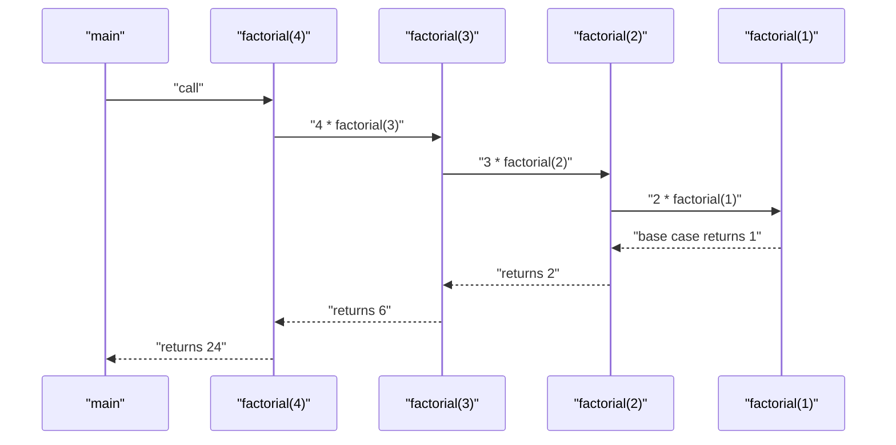
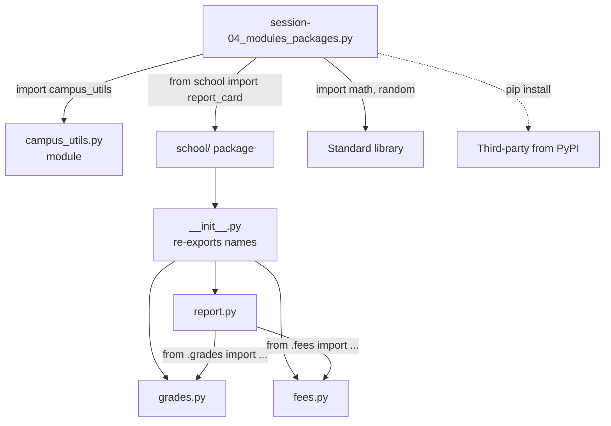
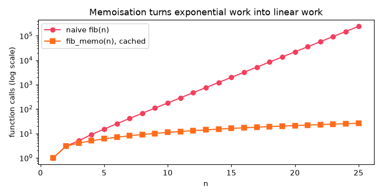

[](https://colab.research.google.com/github/Hamnakhan123/Diploma-in-AI/blob/main/term-1/04-application-based-programming-in-python/code/session-04-functions-modules-and-packages.ipynb) &nbsp; 📓 [Notebook](code/session-04-functions-modules-and-packages.ipynb)

# Session 4: Functions, Modules and Packages

> 🧭 [Diploma in AI](../../README.md) › [Term 1](../README.md) › [Application Based Programming in Python](README.md) › **Session 4**
>
> ⏱️ **Estimated time:** 3 hours (1 h concepts + 2 h lab) &nbsp;|&nbsp; 📋 **Prerequisites:** Session 3 (defining functions, scope, arguments).
>
> Prepared by **Hamna Zahid Khan**, Junior Lecturer

[⬅ Previous: Session 3](session-03-introduction-to-functions.md) &nbsp;|&nbsp; [🏠 Module home](README.md) &nbsp;|&nbsp; [Next: Session 5 ➡](session-05-file-and-exception-handling.md)

---

## 🎯 Learning objectives

By the end of this session you will be able to:

- Write **recursive functions** with a correct base case and recursive case, trace the call stack and speed them up with **memoisation**.
- Explain when recursion is the right tool and when a loop is safer (`RecursionError`).
- Use **lambda functions** with `sorted`, `max`, `map`, `filter` and `reduce`, and avoid the late-binding trap.
- **Create a module**, import it in four different ways, and use `if __name__ == "__main__":`.
- **Define a package** with `__init__.py`, use absolute and relative imports, and explain `sys.path`, `pip` and virtual environments.

## 📖 Concepts

### 1. Recursive functions

A **recursive function** is a function that **calls itself** to solve a smaller version of the same problem. Every correct recursive function has two parts:

| Part | Purpose | Factorial example |
|---|---|---|
| **Base case** | stops the recursion; answered directly | `if n <= 1: return 1` |
| **Recursive case** | reduces the problem and calls itself | `return n * factorial(n - 1)` |

> 🧠 **Analogy:** Russian nesting dolls (matryoshka). To count the dolls you open one, then ask the same question about the doll inside ("how many dolls in here?"). When you reach the tiny solid doll that does not open (the base case) you stop, and the answers add up on the way back out.

**How it runs: the call stack.** Each call gets its own **frame** (its own local variables) pushed onto the **call stack**. `factorial(4)` waits for `factorial(3)`, which waits for `factorial(2)`, and so on. When the base case returns, frames are popped one by one and the results multiply on the way back.

**When recursion fits naturally:**

- Data that is **nested** or **tree-shaped**: folders inside folders, JSON inside JSON, menus inside menus, HTML elements (Session 8).
- **Divide-and-conquer** algorithms: merge sort, quick sort, binary search.
- Mathematical definitions: factorial, Fibonacci, power, greatest common divisor.

**Limits and costs:**

- Python stops runaway recursion at a depth of about **1000** frames with `RecursionError`. Python does not optimise tail calls, so very deep problems should use a **loop**.
- Naive recursion can **repeat the same work**: `fib(25)` makes 242,785 calls. **Memoisation** stores results the first time they are computed; `@functools.lru_cache` does it in one line.

| | Recursion | Iteration (loop) |
|---|---|---|
| Code for tree-shaped problems | short and clear | needs your own stack |
| Memory | one frame per level | constant |
| Depth limit | ~1000 by default | none |
| Speed | function-call overhead | usually faster |

### 2. Lambda functions

A **lambda** is a small **anonymous** function written as one **expression**:

```python
lambda arguments: expression
square = lambda x: x * x            # same as def square(x): return x * x
```

- It can take any number of arguments (including defaults) but contains **one expression** and no statements (no `if` blocks, loops or assignments; a conditional expression is fine).
- Its real home is as a **short throwaway argument** to another function:

| Use | Example |
|---|---|
| Sort by a field | `sorted(students, key=lambda s: s["cgpa"])` |
| Sort by several fields | `key=lambda s: (-s["cgpa"], s["name"])` |
| Pick the best | `max(products, key=lambda p: p["rating"])` |
| Transform all | `map(lambda p: p * 1.16, prices)` |
| Keep some | `filter(lambda s: s["city"] == "Karachi", students)` |
| Fold into one | `functools.reduce(lambda a, b: a + b, values)` |
| Callbacks | Tkinter `command=lambda: save(record)` (Session 9) |

> ⚠️ PEP 8 advises against assigning a lambda to a name (`f = lambda ...`); use `def` when the function deserves a name. And remember the **late-binding** trap: lambdas created in a loop all see the loop variable's *final* value unless you capture it with a default (`lambda i=i: i`).

### 3. Modules

A **module** is simply a `.py` file. Its functions, classes and variables can be **imported** into other files. Modules let you organise a growing program into logical files and reuse code across projects.

| Import style | Example | You then write |
|---|---|---|
| Whole module | `import math` | `math.sqrt(16)` |
| With alias | `import pandas as pd` | `pd.DataFrame(...)` |
| Specific names | `from statistics import mean, median` | `mean(x)` |
| Name with alias | `from campus_utils import percentage as pct` | `pct(45, 60)` |
| Everything (avoid) | `from math import *` | `sqrt(16)`; pollutes your namespace |

Three kinds of modules: **built-in / standard library** (`math`, `os`, `datetime`, `json`, `re`, `sqlite3`), **third-party** installed with `pip` (`requests`, `flask`, `pandas`) and **your own**.

**`__name__ == "__main__"`:** every module has a variable `__name__`. When you run a file directly it is `"__main__"`; when the file is imported it is the module's name. Code under `if __name__ == "__main__":` therefore runs only when the file is executed as a script, which is the right place for self-tests and command-line entry points.

**How Python finds a module:** it searches the folder of the running script first, then the folders listed in `sys.path` (standard library, `site-packages` where pip installs things). Imported modules are cached in `sys.modules`, so a second `import` is instant and does not re-run the file.

### 4. Packages

A **package** is a **folder of modules** with an `__init__.py` file. Packages create a hierarchy with dotted names, just like folders on a disk.

```text
school/                 <- package
├── __init__.py         <- runs on first import; can re-export names
├── grades.py           <- school.grades
├── fees.py             <- school.fees
└── report.py           <- school.report (uses the other two)
```

- **Absolute import:** `from school.grades import letter` (works from anywhere the package is visible).
- **Relative import** inside the package: `from .grades import letter` (`.` = this package, `..` = parent package).
- `__init__.py` can define `__all__` (what `from school import *` exports) and `__version__`, and re-export the most useful functions so users write `from school import report_card`.

**Third-party packages** are installed from **PyPI** with `pip install requests`. Use a **virtual environment** per project so versions do not clash:

```bash
python -m venv .venv                 # create
source .venv/bin/activate            # activate (Windows: .venv\Scripts\activate)
pip install flask requests           # install into this project only
pip freeze > requirements.txt        # record exact versions
pip install -r requirements.txt      # recreate on another machine
```

> 🧠 **Analogy:** A **module** is one book. A **package** is a bookshelf with a label on each shelf. **PyPI** is the national library, `pip` is the librarian who fetches books, and a **virtual environment** is your own study room so your books do not get mixed up with your classmates'.

## 🧭 Diagrams





## 💻 Worked examples

### Example 1: Recursion, the call stack and memoisation (basic → intermediate)

📄 [`code/session-04_recursion.py`](code/session-04_recursion.py) &nbsp;·&nbsp; run: `python session-04_recursion.py`

```python
"""
Session 4 · Example 1: recursive functions
------------------------------------------
Every recursive function needs (1) a BASE CASE that stops, and (2) a
RECURSIVE CASE that moves closer to the base case.
Run:  python session-04_recursion.py
"""
import sys
from functools import lru_cache

def factorial(n):
    """n! = n x (n-1)!, with 0! = 1."""
    if n <= 1:                 # base case
        return 1
    return n * factorial(n - 1)  # recursive case: a smaller problem

print("5! =", factorial(5), "| 20! =", factorial(20))

# Trace the calls so the 'stack' becomes visible
def factorial_trace(n, depth=0):
    print("  " * depth + f"factorial({n}) called")
    result = 1 if n <= 1 else n * factorial_trace(n - 1, depth + 1)
    print("  " * depth + f"factorial({n}) returns {result}")
    return result
factorial_trace(4)

# Sum of digits and string reversal: recursion on smaller pieces
def digit_sum(n):
    return n if n < 10 else n % 10 + digit_sum(n // 10)
def reverse(s):
    return s if len(s) <= 1 else reverse(s[1:]) + s[0]
print("digit_sum(98765) =", digit_sum(98765), "| reverse('karachi') =", reverse("karachi"))

# Recursion shines on nested (tree-shaped) data
menu = {"Food": {"Desi": ["Biryani", "Nihari"], "Fast food": ["Burger", "Pizza"]},
        "Drinks": ["Chai", "Lassi"]}
def count_items(node):
    if isinstance(node, list):             # base case: a list of dishes
        return len(node)
    return sum(count_items(child) for child in node.values())
print("dishes in nested menu:", count_items(menu))

# Naive Fibonacci repeats work; caching (memoisation) fixes it
calls = 0
def fib(n):
    global calls; calls += 1
    return n if n < 2 else fib(n - 1) + fib(n - 2)
fib(25); print("naive fib(25) made", f"{calls:,}", "calls")

@lru_cache(maxsize=None)
def fib_memo(n):
    return n if n < 2 else fib_memo(n - 1) + fib_memo(n - 2)
print("fib_memo(25) =", fib_memo(25), "|", fib_memo.cache_info())
print("fib_memo(300) has", len(str(fib_memo(300))), "digits")

# Python limits recursion depth to protect the call stack
print("recursion limit:", sys.getrecursionlimit())
try:
    factorial(5000)
except RecursionError as e:
    print("RecursionError:", str(e)[:40], "... -> use a loop for very deep problems")

def factorial_loop(n):          # the iterative version never hits the limit
    result = 1
    for k in range(2, n + 1):
        result *= k
    return result
print("factorial_loop(1500) has", len(str(factorial_loop(1500))), "digits")

# Chart: calls made by naive vs memoised Fibonacci (exact counts, not timings)
import matplotlib
matplotlib.use("Agg")
import matplotlib.pyplot as plt
ns, naive_calls, memo_calls = list(range(1, 26)), [], []
for n in ns:
    calls = 0; fib(n); naive_calls.append(calls)
    fib_memo.cache_clear(); fib_memo(n); memo_calls.append(fib_memo.cache_info().misses)
fig, ax = plt.subplots(figsize=(7, 3.6))
ax.plot(ns, naive_calls, "o-", color="#F43F5E", label="naive fib(n)")
ax.plot(ns, memo_calls, "s-", color="#FF6B1A", label="fib_memo(n), cached")
ax.set_yscale("log"); ax.set_xlabel("n"); ax.set_ylabel("function calls (log scale)")
ax.set_title("Memoisation turns exponential work into linear work"); ax.legend()
fig.tight_layout(); fig.savefig("session-04_recursion.png", dpi=110)
print("naive calls for n = 10, 20, 25:", naive_calls[9], naive_calls[19], naive_calls[24], "| cached:", memo_calls[24])
print("Chart saved: session-04_recursion.png")
```

**Output**

```text
5! = 120 | 20! = 2432902008176640000
factorial(4) called
  factorial(3) called
    factorial(2) called
      factorial(1) called
      factorial(1) returns 1
    factorial(2) returns 2
  factorial(3) returns 6
factorial(4) returns 24
digit_sum(98765) = 35 | reverse('karachi') = ihcarak
dishes in nested menu: 6
naive fib(25) made 242,785 calls
fib_memo(25) = 75025 | CacheInfo(hits=23, misses=26, maxsize=None, currsize=26)
fib_memo(300) has 63 digits
recursion limit: 1000
RecursionError: maximum recursion depth exceeded ... -> use a loop for very deep problems
factorial_loop(1500) has 4115 digits
naive calls for n = 10, 20, 25: 177 21891 242785 | cached: 26
Chart saved: session-04_recursion.png
```




**What to notice:**

1. The trace shows the stack growing (calls) and shrinking (returns); the multiplications happen **on the way back**.
2. `count_items` handles a menu of any nesting depth with four lines; a loop would need to know the depth in advance.
3. The chart uses a log scale: naive Fibonacci's calls grow exponentially (about ×1.6 per step), while the cached version needs just n + 1 calls.
4. `factorial(5000)` overflows the stack, but the loop version handles it easily.

### Example 2: Lambda with sorted, map, filter and reduce (intermediate)

📄 [`code/session-04_lambda.py`](code/session-04_lambda.py) &nbsp;·&nbsp; run: `python session-04_lambda.py`

```python
"""
Session 4 · Example 2: lambda functions with sorted, map, filter and reduce
---------------------------------------------------------------------------
lambda arguments: expression   -> a small anonymous function of ONE expression
Run:  python session-04_lambda.py
"""
from functools import reduce

square = lambda x: x * x          # works, but a def is clearer for named functions
print("square(7) =", square(7))
add = lambda a, b=10: a + b
print("add(5) =", add(5), "| add(5, 1) =", add(5, 1))

students = [
    {"name": "Ali", "cgpa": 3.1, "city": "Karachi"},
    {"name": "Sana", "cgpa": 3.8, "city": "Lahore"},
    {"name": "Bilal", "cgpa": 2.7, "city": "Karachi"},
    {"name": "Hira", "cgpa": 3.8, "city": "Quetta"},
]

# 1. sorted / max / min with key=lambda: the most common real use
by_cgpa = sorted(students, key=lambda s: s["cgpa"], reverse=True)
print("by cgpa:", [s["name"] for s in by_cgpa])
by_cgpa_then_name = sorted(students, key=lambda s: (-s["cgpa"], s["name"]))
print("tie-break by name:", [s["name"] for s in by_cgpa_then_name])
print("top student:", max(students, key=lambda s: s["cgpa"])["name"])

# 2. map applies a function to every item (returns an iterator)
prices = [1200, 850, 3400]
with_tax = list(map(lambda p: round(p * 1.16), prices))
print("map with tax:", with_tax)

# 3. filter keeps items where the function returns True
karachi = list(filter(lambda s: s["city"] == "Karachi", students))
print("filter Karachi:", [s["name"] for s in karachi])

# 4. reduce folds a sequence into one value
total = reduce(lambda acc, p: acc + p, prices, 0)
longest = reduce(lambda a, b: a if len(a) >= len(b) else b, [s["name"] for s in students])
print("reduce total:", total, "| longest name:", longest)

# Comprehensions often read better than map/filter
print("comprehension:", [round(p * 1.16) for p in prices if p > 1000])

# 5. Lambdas as small callbacks: a dispatch table of operations
ops = {"+": lambda a, b: a + b, "-": lambda a, b: a - b,
       "*": lambda a, b: a * b, "/": lambda a, b: a / b if b else float("nan")}
for sym in ops:
    print(f"  12 {sym} 4 = {ops[sym](12, 4)}")

# 6. A function that RETURNS a lambda (a function factory)
def make_discount(pct):
    return lambda price: round(price * (1 - pct / 100))
eid_sale, clearance = make_discount(20), make_discount(50)
print("Eid sale:", eid_sale(5000), "| clearance:", clearance(5000))

# 7. The late-binding trap in loops
fns = [lambda: i for i in range(3)]
print("late binding:", [f() for f in fns], "-> fix with a default:", [f() for f in [lambda i=i: i for i in range(3)]])
```

**Output**

```text
square(7) = 49
add(5) = 15 | add(5, 1) = 6
by cgpa: ['Sana', 'Hira', 'Ali', 'Bilal']
tie-break by name: ['Hira', 'Sana', 'Ali', 'Bilal']
top student: Sana
map with tax: [1392, 986, 3944]
filter Karachi: ['Ali', 'Bilal']
reduce total: 5450 | longest name: Bilal
comprehension: [1392, 3944]
  12 + 4 = 16
  12 - 4 = 8
  12 * 4 = 48
  12 / 4 = 3.0
Eid sale: 4000 | clearance: 2500
late binding: [2, 2, 2] -> fix with a default: [0, 1, 2]
```


**Walkthrough:**

- `key=lambda s: (-s["cgpa"], s["name"])` sorts by CGPA descending and breaks ties alphabetically: Hira comes before Sana.
- `map` and `filter` return lazy iterators; wrap them in `list()` to see the values.
- `make_discount(20)` returns a new lambda that remembers `pct`: a closure, like Session 3's counter.
- The late-binding line shows `[2, 2, 2]`: all three lambdas look up `i` when called, after the loop has finished.

### Example 3: Your own module and package (advanced)

The module and the package files live in `code/`:

📄 [`code/campus_utils.py`](code/campus_utils.py)

```python
"""
campus_utils: a small MODULE used in Session 4.

A module is simply a .py file. Anything defined here (functions, constants,
classes) can be imported by another file in the same folder.
"""
PASS_MARK = 50
GRADE_CUTS = [(85, "A"), (70, "B"), (55, "C"), (PASS_MARK, "D")]

def grade(mark):
    """Return the letter grade for a mark out of 100."""
    for cut, letter in GRADE_CUTS:
        if mark >= cut:
            return letter
    return "F"

def percentage(obtained, total):
    """Return a percentage rounded to one decimal place."""
    return round(obtained / total * 100, 1)

def _internal_helper():
    """A leading underscore means 'private': not imported by 'from ... import *'."""
    return "hidden"

# This block runs ONLY when the file is executed directly (python campus_utils.py),
# not when it is imported. Use it for quick self-tests.
if __name__ == "__main__":
    print("Self-test:", grade(91), grade(49), percentage(45, 60))
```


📄 [`code/school/__init__.py`](code/school/__init__.py)

```python
"""
school: a small PACKAGE (a folder of modules with an __init__.py).

The __init__.py runs once when the package is first imported. Here it
re-exports the most useful names so users can write `from school import report_card`.
"""
from .grades import letter, gpa
from .fees import fee_due
from .report import report_card

__all__ = ["letter", "gpa", "fee_due", "report_card"]
__version__ = "1.0.0"
```


📄 [`code/school/report.py`](code/school/report.py)

```python
"""school.report: builds a text report card using the sibling modules."""
from .grades import letter, gpa        # relative import: '.' means 'this package'
from .fees import fee_due

def report_card(name, results, scholarship_pct=0):
    """Return a multi-line report card string."""
    lines = [f"Report card: {name}"]
    for course, (mark, credits) in results.items():
        lines.append(f"  {course:<26} {mark:>3}  {letter(mark)}  ({credits} cr)")
    credits = sum(c for _, c in results.values())
    lines.append(f"  GPA {gpa(list(results.values())):.2f} | fee due Rs {fee_due(credits, scholarship_pct):,}")
    return "\n".join(lines)
```


Now a script that imports them alongside standard-library modules:

📄 [`code/session-04_modules_packages.py`](code/session-04_modules_packages.py) &nbsp;·&nbsp; run: `python session-04_modules_packages.py`

```python
"""
Session 4 · Example 3: using modules and packages
-------------------------------------------------
Needs campus_utils.py and the school/ folder next to this file (both are in code/).
Run:  python session-04_modules_packages.py
"""
import math                                # 1. whole standard-library module
import random as rnd                       # 2. module with an alias
from datetime import date                  # 3. one name from a module
from statistics import mean, median        # 4. several names

print("math.floor(7.8) =", math.floor(7.8), "| rnd seeded pick:", rnd.Random(1).choice(["red", "green", "blue"]))
print("days until 1 Jan 2027 from 26 Oct 2026:", (date(2027, 1, 1) - date(2026, 10, 26)).days)
print("mean/median:", mean([3, 5, 10]), median([3, 5, 10]))

# Our own module (campus_utils.py in the same folder)
import campus_utils
print("\ncampus_utils.grade(77) =", campus_utils.grade(77), "| PASS_MARK =", campus_utils.PASS_MARK)
print("module __name__ when imported:", campus_utils.__name__)
print("public names:", [n for n in dir(campus_utils) if not n.startswith("_")])

from campus_utils import percentage as pct
print("pct(45, 60) =", pct(45, 60))

# Our own package (school/ folder with __init__.py)
import school
from school import report_card
from school.grades import POINTS            # dotted path into a sub-module
print("\nschool version:", school.__version__, "| exported:", school.__all__)
print("grade points:", POINTS)
results = {"Programming Fundamentals": (88, 4), "Statistics": (72, 3),
           "Database Systems": (64, 3), "Communication Skills": (91, 2)}
print(report_card("Hamza Raza", results, scholarship_pct=25))

# Where Python looks for modules: the script folder first, then sys.path entries
import sys
import os
print("\nsys.path has", "many" if len(sys.path) > 3 else "few", "entries; campus_utils.py found in the current folder:", os.path.exists("campus_utils.py"))
print("modules already loaded include math and school:", "math" in sys.modules, "school" in sys.modules)
print("this file's __name__:", __name__)
```

**Output**

```text
math.floor(7.8) = 7 | rnd seeded pick: red
days until 1 Jan 2027 from 26 Oct 2026: 67
mean/median: 6 5

campus_utils.grade(77) = B | PASS_MARK = 50
module __name__ when imported: campus_utils
public names: ['GRADE_CUTS', 'PASS_MARK', 'grade', 'percentage']
pct(45, 60) = 75.0

school version: 1.0.0 | exported: ['letter', 'gpa', 'fee_due', 'report_card']
grade points: {'A': 4.0, 'B': 3.0, 'C': 2.0, 'D': 1.0, 'F': 0.0}
Report card: Hamza Raza
  Programming Fundamentals    88  A  (4 cr)
  Statistics                  72  B  (3 cr)
  Database Systems            64  C  (3 cr)
  Communication Skills        91  A  (2 cr)
  GPA 3.25 | fee due Rs 58,500

sys.path has many entries; campus_utils.py found in the current folder: True
modules already loaded include math and school: True True
this file's __name__: __main__
```


**Key lessons:**

- `dir(campus_utils)` hides `_internal_helper`: the leading underscore marks it private by convention.
- `report.py` uses **relative imports** to reach its sibling modules; the script uses **absolute** ones.
- When imported, `campus_utils.__name__` is `"campus_utils"`, so its self-test block did not run. Run `python campus_utils.py` and it will.

## 🌍 Real-life coding problem: recursive folder-size report

**Scenario.** The lab's shared drive is full. The admin needs a tree showing how big each folder is, the largest files and the space used per file type.

**Why recursion?** A folder's size is *its files* plus *the size of each sub-folder*, and each sub-folder is the same problem again. The base case is a plain file.

```python
def folder_size(path, depth=0, lines=None, files=None):
    total = 0
    for entry in os.scandir(path):
        if entry.is_dir():
            total += folder_size(entry.path, depth + 1, lines, files)   # recursive case
        else:
            total += entry.stat().st_size                              # base case
    return total
```

The script first creates a demo tree with fixed file sizes in a temporary directory, so you get exactly the output below.

📄 Full solution (78 lines, fully commented): [`code/session-04_problem_folder_report.py`](code/session-04_problem_folder_report.py) &nbsp;·&nbsp; run: `python session-04_problem_folder_report.py` &nbsp;·&nbsp; also in the session notebook

**Output**

```text
Folder tree (total size of each folder)
  shared_drive/                  13.8 MB
      datasets/                   8.3 MB
          raw/                    7.3 MB
              images/             2.5 MB
      lectures/                   5.5 MB
          week1/                  2.4 MB
          week2/                  3.1 MB
      submissions/                9.3 KB

Three largest files
  survey_2025.csv       4.8 MB  (35% of the drive)
  slides.pdf            3.1 MB  (22% of the drive)
  slides.pdf            2.4 MB  (17% of the drive)

Size by file type
  .csv     5.8 MB #################
  .pdf     5.5 MB ################
  .png     2.5 MB #######
  .md     20.0 KB 
  .py     15.8 KB 

11 files, 13.8 MB in total
```


**Interpretation.** One raw survey file takes 35 % of the drive and three file types (CSV, PDF, PNG) account for almost everything; the code submissions are negligible. The admin should archive raw data and old slides, not students' work. Python also offers `os.walk()`, which does the recursion for you; writing it yourself once shows how such tools work.

## 🛠️ Mini project: a gradebook command-line tool built from a package

Real tools are organised as **packages + a command-line entry point**. This project combines the `school` package with a module, `gradebook_cli.py`, that parses command-line arguments with the standard-library `argparse` module and exposes a `main(argv)` function guarded by `if __name__ == "__main__":`.

📄 [`code/gradebook_cli.py`](code/gradebook_cli.py)

```python
"""
gradebook_cli: a command-line tool built on the `school` package (Session 4 mini project).

Usage examples (run from the code/ folder):
    python gradebook_cli.py report Hira 88:4 72:3 64:3
    python gradebook_cli.py fee 15 --scholarship 50 --late
    python gradebook_cli.py grade 49 70 85
"""
import argparse
import sys

from school import fee_due, gpa, letter   # names re-exported by school/__init__.py


def parse_results(pairs):
    """Turn ['88:4', '72:3'] into [(88, 4), (72, 3)]."""
    results = []
    for p in pairs:
        mark, credits = p.split(":")
        results.append((int(mark), int(credits)))
    return results


def build_parser():
    parser = argparse.ArgumentParser(prog="gradebook", description="Grades, GPA and fees")
    sub = parser.add_subparsers(dest="command", required=True)

    g = sub.add_parser("grade", help="letter grade for each mark")
    g.add_argument("marks", nargs="+", type=int)

    r = sub.add_parser("report", help="GPA from mark:credit pairs")
    r.add_argument("name")
    r.add_argument("results", nargs="+", help="e.g. 88:4 72:3")

    f = sub.add_parser("fee", help="semester fee")
    f.add_argument("credits", type=int)
    f.add_argument("--scholarship", type=float, default=0)
    f.add_argument("--late", action="store_true")
    return parser


def main(argv=None):
    """Entry point. `argv` lets tests (and notebooks) pass arguments directly."""
    args = build_parser().parse_args(argv)
    if args.command == "grade":
        for m in args.marks:
            print(f"{m:>3} -> {letter(m)}")
    elif args.command == "report":
        res = parse_results(args.results)
        print(f"{args.name}: {len(res)} courses, {sum(c for _, c in res)} credits, GPA {gpa(res):.2f}")
    elif args.command == "fee":
        print(f"Fee for {args.credits} credits: Rs {fee_due(args.credits, args.scholarship, args.late):,}")
    return 0


if __name__ == "__main__":
    sys.exit(main())
```


The driver script calls `main()` with argument lists, exactly as if you typed the commands in a terminal:

📄 Full solution (38 lines, fully commented): [`code/session-04_project_gradebook.py`](code/session-04_project_gradebook.py) &nbsp;·&nbsp; run: `python session-04_project_gradebook.py` &nbsp;·&nbsp; also in the session notebook

**Output**

```text
$ python gradebook_cli.py grade 49 70 85 93
 49 -> F
 70 -> B
 85 -> A
 93 -> A

$ python gradebook_cli.py report Hira 88:4 72:3 64:3 91:2
Hira: 4 courses, 12 credits, GPA 3.25

$ python gradebook_cli.py fee 15
Fee for 15 credits: Rs 97,500

$ python gradebook_cli.py fee 15 --scholarship 50 --late
Fee for 15 credits: Rs 50,750

$ python gradebook_cli.py fee --help
usage: gradebook fee [-h] [--scholarship SCHOLARSHIP] [--late] credits

positional arguments:
  credits

options:
  -h, --help            show this help message and exit
  --scholarship SCHOLARSHIP
  --late

$ python gradebook_cli.py fee lots
usage: gradebook fee [-h] [--scholarship SCHOLARSHIP] [--late] credits
gradebook fee: error: argument credits: invalid int value: 'lots'
(exit code 2 )
```


**What you practised:** a package with `__init__.py` re-exports; a module importing from the package; `__name__ == "__main__"`; `main(argv=None)` so the same code works from a terminal, a test or a notebook; and free help and error messages from `argparse`.

**Extension ideas:** add a `transcript` command that reads results from a CSV file (Session 5); add `school/attendance.py` with an attendance-percentage rule and export it in `__init__.py`; turn the folder into an installable package with a `pyproject.toml`.

## ⚠️ Common mistakes

| Mistake | What happens | Fix |
|---|---|---|
| Recursive function with no (or unreachable) base case | `RecursionError` | Make sure every call moves toward the base case |
| Naive recursion on overlapping sub-problems | extremely slow | `@lru_cache` or a loop |
| Putting statements in a lambda (`lambda x: y = x`) | `SyntaxError` | Use `def` |
| Lambdas created in a loop all give the last value | late binding | `lambda i=i: ...` |
| Naming your file `random.py` or `math.py` | your file hides the real module; strange `AttributeError` | Never reuse standard-library names |
| `from module import *` | name clashes, unclear origin | Import specific names |
| Relative import in a script run directly (`from .grades import ...`) | `ImportError: attempted relative import with no known parent package` | Use relative imports only inside packages; run with `python -m package.module` |
| Editing a module in a notebook and re-importing | old version still used (cached in `sys.modules`) | Restart the kernel or use `importlib.reload()` |
| Installing packages globally for every project | version conflicts | One virtual environment per project |

## ✅ Best practices

- For recursion, **write the base case first**, then the recursive case; test with the smallest inputs (0, 1, empty list).
- Prefer loops for simple linear problems, recursion for nested structures.
- Use lambdas only for **short** keys and callbacks; give anything longer a `def` and a docstring.
- One module = one theme (`grades.py`, `fees.py`); keep modules small and focused.
- Put imports at the **top** of the file in three groups: standard library, third-party, your own.
- Put script-only code under `if __name__ == "__main__":` and wrap it in a `main()` function.
- Keep a `requirements.txt` and a virtual environment for every project.

## 🧪 Lab / practice tasks

**1. 🟢 Easy:** Write a recursive `power(base, exp)` for non-negative integer exponents without using `**`. Test `power(2, 10)` and `power(5, 0)`.

<details><summary>💡 Hint</summary>

Base case: `exp == 0` returns 1. Recursive case: `base * power(base, exp - 1)`.

</details>

<details><summary>✅ Solution</summary>

```python
def power(base, exp):
    if exp == 0:
        return 1
    return base * power(base, exp - 1)
print(power(2, 10), power(5, 0))   # 1024 1
```

</details>

**2. 🟢 Easy:** Sort this list of tuples by price (lowest first), then by rating (highest first): `[("Mouse", 1500, 4.2), ("Keyboard", 3500, 4.6), ("Cable", 500, 3.9), ("Headset", 3500, 4.8)]`.

<details><summary>💡 Hint</summary>

`key=lambda p: (p[1], -p[2])`

</details>

<details><summary>✅ Solution</summary>

```python
items = [("Mouse", 1500, 4.2), ("Keyboard", 3500, 4.6), ("Cable", 500, 3.9), ("Headset", 3500, 4.8)]
print(sorted(items, key=lambda p: (p[1], -p[2])))
# Cable, Mouse, Headset (4.8), Keyboard (4.6)
```

</details>

**3. 🟡 Medium:** Write a recursive `flatten(nested)` that turns `[1, [2, [3, 4], 5], [[6]], 7]` into `[1, 2, 3, 4, 5, 6, 7]`.

<details><summary>💡 Hint</summary>

Loop over the items; if an item is a list, extend the result with `flatten(item)`, otherwise append it.

</details>

<details><summary>✅ Solution</summary>

```python
def flatten(nested):
    out = []
    for item in nested:
        if isinstance(item, list):
            out.extend(flatten(item))
        else:
            out.append(item)
    return out
print(flatten([1, [2, [3, 4], 5], [[6]], 7]))
```

</details>

**4. 🟡 Medium:** Create a module `converters.py` with `km_to_miles`, `kg_to_pounds` and a constant `KM_PER_MILE = 1.609344`, plus a self-test under `__name__ == "__main__"`. Import it from another script in two different ways.

<details><summary>💡 Hint</summary>

`import converters` then `converters.km_to_miles(10)`, and `from converters import kg_to_pounds`.

</details>

<details><summary>✅ Solution</summary>

```python
# converters.py
KM_PER_MILE = 1.609344
def km_to_miles(km): return km / KM_PER_MILE
def kg_to_pounds(kg): return kg * 2.20462
if __name__ == "__main__":
    print(round(km_to_miles(42.195), 2), round(kg_to_pounds(70), 1))   # 26.22 154.3

# use_converters.py
import converters
from converters import kg_to_pounds
print(converters.km_to_miles(10), kg_to_pounds(1))
```

</details>

**5. 🟠 Hard:** Add a module `school/attendance.py` with `attendance_pct(present, total)` and `eligible(present, total, minimum=75)`. Export both from `school/__init__.py` and use them from a new script.

<details><summary>💡 Hint</summary>

Add `from .attendance import attendance_pct, eligible` to `__init__.py` and extend `__all__`.

</details>

<details><summary>✅ Solution</summary>

```python
# school/attendance.py
def attendance_pct(present, total):
    return round(present / total * 100, 1)
def eligible(present, total, minimum=75):
    return attendance_pct(present, total) >= minimum

# in school/__init__.py
from .attendance import attendance_pct, eligible
__all__ += ["attendance_pct", "eligible"]

# script
from school import eligible
print(eligible(24, 30), eligible(20, 30))   # True (80.0 %) False (66.7 %)
```

</details>

**6. 🔴 Challenge:** Write a recursive `binary_search(items, target, lo=0, hi=None)` on a sorted list that returns the index or `-1`, and count how many calls it makes for a list of 1,000,000 numbers.

<details><summary>💡 Hint</summary>

Base cases: `lo > hi` (not found) or `items[mid] == target`. Recurse on the left or right half only. Use a mutable counter or a global.

</details>

<details><summary>✅ Solution</summary>

```python
calls = 0
def binary_search(items, target, lo=0, hi=None):
    global calls; calls += 1
    if hi is None: hi = len(items) - 1
    if lo > hi: return -1
    mid = (lo + hi) // 2
    if items[mid] == target: return mid
    if items[mid] < target: return binary_search(items, target, mid + 1, hi)
    return binary_search(items, target, lo, mid - 1)
data = list(range(0, 2_000_000, 2))
print(binary_search(data, 1_234_566), calls)   # index 617283, about 20 calls
```

Each call halves the search space, so about log₂(1,000,000) ≈ 20 calls are enough.

</details>

## ✅ Quick quiz

**Q1.** What happens if a recursive function has no base case?

- A) it returns None
- B) it loops forever silently
- C) Python raises RecursionError after about 1000 calls
- D) Python converts it into a loop

**Q2.** What does `sorted(["bb", "a", "ccc"], key=lambda s: len(s))` return?

- A) ['a', 'bb', 'ccc']
- B) ['ccc', 'bb', 'a']
- C) ['bb', 'a', 'ccc']
- D) [1, 2, 3]

**Q3.** Which file turns a folder into a regular Python package?

- A) main.py
- B) __main__.py
- C) __init__.py
- D) setup.cfg

**Q4.** In a module imported by another file, what is the value of `__name__`?

- A) "__main__"
- B) the module's own name
- C) None
- D) the importing file's name

**Q5.** Which import style is discouraged because it pollutes the namespace?

- A) import math
- B) import numpy as np
- C) from math import sqrt
- D) from math import *

<details><summary>✅ Show answers</summary>

1. **C** — the call stack hits Python's recursion limit.
2. **A** — sorted by length, shortest first.
3. **C** — __init__.py marks the folder as a package and runs on first import.
4. **B** — only the file you run directly gets "__main__".
5. **D** — it dumps every public name into your file.

</details>


## 📝 Summary

- A **recursive** function calls itself; it needs a **base case** and a **recursive case**. Great for nested data and divide-and-conquer; limited to ~1000 levels; speed up overlapping work with `@lru_cache`.
- A **lambda** is a one-expression anonymous function, ideal as a `key` or callback for `sorted`, `max`, `map`, `filter`, `reduce`.
- A **module** is a `.py` file; import it with `import`, `import ... as`, `from ... import`. `if __name__ == "__main__":` guards script-only code.
- A **package** is a folder of modules with `__init__.py`; use absolute imports from outside and relative imports (`from .x import y`) inside.
- Python finds modules via `sys.path`; third-party packages come from PyPI via `pip`, ideally inside a **virtual environment** with a `requirements.txt`.

### 🎤 Interview / viva questions

1. What are the two essential parts of a recursive function? What happens without them?
2. Compare recursion and iteration in terms of memory and readability.
3. What is memoisation? Show how `lru_cache` changes the cost of Fibonacci.
4. What are the limitations of a lambda function compared with `def`?
5. What is the purpose of `if __name__ == "__main__":`?
6. What is the difference between a module and a package? What does `__init__.py` do?
7. Why should every project use a virtual environment?

---

[⬅ Previous: Session 3](session-03-introduction-to-functions.md) &nbsp;|&nbsp; [🏠 Module home](README.md) &nbsp;|&nbsp; [Next: Session 5 ➡](session-05-file-and-exception-handling.md)

<sub>Prepared by **Hamna Zahid Khan**, Junior Lecturer · Diploma in AI</sub>
