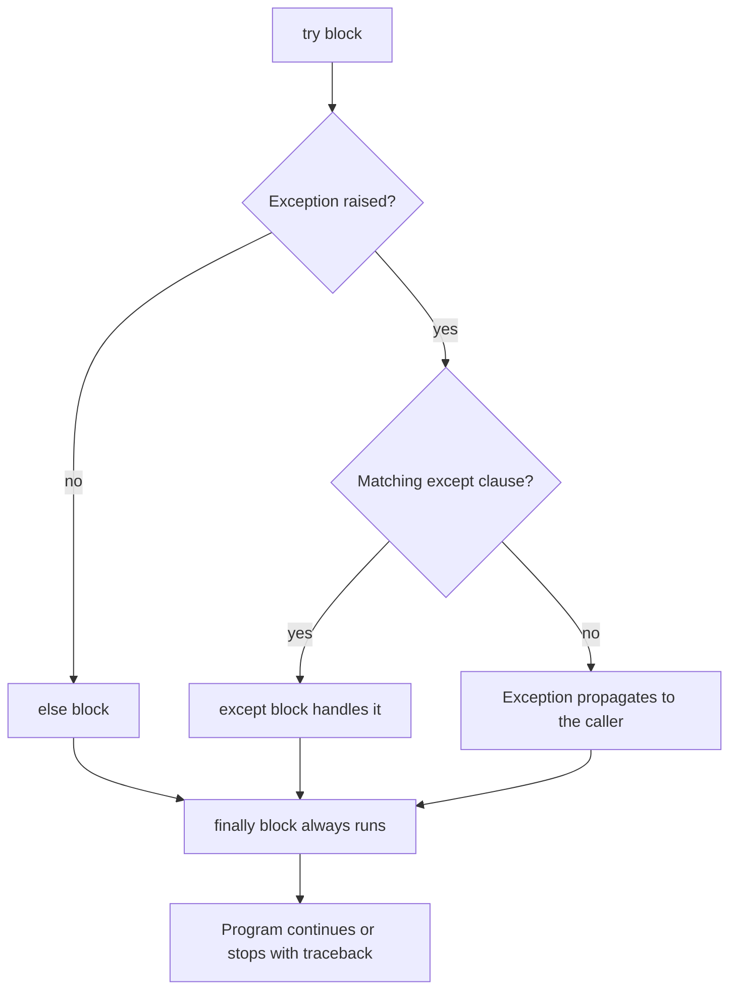
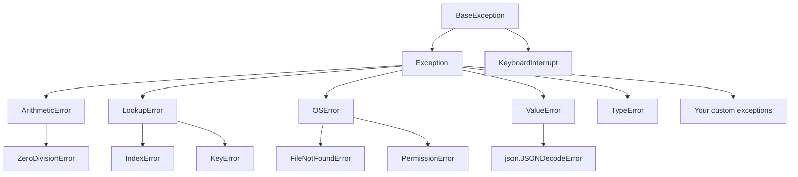
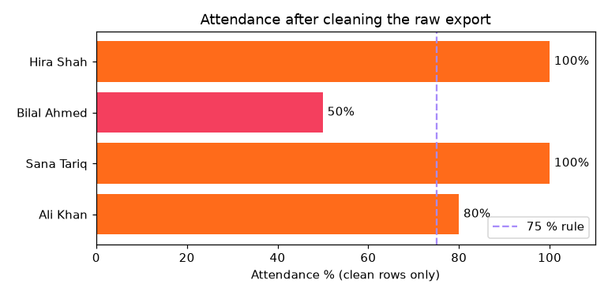
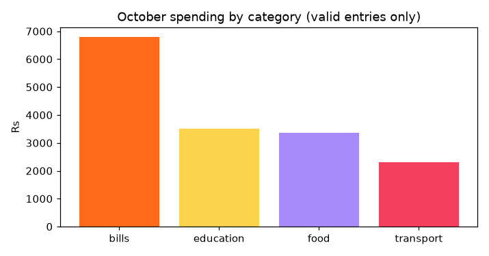

[](https://colab.research.google.com/github/Hamnakhan123/Diploma-in-AI/blob/main/term-1/04-application-based-programming-in-python/code/session-05-file-and-exception-handling.ipynb) &nbsp; 📓 [Notebook](code/session-05-file-and-exception-handling.ipynb)

# Session 5: File Handling and Exception Handling

> 🧭 [Diploma in AI](../../README.md) › [Term 1](../README.md) › [Application Based Programming in Python](README.md) › **Session 5**
>
> ⏱️ **Estimated time:** 3 hours (1 h concepts + 2 h lab) &nbsp;|&nbsp; 📋 **Prerequisites:** Sessions 1-4 (especially functions, dictionaries and loops).
>
> Prepared by **Hamna Zahid Khan**, Junior Lecturer

[⬅ Previous: Session 4](session-04-functions-modules-and-packages.md) &nbsp;|&nbsp; [🏠 Module home](README.md) &nbsp;|&nbsp; [Next: Session 6 ➡](session-06-regular-expressions-and-tokenization.md)

---

## 🎯 Learning objectives

By the end of this session you will be able to:

- Open files in every **access mode** (`r`, `w`, `a`, `x`, `+`, `b`) and choose the right one for the job.
- Use the file methods `read`, `readline`, `readlines`, `write`, `writelines`, `seek`, `tell` and `close`, preferably through a `with` block.
- Work with paths using `os` and `pathlib`, and read and write **CSV** and **JSON** files.
- Explain what an **exception** is, and handle errors with `try / except / else / finally`.
- **Raise** exceptions, define **custom exception** classes, chain exceptions and use `assert` for internal checks.
- Build programs that **never crash on bad data** and report exactly what they skipped.

## 📖 Concepts

### 1. Why files?

Variables live in RAM and vanish when the program ends. **Files** store data permanently on disk so it survives restarts and can be shared: configuration, logs, datasets, reports, images, trained models.

| File type | Content | Python tool |
|---|---|---|
| Text (`.txt`, `.log`, `.md`) | characters in an encoding (UTF-8) | `open(..., "r"/"w")` |
| CSV (`.csv`) | tables as comma-separated text | `csv` module, later `pandas` |
| JSON (`.json`) | nested dicts/lists as text | `json` module |
| Binary (`.png`, `.pdf`, `.pkl`) | raw bytes | `open(..., "rb"/"wb")` |

### 2. Opening a file and access modes

```python
f = open("notes.txt", mode="r", encoding="utf-8")   # returns a file object
...
f.close()                                          # always close (or use 'with')
```

| Mode | Meaning | If the file exists | If it does not exist | Cursor starts at |
|---|---|---|---|---|
| `"r"` | read (default) | opens | `FileNotFoundError` | start |
| `"w"` | write | **erases** content | creates | start |
| `"a"` | append | keeps content | creates | **end** |
| `"x"` | exclusive create | `FileExistsError` | creates | start |
| `"r+"` | read and write | opens, no erase | `FileNotFoundError` | start |
| `"w+"` | write and read | **erases** | creates | start |
| `"a+"` | append and read | keeps | creates | end |
| add `"b"` | binary: `"rb"`, `"wb"`, `"ab"` | bytes instead of str | | |
| add `"t"` | text (the default) | | | |

> 🧠 **Analogy:** `"w"` is a fresh page torn from the notebook (anything written before is gone). `"a"` is turning to the last page and continuing. `"x"` is "only write if this page is blank, otherwise refuse". `"r"` is reading without a pen.

**The `with` statement (context manager)** closes the file automatically, even if an error happens inside the block. Always prefer it:

```python
with open("notes.txt", "a", encoding="utf-8") as f:
    f.write("new line\n")
# file is closed here
```

**Always pass `encoding="utf-8"`** for text. Without it, Windows may use a different default and Urdu, Arabic or emoji characters will break.

### 3. File methods

| Method | Returns / does | Good for |
|---|---|---|
| `f.read()` / `f.read(n)` | whole file / next n characters as one string | small files |
| `f.readline()` | next line, including `\n` | headers, line-by-line logic |
| `f.readlines()` | list of all lines | small files you need as a list |
| `for line in f:` | one line at a time, lazily | **huge files** (constant memory) |
| `f.write(s)` | writes a string, returns characters written | output |
| `f.writelines(list)` | writes each string (adds no newlines!) | many lines at once |
| `print(..., file=f)` | prints into the file, adds a newline | quick logging |
| `f.seek(pos)` / `f.tell()` | move / report the cursor position | re-reading, random access |
| `f.close()`, `f.closed` | close / check | manual handling |

**Paths and the file system:** `os.path.exists`, `os.listdir`, `os.rename`, `os.remove`, `os.makedirs`, `shutil.copy`, `shutil.rmtree`. The modern alternative is **`pathlib.Path`**: `Path("reports") / "2026" / "oct.txt"`, `.exists()`, `.read_text()`, `.write_text()`, `.suffix`, `.stem`, `.glob("*.csv")`. Use **relative paths** inside projects so code works on every machine.

### 4. CSV and JSON

- **CSV** stores tables. The `csv` module handles quoting (a comma inside `"Bilal, Jr."`) correctly, which a naive `line.split(",")` does not. `csv.DictReader` gives each row as a dict keyed by the header; `csv.DictWriter` writes dicts. Open CSV files with `newline=""`. **Every value read from a CSV is a string**: convert numbers yourself.
- **JSON** (JavaScript Object Notation) stores nested data and is the language of web APIs (Sessions 7-8). `json.dump(obj, f, indent=2)` / `json.load(f)` work with files; `json.dumps` / `json.loads` with strings. Python `None`, `True` map to JSON `null`, `true`. JSON requires **double quotes**.

### 5. Exceptions: errors at run time

There are two kinds of errors:

- **Syntax errors** are found before the program runs (missing colon, bad indentation).
- **Exceptions** happen **while** it runs: dividing by zero, a missing file, `int("abc")`. Unhandled, they stop the program with a **traceback**.

| Exception | Typical cause |
|---|---|
| `ZeroDivisionError` | `x / 0` |
| `ValueError` | right type, wrong value: `int("abc")` |
| `TypeError` | wrong type: `"5" + 5` |
| `IndexError` / `KeyError` | list index / dict key does not exist |
| `FileNotFoundError`, `PermissionError` (both `OSError`) | file problems |
| `AttributeError` | object has no such method/attribute |
| `NameError` | variable not defined |
| `ImportError` / `ModuleNotFoundError` | module missing |

All of these inherit from **`Exception`**, which inherits from `BaseException`. An `except` clause catches the named class **and all its subclasses**: `except OSError` also catches `FileNotFoundError`.

### 6. Handling exceptions

```python
try:
    risky_code()                 # code that might fail
except ValueError as e:          # runs if a ValueError happened
    handle(e)
except (KeyError, IndexError):   # several types in one clause
    ...
else:
    runs_only_if_no_error()
finally:
    always_runs()                # cleanup: close connections, release locks
```

- Python checks `except` clauses **top to bottom**; put **specific** exceptions before general ones.
- Keep the `try` block **small**: wrap only the lines that can fail, so you do not hide unrelated bugs.
- `raise ValueError("message")` signals an error yourself. A bare `raise` inside `except` re-raises the current exception.
- `raise NewError(...) from e` keeps the original cause (exception chaining); `from None` hides it.
- **Custom exceptions** are classes that inherit from `Exception`. They make errors self-explanatory (`InsufficientFundsError`) and let callers catch a whole family with a base class.
- `assert condition, "message"` is for **internal sanity checks** during development; never use it to validate user input, because `python -O` disables asserts.

> 🧠 **Analogy:** `try / except` is a **safety net** under a tightrope walker. The walker still attempts the walk (`try`); if they fall, the net catches *that kind* of fall (`except`); if they make it, the crowd cheers (`else`); and the crew packs up the rope either way (`finally`).

> ⚠️ Never write a bare `except:` or `except Exception: pass`. It silently swallows every error, including typos and `KeyboardInterrupt`, and turns bugs into mysteries.

## 🧭 Diagrams





## 💻 Worked examples

### Example 1: Access modes and file methods (basic)

📄 [`code/session-05_file_basics.py`](code/session-05_file_basics.py) &nbsp;·&nbsp; run: `python session-05_file_basics.py`

```python
"""
Session 5 · Example 1: file access modes and file methods
---------------------------------------------------------
All files are created in a temporary folder that is deleted at the end,
so running the script leaves nothing behind.
Run:  python session-05_file_basics.py
"""
import os
import tempfile
from pathlib import Path

start = os.getcwd()                              # remember where we started
work = tempfile.mkdtemp()
os.chdir(work)                                   # work inside the temp folder

# 'w' write: creates the file, or EMPTIES it if it exists
with open("notes.txt", "w", encoding="utf-8") as f:   # 'with' closes the file automatically
    f.write("Line 1: Python files\n")
    f.writelines(["Line 2: modes r w a x\n", "Line 3: Urdu works too: کراچی\n"])
print("closed after with-block?", f.closed)

# 'r' read (the default): the whole file, one line, or all lines
with open("notes.txt", encoding="utf-8") as f:
    print("read():", repr(f.read(20)), "... first 20 characters")
    print("tell() after 20 chars ->", f.tell(), "bytes")
    f.seek(0)                                    # jump back to the start
    print("readline():", repr(f.readline()))
    print("readlines():", f.readlines())

# Iterate line by line: memory-friendly for huge files
with open("notes.txt", encoding="utf-8") as f:
    for number, line in enumerate(f, start=1):
        print(f"  {number}: {line.rstrip()}")

# 'a' append: adds to the end, never erases
with open("notes.txt", "a", encoding="utf-8") as f:
    print("Line 4: appended with print(file=f)", file=f)
print("line count now:", sum(1 for _ in open("notes.txt", encoding="utf-8")))

# 'x' exclusive create: fails if the file already exists (safe against overwriting)
try:
    open("notes.txt", "x")
except FileExistsError as e:
    print("mode 'x':", type(e).__name__, "-", e.strerror)

# 'r+' read and write without truncating
with open("notes.txt", "r+", encoding="utf-8") as f:
    f.write("LINE")                              # overwrites the first 4 characters
    f.seek(0)
    print("after r+:", f.readline().rstrip())

# Binary mode 'rb' / 'wb': bytes, not text (images, PDFs, pickles)
with open("pixel.bin", "wb") as f:
    f.write(bytes([255, 107, 26]))               # the RGB colour #FF6B1A
with open("pixel.bin", "rb") as f:
    data = f.read()
print("binary:", data, "->", list(data), "| size", os.path.getsize("pixel.bin"), "bytes")

# pathlib: the modern, object-oriented way to work with paths
p = Path("reports") / "2026" / "october.txt"
p.parent.mkdir(parents=True, exist_ok=True)
p.write_text("Total: 42\n", encoding="utf-8")
print("pathlib:", p, "| exists:", p.exists(), "| suffix:", p.suffix, "| stem:", p.stem,
      "| text:", p.read_text(encoding="utf-8").strip())
print("all .txt files:", sorted(str(x) for x in Path(".").rglob("*.txt")))

# Rename and delete
os.rename("notes.txt", "notes_old.txt")
os.remove("pixel.bin")
print("folder now:", sorted(os.listdir(".")))

import shutil
os.chdir(start); shutil.rmtree(work)             # go back, then delete the demo folder
print("cleaned up:", not os.path.exists(work))
```

**Output**

```text
closed after with-block? True
read(): 'Line 1: Python files' ... first 20 characters
tell() after 20 chars -> 20 bytes
readline(): 'Line 1: Python files\n'
readlines(): ['Line 2: modes r w a x\n', 'Line 3: Urdu works too: کراچی\n']
  1: Line 1: Python files
  2: Line 2: modes r w a x
  3: Line 3: Urdu works too: کراچی
line count now: 4
mode 'x': FileExistsError - File exists
after r+: LINE 1: Python files
binary: b'\xffk\x1a' -> [255, 107, 26] | size 3 bytes
pathlib: reports/2026/october.txt | exists: True | suffix: .txt | stem: october | text: Total: 42
all .txt files: ['notes.txt', 'reports/2026/october.txt']
folder now: ['notes_old.txt', 'reports']
cleaned up: True
```


**What to notice:**

1. `f.closed` is `True` right after the `with` block, with no `close()` call.
2. `tell()` reported 20 after reading 20 ASCII characters; the Urdu word takes more **bytes** than characters in UTF-8, which is why `tell()` counts bytes.
3. Mode `"x"` refused to touch an existing file, a cheap protection against accidental overwrites.
4. In binary mode we get a `bytes` object; `list(data)` shows the three numbers that make up the colour.

### Example 2: CSV and JSON (intermediate)

📄 [`code/session-05_csv_json.py`](code/session-05_csv_json.py) &nbsp;·&nbsp; run: `python session-05_csv_json.py`

```python
"""
Session 5 · Example 2: structured files - CSV and JSON
------------------------------------------------------
Run:  python session-05_csv_json.py
"""
import csv
import json
import os
import shutil
import tempfile

start, work = os.getcwd(), tempfile.mkdtemp()
os.chdir(work)                      # demo files go to a temporary folder

students = [
    {"roll": "AI-01", "name": "Ali Khan", "city": "Karachi", "marks": 78},
    {"roll": "AI-02", "name": "Sana Tariq", "city": "Lahore", "marks": 91},
    {"roll": "AI-03", "name": "Bilal, Jr.", "city": "Karachi", "marks": 64},   # comma inside a value!
]

# --- CSV: write with DictWriter (handles quoting of commas for you) ---
with open("students.csv", "w", newline="", encoding="utf-8") as f:   # newline="" avoids blank lines on Windows
    writer = csv.DictWriter(f, fieldnames=["roll", "name", "city", "marks"])
    writer.writeheader()
    writer.writerows(students)
print("raw CSV text:\n" + open("students.csv", encoding="utf-8").read())

# --- CSV: read rows as dicts. Every value comes back as TEXT ---
with open("students.csv", newline="", encoding="utf-8") as f:
    rows = list(csv.DictReader(f))
print("first row:", rows[0])
print("type of marks:", type(rows[0]["marks"]).__name__, "-> convert before maths")
avg = sum(int(r["marks"]) for r in rows) / len(rows)
print(f"average marks: {avg:.2f}")

# csv.reader gives plain lists
with open("students.csv", newline="", encoding="utf-8") as f:
    reader = csv.reader(f)
    header = next(reader)
    karachi = [row[1] for row in reader if row[2] == "Karachi"]
print("header:", header, "| Karachi students:", karachi)

# --- JSON: nested data (dicts, lists, numbers, strings, bools, null) ---
config = {
    "course": "Diploma in AI",
    "term": 1,
    "modules": ["T-SQL", "MongoDB", "Statistics", "Python"],
    "lab": {"room": "B-204", "pcs": 30, "projector": True},
    "coordinator": None,
}
with open("config.json", "w", encoding="utf-8") as f:
    json.dump(config, f, indent=2)              # pretty-printed file

with open("config.json", encoding="utf-8") as f:
    loaded = json.load(f)
print("\nJSON round trip equal?", loaded == config)
print("lab room:", loaded["lab"]["room"], "| modules:", len(loaded["modules"]))

# dumps / loads work with strings (used for web APIs in Sessions 7-8)
text = json.dumps({"ok": True, "items": [1, 2]})
print("dumps ->", text, "| loads ->", json.loads(text))
print("Python None/True become JSON:", json.dumps([None, True, False]))
try:
    json.loads("{'single': 'quotes'}")            # not valid JSON
except json.JSONDecodeError as e:
    print("JSONDecodeError:", e.msg)

os.chdir(start); shutil.rmtree(work)   # tidy up
```

**Output**

```text
raw CSV text:
roll,name,city,marks
AI-01,Ali Khan,Karachi,78
AI-02,Sana Tariq,Lahore,91
AI-03,"Bilal, Jr.",Karachi,64

first row: {'roll': 'AI-01', 'name': 'Ali Khan', 'city': 'Karachi', 'marks': '78'}
type of marks: str -> convert before maths
average marks: 77.67
header: ['roll', 'name', 'city', 'marks'] | Karachi students: ['Ali Khan', 'Bilal, Jr.']

JSON round trip equal? True
lab room: B-204 | modules: 4
dumps -> {"ok": true, "items": [1, 2]} | loads -> {'ok': True, 'items': [1, 2]}
Python None/True become JSON: [null, true, false]
JSONDecodeError: Expecting property name enclosed in double quotes
```


**Walkthrough:**

- `DictWriter` wrapped `"Bilal, Jr."` in quotes automatically; reading it back returned the full name, not two broken columns.
- Every CSV value came back as `str`, so `int(r["marks"])` was required before averaging.
- The JSON file preserved nesting, booleans and `None`, and `loaded == config` confirms a perfect round trip.

### Example 3: Exception handling from basics to custom classes (advanced)

📄 [`code/session-05_exceptions.py`](code/session-05_exceptions.py) &nbsp;·&nbsp; run: `python session-05_exceptions.py`

```python
"""
Session 5 · Example 3: exception handling
-----------------------------------------
Run:  python session-05_exceptions.py
"""
# 1. Some common built-in exceptions, triggered on purpose
tests = {
    "ZeroDivisionError": lambda: 10 / 0,
    "ValueError": lambda: int("abc"),
    "TypeError": lambda: "5" + 5,
    "IndexError": lambda: [1, 2, 3][10],
    "KeyError": lambda: {"a": 1}["b"],
    "FileNotFoundError": lambda: open("no_such_file.txt"),
    "AttributeError": lambda: "text".push("x"),
    "NameError": lambda: undefined_variable,      # noqa: F821
}
for name, fn in tests.items():
    try:
        fn()
    except Exception as e:                           # catch, then report the class name
        print(f"  {type(e).__name__:18} {e}")

# 2. try / except / else / finally
def read_number(text):
    try:
        value = float(text)
    except ValueError:
        print(f"  {text!r}: not a number")
        return None
    else:                                            # runs only if NO exception happened
        print(f"  {text!r}: ok -> {value}")
        return value
    finally:                                         # ALWAYS runs (cleanup)
        print("    (finally: checked", repr(text) + ")")
for t in ["42.5", "forty"]:
    read_number(t)

# 3. Several except blocks: the first matching one wins, so specific before general
def safe_ratio(a, b):
    try:
        return round(a / b, 2)
    except ZeroDivisionError:
        return "cannot divide by zero"
    except TypeError:
        return "numbers only"
    except Exception as e:                           # last resort
        return f"unexpected: {e}"
print("safe_ratio:", safe_ratio(7, 2), "|", safe_ratio(7, 0), "|", safe_ratio("7", 2))

# 4. Catch several types in one block with a tuple
for raw in ["12", "x", None]:
    try:
        print("  doubled:", int(raw) * 2)
    except (ValueError, TypeError) as e:
        print("  bad input", repr(raw), "->", type(e).__name__)

# 5. raise: signal an error yourself
def set_age(age):
    if not isinstance(age, int):
        raise TypeError("age must be an int")
    if not 0 <= age <= 120:
        raise ValueError(f"age {age} is out of range 0-120")
    return age
for a in [25, 150, "20"]:
    try:
        print("  age set:", set_age(a))
    except (TypeError, ValueError) as e:
        print("  rejected:", e)

# 6. Custom exceptions: a class that inherits from Exception
class InsufficientFundsError(Exception):
    """Raised when a withdrawal is bigger than the balance."""
    def __init__(self, balance, amount):
        super().__init__(f"balance Rs {balance:,} is less than Rs {amount:,}")
        self.shortfall = amount - balance

def withdraw(balance, amount):
    if amount > balance:
        raise InsufficientFundsError(balance, amount)
    return balance - amount
try:
    withdraw(3_000, 5_000)
except InsufficientFundsError as e:
    print("custom:", e, "| shortfall:", e.shortfall)

# 7. Re-raising with context: 'raise ... from ...' keeps the original cause
def load_price(text):
    try:
        return float(text)
    except ValueError as e:
        raise RuntimeError("price file is corrupt") from e
try:
    load_price("12,50")
except RuntimeError as e:
    print("chained:", e, "| caused by:", repr(e.__cause__))

# 8. assert for internal sanity checks (can be disabled with python -O)
def average(values):
    assert len(values) > 0, "average() needs at least one value"
    return sum(values) / len(values)
try:
    average([])
except AssertionError as e:
    print("assert:", e)

# 9. The exception hierarchy decides what an except clause catches
print("FileNotFoundError is an OSError?", issubclass(FileNotFoundError, OSError))
print("KeyError and IndexError share the base:", KeyError.__mro__[1].__name__)
```

**Output**

```text
  ZeroDivisionError  division by zero
  ValueError         invalid literal for int() with base 10: 'abc'
  TypeError          can only concatenate str (not "int") to str
  IndexError         list index out of range
  KeyError           'b'
  FileNotFoundError  [Errno 2] No such file or directory: 'no_such_file.txt'
  AttributeError     'str' object has no attribute 'push'
  NameError          name 'undefined_variable' is not defined
  '42.5': ok -> 42.5
    (finally: checked '42.5')
  'forty': not a number
    (finally: checked 'forty')
safe_ratio: 3.5 | cannot divide by zero | numbers only
  doubled: 24
  bad input 'x' -> ValueError
  bad input None -> TypeError
  age set: 25
  rejected: age 150 is out of range 0-120
  rejected: age must be an int
custom: balance Rs 3,000 is less than Rs 5,000 | shortfall: 2000
chained: price file is corrupt | caused by: ValueError("could not convert string to float: '12,50'")
assert: average() needs at least one value
FileNotFoundError is an OSError? True
KeyError and IndexError share the base: LookupError
```


**Key lessons:**

- `else` ran only for the valid number, while `finally` ran for both inputs.
- `safe_ratio` turned three different failures into friendly messages; the general `except Exception` is last.
- `InsufficientFundsError` carries extra data (`shortfall`), something a plain string cannot do.
- `raise ... from e` kept the original `ValueError` as `__cause__`, so the full story appears in the traceback.

## 🌍 Real-life coding problem: cleaning a messy attendance file

**Scenario.** A biometric machine exports `attendance_raw.csv`. Before you can compute attendance percentages, you must deal with lower-case codes, an unknown status, the word "ten" in a numeric column, a missing name, a short row and the impossible date 2026-13-09. Here is a slice of the raw file:

```text
date,roll,name,status,minutes_late
2026-10-06,AI-02,Sana Tariq,p,0
2026-10-06,AI-03,Bilal Ahmed,P,ten
2026-10-07,AI-05,,P,0
2026-10-08,AI-04,Hira Shah
2026-13-09,AI-04,Hira Shah,P,0
```


**Plan before coding:**

1. A `validate(row)` function that either returns a clean dict or **raises** a custom `BadRowError` with a precise reason.
2. A loop that calls `validate` inside `try / except BadRowError`, so one bad row never stops the run.
3. Good rows → `attendance_clean.csv` (`DictWriter`); bad rows → `attendance_errors.log` with the line number.
4. Summarise per student and chart the result.

```python
for line_no, row in enumerate(reader, start=2):
    try:
        good.append(validate(row, line_no))
    except BadRowError as e:
        bad.append((line_no, str(e), ",".join(row)))
```

📄 Full solution (95 lines, fully commented): [`code/session-05_problem_attendance_cleaner.py`](code/session-05_problem_attendance_cleaner.py) &nbsp;·&nbsp; run: `python session-05_problem_attendance_cleaner.py` &nbsp;·&nbsp; also in the session notebook

**Output**

```text
read 22 data rows: 18 clean, 4 rejected

attendance_errors.log
line 8: minutes_late is not a number: 'ten' | 2026-10-06,AI-03,Bilal Ahmed,P,ten
line 14: missing name | 2026-10-07,AI-05,,P,0
line 18: expected 5 fields, got 3 | 2026-10-08,AI-04,Hira Shah
line 23: invalid date '2026-13-09' | 2026-13-09,AI-04,Hira Shah,P,0

Student       P  A  L  Attend %  Late min
Ali Khan      4  1  0     80.0%        12
Sana Tariq    5  0  0    100.0%        30
Bilal Ahmed   2  2  0     50.0%         3  <- below 75 %
Hira Shah     3  0  1    100.0%         0

Files written: attendance_clean.csv, attendance_errors.log, session-05_problem_attendance_cleaner.png
```




**Interpretation.** 18 of 22 rows were usable. Lower-case `p` was **fixed** (a safe, obvious correction) while ambiguous rows were **rejected and logged**, not guessed. Bilal is below the 75 % rule; before acting on it, the coordinator can check the error log, because one of his rows was rejected. This "clean, quarantine, report" pattern is exactly how data pipelines in AI projects treat raw data.

## 🛠️ Mini project: persistent expense tracker

A tracker that remembers your expenses between runs by saving them to JSON. It shows three professional habits:

| Habit | How the code does it |
|---|---|
| Never crash on a missing or corrupt file | `except FileNotFoundError` → start empty; `except json.JSONDecodeError` → back up the broken file |
| Validate input with meaningful errors | `ExpenseError` base class with `InvalidAmountError` and `UnknownCategoryError` subclasses |
| Save safely | write to `expenses.json.tmp`, then `os.replace()` it over the real file in one step |

```python
def save(expenses, path=DATA_FILE):
    tmp = path + ".tmp"
    with open(tmp, "w", encoding="utf-8") as f:
        json.dump(expenses, f, indent=2)
    os.replace(tmp, path)          # atomic: the file is either old or new, never half-written
```

📄 Full solution (121 lines, fully commented): [`code/session-05_project_expense_tracker.py`](code/session-05_project_expense_tracker.py) &nbsp;·&nbsp; run: `python session-05_project_expense_tracker.py` &nbsp;·&nbsp; also in the session notebook

**Output**

```text
Run 1: first use
  (no expenses.json yet - starting a new tracker)
  added   2026-10-01 Bills         6,800
  added   2026-10-02 food          1,250
  added   2026-10-03 transport       900
  skipped 2026-10-04: InvalidAmountError: amount '3,500' is not a number
  skipped 2026-10-05: InvalidAmountError: amount must be positive
  skipped 2026-10-06: UnknownCategoryError: 'shopping' is not one of ['bills', 'education', 'food', 'other', 'transport']
  added   2026-10-07 education     3,500
  added   2026-10-08 food          2,100
  added   2026-10-31 transport     1,400
  skipped 2026-10-32: bad date (day is out of range for month)
  saved 6 expenses to expenses.json

Run 2: the program starts again and reloads the file
  loaded 6 expenses, total Rs 15,950

Run 3: someone corrupts the file by hand
  (expenses.json was corrupt - moved to expenses.json.corrupt, starting fresh)
  recovered list length: 0

expense_report.csv
category,total,share
bills,6800,42.6%
education,3500,21.9%
food,3350,21.0%
transport,2300,14.4%
Chart saved: session-05_project_expense_tracker.png
```




**Extension ideas:** add a monthly budget per category and raise a `BudgetExceededError`; add a `delete(index)` function that handles `IndexError`; read expenses from a bank-statement CSV.

## ⚠️ Common mistakes

| Mistake | Consequence | Fix |
|---|---|---|
| Opening with `"w"` when you meant `"a"` | previous data erased | Use `"a"` to add, `"x"` to protect |
| Forgetting to close a file | data not flushed, file locked on Windows | Use `with open(...)` |
| No `encoding="utf-8"` | `UnicodeDecodeError` or garbled Urdu text | Always pass it for text files |
| `writelines(list)` expecting new lines | everything on one line | Add `"\n"` to each item |
| Splitting CSV lines with `split(",")` | breaks on quoted commas | Use the `csv` module |
| Doing maths on CSV values | `TypeError` (they are strings) | Convert with `int()` / `float()` |
| Bare `except:` or `except: pass` | hides real bugs | Catch specific exceptions; log what you skip |
| Huge `try` block | unclear which line failed | Wrap only the risky lines |
| `assert` for user input | disabled with `python -O` | Raise `ValueError` instead |
| Absolute paths like `C:\Users\Ali\data.csv` | fails on every other computer | Relative paths or `pathlib` |

## ✅ Best practices

- Use `with` for every file and every resource that must be released.
- Read big files **line by line**; never `read()` a multi-gigabyte log.
- Validate data at the boundary (when it enters your program) and keep the raw file untouched.
- Catch the **narrowest** exception you can handle, and handle it meaningfully: retry, use a default, skip and log, or re-raise with context.
- Define a small **hierarchy of custom exceptions** for your application.
- Log errors with enough context (line number, raw value) to fix them later.
- Save important files **atomically** (temp file + `os.replace`).

## 🧪 Lab / practice tasks

**1. 🟢 Easy:** Write a program that creates `shopping.txt` with five items (one per line), then appends two more, then prints the numbered list.

<details><summary>💡 Hint</summary>

`"w"` for the first write, `"a"` for the append, `enumerate(f, 1)` to number.

</details>

<details><summary>✅ Solution</summary>

```python
with open("shopping.txt", "w", encoding="utf-8") as f:
    f.write("\n".join(["rice", "daal", "milk", "eggs", "tea"]) + "\n")
with open("shopping.txt", "a", encoding="utf-8") as f:
    f.writelines(["sugar\n", "bread\n"])
with open("shopping.txt", encoding="utf-8") as f:
    for i, item in enumerate(f, 1):
        print(i, item.strip())
```

</details>

**2. 🟢 Easy:** Ask the user for two numbers and divide them. Handle `ValueError` (not a number) and `ZeroDivisionError` with different messages, and print "done" in a `finally` block.

<details><summary>💡 Hint</summary>

Put both `float(input(...))` calls and the division inside the `try`.

</details>

<details><summary>✅ Solution</summary>

```python
try:
    a = float(input("a: ")); b = float(input("b: "))
    print("a / b =", a / b)
except ValueError:
    print("Please type numbers only")
except ZeroDivisionError:
    print("b cannot be zero")
finally:
    print("done")
```

</details>

**3. 🟡 Medium:** Write `word_count(path)` that returns the 5 most common words in a text file (lower-case, punctuation removed) and returns an empty list with a printed warning if the file does not exist.

<details><summary>💡 Hint</summary>

`collections.Counter(words).most_common(5)`; strip punctuation with `word.strip(".,!?;:\"'()")`.

</details>

<details><summary>✅ Solution</summary>

```python
from collections import Counter
def word_count(path):
    try:
        with open(path, encoding="utf-8") as f:
            words = [w.strip(".,!?;:\"'()").lower() for w in f.read().split()]
    except FileNotFoundError:
        print(f"warning: {path} not found")
        return []
    return Counter(w for w in words if w).most_common(5)
```

</details>

**4. 🟡 Medium:** Convert `students.csv` (roll, name, marks) into `students.json` as a list of dicts with marks stored as integers, then load the JSON and print the topper.

<details><summary>💡 Hint</summary>

`rows = [dict(r, marks=int(r["marks"])) for r in csv.DictReader(f)]`

</details>

<details><summary>✅ Solution</summary>

```python
import csv, json
with open("students.csv", newline="", encoding="utf-8") as f:
    rows = [dict(r, marks=int(r["marks"])) for r in csv.DictReader(f)]
with open("students.json", "w", encoding="utf-8") as f:
    json.dump(rows, f, indent=2)
with open("students.json", encoding="utf-8") as f:
    data = json.load(f)
print(max(data, key=lambda r: r["marks"])["name"])
```

</details>

**5. 🟠 Hard:** Write a `retry(fn, attempts=3)` function that calls `fn()`, catches `ConnectionError`, waits 0.1 s (`time.sleep`) and tries again, re-raising the last error after the final attempt. Test it with a fake function that fails twice and then succeeds.

<details><summary>💡 Hint</summary>

Loop `for i in range(attempts)`, `return fn()` inside `try`; in `except`, `if i == attempts - 1: raise`.

</details>

<details><summary>✅ Solution</summary>

```python
import time
def retry(fn, attempts=3):
    for i in range(attempts):
        try:
            return fn()
        except ConnectionError as e:
            print(f"attempt {i + 1} failed: {e}")
            if i == attempts - 1:
                raise
            time.sleep(0.1)
calls = {"n": 0}
def flaky():
    calls["n"] += 1
    if calls["n"] < 3:
        raise ConnectionError("server busy")
    return "data"
print(retry(flaky))   # two failures, then 'data'
```

You will reuse this pattern for web scraping in Session 8.

</details>

**6. 🔴 Challenge:** Extend the attendance cleaner so that **duplicate** rows (same date and roll twice) are rejected with reason "duplicate entry", and so that a summary of rejection reasons (`Counter`) is written at the end of the log file.

<details><summary>💡 Hint</summary>

Keep a `seen = set()` of `(date, roll)` tuples; check it inside `validate` (pass `seen` in) and add after a row passes. Use `Counter(reason.split(" ")[0] for _, reason, _ in bad)` or store a short code with each error.

</details>

<details><summary>✅ Solution</summary>

```python
from collections import Counter
seen = set()
def validate_unique(row, line_no):
    clean = validate(row, line_no)
    key = (clean["date"], clean["roll"])
    if key in seen:
        raise BadRowError("duplicate entry")
    seen.add(key)
    return clean
# ...use validate_unique in the loop, then:
with open("attendance_errors.log", "a", encoding="utf-8") as f:
    f.write("\nSummary\n")
    for reason, n in Counter(r.split(":")[0] for _, r, _ in bad).most_common():
        f.write(f"  {reason}: {n}\n")
```

</details>

## ✅ Quick quiz

**Q1.** Which mode opens a file for writing but raises an error if the file already exists?

- A) "w"
- B) "a"
- C) "x"
- D) "r+"

**Q2.** What is the main advantage of `with open(...) as f:`?

- A) it reads faster
- B) the file is closed automatically, even after an error
- C) it allows binary data
- D) it creates the folder if missing

**Q3.** When does the `else` block of a try statement run?

- A) always
- B) only when an exception occurred
- C) only when no exception occurred
- D) only when finally is absent

**Q4.** `except OSError:` will also catch which of these?

- A) ValueError
- B) KeyError
- C) FileNotFoundError
- D) ZeroDivisionError

**Q5.** What type does `csv.DictReader` give for a column of numbers?

- A) int
- B) float
- C) str
- D) it detects the type automatically

<details><summary>✅ Show answers</summary>

1. **C** — exclusive creation protects existing files.
2. **B** — the context manager guarantees cleanup.
3. **C** — else runs after a try block that raised nothing.
4. **C** — FileNotFoundError is a subclass of OSError.
5. **C** — the csv module returns text; convert it yourself.

</details>


## 📝 Summary

- Open files with `open(path, mode, encoding="utf-8")`; modes `r`, `w` (erases), `a` (appends), `x` (exclusive), `+` (read and write), `b` (binary).
- Prefer `with` blocks; use `read`, `readline`, `readlines`, iteration, `write`, `writelines`, `seek`, `tell`.
- Manage paths with `os` / `shutil` or `pathlib`; use the `csv` and `json` modules for structured data and remember CSV values are strings.
- **Exceptions** are run-time errors organised in a class hierarchy under `Exception`.
- Handle them with `try / except / else / finally`: specific before general, small try blocks, never a bare except.
- `raise` your own errors, create **custom exception classes**, chain with `from`, and keep `assert` for internal checks.

### 🎤 Interview / viva questions

1. What is the difference between modes `"w"`, `"a"` and `"x"`?
2. Why is `with open(...)` preferred over `open()` and `close()`?
3. How would you read a 10 GB log file without running out of memory?
4. Explain the roles of `else` and `finally` in a try statement.
5. Why is `except: pass` dangerous? What should you do instead?
6. When would you create a custom exception class? Give an example.
7. What is the difference between a syntax error and an exception?

---

[⬅ Previous: Session 4](session-04-functions-modules-and-packages.md) &nbsp;|&nbsp; [🏠 Module home](README.md) &nbsp;|&nbsp; [Next: Session 6 ➡](session-06-regular-expressions-and-tokenization.md)

<sub>Prepared by **Hamna Zahid Khan**, Junior Lecturer · Diploma in AI</sub>
