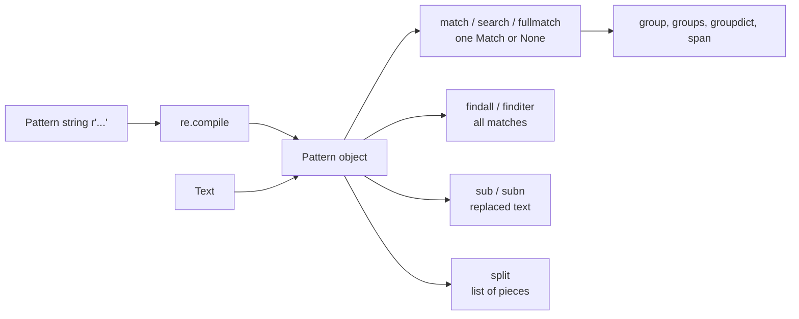
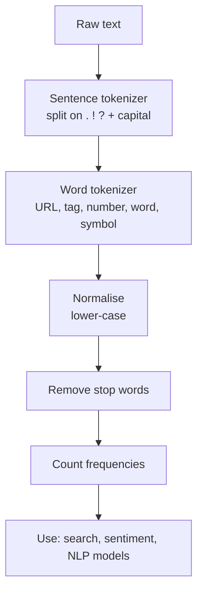
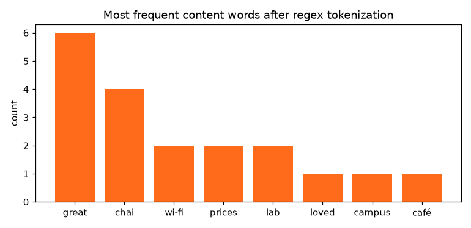
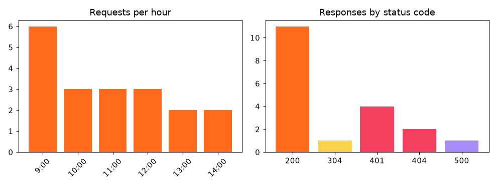

[](https://colab.research.google.com/github/Hamnakhan123/Diploma-in-AI/blob/main/term-1/04-application-based-programming-in-python/code/session-06-regular-expressions-and-tokenization.ipynb) &nbsp; 📓 [Notebook](code/session-06-regular-expressions-and-tokenization.ipynb)

# Session 6: Regular Expressions and Tokenization

> 🧭 [Diploma in AI](../../README.md) › [Term 1](../README.md) › [Application Based Programming in Python](README.md) › **Session 6**
>
> ⏱️ **Estimated time:** 2.5 hours (1 h concepts + 1.5 h lab) &nbsp;|&nbsp; 📋 **Prerequisites:** Session 5 (files, exceptions) and string basics from Sessions 1-2.
>
> Prepared by **Hamna Zahid Khan**, Junior Lecturer

[⬅ Previous: Session 5](session-05-file-and-exception-handling.md) &nbsp;|&nbsp; [🏠 Module home](README.md) &nbsp;|&nbsp; [Next: Session 7 ➡](session-07-web-development-with-flask.md)

---

## 🎯 Learning objectives

By the end of this session you will be able to:

- Explain what **regular expressions** are and the **benefits** they bring over plain string methods.
- Read and write patterns using **metacharacters**, **character classes**, **special sequences**, **quantifiers**, **anchors**, **groups** and **alternation**.
- Use the `re` module's methods: `match`, `search`, `fullmatch`, `findall`, `finditer`, `sub`, `subn`, `split`, `compile`, plus **flags** and **named groups**.
- Tell **greedy** from **lazy** matching and use simple **lookaheads**.
- **Tokenize** text into sentences and words with regular expressions, the first step of every NLP pipeline.

## 📖 Concepts

### 1. What is a regular expression and why use one?

A **regular expression** (regex) is a small language for describing **text patterns**: "five digits, a dash, seven digits, a dash, one digit" describes every CNIC number without listing them. Python's built-in **`re`** module runs these patterns.

| Task | With string methods | With a regex |
|---|---|---|
| Does the text contain "AI"? | `"AI" in text` ✅ easy | overkill |
| Find every date like 2026-10-05 | loops, slicing, `isdigit()` checks | `re.findall(r"\d{4}-\d{2}-\d{2}", text)` |
| Validate a mobile number in 3 formats | many `if`s | one pattern |
| Replace all runs of spaces with one | loop until no double spaces | `re.sub(r"\s+", " ", text)` |
| Split on `,` or `;` or `|` | replace each, then split | `re.split(r"[,;|]", text)` |

**Benefits:** concise, powerful (one pattern replaces dozens of lines), language-independent (the same syntax works in JavaScript, SQL, grep, editors), and fast because patterns are compiled. **Costs:** they can become unreadable, so keep them simple, comment them with `re.VERBOSE`, and test them.

> 🧠 **Analogy:** A regex is a **stencil**. Instead of checking each letter by hand, you slide the stencil over the text and everything with exactly that shape shows through.

**Use raw strings** for patterns: `r"\d+"`. In a normal string, `"\b"` is a backspace character; in a raw string `r"\b"` stays as backslash + b, which the regex engine reads as a word boundary.

### 2. Metacharacters

These characters have special meaning: `. ^ $ * + ? { } [ ] \ | ( )`. Escape them with `\` to match them literally (`\.` matches a real dot), or let `re.escape()` do it.

| Metacharacter | Meaning | Example | Matches |
|---|---|---|---|
| `.` | any character except newline | `c.t` | cat, cot, c9t |
| `^` | start of string (or line with `re.M`) | `^Hello` | "Hello" only at the start |
| `$` | end of string | `again$` | "again" at the end |
| `*` | 0 or more of the previous item | `go*gle` | ggle, gogle, google |
| `+` | 1 or more | `go+gle` | gogle, google |
| `?` | 0 or 1 (optional) | `colou?r` | color, colour |
| `{n}`, `{m,n}` | exactly n / between m and n | `\d{4}` | 2026 |
| `[...]` | one character from a set | `[aeiou]` | any vowel |
| `\|` | OR | `cat\|dog` | cat or dog |
| `(...)` | group (capture) | `(\d+)-(\d+)` | captures both numbers |

### 3. Character classes and special sequences

| Class | Meaning | Equivalent |
|---|---|---|
| `[abc]` | a, b or c | |
| `[a-z]`, `[A-Z0-9]` | ranges | |
| `[^0-9]` | anything **except** a digit (`^` first inside `[]` negates) | `\D` |
| `\d` | digit | `[0-9]` |
| `\D` | non-digit | `[^0-9]` |
| `\w` | word character: letter, digit, underscore (Unicode letters too) | `[a-zA-Z0-9_]` for ASCII |
| `\W` | non-word character | |
| `\s` | whitespace: space, tab, newline | `[ \t\n\r\f\v]` |
| `\S` | non-whitespace | |
| `\b` | word boundary (position between `\w` and `\W`) | |
| `\A`, `\Z` | absolute start / end of string | |

**Greedy vs lazy:** quantifiers are **greedy** by default (`<.+>` grabs from the first `<` to the *last* `>`). Add `?` to make them **lazy**: `<.+?>` stops at the first `>`.

**Groups:** `( )` captures part of the match; `(?P<name>...)` creates a **named group** read with `m.group("name")` or `m.groupdict()`; `(?:...)` groups **without** capturing (useful for alternation). **Lookahead** `(?=...)` checks that something follows without consuming it: `^(?=.*\d)(?=.*[A-Z]).{8,}$` means "8+ characters containing a digit and a capital".

### 4. The `re` module's methods

| Function | Returns | Use when |
|---|---|---|
| `re.match(p, s)` | Match or `None`, **only at the start** | checking a prefix |
| `re.search(p, s)` | first Match **anywhere** or `None` | "is it somewhere in here?" |
| `re.fullmatch(p, s)` | Match only if the **whole** string matches | **validation** |
| `re.findall(p, s)` | list of strings (or tuples of groups) | extracting all values |
| `re.finditer(p, s)` | iterator of Match objects | need positions or many groups |
| `re.sub(p, repl, s)` | new string with replacements (`repl` can be a function) | cleaning, masking |
| `re.subn(p, repl, s)` | `(new_string, count)` | when you need the count |
| `re.split(p, s)` | list of pieces | several delimiters |
| `re.compile(p, flags)` | a reusable Pattern object | the same pattern used many times |

A **Match object** offers `.group()`, `.group(1)`, `.groups()`, `.groupdict()`, `.start()`, `.end()`, `.span()`.

**Flags:** `re.I` (ignore case), `re.M` (`^` and `$` per line), `re.S` (`.` matches newline too), `re.X` / `re.VERBOSE` (whitespace and `#` comments allowed in the pattern).

### 5. Tokenization

**Tokenization** splits text into **tokens**: sentences, words, numbers, symbols. It is the first step of search engines, spam filters, chatbots and every NLP model (Term 2 builds on this).

| Approach | Example result for "Wi-Fi isn't 9:30 a.m." | Problem |
|---|---|---|
| `str.split()` | `['Wi-Fi', "isn't", '9:30', 'a.m.']` | punctuation stays glued to words ("café!!!") |
| `re.findall(r"\w+", s)` | `['Wi', 'Fi', 'isn', 't', '9', '30', 'a', 'm']` | breaks real tokens apart |
| A designed pattern with alternatives | `['Wi-Fi', "isn't", '9:30', 'a.m.']` | you control the rules |

Good tokenizers list alternatives **from most specific to most general**: URLs, hashtags and mentions, abbreviations, numbers and times, words with internal hyphens or apostrophes, and finally any single symbol. **Sentence tokenization** splits after `.`, `!` or `?` followed by a space and a capital, after protecting abbreviations such as "Dr." and "a.m.". After tokenizing you usually **normalise** (lower-case), remove **stop words** (the, is, at) and count.

## 🧭 Diagrams





## 💻 Worked examples

### Example 1: Pattern building blocks (basic)

📄 [`code/session-06_regex_basics.py`](code/session-06_regex_basics.py) &nbsp;·&nbsp; run: `python session-06_regex_basics.py`

```python
"""
Session 6 · Example 1: the building blocks of regular expressions
-----------------------------------------------------------------
Each line shows a pattern, a test string and every match re.findall finds.
Run:  python session-06_regex_basics.py
"""
import re

def show(pattern, text, note=""):
    found = re.findall(pattern, text)
    print(f"  {pattern:<22} on {text!r:<38} -> {found}  {note}")

print("Literal characters and the dot")
show(r"cat", "cat, concat, Cat")
show(r"c.t", "cat cot c9t ct", ". = any char except newline")

print("Character classes [...]")
show(r"[aeiou]", "Karachi", "any one vowel")
show(r"[A-Z]", "Diploma in AI", "any capital")
show(r"[^0-9 ]", "Room 204 B", "^ inside [] = NOT")
show(r"[0-9a-fA-F]+", "colour #FF6B1A and #fcd34d", "hex digits")

print("Special sequences")
show(r"\d+", "Order 66 costs Rs 1450", "\\d digit")
show(r"\w+", "hello_world, 2026!", "\\w letter/digit/_")
show(r"\s", "a b\tc", "\\s whitespace")
show(r"\bin\b", "in inside within in", "\\b word boundary")
show(r"\D+", "03001234567 ext", "\\D NON-digit")

print("Quantifiers")
show(r"colou?r", "color colour colouur", "? = 0 or 1")
show(r"go*gle", "ggle gogle google", "* = 0 or more")
show(r"go+gle", "ggle gogle google", "+ = 1 or more")
show(r"\d{4}", "PIN 1234, year 2026, 99", "{n} exactly n")
show(r"\d{2,3}", "7 42 314 2718", "{m,n} between m and n")

print("Anchors")
show(r"^Hello", "Hello world. Hello again")
show(r"again$", "Hello world. Hello again")

print("Alternation and groups")
show(r"cat|dog", "cat dog cow")
show(r"(\d+)-(\d+)", "pages 10-15 and 20-24", "groups -> tuples")
show(r"(?:Mr|Ms|Dr)\.? \w+", "Dr. Ali met Ms Sana and Mr Khan", "(?:) non-capturing")

print("Greedy vs lazy")
html = "<b>bold</b> and <i>italic</i>"
show(r"<.+>", html, "greedy grabs as much as possible")
show(r"<.+?>", html, "lazy +? stops early")

print("Escaping metacharacters . ^ $ * + ? { } [ ] \\ | ( )")
show(r"\$\d+\.\d{2}", "price $19.99 or $5.50")
print("  re.escape('1+1=2?') ->", re.escape("1+1=2?"))
print("Raw strings: len('\\n') =", len("\n"), "but len(r'\\n') =", len(r"\n"))
```

**Output**

```text
Literal characters and the dot
  cat                    on 'cat, concat, Cat'                     -> ['cat', 'cat']  
  c.t                    on 'cat cot c9t ct'                       -> ['cat', 'cot', 'c9t']  . = any char except newline
Character classes [...]
  [aeiou]                on 'Karachi'                              -> ['a', 'a', 'i']  any one vowel
  [A-Z]                  on 'Diploma in AI'                        -> ['D', 'A', 'I']  any capital
  [^0-9 ]                on 'Room 204 B'                           -> ['R', 'o', 'o', 'm', 'B']  ^ inside [] = NOT
  [0-9a-fA-F]+           on 'colour #FF6B1A and #fcd34d'           -> ['c', 'FF6B1A', 'a', 'd', 'fcd34d']  hex digits
Special sequences
  \d+                    on 'Order 66 costs Rs 1450'               -> ['66', '1450']  \d digit
  \w+                    on 'hello_world, 2026!'                   -> ['hello_world', '2026']  \w letter/digit/_
  \s                     on 'a b\tc'                               -> [' ', '\t']  \s whitespace
  \bin\b                 on 'in inside within in'                  -> ['in', 'in']  \b word boundary
  \D+                    on '03001234567 ext'                      -> [' ext']  \D NON-digit
Quantifiers
  colou?r                on 'color colour colouur'                 -> ['color', 'colour']  ? = 0 or 1
  go*gle                 on 'ggle gogle google'                    -> ['ggle', 'gogle', 'google']  * = 0 or more
  go+gle                 on 'ggle gogle google'                    -> ['gogle', 'google']  + = 1 or more
  \d{4}                  on 'PIN 1234, year 2026, 99'              -> ['1234', '2026']  {n} exactly n
  \d{2,3}                on '7 42 314 2718'                        -> ['42', '314', '271']  {m,n} between m and n
Anchors
  ^Hello                 on 'Hello world. Hello again'             -> ['Hello']  
  again$                 on 'Hello world. Hello again'             -> ['again']  
Alternation and groups
  cat|dog                on 'cat dog cow'                          -> ['cat', 'dog']  
  (\d+)-(\d+)            on 'pages 10-15 and 20-24'                -> [('10', '15'), ('20', '24')]  groups -> tuples
  (?:Mr|Ms|Dr)\.? \w+    on 'Dr. Ali met Ms Sana and Mr Khan'      -> ['Dr. Ali', 'Ms Sana', 'Mr Khan']  (?:) non-capturing
Greedy vs lazy
  <.+>                   on '<b>bold</b> and <i>italic</i>'        -> ['<b>bold</b> and <i>italic</i>']  greedy grabs as much as possible
  <.+?>                  on '<b>bold</b> and <i>italic</i>'        -> ['<b>', '</b>', '<i>', '</i>']  lazy +? stops early
Escaping metacharacters . ^ $ * + ? { } [ ] \ | ( )
  \$\d+\.\d{2}           on 'price $19.99 or $5.50'                -> ['$19.99', '$5.50']  
  re.escape('1+1=2?') -> 1\+1=2\?
Raw strings: len('\n') = 1 but len(r'\n') = 2
```


**What to notice:** `[0-9a-fA-F]+` also matched the lone letters `c`, `a`, `d` because they are valid hex digits; a tighter pattern would be `#[0-9a-fA-F]{6}`. `\d{2,3}` on `2718` found `271`: the engine takes up to three digits, then cannot use the leftover `8`.

### Example 2: The `re` module's methods (intermediate)

📄 [`code/session-06_re_methods.py`](code/session-06_re_methods.py) &nbsp;·&nbsp; run: `python session-06_re_methods.py`

```python
"""
Session 6 · Example 2: the methods of the re module
---------------------------------------------------
Run:  python session-06_re_methods.py
"""
import re

text = "Invoice INV-2026-0042 issued 2026-10-05 to ali.khan@example.com for Rs 12,500. " \
       "Reminder sent 2026-10-20 to accounts@uni.edu.pk."

# match: only at the START of the string
print("match('Invoice'):", re.match(r"Invoice", text))
print("match('INV'):", re.match(r"INV", text))

# search: first match ANYWHERE; returns a Match object (or None)
m = re.search(r"INV-(\d{4})-(\d{4})", text)
print("search ->", m.group(), "| year:", m.group(1), "| number:", m.group(2), "| span:", m.span())

# Named groups make code self-documenting
m = re.search(r"(?P<year>\d{4})-(?P<month>\d{2})-(?P<day>\d{2})", text)
print("named groups:", m.groupdict())

# findall: list of all matches (strings, or tuples when there are groups)
print("findall dates:", re.findall(r"\d{4}-\d{2}-\d{2}", text))
print("findall emails:", re.findall(r"[\w.+-]+@[\w-]+(?:\.[\w-]+)+", text))

# finditer: Match objects one by one, with positions
for mm in re.finditer(r"\d{4}-\d{2}-\d{2}", text):
    print(f"  date {mm.group()} at characters {mm.start()}-{mm.end()}")

# sub: replace; the replacement can use groups or be a function
masked = re.sub(r"[\w.+-]+@([\w-]+(?:\.[\w-]+)+)", r"***@\1", text)
print("sub mask emails:", re.findall(r"\*\*\*@[\w.-]*\w", masked))
print("sub reorder dates:", re.sub(r"(\d{4})-(\d{2})-(\d{2})", r"\3/\2/\1", "due 2026-10-05"))
def to_dollars(mo):
    rupees = int(mo.group(1).replace(",", ""))
    return f"${rupees / 280:.2f}"                   # illustrative exchange rate
print("sub with a function:", re.sub(r"Rs ([\d,]+)", to_dollars, "Fee Rs 12,500 and Rs 700"))
print("subn counts replacements:", re.subn(r"\s+", " ", "too    many   spaces"))

# split on a pattern (several delimiters at once)
print("split:", re.split(r"[;,|]\s*", "python, sql;git | flask"))
print("split keeping delimiters:", re.split(r"([.!?])", "Hi! How are you? Fine."))

# compile once, reuse many times (faster and cleaner in loops)
phone = re.compile(r"^03\d{2}-?\d{7}$")
for p in ["0300-1234567", "03001234567", "021-1234567", "0300-123456"]:
    print(f"  {p:<14} valid mobile? {bool(phone.match(p))}")

# fullmatch: the WHOLE string must match (great for validation)
print("fullmatch roll:", bool(re.fullmatch(r"AI-\d{4}-\d{4}", "AI-2026-0147")),
      bool(re.fullmatch(r"AI-\d{4}-\d{4}", "AI-2026-0147x")))

# Flags
print("IGNORECASE:", re.findall(r"python", "Python PYTHON python", flags=re.I))
print("MULTILINE ^:", re.findall(r"^\w+", "first line\nsecond line", flags=re.M))
verbose = re.compile(r"""
    (?P<user>[\w.]+)      # user name
    @
    (?P<domain>[\w.]+)    # domain
""", re.VERBOSE)
print("VERBOSE:", verbose.search("write to hamna.k@example.org").groupdict())

# Lookahead: password must contain a digit and a capital, 8+ chars
strong = re.compile(r"^(?=.*\d)(?=.*[A-Z]).{8,}$")
for pw in ["karachi2026", "Karachi2026", "Ka1"]:
    print(f"  {pw:<12} strong? {bool(strong.match(pw))}")
```

**Output**

```text
match('Invoice'): <re.Match object; span=(0, 7), match='Invoice'>
match('INV'): None
search -> INV-2026-0042 | year: 2026 | number: 0042 | span: (8, 21)
named groups: {'year': '2026', 'month': '10', 'day': '05'}
findall dates: ['2026-10-05', '2026-10-20']
findall emails: ['ali.khan@example.com', 'accounts@uni.edu.pk']
  date 2026-10-05 at characters 29-39
  date 2026-10-20 at characters 93-103
sub mask emails: ['***@example.com', '***@uni.edu.pk']
sub reorder dates: due 05/10/2026
sub with a function: Fee $44.64 and $2.50
subn counts replacements: ('too many spaces', 2)
split: ['python', 'sql', 'git ', 'flask']
split keeping delimiters: ['Hi', '!', ' How are you', '?', ' Fine', '.', '']
  0300-1234567   valid mobile? True
  03001234567    valid mobile? True
  021-1234567    valid mobile? False
  0300-123456    valid mobile? False
fullmatch roll: True False
IGNORECASE: ['Python', 'PYTHON', 'python']
MULTILINE ^: ['first', 'second']
VERBOSE: {'user': 'hamna.k', 'domain': 'example.org'}
  karachi2026  strong? False
  Karachi2026  strong? True
  Ka1          strong? False
```


**Walkthrough:**

1. `match('INV')` is `None` because `match` only looks at position 0; `search` scans the whole string.
2. Named groups returned a ready-made dict: `{'year': '2026', 'month': '10', 'day': '05'}`.
3. `re.sub` with a **function** converted each rupee amount using its own value.
4. `fullmatch` rejected `AI-2026-0147x`; with `search` the extra `x` would have slipped through. Always use `fullmatch` (or `^...$`) for validation.

### Example 3: Tokenizing real text (advanced)

📄 [`code/session-06_tokenization.py`](code/session-06_tokenization.py) &nbsp;·&nbsp; run: `python session-06_tokenization.py`

```python
"""
Session 6 · Example 3: tokenizing text with regular expressions
---------------------------------------------------------------
Tokenization = splitting text into units (sentences, words, symbols) that a
program or an NLP model can count and analyse. No external library needed.
Run:  python session-06_tokenization.py
"""
import re
from collections import Counter

review = ("Loved the new campus café!!! The chai is great, but Wi-Fi isn't. "
          "Prices went up 15% since Sept... Dr. Khan's AI lab opens at 9:30 a.m. "
          "#KarachiEats @campus_cafe https://example.com/menu :)")

# 1. Naive split breaks on punctuation
print("str.split():", review.split()[:8])

# 2. Sentence tokenization: split after . ! ? followed by space + capital,
#    but protect common abbreviations first
protected = re.sub(r"\b(Dr|Mr|Ms|Mrs|a\.m|p\.m)\.", lambda m: m.group(0).replace(".", "<DOT>"), review)
sentences = [s.replace("<DOT>", ".") for s in re.split(r"(?<=[.!?])\s+(?=[A-Z#@])", protected)]
print("\nSentences:")
for i, s in enumerate(sentences, 1):
    print(f"  {i}. {s}")

# 3. Word tokenization with a pattern that knows about real-world tokens
TOKEN = re.compile(r"""
    https?://\S+              # URLs
  | [#@]\w+                   # hashtags and mentions
  | (?:Dr|Mr|Ms|Mrs)\.        # titles keep their dot
  | (?:[A-Za-z]\.){2,}        # abbreviations like a.m.
  | \.{3}                     # an ellipsis is one token
  | \d+(?::\d+)?%?            # numbers, times like 9:30, percentages
  | \w+(?:[-']\w+)*           # words, incl. Wi-Fi and isn't
  | [:;]-?[)(DP]              # simple emoticons
  | [^\w\s]                   # any other single symbol
""", re.VERBOSE)
tokens = TOKEN.findall(review)
print("\nTokens:", tokens)
print("token count:", len(tokens))

# 4. Classify tokens by type
def kind(tok):
    if tok.startswith("http"): return "url"
    if tok[0] in "#@": return "tag"
    if tok.endswith(".") and tok[0].isalpha(): return "abbreviation"
    if tok[0].isdigit(): return "number"
    if re.fullmatch(r"\w+(?:[-']\w+)*", tok): return "word"
    return "symbol"
print("types:", dict(Counter(kind(t) for t in tokens)))

# 5. Normalise words: lower-case, drop stop words, count
STOP = {"the", "is", "but", "at", "since", "s", "a", "m", "up"}
words = [t.lower() for t in tokens if kind(t) == "word"]
content = [w for w in words if w not in STOP]
print("content words:", content)

# 6. Word frequencies across several reviews + a chart
reviews = [review,
           "The chai is cheap and the samosa is great. Great service!",
           "Wi-Fi is slow, chai is cold, prices are high.",
           "Great lab, great teachers, great chai."]
freq = Counter(w.lower() for r in reviews for w in re.findall(r"\w+(?:[-']\w+)*", r)
               if w.lower() not in STOP | {"and", "are", "isn't", "new", "went", "opens"})
top = freq.most_common(8)
print("\nTop words in 4 reviews:", top)

import matplotlib
matplotlib.use("Agg")
import matplotlib.pyplot as plt
labels, counts = zip(*top)
fig, ax = plt.subplots(figsize=(7, 3.4))
ax.bar(labels, counts, color="#FF6B1A")
ax.set_ylabel("count"); ax.set_title("Most frequent content words after regex tokenization")
fig.tight_layout(); fig.savefig("session-06_tokenization.png", dpi=110)
print("Chart saved: session-06_tokenization.png")
```

**Output**

```text
str.split(): ['Loved', 'the', 'new', 'campus', 'café!!!', 'The', 'chai', 'is']

Sentences:
  1. Loved the new campus café!!!
  2. The chai is great, but Wi-Fi isn't.
  3. Prices went up 15% since Sept...
  4. Dr. Khan's AI lab opens at 9:30 a.m. #KarachiEats @campus_cafe https://example.com/menu :)

Tokens: ['Loved', 'the', 'new', 'campus', 'café', '!', '!', '!', 'The', 'chai', 'is', 'great', ',', 'but', 'Wi-Fi', "isn't", '.', 'Prices', 'went', 'up', '15%', 'since', 'Sept', '...', 'Dr.', "Khan's", 'AI', 'lab', 'opens', 'at', '9:30', 'a.m.', '#KarachiEats', '@campus_cafe', 'https://example.com/menu', ':)']
token count: 36
types: {'word': 22, 'symbol': 7, 'number': 2, 'abbreviation': 2, 'tag': 2, 'url': 1}
content words: ['loved', 'new', 'campus', 'café', 'chai', 'great', 'wi-fi', "isn't", 'prices', 'went', 'sept', "khan's", 'ai', 'lab', 'opens']

Top words in 4 reviews: [('great', 6), ('chai', 4), ('wi-fi', 2), ('prices', 2), ('lab', 2), ('loved', 1), ('campus', 1), ('café', 1)]
Chart saved: session-06_tokenization.png
```




**Key lessons:**

- The order of alternatives matters: abbreviations and the ellipsis are tried **before** the generic "any symbol" rule, otherwise `a.m.` would become four tokens.
- The token classifier shows what a review is made of: words, symbols, numbers, tags and a URL, each needing different treatment in an NLP pipeline.
- "great" dominates the four reviews: the start of **sentiment analysis**, which you will build properly in Term 2.

## 🌍 Real-life coding problem: validating and extracting admission-form data

**Scenario.** The admissions office receives structured form fields that must be **validated** and free-text emails from parents from which CNICs, phone numbers and emails must be **extracted**, and then masked for privacy.

| Field | Format | Pattern |
|---|---|---|
| CNIC | `42101-1234567-1` | `\d{5}-\d{7}-\d` |
| Mobile | `0321-7654321`, `03217654321`, `+923217654321` | `(?:\+92\|0)3\d{2}-?\d{7}` |
| Email | `name@domain.tld` | `[\w.+-]+@[\w-]+(?:\.[\w-]+)*\.[A-Za-z]{2,}` |
| Roll number | `AI-2026-0001` | `AI-202\d-\d{4}` |
| Date of birth | `14/12/2004` | `(0[1-9]\|[12]\d\|3[01])/(0[1-9]\|1[0-2])/(19\|20)\d{2}` |

📄 Full solution (68 lines, fully commented): [`code/session-06_problem_form_validator.py`](code/session-06_problem_form_validator.py) &nbsp;·&nbsp; run: `python session-06_problem_form_validator.py` &nbsp;·&nbsp; also in the session notebook

**Output**

```text
Validation
  Ayesha Siddiqui  OK                         phone -> +923217654321
  Omar Farooq      fix: cnic, email           phone -> +923001112233
  Mehwish Ali      fix: mobile, roll, dob     phone -> None
  Danish Raza      OK                         phone -> +923451234567
  note: 31/02/2005 passes the PATTERN; regex checks format, not calendar logic.
        use datetime.strptime for real date validation (Session 5).

Extraction from free text
  cnic    ['42201-9876543-1', '42101-1112223-3']
  mobile  ['0333-4445566', '+923214445566']
  email   ['parent.khan@example.com', 'friend_99@uni.edu.pk']

Privacy-masked text:
From: parent.khan@example.com
Assalam-o-Alaikum, my son's CNIC is 42201-*******-1 and you can call me on
0333-4445566 or my wife on +923214445566. His friend (CNIC 42101-*******-3)
also applied; reach him at friend_99@uni.edu.pk. Wrong number 12345-678 ignore.
```


**Interpretation.** One dictionary of compiled patterns validated four applicants, normalised phone numbers to one international format, pulled every CNIC, phone and email out of messy prose and masked the CNICs. Note the honest limitation: `31/02/2005` has a valid *shape* but is not a real date. Regex checks **format**; combine it with `datetime.strptime` (Session 5) for **meaning**.

## 🛠️ Mini project: web-server log analyzer

Every website writes an **access log**, one line per request. A single verbose regex with **named groups** turns those lines into dictionaries you can count:

```python
LINE = re.compile(r"""
    ^(?P<ip>\d{1,3}(?:\.\d{1,3}){3})        # client IP address
    \s-\s-\s
    \[(?P<day>\d{2})/(?P<mon>\w{3})/(?P<year>\d{4}):(?P<hour>\d{2}):\d{2}:\d{2}\s[+-]\d{4}\]
    \s"(?P<method>[A-Z]+)\s(?P<path>\S+)\sHTTP/[\d.]+"
    \s(?P<status>\d{3})\s(?P<size>\d+|-)
    \s"[^"]*"\s"(?P<agent>[^"]*)"$
""", re.VERBOSE)
```


📄 Full solution (70 lines, fully commented): [`code/session-06_project_log_analyzer.py`](code/session-06_project_log_analyzer.py) &nbsp;·&nbsp; run: `python session-06_project_log_analyzer.py` &nbsp;·&nbsp; also in the session notebook

**Output**

```text
parsed 19 requests, could not parse line(s) [12]
first record: {'ip': '192.168.1.10', 'day': '20', 'mon': 'Oct', 'year': '2026', 'hour': '09', 'method': 'GET', 'path': '/index.html', 'status': '200', 'size': '5120', 'agent': 'Mozilla/5.0'}

status codes: {'200': 11, '304': 1, '401': 4, '404': 2, '500': 1}
error rate: 37%
top pages: [('/courses/ai', 4), ('/index.html', 3), ('/old-page', 2)]
data served: 70.2 KB
SECURITY: 10.0.0.5 had 4 failed logins (agent curl/8.0)
requests per hour: {9: 6, 10: 3, 11: 3, 12: 3, 13: 2, 14: 2}
Chart saved: session-06_project_log_analyzer.png
```




**Interpretation.** The garbage line was skipped, not crashed on. One IP using `curl` failed to log in four times in 20 seconds: a brute-force pattern that a real system would block. Two hits on `/old-page` returning 404 suggest a broken link worth redirecting. The same approach scales to millions of lines when you read the file line by line.

**Extension ideas:** report the busiest IP per hour; write rejected lines to a separate file; convert the records into a pandas DataFrame (Session 11) and plot a timeline.

## ⚠️ Common mistakes

| Mistake | Consequence | Fix |
|---|---|---|
| Forgetting the `r` prefix: `"\bword\b"` | `\b` becomes a backspace; no matches | Always use raw strings `r"..."` |
| Using `match` when you meant `search` | misses matches not at the start | `search` to find, `fullmatch` to validate |
| Validating with `search` | `"abc0300-1234567xyz"` passes | `fullmatch` or `^...$` |
| Unescaped dot: `r"example.com"` | also matches `exampleXcom` | `r"example\.com"` |
| Greedy `.*` across tags or quotes | one giant match | Lazy `.*?` or a negated class `[^"]*` |
| Expecting `findall` to return full matches when the pattern has groups | returns only the groups | Use non-capturing `(?:...)` or `finditer` |
| Trying to validate meaning with regex (dates, CNIC checksums) | accepts 31/02 | Combine with real parsing/logic |
| Giant unreadable one-line patterns | impossible to maintain | `re.VERBOSE` with comments, or split into steps |
| Parsing nested HTML with regex | breaks on real pages | Use BeautifulSoup (Session 8) |

## ✅ Best practices

- Start small: build the pattern piece by piece and test each piece on good **and** bad examples.
- `re.compile` patterns used in loops and give them descriptive names (`CNIC_RE`).
- Prefer **named groups** for anything with more than one group.
- Comment complex patterns with `re.VERBOSE`.
- Use string methods for simple jobs (`startswith`, `in`, `replace`); reach for regex when the shape matters.
- Keep a list of test strings next to each pattern (a mini unit test).
- Never trust a regex alone for security-critical validation.

## 🧪 Lab / practice tasks

**1. 🟢 Easy:** Extract every number (integers and decimals) from `"Paid 1200 on 3 items, avg 400.50, tax 16.5%"`.

<details><summary>💡 Hint</summary>

`\d+(?:\.\d+)?` matches digits with an optional decimal part.

</details>

<details><summary>✅ Solution</summary>

```python
import re
print(re.findall(r"\d+(?:\.\d+)?", "Paid 1200 on 3 items, avg 400.50, tax 16.5%"))
# ['1200', '3', '400.50', '16.5']
```

</details>

**2. 🟢 Easy:** Replace every sequence of digits in a sentence with `#` so `"Call 0300 1234567 now"` becomes `"Call # # now"`.

<details><summary>💡 Hint</summary>

`re.sub(r"\d+", "#", text)`

</details>

<details><summary>✅ Solution</summary>

```python
print(re.sub(r"\d+", "#", "Call 0300 1234567 now"))   # Call # # now
```

</details>

**3. 🟡 Medium:** Write `is_valid_username(u)`: 4-15 characters, starts with a letter, then letters, digits or underscores only, no double underscore. Test five examples.

<details><summary>💡 Hint</summary>

`^[A-Za-z]\w{3,14}$` for the shape, then `"__" not in u`, or a negative lookahead `(?!.*__)`.

</details>

<details><summary>✅ Solution</summary>

```python
USER = re.compile(r"^(?!.*__)[A-Za-z]\w{3,14}$")
for u in ["hamna_k", "1hamna", "ab", "hamna__k", "Student2026"]:
    print(u, bool(USER.match(u)))
# True, False, False, False, True
```

</details>

**4. 🟡 Medium:** From a text containing dates written `05-10-2026` (DD-MM-YYYY), convert all of them to ISO format `2026-10-05` using `re.sub` with groups.

<details><summary>💡 Hint</summary>

Pattern `(\d{2})-(\d{2})-(\d{4})`, replacement `r"\3-\2-\1"`.

</details>

<details><summary>✅ Solution</summary>

```python
text = "Classes start 05-10-2026 and exams on 14-12-2026."
print(re.sub(r"\b(\d{2})-(\d{2})-(\d{4})\b", r"\3-\2-\1", text))
```

</details>

**5. 🟠 Hard:** Write a hashtag analyser: given a list of 6 tweets, extract all hashtags case-insensitively (treat `#AI` and `#ai` as one), count them and print the top 3.

<details><summary>💡 Hint</summary>

`re.findall(r"#(\w+)", tweet)` then lower-case, then `Counter`.

</details>

<details><summary>✅ Solution</summary>

```python
from collections import Counter
tweets = ["Loving #AI and #Python", "#ai is the future", "Learning #python at uni",
          "#DataScience with #Python", "#AI #ethics matter", "No tags here"]
tags = Counter(t.lower() for tw in tweets for t in re.findall(r"#(\w+)", tw))
print(tags.most_common(3))   # [('ai', 3), ('python', 3), ('datascience', 1)]
```

</details>

**6. 🔴 Challenge:** Extend the log analyzer to compute the **average response size per status code** and to detect **404 storms**: any IP with 2 or more 404s. Also make the pattern accept IPv6-style addresses such as `2001:db8::1`.

<details><summary>💡 Hint</summary>

Change the IP group to `(?P<ip>[0-9a-fA-F:.]+)`. Use a `defaultdict(list)` keyed by status to collect sizes.

</details>

<details><summary>✅ Solution</summary>

```python
from collections import defaultdict
sizes = defaultdict(list)
for r in records:
    if r["size"] != "-":
        sizes[r["status"]].append(int(r["size"]))
for s, v in sorted(sizes.items()):
    print(s, round(sum(v) / len(v)))
not_found = Counter(r["ip"] for r in records if r["status"] == "404")
print({ip: n for ip, n in not_found.items() if n >= 2})
# IPv6: replace the ip group with (?P<ip>[0-9a-fA-F:.]+)
```

</details>

## ✅ Quick quiz

**Q1.** Which method checks that the WHOLE string matches a pattern?

- A) re.match
- B) re.search
- C) re.fullmatch
- D) re.findall

**Q2.** What does `\d{3,5}` match?

- A) exactly 3 or exactly 5 digits
- B) between 3 and 5 digits
- C) the number 35
- D) 3 to 5 of any character

**Q3.** What is the result of `re.findall(r"<.+?>", "<a><b>")`?

- A) ['<a><b>']
- B) ['<a>', '<b>']
- C) ['a', 'b']
- D) []

**Q4.** Why should patterns be written as raw strings (r"...")?

- A) they run faster
- B) backslashes are kept as-is for the regex engine
- C) they ignore case
- D) they allow Unicode

**Q5.** Inside square brackets, what does `[^aeiou]` mean?

- A) start of string followed by a vowel
- B) any vowel
- C) any single character that is not a lower-case vowel
- D) the literal text ^aeiou

<details><summary>✅ Show answers</summary>

1. **C** — fullmatch is the right tool for validation.
2. **B** — {m,n} means between m and n repetitions.
3. **B** — the lazy quantifier stops at the first closing bracket.
4. **B** — otherwise Python interprets escapes such as \b itself.
5. **C** — ^ at the start of a class negates it.

</details>


## 📝 Summary

- A **regular expression** describes a text pattern; Python's `re` module runs it. Benefits: concise, powerful, portable; keep patterns readable.
- **Metacharacters** `. ^ $ * + ? {} [] \ | ()`; **classes** `[a-z]`, `[^...]`; **special sequences** `\d \w \s \b` and their capital opposites.
- **Quantifiers** are greedy unless followed by `?`; **groups** capture, `(?P<name>)` names, `(?:)` groups without capturing; lookaheads check context.
- Methods: `match` (start), `search` (anywhere), `fullmatch` (whole, for validation), `findall`, `finditer`, `sub`, `subn`, `split`, `compile`; flags `I`, `M`, `S`, `X`.
- **Tokenization** splits text into sentences and tokens with ordered alternatives; then normalise, remove stop words and count.

### 🎤 Interview / viva questions

1. What is the difference between `re.match`, `re.search` and `re.fullmatch`?
2. Explain greedy and lazy quantifiers with an example.
3. What does `\b` match? Why is it useful for whole-word search?
4. What is a named group and why would you use one?
5. Why should you not parse HTML with regular expressions?
6. What is tokenization and why is `str.split()` not enough for real text?
7. When is a regex the wrong tool?

---

[⬅ Previous: Session 5](session-05-file-and-exception-handling.md) &nbsp;|&nbsp; [🏠 Module home](README.md) &nbsp;|&nbsp; [Next: Session 7 ➡](session-07-web-development-with-flask.md)

<sub>Prepared by **Hamna Zahid Khan**, Junior Lecturer · Diploma in AI</sub>
