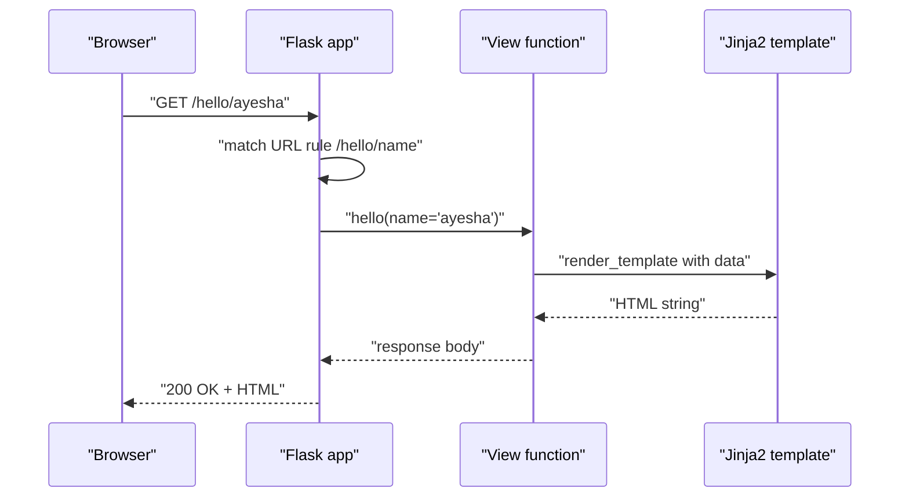
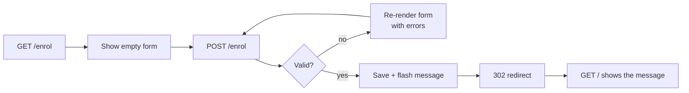

[](https://colab.research.google.com/github/Hamnakhan123/Diploma-in-AI/blob/main/term-1/04-application-based-programming-in-python/code/session-07-web-development-with-flask.ipynb) &nbsp; 📓 [Notebook](code/session-07-web-development-with-flask.ipynb)

# Session 7: Web Development Using Flask

> 🧭 [Diploma in AI](../../README.md) › [Term 1](../README.md) › [Application Based Programming in Python](README.md) › **Session 7**
>
> ⏱️ **Estimated time:** 3 hours (1 h concepts + 2 h lab) &nbsp;|&nbsp; 📋 **Prerequisites:** Sessions 3-5 (functions, decorators-as-syntax, dictionaries, JSON, exceptions). Basic HTML helps but is not required.
>
> Prepared by **Hamna Zahid Khan**, Junior Lecturer

[⬅ Previous: Session 6](session-06-regular-expressions-and-tokenization.md) &nbsp;|&nbsp; [🏠 Module home](README.md) &nbsp;|&nbsp; [Next: Session 8 ➡](session-08-web-scraping.md)

---

## 🎯 Learning objectives

By the end of this session you will be able to:

- Explain how the **web** works (client, server, HTTP request and response, status codes) and where **Flask** fits.
- **Set up** Flask in a virtual environment and run the development server.
- Build a Flask application with **routes**, **dynamic URLs**, **converters**, **query strings** and multiple **HTTP methods**.
- Render HTML with **Jinja2 templates**, template **inheritance**, loops, conditions and filters; handle **forms** with validation and the Post/Redirect/Get pattern.
- Build a **JSON REST API** with full CRUD, correct status codes and error handlers, and test it automatically with the **test client**.

## 📖 Concepts

### 1. How the web works in one page

When you open a website, your **browser** (the **client**) sends an **HTTP request** to a **server**, which runs code and sends back an **HTTP response**.

| Part of a request | Example |
|---|---|
| **Method** (verb) | `GET` read, `POST` create, `PUT`/`PATCH` update, `DELETE` remove |
| **URL** (path + query string) | `/search?q=python&page=2` |
| **Headers** | `Content-Type: application/json`, `Authorization: Bearer ...` |
| **Body** (optional) | form fields or JSON |

| Status code family | Meaning | Common codes |
|---|---|---|
| 2xx success | it worked | 200 OK, 201 Created, 204 No Content |
| 3xx redirection | look elsewhere | 301 Moved Permanently, 302 Found, 304 Not Modified |
| 4xx client error | the request was wrong | 400 Bad Request, 401 Unauthorized, 403 Forbidden, 404 Not Found |
| 5xx server error | the server failed | 500 Internal Server Error |

> 🧠 **Analogy:** A web app is a **restaurant**. The browser is the customer, the URL is the item on the menu, the HTTP method says whether you are ordering (`POST`), asking what is available (`GET`) or cancelling (`DELETE`). Flask is the **head waiter** who takes each order to the right cook (your Python function) and brings back the plate (the response). A status code is the waiter's reply: "here you go" (200), "we do not have that" (404), "the kitchen is on fire" (500).

### 2. What is Flask?

**Flask** is a lightweight (**micro**) web framework for Python. "Micro" means the core is small: routing, request/response handling, templates (Jinja2) and a development server. Everything else (databases, login, forms) is added with extensions when you need it.

| | Flask | Django | FastAPI |
|---|---|---|---|
| Style | micro, minimal, flexible | "batteries included" (admin, ORM, auth) | modern, async, typed APIs |
| Learning curve | gentle | steeper | gentle, needs type hints |
| Typical use | small-to-medium sites, APIs, **serving ML models** | large content sites | high-performance APIs |

Flask is a favourite for **deploying machine-learning models** behind a simple API (Term 2), which is why it is in this course.

### 3. Setup and installation

```bash
python -m venv .venv
source .venv/bin/activate          # Windows: .venv\Scripts\activate
pip install flask
python -c "import flask; print('Flask OK')"
```

A conventional project layout:

```text
notice_board/
├── app.py                 # creates the Flask app and routes
├── templates/             # Jinja2 HTML files: base.html, index.html ...
├── static/                # CSS, JavaScript, images
├── requirements.txt
└── tests/                 # automated tests using app.test_client()
```

Run the development server with `python app.py` (calling `app.run(debug=True)`) or `flask --app app run --debug`, then open `http://127.0.0.1:5000/`. **Debug mode** reloads on code changes and shows an interactive error page. Never use debug mode or the development server in production; use a WSGI server such as Gunicorn or Waitress.

> 💡 In this repository every Flask script tests itself with `app.test_client()`, so it runs in a terminal, a notebook or Colab without a browser. Add `--serve` to start the real server on your own computer.

### 4. Building an application: routes and views

```python
from flask import Flask
app = Flask(__name__)

@app.route("/")                      # decorator: this URL calls the function below
def home():                          # a "view function"
    return "<h1>Hello</h1>"          # str -> HTML, dict -> JSON, tuple -> (body, status)
```

| Feature | Syntax | Example URL |
|---|---|---|
| Static route | `@app.route("/about")` | `/about` |
| Dynamic segment | `@app.route("/hello/<name>")` | `/hello/ayesha` |
| Converter | `<int:n>`, `<float:x>`, `<path:p>` | `/square/12` (and `/square/abc` → 404) |
| Query string | `request.args.get("q")` | `/search?q=flask` |
| Methods | `methods=["GET", "POST"]` or `@app.get` / `@app.post` | |
| Form data | `request.form["name"]` | POST from an HTML form |
| JSON body | `request.get_json()` | POST from JavaScript / an app |
| Build a URL | `url_for("hello", name="sana")` | `/hello/sana` |
| Redirect | `redirect(url_for(...))` | sends 302 |
| Error | `abort(404)`, `@app.errorhandler(404)` | |

### 5. Templates with Jinja2

Writing HTML inside Python strings quickly becomes unmanageable. **Templates** keep HTML in separate files with placeholders:

| Jinja2 syntax | Meaning |
|---|---|
| `{{ variable }}` | print a value (**auto-escaped**, which blocks script injection) |
| ` ...  ... ` | loop, with an `else` for empty lists |
| ` ...  ... ` | condition |
| `{{ name \| title }}`, `{{ items \| length }}` | filters |
| `` + `` | **inheritance**: one layout, many pages |
| `{{ url_for('courses') }}` | links that survive URL changes |

`render_template("courses.html", courses=COURSES)` fills the template with your data.

### 6. Forms and the Post/Redirect/Get pattern

1. `GET /enrol` shows an empty form.
2. The user submits: `POST /enrol` with the fields in `request.form`.
3. Validate on the **server** (never trust the browser). If invalid, re-render the form with error messages and the values already typed.
4. If valid, save, `flash()` a message and **redirect** to another page. Redirecting after a successful POST prevents a duplicate submission when the user presses refresh.

### 7. JSON APIs and REST

An **API** returns data (JSON) instead of HTML, for mobile apps, JavaScript front-ends or other programs. **REST** conventions map methods to actions on a **resource**:

| Action | Method and URL | Success code |
|---|---|---|
| List | `GET /api/books` | 200 |
| Read one | `GET /api/books/7` | 200 (404 if missing) |
| Create | `POST /api/books` + JSON body | 201 + `Location` header |
| Update | `PUT /api/books/7` | 200 |
| Delete | `DELETE /api/books/7` | 204 |

Return `400` with a list of errors for invalid input and `401` when a required token is missing.

## 🧭 Diagrams





## 💻 Worked examples

### Example 1: Routes, dynamic URLs and methods (basic)

📄 [`code/session-07_hello_flask.py`](code/session-07_hello_flask.py) &nbsp;·&nbsp; run: `python session-07_hello_flask.py`

```python
"""
Session 7 · Example 1: a first Flask application - routes and URLs
------------------------------------------------------------------
Flask maps URLs to Python functions ("view functions").
This script tests the app with Flask's built-in test client, so it runs
anywhere (terminal, notebook, Colab) without opening a browser.
To serve it for real:  python session-07_hello_flask.py --serve
then open http://127.0.0.1:5000/ in a browser.
"""
import sys
from flask import Flask, request, url_for, redirect, abort

app = Flask(__name__)          # __name__ tells Flask where to find templates/static files

@app.route("/")                # the home page
def home():
    return "<h1>Welcome to the Diploma in AI portal</h1>"

@app.route("/about")
def about():
    return "This site is built with Flask, a Python micro web framework."

# Dynamic segments: <name> is passed to the function as an argument
@app.route("/hello/<name>")
def hello(name):
    return f"Assalam-o-Alaikum, {name.title()}!"

# Converters check and convert the type: int, float, path, uuid
@app.route("/square/<int:n>")
def square(n):
    return {"n": n, "square": n * n}      # returning a dict sends JSON automatically

# Query strings: /search?q=python&page=2
@app.route("/search")
def search():
    q = request.args.get("q", "")
    page = request.args.get("page", 1, type=int)
    return f"Searching for '{q}' (page {page})"

# Allowing more HTTP methods than the default GET
@app.route("/contact", methods=["GET", "POST"])
def contact():
    if request.method == "POST":
        return f"Thanks {request.form.get('name', 'friend')}, message received.", 201
    return "Contact form goes here"

@app.route("/old-courses")
def old_courses():
    return redirect(url_for("hello", name="visitor"))   # build URLs from function names

@app.route("/admin")
def admin():
    abort(403)                               # stop with an HTTP error status

@app.errorhandler(404)
def not_found(error):
    return "Sorry, that page does not exist.", 404

if __name__ == "__main__" and "--serve" in sys.argv:
    app.run(debug=True)                      # development server only
else:
    client = app.test_client()               # a fake browser for testing
    for method, url, data in [("GET", "/", None), ("GET", "/about", None),
                              ("GET", "/hello/ayesha", None), ("GET", "/square/12", None),
                              ("GET", "/square/abc", None), ("GET", "/search?q=flask&page=2", None),
                              ("POST", "/contact", {"name": "Bilal"}), ("GET", "/old-courses", None),
                              ("GET", "/admin", None), ("GET", "/nowhere", None)]:
        resp = client.open(url, method=method, data=data)
        body = resp.get_data(as_text=True).strip().replace("\n", " ")
        extra = f" -> Location: {resp.headers['Location']}" if resp.status_code in (301, 302) else ""
        print(f"{method:4} {url:<24} {resp.status_code}  {body[:60]}{extra}")
    with app.test_request_context():
        print("\nurl_for examples:", url_for("home"), url_for("hello", name="sana"),
              url_for("search", q="ai", page=3))
    print("registered routes:", sorted(r.rule for r in app.url_map.iter_rules() if r.endpoint != "static"))
```

**Output**

```text
GET  /                        200  <h1>Welcome to the Diploma in AI portal</h1>
GET  /about                   200  This site is built with Flask, a Python micro web framework.
GET  /hello/ayesha            200  Assalam-o-Alaikum, Ayesha!
GET  /square/12               200  {"n":12,"square":144}
GET  /square/abc              404  Sorry, that page does not exist.
GET  /search?q=flask&page=2   200  Searching for 'flask' (page 2)
POST /contact                 201  Thanks Bilal, message received.
GET  /old-courses             302  <!doctype html> <html lang=en> <title>Redirecting...</title> -> Location: /hello/visitor
GET  /admin                   403  <!doctype html> <html lang=en> <title>403 Forbidden</title> 
GET  /nowhere                 404  Sorry, that page does not exist.

url_for examples: / /hello/sana /search?q=ai&page=3
registered routes: ['/', '/about', '/admin', '/contact', '/hello/<name>', '/old-courses', '/search', '/square/<int:n>']
```


**What to notice:** `/square/abc` returned 404 without any code from us: the `int` converter rejected it. Returning a dict produced JSON automatically. The redirect response carries a `Location` header, which browsers follow automatically.

### Example 2: Templates, inheritance and forms (intermediate)

📄 [`code/session-07_templates_forms.py`](code/session-07_templates_forms.py) &nbsp;·&nbsp; run: `python session-07_templates_forms.py`

```python
"""
Session 7 · Example 2: Jinja2 templates, template inheritance and HTML forms
----------------------------------------------------------------------------
Real projects keep templates as files in a templates/ folder. To keep this
example in ONE file, the templates are stored in a dictionary and loaded with
Jinja's DictLoader - the template syntax is exactly the same.
Run:  python session-07_templates_forms.py        (add --serve to open it in a browser)
"""
import sys
from flask import Flask, render_template, request, redirect, url_for, flash
from jinja2 import DictLoader

TEMPLATES = {
    "base.html": """<!doctype html>
<html><head><title>Portal</title></head>
<body>
  <nav><a href="{{ url_for('courses') }}">Courses</a> | <a href="{{ url_for('enrol') }}">Enrol</a></nav>
  <p class="flash">{{ msg }}</p>
  
</body></html>""",
    "courses.html": """
Courses

<h1>{{ heading }}</h1>
<ul>

  <li>{{ loop.index }}. {{ c.title }} - {{ c.hours }} h <b>(long)</b></li>

  <li>No courses yet</li>

</ul>
<p>Total: {{ courses | sum(attribute='hours') }} hours, {{ courses | length }} courses</p>
""",
    "enrol.html": """

<h1>Enrol</h1>
<ul>
  <li class="error">{{ e }}</li>
</ul>
<form method="post">
  <input name="name" value="{{ form.name or '' }}">
  <input name="email" value="{{ form.email or '' }}">
  <button>Submit</button>
</form>
""",
}

app = Flask(__name__)
app.secret_key = "dev-only-change-me"        # needed for flash() messages (signed cookies)
app.jinja_loader = DictLoader(TEMPLATES)

COURSES = [{"title": "T-SQL", "hours": 16}, {"title": "MongoDB", "hours": 32},
           {"title": "Python Applications", "hours": 36}]
ENROLLED = []

@app.route("/")
def courses():
    return render_template("courses.html", heading="Term 1 courses", courses=COURSES)

@app.route("/enrol", methods=["GET", "POST"])
def enrol():
    errors, form = [], request.form
    if request.method == "POST":
        if len(form.get("name", "").strip()) < 3:
            errors.append("Name must have at least 3 characters")
        if "@" not in form.get("email", ""):
            errors.append("Enter a valid email")
        if not errors:
            ENROLLED.append({"name": form["name"].strip(), "email": form["email"]})
            flash(f"Welcome aboard, {form['name'].strip()}!")
            return redirect(url_for("courses"))   # Post/Redirect/Get pattern
    return render_template("enrol.html", errors=errors, form=form)

def text_only(html):
    """Strip tags and blank lines so the test output is easy to read."""
    import re
    return " | ".join(l.strip() for l in re.sub(r"<[^>]+>", "", html).splitlines() if l.strip())

if __name__ == "__main__" and "--serve" in sys.argv:
    app.run(debug=True)
else:
    c = app.test_client()
    print("GET / ->", text_only(c.get("/").get_data(as_text=True)))
    r = c.post("/enrol", data={"name": "Al", "email": "no-at-sign"})
    print("\nPOST bad form ->", r.status_code, text_only(r.get_data(as_text=True)))
    r = c.post("/enrol", data={"name": "Alishba", "email": "alishba@example.com"}, follow_redirects=True)
    print("\nPOST good form (redirect followed) ->", r.status_code, text_only(r.get_data(as_text=True))[:110])
    print("enrolled:", ENROLLED)
    # Jinja escapes HTML automatically, which blocks script injection (XSS)
    with app.test_request_context():
        from flask import render_template_string
        print("\nauto-escaping:", render_template_string("<p>{{ v }}</p>", v="<script>alert(1)</script>"))
```

**Output**

```text
GET / -> Courses | Courses | Enrol | Term 1 courses | 1. T-SQL - 16 h | 2. MongoDB - 32 h | 3. Python Applications - 36 h (long) | Total: 84 hours, 3 courses

POST bad form -> 200 Portal | Courses | Enrol | Enrol | Name must have at least 3 characters | Enter a valid email | Submit

POST good form (redirect followed) -> 200 Courses | Courses | Enrol | Welcome aboard, Alishba! | Term 1 courses | 1. T-SQL - 16 h | 2. MongoDB - 32 h | 
enrolled: [{'name': 'Alishba', 'email': 'alishba@example.com'}]

auto-escaping: <p>&lt;script&gt;alert(1)&lt;/script&gt;</p>
```


**Walkthrough:**

1. `courses.html` **extends** `base.html`, so the navigation and flash messages are written once.
2. The bad form came back with status 200 and both error messages; the good form redirected and the flash message appeared on the next page.
3. The `<script>` tag was converted to `&lt;script&gt;`: Jinja's auto-escaping protects you from **cross-site scripting (XSS)**.

### Example 3: A JSON REST API with CRUD (advanced)

📄 [`code/session-07_json_api.py`](code/session-07_json_api.py) &nbsp;·&nbsp; run: `python session-07_json_api.py`

```python
"""
Session 7 · Example 3: a JSON REST API with full CRUD
-----------------------------------------------------
REST maps HTTP methods to actions on a resource:
  GET /api/books        list       POST   /api/books       create
  GET /api/books/<id>   read one   PUT    /api/books/<id>  update
                                   DELETE /api/books/<id>  delete
Run:  python session-07_json_api.py      (add --serve to run a real server)
"""
import sys
from flask import Flask, jsonify, request, abort

app = Flask(__name__)
books = {1: {"id": 1, "title": "Python Crash Course", "year": 2019, "available": True},
         2: {"id": 2, "title": "Hands-On Machine Learning", "year": 2022, "available": False}}
next_id = 3

def validate(data, partial=False):
    """Return a list of problems with the submitted JSON."""
    problems = []
    if not partial or "title" in data:
        if not isinstance(data.get("title"), str) or not data["title"].strip():
            problems.append("title is required")
    if "year" in data and not (isinstance(data["year"], int) and 1450 <= data["year"] <= 2100):
        problems.append("year must be an integer between 1450 and 2100")
    return problems

@app.get("/api/books")                       # shortcut for @app.route(..., methods=["GET"])
def list_books():
    only_available = request.args.get("available") == "true"
    items = [b for b in books.values() if b["available"] or not only_available]
    return jsonify(count=len(items), books=items)

@app.get("/api/books/<int:book_id>")
def get_book(book_id):
    if book_id not in books:
        abort(404, description=f"book {book_id} not found")
    return jsonify(books[book_id])

@app.post("/api/books")
def create_book():
    global next_id
    data = request.get_json(silent=True) or {}
    problems = validate(data)
    if problems:
        return jsonify(errors=problems), 400                 # 400 Bad Request
    book = {"id": next_id, "title": data["title"].strip(), "year": data.get("year"),
            "available": data.get("available", True)}
    books[next_id] = book
    next_id += 1
    return jsonify(book), 201, {"Location": f"/api/books/{book['id']}"}   # 201 Created

@app.put("/api/books/<int:book_id>")
def update_book(book_id):
    if book_id not in books:
        abort(404, description=f"book {book_id} not found")
    data = request.get_json(silent=True) or {}
    problems = validate(data, partial=True)
    if problems:
        return jsonify(errors=problems), 400
    books[book_id].update({k: v for k, v in data.items() if k in ("title", "year", "available")})
    return jsonify(books[book_id])

@app.delete("/api/books/<int:book_id>")
def delete_book(book_id):
    if books.pop(book_id, None) is None:
        abort(404, description=f"book {book_id} not found")
    return "", 204                                           # 204 No Content

@app.errorhandler(404)
def handle_404(e):
    return jsonify(error=e.description), 404                 # JSON errors for an API

if __name__ == "__main__" and "--serve" in sys.argv:
    app.run(debug=True)
else:
    c = app.test_client()
    def call(method, url, json=None):
        r = c.open(url, method=method, json=json)
        body = r.get_json(silent=True)
        print(f"{method:6} {url:<28} {r.status_code}  {body if body is not None else '(empty)'}")
    call("GET", "/api/books")
    call("GET", "/api/books?available=true")
    call("POST", "/api/books", {"title": "Fluent Python", "year": 2022})
    call("POST", "/api/books", {"title": "  ", "year": 3000})
    call("PUT", "/api/books/2", {"available": True})
    call("DELETE", "/api/books/1")
    call("GET", "/api/books/1")
    call("GET", "/api/books")
```

**Output**

```text
GET    /api/books                   200  {'books': [{'available': True, 'id': 1, 'title': 'Python Crash Course', 'year': 2019}, {'available': False, 'id': 2, 'title': 'Hands-On Machine Learning', 'year': 2022}], 'count': 2}
GET    /api/books?available=true    200  {'books': [{'available': True, 'id': 1, 'title': 'Python Crash Course', 'year': 2019}], 'count': 1}
POST   /api/books                   201  {'available': True, 'id': 3, 'title': 'Fluent Python', 'year': 2022}
POST   /api/books                   400  {'errors': ['title is required', 'year must be an integer between 1450 and 2100']}
PUT    /api/books/2                 200  {'available': True, 'id': 2, 'title': 'Hands-On Machine Learning', 'year': 2022}
DELETE /api/books/1                 204  (empty)
GET    /api/books/1                 404  {'error': 'book 1 not found'}
GET    /api/books                   200  {'books': [{'available': True, 'id': 2, 'title': 'Hands-On Machine Learning', 'year': 2022}, {'available': True, 'id': 3, 'title': 'Fluent Python', 'year': 2022}], 'count': 2}
```


**Key lessons:**

- Each action returns the **correct status code**: 201 on create, 204 on delete, 400 with explanations for bad data, 404 as JSON.
- `request.get_json(silent=True)` returns `None` instead of raising for a missing or broken body, so validation stays in our hands.
- The data lives in a Python dict, so it disappears when the server stops. Session 10 stores it in a database.

## 🌍 Real-life coding problem: a student result portal

**Scenario.** Students keep emailing the office for marks. Build a portal where they type their roll number and see a result card, plus a JSON endpoint for a future mobile app and a class-summary endpoint for the coordinator.

**Plan before coding:**

| Requirement | Technique |
|---|---|
| Load `results.csv` once | `csv.DictReader` at start-up (Session 5) |
| Check the roll-number format | `re.fullmatch(r"AI-202\d-\d{4}")` (Session 6) → 400 if wrong |
| Unknown roll number | 404 page with a friendly message |
| HTML and JSON from the same data | one `card()` function used by both routes |
| Class statistics | dict comprehension + `max(..., key=...)` |


📄 Full solution (105 lines, fully commented): [`code/session-07_problem_result_portal.py`](code/session-07_problem_result_portal.py) &nbsp;·&nbsp; run: `python session-07_problem_result_portal.py` &nbsp;·&nbsp; also in the session notebook

**Output**

```text
GET /result?roll=ai-2026-0001    200
   Ayesha Siddiqui (AI-2026-0001) | Programming 91 A | Statistics 84 B | Databases 88 A | Communication 79 B | Percentage: 85.5% - PASSED

GET /result?roll=AI-2026-0003    200
   Mehwish Ali (AI-2026-0003) | Programming 45 F | Statistics 51 D | Databases 62 C | Communication 70 B | Percentage: 57.0% - NOT PASSED: re-sit required

GET /result?roll=AI-2026-0099    404
   No result found for AI-2026-0099

GET /result?roll=12345           400
   '12345' is not a valid roll number (format AI-2026-0001)

GET /api/result/AI-2026-0004 -> {'name': 'Danish Raza', 'passed': True, 'percentage': 89.0, 'roll': 'AI-2026-0004', 'subjects': {'communication': {'grade': 'A', 'mark': 85}, 'databases': {'grade': 'A', 'mark': 90}, 'programming': {'grade': 'A', 'mark': 88}, 'statistics': {'grade': 'A', 'mark': 93}}}
GET /api/result/XX           -> 404
GET /api/summary -> {'passed': 4, 'students': 5, 'subject_average': {'communication': 81.4, 'databases': 75.8, 'programming': 73.4, 'statistics': 73.8}, 'top_student': {'name': 'Danish Raza', 'percentage': 89.0}}
```


**Interpretation.** The same `card()` function feeds the HTML page and the JSON API, so they can never disagree. Input is normalised (`ai-2026-0001` works) and validated before lookup, and each failure gets the right status code (400 for a malformed roll number, 404 for an unknown one). Mehwish has 57 % overall but failed one subject, so the rule "every subject ≥ 50" correctly marks a re-sit.

## 🛠️ Mini project: campus notice board

A complete small web application with professional structure:

| Feature | How |
|---|---|
| **Application factory** `create_app(data_file, api_token)` | lets tests build fresh, isolated apps |
| HTML page with category filter | Jinja2 loop with `` |
| JSON API with **token authentication** | `Authorization: Bearer <token>` header, 401 otherwise |
| Persistence | notices saved to a JSON file (Session 5) |
| **Automated tests** | 10 checks with the test client, printed as PASS/FAIL |

```python
def require_token():
    sent = request.headers.get("Authorization", "")
    if sent != f"Bearer {app.config['API_TOKEN']}":
        abort(401)
```

📄 Full solution (141 lines, fully commented): [`code/session-07_project_notice_board.py`](code/session-07_project_notice_board.py) &nbsp;·&nbsp; run: `python session-07_project_notice_board.py` &nbsp;·&nbsp; also in the session notebook

**Output**

```text
Automated checks
  [PASS] empty board shows 'No notices'
  [PASS] POST without token is rejected with 401
  [PASS] POST with token returns 201 and an id
  [PASS] invalid notice returns 400 with 3 errors
  [PASS] list is newest first
  [PASS] category filter works
  [PASS] HTML page shows the hackathon
  [PASS] data survives a 'restart' (new app, same file)
  [PASS] DELETE removes a notice (204)
  [PASS] DELETE of a missing id gives 404

10 passed, 0 failed
final board: [(3, 'holiday', 'Iqbal Day'), (1, 'exam', 'Mid-term exams')]
```


**What makes it production-minded:** configuration passed into a factory instead of hard-coded globals; secrets read from an environment variable when served (`NOTICE_TOKEN`); validation errors returned as a list; every behaviour covered by a check. Real projects use `pytest` for the tests, but the idea is identical.

**Extension ideas:** add an `expires` date and hide old notices; add a `PUT` endpoint to edit a notice; style the page with a CSS file in `static/`; move storage to SQLite in Session 10.

## ⚠️ Common mistakes

| Mistake | Symptom | Fix |
|---|---|---|
| Two view functions with the same name | `AssertionError: View function mapping is overwriting...` | Unique function names |
| Forgetting `methods=["POST"]` | 405 Method Not Allowed | Add the method or use `@app.post` |
| `request.form["x"]` when the field is missing | 400 Bad Request (KeyError) | `request.form.get("x", "")` |
| Building HTML with f-strings and user input | XSS security hole | Use templates (auto-escaping) |
| Hard-coding URLs (`href="/hello/ali"`) | links break when routes change | `url_for()` |
| Not redirecting after a successful POST | duplicate submissions on refresh | Post/Redirect/Get |
| `debug=True` or the dev server in production | security risk, slow | Gunicorn/Waitress, debug off |
| Secret key or token committed to GitHub | anyone can forge sessions | Environment variables |
| Returning 200 for errors in an API | clients cannot detect failures | Proper 4xx/5xx codes |

## ✅ Best practices

- Keep view functions **thin**: parse input, call a plain Python function that does the work, return a response. Thin views are easy to test.
- Use an **application factory** and configuration objects for anything beyond a toy.
- **Validate everything on the server** and return helpful error messages.
- Use template **inheritance** so the layout lives in one file.
- Choose correct **HTTP methods and status codes**; document your API's URLs and JSON shapes.
- Write tests with `app.test_client()` and run them before every change.
- Store secrets in environment variables and keep a `requirements.txt`.

## 🧪 Lab / practice tasks

**1. 🟢 Easy:** Create a Flask app with routes `/`, `/about` and `/contact`, each returning a different heading. Test all three with the test client and print the status codes.

<details><summary>💡 Hint</summary>

`client = app.test_client(); print(client.get("/about").status_code)`

</details>

<details><summary>✅ Solution</summary>

```python
from flask import Flask
app = Flask(__name__)
@app.route("/")
def home(): return "<h1>Home</h1>"
@app.route("/about")
def about(): return "<h1>About</h1>"
@app.route("/contact")
def contact(): return "<h1>Contact</h1>"
c = app.test_client()
print([c.get(u).status_code for u in ["/", "/about", "/contact", "/x"]])   # [200, 200, 200, 404]
```

</details>

**2. 🟢 Easy:** Add a route `/convert/<float:celsius>` that returns JSON with Celsius and Fahrenheit. What happens with `/convert/36`?

<details><summary>💡 Hint</summary>

The `float` converter requires a dot: `/convert/36.0`. Add a second rule `@app.route("/convert/<int:celsius>")` on the same function to accept integers.

</details>

<details><summary>✅ Solution</summary>

```python
@app.route("/convert/<float:celsius>")
@app.route("/convert/<int:celsius>")
def convert(celsius):
    return {"celsius": celsius, "fahrenheit": round(celsius * 9 / 5 + 32, 1)}
```

`/convert/36` gives 404 with only the float rule; stacking both decorators fixes it.

</details>

**3. 🟡 Medium:** Build a BMI calculator page: a form with weight and height; on POST show the BMI and category (under 18.5, 18.5-24.9, 25-29.9, 30+), with errors for missing or non-numeric input.

<details><summary>💡 Hint</summary>

Convert inside `try: float(request.form["weight"])` and collect errors in a list; pass `bmi`, `category` and `errors` to `render_template_string`.

</details>

<details><summary>✅ Solution</summary>

```python
from flask import Flask, request, render_template_string
app = Flask(__name__)
PAGE = """<form method=post><input name=weight><input name=height><button>Go</button></form>
<p>{{ e }}</p><p>BMI {{ bmi }}: {{ cat }}</p>"""
@app.route("/", methods=["GET", "POST"])
def bmi_page():
    errors, bmi, cat = [], None, None
    if request.method == "POST":
        try:
            w, h = float(request.form["weight"]), float(request.form["height"])
            bmi = round(w / h ** 2, 1)
            cat = "under" if bmi < 18.5 else "normal" if bmi < 25 else "over" if bmi < 30 else "obese"
        except (KeyError, ValueError, ZeroDivisionError):
            errors.append("Enter weight in kg and height in metres, e.g. 68 and 1.72")
    return render_template_string(PAGE, errors=errors, bmi=bmi, cat=cat)
print(app.test_client().post("/", data={"weight": "68", "height": "1.72"}).get_data(as_text=True)[-30:])
```

</details>

**4. 🟡 Medium:** Add `PATCH /api/books/<id>/toggle` to the books API that flips `available` and returns the updated book. Write two test-client calls to prove it works.

<details><summary>💡 Hint</summary>

`books[book_id]["available"] = not books[book_id]["available"]`

</details>

<details><summary>✅ Solution</summary>

```python
@app.patch("/api/books/<int:book_id>/toggle")
def toggle(book_id):
    if book_id not in books:
        abort(404, description=f"book {book_id} not found")
    books[book_id]["available"] = not books[book_id]["available"]
    return jsonify(books[book_id])
c = app.test_client()
print(c.patch("/api/books/2/toggle").get_json()["available"])   # flips
print(c.patch("/api/books/2/toggle").get_json()["available"])   # flips back
```

</details>

**5. 🟠 Hard:** Add **pagination** to `GET /api/notices`: `?page=1&per_page=2` returns the right slice plus `total`, `page` and `pages` fields. Return 400 for `per_page` above 50.

<details><summary>💡 Hint</summary>

`page = request.args.get("page", 1, type=int)`; slice `items[(page - 1) * per_page : page * per_page]`; `pages = math.ceil(total / per_page)`.

</details>

<details><summary>✅ Solution</summary>

```python
import math
@app.get("/api/notices")
def list_notices():
    items = visible(request.args.get("category"))
    page = request.args.get("page", 1, type=int)
    per = request.args.get("per_page", 10, type=int)
    if not 1 <= per <= 50:
        return jsonify(error="per_page must be 1-50"), 400
    return jsonify(total=len(items), page=page, pages=math.ceil(len(items) / per),
                   items=items[(page - 1) * per: page * per])
```

</details>

**6. 🔴 Challenge:** Turn the result portal into a **template-file project**: create `templates/base.html` and `templates/result.html`, use `render_template`, add a `/top` page that lists the top 3 students with a Jinja loop, and write five test-client checks.

<details><summary>💡 Hint</summary>

Flask looks for a `templates/` folder next to the file that creates `Flask(__name__)`. Sort the cards with `sorted(cards, key=lambda c: -c["percentage"])[:3]`.

</details>

<details><summary>✅ Solution</summary>

```python
# templates/top.html
# <ol><li>{{ c.name }} - {{ c.percentage }}%</li></ol>
@app.get("/top")
def top():
    cards = sorted((card(r) for r in RESULTS.values()), key=lambda c: -c["percentage"])
    return render_template("top.html", top=cards[:3])
c = app.test_client()
html = c.get("/top").get_data(as_text=True)
assert html.index("Danish Raza") < html.index("Ayesha Siddiqui")
assert c.get("/result?roll=bad").status_code == 400
assert c.get("/result?roll=AI-2026-0099").status_code == 404
assert c.get("/api/result/AI-2026-0001").get_json()["passed"] is True
assert c.get("/api/summary").get_json()["students"] == 5
print("all checks passed")
```

</details>

## ✅ Quick quiz

**Q1.** Which HTTP status code should an API return after successfully creating a resource?

- A) 200
- B) 201
- C) 204
- D) 302

**Q2.** What does `@app.route("/user/<int:uid>")` do with the URL `/user/abc`?

- A) passes "abc" as a string
- B) raises ValueError in your code
- C) returns 404 because the converter does not match
- D) converts abc to 0

**Q3.** In Jinja2, which syntax prints a variable?

- A) 
- B) {{ variable }}
- C) <%= variable %>
- D) ${variable}

**Q4.** Why redirect after a successful form POST?

- A) it is faster
- B) it prevents duplicate submissions when the user refreshes
- C) Flask requires it
- D) it encrypts the data

**Q5.** What is `app.test_client()` used for?

- A) deploying to production
- B) sending real emails
- C) simulating requests to the app without running a server
- D) creating templates

<details><summary>✅ Show answers</summary>

1. **B** — 201 Created, usually with a Location header.
2. **C** — converters reject values of the wrong type before your function runs.
3. **B** — {{ }} outputs an auto-escaped value;  is for statements.
4. **B** — the Post/Redirect/Get pattern.
5. **C** — it is a fake browser for automated tests.

</details>


## 📝 Summary

- The web is **requests** (method, URL, headers, body) and **responses** (status code, headers, body). 2xx success, 3xx redirect, 4xx client error, 5xx server error.
- **Flask** is a micro framework: install with `pip install flask` in a virtual environment; `Flask(__name__)`, `@app.route`, `app.run(debug=True)` for development only.
- Routes support **dynamic segments**, **converters**, **query strings**, multiple **methods**, `url_for`, `redirect`, `abort` and error handlers.
- **Jinja2 templates** separate HTML from Python: `{{ }}`, ``, filters, inheritance; auto-escaping prevents XSS.
- Forms: validate on the server, then **Post/Redirect/Get** with `flash` messages.
- **REST APIs** return JSON with correct status codes; test everything with `app.test_client()`; use an application factory for real projects.

### 🎤 Interview / viva questions

1. What does "micro framework" mean? How is Flask different from Django?
2. Explain the request-response cycle when a user opens `/hello/ali` in a Flask app.
3. What is the difference between `request.args`, `request.form` and `request.get_json()`?
4. What is template inheritance and why is it useful?
5. Why should you use `url_for` instead of writing URLs by hand?
6. Map the CRUD operations to HTTP methods and status codes.
7. Why should the Flask development server never be used in production?

---

[⬅ Previous: Session 6](session-06-regular-expressions-and-tokenization.md) &nbsp;|&nbsp; [🏠 Module home](README.md) &nbsp;|&nbsp; [Next: Session 8 ➡](session-08-web-scraping.md)

<sub>Prepared by **Hamna Zahid Khan**, Junior Lecturer · Diploma in AI</sub>
