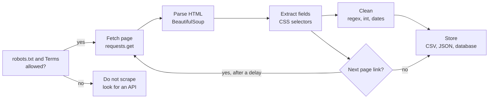
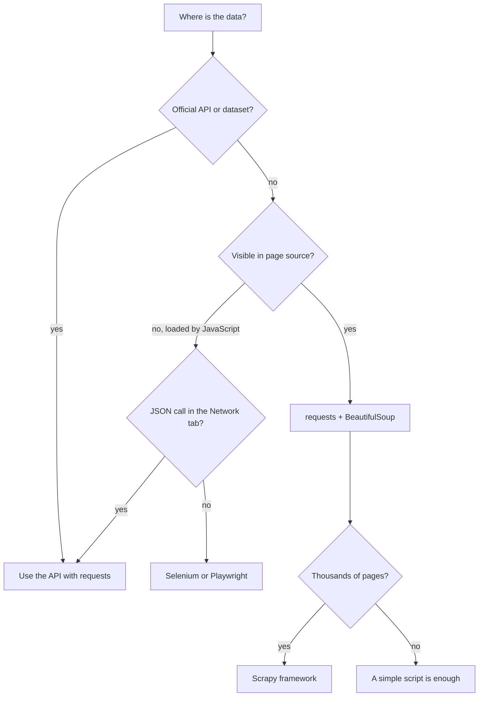
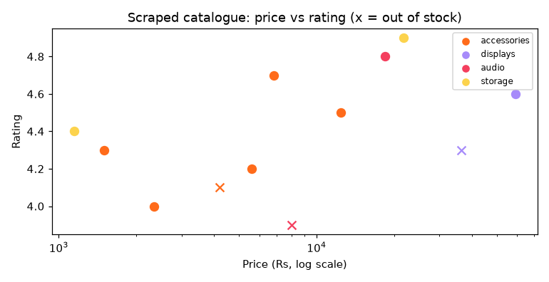

[](https://colab.research.google.com/github/Hamnakhan123/Diploma-in-AI/blob/main/term-1/04-application-based-programming-in-python/code/session-08-web-scraping.ipynb) &nbsp; 📓 [Notebook](code/session-08-web-scraping.ipynb)

# Session 8: Web Scraping in Python

> 🧭 [Diploma in AI](../../README.md) › [Term 1](../README.md) › [Application Based Programming in Python](README.md) › **Session 8**
>
> ⏱️ **Estimated time:** 4 hours (1.5 h concepts + 2.5 h lab; this topic spans two classes) &nbsp;|&nbsp; 📋 **Prerequisites:** Sessions 5-7 (files, exceptions, regular expressions, HTTP basics from the Flask session).
>
> Prepared by **Hamna Zahid Khan**, Junior Lecturer

[⬅ Previous: Session 7](session-07-web-development-with-flask.md) &nbsp;|&nbsp; [🏠 Module home](README.md) &nbsp;|&nbsp; [Next: Session 9 ➡](session-09-gui-programming-with-tkinter.md)

---

## 🎯 Learning objectives

By the end of this session you will be able to:

- Describe **web scraping**, when it is useful, and when an API or dataset is the better choice.
- Apply the **rules of web scraping**: terms of service, `robots.txt`, rate limiting, identification, personal data and copyright.
- Compare the main Python scraping **libraries**: `requests`, `BeautifulSoup`, `lxml`, `Scrapy`, `Selenium` / `Playwright`.
- **Fetch** pages with `requests` (parameters, headers, timeouts, sessions, error handling) and **parse** them with BeautifulSoup (`find`, `find_all`, CSS selectors, attributes, tables, tree navigation).
- **Implement** a complete scraper: crawl paginated pages, clean the data, save it to CSV, and detect changes between runs.

## 📖 Concepts

### 1. What is web scraping?

**Web scraping** is using a program to download web pages and **extract structured data** from them: prices, job ads, timetables, headlines, product reviews. Humans read pages; scrapers read the **HTML** behind them.

Typical uses in data science and AI:

| Use | Example |
|---|---|
| Building datasets | collect product reviews to train a sentiment model (Term 2) |
| Price monitoring | track competitors' prices every morning |
| Lead and job tracking | alert when a new "Data Analyst, Karachi" vacancy appears |
| Research | gather public statistics published only as HTML tables |
| Content aggregation | news headlines from several outlets into one feed |

> 🧠 **Analogy:** A web page is a **printed form** designed for humans. An **API** is the same office handing you the data as a neat spreadsheet. Scraping is photocopying the form and typing the boxes into a spreadsheet yourself. If the office offers the spreadsheet (an API or open dataset), take it: it is faster, more reliable and clearly allowed.

### 2. How a scraper works

1. **Fetch**: send an HTTP GET request and receive HTML (`requests`).
2. **Parse**: turn the HTML text into a navigable tree (`BeautifulSoup`).
3. **Extract**: locate elements by tag, class, id, attribute or CSS selector and read their text or attributes.
4. **Clean**: convert `"Rs. 4,200"` into `4200`, strip whitespace, standardise dates (regex from Session 6).
5. **Store**: write CSV/JSON (Session 5) or a database (Session 10).
6. **Repeat politely**: follow pagination links with a delay; schedule runs and compare with the last snapshot.

**Reading HTML:** open the page in a browser, right-click → **Inspect**. Look for stable hooks: an `id` (`<table id="deals">`), a `class` (`<div class="product">`), or a `data-*` attribute (`data-id="7"`). These become your selectors.

### 3. The rules of web scraping

Scraping public pages is common, but **how** you do it matters legally and ethically.

| Rule | What it means in practice |
|---|---|
| **Prefer official APIs and datasets** | Check for an API, RSS feed or CSV download first. |
| **Read the Terms of Service** | Many sites forbid automated access; respect that. |
| **Obey `robots.txt`** | `https://site/robots.txt` lists paths bots must not visit and sometimes a crawl delay. Python's `urllib.robotparser` reads it. |
| **Be gentle: rate-limit** | Wait between requests (1-5 s), never hammer a server in parallel, scrape off-peak. |
| **Identify yourself** | Send a descriptive `User-Agent` with contact details. |
| **Cache** | Never download the same page twice in one run. |
| **Personal data** | Names, phone numbers and emails are protected by privacy laws (for example Pakistan's PECA 2016, the EU's GDPR). Do not collect what you do not need. |
| **Copyright** | Facts (a price) are generally fine to record; copying whole articles or images and republishing them is not. |
| **No bypassing protection** | Do not log in with others' accounts, break CAPTCHAs or evade blocks. |

> ⚠️ In this repository every scraping example runs against a **local practice website** (`demo_shop_site.py`) that starts on your own computer. You get identical output every time and never put load on a real business. For live practice, use sites built for it, such as `books.toscrape.com` or `quotes.toscrape.com`.

### 4. The Python scraping toolbox

| Library | Role | Strengths | Limits |
|---|---|---|---|
| **requests** | download pages and APIs | simple, sessions, timeouts, JSON | does not run JavaScript |
| **BeautifulSoup (bs4)** | parse HTML/XML | forgiving with messy HTML, CSS selectors | parsing only (needs requests) |
| **lxml** | very fast parser, XPath | speed; can be bs4's parser | stricter API |
| **Scrapy** | full crawling framework | concurrency, pipelines, built-in politeness settings | more to learn |
| **Selenium / Playwright** | drive a real browser | JavaScript-heavy pages, clicking, scrolling | slow, heavy |
| **pandas.read_html** | grab every `<table>` on a page | one line for tables | tables only |

**Static vs dynamic pages:** if the data appears in **View Page Source**, `requests` + BeautifulSoup is enough. If it appears only after JavaScript runs, first look in the browser's **Network** tab for the JSON API the page calls (often the cleanest solution), and use Selenium/Playwright only as a last resort.

### 5. requests essentials

| Task | Code |
|---|---|
| GET with a timeout | `requests.get(url, timeout=10)` |
| Query parameters | `requests.get(url, params={"page": 2})` |
| Headers | `headers={"User-Agent": "MyBot/1.0 (contact)"}` |
| Status | `r.status_code`, `r.ok`, `r.raise_for_status()` |
| Body | `r.text` (str), `r.content` (bytes), `r.json()` |
| Reuse connections | `with requests.Session() as s: s.get(...)` |
| Errors | `requests.HTTPError`, `ConnectionError`, `Timeout` (all under `RequestException`) |

### 6. BeautifulSoup essentials

| Task | Code |
|---|---|
| Parse | `soup = BeautifulSoup(html, "html.parser")` |
| First tag | `soup.title`, `soup.find("p", id="intro")`, `soup.find("div", class_="product")` |
| All tags | `soup.find_all("a")` |
| CSS selectors | `soup.select("div.product .price")`, `soup.select_one("a.next")`, `soup.select('a[href^="http"]')` |
| Text | `tag.get_text(" ", strip=True)` |
| Attributes | `tag["href"]`, `tag.get("rel")`, `tag["data-id"]` |
| Navigate | `.parent`, `.children`, `.find_next_sibling()` |

`select_one` and `find` return **`None`** when nothing matches, so guard before calling `.text`.

## 🧭 Diagrams





## 💻 Worked examples

All examples import the practice site helper. It defines a fake shop with a home page, a deals table, a paginated catalogue, product pages, a JSON API, a jobs page and a `robots.txt`:


```python
from demo_shop_site import start_site
BASE = start_site()        # starts the practice site on 127.0.0.1 and returns its URL
```

### Example 1: Fetching pages with requests (basic)

📄 [`code/session-08_requests_basics.py`](code/session-08_requests_basics.py) &nbsp;·&nbsp; run: `python session-08_requests_basics.py`

```python
"""
Session 8 · Example 1: fetching pages with the requests library
---------------------------------------------------------------
Uses the local practice site from demo_shop_site.py, so nothing real is hit.
Run:  python session-08_requests_basics.py
"""
import requests
from demo_shop_site import start_site

BASE = start_site()
HEADERS = {"User-Agent": "DiplomaAI-StudentBot/1.0 (learning project; contact: lecturer@example.edu)"}

# 1. A basic GET request
r = requests.get(BASE + "/", headers=HEADERS, timeout=10)    # ALWAYS set a timeout
print("status:", r.status_code, r.reason, "| ok:", r.ok)
print("content type:", r.headers["Content-Type"], "| encoding:", r.encoding)
print("bytes:", len(r.content), "| first 60 chars of text:", r.text[:60].replace("\n", " "))

# 2. Query parameters: requests builds and encodes the query string
r = requests.get(BASE + "/products", params={"page": 2}, headers=HEADERS, timeout=10)
print("\nfinal URL:", r.url.replace(BASE, "BASE"), "| status:", r.status_code)

# 3. JSON endpoints: .json() parses the body for you
items = requests.get(BASE + "/api/products.json", headers=HEADERS, timeout=10).json()
print("API returned", len(items), "products; first:", items[0])

# 4. Handling errors: check status, catch network exceptions
for path in ["/products?page=9", "/no-such-page"]:
    r = requests.get(BASE + path, headers=HEADERS, timeout=10)
    try:
        r.raise_for_status()                 # raises HTTPError for 4xx/5xx
    except requests.HTTPError as e:
        print(f"HTTPError for {path}: {e.response.status_code}")

try:
    requests.get("http://127.0.0.1:1/", timeout=2)       # nothing listens on port 1
except requests.ConnectionError:
    print("ConnectionError: server unreachable (handled, no crash)")
try:
    requests.get(BASE + "/slow", timeout=0.5)            # this page needs 2 s to answer
except requests.Timeout:
    print("Timeout: the server took too long (handled)")

# 5. A Session reuses the connection and default headers (faster, politer)
with requests.Session() as s:
    s.headers.update(HEADERS)
    sizes = [len(s.get(f"{BASE}/products", params={"page": p}, timeout=10).text) for p in (1, 2, 3)]
print("\npage sizes with one Session:", sizes)

# 6. What the server saw as our identity
print("our User-Agent:", HEADERS["User-Agent"])
```

**Output**

```text
status: 200 OK | ok: True
content type: text/html; charset=utf-8 | encoding: utf-8
bytes: 882 | first 60 chars of text: <!doctype html><html><head><meta charset="utf-8"><title>Home

final URL: BASE/products?page=2 | status: 200
API returned 12 products; first: {'id': 1, 'name': 'Wireless Mouse', 'category': 'accessories'}
HTTPError for /products?page=9: 404
HTTPError for /no-such-page: 404
ConnectionError: server unreachable (handled, no crash)
Timeout: the server took too long (handled)

page sizes with one Session: [1734, 1728, 924]
our User-Agent: DiplomaAI-StudentBot/1.0 (learning project; contact: lecturer@example.edu)
```


**What to notice:** `raise_for_status()` turns a 404 into an exception you can catch; the connection and timeout errors were handled instead of crashing; one `Session` fetched three pages over a reused connection with the same headers.

### Example 2: Parsing HTML with BeautifulSoup (intermediate)

📄 [`code/session-08_bs4_parsing.py`](code/session-08_bs4_parsing.py) &nbsp;·&nbsp; run: `python session-08_bs4_parsing.py`

```python
"""
Session 8 · Example 2: parsing HTML with BeautifulSoup
------------------------------------------------------
Run:  python session-08_bs4_parsing.py
"""
import requests
from bs4 import BeautifulSoup
from demo_shop_site import start_site

BASE = start_site()
html = requests.get(BASE + "/", timeout=10).text
soup = BeautifulSoup(html, "html.parser")        # or "lxml" (faster, needs the lxml package)

# 1. Simple access by tag name
print("title tag:", soup.title, "| text:", soup.title.string)
print("first <h1>:", soup.h1.get_text(), "| its class:", soup.h1["class"])

# 2. find (first match) and find_all (all matches), filtering by attributes
intro = soup.find("p", id="intro")
print("get_text(strip=True):     ", intro.get_text(strip=True))        # pieces glued together!
print("get_text(' ', strip=True):", intro.get_text(" ", strip=True), "| bold word:", intro.b.text)
links = soup.find_all("a")
print("number of links:", len(links))
for a in links:
    print(f"  {a.get_text():<14} -> {a['href']:<28} rel={a.get('rel')}")

# 3. CSS selectors with select / select_one (same syntax as in CSS files)
print("nav links:", [a.text for a in soup.select("nav a")])
print("external links:", [a["href"] for a in soup.select('a[href^="http"]')])
print("footer text:", soup.select_one("footer p").text)

# 4. Turning an HTML table into Python data
table = soup.find("table", id="deals")
rows = []
for tr in table.find_all("tr")[1:]:                       # skip the header row
    cells = [td.get_text(strip=True) for td in tr.find_all("td")]
    rows.append(cells)
headers = [th.text for th in table.find_all("th")]
print("\ntable headers:", headers)
for item, old, new in rows:
    to_int = lambda t: int(t.replace("Rs", "").replace(",", "").strip())
    saving = to_int(old) - to_int(new)
    print(f"  {item:<18} saves Rs {saving:,} ({saving / to_int(old):.0%})")

# 5. Navigating the tree: parent, children, siblings
first_td = soup.find("td")
print("\nfirst <td>:", first_td.text, "| parent tag:", first_td.parent.name,
      "| next sibling:", first_td.find_next_sibling("td").text)
print("children of <nav>:", [c.name for c in soup.nav.children if c.name])

# 6. Product cards: data attributes and nested elements on another page
page = BeautifulSoup(requests.get(BASE + "/products?page=1", timeout=10).text, "html.parser")
for card in page.select("div.product")[:3]:
    print(f"  id={card['data-id']} cat={card['data-category']:<12} "
          f"{card.select_one('.name').get_text(strip=True):<22} {card.select_one('.price').text:<10} "
          f"{card.select_one('.stock').text}")

# 7. Missing elements return None: guard before using them
missing = page.select_one(".discount")
print("missing element ->", missing, "| safe text:", missing.text if missing else "n/a")
```

**Output**

```text
title tag: <title>Home</title> | text: Home
first <h1>: TechBazaar Demo | its class: ['site-title']
get_text(strip=True):      Welcome! Today'sdealsare below.
get_text(' ', strip=True): Welcome! Today's deals are below. | bold word: deals
number of links: 6
  Home           -> /                            rel=None
  Products       -> /products?page=1             rel=None
  Jobs           -> /jobs                        rel=None
  All products   -> /products?page=1             rel=None
  Careers        -> /jobs                        rel=None
  Partner site   -> https://example.com/partner  rel=['nofollow']
nav links: ['Home', 'Products', 'Jobs']
external links: ['https://example.com/partner']
footer text: Practice site for scraping lessons. Not a real shop.

table headers: ['Item', 'Old price', 'New price']
  Wireless Mouse     saves Rs 400 (21%)
  Portable SSD 1TB   saves Rs 2,250 (9%)
  32GB USB Drive     saves Rs 250 (18%)

first <td>: Wireless Mouse | parent tag: tr | next sibling: Rs 1,899
children of <nav>: ['a', 'a', 'a']
  id=1 cat=accessories  Wireless Mouse         Rs 1,499   In stock
  id=2 cat=accessories  Mechanical Keyboard    Rs 6,850   In stock
  id=3 cat=accessories  USB-C Hub 7-in-1       Rs. 4,200  Out of stock
missing element -> None | safe text: n/a
```


**Walkthrough:**

1. `get_text(strip=True)` glued "Today's", "deals" and "are" together; passing a separator `" "` fixes it. A small detail that ruins datasets if missed.
2. The CSS selector `a[href^="http"]` found only external links: attribute selectors are powerful filters.
3. The deals table became a list of rows, and simple arithmetic produced the saving percentage for each item.
4. `select_one(".discount")` returned `None`; the guard prevented an `AttributeError`.

### Example 3: Rules and politeness in code (advanced)

📄 [`code/session-08_rules_and_politeness.py`](code/session-08_rules_and_politeness.py) &nbsp;·&nbsp; run: `python session-08_rules_and_politeness.py`

```python
"""
Session 8 · Example 3: the rules of scraping - robots.txt, rate limits, caching
-------------------------------------------------------------------------------
Run:  python session-08_rules_and_politeness.py
"""
import time
from urllib import robotparser
import requests
from demo_shop_site import start_site

BASE = start_site()
AGENT = "DiplomaAI-StudentBot/1.0"

# 1. Read robots.txt: the site's instructions for automated visitors
robots_txt = requests.get(BASE + "/robots.txt", timeout=10).text
print("robots.txt says:\n" + robots_txt)
rp = robotparser.RobotFileParser()
rp.parse(robots_txt.splitlines())
for path in ["/products?page=1", "/jobs", "/admin", "/cart"]:
    print(f"  may fetch {path:<18}? {rp.can_fetch(AGENT, BASE + path)}")
delay = rp.crawl_delay(AGENT) or 1
print("requested crawl delay:", delay, "second(s)")

# 2. A polite fetcher: checks robots.txt, waits between requests, caches pages
class PoliteFetcher:
    def __init__(self, robots, delay, agent):
        self.robots, self.delay, self.last = robots, delay, 0.0
        self.session = requests.Session()
        self.session.headers["User-Agent"] = agent
        self.cache, self.requests_made = {}, 0

    def get(self, url):
        if not self.robots.can_fetch(self.session.headers["User-Agent"], url):
            raise PermissionError(f"robots.txt disallows {url}")
        if url in self.cache:                       # never download the same page twice
            return self.cache[url]
        wait = self.delay - (time.monotonic() - self.last)
        if wait > 0:
            time.sleep(wait)                        # rate limiting
        resp = self.session.get(url, timeout=10)
        self.last = time.monotonic()
        self.requests_made += 1
        resp.raise_for_status()
        self.cache[url] = resp.text
        return resp.text

fetcher = PoliteFetcher(rp, delay=0.5, agent=AGENT)    # 0.5 s here to keep the demo short
start = time.monotonic()
for url in [BASE + "/products?page=1", BASE + "/products?page=2", BASE + "/products?page=1", BASE + "/admin"]:
    try:
        fetcher.get(url)
        print(f"  fetched {url.replace(BASE, ''):<18} (network requests so far: {fetcher.requests_made})")
    except PermissionError as e:
        print("  refused:", str(e).replace(BASE, ""))
elapsed = time.monotonic() - start
print(f"3 page loads, {fetcher.requests_made} real requests, spaced out: {'yes' if elapsed >= 0.5 else 'no'}")

# 3. A checklist to run before every scraping project
checklist = [
    "Is there an official API or a downloadable dataset? Use it instead.",
    "Do the Terms of Service allow automated access?",
    "Does robots.txt allow the pages you need?",
    "Are you collecting personal data? (names, phones, emails -> privacy law applies)",
    "Is the data copyrighted? Store facts, not whole articles or images.",
    "Identify yourself (User-Agent), rate-limit, cache, and scrape off-peak.",
]
print("\nBefore you scrape:")
for i, item in enumerate(checklist, 1):
    print(f"  {i}. {item}")
```

**Output**

```text
robots.txt says:
User-agent: *
Disallow: /admin
Disallow: /cart
Crawl-delay: 1

  may fetch /products?page=1  ? True
  may fetch /jobs             ? True
  may fetch /admin            ? False
  may fetch /cart             ? False
requested crawl delay: 1 second(s)
  fetched /products?page=1   (network requests so far: 1)
  fetched /products?page=2   (network requests so far: 2)
  fetched /products?page=1   (network requests so far: 2)
  refused: robots.txt disallows /admin
3 page loads, 2 real requests, spaced out: yes

Before you scrape:
  1. Is there an official API or a downloadable dataset? Use it instead.
  2. Do the Terms of Service allow automated access?
  3. Does robots.txt allow the pages you need?
  4. Are you collecting personal data? (names, phones, emails -> privacy law applies)
  5. Is the data copyrighted? Store facts, not whole articles or images.
  6. Identify yourself (User-Agent), rate-limit, cache, and scrape off-peak.
```


**Key lessons:**

- `robotparser` turns the site's rules into a `can_fetch()` check that the fetcher enforces automatically.
- The fetcher **rate-limits** (waits between requests) and **caches** (the second visit to page 1 cost no network request).
- `/admin` was refused before any request was sent. Being polite is a feature you build in, not a promise you make.

## 🌍 Real-life coding problem: scraping a paginated product catalogue

**Scenario.** A small electronics business wants a daily spreadsheet of a competitor's catalogue: every product, price, rating and stock status, plus a summary by category.

**Challenges and solutions:**

| Challenge | Solution |
|---|---|
| Products spread over several pages | loop: scrape, find `a.next`, `urljoin` it, repeat until missing |
| Prices written three ways (`Rs 1,499`, `Rs. 4,200`, `PKR 2,350`) | `re.sub(r"[^\d]", "", text)` then `int()` |
| Rating hidden in an attribute (`title="4.3 out of 5"`) | read `card.select_one(".rating")["title"]` |
| One broken card must not stop the crawl | `try / except` around `parse_card` |
| Politeness | `robots.txt` check + `time.sleep` between pages |

```python
while url:
    soup = BeautifulSoup(session.get(url, timeout=10).text, "html.parser")
    products += [parse_card(c) for c in soup.select("div.product")]
    nxt = soup.select_one("a.next")
    url = urljoin(url, nxt["href"]) if nxt else None
    time.sleep(0.2)
```

📄 Full solution (99 lines, fully commented): [`code/session-08_problem_catalogue_scraper.py`](code/session-08_problem_catalogue_scraper.py) &nbsp;·&nbsp; run: `python session-08_problem_catalogue_scraper.py` &nbsp;·&nbsp; also in the session notebook

**Output**

```text
scraped 12 products from 3 pages
saved products.csv; first rows:
   {'id': 1, 'name': 'Wireless Mouse', 'category': 'accessories', 'price': 1499, 'rating': 4.3, 'in_stock': True, 'url': '/product/1'}
   {'id': 2, 'name': 'Mechanical Keyboard', 'category': 'accessories', 'price': 6850, 'rating': 4.7, 'in_stock': True, 'url': '/product/2'}
   {'id': 3, 'name': 'USB-C Hub 7-in-1', 'category': 'accessories', 'price': 4200, 'rating': 4.1, 'in_stock': False, 'url': '/product/3'}

Category     Items  Avg price  Cheapest In stock
accessories      6      5,483     1,499    5/6
audio            2     13,250     7,999    1/2
displays         2     47,750    36,500    1/2
storage          2     11,450     1,150    2/2

Best rated: Portable SSD 1TB (4.9★, Rs 21,750)
Out of stock: ['USB-C Hub 7-in-1', 'Bluetooth Speaker', '24-inch Monitor']
Chart saved: session-08_problem_catalogue_scraper.png
```




**Interpretation.** Twelve products from three pages, every price converted to a clean integer, saved to CSV for Excel or pandas (Session 11). The chart shows displays are expensive but not better rated, while the 1 TB SSD is the standout product. Three items out of stock is useful competitive information.

## 🛠️ Mini project: job-vacancy monitor with change detection

Scraping becomes really useful when it **runs repeatedly** and tells you what **changed**. This monitor scrapes a careers page, filters by keywords and city, compares with a saved JSON **snapshot**, and reports new and removed vacancies.

```python
old = load_snapshot()                                   # {id: job} from the last run
new_ids = {j["id"] for j in relevant} - set(old)        # set difference = what is new
gone_ids = set(old) - {j["id"] for j in relevant}
save_snapshot(relevant, when)
```

📄 Full solution (88 lines, fully commented): [`code/session-08_project_job_monitor.py`](code/session-08_project_job_monitor.py) &nbsp;·&nbsp; run: `python session-08_project_job_monitor.py` &nbsp;·&nbsp; also in the session notebook

**Output**

```text
--- check at 2026-10-22 09:00 ---
page lists 3 jobs, 2 match ['data', 'python', 'machine learning', 'lab engineer'] in Karachi
first run: saving a baseline snapshot
  baseline J101 Junior Data Analyst
  baseline J102 Python Developer (Flask)
--- check at 2026-10-24 09:00 ---
page lists 5 jobs, 4 match ['data', 'python', 'machine learning', 'lab engineer'] in Karachi
  NEW   J104 Lab Engineer (Computer Science) @ City University (posted 2026-10-23)
  NEW   J105 Data Entry Operator @ Port Logistics (posted 2026-10-24)
--- check at 2026-10-25 09:00 ---
page lists 5 jobs, 4 match ['data', 'python', 'machine learning', 'lab engineer'] in Karachi
  no changes

Snapshot file now holds: ['J101', 'J102', 'J104', 'J105']
```


**Interpretation.** The second run found the two vacancies posted since the first; the third run correctly reported "no changes". Notice a **false positive**: "Data Entry Operator" matched the keyword "data". Keyword filters need care (see Lab task 6). Scheduled with cron or Windows Task Scheduler, this script becomes a personal job alert.

**Extension ideas:** email yourself the new jobs (`smtplib`); visit each job's detail page for the salary; store snapshots in SQLite (Session 10) to see how long vacancies stay open.

## ⚠️ Common mistakes

| Mistake | Consequence | Fix |
|---|---|---|
| No `timeout` in `requests.get` | the script can hang forever | Always pass `timeout=10` |
| Not checking the status code | parsing an error page as data | `r.raise_for_status()` |
| Fragile selectors like `div > div:nth-child(7)` | breaks when the layout changes | Prefer ids, meaningful classes, `data-*` attributes |
| Calling `.text` on `None` | `AttributeError` | Check `if tag:` first |
| Treating prices as strings | wrong sorting ("9,000" > "10,000") | Clean to `int` / `float` |
| Hammering a server with fast loops | IP blocked, unethical | `time.sleep`, caching, crawl delay |
| Ignoring `robots.txt` or the ToS | legal and ethical problems | Check both before you start |
| Scraping JavaScript-rendered pages with requests | empty results | Find the JSON API, or use Playwright |
| Collecting personal data "just in case" | privacy violations | Collect the minimum you need |
| Concatenating URLs by hand | broken links | `urllib.parse.urljoin` |

## ✅ Best practices

- **API first**, scraping second.
- Separate the steps into functions: `fetch()`, `parse_card()`, `clean_price()`, `save()`. Test `parse_card()` on saved HTML so you do not hit the site while debugging.
- Identify your bot, respect `robots.txt`, rate-limit and cache.
- Validate and clean at extraction time; log skipped items instead of silently dropping them.
- Save raw HTML for important runs, so you can re-parse without re-downloading.
- Expect the site to change: monitor for sudden drops in the number of items scraped.

## 🧪 Lab / practice tasks

**1. 🟢 Easy:** Using the practice site, print the text of every `<h2 class="name">` on products page 2.

<details><summary>💡 Hint</summary>

`soup.select("h2.name")` then `.get_text(strip=True)`.

</details>

<details><summary>✅ Solution</summary>

```python
import requests
from bs4 import BeautifulSoup
from demo_shop_site import start_site
BASE = start_site()
soup = BeautifulSoup(requests.get(BASE + "/products", params={"page": 2}, timeout=10).text, "html.parser")
print([h.get_text(strip=True) for h in soup.select("h2.name")])
```

</details>

**2. 🟢 Easy:** Fetch `/api/products.json` and count products per category with `collections.Counter`.

<details><summary>💡 Hint</summary>

`r.json()` gives a list of dicts.

</details>

<details><summary>✅ Solution</summary>

```python
from collections import Counter
items = requests.get(BASE + "/api/products.json", timeout=10).json()
print(Counter(i["category"] for i in items))
# Counter({'accessories': 6, 'displays': 2, 'audio': 2, 'storage': 2})
```

</details>

**3. 🟡 Medium:** Visit every product's detail page (links from the catalogue) and extract the model number from `<p class="desc">` with a regex (`TB-\d{3}`). Respect a 0.5 s delay.

<details><summary>💡 Hint</summary>

Collect `a["href"]` from `.name a`, `urljoin` each, then `re.search(r"TB-\d{3}", desc_text)`.

</details>

<details><summary>✅ Solution</summary>

```python
import re, time
from urllib.parse import urljoin
models = {}
for page in (1, 2, 3):
    s = BeautifulSoup(requests.get(BASE + "/products", params={"page": page}, timeout=10).text, "html.parser")
    for a in s.select(".name a"):
        detail = BeautifulSoup(requests.get(urljoin(BASE, a["href"]), timeout=10).text, "html.parser")
        models[a.text] = re.search(r"TB-\d{3}", detail.select_one(".desc").text).group()
        time.sleep(0.5)
print(models)
```

</details>

**4. 🟡 Medium:** Use `pandas.read_html` to read the deals table from the home page in one line, then add a "saving" column.

<details><summary>💡 Hint</summary>

`pd.read_html(io.StringIO(html))[0]`; clean the price columns with `.str.replace(r"[^\d]", "", regex=True).astype(int)`.

</details>

<details><summary>✅ Solution</summary>

```python
import io, pandas as pd
html = requests.get(BASE + "/", timeout=10).text
df = pd.read_html(io.StringIO(html))[0]
for col in ["Old price", "New price"]:
    df[col] = df[col].str.replace(r"[^\d]", "", regex=True).astype(int)
df["saving"] = df["Old price"] - df["New price"]
print(df)
```

</details>

**5. 🟠 Hard:** Make the catalogue scraper **resumable**: save progress (the next URL and products so far) to `progress.json` after each page, and on start-up continue from there if the file exists.

<details><summary>💡 Hint</summary>

Write `{"next": url, "products": products}` after each page; at start, `load` it with a `try / except FileNotFoundError`; delete the file when the crawl finishes.

</details>

<details><summary>✅ Solution</summary>

```python
import json, os
try:
    state = json.load(open("progress.json"))
    url, products = state["next"], state["products"]
except FileNotFoundError:
    url, products = BASE + "/products?page=1", []
while url:
    soup = BeautifulSoup(session.get(url, timeout=10).text, "html.parser")
    products += [parse_card(c) for c in soup.select("div.product")]
    nxt = soup.select_one("a.next")
    url = urljoin(url, nxt["href"]) if nxt else None
    json.dump({"next": url, "products": products}, open("progress.json", "w"))
os.remove("progress.json")
```

</details>

**6. 🔴 Challenge:** Fix the job monitor's false positive. Match keywords as **whole words or phrases** with regex word boundaries, add an **exclude** list (for example "entry"), and print why each job matched.

<details><summary>💡 Hint</summary>

Build one pattern: `re.compile(r"\b(?:" + "|".join(map(re.escape, KEYWORDS)) + r")\b", re.I)`; check excludes the same way; return the matched keyword.

</details>

<details><summary>✅ Solution</summary>

```python
import re
INCLUDE = re.compile(r"\b(?:" + "|".join(map(re.escape, ["data analyst", "python", "machine learning", "lab engineer"])) + r")\b", re.I)
EXCLUDE = re.compile(r"\b(?:entry|operator)\b", re.I)
def matches(job):
    m = INCLUDE.search(job["title"])
    if job["city"] != CITY or not m or EXCLUDE.search(job["title"]):
        return False
    print(f"  {job['id']} matched on '{m.group()}'")
    return True
```

"Data Entry Operator" is now excluded, while "Junior Data Analyst" still matches on "data analyst".

</details>

## ✅ Quick quiz

**Q1.** Before scraping a website, what should you look for first?

- A) a faster laptop
- B) an official API or downloadable dataset
- C) a list of proxy servers
- D) the site's source code on GitHub

**Q2.** What is `robots.txt` used for?

- A) storing passwords
- B) telling automated visitors which paths they should not crawl
- C) speeding up the website
- D) listing the site's products

**Q3.** Which call returns None when nothing matches?

- A) soup.select("div.x")
- B) soup.find_all("div")
- C) soup.select_one("div.x")
- D) requests.get(url)

**Q4.** Your scraper gets an empty list on a page that clearly shows products in the browser. The most likely cause is…

- A) the parser is wrong
- B) the products are loaded by JavaScript after the page loads
- C) the CSS selector is case-insensitive
- D) the server returned 201

**Q5.** Why should every requests call include a timeout?

- A) it makes downloads faster
- B) without it a stalled server can hang the program forever
- C) servers require it
- D) it enables caching

<details><summary>✅ Show answers</summary>

1. **B** — an API or dataset is more reliable and clearly permitted.
2. **B** — it is the site's instruction file for bots.
3. **C** — select_one and find return None; select and find_all return an empty list.
4. **B** — requests only downloads the initial HTML; check the Network tab for a JSON API.
5. **B** — requests waits indefinitely by default.

</details>


## 📝 Summary

- **Web scraping** extracts structured data from HTML pages: fetch → parse → extract → clean → store → repeat politely.
- **Rules:** API first, read the ToS, obey `robots.txt`, rate-limit, identify yourself, cache, avoid personal data and copyright problems, never bypass protections.
- **Libraries:** `requests` (download), BeautifulSoup and `lxml` (parse), Scrapy (large crawls), Selenium/Playwright (JavaScript pages), `pandas.read_html` (tables).
- `requests`: timeouts, params, headers, sessions, `raise_for_status()`, `.json()`. BeautifulSoup: `find`, `find_all`, `select`, `select_one`, attributes, `get_text(" ", strip=True)`.
- Robust scrapers follow pagination with `urljoin`, clean every field, handle errors per item, and compare snapshots to detect changes.

### 🎤 Interview / viva questions

1. What is web scraping and when should you avoid it?
2. Explain the purpose of `robots.txt` and a crawl delay.
3. What is the difference between `find` and `find_all`, and between `select` and `select_one`?
4. How would you scrape a website whose data is loaded with JavaScript?
5. Why is caching important in a scraper?
6. What legal and ethical issues arise when scraping personal data?
7. How would you make a scraper resilient to small layout changes on the site?

---

[⬅ Previous: Session 7](session-07-web-development-with-flask.md) &nbsp;|&nbsp; [🏠 Module home](README.md) &nbsp;|&nbsp; [Next: Session 9 ➡](session-09-gui-programming-with-tkinter.md)

<sub>Prepared by **Hamna Zahid Khan**, Junior Lecturer · Diploma in AI</sub>
