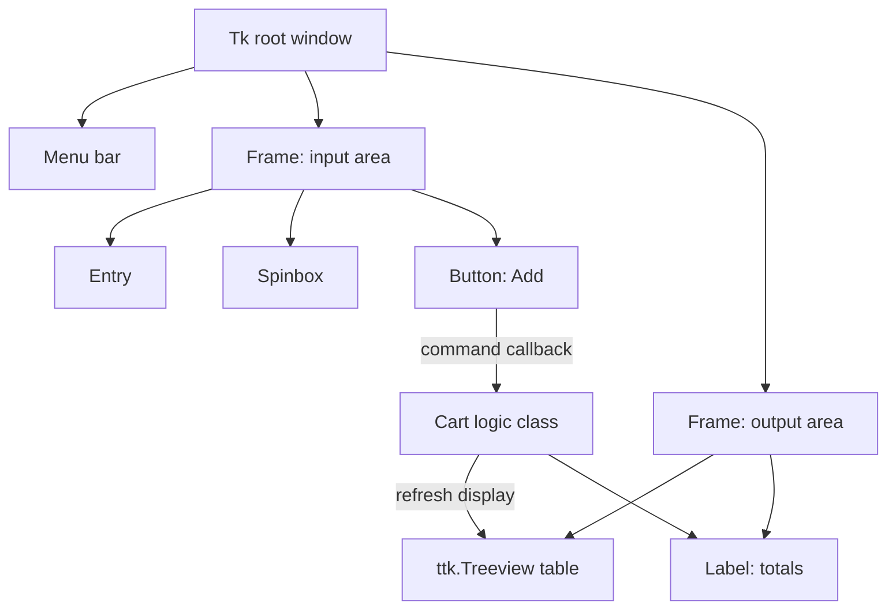
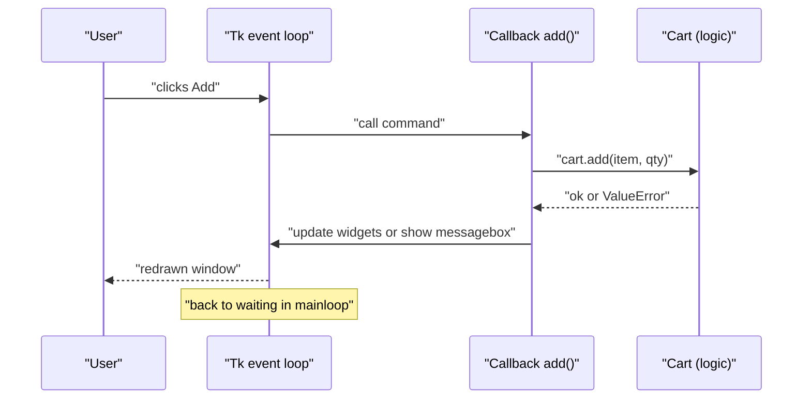
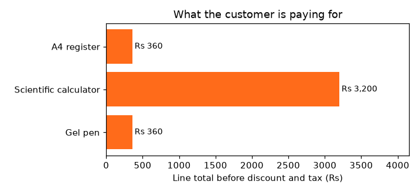

[](https://colab.research.google.com/github/Hamnakhan123/Diploma-in-AI/blob/main/term-1/04-application-based-programming-in-python/code/session-09-gui-programming-with-tkinter.ipynb) &nbsp; 📓 [Notebook](code/session-09-gui-programming-with-tkinter.ipynb)

# Session 9: GUI Programming with Tkinter

> 🧭 [Diploma in AI](../../README.md) › [Term 1](../README.md) › [Application Based Programming in Python](README.md) › **Session 9**
>
> ⏱️ **Estimated time:** 3 hours (1 h concepts + 2 h lab) &nbsp;|&nbsp; 📋 **Prerequisites:** Sessions 3-5 (functions, lambda, files, exceptions). Classes are used lightly; each one is explained.
>
> Prepared by **Hamna Zahid Khan**, Junior Lecturer

[⬅ Previous: Session 8](session-08-web-scraping.md) &nbsp;|&nbsp; [🏠 Module home](README.md) &nbsp;|&nbsp; [Next: Session 10 ➡](session-10-database-integration.md)

---

## 🎯 Learning objectives

By the end of this session you will be able to:

- Describe **Tkinter**, its purpose, and how **event-driven** GUI programs differ from top-to-bottom scripts.
- Create windows and the common **widgets** (Label, Button, Entry, Text, Checkbutton, Radiobutton, Listbox, Spinbox, Scale, Combobox, Treeview, Frame, Menu, messagebox) and set their **properties** (options).
- Link widgets to data with **Tk variables** (`StringVar`, `IntVar`, `BooleanVar`) and respond to clicks and keys with **callbacks** and **event bindings**.
- Arrange widgets with the **pack**, **grid** and **place** geometry managers.
- Build complete small applications with a clean separation between **logic** and **interface**.

## 📖 Concepts

### 1. What is Tkinter and why use it?

A **GUI** (graphical user interface) lets people use your program with windows, buttons and text boxes instead of typing commands. **Tkinter** is Python's standard GUI toolkit: a Python wrapper around the **Tk** library.

| Feature | Benefit |
|---|---|
| Ships with Python on Windows and macOS (`import tkinter`) | nothing to install |
| Cross-platform | the same code runs on Windows, macOS and Linux |
| Simple API | a window with a button takes five lines |
| `ttk` themed widgets | native-looking controls, plus Combobox, Treeview, Progressbar |
| Good for | internal tools, data-entry forms, calculators, teaching, quick front-ends for ML models |

Alternatives for bigger projects: **PyQt / PySide** (professional desktop apps), **Kivy** (touch and mobile), or a web interface with **Flask** (Session 7) or **Streamlit**.

> ⚠️ **About running these examples:** Tkinter needs a screen. On your own computer each script opens a real window. In Google Colab, on servers, in Jupyter notebooks, or when Tk is not installed (some Linux systems need `sudo apt install python3-tk`), there is no screen, so the scripts automatically switch to **test mode** and exercise the same application logic in text. The helper that decides this is `gui_support.py`. The outputs on this page were produced in test mode.

📄 [`code/gui_support.py`](code/gui_support.py)

```python
"""
gui_support: decides whether a Tkinter window can be shown (Session 9).

Tkinter needs a screen. On your laptop the examples open real windows.
In Google Colab, on servers, inside notebooks or with --test, there is no
screen to draw on, so the examples run their application LOGIC in a text
"test mode" instead. Keeping logic separate from widgets is good design anyway.
"""
import sys

def gui_available():
    """True when a Tk window can actually be created."""
    if "--test" in sys.argv or "ipykernel" in sys.modules:   # notebooks and test runs: no window
        return False
    try:
        import tkinter as tk
        root = tk.Tk()
        root.withdraw()
        root.destroy()
        return True
    except Exception:                 # no display, or Tk libraries not installed
        return False

def banner(name):
    print(f"[{name}] no screen available here -> running the app logic in test mode.")
    print("Run this file on your own computer (python <file>.py) to see the window.\n")
```


### 2. Event-driven programming

A normal script runs from top to bottom and ends. A GUI program **builds the window, then waits** inside `root.mainloop()`. When the user clicks or types, Tk calls the function you registered for that **event** (a **callback**), then goes back to waiting.

> 🧠 **Analogy:** A script is a **lecture**: the speaker goes through the slides in order. A GUI is a **help desk**: the clerk sets up the counter (builds widgets), then waits; each visitor (event) is handled by the right procedure (callback), and the clerk returns to waiting until closing time (the window is closed).

**The five steps of every Tkinter program:**

```python
import tkinter as tk                    # 1. import
root = tk.Tk()                          # 2. main window
btn = tk.Button(root, text="Hi", command=say_hi)   # 3. create a widget (parent first)
btn.pack()                              # 4. place it with a geometry manager
root.mainloop()                         # 5. start the event loop
```

### 3. Widgets and their properties

Every widget is created as `WidgetClass(parent, option=value, ...)`. Options can be changed later with `widget.config(option=value)` and read with `widget.cget("option")` or `widget["option"]`.

| Widget | Purpose | Key options / methods |
|---|---|---|
| `Label` | show text or an image | `text`, `font`, `fg`, `bg`, `textvariable` |
| `Button` | run a function on click | `text`, `command`, `state="disabled"` |
| `Entry` | one-line text input | `textvariable`, `show="*"`, `.get()`, `.delete(0, "end")` |
| `Text` | multi-line text | `.get("1.0", "end")`, `.insert("end", s)` |
| `Checkbutton` | on/off option | `variable=BooleanVar` |
| `Radiobutton` | one choice from several | shared `variable`, each with its own `value` |
| `Listbox` | list of items | `.insert`, `.curselection()`, `selectmode` |
| `Spinbox` | number with arrows | `from_`, `to`, `textvariable` |
| `Scale` | slider | `from_`, `to`, `orient`, `variable` |
| `ttk.Combobox` / `OptionMenu` | drop-down list | `values`, `textvariable`, `state="readonly"` |
| `ttk.Treeview` | table or tree | `columns`, `.heading()`, `.insert()`, `.selection()` |
| `Frame` / `LabelFrame` | container to group widgets | `padx`, `pady`, `text` |
| `Canvas` | drawing area | `.create_line`, `.create_rectangle`, `.create_text` |
| `Menu` | menu bar and menus | `.add_command`, `.add_cascade` |
| `messagebox` | pop-up dialogs | `showinfo`, `showwarning`, `showerror`, `askyesno` |

**Common properties:** `text`, `font=("Segoe UI", 12, "bold")`, `fg`/`bg` (colours), `width`/`height`, `padx`/`pady`, `relief` (`flat`, `raised`, `sunken`, `groove`), `anchor`/`justify`, `state`, `cursor`.

**Tk variable classes** connect a widget to a value: `name = tk.StringVar()`, `Entry(root, textvariable=name)`, then `name.get()` and `name.set("...")`. Also `IntVar`, `DoubleVar`, `BooleanVar`. Several widgets can share one variable (a group of Radiobuttons).

### 4. Ways to create and arrange widgets: geometry managers

A widget is invisible until a **geometry manager** places it. Use **one manager per container** (do not mix `pack` and `grid` in the same frame).

| Manager | How it works | Best for |
|---|---|---|
| `pack()` | stacks widgets along a side: `side="top"/"left"`, `fill="x"`, `expand=True` | simple vertical or horizontal layouts, toolbars |
| `grid()` | rows and columns: `row`, `column`, `columnspan`, `sticky="we"`, `padx` | forms, keypads, anything table-like |
| `place()` | exact `x`, `y` or relative `relx`, `rely` positions | overlays, rare special cases |

Use **Frames** to combine them: the window can `pack` a left frame and a right frame, while each frame uses `grid` inside.

### 5. Events and bindings

- **`command=`** on buttons and similar widgets: called with no arguments when clicked.
- **`widget.bind("<Event>", handler)`**: for any event. The handler receives an **event object** with `.char`, `.keysym`, `.x`, `.y`, `.widget`.

| Event pattern | Meaning |
|---|---|
| `<Button-1>`, `<Double-Button-1>` | left click, double click |
| `<Key>`, `<Return>`, `<Escape>`, `<BackSpace>` | any key, specific keys |
| `<Control-s>` | keyboard shortcut |
| `<Enter>`, `<Leave>` | mouse enters / leaves the widget |
| `<<ListboxSelect>>`, `<<ComboboxSelected>>` | virtual events from widgets |

To pass arguments to a callback use `lambda`: `command=lambda k=key: press(k)` (the `k=key` default avoids the late-binding trap from Session 4).

### 6. Designing simple applications

Keep the **rules** of the program (calculations, validation, saving) in plain functions or a class, and keep the **widgets** thin: they read values, call the logic, and display the result. This is the core idea of the **Model-View** pattern. Benefits: you can test the logic without a screen, reuse it in a web app (Session 7) or a script, and change the interface without breaking the rules.

## 🧭 Diagrams





## 💻 Worked examples

### Example 1: Your first window (basic)

A label, three buttons, `pack` layout, and callbacks that change a widget's `text` property with `config()`. The counting rules live in a tiny `ClickCounter` class.

📄 [`code/session-09_first_window.py`](code/session-09_first_window.py) &nbsp;·&nbsp; run: `python session-09_first_window.py`

```python
"""
Session 9 · Example 1: your first Tkinter window
------------------------------------------------
Every Tkinter program follows the same five steps:
  1. import tkinter   2. create the root window   3. create widgets
  4. place them with a geometry manager             5. start the event loop
Run:  python session-09_first_window.py
"""
from gui_support import gui_available, banner

class ClickCounter:
    """The app's logic, kept separate from the widgets so it can be tested."""
    def __init__(self):
        self.count = 0
    def click(self):
        self.count += 1
        return self.message()
    def reset(self):
        self.count = 0
        return self.message()
    def message(self):
        if self.count == 0:
            return "Click the button!"
        return f"Clicked {self.count} time{'s' if self.count != 1 else ''}" + (" - nice!" if self.count >= 5 else "")

def run_gui():
    import tkinter as tk                       # step 1
    counter = ClickCounter()
    root = tk.Tk()                             # step 2: the main window
    root.title("My first Tkinter app")
    root.geometry("320x160")                   # width x height in pixels
    root.resizable(False, False)

    label = tk.Label(root, text=counter.message(), font=("Segoe UI", 14), fg="#FF6B1A")   # step 3
    def on_click():                            # a callback: runs when the button is pressed
        label.config(text=counter.click())     # change a widget property at run time
    button = tk.Button(root, text="Click me", width=12, command=on_click)
    reset = tk.Button(root, text="Reset", command=lambda: label.config(text=counter.reset()))
    quit_btn = tk.Button(root, text="Quit", command=root.destroy)

    label.pack(pady=15)                        # step 4: pack stacks widgets top to bottom
    button.pack()
    reset.pack(side="left", padx=40, pady=10)
    quit_btn.pack(side="right", padx=40, pady=10)
    root.mainloop()                            # step 5: wait for events until the window closes

if gui_available():
    run_gui()
else:
    banner("first_window")
    c = ClickCounter()
    print("start      ->", c.message())
    for _ in range(5):
        print("click      ->", c.click())
    print("reset      ->", c.reset())
    print("\nWidgets this window creates: Tk (root), Label, Button x3")
    print("Geometry manager: pack | Event loop: root.mainloop()")
```

**Output**

```text
[first_window] no screen available here -> running the app logic in test mode.
Run this file on your own computer (python <file>.py) to see the window.

start      -> Click the button!
click      -> Clicked 1 time
click      -> Clicked 2 times
click      -> Clicked 3 times
click      -> Clicked 4 times
click      -> Clicked 5 times - nice!
reset      -> Click the button!

Widgets this window creates: Tk (root), Label, Button x3
Geometry manager: pack | Event loop: root.mainloop()
```


**What to notice:** the GUI function never calculates anything; it asks `ClickCounter` and displays the answer. That is why test mode can prove the app works without drawing a pixel.

### Example 2: A registration form with the common widgets (intermediate)

📄 [`code/session-09_widget_gallery.py`](code/session-09_widget_gallery.py) &nbsp;·&nbsp; run: `python session-09_widget_gallery.py`

```python
"""
Session 9 · Example 2: a registration form using the common widgets
-------------------------------------------------------------------
Widgets: Label, Entry, Spinbox, Radiobutton, Checkbutton, ttk.Combobox, Listbox,
Scale, Text, Button, LabelFrame, messagebox - with Tk variable classes
(StringVar, IntVar, BooleanVar) linking widgets to Python values.
Run:  python session-09_widget_gallery.py
"""
import re
from gui_support import gui_available, banner

PROGRAMS = ["Diploma in AI", "Data Science", "Web Development"]
SKILLS = ["Python", "SQL", "Statistics", "HTML/CSS", "Git"]

def validate(form):
    """Pure function: return a list of error messages for a form dict."""
    errors = []
    if len(form["name"].strip()) < 3:
        errors.append("Name needs at least 3 characters")
    if not re.fullmatch(r"[\w.+-]+@[\w-]+\.[\w.]+", form["email"]):
        errors.append("Email is not valid")
    if not 16 <= form["age"] <= 60:
        errors.append("Age must be 16-60")
    if form["program"] not in PROGRAMS:
        errors.append("Choose a program")
    if not form["agree"]:
        errors.append("You must accept the rules")
    return errors

def summary(form):
    skills = ", ".join(form["skills"]) or "none yet"
    return (f"{form['name'].strip().title()} ({form['age']}, {form['gender']}) -> {form['program']}, "
            f"{form['shift']} shift | skills: {skills} | confidence {form['confidence']}/10")

def run_gui():
    import tkinter as tk
    from tkinter import ttk, messagebox
    root = tk.Tk(); root.title("Student registration")
    name, email = tk.StringVar(), tk.StringVar()
    age, gender, shift = tk.IntVar(value=20), tk.StringVar(value="female"), tk.StringVar(value="Morning")
    agree, confidence, program = tk.BooleanVar(), tk.IntVar(value=5), tk.StringVar()

    tk.Label(root, text="Name").grid(row=0, column=0, sticky="w", padx=6, pady=3)
    tk.Entry(root, textvariable=name, width=30).grid(row=0, column=1, columnspan=2, sticky="we")
    tk.Label(root, text="Email").grid(row=1, column=0, sticky="w", padx=6)
    tk.Entry(root, textvariable=email, width=30).grid(row=1, column=1, columnspan=2, sticky="we")
    tk.Label(root, text="Age").grid(row=2, column=0, sticky="w", padx=6)
    tk.Spinbox(root, from_=16, to=60, textvariable=age, width=5).grid(row=2, column=1, sticky="w")
    box = tk.LabelFrame(root, text="Gender"); box.grid(row=3, column=0, columnspan=3, sticky="we", padx=6)
    for g in ("female", "male", "prefer not to say"):
        tk.Radiobutton(box, text=g, value=g, variable=gender).pack(side="left")
    tk.Label(root, text="Program").grid(row=4, column=0, sticky="w", padx=6)
    ttk.Combobox(root, values=PROGRAMS, textvariable=program, state="readonly").grid(row=4, column=1, sticky="w")
    tk.Label(root, text="Shift").grid(row=5, column=0, sticky="w", padx=6)
    tk.OptionMenu(root, shift, "Morning", "Evening", "Weekend").grid(row=5, column=1, sticky="w")
    tk.Label(root, text="Skills").grid(row=6, column=0, sticky="nw", padx=6)
    skills = tk.Listbox(root, selectmode="multiple", height=5, exportselection=False)
    for s in SKILLS: skills.insert("end", s)
    skills.grid(row=6, column=1, sticky="w")
    tk.Scale(root, from_=0, to=10, orient="horizontal", label="Confidence", variable=confidence).grid(row=7, column=1, sticky="we")
    notes = tk.Text(root, height=3, width=30); notes.grid(row=8, column=1, columnspan=2, pady=3)
    tk.Checkbutton(root, text="I accept the lab rules", variable=agree).grid(row=9, column=1, sticky="w")

    def submit():
        form = {"name": name.get(), "email": email.get(), "age": age.get(), "gender": gender.get(),
                "program": program.get(), "shift": shift.get(), "agree": agree.get(),
                "skills": [skills.get(i) for i in skills.curselection()], "confidence": confidence.get(),
                "notes": notes.get("1.0", "end").strip()}
        errors = validate(form)
        if errors:
            messagebox.showerror("Please fix", "\n".join(errors))
        else:
            messagebox.showinfo("Registered", summary(form))
    tk.Button(root, text="Submit", bg="#FF6B1A", fg="white", command=submit).grid(row=10, column=1, pady=8)
    root.mainloop()

if gui_available():
    run_gui()
else:
    banner("widget_gallery")
    samples = [
        {"name": "  ayesha khan ", "email": "ayesha@example.com", "age": 21, "gender": "female",
         "program": "Diploma in AI", "shift": "Evening", "agree": True, "skills": ["Python", "SQL"], "confidence": 7},
        {"name": "Al", "email": "al@", "age": 14, "gender": "male", "program": "",
         "shift": "Morning", "agree": False, "skills": [], "confidence": 3},
    ]
    for form in samples:
        errors = validate(form)
        print("Submit pressed with:", {k: form[k] for k in ("name", "email", "age", "program")})
        print("  -> showerror:" if errors else "  -> showinfo:", "; ".join(errors) if errors else summary(form))
    print("\nWidget -> Tk variable used to read it")
    for w, v in [("Entry", "StringVar"), ("Spinbox", "IntVar"), ("Radiobutton", "StringVar (shared)"),
                 ("Checkbutton", "BooleanVar"), ("Combobox/OptionMenu", "StringVar"), ("Scale", "IntVar"),
                 ("Listbox", "curselection()"), ("Text", "get('1.0', 'end')")]:
        print(f"  {w:<20} {v}")
```

**Output**

```text
[widget_gallery] no screen available here -> running the app logic in test mode.
Run this file on your own computer (python <file>.py) to see the window.

Submit pressed with: {'name': '  ayesha khan ', 'email': 'ayesha@example.com', 'age': 21, 'program': 'Diploma in AI'}
  -> showinfo: Ayesha Khan (21, female) -> Diploma in AI, Evening shift | skills: Python, SQL | confidence 7/10
Submit pressed with: {'name': 'Al', 'email': 'al@', 'age': 14, 'program': ''}
  -> showerror: Name needs at least 3 characters; Email is not valid; Age must be 16-60; Choose a program; You must accept the rules

Widget -> Tk variable used to read it
  Entry                StringVar
  Spinbox              IntVar
  Radiobutton          StringVar (shared)
  Checkbutton          BooleanVar
  Combobox/OptionMenu  StringVar
  Scale                IntVar
  Listbox              curselection()
  Text                 get('1.0', 'end')
```


**Walkthrough:**

1. Each input widget is tied to a Tk variable, so `submit()` collects everything with `.get()` calls into one dictionary.
2. `validate(form)` is a pure function (no widgets) returning a list of messages, reused by both the GUI and test mode.
3. The Listbox uses `selectmode="multiple"` and `curselection()` to read several skills; `exportselection=False` keeps the selection when focus moves.
4. `messagebox.showerror` / `showinfo` give the user feedback without extra windows to design.

### Example 3: Grid layout, events and key bindings: a calculator (advanced)

📄 [`code/session-09_layout_and_events.py`](code/session-09_layout_and_events.py) &nbsp;·&nbsp; run: `python session-09_layout_and_events.py`

```python
"""
Session 9 · Example 3: grid layout, events and key bindings - a calculator
--------------------------------------------------------------------------
Shows the grid geometry manager (rows/columns, columnspan, sticky), button
commands built with lambda, and keyboard events bound with root.bind().
Run:  python session-09_layout_and_events.py
"""
from gui_support import gui_available, banner

class CalculatorEngine:
    """All calculator behaviour lives here; the GUI only forwards key presses."""
    ALLOWED = set("0123456789+-*/.()")
    def __init__(self):
        self.expr = ""
    def press(self, key):
        if key == "C":
            self.expr = ""
        elif key == "<-":
            self.expr = self.expr[:-1]
        elif key == "=":
            self.expr = self.evaluate()
        elif key in self.ALLOWED:
            if self.expr == "Error":
                self.expr = ""
            self.expr += key
        return self.expr or "0"
    def evaluate(self):
        if not self.expr or not set(self.expr) <= self.ALLOWED:      # never eval arbitrary text
            return ""
        try:
            value = eval(self.expr, {"__builtins__": {}}, {})          # only digits and operators reach here
            return str(round(value, 10)).rstrip("0").rstrip(".") if isinstance(value, float) else str(value)
        except (SyntaxError, ZeroDivisionError):
            return "Error"

LAYOUT = [["7", "8", "9", "/"],
          ["4", "5", "6", "*"],
          ["1", "2", "3", "-"],
          ["0", ".", "=", "+"],
          ["(", ")", "<-", "C"]]

def run_gui():
    import tkinter as tk
    engine = CalculatorEngine()
    root = tk.Tk(); root.title("Calculator")
    display = tk.StringVar(value="0")
    tk.Label(root, textvariable=display, anchor="e", font=("Consolas", 20), bg="#0A0716", fg="#FCD34D",
             padx=10).grid(row=0, column=0, columnspan=4, sticky="nsew")
    for r, row in enumerate(LAYOUT, start=1):
        for c, key in enumerate(row):
            tk.Button(root, text=key, font=("Segoe UI", 14), width=4,
                      command=lambda k=key: display.set(engine.press(k))   # k=key avoids late binding
                      ).grid(row=r, column=c, sticky="nsew", padx=1, pady=1)
    for i in range(4):
        root.columnconfigure(i, weight=1)                # columns stretch when resized
    def on_key(event):                                   # event object: .char, .keysym, .x, .y ...
        mapping = {"Return": "=", "BackSpace": "<-", "Escape": "C"}
        key = mapping.get(event.keysym, event.char)
        display.set(engine.press(key))
    root.bind("<Key>", on_key)
    root.mainloop()

if gui_available():
    run_gui()
else:
    banner("calculator")
    eng = CalculatorEngine()
    def type_keys(keys):
        shown = ""
        for k in keys:
            shown = eng.press(k)
        return shown
    for seq in [list("12+7*3") + ["="], ["C"] + list("(12+7)*3") + ["="], ["C"] + list("10/4") + ["="],
                ["C"] + list("9/0") + ["="], ["C"] + list("123") + ["<-", "<-"], ["C"] + list("2**3") + ["="],
                ["C", "a", "b", "5"]]:
        print(f"keys {' '.join(seq):<36} display -> {type_keys(seq)}")
    print("\nGrid plan (row, column) for the buttons:")
    for r, row in enumerate(LAYOUT, start=1):
        print("  " + "  ".join(f"[{k:>2}]({r},{c})" for c, k in enumerate(row)))
```

**Output**

```text
[calculator] no screen available here -> running the app logic in test mode.
Run this file on your own computer (python <file>.py) to see the window.

keys 1 2 + 7 * 3 =                        display -> 33
keys C ( 1 2 + 7 ) * 3 =                  display -> 57
keys C 1 0 / 4 =                          display -> 2.5
keys C 9 / 0 =                            display -> Error
keys C 1 2 3 <- <-                        display -> 1
keys C 2 * * 3 =                          display -> 8
keys C a b 5                              display -> 5

Grid plan (row, column) for the buttons:
  [ 7](1,0)  [ 8](1,1)  [ 9](1,2)  [ /](1,3)
  [ 4](2,0)  [ 5](2,1)  [ 6](2,2)  [ *](2,3)
  [ 1](3,0)  [ 2](3,1)  [ 3](3,2)  [ -](3,3)
  [ 0](4,0)  [ .](4,1)  [ =](4,2)  [ +](4,3)
  [ (](5,0)  [ )](5,1)  [<-](5,2)  [ C](5,3)
```


**Key lessons:**

- The keypad is generated by **two loops** over a 2-D list, each button placed with `grid(row=r, column=c, sticky="nsew")`; `columnconfigure(weight=1)` makes columns stretch.
- `command=lambda k=key: ...` gives every button its own key.
- `root.bind("<Key>", on_key)` makes the physical keyboard work too, mapping Enter, Backspace and Escape to `=`, `<-` and `C`.
- `eval` is only reached after checking that the text contains digits and operators **only**. Never `eval` raw user input.

## 🌍 Real-life coding problem: a point-of-sale billing app

**Scenario.** A campus stationery shop wants a billing screen: choose an item and quantity, build a cart, apply a discount code, see subtotal, discount, 16 % tax and total, and print a receipt.

**Design before coding:**

| Layer | Responsibility |
|---|---|
| `Cart` class (logic) | add with validation, remove, discount codes, totals, receipt text |
| Tkinter (view) | Listbox of items, Spinbox for quantity, Entry for the code, Treeview cart table, totals Label, buttons |
| Glue | each button's callback calls one `Cart` method, then `refresh()` redraws the table and totals |

```python
def totals(self):
    sub = sum(CATALOGUE[i] * q for i, q in self.lines.items())
    disc = sub * CODES.get(self.discount_code, 0)
    tax = (sub - disc) * TAX
    return {"subtotal": sub, "discount": disc, "tax": tax, "total": round(sub - disc + tax)}
```

📄 Full solution (136 lines, fully commented): [`code/session-09_problem_pos_billing.py`](code/session-09_problem_pos_billing.py) &nbsp;·&nbsp; run: `python session-09_problem_pos_billing.py` &nbsp;·&nbsp; also in the session notebook

**Output**

```text
[pos_billing] no screen available here -> running the app logic in test mode.
Run this file on your own computer (python <file>.py) to see the window.

add    A4 register            ok      -> total Rs 626
add    Gel pen                ok      -> total Rs 905
add    Scientific calculator  ok      -> total Rs 4,617
add    Gel pen                ok      -> total Rs 4,756
add    Stapler                warning -> unknown item 'Stapler'
add    Highlighter            warning -> quantity must be 1-100
code   student10              ok      -> total Rs 4,280
code   FREE100                warning -> invalid code 'FREE100'
remove A4 register            ok      -> total Rs 3,717
add    A4 register            ok      -> total Rs 4,092

           CAMPUS STATIONERS            
           26 Oct 2026 11:45            
----------------------------------------
Gel pen                  6 x   60     360
Scientific calculator    1 x 3200   3,200
A4 register              2 x  180     360
----------------------------------------
Subtotal                           3,920
Discount (STUDENT10)                -392
Sales tax 16%                        564
TOTAL Rs                           4,092
----------------------------------------
               Thank you!               

Chart saved: session-09_problem_pos_billing.png
```




**Interpretation.** Invalid actions (an unknown item, quantity 0, a fake code) produced warnings instead of crashes; in the GUI they appear as message boxes. Adding the same item twice merged the lines. Tax is calculated **after** the discount, a business rule that lives in exactly one place, so changing it later is a one-line edit.

## 🛠️ Mini project: to-do manager with saved tasks

A complete desktop app combining everything from this session and earlier ones:

| Feature | Technique |
|---|---|
| Add task with priority | Entry + OptionMenu, `<Return>` key binding |
| Mark done | `<Double-Button-1>` binding on the Listbox |
| Filter all / pending / done | Radiobuttons sharing a `StringVar`, `command=self.refresh` |
| Sorted view | `sorted` with a tuple key (pending first, then priority) |
| Menu bar and shortcut | `Menu`, `add_cascade`, `<Control-s>` |
| Status bar | Label with `relief="sunken"` at the bottom |
| Persistence | JSON file loaded at start, saved after every change (Session 5) |
| Confirmation | `messagebox.askyesno` before deleting |

📄 Full solution (132 lines, fully commented): [`code/session-09_project_todo_app.py`](code/session-09_project_todo_app.py) &nbsp;·&nbsp; run: `python session-09_project_todo_app.py` &nbsp;·&nbsp; also in the session notebook

**Output**

```text
[todo_app] no screen available here -> running the app logic in test mode.
Run this file on your own computer (python <file>.py) to see the window.

add 'Prepare Python lab 9'     ok
add 'Mark quizzes'             ok
add 'Buy whiteboard markers'   ok
add '  '                       warning: task text is empty
add 'mark quizzes'             warning: 'mark quizzes' is already on the list
add 'Email the timetable'      warning: priority must be one of ['high', 'normal', 'low']
add 'Book projector'           ok

List (pending first, high priority first):
  • [  high] Prepare Python lab 9
  • [  high] Book projector
  • [   low] Buy whiteboard markers
  ✔ [normal] Mark quizzes

Filter 'done': ['Mark quizzes']
Status bar: {'total': 4, 'done': 1, 'pending': 3}
After restart, tasks loaded from file: 4
After deleting the first task: {'total': 3, 'done': 1, 'pending': 2}
```


**Extension ideas:** add due dates with overdue tasks shown in red (`listbox.itemconfig(i, fg="red")`); an Edit button that loads a task into the Entry; export to CSV from the File menu; a progress bar (`ttk.Progressbar`) showing the percentage done.

## ⚠️ Common mistakes

| Mistake | Symptom | Fix |
|---|---|---|
| Forgetting `root.mainloop()` | the window flashes and closes | Call it once, at the end |
| `command=save()` with parentheses | the function runs immediately, once, at start-up | `command=save` (no parentheses) or a lambda |
| Lambdas in a loop without `k=key` | every button does the last action | `lambda k=key: press(k)` |
| Mixing `pack` and `grid` in one container | the app freezes while Tk fights over the layout | One manager per container; use Frames |
| Creating a widget but never placing it | it does not appear | Call `pack`, `grid` or `place` |
| Long calculations inside a callback | the window freezes ("Not responding") | Keep callbacks short; use `root.after` or threads for long jobs |
| Putting business rules inside callbacks | untestable, duplicated logic | Separate logic class or functions |
| Several `Tk()` windows | strange errors | One `Tk()`; use `Toplevel()` for extra windows |
| Reading an Entry as a number without converting | `TypeError` | `int(entry.get())` inside `try / except ValueError` |

## ✅ Best practices

- **Separate logic from interface** and test the logic on its own.
- Group related widgets in **Frames** and use `grid` for forms.
- Give users **feedback**: status bars, message boxes, disabled buttons when an action is not possible.
- Validate input and show clear messages; never let an exception crash the GUI silently.
- Use `ttk` widgets for a modern look, and consistent fonts and padding.
- Add keyboard shortcuts for frequent actions (Enter to add, Ctrl+S to save).
- Save the user's data automatically and confirm destructive actions.

## 🧪 Lab / practice tasks

**1. 🟢 Easy:** Create a window titled "Greeting" with an Entry and a Button; clicking the button shows "Hello, <name>!" in a Label.

<details><summary>💡 Hint</summary>

Use a `StringVar` for the Entry and `label.config(text=...)` in the callback.

</details>

<details><summary>✅ Solution</summary>

```python
import tkinter as tk
root = tk.Tk(); root.title("Greeting")
name = tk.StringVar()
tk.Entry(root, textvariable=name).pack(padx=10, pady=5)
out = tk.Label(root, text="")
tk.Button(root, text="Greet", command=lambda: out.config(text=f"Hello, {name.get().strip() or 'stranger'}!")).pack()
out.pack(pady=5)
root.mainloop()
```

</details>

**2. 🟢 Easy:** Build a temperature converter with two Radiobuttons (C→F, F→C), an Entry and a result Label. Show an error message for non-numeric input.

<details><summary>💡 Hint</summary>

Write `convert(value, direction)` first as a normal function, test it, then attach it to a button. Use `messagebox.showerror` in `except ValueError`.

</details>

<details><summary>✅ Solution</summary>

```python
import tkinter as tk
from tkinter import messagebox
def convert(value, direction):
    return value * 9 / 5 + 32 if direction == "CtoF" else (value - 32) * 5 / 9
root = tk.Tk(); d = tk.StringVar(value="CtoF"); v = tk.StringVar()
for text, val in [("C to F", "CtoF"), ("F to C", "FtoC")]:
    tk.Radiobutton(root, text=text, value=val, variable=d).pack(anchor="w")
tk.Entry(root, textvariable=v).pack(); res = tk.Label(root); res.pack()
def go():
    try:
        res.config(text=f"{convert(float(v.get()), d.get()):.1f}")
    except ValueError:
        messagebox.showerror("Input", "Please type a number")
tk.Button(root, text="Convert", command=go).pack(); root.mainloop()
```

</details>

**3. 🟡 Medium:** Lay out a login form with `grid`: labels in column 0, entries in column 1 (password with `show="*"`), a "Show password" Checkbutton that toggles the `show` option, and a Login button spanning both columns.

<details><summary>💡 Hint</summary>

`pwd_entry.config(show="" if show_var.get() else "*")` inside the Checkbutton's `command`.

</details>

<details><summary>✅ Solution</summary>

```python
import tkinter as tk
root = tk.Tk(); root.title("Login")
tk.Label(root, text="Username").grid(row=0, column=0, sticky="w", padx=5, pady=3)
tk.Label(root, text="Password").grid(row=1, column=0, sticky="w", padx=5)
user = tk.Entry(root); user.grid(row=0, column=1)
pwd = tk.Entry(root, show="*"); pwd.grid(row=1, column=1)
show = tk.BooleanVar()
tk.Checkbutton(root, text="Show password", variable=show,
               command=lambda: pwd.config(show="" if show.get() else "*")).grid(row=2, column=1, sticky="w")
tk.Button(root, text="Login", width=20).grid(row=3, column=0, columnspan=2, pady=6)
root.mainloop()
```

</details>

**4. 🟡 Medium:** Add a **percentage** key (`%`) and a **square root** key (`√`) to the calculator engine, and test both in test mode before touching the GUI.

<details><summary>💡 Hint</summary>

Handle them as special keys in `press()`: evaluate the current expression, then divide by 100 or apply `math.sqrt`.

</details>

<details><summary>✅ Solution</summary>

```python
import math
class ScientificEngine(CalculatorEngine):
    def press(self, key):
        if key in ("%", "√"):
            value = self.evaluate()
            try:
                x = float(value)
                self.expr = str(x / 100 if key == "%" else math.sqrt(x))
            except ValueError:
                self.expr = "Error"
            return self.expr
        return super().press(key)
e = ScientificEngine()
for k in "50": e.press(k)
print(e.press("%"))          # 0.5
e.press("C"); [e.press(k) for k in "81"]; print(e.press("√"))   # 9.0
```

</details>

**5. 🟠 Hard:** Draw a live bar chart on a `Canvas`: three Scales (0-100) for three subjects; whenever a Scale moves, redraw three rectangles whose heights match the values, with the value printed above each bar.

<details><summary>💡 Hint</summary>

Give each Scale `command=lambda _v: redraw()`. In `redraw`, call `canvas.delete("all")` and then `create_rectangle` / `create_text` for each value.

</details>

<details><summary>✅ Solution</summary>

```python
import tkinter as tk
root = tk.Tk(); canvas = tk.Canvas(root, width=300, height=220, bg="white"); canvas.pack()
vars_ = [tk.IntVar(value=v) for v in (60, 75, 45)]
def redraw():
    canvas.delete("all")
    for i, v in enumerate(vars_):
        x = 40 + i * 90; h = v.get() * 2
        canvas.create_rectangle(x, 210 - h, x + 50, 210, fill="#FF6B1A")
        canvas.create_text(x + 25, 200 - h, text=str(v.get()))
for v in vars_:
    tk.Scale(root, from_=0, to=100, orient="horizontal", variable=v, command=lambda _v: redraw()).pack(fill="x")
redraw(); root.mainloop()
```

</details>

**6. 🔴 Challenge:** Give the POS app a **sales history**: every printed receipt is appended to `sales.csv` (time, items, total), and a new "Today's sales" button opens a `Toplevel` window with a Treeview of today's receipts and the day's total. Write and test the CSV functions in test mode first.

<details><summary>💡 Hint</summary>

`record_sale(cart, when)` appends one row with `csv.writer` in mode `"a"`; `sales_on(date)` reads the file and filters by the date part of the timestamp. The window: `win = tk.Toplevel(root)`, then build a Treeview inside `win`.

</details>

<details><summary>✅ Solution</summary>

```python
import csv
from datetime import datetime, date
def record_sale(cart, when, path="sales.csv"):
    with open(path, "a", newline="", encoding="utf-8") as f:
        csv.writer(f).writerow([when.isoformat(timespec="minutes"),
                                ";".join(f"{i}x{q}" for i, q in cart.lines.items()), cart.totals()["total"]])
def sales_on(day, path="sales.csv"):
    try:
        with open(path, newline="", encoding="utf-8") as f:
            return [r for r in csv.reader(f) if r[0].startswith(day.isoformat())]
    except FileNotFoundError:
        return []
record_sale(cart, datetime(2026, 10, 26, 11, 45))
rows = sales_on(date(2026, 10, 26))
print(len(rows), "sales, total Rs", sum(int(r[2]) for r in rows))
```

</details>

## ✅ Quick quiz

**Q1.** What does `root.mainloop()` do?

- A) closes the window
- B) starts the event loop that waits for and dispatches user events
- C) creates the root window
- D) draws all widgets once and exits

**Q2.** Which geometry manager is best for a form with labels and entries in neat rows and columns?

- A) pack
- B) place
- C) grid
- D) frame

**Q3.** What is wrong with `tk.Button(root, text="Save", command=save())`?

- A) nothing
- B) save runs immediately at start-up instead of on click
- C) buttons cannot have commands
- D) text must come after command

**Q4.** Which widget lets the user pick several items from a visible list?

- A) Entry
- B) Listbox with selectmode="multiple"
- C) Label
- D) Scale

**Q5.** How do you read the text typed into a Text widget?

- A) text.get()
- B) text.get("1.0", "end")
- C) text.value
- D) text.read()

<details><summary>✅ Show answers</summary>

1. **B** — the program waits in the event loop until the window is closed.
2. **C** — grid arranges widgets in rows and columns.
3. **B** — the parentheses call the function; pass `save` without them.
4. **B** — read the choices with curselection().
5. **B** — Text widgets use index positions: line 1, character 0, to the end.

</details>


## 📝 Summary

- **Tkinter** is Python's built-in GUI toolkit; programs are **event-driven** and wait in `root.mainloop()`.
- Five steps: import, create `Tk()`, create widgets with a parent, place them, start the loop.
- **Widgets:** Label, Button, Entry, Text, Checkbutton, Radiobutton, Listbox, Spinbox, Scale, Combobox/OptionMenu, Treeview, Frame, Canvas, Menu, messagebox. Set **properties** at creation or with `config()`.
- **Tk variables** (`StringVar`, `IntVar`, `BooleanVar`) link widgets and data.
- **Geometry managers:** `pack` (stack), `grid` (rows/columns), `place` (exact); one per container, combine with Frames.
- **Events:** `command=` for clicks, `bind("<Event>", handler)` for keys and mouse; `lambda k=key:` to pass arguments.
- Separate **logic** from **interface** so apps are testable, reusable and easy to change.

### 🎤 Interview / viva questions

1. What is event-driven programming? How does `mainloop()` support it?
2. Compare `pack`, `grid` and `place`. Why should you not mix them in one container?
3. What is a `StringVar` and why use it instead of reading the widget directly?
4. How do you pass an argument to a button's callback?
5. Why does a GUI freeze during a long calculation, and how can you avoid it?
6. What is the benefit of separating application logic from the GUI code?
7. When would you choose Flask or PyQt instead of Tkinter?

---

[⬅ Previous: Session 8](session-08-web-scraping.md) &nbsp;|&nbsp; [🏠 Module home](README.md) &nbsp;|&nbsp; [Next: Session 10 ➡](session-10-database-integration.md)

<sub>Prepared by **Hamna Zahid Khan**, Junior Lecturer · Diploma in AI</sub>
