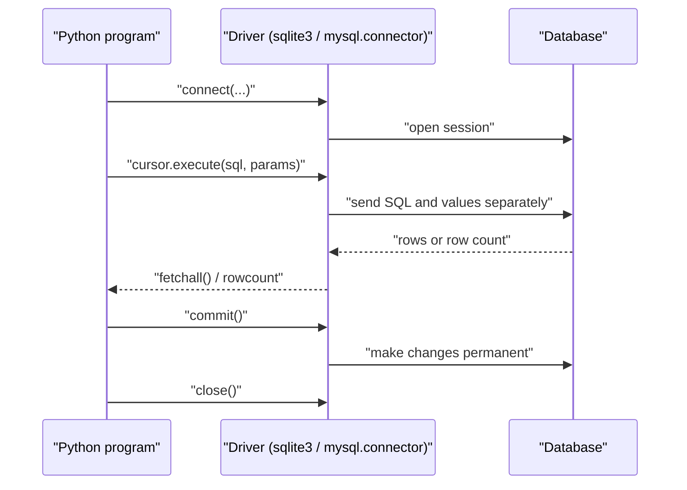
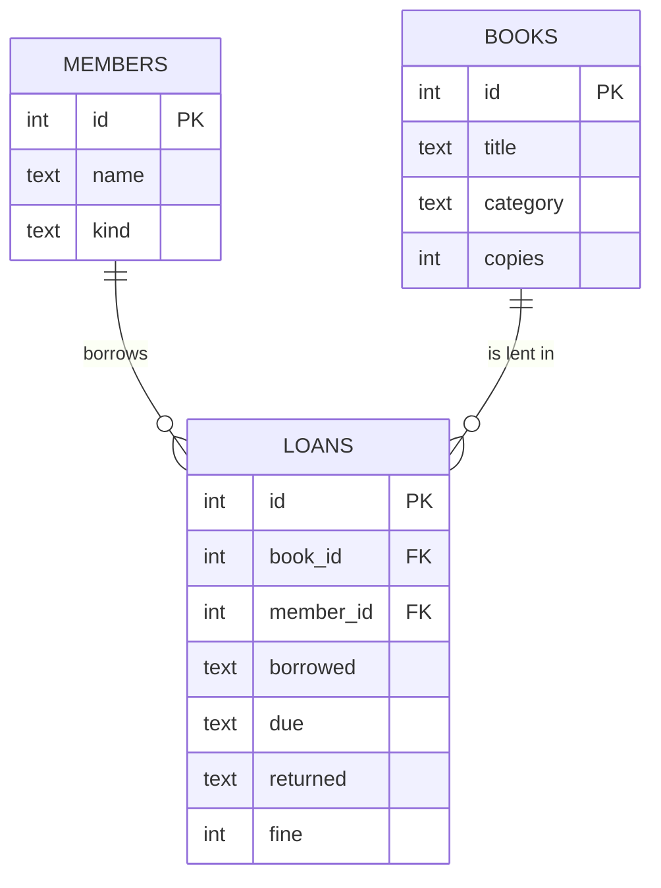
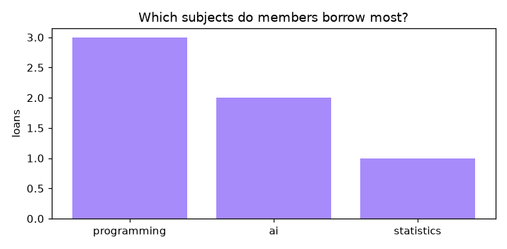

[](https://colab.research.google.com/github/Hamnakhan123/Diploma-in-AI/blob/main/term-1/04-application-based-programming-in-python/code/session-10-database-integration.ipynb) &nbsp; 📓 [Notebook](code/session-10-database-integration.ipynb)

# Session 10: Database Integration with Python

> 🧭 [Diploma in AI](../../README.md) › [Term 1](../README.md) › [Application Based Programming in Python](README.md) › **Session 10**
>
> ⏱️ **Estimated time:** 3 hours (1 h concepts + 2 h lab) &nbsp;|&nbsp; 📋 **Prerequisites:** Session 5 (exceptions), Session 9 (Tkinter) and the SQL you learned in the T-SQL module.
>
> Prepared by **Hamna Zahid Khan**, Junior Lecturer

[⬅ Previous: Session 9](session-09-gui-programming-with-tkinter.md) &nbsp;|&nbsp; [🏠 Module home](README.md) &nbsp;|&nbsp; [Next: Session 11 ➡](session-11-data-handling-with-pandas.md)

---

## 🎯 Learning objectives

By the end of this session you will be able to:

- Explain **database connectivity** in Python and the standard **DB-API** steps shared by SQLite, MySQL, PostgreSQL and SQL Server.
- **Connect**, create a **cursor**, run SQL with **parameters**, **fetch** results, **commit** or **roll back**, and close the connection.
- **Create a database and a table in MySQL** using the command-line client, and connect to it with `mysql-connector-python`.
- Prevent **SQL injection**, handle **integrity errors**, and group statements into **transactions**.
- Design a **Tkinter application that inserts, updates, deletes and searches** records in a database.

## 📖 Concepts

### 1. Why connect Python to a database?

Files (Session 5) work for small data, but real applications need a **database management system (DBMS)**: many users at once, fast searching with indexes, relationships between tables, constraints that keep data valid and **transactions** that never leave data half-updated.

| Need | Plain files | Database |
|---|---|---|
| Find one student among 100,000 | read the whole file | indexed lookup in milliseconds |
| Two clerks saving at the same time | data can be overwritten | locking and transactions |
| "Every loan must refer to an existing book" | your code must check | foreign-key constraint |
| Reports (counts, averages, joins) | write loops | one SQL query |

| Database | Type | Python driver | Placeholder |
|---|---|---|---|
| **SQLite** | file-based, built into Python | `sqlite3` (standard library) | `?` or `:name` |
| **MySQL / MariaDB** | client-server | `mysql-connector-python` or `PyMySQL` | `%s` |
| **PostgreSQL** | client-server | `psycopg` | `%s` |
| **SQL Server** | client-server | `pyodbc` | `?` |
| **MongoDB** (Module 2) | document store | `pymongo` | (no SQL) |

All the SQL drivers follow **PEP 249, the Python DB-API**, so once you know one, the others feel the same. This session runs everything on **SQLite** (zero setup, works in Colab) and shows the **MySQL** equivalents side by side.

> 🧠 **Analogy:** The database is a **bank vault**. The **connection** is your authorised visit to the bank; the **cursor** is the clerk who carries your requests to the vault and brings back results; **commit** is signing the transaction slip so it becomes official; **rollback** is tearing the slip up before signing; closing the connection is leaving the bank.

### 2. The DB-API steps

```python
import sqlite3                                   # 1. import the driver
conn = sqlite3.connect("campus.db")              # 2. connect (creates the file if needed)
cur = conn.cursor()                              # 3. create a cursor
cur.execute("SELECT * FROM students WHERE city = ?", ("Karachi",))   # 4. execute with parameters
rows = cur.fetchall()                            # 5. fetch results (for SELECT)
conn.commit()                                    # 6. commit changes (for INSERT/UPDATE/DELETE)
conn.close()                                     # 7. close
```

| Method | Purpose |
|---|---|
| `execute(sql, params)` | run one statement |
| `executemany(sql, list_of_params)` | run one statement for many rows |
| `executescript(sql)` (SQLite) | run several statements at once (setup scripts) |
| `fetchone()`, `fetchmany(n)`, `fetchall()` | get one row, n rows, or all remaining rows |
| `rowcount`, `lastrowid` | rows affected, id of the last inserted row |
| `commit()`, `rollback()` | make permanent, undo since the last commit |
| `with conn:` (SQLite) | commit on success, roll back on exception |
| `conn.row_factory = sqlite3.Row` | rows accessible by column name |

### 3. Parameters and SQL injection

**Never** build SQL by joining strings with user input:

```python
name = "x' OR '1'='1"
cur.execute(f"SELECT * FROM students WHERE name = '{name}'")      # ❌ returns EVERY row
cur.execute("SELECT * FROM students WHERE name = ?", (name,))      # ✅ treated as plain text
```

With parameters the driver sends the SQL and the values **separately**, so the value can never change the meaning of the query. This also handles quotes in names like "O'Brien" and converts Python types correctly. Note the trailing comma: `(name,)` is a one-element tuple.

### 4. Transactions and errors

A **transaction** is a group of statements that succeed or fail **together** (atomicity, the "A" in **ACID**). Borrowing a library book must both decrease the copy count **and** insert a loan row; if the second step fails, the first must be undone.

```python
try:
    with conn:                                   # SQLite: one transaction
        conn.execute("UPDATE books SET copies = copies - 1 WHERE id = ?", (book_id,))
        conn.execute("INSERT INTO loans (...) VALUES (...)", (...))
except sqlite3.IntegrityError as e:
    print("nothing was saved:", e)
```

Common exceptions (DB-API names): `IntegrityError` (UNIQUE, NOT NULL, CHECK, FOREIGN KEY violated), `OperationalError` (bad SQL, missing table, locked database), `ProgrammingError` (wrong number of parameters). In MySQL Connector they live under `mysql.connector.Error` with an `errno`.

### 5. Creating a database and a table in MySQL (command line)

1. Install MySQL Server (or MariaDB, or XAMPP) and open a terminal.
2. Log in: `mysql -u root -p`, then type your password.
3. Run the statements below (also in [`code/mysql_setup.sql`](code/mysql_setup.sql)).

📄 [`code/mysql_setup.sql`](code/mysql_setup.sql)

```sql
-- Session 10 · Creating a database and a table with the MySQL command-line client
-- Start the client:   mysql -u root -p          (type your password when asked)
-- Then run these statements one by one, or:  mysql -u root -p < mysql_setup.sql

CREATE DATABASE IF NOT EXISTS campus CHARACTER SET utf8mb4;
SHOW DATABASES;
USE campus;

CREATE TABLE IF NOT EXISTS students (
    id      INT AUTO_INCREMENT PRIMARY KEY,
    roll    VARCHAR(12)  NOT NULL UNIQUE,
    name    VARCHAR(60)  NOT NULL,
    city    VARCHAR(30)  DEFAULT 'Karachi',
    cgpa    DECIMAL(3,2) CHECK (cgpa BETWEEN 0 AND 4),
    created TIMESTAMP    DEFAULT CURRENT_TIMESTAMP
);
SHOW TABLES;
DESCRIBE students;

INSERT INTO students (roll, name, city, cgpa) VALUES
    ('AI-01', 'Ali Khan', 'Karachi', 3.10),
    ('AI-02', 'Sana Tariq', 'Lahore', 3.80);
SELECT * FROM students;

-- A dedicated user for the Python app (never connect apps as root)
CREATE USER IF NOT EXISTS 'campus_app'@'localhost' IDENTIFIED BY 'choose-a-strong-password';
GRANT SELECT, INSERT, UPDATE, DELETE ON campus.* TO 'campus_app'@'localhost';
FLUSH PRIVILEGES;
```


4. From Python: `pip install mysql-connector-python`, then connect with host, user, password and database. The only code differences from SQLite are the `connect()` arguments and the `%s` placeholders:

📄 [`code/mysql_students_demo.py`](code/mysql_students_demo.py)

```python
"""
Session 10 · The same CRUD code for MySQL (reference - needs a MySQL server)
---------------------------------------------------------------------------
Install the driver:   pip install mysql-connector-python
Create the database first with mysql_setup.sql.
Differences from SQLite: placeholders are %s instead of ?, and you connect
with host/user/password/database. Everything else follows the same DB-API steps.
Run (only where MySQL is installed):  python mysql_students_demo.py
"""
import os
import mysql.connector
from mysql.connector import Error, errorcode

config = {
    "host": "localhost",
    "user": "campus_app",
    "password": os.environ.get("CAMPUS_DB_PASSWORD", ""),   # keep secrets out of code
    "database": "campus",
}

try:
    conn = mysql.connector.connect(**config)
    cur = conn.cursor(dictionary=True)               # rows as dicts
    cur.execute("INSERT INTO students (roll, name, city, cgpa) VALUES (%s, %s, %s, %s)",
                ("AI-03", "Bilal Ahmed", "Karachi", 2.70))
    conn.commit()
    print("new id:", cur.lastrowid)

    cur.execute("SELECT roll, name, cgpa FROM students WHERE cgpa >= %s ORDER BY cgpa DESC", (3.0,))
    for row in cur.fetchall():
        print(row)

    cur.execute("UPDATE students SET cgpa = %s WHERE roll = %s", (2.95, "AI-03"))
    cur.execute("DELETE FROM students WHERE roll = %s", ("AI-03",))
    conn.commit()
except Error as e:
    if e.errno == errorcode.ER_ACCESS_DENIED_ERROR:
        print("Wrong user name or password")
    elif e.errno == errorcode.ER_BAD_DB_ERROR:
        print("Database does not exist - run mysql_setup.sql first")
    else:
        print("MySQL error:", e)
finally:
    if "conn" in locals() and conn.is_connected():
        cur.close()
        conn.close()
```


> 💡 Keep passwords out of source code: read them from an environment variable (as above) or a config file that is not committed to GitHub. Create a dedicated database user with only the permissions the app needs.

### 6. Designing a database application with Tkinter

A GUI database app has three layers:

| Layer | Responsibility | In this session |
|---|---|---|
| **View** (Tkinter) | form widgets, table (Treeview), buttons, message boxes | `StudentApp` |
| **Logic / validation** | check the roll format, phone, CGPA range | `StudentDB.validate()` |
| **Data access** | all SQL: insert, update, delete, search | `StudentDB` methods |

Typical flow: **Insert** reads the form → validates → `INSERT` → refreshes the table. **Selecting a row** loads it into the form. **Update** saves the edited form with `UPDATE ... WHERE roll = ?`. **Delete** asks for confirmation, then `DELETE`. **Search** re-runs a `SELECT ... LIKE ?` as the user types.

## 🧭 Diagrams





## 💻 Worked examples

### Example 1: Connecting and the full DB-API cycle (basic)

📄 [`code/session-10_connect_sqlite.py`](code/session-10_connect_sqlite.py) &nbsp;·&nbsp; run: `python session-10_connect_sqlite.py`

```python
"""
Session 10 · Example 1: connecting Python to a database (SQLite)
----------------------------------------------------------------
The DB-API pattern is the same for SQLite, MySQL, PostgreSQL and SQL Server:
  connect -> cursor -> execute (with parameters) -> fetch / commit -> close
SQLite is built into Python and stores the database in one file (or memory).
Run:  python session-10_connect_sqlite.py
"""
import sqlite3

# 1. Connect (":memory:" = a temporary database in RAM; use "campus.db" for a file)
conn = sqlite3.connect(":memory:")
cur = conn.cursor()
print("SQLite library version:", sqlite3.sqlite_version)

# 2. Create a table (DDL)
cur.execute("""
    CREATE TABLE students (
        id      INTEGER PRIMARY KEY AUTOINCREMENT,
        roll    TEXT    NOT NULL UNIQUE,
        name    TEXT    NOT NULL,
        city    TEXT    DEFAULT 'Karachi',
        cgpa    REAL    CHECK (cgpa BETWEEN 0 AND 4)
    )""")

# 3. Insert rows with PARAMETERS (? placeholders) - never build SQL with f-strings
cur.execute("INSERT INTO students (roll, name, city, cgpa) VALUES (?, ?, ?, ?)",
            ("AI-01", "Ali Khan", "Karachi", 3.1))
print("first insert got id:", cur.lastrowid)
rows = [("AI-02", "Sana Tariq", "Lahore", 3.8), ("AI-03", "Bilal Ahmed", "Karachi", 2.7),
        ("AI-04", "Hira Shah", "Quetta", 3.5), ("AI-05", "Omar Farooq", "Karachi", 3.3)]
cur.executemany("INSERT INTO students (roll, name, city, cgpa) VALUES (?, ?, ?, ?)", rows)
conn.commit()                                     # make the changes permanent
print("rows inserted by executemany:", cur.rowcount)

# 4. Read: fetchone, fetchmany, fetchall
cur.execute("SELECT roll, name, cgpa FROM students ORDER BY cgpa DESC")
print("fetchone :", cur.fetchone())
print("fetchmany:", cur.fetchmany(2))
print("fetchall :", cur.fetchall())

# 5. Parameters in WHERE clauses; named placeholders also work
cur.execute("SELECT name FROM students WHERE city = :city AND cgpa >= :min", {"city": "Karachi", "min": 3.0})
print("Karachi students with CGPA >= 3:", [r[0] for r in cur.fetchall()])

# 6. Rows as dictionaries with row_factory
conn.row_factory = sqlite3.Row
row = conn.execute("SELECT * FROM students WHERE roll = ?", ("AI-04",)).fetchone()
print("sqlite3.Row:", dict(row), "| access by name:", row["name"])
conn.row_factory = None

# 7. Update and delete report how many rows changed
cur.execute("UPDATE students SET cgpa = cgpa + 0.1 WHERE city = ?", ("Karachi",))
print("updated rows:", cur.rowcount)
cur.execute("DELETE FROM students WHERE roll = ?", ("AI-03",))
print("deleted rows:", cur.rowcount)
conn.commit()

# 8. Constraint violations raise exceptions you can handle
for bad in [("AI-01", "Duplicate Roll", "Karachi", 3.0), ("AI-09", "Too High", "Karachi", 4.7)]:
    try:
        cur.execute("INSERT INTO students (roll, name, city, cgpa) VALUES (?, ?, ?, ?)", bad)
    except sqlite3.IntegrityError as e:
        print("IntegrityError:", e)

# 9. Aggregates
cur.execute("SELECT city, COUNT(*), ROUND(AVG(cgpa), 2) FROM students GROUP BY city ORDER BY 2 DESC, city")
print("by city:", cur.fetchall())

# 10. Why parameters matter: SQL injection
attack = "x' OR '1'='1"
unsafe_sql = f"SELECT COUNT(*) FROM students WHERE name = '{attack}'"      # DON'T do this
print("\nunsafe query text:", unsafe_sql)
print("  rows matched by the UNSAFE query:", cur.execute(unsafe_sql).fetchone()[0], "<- attacker sees everything")
print("  rows matched with a parameter   :", cur.execute("SELECT COUNT(*) FROM students WHERE name = ?", (attack,)).fetchone()[0])

conn.close()
print("connection closed")
```

**Output**

```text
SQLite library version: 3.46.1
first insert got id: 1
rows inserted by executemany: 4
fetchone : ('AI-02', 'Sana Tariq', 3.8)
fetchmany: [('AI-04', 'Hira Shah', 3.5), ('AI-05', 'Omar Farooq', 3.3)]
fetchall : [('AI-01', 'Ali Khan', 3.1), ('AI-03', 'Bilal Ahmed', 2.7)]
Karachi students with CGPA >= 3: ['Ali Khan', 'Omar Farooq']
sqlite3.Row: {'id': 4, 'roll': 'AI-04', 'name': 'Hira Shah', 'city': 'Quetta', 'cgpa': 3.5} | access by name: Hira Shah
updated rows: 3
deleted rows: 1
IntegrityError: UNIQUE constraint failed: students.roll
IntegrityError: CHECK constraint failed: cgpa BETWEEN 0 AND 4
by city: [('Karachi', 2, 3.3), ('Lahore', 1, 3.8), ('Quetta', 1, 3.5)]

unsafe query text: SELECT COUNT(*) FROM students WHERE name = 'x' OR '1'='1'
  rows matched by the UNSAFE query: 4 <- attacker sees everything
  rows matched with a parameter   : 0
connection closed
```


**What to notice:**

1. `fetchone`, `fetchmany(2)` and `fetchall` continue from where the previous call stopped, like reading a file.
2. Both constraint violations (duplicate roll, CGPA 4.7) were stopped by the **database itself**, not by Python code.
3. The unsafe query matched all 4 students; the parameterised one matched none. That is SQL injection, prevented by one habit.

### Example 2: A repository class with CRUD and transactions (intermediate)

📄 [`code/session-10_crud_repository.py`](code/session-10_crud_repository.py) &nbsp;·&nbsp; run: `python session-10_crud_repository.py`

```python
"""
Session 10 · Example 2: a data-access layer with CRUD functions and transactions
--------------------------------------------------------------------------------
Wrapping all SQL in one class (a "repository") keeps the rest of the program
free of SQL and makes it easy to switch from SQLite to MySQL later.
Run:  python session-10_crud_repository.py
"""
import sqlite3
from contextlib import closing

class StudentRepository:
    def __init__(self, path=":memory:"):
        self.conn = sqlite3.connect(path)
        self.conn.row_factory = sqlite3.Row
        self.conn.execute("PRAGMA foreign_keys = ON")
        self.conn.executescript("""
            CREATE TABLE IF NOT EXISTS students (
                roll TEXT PRIMARY KEY, name TEXT NOT NULL, phone TEXT, cgpa REAL CHECK (cgpa BETWEEN 0 AND 4));
            CREATE TABLE IF NOT EXISTS fees (
                id INTEGER PRIMARY KEY, roll TEXT NOT NULL REFERENCES students(roll) ON DELETE CASCADE,
                amount INTEGER NOT NULL CHECK (amount > 0), paid_on TEXT NOT NULL);
        """)

    # ----- Create -----
    def add(self, roll, name, phone=None, cgpa=None):
        with self.conn:                                   # commits on success, rolls back on error
            self.conn.execute("INSERT INTO students VALUES (?, ?, ?, ?)", (roll, name, phone, cgpa))

    # ----- Read -----
    def get(self, roll):
        row = self.conn.execute("SELECT * FROM students WHERE roll = ?", (roll,)).fetchone()
        return dict(row) if row else None

    def search(self, text="", min_cgpa=0.0):
        sql = "SELECT * FROM students WHERE name LIKE ? AND IFNULL(cgpa, 0) >= ? ORDER BY name"
        return [dict(r) for r in self.conn.execute(sql, (f"%{text}%", min_cgpa))]

    # ----- Update -----
    def update(self, roll, /, **fields):          # '/' lets 'roll' also appear in **fields
        allowed = {"name", "phone", "cgpa"}
        if not fields or not set(fields) <= allowed:      # e.g. changing the primary key is refused
            raise ValueError(f"can only update {sorted(allowed)}")
        sets = ", ".join(f"{k} = ?" for k in fields)          # column names come from our whitelist
        with self.conn:
            cur = self.conn.execute(f"UPDATE students SET {sets} WHERE roll = ?", (*fields.values(), roll))
        return cur.rowcount

    # ----- Delete -----
    def delete(self, roll):
        with self.conn:
            return self.conn.execute("DELETE FROM students WHERE roll = ?", (roll,)).rowcount

    # ----- A transaction across two tables -----
    def pay_fee_instalments(self, roll, amounts, day):
        """All instalments are recorded, or none are (atomicity)."""
        with self.conn:
            for amt in amounts:
                self.conn.execute("INSERT INTO fees (roll, amount, paid_on) VALUES (?, ?, ?)", (roll, amt, day))

    def fee_report(self):
        sql = """SELECT s.roll, s.name, COUNT(f.id) AS payments, IFNULL(SUM(f.amount), 0) AS total
                 FROM students s LEFT JOIN fees f ON f.roll = s.roll GROUP BY s.roll ORDER BY total DESC"""
        return [dict(r) for r in self.conn.execute(sql)]

repo = StudentRepository()
for r in [("AI-01", "Ali Khan", "0300-1111111", 3.1), ("AI-02", "Sana Tariq", "0321-2222222", 3.8),
          ("AI-03", "Bilal Ahmed", None, 2.7), ("AI-04", "Hira Shah", "0333-4444444", 3.5)]:
    repo.add(*r)
print("get AI-02     :", repo.get("AI-02"))
print("search 'a', cgpa>=3.2:", [s["name"] for s in repo.search("a", 3.2)])
print("update phone  :", repo.update("AI-03", phone="0345-3333333"), "row(s)")
try:
    repo.update("AI-03", roll="AI-99")
except ValueError as e:
    print("update refused:", e)
try:
    repo.add("AI-01", "Someone Else")
except sqlite3.IntegrityError as e:
    print("add refused   :", e)

repo.pay_fee_instalments("AI-01", [25_000, 25_000], "2026-10-01")
try:
    repo.pay_fee_instalments("AI-02", [30_000, -5], "2026-10-02")    # second amount breaks the CHECK
except sqlite3.IntegrityError as e:
    print("transaction rolled back:", e)
print("fee report    :", repo.fee_report())
print("delete AI-01  :", repo.delete("AI-01"), "row(s); its fee rows cascade ->",
      repo.conn.execute("SELECT COUNT(*) FROM fees").fetchone()[0], "fee rows left")
with closing(repo.conn):
    print("students left :", [s["roll"] for s in repo.search()])
```

**Output**

```text
get AI-02     : {'roll': 'AI-02', 'name': 'Sana Tariq', 'phone': '0321-2222222', 'cgpa': 3.8}
search 'a', cgpa>=3.2: ['Hira Shah', 'Sana Tariq']
update phone  : 1 row(s)
update refused: can only update ['cgpa', 'name', 'phone']
add refused   : UNIQUE constraint failed: students.roll
transaction rolled back: CHECK constraint failed: amount > 0
fee report    : [{'roll': 'AI-01', 'name': 'Ali Khan', 'payments': 2, 'total': 50000}, {'roll': 'AI-02', 'name': 'Sana Tariq', 'payments': 0, 'total': 0}, {'roll': 'AI-03', 'name': 'Bilal Ahmed', 'payments': 0, 'total': 0}, {'roll': 'AI-04', 'name': 'Hira Shah', 'payments': 0, 'total': 0}]
delete AI-01  : 1 row(s); its fee rows cascade -> 0 fee rows left
students left : ['AI-03', 'AI-04', 'AI-02']
```


**Walkthrough:**

- Every write uses `with self.conn:`, so a failure rolls back automatically. The two-instalment payment with a negative amount saved **neither** instalment.
- `update(**fields)` accepts only whitelisted column names, so a caller cannot build arbitrary SQL through keyword names.
- `ON DELETE CASCADE` plus `PRAGMA foreign_keys = ON` removed Ali's fee rows when Ali was deleted. (SQLite enforces foreign keys only when this pragma is on.)
- `LEFT JOIN` kept students with no payments in the fee report.

## 🌍 Real-life coding problem: a library management database

**Scenario.** The department library still uses a register. Design three related tables and code the borrowing rules: a copy must be available, a member may hold at most 3 books, loans last 14 days and late returns cost Rs 20 per day. Then report overdue loans and popular categories.

**Plan before coding:**

| Step | SQL / Python |
|---|---|
| Schema | `books`, `members`, `loans` with `REFERENCES` foreign keys and `CHECK (copies >= 0)` |
| Borrow | inside `with db:` check the book exists, count active loans, check copies, then `UPDATE` + `INSERT` |
| Return | compute days late with `date` objects, `UPDATE loans` and `UPDATE books` together |
| Overdue report | `JOIN` loans to members and books, `WHERE returned IS NULL AND due < today` |
| Popularity | `GROUP BY category` + chart |

📄 Full solution (105 lines, fully commented): [`code/session-10_problem_library_db.py`](code/session-10_problem_library_db.py) &nbsp;·&nbsp; run: `python session-10_problem_library_db.py` &nbsp;·&nbsp; also in the session notebook

**Output**

```text
2026-09-01 member 1 borrows 'Python Crash Course'
2026-09-01 member 1 borrows 'Think Stats'
2026-09-02 member 2 REFUSED: 'Think Stats' is not available
2026-09-03 member 1 borrows 'Hands-On Machine Learning'
2026-09-03 member 1 REFUSED: member 1 already has 3 books
2026-09-04 member 3 borrows 'Hands-On Machine Learning'
2026-09-06 member 2 borrows 'Python Crash Course'
2026-09-07 member 3 borrows 'Automate the Boring Stuff'
2026-09-07 member 2 REFUSED: no book with id 9
2026-09-10 loan 1 returned, fine Rs 0
2026-09-20 loan 2 returned, fine Rs 100
2026-09-21 REFUSED: loan 2 is not open

Overdue on 2026-09-25:
  Ayesha    Hands-On Machine Learning    due 2026-09-17  8 days late (fine so far Rs 160)
  Mr Kamran Hands-On Machine Learning    due 2026-09-18  7 days late (fine so far Rs 140)
  Omar      Python Crash Course          due 2026-09-20  5 days late (fine so far Rs 100)
  Mr Kamran Automate the Boring Stuff    due 2026-09-21  4 days late (fine so far Rs 80)

Availability: [('Python Crash Course', 1), ('Think Stats', 1), ('Hands-On Machine Learn', 0), ('Database System Concep', 1), ('Automate the Boring St', 0)]
Loans by category: [('programming', 3), ('ai', 2), ('statistics', 1)]
Fines collected: Rs 100
Chart saved: session-10_problem_library_db.png
```




**Interpretation.** The business rules refused three invalid requests with clear reasons, and every borrow or return changed two tables atomically. The overdue report is a single JOIN query; the same report in plain Python would need nested loops over three lists. Programming books are borrowed most, so buying another copy of the Python title is a data-driven decision.

## 🛠️ Mini project: student records manager (Tkinter + SQLite)

The classic database GUI: a form, a table and Insert / Update / Delete / Clear buttons with live search. All SQL and validation live in `StudentDB`; the Tkinter class only moves data between widgets and that class.

```python
def insert(self, rec):
    rec = self.validate(rec)                          # raises ValueError with all problems
    try:
        with self.conn:
            self.conn.execute("INSERT INTO students VALUES (:roll, :name, :program, :phone, :cgpa)", rec)
    except sqlite3.IntegrityError:
        raise ValueError(f"roll {rec['roll']} already exists") from None
```

GUI highlights: `ttk.Treeview` with `show="headings"` as the table; `<<TreeviewSelect>>` loads the clicked row into the form; `search.trace_add("write", ...)` refreshes the table on every keystroke; `messagebox.askyesno` confirms deletes; a status bar shows the count and average CGPA from an aggregate query.

📄 Full solution (154 lines, fully commented): [`code/session-10_project_student_manager.py`](code/session-10_project_student_manager.py) &nbsp;·&nbsp; run: `python session-10_project_student_manager.py` &nbsp;·&nbsp; also in the session notebook

**Output**

```text
[student_manager] no screen available here -> running the app logic in test mode.
Run this file on your own computer (python <file>.py) to see the window.

Insert AI-01 ayesha siddiqui                 ok
Insert AI-02 Omar Farooq                     ok
Insert AI-03 Hira Shah                       ok
Insert AI-01 again                           error: roll AI-01 already exists
Insert bad form                              error: roll must look like AI-07; name is too short; phone must be 03XX-XXXXXXX; CGPA must be a number
Update AI-02 cgpa -> 3.35                    ok
Update AI-09 (does not exist)                error: roll AI-09 not found

Table (search ''):
  AI-01  Ayesha Siddiqui  Diploma in AI  0321-7654321  3.72
  AI-02  Omar Farooq      Data Science   0300-1112233  3.35
  AI-03  Hira Shah        Diploma in AI  0333-4444444  3.45
Search 'diploma': ['AI-01', 'AI-03']
Delete AI-03                                 ok
Status bar: {'n': 2, 'avg': 3.54, 'best': 3.72}
After reopening the database file: ['AI-01', 'AI-02']
```


**Extension ideas:** export the table to CSV; add a "program" filter Combobox; sort by clicking a column heading; switch `StudentDB` to MySQL by changing only the connection and placeholders.

## ⚠️ Common mistakes

| Mistake | Consequence | Fix |
|---|---|---|
| Building SQL with f-strings and user input | SQL injection, broken quotes | Always use placeholders |
| `execute(sql, "AI-01")` instead of `("AI-01",)` | "Incorrect number of bindings" | One-element tuple needs a comma |
| Forgetting `commit()` | changes vanish when the program ends | `conn.commit()` or `with conn:` |
| Using `?` with MySQL or `%s` with SQLite | `ProgrammingError` | Match the driver's placeholder style |
| Expecting SQLite to enforce foreign keys by default | orphan rows | `PRAGMA foreign_keys = ON` per connection |
| Catching every exception and continuing | silent data corruption | Catch `IntegrityError` specifically and report it |
| Connecting as `root` with the password in the code | security risk | Dedicated user, password from environment |
| Opening a new connection for every query in a loop | slow | Reuse one connection |
| Never closing connections | locked database files, exhausted server connections | `close()` or `contextlib.closing` |

## ✅ Best practices

- Keep all SQL in **one data-access class or module**; the rest of the app calls methods like `add()` and `search()`.
- Use **parameters** everywhere, **transactions** for multi-step changes, and **constraints** (PRIMARY KEY, UNIQUE, NOT NULL, CHECK, FOREIGN KEY) as the last line of defence.
- Validate in Python for friendly messages **and** in the database for guaranteed integrity.
- Store configuration (host, user, password) outside the code.
- Back up database files; never edit production data by hand without a transaction.
- Use `row_factory` / `dictionary=True` so code reads `row["name"]` instead of `row[1]`.

## 🧪 Lab / practice tasks

**1. 🟢 Easy:** Create `shop.db` with a table `products(id INTEGER PRIMARY KEY, name TEXT, price INTEGER)`, insert five products with `executemany`, and print those cheaper than Rs 1,000.

<details><summary>💡 Hint</summary>

`cur.execute("SELECT name, price FROM products WHERE price < ?", (1000,))`

</details>

<details><summary>✅ Solution</summary>

```python
import sqlite3
conn = sqlite3.connect("shop.db"); cur = conn.cursor()
cur.execute("CREATE TABLE IF NOT EXISTS products (id INTEGER PRIMARY KEY, name TEXT, price INTEGER)")
cur.executemany("INSERT INTO products (name, price) VALUES (?, ?)",
                [("Pen", 60), ("Register", 180), ("Calculator", 3200), ("Bag", 2500), ("Marker", 90)])
conn.commit()
print(cur.execute("SELECT name, price FROM products WHERE price < ?", (1000,)).fetchall())
conn.close()
```

</details>

**2. 🟢 Easy:** Write `count_rows(conn, table)` that returns the number of rows in a table. Why can the table name **not** be passed as a `?` parameter, and how do you keep it safe?

<details><summary>💡 Hint</summary>

Placeholders are for **values**, not identifiers. Check the name against a whitelist (or `sqlite_master`) before inserting it into the SQL.

</details>

<details><summary>✅ Solution</summary>

```python
def count_rows(conn, table):
    tables = {r[0] for r in conn.execute("SELECT name FROM sqlite_master WHERE type='table'")}
    if table not in tables:
        raise ValueError(f"unknown table {table!r}")
    return conn.execute(f"SELECT COUNT(*) FROM {table}").fetchone()[0]
```

</details>

**3. 🟡 Medium:** Load `results.csv` from Session 7 into a SQLite table and use SQL to list each student's average mark, highest first.

<details><summary>💡 Hint</summary>

`csv.DictReader` → `executemany` with named placeholders; then `SELECT name, (programming + statistics + databases + communication) / 4.0 AS avg ... ORDER BY avg DESC`.

</details>

<details><summary>✅ Solution</summary>

```python
import csv, sqlite3
conn = sqlite3.connect(":memory:")
conn.execute("CREATE TABLE results (roll TEXT PRIMARY KEY, name TEXT, programming INT, statistics INT, databases INT, communication INT)")
with open("results.csv", newline="", encoding="utf-8") as f:
    conn.executemany("INSERT INTO results VALUES (:roll, :name, :programming, :statistics, :databases, :communication)",
                     csv.DictReader(f))
for row in conn.execute("SELECT name, ROUND((programming+statistics+databases+communication)/4.0, 1) AS avg "
                        "FROM results ORDER BY avg DESC"):
    print(row)
```

</details>

**4. 🟡 Medium:** Prove that `with conn:` rolls back: inside one `with` block insert a valid row and then a row that violates `UNIQUE`. Show that the valid row is not in the table afterwards.

<details><summary>💡 Hint</summary>

Wrap the `with` block in `try / except sqlite3.IntegrityError`, then `SELECT COUNT(*)`.

</details>

<details><summary>✅ Solution</summary>

```python
conn = sqlite3.connect(":memory:")
conn.execute("CREATE TABLE t (code TEXT UNIQUE)")
try:
    with conn:
        conn.execute("INSERT INTO t VALUES ('A')")
        conn.execute("INSERT INTO t VALUES ('A')")      # duplicate
except sqlite3.IntegrityError as e:
    print("rolled back:", e)
print(conn.execute("SELECT COUNT(*) FROM t").fetchone()[0])   # 0
```

</details>

**5. 🟠 Hard:** Add a `renew(loan_id, day)` function to the library problem: a loan can be renewed once, only if it is not overdue and no other member is waiting (add a `reservations` table). Test all three refusal cases.

<details><summary>💡 Hint</summary>

Add a `renewed INTEGER DEFAULT 0` column to `loans` and a table `reservations(book_id, member_id)`. Check the rules inside `with db:` and extend `due` by 14 days.

</details>

<details><summary>✅ Solution</summary>

```python
db.execute("ALTER TABLE loans ADD COLUMN renewed INTEGER DEFAULT 0")
db.execute("CREATE TABLE reservations (book_id INTEGER REFERENCES books(id), member_id INTEGER REFERENCES members(id))")
def renew(loan_id, day):
    with db:
        loan = db.execute("SELECT * FROM loans WHERE id = ? AND returned IS NULL", (loan_id,)).fetchone()
        if loan is None: raise LibraryError("loan is not open")
        if loan["renewed"]: raise LibraryError("already renewed once")
        if day > date.fromisoformat(loan["due"]): raise LibraryError("overdue loans cannot be renewed")
        if db.execute("SELECT 1 FROM reservations WHERE book_id = ?", (loan["book_id"],)).fetchone():
            raise LibraryError("another member is waiting for this book")
        new_due = date.fromisoformat(loan["due"]) + timedelta(days=LOAN_DAYS)
        db.execute("UPDATE loans SET due = ?, renewed = 1 WHERE id = ?", (new_due.isoformat(), loan_id))
    return new_due
```

</details>

**6. 🔴 Challenge:** Make the student manager work with **both** SQLite and MySQL by writing a small `connect(kind)` function and converting the SQL placeholders automatically (`?` ↔ `%s`). Keep all other code unchanged.

<details><summary>💡 Hint</summary>

Write every query once with `?`, and in a helper `q(sql)` return `sql.replace("?", "%s")` when the backend is MySQL. Named placeholders differ too (`:roll` vs `%(roll)s`), so either convert them with `re.sub(r":(\w+)", r"%(\1)s", sql)` or use positional placeholders only.

</details>

<details><summary>✅ Solution</summary>

```python
import re, sqlite3
class Backend:
    def __init__(self, kind, **cfg):
        self.kind = kind
        if kind == "sqlite":
            self.conn = sqlite3.connect(cfg.get("path", "students.db"))
        else:
            import mysql.connector
            self.conn = mysql.connector.connect(**cfg)
    def q(self, sql):
        if self.kind == "mysql":
            sql = re.sub(r":(\w+)", r"%(\1)s", sql).replace("?", "%s")
        return sql
    def execute(self, sql, params=()):
        cur = self.conn.cursor()
        cur.execute(self.q(sql), params)
        return cur
db = Backend("sqlite", path=":memory:")
db.execute("CREATE TABLE s (roll TEXT, name TEXT)")
db.execute("INSERT INTO s VALUES (:roll, :name)", {"roll": "AI-01", "name": "Ayesha"})
print(db.execute("SELECT * FROM s WHERE roll = ?", ("AI-01",)).fetchall())
```

</details>

## ✅ Quick quiz

**Q1.** Which placeholder style does Python's sqlite3 module use?

- A) %s
- B) ?
- C) $1
- D) {}

**Q2.** What happens if you insert rows but never call commit() (and do not use `with conn:`)?

- A) the rows are saved anyway
- B) the rows are lost when the connection closes
- C) Python raises an error immediately
- D) only the first row is saved

**Q3.** Why are parameterised queries safer than f-strings?

- A) they run faster on every database
- B) values are sent separately, so input cannot change the SQL's meaning
- C) they encrypt the data
- D) they validate email addresses

**Q4.** Which exception is raised when a UNIQUE or CHECK constraint is violated?

- A) ValueError
- B) KeyError
- C) IntegrityError
- D) SyntaxError

**Q5.** In a Tkinter database app, where should the SQL statements live?

- A) inside every button callback
- B) in a separate data-access class used by the callbacks
- C) in the Label text
- D) in a global string

<details><summary>✅ Show answers</summary>

1. **B** — sqlite3 uses ? (or :name); MySQL Connector uses %s.
2. **B** — uncommitted changes are discarded.
3. **B** — this is what prevents SQL injection.
4. **C** — a DB-API IntegrityError.
5. **B** — keeping SQL in one place makes the app testable and easy to change.

</details>


## 📝 Summary

- Python talks to SQL databases through drivers that follow the **DB-API**: connect → cursor → execute with parameters → fetch / commit → close.
- **SQLite** (`sqlite3`) is built in and file-based; **MySQL** needs a server and `mysql-connector-python`, uses `%s` placeholders and host/user/password/database to connect.
- Create MySQL databases and tables from the command line with `CREATE DATABASE`, `USE`, `CREATE TABLE`, `DESCRIBE`; create a limited app user.
- Always use **parameters** (no SQL injection), **transactions** for multi-step changes, and handle `IntegrityError`.
- A Tkinter database app = view (widgets) + validation + data-access class; Insert, Update, Delete and Search map to SQL statements.

### 🎤 Interview / viva questions

1. List the DB-API steps to read data from a database in Python.
2. What is a cursor? What do `fetchone`, `fetchmany` and `fetchall` return?
3. Explain SQL injection with an example and how parameters prevent it.
4. What is a transaction? Give a real example where atomicity matters.
5. What are the differences between connecting to SQLite and to MySQL from Python?
6. Why should an application not connect to MySQL as `root`?
7. How would you structure a Tkinter app that performs CRUD operations on a database?

---

[⬅ Previous: Session 9](session-09-gui-programming-with-tkinter.md) &nbsp;|&nbsp; [🏠 Module home](README.md) &nbsp;|&nbsp; [Next: Session 11 ➡](session-11-data-handling-with-pandas.md)

<sub>Prepared by **Hamna Zahid Khan**, Junior Lecturer · Diploma in AI</sub>
