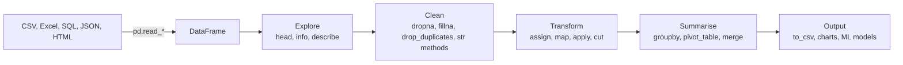
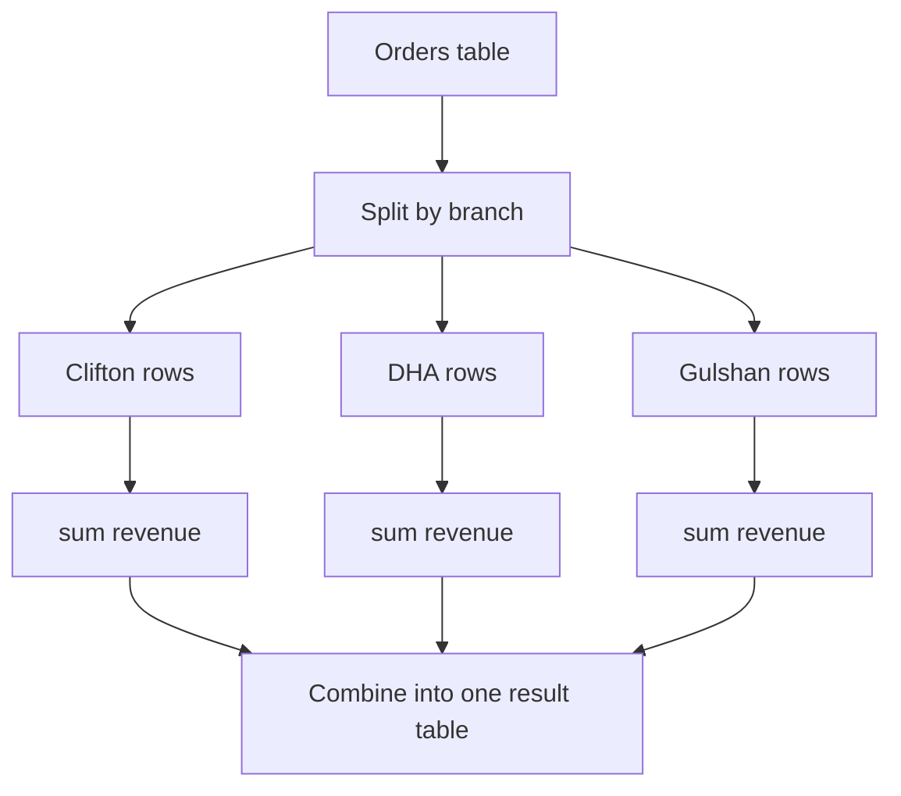
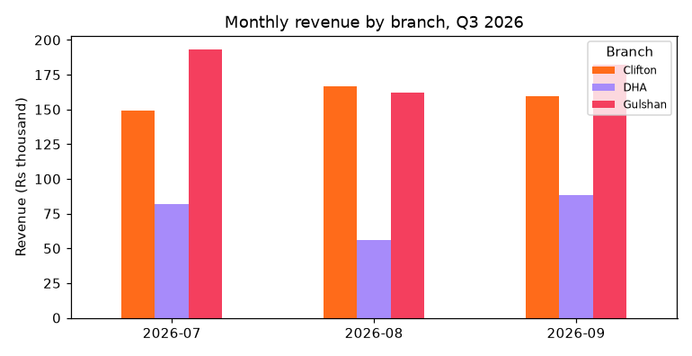
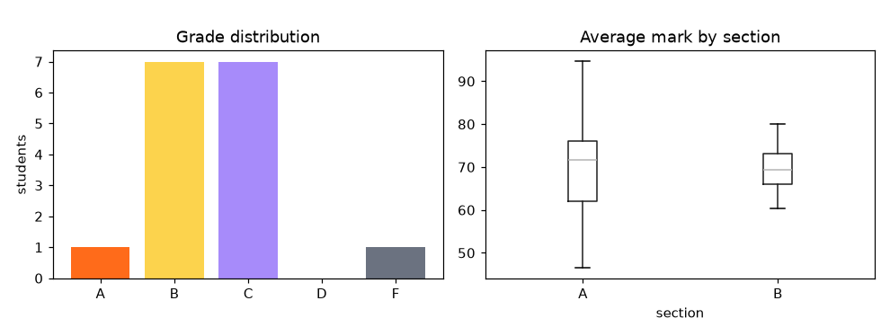

[](https://colab.research.google.com/github/Hamnakhan123/Diploma-in-AI/blob/main/term-1/04-application-based-programming-in-python/code/session-11-data-handling-with-pandas.ipynb) &nbsp; 📓 [Notebook](code/session-11-data-handling-with-pandas.ipynb)

# Session 11: Data Handling Using Pandas

> 🧭 [Diploma in AI](../../README.md) › [Term 1](../README.md) › [Application Based Programming in Python](README.md) › **Session 11**
>
> ⏱️ **Estimated time:** 3 hours (1 h concepts + 2 h lab) &nbsp;|&nbsp; 📋 **Prerequisites:** Sessions 2-6 (data types, functions, lambda, files, regular expressions). The statistics module helps for `describe()`.
>
> Prepared by **Hamna Zahid Khan**, Junior Lecturer

[⬅ Previous: Session 10](session-10-database-integration.md) &nbsp;|&nbsp; [🏠 Module home](README.md) &nbsp;|&nbsp; [Next: Session 12 ➡](session-12-data-visualization.md)

---

## 🎯 Learning objectives

By the end of this session you will be able to:

- Explain the **purpose of pandas** and why it is the standard tool for tabular data in data science and AI.
- Create and inspect the two pandas data structures, **Series** and **DataFrame**, and select data with `[]`, `loc`, `iloc`, boolean masks and `query`.
- Use the most common **data-manipulation functions**: handling missing values and duplicates, `sort_values`, `assign`, `map`, `apply`, `groupby` + `agg`, `pivot_table`, `merge`, `concat`, date handling and `resample`.
- Clean and analyse text columns with the **`.str` accessor** (`strip`, `lower`, `title`, `split`, `contains`, `replace`, `extract`, `match`) including regular expressions.
- Turn a messy CSV export into a clean dataset, a summary report, a chart and an exported file.

## 📖 Concepts

### 1. What is pandas and why use it?

**pandas** is Python's library for working with **tables of data** (rows and columns), built on top of NumPy. The name comes from "panel data".

| Without pandas (lists and dicts) | With pandas |
|---|---|
| a loop to compute the average of a column | `df["marks"].mean()` |
| nested loops to group by city | `df.groupby("city")["marks"].mean()` |
| hand-written CSV parsing and type conversion | `pd.read_csv("file.csv", parse_dates=["date"])` |
| custom code to join two lists of records | `students.merge(fees, on="roll")` |
| manual checks for blanks | `df.isna().sum()` |

**Where it fits in an AI project:** load data → explore → clean → transform features → feed a model (scikit-learn, Sessions 13-15) → report results. Data scientists often spend most of their time in the pandas steps, which is why this session matters.

> 🧠 **Analogy:** A **DataFrame** is an **Excel sheet that you control with code**. Each column is a **Series** (like one Excel column with a name), the **index** is the row labels down the left. Unlike Excel, every step is written down, repeatable on next month's file in one click, and works on millions of rows.

Import convention: `import pandas as pd` (and `import numpy as np`).

### 2. The two data structures

| | **Series** | **DataFrame** |
|---|---|---|
| Shape | 1-D: values + index | 2-D: rows × columns |
| Think of it as | one labelled column | a table / dict of Series sharing an index |
| Create | `pd.Series([31, 33], index=["Mon", "Tue"])` | `pd.DataFrame({"name": [...], "marks": [...]})` |
| Key attributes | `.values`, `.index`, `.dtype`, `.name` | `.shape`, `.columns`, `.index`, `.dtypes` |

**Ways to create a DataFrame:** from a dict of lists, a list of dicts, a NumPy array, or by reading a file: `pd.read_csv`, `pd.read_excel`, `pd.read_json`, `pd.read_sql` (Session 10), `pd.read_html` (Session 8). Save with `to_csv`, `to_excel`, `to_json`.

**First look at any dataset:** `df.head()`, `df.tail()`, `df.shape`, `df.info()`, `df.dtypes`, `df.describe()`, `df["col"].value_counts()`, `df.isna().sum()`.

### 3. Selecting data

| Goal | Code | Returns |
|---|---|---|
| One column | `df["name"]` | Series |
| Several columns | `df[["name", "marks"]]` | DataFrame |
| Rows by **label** | `df.loc["AI-04"]`, `df.loc["AI-02":"AI-04", "name"]` | label-based, end **included** |
| Rows by **position** | `df.iloc[0]`, `df.iloc[0:2, 0:3]` | position-based, end **excluded** |
| Filter rows | `df[df["marks"] > 80]` | rows where the mask is True |
| Combine conditions | `df[(df.city == "Karachi") & (df.marks >= 60)]` | use `&`, `\|`, `~` and parentheses |
| Membership | `df[df["city"].isin(["Lahore", "Quetta"])]` | |
| SQL-like text | `df.query("python > 80 and stats > 80")` | |

> ⚠️ Use `&` and `|` (not `and` / `or`) between conditions, and wrap each condition in parentheses.

**Vectorisation:** operations apply to a whole column at once, without loops: `df["total"] = df["python"] + df["stats"]`. This is shorter **and** much faster than a Python loop.

### 4. Common data-manipulation functions

| Task | Functions |
|---|---|
| Missing values | `isna()`, `notna()`, `dropna(subset=...)`, `fillna(value / median / method)` |
| Duplicates | `duplicated()`, `drop_duplicates(subset=...)` |
| Types | `astype(int)`, `pd.to_datetime()`, `pd.to_numeric(errors="coerce")` |
| Sorting | `sort_values("col", ascending=False)`, `sort_index()`, `nlargest(3, "col")` |
| New columns | `df["new"] = ...`, `assign(new=lambda d: ...)` |
| Transform values | `map(dict_or_func)` (Series), `apply(func)` (Series or rows/columns), `where`, `clip`, `pd.cut` (binning) |
| Rename / drop | `rename(columns={...})`, `drop(columns=[...])` |
| Grouping | `groupby("col").agg(new=("col", "sum"))`, `transform`, `size()` |
| Reshaping | `pivot_table(index, columns, values, aggfunc)`, `melt`, `stack` / `unstack` |
| Combining | `merge(other, on=..., how="inner/left/right/outer")`, `concat([a, b])` |
| Dates | `.dt.year`, `.dt.month`, `.dt.day_name()`, `.dt.to_period("M")`, `resample("D")` |

**groupby = split → apply → combine:** split the rows into groups by a key, apply an aggregate (sum, mean, count) to each group, and combine the results into a new table, exactly like SQL `GROUP BY`.

### 5. Text processing with `.str`

Every Python string method, plus regex support, is available column-wide through `Series.str`:

| Method | Example | Result |
|---|---|---|
| `strip`, `lower`, `upper`, `title` | `s.str.strip().str.title()` | `"  ali KHAN"` → `"Ali Khan"` |
| `len` | `s.str.len()` | number of characters |
| `split` + `.str[i]` | `s.str.split(",").str[-1]` | last part of an address |
| `contains`, `startswith`, `endswith`, `match` | `s.str.contains("fast")` | boolean mask |
| `replace` (regex) | `s.str.replace(r"\D", "", regex=True)` | digits only |
| `extract` (regex groups) | `s.str.extract(r"@([\w.-]+)$")` | the email domain |
| `split` + `explode` | `s.str.split().explode()` | one word per row (tokenizing, Session 6) |
| `cat`, `join`, `pad`, `zfill` | `s.str.zfill(4)` | `"7"` → `"0007"` |

Missing values (`NaN`) pass through `.str` methods safely instead of crashing.

## 🧭 Diagrams





## 💻 Worked examples

### Example 1: Series and DataFrame: create, inspect, select (basic)

📄 [`code/session-11_series_dataframe.py`](code/session-11_series_dataframe.py) &nbsp;·&nbsp; run: `python session-11_series_dataframe.py`

```python
"""
Session 11 · Example 1: pandas Series and DataFrame - create, inspect, select
-----------------------------------------------------------------------------
Run:  python session-11_series_dataframe.py
"""
import numpy as np
import pandas as pd

pd.set_option("display.width", 110)

# 1. Series: a 1-D labelled array (values + index)
temps = pd.Series([31, 33, 35, 34, 29], index=["Mon", "Tue", "Wed", "Thu", "Fri"], name="max_temp_C")
print(temps, "\n")
print("temps['Wed'] =", temps["Wed"], "| temps.iloc[0] =", temps.iloc[0], "| mean =", temps.mean())
print("hot days (> 32):", temps[temps > 32].to_dict())
print("vectorised maths, to Fahrenheit:", (temps * 9 / 5 + 32).round(1).tolist())
print("Series from a dict:", pd.Series({"Karachi": 20.4, "Lahore": 13.0, "Quetta": 1.6}).to_dict())

# 2. DataFrame: a 2-D table of columns (each column is a Series)
df = pd.DataFrame({
    "roll": ["AI-01", "AI-02", "AI-03", "AI-04", "AI-05", "AI-06"],
    "name": ["Ali", "Sana", "Bilal", "Hira", "Omar", "Zara"],
    "city": ["Karachi", "Lahore", "Karachi", "Quetta", "Karachi", "Lahore"],
    "python": [78, 91, 64, 85, np.nan, 72],
    "stats": [70, 88, 59, 90, 66, 81],
})
print("\n", df)
print("\nshape:", df.shape, "| columns:", list(df.columns))
print("dtypes:\n" + df.dtypes.to_string())
print("\ndescribe():\n", df.describe().round(1))

# 3. Selecting columns and rows
print("\none column (Series):", df["name"].tolist())
print("two columns (DataFrame):\n", df[["name", "python"]].head(3))
df = df.set_index("roll")                          # use roll numbers as row labels
print("\nloc by label  df.loc['AI-04']:\n", df.loc["AI-04"].to_dict())
print("iloc by position df.iloc[0:2, 0:2]:\n", df.iloc[0:2, 0:2])
print("\nloc rows + columns:\n", df.loc[["AI-02", "AI-05"], ["name", "stats"]])

# 4. Boolean filtering (combine with & | ~ and parentheses)
karachi_good = df[(df["city"] == "Karachi") & (df["stats"] >= 60)]
print("\nKarachi students with stats >= 60:\n", karachi_good[["name", "stats"]])
print("isin:", df[df["city"].isin(["Lahore", "Quetta"])]["name"].tolist())
print("query():", df.query("python > 80 and stats > 80")["name"].tolist())

# 5. Adding and changing columns
df["total"] = df["python"].fillna(0) + df["stats"]
df["passed"] = df[["python", "stats"]].min(axis=1, skipna=False) >= 60   # a missing mark is not a pass
print("\nwith new columns:\n", df)
```

**Output**

```text
Mon    31
Tue    33
Wed    35
Thu    34
Fri    29
Name: max_temp_C, dtype: int64 

temps['Wed'] = 35 | temps.iloc[0] = 31 | mean = 32.4
hot days (> 32): {'Tue': 33, 'Wed': 35, 'Thu': 34}
vectorised maths, to Fahrenheit: [87.8, 91.4, 95.0, 93.2, 84.2]
Series from a dict: {'Karachi': 20.4, 'Lahore': 13.0, 'Quetta': 1.6}

     roll   name     city  python  stats
0  AI-01    Ali  Karachi    78.0     70
1  AI-02   Sana   Lahore    91.0     88
2  AI-03  Bilal  Karachi    64.0     59
3  AI-04   Hira   Quetta    85.0     90
4  AI-05   Omar  Karachi     NaN     66
5  AI-06   Zara   Lahore    72.0     81

shape: (6, 5) | columns: ['roll', 'name', 'city', 'python', 'stats']
dtypes:
roll          str
name          str
city          str
python    float64
stats       int64

describe():
        python  stats
count     5.0    6.0
mean     78.0   75.7
std      10.6   12.6
min      64.0   59.0
25%      72.0   67.0
50%      78.0   75.5
75%      85.0   86.2
max      91.0   90.0

one column (Series): ['Ali', 'Sana', 'Bilal', 'Hira', 'Omar', 'Zara']
two columns (DataFrame):
     name  python
0    Ali    78.0
1   Sana    91.0
2  Bilal    64.0

loc by label  df.loc['AI-04']:
 {'name': 'Hira', 'city': 'Quetta', 'python': 85.0, 'stats': 90}
iloc by position df.iloc[0:2, 0:2]:
        name     city
roll                
AI-01   Ali  Karachi
AI-02  Sana   Lahore

loc rows + columns:
        name  stats
roll              
AI-02  Sana     88
AI-05  Omar     66

Karachi students with stats >= 60:
        name  stats
roll              
AI-01   Ali     70
AI-05  Omar     66
isin: ['Sana', 'Hira', 'Zara']
query(): ['Sana', 'Hira']

with new columns:
         name     city  python  stats  total  passed
... (7 more lines)
```


**What to notice:**

1. `describe()` skipped the text columns and counted only 5 Python marks, because Omar's is missing (`NaN`).
2. `loc` uses labels (after `set_index("roll")`), `iloc` uses positions.
3. `min(axis=1, skipna=False)` makes a missing mark count as "not passed"; with the default `skipna=True`, Omar would wrongly pass on one subject.
4. Your `dtypes` may show `object` instead of `str` for text columns: older pandas versions (such as Colab's) use `object`, pandas 3 uses a dedicated string type. Both behave the same here.

### Example 2: Cleaning, grouping, pivoting and merging (intermediate)

📄 [`code/session-11_manipulation.py`](code/session-11_manipulation.py) &nbsp;·&nbsp; run: `python session-11_manipulation.py`

```python
"""
Session 11 · Example 2: data manipulation - clean, sort, group, merge, reshape
-----------------------------------------------------------------------------
Run:  python session-11_manipulation.py
"""
import numpy as np
import pandas as pd

pd.set_option("display.width", 110)
orders = pd.DataFrame({
    "order_id": [101, 102, 103, 104, 105, 105, 106, 107, 108],
    "date": ["2026-10-01", "2026-10-01", "2026-10-02", "2026-10-02", "2026-10-03", "2026-10-03",
             "2026-10-03", "2026-10-04", None],
    "branch": ["Clifton", "Gulshan", "Clifton", "DHA", "Gulshan", "Gulshan", "DHA", "Clifton", "DHA"],
    "item": ["Biryani", "Karahi", "Biryani", "Nihari", "Biryani", "Biryani", "Karahi", "Nihari", "Biryani"],
    "qty": [2, 1, 3, np.nan, 1, 1, 2, 2, 4],
    "price": [450, 1450, 450, 600, 450, 450, 1450, 600, 450],
})
print("raw data:\n", orders, "\n")

# 1. Missing values and duplicates
print("missing per column:", orders.isna().sum().to_dict())
print("duplicated rows:", orders.duplicated().sum())
clean = (orders.drop_duplicates()                       # remove the repeated order 105
               .dropna(subset=["date"])                 # an order with no date cannot be dated
               .assign(qty=lambda d: d["qty"].fillna(1).astype(int),      # assume 1 if missing
                       date=lambda d: pd.to_datetime(d["date"])))
clean["revenue"] = clean["qty"] * clean["price"]
print("after cleaning:", clean.shape, "\n", clean)

# 2. Sorting
print("\ntop 3 by revenue:\n", clean.sort_values("revenue", ascending=False).head(3)[["order_id", "item", "revenue"]])

# 3. apply / map on columns
size = {"Biryani": "single dish", "Karahi": "family dish", "Nihari": "single dish"}
clean["type"] = clean["item"].map(size)
clean["band"] = clean["revenue"].apply(lambda r: "high" if r >= 1400 else "normal")
print("\nmap + apply:\n", clean[["item", "type", "revenue", "band"]])

# 4. groupby + aggregate (split - apply - combine)
by_branch = clean.groupby("branch").agg(orders=("order_id", "count"), units=("qty", "sum"),
                                        revenue=("revenue", "sum")).sort_values("revenue", ascending=False)
print("\nby branch:\n", by_branch)
print("\nmean revenue per item:", clean.groupby("item")["revenue"].mean().round(0).to_dict())

# 5. pivot_table: branches as rows, items as columns
print("\npivot (revenue):\n", clean.pivot_table(index="branch", columns="item", values="revenue",
                                              aggfunc="sum", fill_value=0, margins=True))

# 6. merge (SQL-style join) with a second table
managers = pd.DataFrame({"branch": ["Clifton", "Gulshan", "DHA", "Saddar"],
                         "manager": ["Mr Asif", "Ms Rabia", "Mr Junaid", "Ms Nida"]})
merged = by_branch.reset_index().merge(managers, on="branch", how="right")
print("\nmerge how='right' (Saddar has no orders yet):\n", merged.fillna({"orders": 0, "units": 0, "revenue": 0}))

# 7. concat: stack two days of new orders under the old ones
extra = pd.DataFrame({"order_id": [109], "date": [pd.Timestamp("2026-10-05")], "branch": ["DHA"],
                      "item": ["Karahi"], "qty": [1], "price": [1450], "revenue": [1450]})
print("\nafter concat:", len(pd.concat([clean, extra], ignore_index=True)), "rows")

# 8. Dates: extract parts and resample by day
daily = clean.set_index("date")["revenue"].resample("D").sum()
print("\ndaily revenue:", {d.strftime("%a %d"): int(v) for d, v in daily.items()})
```

**Output**

```text
raw data:
    order_id        date   branch     item  qty  price
0       101  2026-10-01  Clifton  Biryani  2.0    450
1       102  2026-10-01  Gulshan   Karahi  1.0   1450
2       103  2026-10-02  Clifton  Biryani  3.0    450
3       104  2026-10-02      DHA   Nihari  NaN    600
4       105  2026-10-03  Gulshan  Biryani  1.0    450
5       105  2026-10-03  Gulshan  Biryani  1.0    450
6       106  2026-10-03      DHA   Karahi  2.0   1450
7       107  2026-10-04  Clifton   Nihari  2.0    600
8       108         NaN      DHA  Biryani  4.0    450 

missing per column: {'order_id': 0, 'date': 1, 'branch': 0, 'item': 0, 'qty': 1, 'price': 0}
duplicated rows: 1
after cleaning: (7, 7) 
    order_id       date   branch     item  qty  price  revenue
0       101 2026-10-01  Clifton  Biryani    2    450      900
1       102 2026-10-01  Gulshan   Karahi    1   1450     1450
2       103 2026-10-02  Clifton  Biryani    3    450     1350
3       104 2026-10-02      DHA   Nihari    1    600      600
4       105 2026-10-03  Gulshan  Biryani    1    450      450
6       106 2026-10-03      DHA   Karahi    2   1450     2900
7       107 2026-10-04  Clifton   Nihari    2    600     1200

top 3 by revenue:
    order_id     item  revenue
6       106   Karahi     2900
1       102   Karahi     1450
2       103  Biryani     1350

map + apply:
       item         type  revenue    band
0  Biryani  single dish      900  normal
1   Karahi  family dish     1450    high
2  Biryani  single dish     1350  normal
3   Nihari  single dish      600  normal
4  Biryani  single dish      450  normal
6   Karahi  family dish     2900    high
7   Nihari  single dish     1200  normal

by branch:
          orders  units  revenue
branch                         
DHA           2      3     3500
Clifton       3      7     3450
Gulshan       2      2     1900

mean revenue per item: {'Biryani': 900.0, 'Karahi': 2175.0, 'Nihari': 900.0}

pivot (revenue):
 item     Biryani  Karahi  Nihari   All
branch                                
Clifton     2250       0    1200  3450
DHA            0    2900     600  3500
Gulshan      450    1450       0  1900
All         2700    4350    1800  8850

merge how='right' (Saddar has no orders yet):
     branch  orders  units  revenue    manager
0  Clifton     3.0    7.0   3450.0    Mr Asif
1  Gulshan     2.0    2.0   1900.0   Ms Rabia
2      DHA     2.0    3.0   3500.0  Mr Junaid
3   Saddar     0.0    0.0      0.0    Ms Nida

after concat: 8 rows

daily revenue: {'Thu 01': 2350, 'Fri 02': 1950, 'Sat 03': 3350, 'Sun 04': 1200}
```


**Walkthrough:**

- A **method chain** (`drop_duplicates().dropna(...).assign(...)`) records every cleaning decision in one readable block.
- The missing quantity was filled with 1 (a stated assumption); the undated order was dropped because it cannot be placed in time.
- `groupby(...).agg(name=(column, function))` produced named summary columns in one call.
- The right-merge kept Saddar even though it has no orders, which is how you find branches with zero sales.

### Example 3: Text cleaning with `.str` and regex (advanced)

📄 [`code/session-11_text_processing.py`](code/session-11_text_processing.py) &nbsp;·&nbsp; run: `python session-11_text_processing.py`

```python
"""
Session 11 · Example 3: text processing with the .str accessor
--------------------------------------------------------------
Every string method works on a whole column at once via Series.str,
including regular expressions (Session 6).
Run:  python session-11_text_processing.py
"""
import pandas as pd

pd.set_option("display.width", 120)
raw = pd.DataFrame({
    "name": ["  ali KHAN", "Sana  tariq ", "BILAL ahmed", "hira shah", "Omar   Farooq"],
    "email": ["Ali.Khan@Example.COM", "sana@uni.edu.pk", "bilal@@mail", "HIRA@example.com ", "omar.f@uni.edu.pk"],
    "phone": ["0300-1234567", "+92 321 7654321", "03451234567", "021-34567890", "0333 444 5566"],
    "address": ["House 12, Block 5, Clifton, Karachi", "Flat 3B, Gulberg III, Lahore",
                "Plot 7, Gulshan-e-Iqbal, Karachi", "Street 9, Satellite Town, Quetta", "Shop 4, Saddar, Karachi"],
    "feedback": ["Great course!!", "too fast, but useful", "Loved the Python labs", "boring slides", "great labs; fast pace"],
})

df = pd.DataFrame()
df["name"] = raw["name"].str.strip().str.split().str.join(" ").str.title()       # tidy spaces + Title Case
df["first"] = df["name"].str.split().str[0]
df["email"] = raw["email"].str.strip().str.lower()
df["email_ok"] = df["email"].str.match(r"^[\w.+-]+@[\w-]+(\.[\w-]+)+$")
df["domain"] = df["email"].str.extract(r"@([\w.-]+)$", expand=False)
digits = raw["phone"].str.replace(r"\D", "", regex=True)                       # keep digits only
df["mobile"] = digits.str.replace(r"^92", "0", regex=True).where(digits.str.match(r"^(92|0)3\d{9}$"))
df["mobile"] = df["mobile"].str.replace(r"^(\d{4})(\d{7})$", r"\1-\2", regex=True)
df["city"] = raw["address"].str.split(",").str[-1].str.strip()
df["area"] = raw["address"].str.split(",").str[-2].str.strip()
print(df.to_string(), "\n")

print("first names starting with a vowel:", df.loc[df["first"].str.contains(r"^[AEIOU]"), "first"].tolist())
print("name lengths:", df["name"].str.len().tolist())
print("starts with 'S' or 'O':", df.loc[df["name"].str.startswith(("S", "O")), "name"].tolist())
print("invalid emails:", df.loc[~df["email_ok"], "email"].tolist())
print("not a mobile number:", raw.loc[df["mobile"].isna(), "phone"].tolist())
print("students per city:", df["city"].value_counts().to_dict())

# Simple text analytics on feedback: normalise, tokenize, count words
words = (raw["feedback"].str.lower()
                        .str.replace(r"[^a-z\s]", " ", regex=True)
                        .str.split()
                        .explode())                                     # one word per row
stop = {"the", "but", "too"}
print("\ntop feedback words:", words[~words.isin(stop)].value_counts().head(5).to_dict())
print("mentions 'fast':", raw["feedback"].str.contains("fast").sum(), "of", len(raw))
```

**Output**

```text
          name  first                 email  email_ok       domain        mobile     city             area
0     Ali Khan    Ali  ali.khan@example.com      True  example.com  0300-1234567  Karachi          Clifton
1   Sana Tariq   Sana       sana@uni.edu.pk      True   uni.edu.pk  0321-7654321   Lahore      Gulberg III
2  Bilal Ahmed  Bilal           bilal@@mail     False         mail  0345-1234567  Karachi  Gulshan-e-Iqbal
3    Hira Shah   Hira      hira@example.com      True  example.com           NaN   Quetta   Satellite Town
4  Omar Farooq   Omar     omar.f@uni.edu.pk      True   uni.edu.pk  0333-4445566  Karachi           Saddar 

first names starting with a vowel: ['Ali', 'Omar']
name lengths: [8, 10, 11, 9, 11]
starts with 'S' or 'O': ['Sana Tariq', 'Omar Farooq']
invalid emails: ['bilal@@mail']
not a mobile number: ['021-34567890']
students per city: {'Karachi': 3, 'Lahore': 1, 'Quetta': 1}

top feedback words: {'great': 2, 'fast': 2, 'labs': 2, 'course': 1, 'useful': 1}
mentions 'fast': 2 of 5
```


**Key lessons:**

- `str.strip().str.split().str.join(" ")` collapses internal double spaces; `.title()` fixes capitalisation.
- Phone numbers written four different ways were normalised to `03XX-XXXXXXX`; the landline was correctly left blank rather than forced into the wrong format.
- `str.extract` with a regex group pulled the email domain; `str.match` validated the whole address.
- `split().explode()` turned feedback sentences into a column of words, ready for `value_counts()`: a one-line text-analytics pipeline.

## 🌍 Real-life coding problem: monthly sales analysis for a restaurant chain

**Scenario.** A chain with three Karachi branches exports one row per order. The export has inconsistent branch names (`" clifton"`, `"CLIFTON"`), prices stored as text (`"Rs 1,450"`), missing quantities and duplicate rows. Management wants revenue by branch and month, best sellers, the busiest weekday, a chart and a clean CSV.

**Cleaning plan:**

| Problem | Fix |
|---|---|
| Duplicate orders | `drop_duplicates(subset="order_id")` |
| `" clifton"`, `"CLIFTON"`, `"DHA"` | `str.strip().str.title()` then restore the acronym `"DHA"` |
| `"Rs 1,450"` | `str.replace(r"[^\d]", "", regex=True).astype(int)` |
| Missing quantity | fill with the **median quantity of that item** using `groupby("item")["qty"].transform("median")` |
| Month and weekday | `dt.to_period("M")`, `dt.day_name()` |

📄 Full solution (81 lines, fully commented): [`code/session-11_problem_sales_analysis.py`](code/session-11_problem_sales_analysis.py) &nbsp;·&nbsp; run: `python session-11_problem_sales_analysis.py` &nbsp;·&nbsp; also in the session notebook

**Output**

```text
raw export: (612, 6) | sample:
  order_id       date   branch           item  qty    price
     5001 2026-09-25 Gulshan          Haleem  3.0   Rs 400
     5002 2026-08-27  CLIFTON         Haleem  1.0   Rs 400
     5003 2026-09-01  clifton Chicken Karahi  1.0 Rs 1,450

cleaned: removed 12 duplicates; branches now ['Clifton', 'DHA', 'Gulshan']

Revenue (Rs) by branch and month:
 month    2026-07  2026-08  2026-09      Total
branch                                       
Clifton  149,450  166,850  159,550    475,850
DHA       82,100   55,800   88,250    226,150
Gulshan  193,250  162,050  182,250    537,550
Total    424,800  384,700  430,050  1,239,550

Best-selling item per branch (units):
             item  qty
branch               
Clifton  Biryani  223
Gulshan  Biryani  213
DHA      Biryani  108

Revenue share by item: {'BBQ Platter': 30.7, 'Chicken Karahi': 28.9, 'Biryani': 19.7, 'Nihari': 13.4, 'Haleem': 7.3}

Orders by weekday: {'Monday': 93, 'Tuesday': 92, 'Wednesday': 94, 'Thursday': 75, 'Friday': 73, 'Saturday': 94, 'Sunday': 79} -> busiest: Wednesday
Average order value: {'Clifton': 2069.0, 'DHA': 1967.0, 'Gulshan': 2108.0}

Saved sales_clean.csv with 600 rows and columns ['order_id', 'date', 'branch', 'item', 'qty', 'price', 'revenue', 'month', 'weekday']
Chart saved: session-11_problem_sales_analysis.png
```




**Interpretation.** Gulshan earns the most and DHA the least each month; biryani sells the most **units** everywhere, but BBQ platters and karahi bring in the most **revenue**, a classic volume-versus-value insight. Notice the trap the code avoids: `.title()` would have turned "DHA" into "Dha". Always look at `unique()` values after cleaning.

## 🛠️ Mini project: automated class performance report

Departments keep marks in **long format** (one row per student, subject and assessment). This project turns three raw tables into a ranked report with grades and risk flags, then summarises and exports it.

| Step | pandas tool |
|---|---|
| Long → wide (assessments as columns) | `pivot_table(index=["roll", "subject"], columns="assessment")` |
| Weighted total (20/30/50) | vectorised arithmetic over columns |
| Students as rows, subjects as columns | a second `pivot_table` |
| Add names, sections, attendance | two `merge` calls |
| Letter grades | `pd.cut(average, bins=[0, 50, 55, 70, 85, 100], labels=[...], right=False)` |
| Risk flag | boolean expression with `\|` |
| Section and subject summaries | `groupby(...).agg(...)` |
| Export and charts | `to_csv`, `value_counts`, `boxplot(by="section")` |

📄 Full solution (76 lines, fully commented): [`code/session-11_project_student_report.py`](code/session-11_project_student_report.py) &nbsp;·&nbsp; run: `python session-11_project_student_report.py` &nbsp;·&nbsp; also in the session notebook

**Output**

```text
marks table (long format): (144, 4) 
  roll    subject assessment  score
AI-01     Python       quiz   57.0
AI-01     Python    midterm   65.0
AI-01     Python      final   59.0
AI-01 Statistics       quiz   49.0

Class report (ranked):
      roll     name section  Databases  Python  Statistics  average  attendance_% grade  at_risk
1   AI-04    Bilal       A       96.5    93.7        94.0     94.7          88.0     A    False
2   AI-12    Fahad       B       77.9    78.9        83.3     80.0          92.0     B    False
3   AI-05   Zainab       A       74.5    77.2        77.9     76.5         100.0     B    False
4   AI-11     Iqra       B       77.2    82.0        69.2     76.1          92.0     B    False
5   AI-02     Omar       A       81.8    79.5        66.8     76.0         100.0     B    False
6   AI-08    Usman       A       69.2    74.2        76.4     73.3          92.0     B    False
7   AI-15     Anum       B       67.8    68.8        80.0     72.2          80.0     B    False
8   AI-07  Mehwish       A       69.8    70.7        69.9     70.1          88.0     B    False
9   AI-13     Noor       B       66.6    74.5        67.0     69.4          78.0     C    False
10  AI-14     Saad       B       63.1    73.9        70.6     69.2          92.0     C    False
11  AI-10    Hamza       B       70.7    61.0        68.0     66.6          92.0     C    False
12  AI-09     Sara       B       70.5    69.1        54.3     64.6          75.0     C    False
13  AI-06   Danish       A       64.9    56.8        65.9     62.5          75.0     C    False
14  AI-01   Ayesha       A       62.5    60.4        59.9     60.9          82.0     C    False
15  AI-16     Taha       B       63.6    58.8        58.6     60.3          65.0     C     True
16  AI-03     Hira       A       42.9    45.4        51.1     46.5          75.0     F     True

Section summary:
          students  mean_avg  best  at_risk
section                                   
A               8      70.1  94.7        1
B               8      69.8  80.0        1

Subject means by section:
          Python  Statistics  Databases
section                               
A          69.7        70.2       70.3
B          70.9        68.9       69.7

Grade distribution: {'A': 1, 'B': 7, 'C': 7, 'D': 0, 'F': 1}
Students at risk: [{'name': 'Taha', 'average': 60.3, 'attendance_%': 65.0}, {'name': 'Hira', 'average': 46.5, 'attendance_%': 75.0}]
Correlation between attendance and average: r = 0.60

Exported report.csv
Chart saved: session-11_project_student_report.png
```




**Interpretation.** Both sections perform almost identically on average, but section A has the single top student and the only failing student, which the box plot shows as a wider spread. Attendance and average marks are positively correlated (r ≈ 0.6) in this demo data. Correlation is not causation (Statistics module), but it justifies an attendance reminder for the two students flagged at risk.

**Extension ideas:** export to Excel with one sheet per section (`pd.ExcelWriter`); compute each student's rank within the section with `groupby("section")["average"].rank(ascending=False)`; read the marks from the SQLite database of Session 10 with `pd.read_sql`.

## ⚠️ Common mistakes

| Mistake | Symptom | Fix |
|---|---|---|
| `df[df.a > 1 and df.b < 5]` | `ValueError: truth value of a Series is ambiguous` | `df[(df.a > 1) & (df.b < 5)]` |
| Chained assignment `df[df.x > 0]["y"] = 1` | `SettingWithCopyWarning`, value not saved | `df.loc[df.x > 0, "y"] = 1` |
| Forgetting that most methods return a **new** object | changes seem to disappear | `df = df.dropna()` |
| Confusing `loc` (labels, end included) and `iloc` (positions, end excluded) | off-by-one rows | Choose deliberately |
| Doing maths on text numbers (`"Rs 1,450"`) | `TypeError` or string concatenation | Clean with `.str.replace` then `astype` |
| Looping over rows with `for i in range(len(df))` | slow, verbose | Vectorised column operations or `apply` |
| `fillna(0)` for every missing value | biased averages | Choose a fill that makes sense (median, group median) or drop |
| Merging on keys with different spellings or types | rows silently lost | Clean keys first; check row counts after `merge` |
| Ignoring `NaN` in aggregates | averages over fewer rows than you think | Check `count()` and `isna().sum()` |

## ✅ Best practices

- Always start with `head()`, `info()`, `describe()` and `isna().sum()`.
- Keep the **raw** data unchanged; clean into a new DataFrame and save it separately.
- Write cleaning as a **method chain** or a function, so it can be rerun on next month's file.
- Prefer vectorised operations, then `map` / `apply`; loops last.
- Check results after every `merge` and `groupby` (row counts, unique keys).
- Use clear column names (`snake_case`, no spaces) early.
- Record every assumption (what you filled, what you dropped) in comments or a log.

## 🧪 Lab / practice tasks

**1. 🟢 Easy:** Create a DataFrame of five Karachi weather readings (date, max_temp, humidity). Print the hottest day and the average humidity.

<details><summary>💡 Hint</summary>

`df.loc[df["max_temp"].idxmax()]` gives the row with the largest value.

</details>

<details><summary>✅ Solution</summary>

```python
import pandas as pd
df = pd.DataFrame({"date": pd.date_range("2026-10-20", periods=5),
                   "max_temp": [34, 36, 35, 38, 33], "humidity": [62, 58, 60, 45, 70]})
print(df.loc[df["max_temp"].idxmax(), "date"].date(), df["humidity"].mean())   # 2026-10-23 59.0
```

</details>

**2. 🟢 Easy:** From the Example 1 DataFrame, select the names and stats marks of students from Lahore whose stats mark is above 80, using both a boolean mask and `query()`.

<details><summary>💡 Hint</summary>

`df.loc[(df.city == "Lahore") & (df.stats > 80), ["name", "stats"]]`

</details>

<details><summary>✅ Solution</summary>

```python
print(df.loc[(df["city"] == "Lahore") & (df["stats"] > 80), ["name", "stats"]])
print(df.query("city == 'Lahore' and stats > 80")[["name", "stats"]])   # Sana 88, Zara 81
```

</details>

**3. 🟡 Medium:** Using the cleaned orders from Example 2, find each branch's share (%) of total revenue and the item that earned the most money in each branch.

<details><summary>💡 Hint</summary>

Share: `by_branch["revenue"] / by_branch["revenue"].sum() * 100`. Top item: `groupby(["branch", "item"])["revenue"].sum()` then `idxmax` per branch, or sort and `drop_duplicates("branch")`.

</details>

<details><summary>✅ Solution</summary>

```python
share = (clean.groupby("branch")["revenue"].sum() / clean["revenue"].sum() * 100).round(1)
print(share.to_dict())          # {'Clifton': 39.0, 'DHA': 39.5, 'Gulshan': 21.5}
top = (clean.groupby(["branch", "item"])["revenue"].sum().reset_index()
            .sort_values("revenue", ascending=False).drop_duplicates("branch"))
print(top)
```

</details>

**4. 🟡 Medium:** Given a column of messy course codes `[" cs-101", "CS102 ", "cs 103", "Cs-104a"]`, normalise them to `CS-101`, `CS-102`, `CS-103`, `CS-104A` with `.str` methods and one regex.

<details><summary>💡 Hint</summary>

`.str.upper().str.strip()`, then `.str.replace(r"^CS[\s-]?", "CS-", regex=True)`.

</details>

<details><summary>✅ Solution</summary>

```python
s = pd.Series([" cs-101", "CS102 ", "cs 103", "Cs-104a"])
print(s.str.strip().str.upper().str.replace(r"^CS[\s-]?", "CS-", regex=True).tolist())
```

</details>

**5. 🟠 Hard:** Reshape the wide report back to long format with `melt` (one row per student and subject), then find each subject's top scorer with `groupby` + `idxmax`.

<details><summary>💡 Hint</summary>

`report.melt(id_vars=["roll", "name"], value_vars=subjects, var_name="subject", value_name="score")`.

</details>

<details><summary>✅ Solution</summary>

```python
long = report.melt(id_vars=["roll", "name"], value_vars=subjects, var_name="subject", value_name="score")
best = long.loc[long.groupby("subject")["score"].idxmax(), ["subject", "name", "score"]]
print(best)
```

</details>

**6. 🔴 Challenge:** Write `clean_sales(path)` that performs the whole cleaning of the sales problem and returns the clean DataFrame plus a **data-quality log** (dict) with: duplicates removed, missing quantities filled, distinct branch spellings before and after. Test it on `sales_raw.csv`.

<details><summary>💡 Hint</summary>

Measure before each step: `len(df)`, `df["qty"].isna().sum()`, `df["branch"].nunique()`. Return `df, log`.

</details>

<details><summary>✅ Solution</summary>

```python
def clean_sales(path):
    df = pd.read_csv(path, parse_dates=["date"])
    log = {"rows_in": len(df), "branch_spellings_before": df["branch"].nunique()}
    df = df.drop_duplicates(subset="order_id")
    log["duplicates_removed"] = log["rows_in"] - len(df)
    log["qty_filled"] = int(df["qty"].isna().sum())
    df["qty"] = df["qty"].fillna(df.groupby("item")["qty"].transform("median")).astype(int)
    df["branch"] = df["branch"].str.strip().str.title().replace({"Dha": "DHA"})
    log["branch_spellings_after"] = df["branch"].nunique()
    df["price"] = df["price"].str.replace(r"[^\d]", "", regex=True).astype(int)
    df["revenue"] = df["qty"] * df["price"]
    return df, log
df, log = clean_sales("sales_raw.csv")
print(log)   # duplicates 12, branch spellings 5 -> 3, ...
```

</details>

## ✅ Quick quiz

**Q1.** What is a pandas Series?

- A) a 2-D table
- B) a one-dimensional labelled array
- C) a list of DataFrames
- D) a database connection

**Q2.** Which selects rows 0 and 1 by position?

- A) df.loc[0:1]
- B) df.iloc[0:2]
- C) df[0:1, :]
- D) df.at[0:2]

**Q3.** What does `df.groupby("city")["sales"].sum()` do?

- A) sorts by city
- B) adds up sales separately for each city
- C) counts the cities
- D) removes duplicate cities

**Q4.** Which code keeps only rows where marks > 50 AND city is Karachi?

- A) df[df.marks > 50 and df.city == "Karachi"]
- B) df[(df.marks > 50) & (df.city == "Karachi")]
- C) df.filter(marks > 50, city="Karachi")
- D) df[df.marks > 50 or df.city == "Karachi"]

**Q5.** How do you convert the text column "Rs 1,450" to the number 1450?

- A) int(df["price"])
- B) df["price"].astype(int)
- C) df["price"].str.replace(r"[^\d]", "", regex=True).astype(int)
- D) df["price"].sum()

<details><summary>✅ Show answers</summary>

1. **B** — values plus an index; each DataFrame column is a Series.
2. **B** — iloc is position-based and excludes the end.
3. **B** — split by city, sum each group, combine.
4. **B** — use & with parentheses around each condition.
5. **C** — remove non-digits first, then convert.

</details>


## 📝 Summary

- **pandas** handles tabular data: load, explore, clean, transform, summarise and export, with vectorised operations instead of loops.
- **Series** = 1-D labelled array; **DataFrame** = 2-D table of Series sharing an index.
- Select with `[]`, `loc` (labels), `iloc` (positions), boolean masks (`&`, `|`, `~`), `isin`, `query`.
- Manipulate with `dropna` / `fillna`, `drop_duplicates`, `astype`, `sort_values`, `assign`, `map`, `apply`, `pd.cut`, `groupby().agg()`, `pivot_table`, `melt`, `merge`, `concat`, `.dt` and `resample`.
- Process text with `.str`: `strip`, `lower`, `title`, `split`, `contains`, `replace` and `extract` with regex, `explode`.

### 🎤 Interview / viva questions

1. What is the difference between a Series and a DataFrame?
2. Explain the difference between `loc` and `iloc` with an example.
3. How do you find and handle missing values in pandas? When would you drop instead of fill?
4. Describe the split-apply-combine idea behind `groupby`.
5. What is the difference between `merge` and `concat`? Explain `how="left"`.
6. Why are vectorised operations preferred over loops in pandas?
7. How would you clean a text column of phone numbers written in different formats?

---

[⬅ Previous: Session 10](session-10-database-integration.md) &nbsp;|&nbsp; [🏠 Module home](README.md) &nbsp;|&nbsp; [Next: Session 12 ➡](session-12-data-visualization.md)

<sub>Prepared by **Hamna Zahid Khan**, Junior Lecturer · Diploma in AI</sub>
