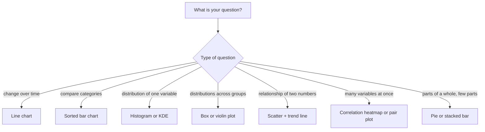
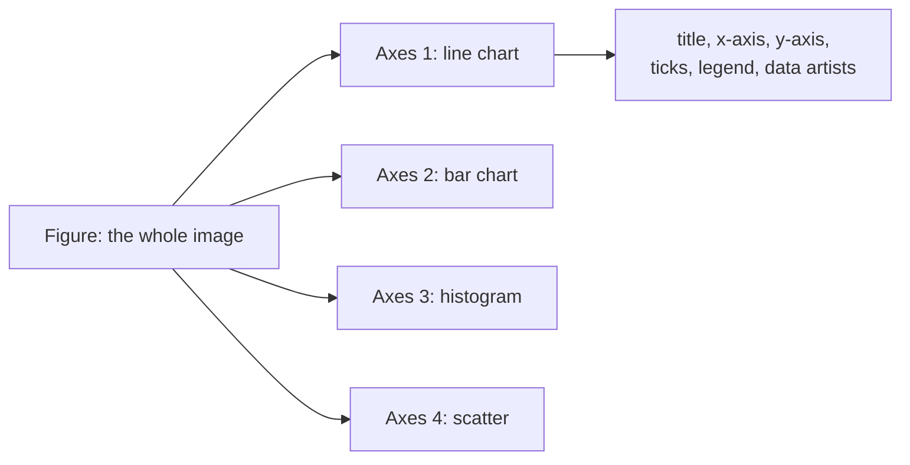
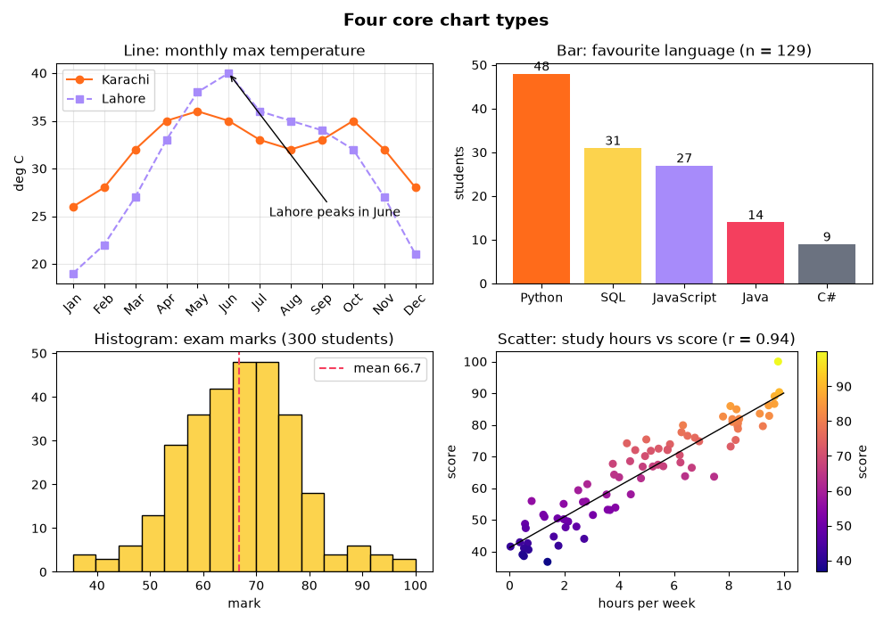
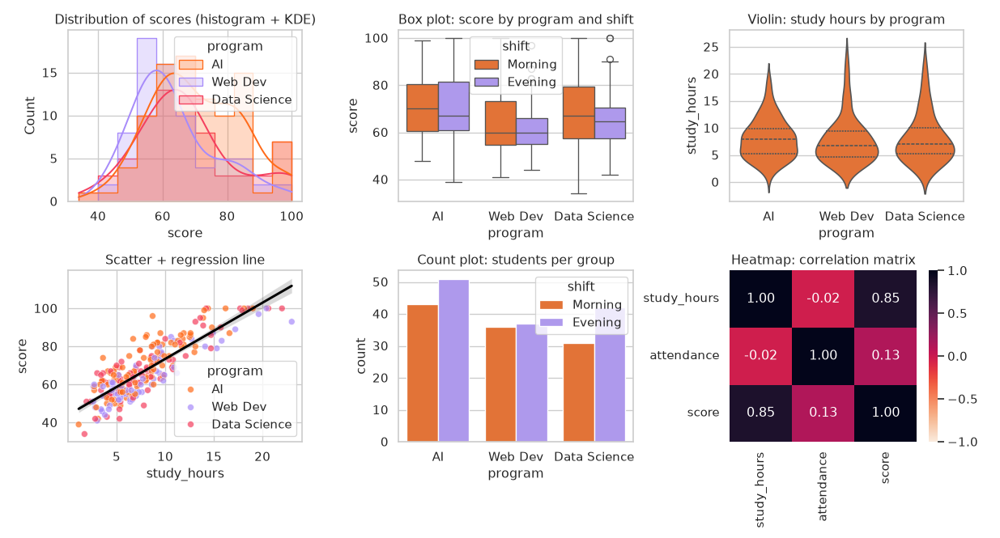
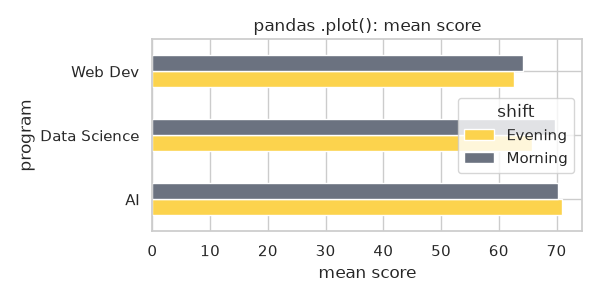
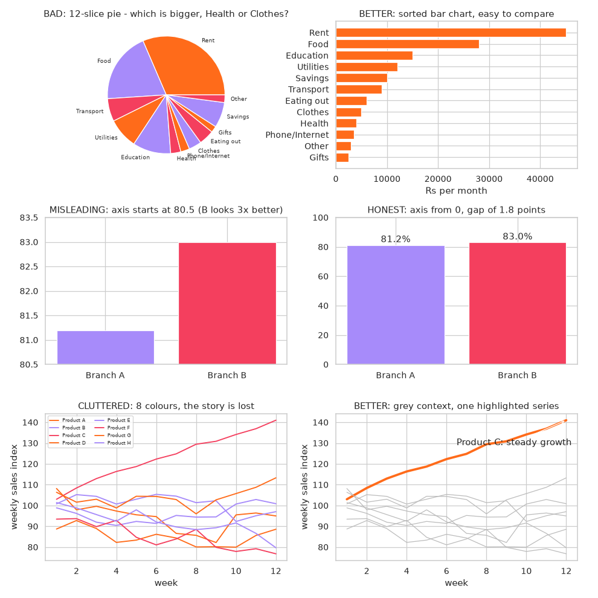
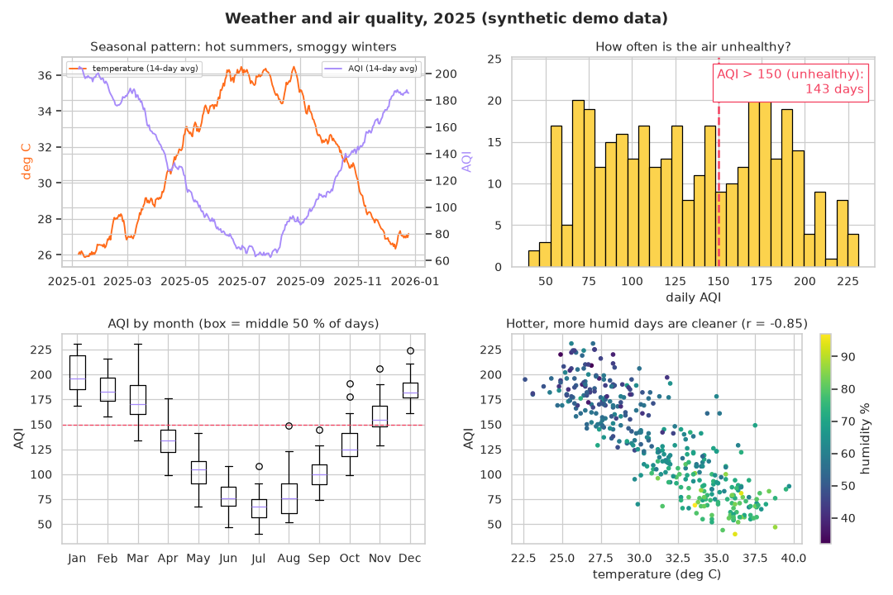
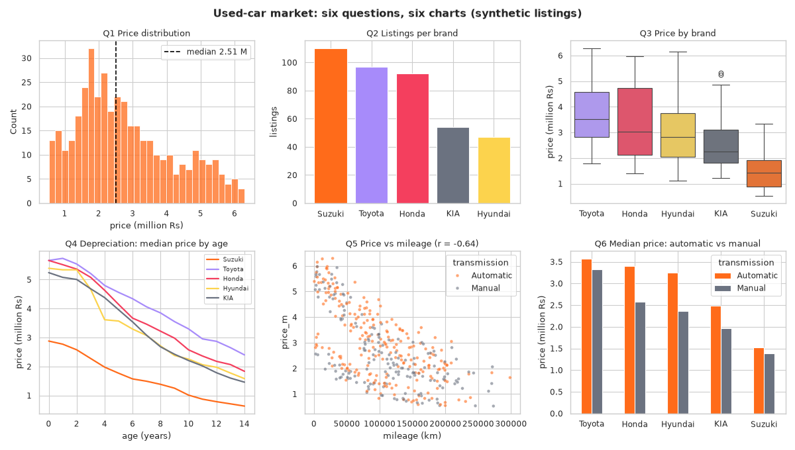

[](https://colab.research.google.com/github/Hamnakhan123/Diploma-in-AI/blob/main/term-1/04-application-based-programming-in-python/code/session-12-data-visualization.ipynb) &nbsp; 📓 [Notebook](code/session-12-data-visualization.ipynb)

# Session 12: Data Visualization in Python

> 🧭 [Diploma in AI](../../README.md) › [Term 1](../README.md) › [Application Based Programming in Python](README.md) › **Session 12**
>
> ⏱️ **Estimated time:** 3 hours (1 h concepts + 2 h lab) &nbsp;|&nbsp; 📋 **Prerequisites:** Session 11 (pandas). Basic statistics (mean, median, distribution, correlation) from the statistics module.
>
> Prepared by **Hamna Zahid Khan**, Junior Lecturer

[⬅ Previous: Session 11](session-11-data-handling-with-pandas.md) &nbsp;|&nbsp; [🏠 Module home](README.md) &nbsp;|&nbsp; [Next: Session 13 ➡](session-13-data-processing-for-machine-learning.md)

---

## 🎯 Learning objectives

By the end of this session you will be able to:

- Explain **data visualization**, why it matters in data science and AI, and the questions each chart type answers.
- Compare the main Python visualization **libraries**: Matplotlib, seaborn, pandas plotting, Plotly and Bokeh.
- Build and customise line, bar, histogram, scatter, box, violin, count, pie and heatmap charts, and arrange them in **subplots**.
- Choose an **honest, readable** chart for a question, and spot misleading ones (truncated axes, overloaded pies, clutter).
- Produce a multi-chart **dashboard** from a pandas DataFrame and back every visual claim with numbers.

## 📖 Concepts

### 1. What is data visualization and why does it matter?

**Data visualization** is the graphical representation of data so that patterns, trends, comparisons and outliers become visible at a glance. Humans process shapes and colours far faster than columns of numbers.

| Stage of a data project | What charts do |
|---|---|
| **Exploration (EDA)** | reveal distributions, outliers, missing data, relationships |
| **Cleaning** | expose impossible values (negative ages, a spike of zeros) |
| **Modelling** | show feature relationships, training curves, residuals (Session 15) |
| **Communication** | convince managers or clients with one clear picture |

A famous lesson is **Anscombe's quartet**: four small datasets with the *same* mean, variance and correlation that look completely different when plotted. Summary statistics alone can hide the story; always plot.

> 🧠 **Analogy:** A table of numbers is a **recipe written as a list of chemicals**; a good chart is a **photo of the finished dish**. Both describe the same thing, but only one tells you instantly whether you want to eat it.

### 2. Python visualization libraries

| Library | Style | Strengths | Typical use |
|---|---|---|---|
| **Matplotlib** | low-level, full control | every chart type, publication quality, the foundation of the others | custom static charts |
| **seaborn** | high-level, statistical, built on Matplotlib | works directly with DataFrames, beautiful defaults, `hue` grouping, regression and distribution plots | EDA, statistical comparisons |
| **pandas `.plot()`** | Matplotlib shortcut | one line from a DataFrame or Series | quick looks during analysis |
| **Plotly** | interactive (zoom, hover), web-based | dashboards, maps, 3-D, Dash apps | sharing interactive charts |
| **Bokeh / Altair** | interactive / declarative | browser apps, grammar-of-graphics style | specialised dashboards |

Import conventions: `import matplotlib.pyplot as plt`, `import seaborn as sns`.

### 3. Anatomy of a Matplotlib figure

- A **Figure** is the whole canvas (the image file).
- An **Axes** is one plot inside it, with its own x-axis, y-axis, title and data. A figure can hold many Axes (**subplots**).
- Two interfaces: the quick **pyplot** state style (`plt.plot(...)`, `plt.title(...)`) and the recommended **object-oriented** style:

```python
fig, ax = plt.subplots(figsize=(8, 4))          # one Figure, one Axes
ax.plot(x, y, color="#FF6B1A", marker="o", label="Karachi")
ax.set_title("Monthly max temperature"); ax.set_xlabel("month"); ax.set_ylabel("deg C")
ax.legend(); ax.grid(alpha=0.3)
fig.savefig("chart.png", dpi=120, bbox_inches="tight")
```

Common customisations: `color`, `linestyle`, `marker`, `linewidth`, `alpha` (transparency), `label` + `legend()`, `set_xlim` / `set_ylim`, `annotate()` (arrow + text), `bar_label()`, `tick_params(rotation=45)`, `twinx()` (second y-axis), colour maps (`cmap="viridis"`).

### 4. Visualization techniques: which chart answers which question?

| Question | Chart | Matplotlib / seaborn |
|---|---|---|
| How does a value change over **time**? | line chart | `ax.plot`, `sns.lineplot` |
| How do **categories** compare? | bar / horizontal bar (sorted) | `ax.bar`, `ax.barh`, `sns.barplot`, `sns.countplot` |
| What does the **distribution** of one variable look like? | histogram, KDE | `ax.hist`, `sns.histplot(kde=True)`, `sns.kdeplot` |
| How do distributions compare across **groups**? | box plot, violin plot | `ax.boxplot`, `sns.boxplot`, `sns.violinplot` |
| Is there a **relationship** between two numbers? | scatter (+ regression line) | `ax.scatter`, `sns.scatterplot`, `sns.regplot` |
| How do **many variables** relate? | correlation heatmap, pair plot | `sns.heatmap(df.corr())`, `sns.pairplot` |
| What are the **parts of a whole**? | pie / donut (2-5 slices only), stacked bar | `ax.pie`, `ax.bar(bottom=...)` |
| Several views at once | subplots / dashboard | `plt.subplots(rows, cols)` |

### 5. Principles of honest, readable charts

1. **Start bar charts at zero.** A truncated axis can make a 2 % difference look like 300 %.
2. **Sort categories** by value unless they have a natural order (months, grades).
3. **Avoid pies with many slices**; angles are hard to compare. Use a sorted bar chart.
4. **Highlight the story:** grey for context, one strong colour for what matters.
5. **Label everything:** title that states the finding, axis labels with units, a source or "synthetic data" note.
6. **Use colour meaningfully** and accessibly (colour-blind-friendly palettes such as viridis; do not rely on red vs green alone).
7. **Show the data's uncertainty and spread** (box plots, error bars), not just averages.
8. **One chart, one message.**

### 6. The same chart in Matplotlib, seaborn and pandas

| Chart | Matplotlib | seaborn | pandas |
|---|---|---|---|
| Line | `ax.plot(x, y)` | `sns.lineplot(data=df, x=..., y=..., hue=...)` | `df.plot(x=..., y=...)` |
| Bar | `ax.bar(cats, values)` | `sns.barplot(data=df, x=..., y=...)` (mean + CI) | `s.plot(kind="bar")` |
| Histogram | `ax.hist(x, bins=20)` | `sns.histplot(data=df, x=..., kde=True)` | `s.plot(kind="hist")` |
| Scatter | `ax.scatter(x, y, c=z)` | `sns.scatterplot(data=df, x=..., y=..., hue=...)` | `df.plot(kind="scatter", x=..., y=...)` |
| Box | `ax.boxplot([a, b])` | `sns.boxplot(data=df, x=group, y=value)` | `df.boxplot(column=..., by=...)` |
| Heatmap | `ax.imshow(matrix)` | `sns.heatmap(df.corr(), annot=True)` | not built in |

Rule of thumb: **pandas** for a quick look, **seaborn** for statistical comparisons with grouping, **Matplotlib** for full control and final touches (seaborn and pandas both return Matplotlib Axes, so you can always finish with `ax.set_title(...)`).

## 🧭 Diagrams





## 💻 Worked examples

### Example 1: Matplotlib fundamentals (basic)

The four chart types you will use most, built with the object-oriented interface in a 2 × 2 grid.

📄 [`code/session-12_matplotlib_basics.py`](code/session-12_matplotlib_basics.py) &nbsp;·&nbsp; run: `python session-12_matplotlib_basics.py`

```python
"""
Session 12 · Example 1: Matplotlib fundamentals - the four core chart types
---------------------------------------------------------------------------
Shows the object-oriented interface (fig, ax), labels, legends, colours,
annotations and a 2 x 2 grid of subplots saved to one PNG file.
Run:  python session-12_matplotlib_basics.py
"""
import matplotlib
matplotlib.use("Agg")                    # draw to files (no window); remove this line to see windows
import matplotlib.pyplot as plt
import numpy as np

months = ["Jan", "Feb", "Mar", "Apr", "May", "Jun", "Jul", "Aug", "Sep", "Oct", "Nov", "Dec"]
# Illustrative average monthly maximum temperatures (deg C), rounded, for two cities
karachi = [26, 28, 32, 35, 36, 35, 33, 32, 33, 35, 32, 28]
lahore = [19, 22, 27, 33, 38, 40, 36, 35, 34, 32, 27, 21]

fig, axes = plt.subplots(2, 2, figsize=(10, 7))          # a Figure with 4 Axes
fig.suptitle("Four core chart types", fontsize=14, fontweight="bold")

# 1. LINE chart: change over an ordered axis (time)
ax = axes[0, 0]
ax.plot(months, karachi, marker="o", color="#FF6B1A", label="Karachi")
ax.plot(months, lahore, marker="s", linestyle="--", color="#A78BFA", label="Lahore")
ax.annotate("Lahore peaks in June", xy=(5, 40), xytext=(6.3, 25), arrowprops={"arrowstyle": "->"})
ax.set_title("Line: monthly max temperature"); ax.set_ylabel("deg C"); ax.legend()
ax.tick_params(axis="x", rotation=45); ax.grid(alpha=0.3)

# 2. BAR chart: compare categories
langs = ["Python", "SQL", "JavaScript", "Java", "C#"]
votes = [48, 31, 27, 14, 9]                              # a class survey: favourite language
ax = axes[0, 1]
bars = ax.bar(langs, votes, color=["#FF6B1A", "#FCD34D", "#A78BFA", "#F43F5E", "#6B7280"])
ax.bar_label(bars)                                        # value on top of each bar
ax.set_title("Bar: favourite language (n = 129)"); ax.set_ylabel("students")

# 3. HISTOGRAM: distribution of one numeric variable
rng = np.random.default_rng(1)
marks = np.clip(rng.normal(68, 12, 300), 0, 100)
ax = axes[1, 0]
ax.hist(marks, bins=15, color="#FCD34D", edgecolor="black")
ax.axvline(marks.mean(), color="#F43F5E", linestyle="--", label=f"mean {marks.mean():.1f}")
ax.set_title("Histogram: exam marks (300 students)"); ax.set_xlabel("mark"); ax.legend()

# 4. SCATTER plot: relationship between two numeric variables
hours = rng.uniform(0, 10, 80)
score = 40 + 5 * hours + rng.normal(0, 6, 80)
ax = axes[1, 1]
sc = ax.scatter(hours, score, c=score, cmap="plasma", s=30)
m, b = np.polyfit(hours, score, 1)                       # best-fit line (Session 15 explains it)
xs = np.linspace(0, 10, 2)
ax.plot(xs, m * xs + b, color="black", linewidth=1)
fig.colorbar(sc, ax=ax, label="score")
ax.set_title(f"Scatter: study hours vs score (r = {np.corrcoef(hours, score)[0, 1]:.2f})")
ax.set_xlabel("hours per week"); ax.set_ylabel("score")

fig.tight_layout()
fig.savefig("session-12_matplotlib_basics.png", dpi=100)
print("Saved session-12_matplotlib_basics.png")
print(f"Figure size {fig.get_size_inches()} inches, {len(fig.axes)} axes (4 plots + 1 colour bar)")
print(f"Histogram: mean {marks.mean():.1f}, std {marks.std():.1f}; fitted line: score = {m:.1f} x hours + {b:.1f}")
```

**Output**

```text
Saved session-12_matplotlib_basics.png
Figure size [10.  7.] inches, 5 axes (4 plots + 1 colour bar)
Histogram: mean 66.7, std 11.0; fitted line: score = 4.9 x hours + 41.2
```




**What to notice:** each `axes[r, c]` is an independent plot; `bar_label` writes values on bars; `annotate` points at the June peak; the scatter colours points by score through a colour map and adds a fitted line from `np.polyfit`.

### Example 2: Statistical charts with seaborn and pandas (intermediate)

seaborn takes a DataFrame and column names and handles grouping (`hue`), statistics (KDE, regression, quartiles) and styling for you.

📄 [`code/session-12_seaborn_pandas.py`](code/session-12_seaborn_pandas.py) &nbsp;·&nbsp; run: `python session-12_seaborn_pandas.py`

```python
"""
Session 12 · Example 2: statistical charts with seaborn and pandas plotting
---------------------------------------------------------------------------
seaborn works directly with DataFrames: give it the table and column names.
The dataset is generated with a fixed seed (no internet download needed).
Run:  python session-12_seaborn_pandas.py
"""
import matplotlib
matplotlib.use("Agg")
import matplotlib.pyplot as plt
import numpy as np
import pandas as pd
import seaborn as sns

rng = np.random.default_rng(12)
n = 240
df = pd.DataFrame({
    "program": rng.choice(["AI", "Data Science", "Web Dev"], n, p=[0.4, 0.35, 0.25]),
    "shift": rng.choice(["Morning", "Evening"], n),
    "study_hours": rng.gamma(4, 2, n).round(1),
})
df["attendance"] = np.clip(rng.normal(82, 9, n), 40, 100).round(0)
df["score"] = np.clip(18 + 3.0 * df["study_hours"] + 0.3 * df["attendance"]
                      + df["program"].map({"AI": 3, "Data Science": 1, "Web Dev": -2}) + rng.normal(0, 7, n), 0, 100).round(0)
print(df.head(), "\n")
print(df.groupby("program")[["study_hours", "score"]].mean().round(1), "\n")

sns.set_theme(style="whitegrid", palette=["#FF6B1A", "#A78BFA", "#F43F5E"])
fig, axes = plt.subplots(2, 3, figsize=(13, 7))
sns.histplot(data=df, x="score", hue="program", kde=True, element="step", ax=axes[0, 0])
axes[0, 0].set_title("Distribution of scores (histogram + KDE)")
sns.boxplot(data=df, x="program", y="score", hue="shift", ax=axes[0, 1])
axes[0, 1].set_title("Box plot: score by program and shift")
sns.violinplot(data=df, x="program", y="study_hours", ax=axes[0, 2], inner="quartile")
axes[0, 2].set_title("Violin: study hours by program")
sns.scatterplot(data=df, x="study_hours", y="score", hue="program", alpha=0.7, ax=axes[1, 0])
sns.regplot(data=df, x="study_hours", y="score", scatter=False, color="black", ax=axes[1, 0])
axes[1, 0].set_title("Scatter + regression line")
sns.countplot(data=df, x="program", hue="shift", ax=axes[1, 1])
axes[1, 1].set_title("Count plot: students per group")
corr = df[["study_hours", "attendance", "score"]].corr()
sns.heatmap(corr, annot=True, fmt=".2f", cmap="rocket_r", vmin=-1, vmax=1, ax=axes[1, 2])
axes[1, 2].set_title("Heatmap: correlation matrix")
fig.tight_layout(); fig.savefig("session-12_seaborn_pandas.png", dpi=95)
print("Correlation matrix:\n", corr.round(2), "\n")

# pandas has plotting built in: DataFrame.plot(kind=...)
summary = df.pivot_table(index="program", columns="shift", values="score", aggfunc="mean")
ax = summary.plot(kind="barh", figsize=(6, 3), color=["#FCD34D", "#6B7280"], title="pandas .plot(): mean score")
ax.set_xlabel("mean score"); plt.tight_layout(); plt.savefig("session-12_seaborn_pandas_pandasplot.png", dpi=100)
print("Mean score by program and shift:\n", summary.round(1))
print("\nSaved session-12_seaborn_pandas.png and session-12_seaborn_pandas_pandasplot.png")
```

**Output**

```text
   program    shift  study_hours  attendance  score
0       AI  Morning         11.8        88.0   84.0
1  Web Dev  Morning         12.7        76.0   84.0
2       AI  Morning          9.2        99.0   82.0
3       AI  Morning          8.1        87.0   86.0
4       AI  Evening          1.1        81.0   39.0 

              study_hours  score
program                         
AI                    8.1   70.6
Data Science          8.1   67.5
Web Dev               7.7   63.4 

Correlation matrix:
              study_hours  attendance  score
study_hours         1.00       -0.02   0.85
attendance         -0.02        1.00   0.13
score               0.85        0.13   1.00 

Mean score by program and shift:
 shift         Evening  Morning
program                       
AI               70.9     70.3
Data Science     65.8     69.7
Web Dev          62.6     64.2

Saved session-12_seaborn_pandas.png and session-12_seaborn_pandas_pandasplot.png
```






**Walkthrough:**

1. `histplot(hue="program", kde=True)` overlays three distributions with smooth density curves.
2. The box plot splits each program by shift in one call; the violin shows the full shape of study hours, not just quartiles.
3. The heatmap makes it obvious that study hours (r ≈ 0.85) matter far more than attendance (r ≈ 0.13) in this data.
4. `DataFrame.plot(kind="barh")` drew the pivot table directly: pandas plotting is ideal for quick checks.

### Example 3: Choosing honest, readable charts (advanced)

The same data, drawn badly and then well.

📄 [`code/session-12_choosing_charts.py`](code/session-12_choosing_charts.py) &nbsp;·&nbsp; run: `python session-12_choosing_charts.py`

```python
"""
Session 12 · Example 3: choosing honest, readable charts (bad vs better)
------------------------------------------------------------------------
Three common mistakes, each shown next to a better version:
  1. a pie chart with too many slices  -> a sorted horizontal bar chart
  2. a truncated y-axis that exaggerates a difference -> an axis starting at 0
  3. a cluttered rainbow line chart     -> highlight the one series that matters
Run:  python session-12_choosing_charts.py
"""
import matplotlib
matplotlib.use("Agg")
import matplotlib.pyplot as plt
import numpy as np

expenses = {"Rent": 45000, "Food": 28000, "Transport": 9000, "Utilities": 12000, "Education": 15000,
            "Health": 4000, "Phone/Internet": 3500, "Clothes": 5000, "Eating out": 6000, "Gifts": 2500,
            "Savings": 10000, "Other": 3000}
fig, axes = plt.subplots(3, 2, figsize=(11, 11))

# 1. Pie with 12 slices vs sorted bar
axes[0, 0].pie(expenses.values(), labels=expenses.keys(), textprops={"fontsize": 7})
axes[0, 0].set_title("BAD: 12-slice pie - which is bigger, Health or Clothes?")
items = sorted(expenses.items(), key=lambda kv: kv[1])
axes[0, 1].barh([k for k, _ in items], [v for _, v in items], color="#FF6B1A")
axes[0, 1].set_title("BETTER: sorted bar chart, easy to compare")
axes[0, 1].set_xlabel("Rs per month")

# 2. Truncated axis vs zero-based axis
branches, satisfaction = ["Branch A", "Branch B"], [81.2, 83.0]
axes[1, 0].bar(branches, satisfaction, color=["#A78BFA", "#F43F5E"]); axes[1, 0].set_ylim(80.5, 83.5)
axes[1, 0].set_title("MISLEADING: axis starts at 80.5 (B looks 3x better)")
axes[1, 1].bar(branches, satisfaction, color=["#A78BFA", "#F43F5E"]); axes[1, 1].set_ylim(0, 100)
for i, v in enumerate(satisfaction):
    axes[1, 1].text(i, v + 2, f"{v}%", ha="center")
axes[1, 1].set_title("HONEST: axis from 0, gap of 1.8 points")

# 3. Spaghetti chart vs highlight
rng = np.random.default_rng(3)
weeks = np.arange(1, 13)
series = {f"Product {c}": 100 + np.cumsum(rng.normal(0, 4, 12)) for c in "ABCDEFGH"}
series["Product C"] = 100 + np.cumsum(rng.normal(3, 2, 12))       # the one that grows
for name, ys in series.items():
    axes[2, 0].plot(weeks, ys, label=name)
axes[2, 0].legend(fontsize=6, ncol=2); axes[2, 0].set_title("CLUTTERED: 8 colours, the story is lost")
for name, ys in series.items():
    hl = name == "Product C"
    axes[2, 1].plot(weeks, ys, color="#FF6B1A" if hl else "#BBBBBB", linewidth=3 if hl else 1)
axes[2, 1].annotate("Product C: steady growth", xy=(12, series["Product C"][-1]), xytext=(6.5, series["Product C"][-1] - 12),
                    arrowprops={"arrowstyle": "->"})
axes[2, 1].set_title("BETTER: grey context, one highlighted series")
for ax in axes[2]:
    ax.set_xlabel("week"); ax.set_ylabel("weekly sales index")

fig.tight_layout(); fig.savefig("session-12_choosing_charts.png", dpi=90)
diff = satisfaction[1] - satisfaction[0]
print(f"Satisfaction gap: {diff:.1f} points ({diff / satisfaction[0]:.1%} relative).")
print("On the truncated axis, bar B is drawn", round((83.0 - 80.5) / (81.2 - 80.5), 1), "times taller than bar A.")
print("Largest expense:", items[-1][0], "| smallest:", items[0][0])
print(f"Product C grew {series['Product C'][-1] - 100:.0f} points in 12 weeks.")
print("Saved session-12_choosing_charts.png")
```

**Output**

```text
Satisfaction gap: 1.8 points (2.2% relative).
On the truncated axis, bar B is drawn 3.6 times taller than bar A.
Largest expense: Rent | smallest: Gifts
Product C grew 41 points in 12 weeks.
Saved session-12_choosing_charts.png
```




**Key lessons:**

- In the pie, Health and Clothes are nearly impossible to compare; in the sorted bars the order is instant.
- The truncated axis drew branch B 3.6 times taller for a 1.8-point (2.2 %) difference. Same data, opposite impression.
- Eight colours hide the one growing product; grey context plus one highlighted line tells the story in a second.

## 🌍 Real-life coding problem: a one-page weather and air-quality dashboard

**Scenario.** A city environment office wants a single image for its monthly meeting that answers four questions: the seasonal pattern of temperature and pollution, how often the air is unhealthy, which months are worst, and how weather relates to air quality. The data is **synthetic**, shaped like a coastal South Asian city.

| Question | Chart chosen | Why |
|---|---|---|
| Seasonal pattern | two lines on twin y-axes, 14-day rolling average | different units; smoothing removes daily noise |
| How often unhealthy? | histogram with a threshold line at AQI 150 | shows the whole distribution and the cut-off |
| Worst months | box plot per month | spread and outliers, not just averages |
| Weather vs AQI | scatter coloured by humidity | three variables in one view |

📄 Full solution (77 lines, fully commented): [`code/session-12_problem_weather_dashboard.py`](code/session-12_problem_weather_dashboard.py) &nbsp;·&nbsp; run: `python session-12_problem_weather_dashboard.py` &nbsp;·&nbsp; also in the session notebook

**Output**

```text
Monthly means:
 month       Jan    Feb    Mar    Apr    May   Jun   Jul   Aug    Sep    Oct    Nov    Dec
temp       26.0   27.6   28.1   30.7   33.5  35.6  36.0  35.5   33.2   31.6   28.2   26.8
aqi       199.5  184.7  173.1  135.1  101.3  77.1  67.6  80.7  101.1  130.1  157.7  185.5
humidity   48.0   51.0   54.7   60.4   69.0  74.9  75.8  74.1   69.9   59.9   55.8   50.7

Unhealthy days (AQI > 150): 143 of 365 (39%)
Worst month by median AQI: Jan | best: Jul
Correlation AQI-temperature r = -0.85, AQI-humidity r = -0.81
Saved session-12_problem_weather_dashboard.png
```




**Interpretation.** In this data the air is unhealthy on 39 % of days, concentrated from November to March, while the humid monsoon months are cleanest. The scatter shows hot, humid days with low AQI (r ≈ −0.85). That is a strong association, not proof of cause: winter brings both cooler, drier air **and** more burning and temperature inversions. The rolling average and threshold line turn 365 noisy readings into a clear message.

## 🛠️ Mini project: visual EDA of a used-car market

Before building a price-prediction model (Session 15) you must understand the data. This project asks six questions and answers each with the right chart in one dashboard, printing the numbers behind every chart.

| # | Question | Chart |
|---|---|---|
| Q1 | What do prices look like? | histogram + median line |
| Q2 | Which brands are most common? | sorted bar chart |
| Q3 | How do brands compare on price? | box plot ordered by median |
| Q4 | How fast do cars lose value? | line of median price by age, per brand |
| Q5 | Does mileage matter? | scatter coloured by transmission |
| Q6 | Is there an automatic premium? | grouped bar chart |

📄 Full solution (78 lines, fully commented): [`code/session-12_project_car_market_eda.py`](code/session-12_project_car_market_eda.py) &nbsp;·&nbsp; run: `python session-12_project_car_market_eda.py` &nbsp;·&nbsp; also in the session notebook

**Output**

```text
listings: 400 
                  mean     min       50%        max
age              7.16    0.00      7.00      14.00
mileage_km  104478.00  500.00  98950.00  298400.00
price_m          2.79    0.53      2.51       6.29 

Q1 median price 2.51 M, mean 2.79 M, skew 0.57
Q2 listings: {'Suzuki': 110, 'Toyota': 97, 'Honda': 92, 'KIA': 54, 'Hyundai': 47}
Q3 median price by brand: {'Toyota': 3.51, 'Honda': 3.01, 'Hyundai': 2.83, 'KIA': 2.26, 'Suzuki': 1.42}
Q4 value kept after 8+ years vs nearly new: {'Toyota': 0.5, 'Honda': 0.4, 'Hyundai': 0.36, 'KIA': 0.36, 'Suzuki': 0.3}
Q5 correlation price-mileage r = -0.64
Q6 automatic premium: {'Toyota': 8.0, 'Honda': 32.0, 'Hyundai': 38.0, 'KIA': 26.0, 'Suzuki': 10.0} (%)

Saved session-12_project_car_market_eda.png
```




**Interpretation.** Prices are right-skewed (mean above median), so the median is the better "typical price". Toyota keeps the most value after 8+ years (about 50 %) and Suzuki the least (about 30 %). Mileage is strongly negatively related to price (r ≈ −0.64), but mileage and age move together, so part of that effect is really age. The automatic "premium" varies from 8 % to 38 % by brand partly because the groups differ in age: a reminder that a simple comparison of medians can be **confounded**. These are exactly the insights that guide feature selection for a model.

**Extension ideas:** add a `sns.pairplot(df, hue="brand")`; plot price against age with `sns.lmplot(col="brand")`; rebuild one chart in Plotly (`plotly.express.scatter`) for hover tooltips.

## ⚠️ Common mistakes

| Mistake | Problem | Fix |
|---|---|---|
| Bar chart axis not starting at 0 | exaggerates differences | `ax.set_ylim(0, ...)` |
| Pie chart with many slices | unreadable comparisons | Sorted bar chart |
| No title, labels or units | the reader must guess | Title states the finding; label axes with units |
| Too many colours or lines | clutter hides the message | Highlight one series, grey the rest |
| Using a line chart for unordered categories | implies a trend that does not exist | Bar chart |
| Overplotting thousands of scatter points | a solid blob | `alpha=0.3`, smaller markers, hexbin or sampling |
| Calling `plt.show()` before `savefig` | saves a blank image | `savefig` first, then `show` |
| Mixing pyplot calls and several Axes | labels land on the wrong plot | Use the `ax.` object-oriented methods |
| Forgetting `tight_layout()` | overlapping titles and labels | `fig.tight_layout()` |
| Showing only averages | hides spread and outliers | Box plots, histograms, error bars |

## ✅ Best practices

- Start every analysis by plotting each important variable's **distribution**.
- Pick the chart from the **question**, not from habit.
- Use the object-oriented interface (`fig, ax = plt.subplots()`) for anything beyond one quick plot.
- Write titles that state the insight ("Toyota keeps its value best") rather than the variable names.
- Keep a consistent palette across a report; use colour-blind-safe colour maps.
- Save figures with an explicit `dpi` and `bbox_inches="tight"`; mark synthetic or sample data clearly.
- Print or tabulate the numbers behind every chart so others can verify your claims.

## 🧪 Lab / practice tasks

**1. 🟢 Easy:** Plot your weekly spending for 8 weeks as a line chart with markers, a title, axis labels and a dashed horizontal line at your budget.

<details><summary>💡 Hint</summary>

`ax.plot(weeks, spend, marker="o")` and `ax.axhline(budget, linestyle="--")`.

</details>

<details><summary>✅ Solution</summary>

```python
import matplotlib.pyplot as plt
weeks = range(1, 9); spend = [4200, 3900, 5100, 4700, 3600, 6100, 4400, 4000]
fig, ax = plt.subplots(figsize=(7, 3.5))
ax.plot(weeks, spend, marker="o", color="#FF6B1A")
ax.axhline(4500, linestyle="--", color="gray", label="budget Rs 4,500")
ax.set(title="Weekly spending", xlabel="week", ylabel="Rs"); ax.legend()
fig.savefig("spending.png", dpi=120, bbox_inches="tight")
```

</details>

**2. 🟢 Easy:** Convert the 12-slice pie from Example 3 into a donut chart showing only the top 4 categories plus "Other".

<details><summary>💡 Hint</summary>

Sort, keep 4, sum the rest; `ax.pie(values, labels=labels, wedgeprops={"width": 0.4})`.

</details>

<details><summary>✅ Solution</summary>

```python
items = sorted(expenses.items(), key=lambda kv: kv[1], reverse=True)
top = items[:4] + [("Other", sum(v for _, v in items[4:]))]
fig, ax = plt.subplots()
ax.pie([v for _, v in top], labels=[k for k, _ in top], autopct="%1.0f%%", wedgeprops={"width": 0.4})
ax.set_title("Where the money goes")
```

</details>

**3. 🟡 Medium:** Using the seaborn dataset from Example 2, draw a `sns.pairplot` of study hours, attendance and score coloured by program, and describe one pattern you see.

<details><summary>💡 Hint</summary>

`sns.pairplot(df, vars=["study_hours", "attendance", "score"], hue="program")` returns a grid; save it with `.savefig()`.

</details>

<details><summary>✅ Solution</summary>

```python
g = sns.pairplot(df, vars=["study_hours", "attendance", "score"], hue="program", corner=True)
g.savefig("pairplot.png")
```

The study_hours vs score panel shows a clear upward cloud for every program; attendance vs score is nearly flat.

</details>

**4. 🟡 Medium:** From the sales data of Session 11 (`sales_clean.csv`), draw a stacked bar chart of monthly revenue split by item.

<details><summary>💡 Hint</summary>

`df.pivot_table(index="month", columns="item", values="revenue", aggfunc="sum").plot(kind="bar", stacked=True)`.

</details>

<details><summary>✅ Solution</summary>

```python
import pandas as pd
df = pd.read_csv("sales_clean.csv")
ax = (df.pivot_table(index="month", columns="item", values="revenue", aggfunc="sum") / 1000).plot(
    kind="bar", stacked=True, figsize=(7, 4), rot=0)
ax.set(ylabel="Rs thousand", title="Monthly revenue by item")
ax.figure.savefig("stacked.png", bbox_inches="tight")
```

</details>

**5. 🟠 Hard:** Recreate **Anscombe's quartet** (the four datasets are listed on many statistics sites; seaborn's `load_dataset("anscombe")` downloads them if you are online). Print each set's mean, variance and correlation, then plot the four scatter plots with regression lines in a 2 × 2 grid.

<details><summary>💡 Hint</summary>

`df.groupby("dataset").agg(...)` for the statistics; `sns.lmplot(data=df, x="x", y="y", col="dataset", col_wrap=2)` for the plots.

</details>

<details><summary>✅ Solution</summary>

```python
import seaborn as sns
df = sns.load_dataset("anscombe")          # needs internet
print(df.groupby("dataset").agg(mean_x=("x", "mean"), mean_y=("y", "mean"), var_y=("y", "var")).round(2))
print(df.groupby("dataset")[["x", "y"]].corr().round(3))
sns.lmplot(data=df, x="x", y="y", col="dataset", col_wrap=2, ci=None).savefig("anscombe.png")
```

All four have mean y ≈ 7.50 and r ≈ 0.816, yet one is curved, one has an outlier and one is a vertical line with one extreme point.

</details>

**6. 🔴 Challenge:** Write a reusable function `quick_eda(df, target, path)` that, for any DataFrame, saves a dashboard with: the target's histogram, a correlation heatmap of numeric columns, the top categorical column's box plot against the target, and a scatter of the target against its most correlated numeric feature. Test it on the car data.

<details><summary>💡 Hint</summary>

`num = df.select_dtypes("number")`; `best = num.corr()[target].drop(target).abs().idxmax()`; `cat = df.select_dtypes(exclude="number").columns[0]`.

</details>

<details><summary>✅ Solution</summary>

```python
def quick_eda(df, target, path):
    num = df.select_dtypes("number")
    best = num.corr()[target].drop(target).abs().idxmax()
    cats = df.select_dtypes(exclude="number").columns
    fig, ax = plt.subplots(2, 2, figsize=(11, 8))
    sns.histplot(df[target], ax=ax[0, 0]).set_title(f"{target} distribution")
    sns.heatmap(num.corr(), annot=True, fmt=".2f", cmap="rocket_r", ax=ax[0, 1])
    if len(cats):
        sns.boxplot(data=df, x=cats[0], y=target, ax=ax[1, 0])
    sns.scatterplot(data=df, x=best, y=target, alpha=0.5, ax=ax[1, 1]).set_title(f"{target} vs {best}")
    fig.tight_layout(); fig.savefig(path, dpi=90)
    return best
print(quick_eda(df, "price_m", "car_eda.png"))   # mileage_km or age
```

</details>

## ✅ Quick quiz

**Q1.** Which chart best shows how a value changes over 12 months?

- A) pie chart
- B) line chart
- C) histogram
- D) heatmap

**Q2.** You want to compare the distribution of salaries across five departments, including outliers. Which chart?

- A) pie chart
- B) box plot
- C) line chart
- D) single histogram

**Q3.** In Matplotlib's object-oriented interface, what does `fig, ax = plt.subplots(2, 3)` create?

- A) 2 figures with 3 axes each
- B) one figure with a 2 by 3 grid of axes
- C) 6 separate image files
- D) a 2-D histogram

**Q4.** A bar chart's y-axis starts at 95 instead of 0. What is the risk?

- A) none
- B) small differences look much larger than they are
- C) the bars disappear
- D) the legend is hidden

**Q5.** Which library is built on Matplotlib and works directly with DataFrame column names and `hue` grouping?

- A) NumPy
- B) seaborn
- C) requests
- D) Flask

<details><summary>✅ Show answers</summary>

1. **B** — line charts show change along an ordered axis such as time.
2. **B** — box plots show median, quartiles and outliers for each group side by side.
3. **B** — one Figure holding six Axes.
4. **B** — truncated axes exaggerate differences.
5. **B** — seaborn is the high-level statistical plotting library.

</details>


## 📝 Summary

- **Data visualization** turns numbers into pictures for exploration, cleaning, modelling and communication; always plot, because summaries can hide the story (Anscombe's quartet).
- **Libraries:** Matplotlib (foundation, full control), seaborn (statistical, DataFrame-friendly), pandas `.plot()` (quick), Plotly and Bokeh (interactive).
- A **Figure** contains one or more **Axes**; use `fig, ax = plt.subplots()` and `ax.` methods, then `savefig`.
- **Techniques:** line (time), bar (categories), histogram/KDE (distribution), box/violin (groups), scatter/regplot (relationships), heatmap/pairplot (many variables), pie (few parts), subplots (dashboards).
- **Honest charts:** zero-based bars, sorted categories, few pie slices, highlight the story, label everything, show spread.

### 🎤 Interview / viva questions

1. Why is data visualization important before building a machine-learning model?
2. What is the difference between a Figure and an Axes in Matplotlib?
3. When would you use seaborn instead of plain Matplotlib?
4. Which chart would you use to show the relationship between two numeric variables, and how would you add a trend line?
5. Give two ways a chart can mislead its audience.
6. What does a box plot show? How do you read an outlier in it?
7. Explain Anscombe's quartet and its lesson.

---

[⬅ Previous: Session 11](session-11-data-handling-with-pandas.md) &nbsp;|&nbsp; [🏠 Module home](README.md) &nbsp;|&nbsp; [Next: Session 13 ➡](session-13-data-processing-for-machine-learning.md)

<sub>Prepared by **Hamna Zahid Khan**, Junior Lecturer · Diploma in AI</sub>
