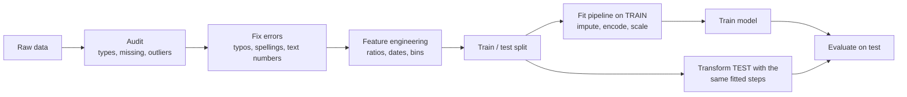
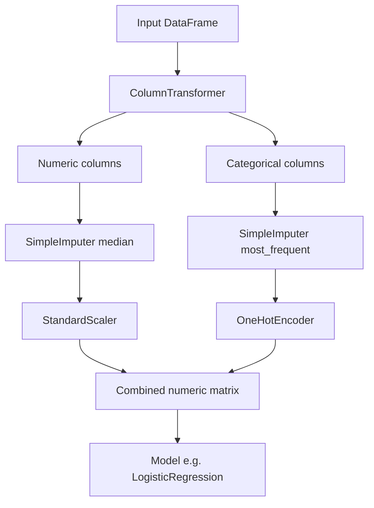
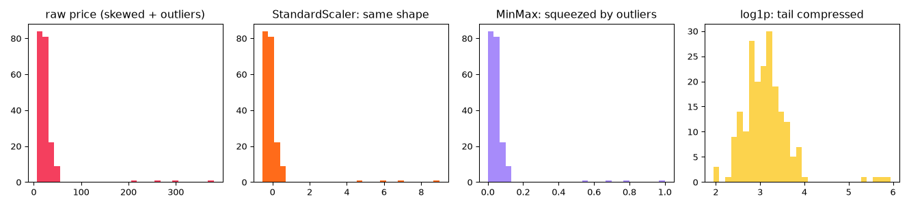
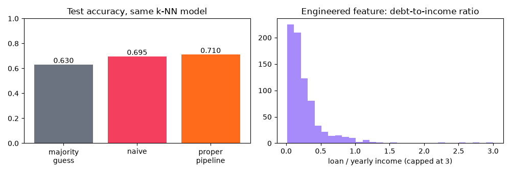

[](https://colab.research.google.com/github/Hamnakhan123/Diploma-in-AI/blob/main/term-1/04-application-based-programming-in-python/code/session-13-data-processing-for-machine-learning.ipynb) &nbsp; 📓 [Notebook](code/session-13-data-processing-for-machine-learning.ipynb)

# Session 13: Data Processing Techniques for Machine Learning

> 🧭 [Diploma in AI](../../README.md) › [Term 1](../README.md) › [Application Based Programming in Python](README.md) › **Session 13**
>
> ⏱️ **Estimated time:** 3 hours (1 h concepts + 2 h lab) &nbsp;|&nbsp; 📋 **Prerequisites:** Sessions 11-12 (pandas, visualization) and the statistics module (median, IQR, skewness, correlation).
>
> Prepared by **Hamna Zahid Khan**, Junior Lecturer

[⬅ Previous: Session 12](session-12-data-visualization.md) &nbsp;|&nbsp; [🏠 Module home](README.md) &nbsp;|&nbsp; [Next: Session 14 ➡](session-14-types-of-machine-learning.md)

---

## 🎯 Learning objectives

By the end of this session you will be able to:

- Describe **machine learning**, its workflow, and where data processing fits in it.
- Explain **why data processing matters**: "garbage in, garbage out", model assumptions, and **data leakage**.
- Apply the core techniques: **missing-value handling**, **categorical encoding**, **feature scaling**, **outlier treatment**, **transformations** and **feature engineering**.
- Use the Python libraries for preparing data: **NumPy**, **pandas** and **scikit-learn** (`SimpleImputer`, encoders, scalers, `train_test_split`, `Pipeline`, `ColumnTransformer`).
- Build, evaluate, save and reuse a complete **preprocessing pipeline**.

## 📖 Concepts

### 1. What is machine learning?

**Machine learning (ML)** is building programs that **learn patterns from data** instead of following rules you write by hand.

| Traditional programming | Machine learning |
|---|---|
| rules + data → answers | data + answers → **rules (a model)** |
| "if income > X and age > Y, approve" written by a person | the model *finds* the pattern from thousands of past loans |

Examples you meet every day: spam filters, product recommendations, face unlock, fraud alerts, ride-hailing arrival estimates, Urdu speech recognition.

**Key vocabulary:** a **dataset** has rows (**samples / observations**) and columns (**features**, written **X**). The column we want to predict is the **target / label** (**y**). **Training** fits the model on known examples; **inference** uses it on new ones. Session 14 covers the types of ML (supervised, unsupervised, reinforcement).

**The ML workflow:**

1. Define the problem and collect data.
2. **Explore** (Session 12) and **prepare** the data (**this session**).
3. Split into training and test sets.
4. Train a model, evaluate it, tune it (Sessions 14-15).
5. Deploy and monitor (for example behind a Flask API, Session 7).

### 2. Why data processing matters

Real data is **incomplete** (missing values), **inconsistent** ("Karachi", "karachi ", "KHI"), **noisy** (typos, an age of 999), **skewed** (a few huge loans) and full of **text** that models cannot use directly. Most ML algorithms require a complete, **numeric** table, and many assume features on similar scales.

> 🧠 **Analogy:** Training a model on raw data is like **cooking with unwashed, unpeeled, unmeasured ingredients**. The recipe (algorithm) may be excellent, but the dish will still be bad. Data processing is the washing, peeling and measuring: unglamorous, essential, and usually most of the kitchen time.

| Problem in the data | Effect on a model | Technique |
|---|---|---|
| Missing values | most scikit-learn models raise an error | drop or **impute** (mean, median, mode, constant), add a missing-indicator |
| Text categories | models need numbers | **one-hot** (nominal), **ordinal** (ordered), label encoding (target only) |
| Very different scales (income in thousands, rooms 1-5) | distance and gradient-based models favour the big column | **StandardScaler**, **MinMaxScaler**, **RobustScaler** |
| Outliers | pull means, stretch scales, distort fitted lines | detect (IQR, z-score), then keep, **cap**, transform or remove |
| Skewed distributions | linear models fit poorly | **log** / square-root transform |
| Raw columns that hide the signal | weaker models | **feature engineering** (ratios, dates → day of week, binning) |
| Information from the future or the test set | fake high accuracy | split first; fit steps on training data only (**no leakage**) |

### 3. Handling missing values

- **Detect:** `df.isna().sum()`, `df.isna().mean()` (fraction missing).
- **Drop** rows (`dropna`) only when few are affected and missingness is random; drop a **column** if it is mostly empty.
- **Impute** numbers with the **median** (robust) or mean; categories with the **most frequent** value or a constant like `"Unknown"`.
- Add a **missing-indicator** column when "missing" itself may carry information (an applicant who did not state income).
- In scikit-learn: `SimpleImputer(strategy="median" | "mean" | "most_frequent" | "constant")`; advanced: `KNNImputer`, `IterativeImputer`.

### 4. Encoding categorical data

| Type | Example | Encoding | Tool |
|---|---|---|---|
| **Nominal** (no order) | city, payment method | **one-hot**: one 0/1 column per category | `pd.get_dummies`, `OneHotEncoder(handle_unknown="ignore")` |
| **Ordinal** (ordered) | education level, T-shirt size | integers in the right order | `OrdinalEncoder(categories=[[...]])`, `map` |
| **Target labels** | yes / no | 0 / 1 | `LabelEncoder` (for **y** only) |

> ⚠️ Never give nominal categories arbitrary integers (Karachi = 0, Lahore = 1, Quetta = 2): the model will think Quetta is "twice" Lahore. And always plan for **unseen categories** in new data (`handle_unknown="ignore"`).

### 5. Feature scaling

| Scaler | Formula | Result | Use when |
|---|---|---|---|
| **StandardScaler** | (x − mean) / std | mean 0, std 1 | most models (logistic regression, SVM, neural networks, PCA) |
| **MinMaxScaler** | (x − min) / (max − min) | range 0 to 1 | bounded inputs (images, some neural nets); sensitive to outliers |
| **RobustScaler** | (x − median) / IQR | centred, outlier-resistant | data with outliers |

**Which models need scaling?** k-NN, k-means, SVM, linear/logistic regression with regularisation, neural networks, PCA: **yes**. Decision trees and random forests: **no** (they split on thresholds).

### 6. Outliers, transformations and feature engineering

- **Detect** with the IQR fences or |z| > 3 (statistics module); **plot** with box plots.
- **Decide** with domain knowledge: a typo (age 999) → fix or set missing; a genuine extreme (a luxury flat) → keep, **cap** (`clip`), or **log-transform** (`np.log1p`) to compress the tail.
- **Feature engineering** creates more informative columns: ratios (debt-to-income, price per square foot), date parts (month, weekday, "is weekend"), counts, **binning** (`pd.cut` age groups), text length, interactions.

### 7. Train/test split, pipelines and data leakage

- **Split first:** `train_test_split(X, y, test_size=0.2, stratify=y, random_state=42)`. The test set simulates future, unseen data.
- **Fit on train, transform both:** medians, means/stds and category lists must be learned from training data only. Otherwise information from the test set **leaks** into training and the score is too optimistic.
- A scikit-learn **`Pipeline`** chains steps (impute → scale → model) so `fit` and `predict` apply them in the right order automatically; a **`ColumnTransformer`** sends numeric and categorical columns through different steps. Together they make preprocessing **reproducible**, **leak-free** and easy to **save** (`joblib.dump`) for deployment.
- **Target leakage:** a feature that is only known *after* the outcome (a "discount code used at checkout" when predicting whether someone will buy) gives unrealistically perfect results. Ask of every feature: "would I know this at prediction time?"

### 8. Python libraries for data processing

| Library | Role in preprocessing |
|---|---|
| **NumPy** | fast arrays and maths (`np.log1p`, `np.where`, `np.clip`, random data) |
| **pandas** | loading, auditing, cleaning, feature engineering (`isna`, `str`, `cut`, `get_dummies`) |
| **scikit-learn** | reusable, fit/transform steps: `SimpleImputer`, `OneHotEncoder`, `OrdinalEncoder`, `StandardScaler`, `MinMaxScaler`, `RobustScaler`, `train_test_split`, `Pipeline`, `ColumnTransformer`, `cross_val_score` |
| **matplotlib / seaborn** | checking distributions before and after |
| **joblib** | saving fitted pipelines |

## 🧭 Diagrams





## 💻 Worked examples

### Example 1: Missing values and categorical encoding (basic)

📄 [`code/session-13_missing_and_encoding.py`](code/session-13_missing_and_encoding.py) &nbsp;·&nbsp; run: `python session-13_missing_and_encoding.py`

```python
"""
Session 13 · Example 1: missing values and categorical encoding
---------------------------------------------------------------
Machine-learning models need a complete, NUMERIC table. This example
shows how to (1) find and fill missing values and (2) turn text categories
into numbers with pandas and scikit-learn.
Run:  python session-13_missing_and_encoding.py
"""
import numpy as np
import pandas as pd
from sklearn.impute import SimpleImputer
from sklearn.preprocessing import OneHotEncoder, OrdinalEncoder, LabelEncoder

pd.set_option("display.width", 140); pd.set_option("display.max_columns", 20)
df = pd.DataFrame({
    "age":       [24, 31, np.nan, 45, 29, 38, np.nan, 52],
    "income_k":  [55, 80, 62, np.nan, 48, 120, 70, 95],          # monthly income, thousand Rs
    "city":      ["Karachi", "Lahore", "Karachi", np.nan, "Islamabad", "Karachi", "Lahore", "Karachi"],
    "education": ["Bachelors", "Masters", "Intermediate", "Masters", "Bachelors", "PhD", "Bachelors", np.nan],
    "bought":    ["no", "yes", "no", "yes", "no", "yes", "no", "yes"],   # the target to predict
})
print("raw data:\n", df, "\n")

# 1. Detect missing values
print("missing per column:", df.isna().sum().to_dict())
print(f"rows with any missing value: {df.isna().any(axis=1).sum()} of {len(df)}")

# 2. Option A: drop (only when few rows are affected and they are missing at random)
print("dropna would keep", len(df.dropna()), "rows - too much data lost here")

# 3. Option B: impute. Numbers -> median (robust to outliers); categories -> most frequent
num_cols, cat_cols = ["age", "income_k"], ["city", "education"]
filled = df.copy()
filled[num_cols] = SimpleImputer(strategy="median").fit_transform(df[num_cols])
filled[cat_cols] = SimpleImputer(strategy="most_frequent").fit_transform(df[cat_cols])
print("medians used:", df[num_cols].median().to_dict(), "| modes used:", df[cat_cols].mode().iloc[0].to_dict())
# A missing-indicator column keeps the information that a value WAS missing
filled["age_was_missing"] = df["age"].isna().astype(int)
print("\nafter imputation:\n", filled, "\n")

# 4. Encoding categories
# 4a. NOMINAL (no order): one-hot encoding -> one 0/1 column per category
print("pandas get_dummies:\n", pd.get_dummies(filled["city"], prefix="city", dtype=int).head(4), "\n")
ohe = OneHotEncoder(sparse_output=False, handle_unknown="ignore")
city_matrix = ohe.fit_transform(filled[["city"]])
print("OneHotEncoder categories:", ohe.categories_[0].tolist())
print("unknown city 'Quetta' encodes to:", ohe.transform(pd.DataFrame({"city": ["Quetta"]})).tolist(), "(all zeros, no crash)")

# 4b. ORDINAL (natural order): map to ordered integers
levels = [["Intermediate", "Bachelors", "Masters", "PhD"]]
filled["education_level"] = OrdinalEncoder(categories=levels).fit_transform(filled[["education"]]).ravel()
print("\neducation -> level:", dict(zip(filled["education"], filled["education_level"])))

# 4c. TARGET labels: LabelEncoder (for y only)
le = LabelEncoder()
y = le.fit_transform(filled["bought"])
print("target classes:", le.classes_.tolist(), "-> y =", y.tolist())

# 5. The final all-numeric feature matrix X
X = pd.concat([filled[["age", "income_k", "age_was_missing", "education_level"]],
               pd.DataFrame(city_matrix, columns=ohe.get_feature_names_out(), index=filled.index)], axis=1)
print("\nfeature matrix X:", X.shape, "\n", X.round(1))
```

**Output**

```text
raw data:
     age  income_k       city     education bought
0  24.0      55.0    Karachi     Bachelors     no
1  31.0      80.0     Lahore       Masters    yes
2   NaN      62.0    Karachi  Intermediate     no
3  45.0       NaN        NaN       Masters    yes
4  29.0      48.0  Islamabad     Bachelors     no
5  38.0     120.0    Karachi           PhD    yes
6   NaN      70.0     Lahore     Bachelors     no
7  52.0      95.0    Karachi           NaN    yes 

missing per column: {'age': 2, 'income_k': 1, 'city': 1, 'education': 1, 'bought': 0}
rows with any missing value: 4 of 8
dropna would keep 4 rows - too much data lost here
medians used: {'age': 34.5, 'income_k': 70.0} | modes used: {'city': 'Karachi', 'education': 'Bachelors'}

after imputation:
     age  income_k       city     education bought  age_was_missing
0  24.0      55.0    Karachi     Bachelors     no                0
1  31.0      80.0     Lahore       Masters    yes                0
2  34.5      62.0    Karachi  Intermediate     no                1
3  45.0      70.0    Karachi       Masters    yes                0
4  29.0      48.0  Islamabad     Bachelors     no                0
5  38.0     120.0    Karachi           PhD    yes                0
6  34.5      70.0     Lahore     Bachelors     no                1
7  52.0      95.0    Karachi     Bachelors    yes                0 

pandas get_dummies:
    city_Islamabad  city_Karachi  city_Lahore
0               0             1            0
1               0             0            1
2               0             1            0
3               0             1            0 

OneHotEncoder categories: ['Islamabad', 'Karachi', 'Lahore']
unknown city 'Quetta' encodes to: [[0.0, 0.0, 0.0]] (all zeros, no crash)

education -> level: {'Bachelors': 1.0, 'Masters': 2.0, 'Intermediate': 0.0, 'PhD': 3.0}
target classes: ['no', 'yes'] -> y = [0, 1, 0, 1, 0, 1, 0, 1]

feature matrix X: (8, 7) 
     age  income_k  age_was_missing  education_level  city_Islamabad  city_Karachi  city_Lahore
0  24.0      55.0                0              1.0             0.0           1.0          0.0
1  31.0      80.0                0              2.0             0.0           0.0          1.0
2  34.5      62.0                1              0.0             0.0           1.0          0.0
3  45.0      70.0                0              2.0             0.0           1.0          0.0
4  29.0      48.0                0              1.0             1.0           0.0          0.0
5  38.0     120.0                0              3.0             0.0           1.0          0.0
6  34.5      70.0                1              1.0             0.0           0.0          1.0
7  52.0      95.0                0              1.0             0.0           1.0          0.0
```


**What to notice:** dropping incomplete rows would have thrown away half the data, so imputation is the better choice here. The ordinal encoder respected the real order (Intermediate < Bachelors < Masters < PhD), while cities were one-hot encoded, and an unseen city ("Quetta") became all zeros instead of crashing.

### Example 2: Scaling, outliers and feature engineering (intermediate)

📄 [`code/session-13_scaling_outliers.py`](code/session-13_scaling_outliers.py) &nbsp;·&nbsp; run: `python session-13_scaling_outliers.py`

```python
"""
Session 13 · Example 2: feature scaling, outliers and feature engineering
-------------------------------------------------------------------------
Run:  python session-13_scaling_outliers.py
"""
import matplotlib
matplotlib.use("Agg")
import matplotlib.pyplot as plt
import numpy as np
import pandas as pd
from sklearn.preprocessing import MinMaxScaler, RobustScaler, StandardScaler

rng = np.random.default_rng(5)
df = pd.DataFrame({
    "area_sqft": rng.normal(1200, 300, 200).round(),
    "rooms": rng.integers(1, 6, 200),
    "price_m": np.r_[rng.lognormal(3.0, 0.45, 196), [210, 260, 300, 380]].round(1),   # 4 luxury outliers
})
print("raw scales:\n", df.describe().loc[["mean", "std", "min", "max"]].round(1), "\n")

# 1. Why scale? Distance-based models (k-NN, k-means, SVM) and gradient descent
#    are dominated by the column with the biggest numbers.
a, b = df.iloc[0], df.iloc[1]
print(f"distance between rows 0 and 1: {np.linalg.norm(a - b):.1f} "
      f"(area difference {abs(a.area_sqft - b.area_sqft):.0f} swamps rooms difference {abs(a.rooms - b.rooms)})")

# 2. Three scalers
scaled = {name: pd.DataFrame(s.fit_transform(df), columns=df.columns)
          for name, s in [("StandardScaler", StandardScaler()), ("MinMaxScaler", MinMaxScaler()), ("RobustScaler", RobustScaler())]}
for name, d in scaled.items():
    print(f"{name:<15} price: mean {d.price_m.mean():6.2f}  std {d.price_m.std():5.2f}  "
          f"min {d.price_m.min():6.2f}  max {d.price_m.max():6.2f}")

# 3. Outliers: detect with IQR (Statistics module), then decide: keep, cap or remove
q1, q3 = df["price_m"].quantile([0.25, 0.75]); iqr = q3 - q1
upper = q3 + 1.5 * iqr
out = df[df["price_m"] > upper]
print(f"\nIQR fence: price > {upper:.1f} M is an outlier -> {len(out)} rows: {out['price_m'].tolist()}")
capped = df["price_m"].clip(upper=upper)                     # winsorising / capping
logged = np.log1p(df["price_m"])                              # log transform compresses the tail
print(f"skewness: raw {df['price_m'].skew():.2f}, capped {capped.skew():.2f}, log {logged.skew():.2f}")

# 4. Feature engineering: create more useful columns from existing ones
df["price_per_sqft_k"] = (df["price_m"] * 1000 / df["area_sqft"]).round(2)
df["size_band"] = pd.cut(df["area_sqft"], bins=[0, 900, 1400, np.inf], labels=["small", "medium", "large"])
print("\nengineered features:\n", df[["area_sqft", "price_m", "price_per_sqft_k", "size_band"]].head(5))
print("size bands:", df["size_band"].value_counts().to_dict())

fig, ax = plt.subplots(1, 4, figsize=(14, 3.2))
ax[0].hist(df["price_m"], bins=30, color="#F43F5E"); ax[0].set_title("raw price (skewed + outliers)")
ax[1].hist(scaled["StandardScaler"]["price_m"], bins=30, color="#FF6B1A"); ax[1].set_title("StandardScaler: same shape")
ax[2].hist(scaled["MinMaxScaler"]["price_m"], bins=30, color="#A78BFA"); ax[2].set_title("MinMax: squeezed by outliers")
ax[3].hist(logged, bins=30, color="#FCD34D"); ax[3].set_title("log1p: tail compressed")
fig.tight_layout(); fig.savefig("session-13_scaling_outliers.png", dpi=95)
print("\nSaved session-13_scaling_outliers.png")
```

**Output**

```text
raw scales:
       area_sqft  rooms  price_m
mean     1180.5    3.0     27.7
std       289.3    1.4     39.4
min       483.0    1.0      6.0
max      2008.0    5.0    380.0 

distance between rows 0 and 1: 156.0 (area difference 156 swamps rooms difference 2.0)
StandardScaler  price: mean   0.00  std  1.00  min  -0.55  max   8.97
MinMaxScaler    price: mean   0.06  std  0.11  min   0.00  max   1.00
RobustScaler    price: mean   0.45  std  3.02  min  -1.21  max  27.50

IQR fence: price > 47.7 M is an outlier -> 7 rows: [51.4, 49.7, 49.6, 210.0, 260.0, 300.0, 380.0]
skewness: raw 6.85, capped 0.82, log 1.91

engineered features:
    area_sqft  price_m  price_per_sqft_k size_band
0      959.0     13.4             13.97    medium
1      803.0     13.6             16.94     small
2     1125.0     21.6             19.20    medium
3     1326.0     28.1             21.19    medium
4     1541.0     15.4              9.99     large
size bands: {'medium': 121, 'large': 43, 'small': 36}

Saved session-13_scaling_outliers.png
```




**Walkthrough:**

1. The Euclidean distance between two houses (156) was almost entirely the area difference; the room difference was invisible until scaling.
2. `StandardScaler` keeps the distribution's **shape** (outliers stay outliers); `MinMaxScaler` squeezes normal prices near 0 because of four luxury outliers; `RobustScaler` uses the median and IQR, so outliers affect it less.
3. Capping and log-transforming reduced skewness from 6.85 to 0.82 and 1.91.
4. `price_per_sqft` and `size_band` are new, often more predictive, features built from existing columns.

### Example 3: Pipelines, cross-validation and data leakage (advanced)

📄 [`code/session-13_pipeline_and_leakage.py`](code/session-13_pipeline_and_leakage.py) &nbsp;·&nbsp; run: `python session-13_pipeline_and_leakage.py`

```python
"""
Session 13 · Example 3: train/test split, Pipeline + ColumnTransformer, and data leakage
--------------------------------------------------------------------------------------
Rule: learn every preprocessing step (medians, scaling, categories) from the
TRAINING data only, then apply the same learned steps to the test data.
A scikit-learn Pipeline does this automatically.
Run:  python session-13_pipeline_and_leakage.py
"""
import numpy as np
import pandas as pd
from sklearn.compose import ColumnTransformer
from sklearn.impute import SimpleImputer
from sklearn.linear_model import LogisticRegression
from sklearn.model_selection import cross_val_score, train_test_split
from sklearn.pipeline import Pipeline
from sklearn.preprocessing import OneHotEncoder, StandardScaler

rng = np.random.default_rng(13)
n = 500
df = pd.DataFrame({
    "age": rng.integers(18, 65, n).astype(float),
    "income_k": rng.lognormal(4.2, 0.4, n).round(1),
    "city": rng.choice(["Karachi", "Lahore", "Islamabad", "Peshawar"], n, p=[0.45, 0.3, 0.15, 0.1]),
    "visits": rng.poisson(4, n).astype(float),
})
logit = -6 + 0.04 * df["age"] + 0.03 * df["income_k"] + 0.25 * df["visits"] + (df["city"] == "Islamabad") * 0.8
df["bought"] = (rng.random(n) < 1 / (1 + np.exp(-logit))).astype(int)
for col, k in [("age", 30), ("income_k", 25), ("city", 20)]:           # punch random holes
    df.loc[rng.choice(n, k, replace=False), col] = np.nan
print(df.head(), "\nmissing:", df.isna().sum().to_dict(), "| bought rate:", round(df["bought"].mean(), 2))

X, y = df.drop(columns="bought"), df["bought"]
# 1. Split FIRST. stratify keeps the same class balance in both parts; random_state = reproducible
X_train, X_test, y_train, y_test = train_test_split(X, y, test_size=0.25, stratify=y, random_state=42)
print(f"\ntrain {X_train.shape}, test {X_test.shape}, positive rate train {y_train.mean():.2f} / test {y_test.mean():.2f}")

# 2. Different steps for different column types
numeric = ["age", "income_k", "visits"]
categorical = ["city"]
preprocess = ColumnTransformer([
    ("num", Pipeline([("impute", SimpleImputer(strategy="median")), ("scale", StandardScaler())]), numeric),
    ("cat", Pipeline([("impute", SimpleImputer(strategy="most_frequent")),
                      ("onehot", OneHotEncoder(handle_unknown="ignore"))]), categorical),
])
model = Pipeline([("prep", preprocess), ("clf", LogisticRegression(max_iter=1000))])

# 3. fit() learns medians, means/stds, categories AND the model - from training data only
model.fit(X_train, y_train)
medians = model.named_steps["prep"].named_transformers_["num"].named_steps["impute"].statistics_
print("learned medians (train only):", {c: round(float(m), 1) for c, m in zip(numeric, medians)})
print("output feature names:", list(model.named_steps["prep"].get_feature_names_out()))
print(f"test accuracy: {model.score(X_test, y_test):.3f}")
print(f"5-fold cross-validation accuracy: {cross_val_score(model, X, y, cv=5).mean():.3f}")

# 4. New data with an unseen city and missing values goes through the SAME steps
new = pd.DataFrame({"age": [np.nan, 40], "income_k": [90, np.nan], "city": ["Quetta", "Islamabad"], "visits": [6, 2]})
print("\nnew customers:\n", new)
print("predicted probability of buying:", model.predict_proba(new)[:, 1].round(2).tolist())

# 5. Data leakage demo: a 'feature' that secretly contains the answer
leaky = X.copy()
leaky["discount_code_used"] = y.values * (rng.random(n) < 0.9)       # only known AFTER the purchase!
Xl_tr, Xl_te, yl_tr, yl_te = train_test_split(leaky, y, test_size=0.25, stratify=y, random_state=42)
leak_model = Pipeline([("prep", ColumnTransformer([("num", preprocess.transformers[0][1], numeric + ["discount_code_used"]),
                                                   ("cat", preprocess.transformers[1][1], categorical)])),
                       ("clf", LogisticRegression(max_iter=1000))]).fit(Xl_tr, yl_tr)
print(f"\nwith a LEAKY feature, test accuracy jumps to {leak_model.score(Xl_te, yl_te):.3f} "
      "- too good to be true, and useless for real predictions")
```

**Output**

```text
    age  income_k      city  visits  bought
0   NaN      70.6    Lahore     3.0       0
1  58.0      36.6   Karachi     1.0       1
2  56.0      70.1    Lahore     5.0       0
3  58.0      45.3    Lahore     4.0       0
4  21.0       NaN  Peshawar     3.0       0 
missing: {'age': 30, 'income_k': 25, 'city': 20, 'visits': 0, 'bought': 0} | bought rate: 0.34

train (375, 4), test (125, 4), positive rate train 0.34 / test 0.34
learned medians (train only): {'age': 42.0, 'income_k': 66.2, 'visits': 4.0}
output feature names: ['num__age', 'num__income_k', 'num__visits', 'cat__city_Islamabad', 'cat__city_Karachi', 'cat__city_Lahore', 'cat__city_Peshawar']
test accuracy: 0.792
5-fold cross-validation accuracy: 0.750

new customers:
     age  income_k       city  visits
0   NaN      90.0     Quetta       6
1  40.0       NaN  Islamabad       2
predicted probability of buying: [0.59, 0.31]

with a LEAKY feature, test accuracy jumps to 0.968 - too good to be true, and useless for real predictions
```


**Key lessons:**

- The `Pipeline` learned medians **from the training split only** and applied them to the test set and to brand-new customers, including an unseen city and missing values.
- Cross-validation (0.75) gives a steadier estimate than one test split (0.79).
- The leaky feature pushed accuracy to 0.97. When results look too good to be true, look for leakage first.

## 🌍 Real-life coding problem: preparing messy loan applications

**Scenario.** A microfinance team wants to predict loan repayment. Their export stores income as text with commas, spells employment types several ways, contains impossible ages (0, 150, 999), has missing values and a heavily skewed loan amount.

**Plan:**

| Step | Action |
|---|---|
| Audit | dtypes, missing counts, distinct spellings, impossible values, skewness |
| Fix | `to_numeric(str.replace(",", ""))`, `str.strip().str.title()`, impossible ages → `NaN` |
| Engineer | **debt-to-income ratio** = loan / (12 × monthly income); `log(loan)` |
| Pipeline | median imputation + scaling for numbers; mode imputation + one-hot for employment |
| Compare | the **same** k-NN model with naive vs proper preprocessing, on a test split and with 5-fold CV |

📄 Full solution (99 lines, fully commented): [`code/session-13_problem_loan_preprocessing.py`](code/session-13_problem_loan_preprocessing.py) &nbsp;·&nbsp; run: `python session-13_problem_loan_preprocessing.py` &nbsp;·&nbsp; also in the session notebook

**Output**

```text
=== 1. data-quality audit ===
dtypes: {'age': 'float64', 'monthly_income': 'str', 'employment': 'str', 'loan_amount': 'float64', 'repaid': 'int64'}
missing: {'age': 0, 'monthly_income': 40, 'employment': 25, 'loan_amount': 0, 'repaid': 0}
employment spellings: {'Salaried': 260, 'Business': 172, 'Daily wage': 122, 'salaried ': 53, 'SALARIED': 52, 'BUSINESS': 40, 'business ': 31, 'daily wage ': 26, 'nan': 25, 'DAILY WAGE': 19}
impossible ages: [0.0, 150.0, 999.0]
loan_amount skewness: 2.76

=== 2. after fixing and engineering ===
employment now: {'Salaried': 365, 'Business': 243, 'Daily Wage': 167, 'nan': 25}
        age  monthly_income  loan_amount   dti  log_loan
mean  40.22        81818.74    208182.62  0.27     11.99
50%   41.00        74891.50    156250.00  0.18     11.96
max   59.00       264564.00   1764800.00  3.22     14.38

=== 3. same model (k-NN, k = 15), different preprocessing ===
always guess the majority class : 0.630
naive (fill 0, no scaling)      : 0.695   5-fold CV 0.686
proper pipeline                 : 0.710   5-fold CV 0.726
Saved session-13_problem_loan_preprocessing.png
```




**Interpretation.** Always compare with the **majority-class baseline** (63 % here): a model is only useful if it beats guessing. Naive preprocessing gives about 69 % in cross-validation; the proper pipeline about 73 %, with **the same algorithm**. The gain comes from scaling (k-NN measures distances), sensible imputation instead of zeros, the employment category, and the engineered debt-to-income ratio. Better data often beats a fancier model.

## 🛠️ Mini project: a reusable data-preparation toolkit

Three functions you can drop into any project:

| Function | What it does |
|---|---|
| `quality_report(df, target)` | per column: dtype, missing %, unique count and a suggested action (drop ID, impute, one-hot, log-transform, scale) |
| `build_preprocessor(df, target, drop)` | detects numeric and categorical columns and returns a ready `ColumnTransformer` (with `min_frequency` to group rare categories) |
| `joblib.dump` / `joblib.load` | saves the **fitted** pipeline and reloads it to score new customers identically |

📄 Full solution (106 lines, fully commented): [`code/session-13_project_prep_toolkit.py`](code/session-13_project_prep_toolkit.py) &nbsp;·&nbsp; run: `python session-13_project_prep_toolkit.py` &nbsp;·&nbsp; also in the session notebook

**Output**

```text
=== quality report ===
       column   dtype  missing_%  unique                                                suggestion
  customer_id     str        0.0    1000                      drop: unique ID, no pattern to learn
tenure_months float64        0.0      71                                                     scale
 monthly_bill float64        6.0     762 impute median, skewed: consider log transform, then scale
      data_gb float64        0.0     287                skewed: consider log transform, then scale
   complaints float64        0.0       6                skewed: consider log transform, then scale
      package     str        0.0       3                                            one-hot encode
       region     str        3.0       5                               impute mode, one-hot encode
referral_note     str       70.7       1                         mostly missing: consider dropping
      churned   int64        0.0       2                 target: never transform with the features

numeric columns    : ['tenure_months', 'monthly_bill', 'data_gb', 'complaints']
categorical columns: ['package', 'region']

churn rate 0.32 | test accuracy 0.775
strongest signals (scaled coefficients): {'num__tenure_months': -0.82, 'cat__package_Prepaid': 0.6, 'num__complaints': 0.5, 'cat__region_ICT': 0.35}

saved churn_pipeline.joblib (4.6 KB)
  C900001: churn risk 89% -> offer a retention discount
  C900002: churn risk 4% -> no action
same predictions as the original pipeline: True
```


**Interpretation.** The report caught a unique ID column (useless to a model), a mostly empty note column, skewed numeric columns and missing values, and suggested a fix for each. The reloaded pipeline gave exactly the same predictions as the original, which is what makes deployment safe: the app that serves predictions must apply **identical** preprocessing. Tenure, prepaid packages and complaints are the strongest churn signals; the small regional coefficient is probably noise, worth checking before anyone acts on it.

**Extension ideas:** add a log-transform step for skewed columns using `FunctionTransformer(np.log1p)`; let `quality_report` also flag highly correlated feature pairs; serve the saved pipeline from a Flask `/predict` endpoint (Session 7).

## ⚠️ Common mistakes

| Mistake | Consequence | Fix |
|---|---|---|
| Scaling or imputing **before** the train/test split | data leakage, optimistic scores | Split first; use a Pipeline |
| Label-encoding nominal categories (0, 1, 2) | fake order and distances | One-hot encode |
| `fillna(0)` for every column | distorted distributions, fake signal | Median/mode imputation, missing indicators |
| Deleting all outliers automatically | losing genuine, important cases | Investigate; cap or transform when appropriate |
| Forgetting unseen categories in new data | crash at prediction time | `OneHotEncoder(handle_unknown="ignore")` |
| Keeping ID columns as features | the model memorises noise | Drop identifiers |
| Using features not available at prediction time | target leakage | Ask "would I know this when predicting?" |
| Transforming the target with the features | wrong labels, leakage | Keep y separate |
| Evaluating only accuracy on imbalanced data | a useless model looks good | Compare with the majority baseline (more metrics in Module 5) |

## ✅ Best practices

- **Audit first** (types, missing values, unique values, distributions) and write down every decision.
- Keep raw data read-only; do all processing in code that can be rerun.
- **Split before** fitting anything; use `stratify` for classification and a fixed `random_state`.
- Wrap preprocessing and model in **one Pipeline**; save and deploy the pipeline, not just the model.
- Choose techniques by data type and model family (scaling for distance-based models, not for trees).
- Engineer features from domain knowledge; they often matter more than the algorithm.
- Validate with cross-validation and always compare against a simple baseline.

## 🧪 Lab / practice tasks

**1. 🟢 Easy:** For `pd.Series([12, np.nan, 15, 300, 14, np.nan, 13])`, fill missing values with the mean and with the median. Which is more sensible here, and why?

<details><summary>💡 Hint</summary>

The value 300 is an outlier; compare `s.mean()` and `s.median()`.

</details>

<details><summary>✅ Solution</summary>

```python
import numpy as np, pandas as pd
s = pd.Series([12, np.nan, 15, 300, 14, np.nan, 13])
print(s.fillna(s.mean()).tolist())    # fills with 70.8
print(s.fillna(s.median()).tolist())  # fills with 14.0
```

The median (14) is sensible; the mean (70.8) is dragged up by the outlier 300.

</details>

**2. 🟢 Easy:** One-hot encode a `payment` column with values cash, card, wallet using `pd.get_dummies(..., drop_first=True)`. Why might `drop_first` be useful?

<details><summary>💡 Hint</summary>

With three categories, two 0/1 columns are enough: if both are 0, it must be the third.

</details>

<details><summary>✅ Solution</summary>

```python
df = pd.DataFrame({"payment": ["cash", "card", "wallet", "cash"]})
print(pd.get_dummies(df["payment"], drop_first=True, dtype=int))
```

Dropping one column avoids perfectly redundant columns (the "dummy variable trap"), which matters for unregularised linear models.

</details>

**3. 🟡 Medium:** Show leakage with numbers: scale the whole house dataset from Example 2 with `StandardScaler` **before** splitting, then the correct way (fit on train only), and compare the learned mean of `area_sqft` in each case.

<details><summary>💡 Hint</summary>

`StandardScaler().fit(df)` vs `StandardScaler().fit(train)`; read `.mean_`.

</details>

<details><summary>✅ Solution</summary>

```python
from sklearn.model_selection import train_test_split
from sklearn.preprocessing import StandardScaler
cols = ["area_sqft", "rooms", "price_m"]
train, test = train_test_split(df[cols], test_size=0.25, random_state=0)
print("fit on ALL  :", StandardScaler().fit(df[cols]).mean_[0].round(1))
print("fit on TRAIN:", StandardScaler().fit(train).mean_[0].round(1))
```

The numbers differ: the "all data" scaler has already seen the test rows, which is exactly the information a real future sample would not give you.

</details>

**4. 🟡 Medium:** Engineer three features from a `timestamp` column of food orders: hour of day, day of week, and `is_weekend`. Then bin the hour into breakfast / lunch / dinner / late night with `pd.cut`.

<details><summary>💡 Hint</summary>

`df["timestamp"].dt.hour`, `.dt.day_name()`, `.dt.dayofweek >= 5`; bins `[0, 11, 16, 22, 24]`.

</details>

<details><summary>✅ Solution</summary>

```python
orders = pd.DataFrame({"timestamp": pd.to_datetime(["2026-10-24 08:15", "2026-10-24 13:40",
                                                    "2026-10-26 20:05", "2026-10-26 23:30"])})
orders["hour"] = orders["timestamp"].dt.hour
orders["weekday"] = orders["timestamp"].dt.day_name()
orders["is_weekend"] = orders["timestamp"].dt.dayofweek >= 5
orders["meal"] = pd.cut(orders["hour"], bins=[0, 11, 16, 22, 24], labels=["breakfast", "lunch", "dinner", "late night"], right=False)
print(orders)
```

</details>

**5. 🟠 Hard:** Add a log-transform step to the loan pipeline for `monthly_income` using `FunctionTransformer(np.log1p)` inside its own branch of the `ColumnTransformer`, and compare the cross-validated accuracy with the original.

<details><summary>💡 Hint</summary>

Create a third branch: `("income", Pipeline([("imp", SimpleImputer(strategy="median")), ("log", FunctionTransformer(np.log1p)), ("sc", StandardScaler())]), ["monthly_income"])` and remove `monthly_income` from the numeric list.

</details>

<details><summary>✅ Solution</summary>

```python
from sklearn.preprocessing import FunctionTransformer
prep2 = ColumnTransformer([
    ("num", Pipeline([("imp", SimpleImputer(strategy="median")), ("sc", StandardScaler())]), ["age", "log_loan", "dti"]),
    ("income", Pipeline([("imp", SimpleImputer(strategy="median")), ("log", FunctionTransformer(np.log1p)),
                         ("sc", StandardScaler())]), ["monthly_income"]),
    ("cat", Pipeline([("imp", SimpleImputer(strategy="most_frequent")), ("oh", OneHotEncoder(handle_unknown="ignore"))]), ["employment"]),
])
print(cross_val_score(Pipeline([("prep", prep2), ("knn", KNeighborsClassifier(n_neighbors=15))]), X, y, cv=5).mean())
```

</details>

**6. 🔴 Challenge:** Extend `quality_report` to (a) flag pairs of numeric columns with |r| > 0.9 as "redundant", (b) flag categorical columns where one value covers more than 95 % of rows as "near-constant", and (c) return the report sorted so the most urgent problems come first.

<details><summary>💡 Hint</summary>

Use `df.select_dtypes("number").corr().abs()` and loop over the upper triangle; `s.value_counts(normalize=True).iloc[0]` gives the share of the most common value. Add a numeric `priority` column and sort by it.

</details>

<details><summary>✅ Solution</summary>

```python
def extra_checks(df):
    issues = []
    corr = df.select_dtypes("number").corr().abs()
    cols = corr.columns
    for i in range(len(cols)):
        for j in range(i + 1, len(cols)):
            if corr.iloc[i, j] > 0.9:
                issues.append({"column": f"{cols[i]} & {cols[j]}", "issue": "redundant (|r| > 0.9)", "priority": 2})
    for c in df.select_dtypes(exclude="number"):
        share = df[c].value_counts(normalize=True)
        if len(share) and share.iloc[0] > 0.95:
            issues.append({"column": c, "issue": "near-constant", "priority": 1})
    return pd.DataFrame(issues).sort_values("priority") if issues else pd.DataFrame(columns=["column", "issue", "priority"])
print(extra_checks(df))
```

</details>

## ✅ Quick quiz

**Q1.** Why must most scikit-learn models receive preprocessed data?

- A) they only accept CSV files
- B) they need a complete, numeric feature matrix
- C) they cannot read pandas
- D) preprocessing makes training slower

**Q2.** Which encoding suits a nominal column such as city?

- A) ordinal integers
- B) one-hot encoding
- C) label encoding of the features
- D) min-max scaling

**Q3.** When should a scaler's mean and standard deviation be computed?

- A) on the full dataset before splitting
- B) on the test set
- C) on the training set only, then applied to the test set
- D) never

**Q4.** Which model family generally does NOT need feature scaling?

- A) k-nearest neighbours
- B) support vector machines
- C) decision trees and random forests
- D) logistic regression with regularisation

**Q5.** A feature recorded only after the outcome happens, used to predict that outcome, is an example of…

- A) feature scaling
- B) target leakage
- C) one-hot encoding
- D) stratification

<details><summary>✅ Show answers</summary>

1. **B** — missing values and text categories must be handled first.
2. **B** — one-hot avoids inventing an order between cities.
3. **C** — fitting on all data leaks test information.
4. **C** — tree splits depend on thresholds, not distances.
5. **B** — it makes the model look far better than it can be in real use.

</details>


## 📝 Summary

- **Machine learning** learns rules from data; preparing that data is the most time-consuming and most important step.
- **Techniques:** impute or drop missing values; one-hot (nominal) and ordinal encoding; Standard / MinMax / Robust scaling; detect and cap or transform outliers; log transforms for skew; feature engineering (ratios, dates, bins).
- **Libraries:** NumPy, pandas and scikit-learn (`SimpleImputer`, encoders, scalers, `train_test_split`, `Pipeline`, `ColumnTransformer`, `cross_val_score`), plus `joblib` for saving.
- **Split first, fit on training data only, transform everything with the same fitted steps.** Watch for target leakage.
- Always compare against a baseline: better data processing often beats a fancier algorithm.

### 🎤 Interview / viva questions

1. Why is data preprocessing necessary before training a machine-learning model?
2. Compare mean, median and mode imputation. When is each appropriate?
3. What is the difference between one-hot and ordinal encoding? Give an example of each.
4. Explain StandardScaler vs MinMaxScaler. Which is more sensitive to outliers?
5. What is data leakage? Give two examples and how to prevent them.
6. Why use a scikit-learn Pipeline instead of separate preprocessing steps?
7. What is feature engineering? Give three examples from a real dataset.

---

[⬅ Previous: Session 12](session-12-data-visualization.md) &nbsp;|&nbsp; [🏠 Module home](README.md) &nbsp;|&nbsp; [Next: Session 14 ➡](session-14-types-of-machine-learning.md)

<sub>Prepared by **Hamna Zahid Khan**, Junior Lecturer · Diploma in AI</sub>
