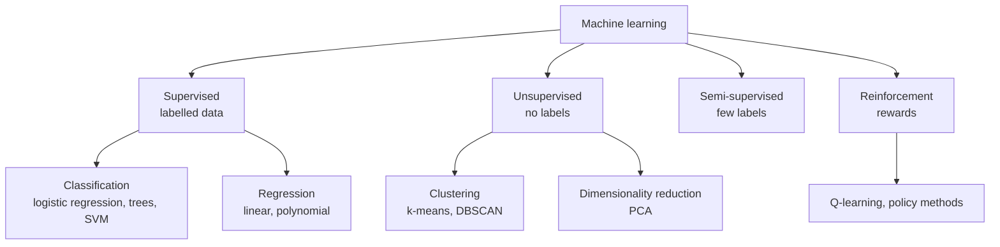
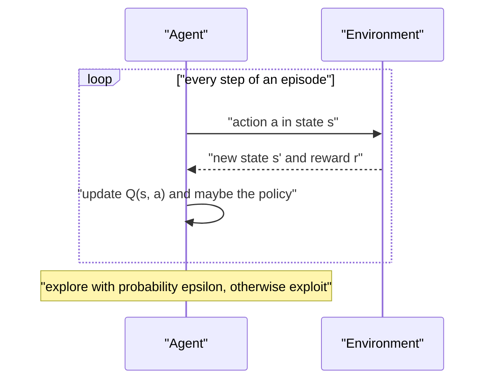
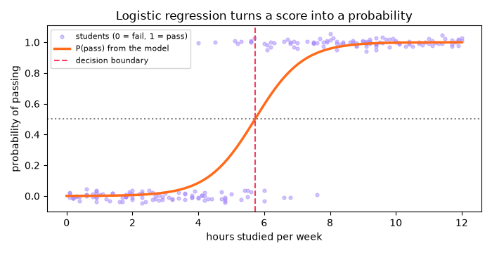
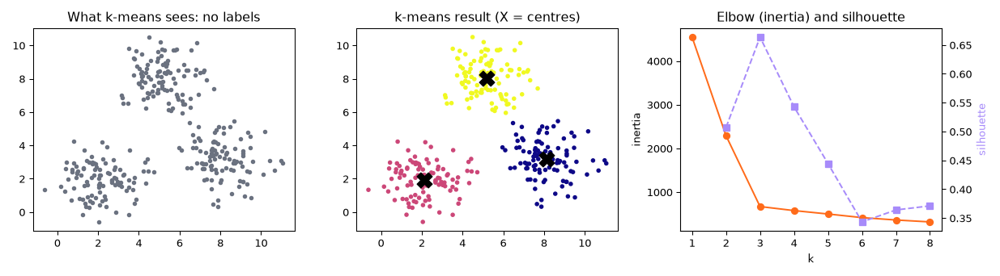
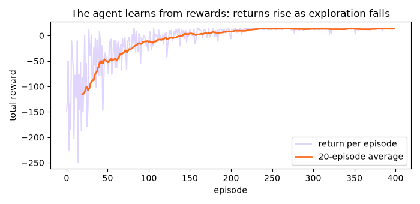
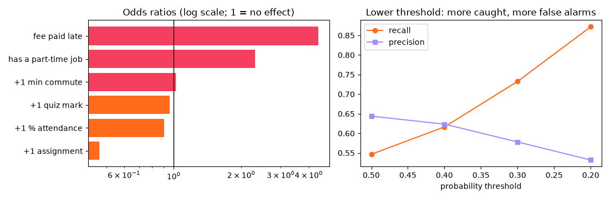
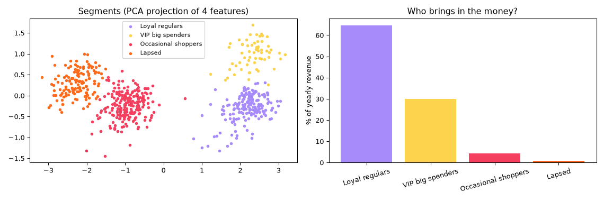

[](https://colab.research.google.com/github/Hamnakhan123/Diploma-in-AI/blob/main/term-1/04-application-based-programming-in-python/code/session-14-types-of-machine-learning.ipynb) &nbsp; 📓 [Notebook](code/session-14-types-of-machine-learning.ipynb)

# Session 14: Types of Machine Learning in Python

> 🧭 [Diploma in AI](../../README.md) › [Term 1](../README.md) › [Application Based Programming in Python](README.md) › **Session 14**
>
> ⏱️ **Estimated time:** 3 hours (1 h concepts + 2 h lab) &nbsp;|&nbsp; 📋 **Prerequisites:** Session 13 (preprocessing, train/test split, pipelines). Probability and regression basics from the statistics module.
>
> Prepared by **Hamna Zahid Khan**, Junior Lecturer

[⬅ Previous: Session 13](session-13-data-processing-for-machine-learning.md) &nbsp;|&nbsp; [🏠 Module home](README.md) &nbsp;|&nbsp; [Next: Session 15 ➡](session-15-regression-techniques.md)

---

## 🎯 Learning objectives

By the end of this session you will be able to:

- Describe the different **types of machine learning**: **supervised** (classification and regression), **unsupervised** (clustering, dimensionality reduction), **semi-supervised** and **reinforcement** learning, with real examples.
- Explain and implement **logistic regression** for classification: the sigmoid, probabilities, decision threshold, coefficients as **odds ratios**, and evaluation with a **confusion matrix**, precision and recall.
- Explain and implement **k-means clustering**: the algorithm step by step, initialisation, choosing k with the **elbow** method and **silhouette** score, and interpreting clusters.
- Explain **reinforcement learning**: agent, environment, state, action, reward, policy, exploration vs exploitation, and a working **Q-learning** example.
- Choose the right type of learning for a business problem.

## 📖 Concepts

### 1. The main types of machine learning

| Type | Data it learns from | Goal | Everyday examples | Algorithms |
|---|---|---|---|---|
| **Supervised** | inputs **with** the correct answers (labels) | predict the label for new inputs | spam or not, house price, loan default, disease diagnosis | linear & logistic regression, decision trees, random forests, SVM, k-NN, neural networks |
| ↳ **Classification** | labels are **categories** | which class? | pass/fail, fraud/genuine, digit 0-9 | logistic regression, trees, SVM |
| ↳ **Regression** | labels are **numbers** | how much? | price, temperature, delivery time | linear/polynomial regression (Session 15) |
| **Unsupervised** | inputs **without** labels | find structure | customer segments, anomaly detection, topic discovery | k-means, hierarchical clustering, DBSCAN, PCA |
| **Semi-supervised** | a few labels + many unlabelled examples | use cheap unlabelled data to help | labelling a few medical scans, then learning from thousands more | self-training, label propagation |
| **Reinforcement** | **rewards** from interacting with an environment | learn a strategy (policy) that maximises total reward | game-playing agents, robot navigation, traffic-light control, recommendation sequences | Q-learning, deep Q-networks, policy gradients |

> 🧠 **Analogy:** **Supervised** learning is studying with a **teacher who marks your answers** (labelled examples). **Unsupervised** learning is being handed a **box of mixed buttons** and sorting them into sensible piles with no instructions. **Reinforcement** learning is **learning to ride a bicycle**: nobody gives you the right answer for each moment; you try, wobble (negative reward), stay upright (positive reward) and gradually learn a strategy.

### 2. Supervised learning: logistic regression

Despite its name, **logistic regression is a classification method**. It computes a weighted sum of the features, `z = b₀ + b₁x₁ + b₂x₂ + ...`, and squashes it into a probability with the **sigmoid** (logistic) function:

**p = 1 / (1 + e^(−z))**

| z | −6 | −2 | 0 | 2 | 6 |
|---|---|---|---|---|---|
| sigmoid(z) | 0.002 | 0.12 | 0.5 | 0.88 | 0.998 |

- Predict class 1 when **p ≥ threshold** (0.5 by default). The set of inputs where p = 0.5 is the **decision boundary**.
- Training finds the coefficients that make the observed labels most likely (maximum likelihood), using an iterative optimiser.
- **Interpretation:** each coefficient changes the **log-odds**; **e^b** is the **odds ratio**: "each extra study hour multiplies the odds of passing by 3.97". Advisers and managers understand this.
- Strengths: fast, interpretable, outputs probabilities, a strong baseline. Limits: a linear boundary unless you engineer features; scale features for stable training.

**Evaluating a classifier:**

| | Predicted 0 | Predicted 1 |
|---|---|---|
| **Actual 0** | True Negative (TN) | False Positive (FP) |
| **Actual 1** | False Negative (FN) | True Positive (TP) |

- **Accuracy** = (TP + TN) / all. Misleading when classes are imbalanced.
- **Precision** = TP / (TP + FP): of those we flagged, how many were right?
- **Recall** = TP / (TP + FN): of the real positives, how many did we catch?
- **ROC-AUC**: how well the probabilities rank positives above negatives (0.5 = guessing, 1 = perfect).
- Lowering the threshold raises recall and lowers precision. Choose it from the **cost of each mistake** (missing a dropout vs an extra phone call).

### 3. Unsupervised learning: k-means clustering

**k-means** splits data into **k** groups so that points are close to their group's centre (**centroid**).

1. Choose **k** and place k starting centres (randomly, or with the smarter **k-means++**).
2. **Assign** every point to its nearest centre.
3. **Update** each centre to the mean of its assigned points.
4. **Repeat** steps 2-3 until assignments stop changing.

- It minimises **inertia**: the sum of squared distances from points to their centre.
- **Initialisation matters:** a bad start can get stuck in a poor local optimum, so scikit-learn runs several starts (`n_init`) and keeps the best.
- **Choosing k:** the **elbow method** (plot inertia vs k and look for the bend) and the **silhouette score** (−1 to 1; how much closer points are to their own cluster than to the next one). Metrics guide; business usefulness decides.
- **Scale features first** (distances!) and consider log transforms for skewed money columns.
- Limits: assumes roughly round, similar-sized clusters; sensitive to outliers; you must choose k. Alternatives: DBSCAN (any shape, finds noise), hierarchical clustering (a tree of clusters).

### 4. Reinforcement learning

An **agent** interacts with an **environment** over time:

| Term | Meaning | Grid-world example |
|---|---|---|
| **State (s)** | the current situation | the robot's cell on the map |
| **Action (a)** | what the agent can do | move up, down, left, right |
| **Reward (r)** | feedback signal | −1 per step, −10 in a puddle, +20 at the goal |
| **Policy (π)** | the strategy: which action in each state | the arrow drawn in each cell |
| **Episode** | one run from start to finish | start cell to goal |
| **Return** | total (discounted) reward of an episode | what the agent wants to maximise |

**Q-learning** keeps a table **Q(s, a)** estimating the long-term value of taking action a in state s, and updates it after every step:

**Q(s, a) ← Q(s, a) + α [ r + γ · maxₐ′ Q(s′, a′) − Q(s, a) ]**

- **α** (learning rate) controls how much new experience overrides old estimates; **γ** (discount factor) how much future rewards matter.
- **Exploration vs exploitation:** with probability **ε** the agent tries a random action (explore), otherwise it takes the best known action (exploit). ε usually starts high and decays.

Real reinforcement learning powered game-playing systems that beat world champions, and is used in robotics, data-centre cooling, ad bidding and traffic-signal timing. It needs many trials, so it is often trained in simulation first.

## 🧭 Diagrams





## 💻 Worked examples

### Example 1: Logistic regression: pass or fail? (supervised, basic → intermediate)

📄 [`code/session-14_logistic_regression.py`](code/session-14_logistic_regression.py) &nbsp;·&nbsp; run: `python session-14_logistic_regression.py`

```python
"""
Session 14 · Example 1: supervised learning - logistic regression for classification
------------------------------------------------------------------------------------
Question: from hours studied, can we predict whether a student passes?
Logistic regression outputs a PROBABILITY with the sigmoid function
    p = 1 / (1 + e^-(b0 + b1*x))
and predicts "pass" when p >= 0.5.
Run:  python session-14_logistic_regression.py
"""
import matplotlib
matplotlib.use("Agg")
import matplotlib.pyplot as plt
import numpy as np
from sklearn.linear_model import LogisticRegression
from sklearn.metrics import accuracy_score, confusion_matrix, precision_score, recall_score, classification_report
from sklearn.model_selection import train_test_split

def sigmoid(z):
    return 1 / (1 + np.exp(-z))
print("sigmoid squashes any number into (0, 1):", {z: round(float(sigmoid(z)), 3) for z in (-6, -2, 0, 2, 6)})

rng = np.random.default_rng(14)
hours = rng.uniform(0, 12, 200).round(1)
passed = (rng.random(200) < sigmoid(1.1 * (hours - 5.5))).astype(int)      # the hidden 'true' rule
X = hours.reshape(-1, 1)                                                   # scikit-learn wants a 2-D X
X_train, X_test, y_train, y_test = train_test_split(X, passed, test_size=0.25, random_state=0, stratify=passed)

model = LogisticRegression()
model.fit(X_train, y_train)                                                # learn b0 and b1
b0, b1 = model.intercept_[0], model.coef_[0, 0]
print(f"\nlearned: b0 = {b0:.2f}, b1 = {b1:.2f}  -> 50 % chance at {-b0 / b1:.1f} hours")
print(f"each extra hour multiplies the odds of passing by e^b1 = {np.exp(b1):.2f}")

for h in [2, 5, 6, 9]:
    p = model.predict_proba([[h]])[0, 1]
    print(f"  {h:>2} hours -> P(pass) = {p:.2f} -> predict {'pass' if p >= 0.5 else 'fail'}")

pred = model.predict(X_test)
print("\naccuracy :", round(accuracy_score(y_test, pred), 3))
print("precision:", round(precision_score(y_test, pred), 3), "(of predicted passes, how many really passed)")
print("recall   :", round(recall_score(y_test, pred), 3), "(of real passes, how many we caught)")
tn, fp, fn, tp = confusion_matrix(y_test, pred).ravel()
print(f"confusion matrix: TN={tn} FP={fp} FN={fn} TP={tp}")
print(classification_report(y_test, pred, target_names=["fail", "pass"]))

xs = np.linspace(0, 12, 200).reshape(-1, 1)
fig, ax = plt.subplots(figsize=(7, 3.6))
ax.scatter(hours, passed + rng.normal(0, 0.02, 200), s=12, alpha=0.5, color="#A78BFA", label="students (0 = fail, 1 = pass)")
ax.plot(xs, model.predict_proba(xs)[:, 1], color="#FF6B1A", lw=2.5, label="P(pass) from the model")
ax.axhline(0.5, color="gray", ls=":"); ax.axvline(-b0 / b1, color="#F43F5E", ls="--", label="decision boundary")
ax.set_xlabel("hours studied per week"); ax.set_ylabel("probability of passing"); ax.legend(fontsize=8)
ax.set_title("Logistic regression turns a score into a probability")
fig.tight_layout(); fig.savefig("session-14_logistic_regression.png", dpi=100)
print("Saved session-14_logistic_regression.png")
```

**Output**

```text
sigmoid squashes any number into (0, 1): {-6: 0.002, -2: 0.119, 0: 0.5, 2: 0.881, 6: 0.998}

learned: b0 = -7.89, b1 = 1.38  -> 50 % chance at 5.7 hours
each extra hour multiplies the odds of passing by e^b1 = 3.97
   2 hours -> P(pass) = 0.01 -> predict fail
   5 hours -> P(pass) = 0.27 -> predict fail
   6 hours -> P(pass) = 0.59 -> predict pass
   9 hours -> P(pass) = 0.99 -> predict pass

accuracy : 0.96
precision: 1.0 (of predicted passes, how many really passed)
recall   : 0.923 (of real passes, how many we caught)
confusion matrix: TN=24 FP=0 FN=2 TP=24
              precision    recall  f1-score   support

        fail       0.92      1.00      0.96        24
        pass       1.00      0.92      0.96        26

    accuracy                           0.96        50
   macro avg       0.96      0.96      0.96        50
weighted avg       0.96      0.96      0.96        50

Saved session-14_logistic_regression.png
```




**What to notice:** the model learned a 50 % point at about 5.7 hours, close to the hidden rule (5.5). The odds ratio (≈ 4 per hour) is an intuitive explanation. Precision is 1.0 (every predicted pass passed) while recall is 0.92 (two passes were missed): the confusion matrix shows exactly where the errors are.

### Example 2: k-means from scratch and with scikit-learn (unsupervised, intermediate)

📄 [`code/session-14_kmeans.py`](code/session-14_kmeans.py) &nbsp;·&nbsp; run: `python session-14_kmeans.py`

```python
"""
Session 14 · Example 2: unsupervised learning - k-means clustering
------------------------------------------------------------------
No labels: the algorithm groups similar points by itself.
  1. pick k starting centres     2. assign each point to its nearest centre
  3. move each centre to the mean of its points     4. repeat until nothing changes
We implement it from scratch, compare with scikit-learn, and choose k with the
elbow method and the silhouette score.
Run:  python session-14_kmeans.py
"""
import matplotlib
matplotlib.use("Agg")
import matplotlib.pyplot as plt
import numpy as np
from sklearn.cluster import KMeans
from sklearn.datasets import make_blobs
from sklearn.metrics import silhouette_score

X, true_groups = make_blobs(n_samples=300, centers=[[2, 2], [8, 3], [5, 8]], cluster_std=1.1, random_state=4)

def kmeans_scratch(X, k, iters=20, seed=0, verbose=True):
    rng = np.random.default_rng(seed)
    centres = X[rng.choice(len(X), k, replace=False)]                 # step 1
    for it in range(1, iters + 1):
        dists = np.linalg.norm(X[:, None, :] - centres[None, :, :], axis=2)
        labels = dists.argmin(axis=1)                                 # step 2
        new = np.array([X[labels == j].mean(axis=0) for j in range(k)])   # step 3
        moved = np.linalg.norm(new - centres)
        centres = new
        if verbose:
            print(f"  iteration {it}: centres moved {moved:.3f}")
        if moved < 1e-6:                                              # step 4: converged
            break
    inertia = ((X - centres[labels]) ** 2).sum()
    return labels, centres, inertia

print("From scratch (k = 3):")
labels, centres, inertia = kmeans_scratch(X, 3)
print("centres:", np.round(centres[np.argsort(centres[:, 0])], 2).tolist(), "| inertia:", round(inertia, 1))
print("-> stuck in a poor local optimum: two centres started in the same blob.")
runs = [kmeans_scratch(X, 3, seed=s, verbose=False) for s in range(10)]      # restart 10 times
labels, centres, inertia = min(runs, key=lambda r: r[2])                      # keep the best
print("best of 10 random starts -> inertia", round(inertia, 1), "| inertias seen:",
      sorted({round(float(r[2]), 1) for r in runs}))

km = KMeans(n_clusters=3, n_init=10, random_state=0).fit(X)
print("\nscikit-learn centres:", np.round(km.cluster_centers_[np.argsort(km.cluster_centers_[:, 0])], 2).tolist(),
      "| inertia:", round(km.inertia_, 1))
print("new points ->", km.predict([[1, 1], [9, 2], [5, 9]]).tolist())

print("\nChoosing k:")
ks, inertias, sils = range(1, 9), [], []
for k in ks:
    m = KMeans(n_clusters=k, n_init=10, random_state=0).fit(X)
    inertias.append(m.inertia_)
    sils.append(silhouette_score(X, m.labels_) if k > 1 else np.nan)
    print(f"  k={k}: inertia {m.inertia_:8.1f}" + (f"  silhouette {sils[-1]:.3f}" if k > 1 else ""))
best_k = int(np.nanargmax(sils)) + 1
print("best k by silhouette:", best_k)

fig, ax = plt.subplots(1, 3, figsize=(13, 3.6))
ax[0].scatter(X[:, 0], X[:, 1], s=10, color="#6B7280"); ax[0].set_title("What k-means sees: no labels")
ax[1].scatter(X[:, 0], X[:, 1], c=km.labels_, cmap="plasma", s=10)
ax[1].scatter(*km.cluster_centers_.T, marker="X", s=200, color="black"); ax[1].set_title("k-means result (X = centres)")
ax[2].plot(list(ks), inertias, "o-", color="#FF6B1A"); ax[2].set_xlabel("k"); ax[2].set_ylabel("inertia")
ax2 = ax[2].twinx(); ax2.plot(list(ks), sils, "s--", color="#A78BFA"); ax2.set_ylabel("silhouette", color="#A78BFA")
ax[2].set_title("Elbow (inertia) and silhouette")
fig.tight_layout(); fig.savefig("session-14_kmeans.png", dpi=95)
print("Saved session-14_kmeans.png")
```

**Output**

```text
From scratch (k = 3):
  iteration 1: centres moved 3.074
  iteration 2: centres moved 0.535
  iteration 3: centres moved 0.000
centres: [[2.09, 2.69], [2.19, 1.09], [6.63, 5.63]] | inertia: 2225.3
-> stuck in a poor local optimum: two centres started in the same blob.
best of 10 random starts -> inertia 668.3 | inertias seen: [668.3, 2225.3]

scikit-learn centres: [[2.14, 1.93], [5.16, 8.04], [8.12, 3.17]] | inertia: 668.3
new points -> [1, 0, 2]

Choosing k:
  k=1: inertia   4547.8
  k=2: inertia   2289.5  silhouette 0.507
  k=3: inertia    668.3  silhouette 0.664
  k=4: inertia    575.8  silhouette 0.543
  k=5: inertia    497.5  silhouette 0.444
  k=6: inertia    415.0  silhouette 0.343
  k=7: inertia    360.2  silhouette 0.364
  k=8: inertia    316.4  silhouette 0.371
best k by silhouette: 3
Saved session-14_kmeans.png
```




**Walkthrough:**

1. The from-scratch version converged in 3 iterations, but to a **poor local optimum** (two centres started in the same blob; inertia 2225).
2. Restarting 10 times and keeping the lowest inertia found the right answer (668), which is exactly what `n_init=10` does in scikit-learn.
3. Inertia always falls as k grows, so we look for the **elbow**; the silhouette score peaks clearly at k = 3, the true number of groups.

### Example 3: Q-learning in a grid world (reinforcement, advanced)

📄 [`code/session-14_reinforcement_learning.py`](code/session-14_reinforcement_learning.py) &nbsp;·&nbsp; run: `python session-14_reinforcement_learning.py`

```python
"""
Session 14 · Example 3: reinforcement learning - Q-learning in a grid world
---------------------------------------------------------------------------
An agent (a delivery robot) starts at S and must reach the goal G on a 4 x 5
campus map. Walls (#) block movement; a puddle (~) costs -10; every step
costs -1; reaching G gives +20. Nobody tells the robot the route: it learns
from rewards by trial and error, updating a Q-table:
    Q[s, a] <- Q[s, a] + alpha * (reward + gamma * max Q[s', :] - Q[s, a])
Run:  python session-14_reinforcement_learning.py
"""
import matplotlib
matplotlib.use("Agg")
import matplotlib.pyplot as plt
import numpy as np

GRID = ["S..#.",
        ".#.~.",
        ".#...",
        "...#G"]
ROWS, COLS = len(GRID), len(GRID[0])
ACTIONS = {0: (-1, 0, "↑"), 1: (1, 0, "↓"), 2: (0, -1, "←"), 3: (0, 1, "→")}
start = (0, 0)

def step(state, action):
    dr, dc, _ = ACTIONS[action]
    r, c = state[0] + dr, state[1] + dc
    if not (0 <= r < ROWS and 0 <= c < COLS) or GRID[r][c] == "#":
        return state, -2, False                    # bumped into a wall or the edge
    cell = GRID[r][c]
    if cell == "G":
        return (r, c), 20, True
    return (r, c), (-10 if cell == "~" else -1), False

rng = np.random.default_rng(0)
Q = np.zeros((ROWS, COLS, 4))
alpha, gamma, episodes = 0.5, 0.95, 400
returns = []
for ep in range(episodes):
    epsilon = max(0.05, 1 - ep / 250)              # explore a lot first, then exploit
    state, total, done, steps = start, 0, False, 0
    while not done and steps < 100:
        if rng.random() < epsilon:
            action = int(rng.integers(4))           # explore: random action
        else:
            action = int(Q[state].argmax())          # exploit: best known action
        nxt, reward, done = step(state, action)
        Q[state][action] += alpha * (reward + gamma * Q[nxt].max() * (not done) - Q[state][action])
        state, total, steps = nxt, total + reward, steps + 1
    returns.append(total)

print(f"average return, first 50 episodes: {np.mean(returns[:50]):7.1f}")
print(f"average return, last 50 episodes : {np.mean(returns[-50:]):7.1f}")

print("\nLearned policy (best action in each cell):")
for r in range(ROWS):
    print("  " + " ".join(GRID[r][c] if GRID[r][c] in "#G" else ACTIONS[int(Q[r, c].argmax())][2] for c in range(COLS)))

state, path, done = start, [start], False
while not done and len(path) < 20:
    state, _, done = step(state, int(Q[state].argmax()))
    path.append(state)
print("greedy route:", " -> ".join(f"({r},{c})" for r, c in path), f"| {len(path) - 1} steps, puddle avoided:",
      all(GRID[r][c] != "~" for r, c in path))

fig, ax = plt.subplots(figsize=(7, 3.4))
smooth = np.convolve(returns, np.ones(20) / 20, mode="valid")
ax.plot(returns, color="#A78BFA", alpha=0.35, label="return per episode")
ax.plot(range(19, episodes), smooth, color="#FF6B1A", lw=2, label="20-episode average")
ax.set_xlabel("episode"); ax.set_ylabel("total reward"); ax.legend()
ax.set_title("The agent learns from rewards: returns rise as exploration falls")
fig.tight_layout(); fig.savefig("session-14_reinforcement_learning.png", dpi=100)
print("Saved session-14_reinforcement_learning.png")
```

**Output**

```text
average return, first 50 episodes:   -81.5
average return, last 50 episodes :    13.2

Learned policy (best action in each cell):
  → → ↓ # ↓
  ↑ # ↓ ↓ ↓
  ↓ # → → ↓
  → → ↑ # G
greedy route: (0,0) -> (0,1) -> (0,2) -> (1,2) -> (2,2) -> (2,3) -> (2,4) -> (3,4) | 7 steps, puddle avoided: True
Saved session-14_reinforcement_learning.png
```




**Key lessons:**

- Early episodes are long, random and costly (average return about −80); after learning, returns are positive and stable.
- The printed policy shows an arrow in every cell, a complete strategy, not just one route; the greedy route reaches the goal in 7 steps **and avoids the puddle**, which nobody programmed explicitly.
- ε decays from 1 to 0.05: exploration first, exploitation later.

## 🌍 Real-life coding problem: an early-warning system for student dropout

**Scenario.** A diploma program wants to flag students at risk of dropping out **by week 4**, so advisers can intervene. Last year's records are labelled (dropped out or not), so this is **supervised classification**.

| Requirement | How |
|---|---|
| Only information available by week 4 | attendance, quiz average, assignments, commute, job, late fee (avoids leakage) |
| Model | `make_pipeline(StandardScaler(), LogisticRegression())` |
| Explainable to advisers | odds ratios from a model fitted on unscaled features |
| Missing an at-risk student is costly | compare thresholds and choose one that favours **recall** |
| Actionable output | ranked contact list for the new cohort |

📄 Full solution (89 lines, fully commented): [`code/session-14_problem_dropout_warning.py`](code/session-14_problem_dropout_warning.py) &nbsp;·&nbsp; run: `python session-14_problem_dropout_warning.py` &nbsp;·&nbsp; also in the session notebook

**Output**

```text
last year: 900 students, dropout rate 31.7%
test ROC-AUC: 0.821 (0.5 = guessing, 1.0 = perfect ranking)

Odds ratios (how the odds of dropping out change):
  +1 assignment          x 0.46  (lower risk)
  +1 % attendance        x 0.91  (lower risk)
  +1 quiz mark           x 0.96  (lower risk)
  +1 min commute         x 1.02  (higher risk)
  has a part-time job    x 2.30  (higher risk)
  fee paid late          x 4.42  (higher risk)

Threshold trade-off on the test set:
  threshold  flagged  recall precision
        0.5       73    0.55      0.64
        0.4       85    0.62      0.62
        0.3      109    0.73      0.58
        0.2      141    0.87      0.53
chosen threshold 0.3: catches 73% of real dropouts while calling 40% of students

Contact list for the new cohort (5 of 20 students):
student  attendance_pct  quiz_avg  assignments_done  fee_late  risk
 New-14            74.0      90.0                 0         1  0.90
 New-08            72.0      76.0                 0         1  0.69
 New-09            78.0      71.0                 1         0  0.62
 New-13            80.0      74.0                 0         0  0.57
 New-11            88.0      63.0                 1         0  0.49
Saved session-14_problem_dropout_warning.png
```




**Interpretation.** A late fee payment multiplies the odds of dropping out by about 4.4 and a part-time job by about 2.3, while each completed assignment roughly halves them: concrete talking points for advisers (fee instalment plans, flexible deadlines). Lowering the threshold from 0.5 to 0.3 raises recall from 55 % to 73 % at the cost of more calls, a deliberate trade-off. ROC-AUC 0.82 means the model ranks students well, but it is a **support tool**: advisers make the final judgement, and the model must be checked for fairness across groups before use.

## 🛠️ Mini project: customer segmentation for a supermarket (k-means)

The loyalty program has purchase histories but no labels: a classic **unsupervised** problem. The project builds RFM-style features (Recency, Frequency, spend), log-transforms and scales them, chooses k, fits k-means, names each segment in business language and proposes an action for each.

```python
X = StandardScaler().fit_transform(np.log1p(df[features]))    # log first, then scale
km = KMeans(n_clusters=4, n_init=10, random_state=0).fit(X)
profile = df.groupby(km.labels_)[features].median()           # describe each segment
```

📄 Full solution (90 lines, fully commented): [`code/session-14_project_customer_segments.py`](code/session-14_project_customer_segments.py) &nbsp;·&nbsp; run: `python session-14_project_customer_segments.py` &nbsp;·&nbsp; also in the session notebook

**Output**

```text
600 customers, features: ['recency_days', 'visits_per_year', 'avg_basket', 'yearly_spend']
      recency_days  visits_per_year  avg_basket  yearly_spend
mean          56.0             21.0      4739.0      148476.0
min            1.0              1.0       690.0        1550.0
max          264.0             81.0     23500.0      730210.0 

k   inertia   silhouette
2     443.9   0.708
3     274.2   0.585
4     199.3   0.506
5     175.5   0.472
6     155.1   0.380
7     142.1   0.347
silhouette prefers k = 2 - a coarse 'active vs inactive' split.
chosen k = 4: inertia stops dropping sharply after 4 and four segments give the marketing team
distinct actions. Metrics guide the choice of k; business usefulness decides it.

Segment profiles (medians):
          recency_days  visits_per_year  avg_basket  yearly_spend  customers  share_of_revenue_%                 name
segment                                                                                                             
1                 6.0             48.0      6795.0      320180.0        178                64.7       Loyal regulars
3                12.0             29.0     15470.0      448500.0         61                30.0     VIP big spenders
2                45.0              8.0      2160.0       17550.0        219                 4.4  Occasional shoppers
0               158.0              3.0      1810.0        5515.0        142                 0.9               Lapsed

Marketing plan:
  Loyal regulars        178 customers,  64.7% of revenue -> points multiplier on weekly staples
  VIP big spenders       61 customers,  30.0% of revenue -> personal offers and priority checkout
  Occasional shoppers   219 customers,   4.4% of revenue -> bundle deals to bring them in more often
  Lapsed                142 customers,   0.9% of revenue -> win-back SMS with a 15 % voucher

How well did k-means rediscover the hidden types? (rows = truth)
 segment        Lapsed  Loyal regulars  Occasional shoppers  VIP big spenders
hidden_type                                                                 
big spender         0               2                    0                58
lapsed            139               0                    1                 0
occasional          3               0                  217                 0
weekly family       0             176                    1                 3
purity: 98.3% of customers sit in the segment matching their hidden type
Saved session-14_project_customer_segments.png
```




**Interpretation.** The silhouette score preferred k = 2 ("active vs inactive"), which is correct but not useful. Four segments match how the business acts. Just 61 "VIP big spenders" (10 % of customers) bring in 30 % of revenue, and loyal regulars bring in 65 %. Because the data was synthetic with hidden types, we could verify that k-means rediscovered them with about 98 % purity; with real data there is no answer key, so segment profiles must be judged for sense and usefulness.

**Extension ideas:** add product-category shares as features; try `DBSCAN` to find unusual customers; re-run monthly and track customers moving between segments.

## ⚠️ Common mistakes

| Mistake | Consequence | Fix |
|---|---|---|
| Using logistic regression for a numeric target | wrong tool | Linear regression (Session 15) for numbers |
| Judging a classifier only by accuracy on imbalanced data | a "95 % accurate" model that never finds the rare class | Precision, recall, ROC-AUC, confusion matrix, baseline |
| Keeping the default 0.5 threshold without thinking | ignores the cost of mistakes | Choose the threshold from business costs |
| Reading raw coefficients of unscaled features as importance | units differ | Compare scaled coefficients or odds ratios per meaningful unit |
| k-means on unscaled features | the largest-unit column decides the clusters | Scale (and log-transform skewed data) first |
| One k-means run | stuck in a local optimum | `n_init` ≥ 10, k-means++ initialisation |
| Choosing k purely by one metric | technically "best" but useless segments | Combine elbow, silhouette and business sense |
| Treating clusters as ground truth | over-confident decisions | Profile, sanity-check and validate them |
| RL agent that never explores | gets stuck with a poor policy | ε-greedy exploration with decay |

## ✅ Best practices

- Start from the **business question** and the available data: labels → supervised; no labels → unsupervised; sequential decisions with feedback → reinforcement.
- Always build a **simple baseline** (majority class, logistic regression) before complex models.
- Keep preprocessing inside a **pipeline**; use stratified splits and cross-validation.
- **Explain** models in the user's language (odds ratios, segment profiles).
- Consider **fairness and ethics** when predictions affect people (students, loan applicants).
- Fix random seeds for reproducibility and record the choices you made (threshold, k, features).

## 🧪 Lab / practice tasks

**1. 🟢 Easy:** Classify each problem as supervised classification, supervised regression, unsupervised or reinforcement: (a) predict tomorrow's electricity demand in MW, (b) group news articles by topic with no labels, (c) detect whether an email is phishing from labelled examples, (d) a robot learning to walk from falls and successes, (e) predict a student's exam mark.

<details><summary>💡 Hint</summary>

Is there a labelled answer? Is it a number or a category? Is there a reward signal over time?

</details>

<details><summary>✅ Solution</summary>

(a) supervised regression · (b) unsupervised (clustering) · (c) supervised classification · (d) reinforcement · (e) supervised regression.

</details>

**2. 🟢 Easy:** Compute by hand the probability a logistic model with b₀ = −4 and b₁ = 0.8 gives for x = 3 and x = 7. At what x is p = 0.5?

<details><summary>💡 Hint</summary>

z = b₀ + b₁x; p = 1 / (1 + e^(−z)); p = 0.5 when z = 0.

</details>

<details><summary>✅ Solution</summary>

x = 3: z = −1.6, p = 1/(1 + e^1.6) ≈ 0.17. x = 7: z = 1.6, p ≈ 0.83. p = 0.5 at x = 4 / 0.8 = 5.

```python
import numpy as np
print([round(1 / (1 + np.exp(-(-4 + 0.8 * x))), 2) for x in (3, 7)])   # [0.17, 0.83]
```

</details>

**3. 🟡 Medium:** Train a logistic regression on scikit-learn's built-in breast-cancer dataset (`load_breast_cancer`) inside a scaling pipeline. Report accuracy, precision, recall and the confusion matrix on a stratified 25 % test set.

<details><summary>💡 Hint</summary>

`X, y = load_breast_cancer(return_X_y=True)`; `make_pipeline(StandardScaler(), LogisticRegression(max_iter=1000))`.

</details>

<details><summary>✅ Solution</summary>

```python
from sklearn.datasets import load_breast_cancer
from sklearn.metrics import classification_report, confusion_matrix
X, y = load_breast_cancer(return_X_y=True)
Xtr, Xte, ytr, yte = train_test_split(X, y, test_size=0.25, stratify=y, random_state=0)
m = make_pipeline(StandardScaler(), LogisticRegression(max_iter=1000)).fit(Xtr, ytr)
print(confusion_matrix(yte, m.predict(Xte)))
print(classification_report(yte, m.predict(Xte)))      # about 97-98 % accuracy
```

</details>

**4. 🟡 Medium:** Cluster the Iris flower measurements (`load_iris`) with k-means (k = 3) **without** using the labels, then compare clusters to the true species with `pd.crosstab`. Which species are confused?

<details><summary>💡 Hint</summary>

Scale first. `pd.crosstab(iris.target, km.labels_)`.

</details>

<details><summary>✅ Solution</summary>

```python
from sklearn.datasets import load_iris
iris = load_iris()
X = StandardScaler().fit_transform(iris.data)
km = KMeans(n_clusters=3, n_init=10, random_state=0).fit(X)
print(pd.crosstab(pd.Series(iris.target_names[iris.target], name="species"), km.labels_))
```

Setosa forms its own cluster perfectly; versicolor and virginica overlap and are partly mixed.

</details>

**5. 🟠 Hard:** Modify the grid world: move the puddle to `(2, 3)` and add a second puddle at `(1, 2)`. Retrain and print the new policy and route. Then set ε to 0 from the start (no exploration) and describe what happens.

<details><summary>💡 Hint</summary>

Edit the `GRID` strings with `~` in the new cells. For no exploration, replace the ε schedule with `epsilon = 0`.

</details>

<details><summary>✅ Solution</summary>

```python
GRID = ["S..#.",
        ".#~..",
        ".#.~.",
        "...#G"]
# rerun the training loop and print the policy as before
```

The agent finds another route around both puddles (for example along the top row, then down the right edge). With ε = 0 from the start it always picks the first action with the highest (initially all-zero) Q-value, so it can wander, bump walls and settle on a poor or very long route: without exploration it never discovers better options.

</details>

**6. 🔴 Challenge:** For the dropout model, plot a **precision-recall curve** (`precision_recall_curve`) and write a function `best_threshold(cost_fn, cost_fp)` that chooses the threshold minimising total cost on the test set, where missing a dropout costs 10 units and an unnecessary call costs 1.

<details><summary>💡 Hint</summary>

Loop over thresholds from 0.05 to 0.95; for each compute FN and FP with `confusion_matrix`; cost = 10·FN + 1·FP.

</details>

<details><summary>✅ Solution</summary>

```python
from sklearn.metrics import confusion_matrix, precision_recall_curve
def best_threshold(cost_fn=10, cost_fp=1):
    best = None
    for t in np.arange(0.05, 0.96, 0.05):
        tn, fp, fn, tp = confusion_matrix(y_te, (proba >= t).astype(int)).ravel()
        cost = cost_fn * fn + cost_fp * fp
        if best is None or cost < best[1]:
            best = (round(t, 2), cost)
    return best
print(best_threshold())          # a low threshold, because misses are 10x worse
p, r, _ = precision_recall_curve(y_te, proba)
plt.plot(r, p); plt.xlabel("recall"); plt.ylabel("precision"); plt.savefig("pr_curve.png")
```

</details>

## ✅ Quick quiz

**Q1.** A bank has past loans labelled "repaid" or "defaulted" and wants to predict this for new applicants. Which type of learning is this?

- A) unsupervised clustering
- B) supervised classification
- C) reinforcement learning
- D) supervised regression

**Q2.** What does the sigmoid function do in logistic regression?

- A) sorts the data
- B) converts any real number into a probability between 0 and 1
- C) removes outliers
- D) chooses k

**Q3.** Which statement about k-means is TRUE?

- A) it needs labelled data
- B) it always finds the global optimum in one run
- C) each point is assigned to its nearest centroid, then centroids move to the mean of their points
- D) it works best without scaling

**Q4.** In reinforcement learning, what is a policy?

- A) the reward table
- B) the strategy that chooses an action in each state
- C) the training dataset
- D) the learning rate

**Q5.** Lowering a classifier's decision threshold from 0.5 to 0.3 usually…

- A) increases recall and decreases precision
- B) increases both precision and recall
- C) decreases recall
- D) has no effect

<details><summary>✅ Show answers</summary>

1. **B** — labelled categories make it supervised classification.
2. **B** — it maps the linear score z to a probability.
3. **C** — assign, update, repeat until stable.
4. **B** — the agent's mapping from states to actions.
5. **A** — more cases are flagged, catching more positives but with more false alarms.

</details>


## 📝 Summary

- **Supervised** learning uses labels (classification for categories, regression for numbers); **unsupervised** finds structure without labels (clustering, dimensionality reduction); **semi-supervised** combines few labels with many unlabelled examples; **reinforcement** learns a policy from rewards.
- **Logistic regression** = linear score + sigmoid → probability; threshold for the class; coefficients as odds ratios; evaluate with the confusion matrix, precision, recall and ROC-AUC.
- **k-means** = choose k, assign to the nearest centre, move centres, repeat; scale first, use several initialisations, choose k with elbow, silhouette and business sense.
- **Reinforcement learning:** agent, environment, state, action, reward, policy; **Q-learning** updates Q(s, a) from experience; balance exploration and exploitation with ε-greedy.

### 🎤 Interview / viva questions

1. Explain the difference between supervised, unsupervised and reinforcement learning with one example each.
2. Why is logistic regression called "regression" if it is used for classification?
3. What are precision and recall? When would you prefer high recall?
4. Describe the k-means algorithm step by step. How do you choose k?
5. Why must features be scaled before k-means?
6. What is the exploration-exploitation trade-off in reinforcement learning?
7. Write and explain the Q-learning update rule.

---

[⬅ Previous: Session 13](session-13-data-processing-for-machine-learning.md) &nbsp;|&nbsp; [🏠 Module home](README.md) &nbsp;|&nbsp; [Next: Session 15 ➡](session-15-regression-techniques.md)

<sub>Prepared by **Hamna Zahid Khan**, Junior Lecturer · Diploma in AI</sub>
