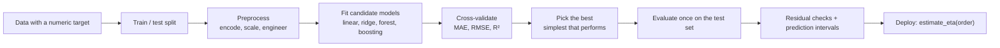
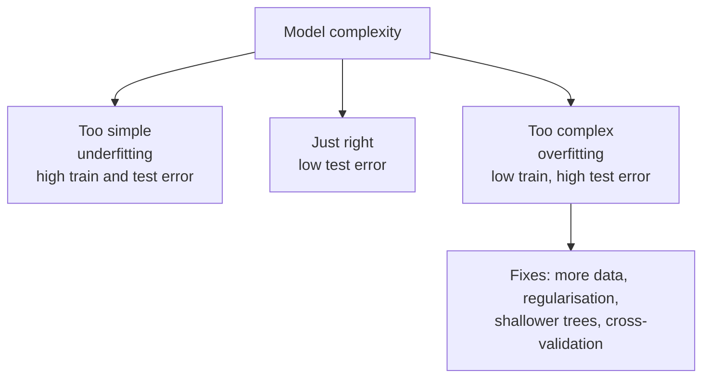
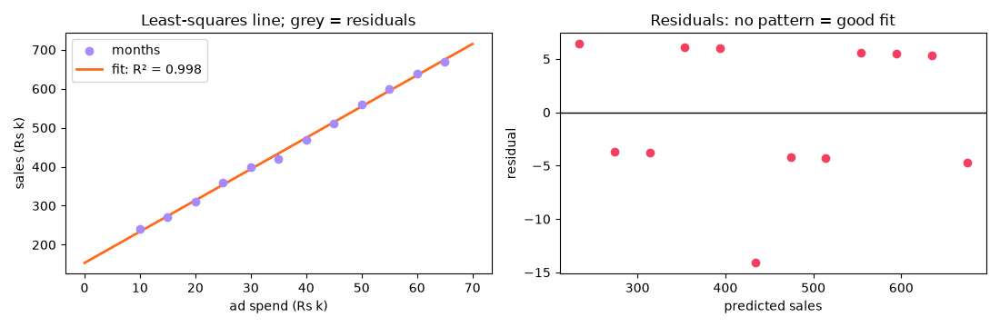
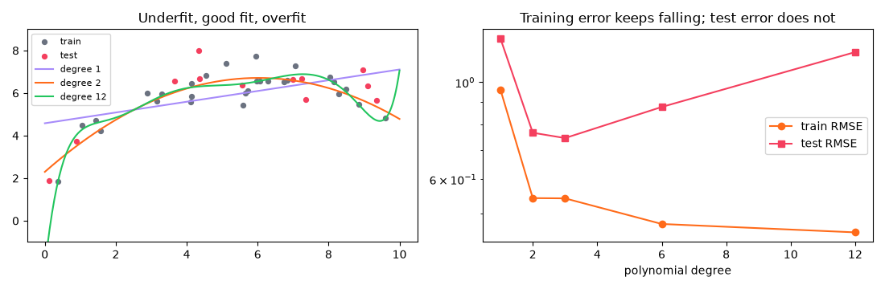
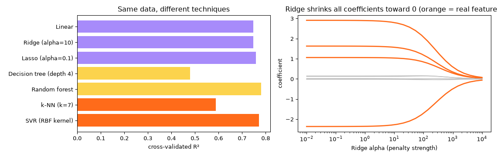
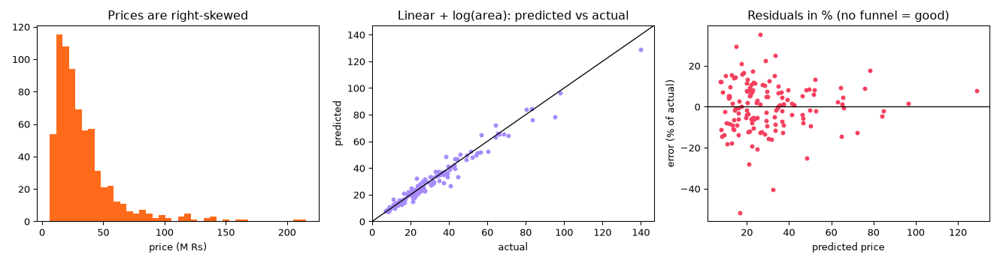
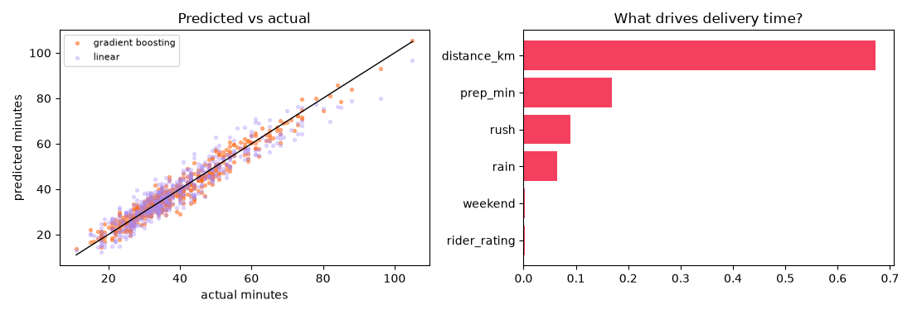

[](https://colab.research.google.com/github/Hamnakhan123/Diploma-in-AI/blob/main/term-1/04-application-based-programming-in-python/code/session-15-regression-techniques.ipynb) &nbsp; 📓 [Notebook](code/session-15-regression-techniques.ipynb)

# Session 15: Regression Techniques for Machine Learning

> 🧭 [Diploma in AI](../../README.md) › [Term 1](../README.md) › [Application Based Programming in Python](README.md) › **Session 15**
>
> ⏱️ **Estimated time:** 3 hours (1 h concepts + 2 h lab) &nbsp;|&nbsp; 📋 **Prerequisites:** Sessions 13-14 (preprocessing, pipelines, supervised learning). Correlation and regression from the statistics module.
>
> Prepared by **Hamna Zahid Khan**, Junior Lecturer

[⬅ Previous: Session 14](session-14-types-of-machine-learning.md) &nbsp;|&nbsp; [🏠 Module home](README.md) &nbsp;|&nbsp; [Module practice test ➡](practice-test.md)

---

## 🎯 Learning objectives

By the end of this session you will be able to:

- Describe **regression** in machine learning and the main **regression techniques** available in Python.
- Explain and **implement linear regression** (simple and multiple), by hand with least squares and with scikit-learn, and interpret its coefficients.
- Use **polynomial regression** and recognise **underfitting** and **overfitting** with training and test errors.
- Apply **regularised** (Ridge, Lasso) and **non-linear** techniques (decision trees, random forests, gradient boosting, k-NN, SVR) and compare them fairly with cross-validation.
- **Evaluate** regression models with MAE, MSE, RMSE and R², read **residual plots**, and deliver predictions with honest uncertainty.

## 📖 Concepts

### 1. What is regression?

**Regression** is supervised learning where the target is a **number**: a price, a temperature, minutes until delivery, next month's sales. The model learns a function **ŷ = f(X)** from examples with known answers and uses it to predict new cases.

| Classification (Session 14) | Regression (this session) |
|---|---|
| "Will this student drop out?" (yes / no) | "What mark will this student get?" (0-100) |
| output: a class or probability | output: a continuous number |
| metrics: accuracy, precision, recall | metrics: MAE, RMSE, R² |

> 🧠 **Analogy:** Regression is drawing the **best road through a field of houses**. Each house (data point) is a little off the road; the residual is how far its gate is from the road. Least squares chooses the road that makes the total squared walking distance from all gates as small as possible.

### 2. Regression techniques in Python

| Technique | Shape it can learn | Strengths | Watch out for | scikit-learn |
|---|---|---|---|---|
| **Simple linear** | straight line, one feature | very interpretable | only linear relationships | `LinearRegression` |
| **Multiple linear** | flat plane over many features | interpretable coefficients | multicollinearity, needs feature engineering for curves | `LinearRegression` |
| **Polynomial** | curves (x², x³ ...) | simple way to bend a line | overfits at high degree; extrapolates wildly | `PolynomialFeatures` + `LinearRegression` |
| **Ridge (L2)** | linear, coefficients shrunk | stable with many or correlated features | must scale features; choose α | `Ridge` |
| **Lasso (L1)** | linear, some coefficients exactly 0 | built-in feature selection | must scale; choose α | `Lasso` |
| **Decision tree** | step-like, any interaction | no scaling needed, readable rules | overfits unless depth is limited | `DecisionTreeRegressor` |
| **Random forest** | flexible, averages many trees | strong default, feature importances | less interpretable, cannot extrapolate | `RandomForestRegressor` |
| **Gradient boosting** | flexible, trees added one by one to fix errors | often the most accurate on tables | tuning needed | `GradientBoostingRegressor` |
| **k-NN regression** | local averages | simple idea | needs scaling, struggles with many features | `KNeighborsRegressor` |
| **SVR** | smooth non-linear (kernels) | robust to some outliers | needs scaling, slow on big data | `SVR` |

### 3. Linear regression in detail

**Simple:** ŷ = b₀ + b₁x. **Multiple:** ŷ = b₀ + b₁x₁ + b₂x₂ + … + bₚxₚ.

**Least squares** picks the coefficients that minimise the **sum of squared errors** SSE = Σ(y − ŷ)². For one feature there is a closed form:

- **b₁ = Σ(x − x̄)(y − ȳ) / Σ(x − x̄)²** (slope)
- **b₀ = ȳ − b₁ x̄** (intercept)

**Interpreting coefficients:** b₁ is the expected change in y for a one-unit increase in x, **holding the other features constant**. Compare importance only after **standardising** features (or use domain units deliberately). If you model **log(y)**, e^b is a percentage multiplier ("each year of age multiplies the price by 0.991"), which is ideal for prices and incomes.

**Assumptions to check (with residual plots):** a roughly linear relationship, errors with constant spread (no funnel shape), independent errors, and no extreme multicollinearity among features. Violations do not always break predictions, but they make coefficients and intervals unreliable.

**Implementing linear regression with scikit-learn: the standard five steps**

```python
from sklearn.linear_model import LinearRegression
from sklearn.model_selection import train_test_split
X_train, X_test, y_train, y_test = train_test_split(X, y, test_size=0.2, random_state=0)  # 1. split
model = LinearRegression()                    # 2. choose the model
model.fit(X_train, y_train)                   # 3. learn b0 (intercept_) and b1..bp (coef_)
y_pred = model.predict(X_test)                # 4. predict
print(model.score(X_test, y_test))            # 5. evaluate (R^2)
```

### 4. Evaluating regression models

| Metric | Formula | Meaning | Note |
|---|---|---|---|
| **MAE** | mean \|y − ŷ\| | average size of the error, in target units | easy to explain ("off by 2.6 minutes") |
| **MSE** | mean (y − ŷ)² | squared error | punishes big errors; units squared |
| **RMSE** | √MSE | typical error, in target units | more sensitive to large errors than MAE |
| **R²** | 1 − SSE / SST | share of the variation explained | 1 = perfect, 0 = no better than predicting the mean; can be negative on test data |
| **MAPE / median % error** | mean \|y − ŷ\| / y | error relative to size | good for prices; avoid when y can be near 0 |

Always compare with a **baseline** (predict the training mean) and evaluate on data the model has **not** seen (a test set or cross-validation).

### 5. Underfitting, overfitting and regularisation

- **Underfitting** (high bias): the model is too simple; training and test errors are both high (a straight line through a curve).
- **Overfitting** (high variance): the model memorises noise; training error is very low but test error is high (a degree-12 polynomial).
- Remedies for overfitting: more data, simpler models, limiting tree depth, cross-validation for model choice, and **regularisation**: Ridge adds α·Σb² to the loss (shrinks all coefficients), Lasso adds α·Σ|b| (can set some exactly to zero). Larger α = simpler model.

### 6. Residual analysis and honest predictions

A **residual** is y − ŷ. Plot residuals against predictions:

- a random cloud around zero → good;
- a curve → a non-linear pattern you have not captured (add features or use a non-linear model);
- a funnel → errors grow with size (model log(y));
- a few huge residuals → outliers or data errors.

Predictions should come with **uncertainty**: a range such as "25-31 minutes", estimated from the spread of past errors, is more useful and more honest than one number. And never trust **extrapolation** far outside the range of the training data.

## 🧭 Diagrams





## 💻 Worked examples

### Example 1: Simple linear regression by hand and with scikit-learn (basic)

📄 [`code/session-15_simple_linear.py`](code/session-15_simple_linear.py) &nbsp;·&nbsp; run: `python session-15_simple_linear.py`

```python
"""
Session 15 · Example 1: simple linear regression - by hand and with scikit-learn
--------------------------------------------------------------------------------
Model:  y = b0 + b1 * x   (a straight line)
Least squares chooses b0 and b1 that make the sum of squared errors smallest:
    b1 = sum((x - x_mean)(y - y_mean)) / sum((x - x_mean)^2),   b0 = y_mean - b1 * x_mean
Run:  python session-15_simple_linear.py
"""
import matplotlib
matplotlib.use("Agg")
import matplotlib.pyplot as plt
import numpy as np
from sklearn.linear_model import LinearRegression
from sklearn.metrics import mean_absolute_error, mean_squared_error, r2_score

# Monthly advertising spend (Rs thousand) and sales (Rs thousand) for a small shop
ads = np.array([20, 35, 15, 50, 40, 25, 60, 30, 45, 55, 10, 65])
sales = np.array([310, 420, 270, 560, 470, 360, 640, 400, 510, 600, 240, 670])

# 1. By hand
x_mean, y_mean = ads.mean(), sales.mean()
b1 = ((ads - x_mean) * (sales - y_mean)).sum() / ((ads - x_mean) ** 2).sum()
b0 = y_mean - b1 * x_mean
print(f"by hand:      sales = {b0:.2f} + {b1:.3f} x ads")

# 2. With scikit-learn (X must be 2-D: rows = samples, columns = features)
model = LinearRegression().fit(ads.reshape(-1, 1), sales)
print(f"scikit-learn: sales = {model.intercept_:.2f} + {model.coef_[0]:.3f} x ads")
print(f"meaning: every extra Rs 1,000 of advertising is associated with Rs {b1 * 1000:,.0f} more sales")

# 3. Predictions and residuals (errors)
pred = model.predict(ads.reshape(-1, 1))
residuals = sales - pred
for a, s, p, r in list(zip(ads, sales, pred, residuals))[:4]:
    print(f"  ads {a:>2}k: actual {s}, predicted {p:6.1f}, residual {r:+6.1f}")

# 4. Evaluation metrics
mae = mean_absolute_error(sales, pred)
mse = mean_squared_error(sales, pred)
rmse = np.sqrt(mse)
r2 = r2_score(sales, pred)
print(f"\nMAE  = {mae:.2f}   (average absolute error, Rs thousand)")
print(f"MSE  = {mse:.2f}  (average squared error)")
print(f"RMSE = {rmse:.2f}   (typical error, same units as sales)")
print(f"R^2  = {r2:.4f} (share of the variation in sales explained by ads)")
print(f"check R^2 by hand: 1 - SSE/SST = {1 - (residuals ** 2).sum() / ((sales - y_mean) ** 2).sum():.4f}")

# 5. Predict for a new budget - and a warning about extrapolation
for budget in [42, 150]:
    print(f"forecast at {budget}k ads: Rs {model.predict([[budget]])[0]:.0f}k"
          + ("  <- far outside the data (10-65k): do not trust this" if budget > ads.max() * 1.5 else ""))

fig, ax = plt.subplots(1, 2, figsize=(11, 3.6))
xs = np.linspace(0, 70, 2)
ax[0].scatter(ads, sales, color="#A78BFA", zorder=3, label="months")
ax[0].plot(xs, model.predict(xs.reshape(-1, 1)), color="#FF6B1A", lw=2, label=f"fit: R² = {r2:.3f}")
for a, s, p in zip(ads, sales, pred):
    ax[0].plot([a, a], [s, p], color="gray", lw=0.8)
ax[0].set(xlabel="ad spend (Rs k)", ylabel="sales (Rs k)", title="Least-squares line; grey = residuals"); ax[0].legend()
ax[1].scatter(pred, residuals, color="#F43F5E"); ax[1].axhline(0, color="black", lw=1)
ax[1].set(xlabel="predicted sales", ylabel="residual", title="Residuals: no pattern = good fit")
fig.tight_layout(); fig.savefig("session-15_simple_linear.png", dpi=100)
print("Saved session-15_simple_linear.png")
```

**Output**

```text
by hand:      sales = 153.38 + 8.021 x ads
scikit-learn: sales = 153.38 + 8.021 x ads
meaning: every extra Rs 1,000 of advertising is associated with Rs 8,021 more sales
  ads 20k: actual 310, predicted  313.8, residual   -3.8
  ads 35k: actual 420, predicted  434.1, residual  -14.1
  ads 15k: actual 270, predicted  273.7, residual   -3.7
  ads 50k: actual 560, predicted  554.4, residual   +5.6

MAE  = 5.82   (average absolute error, Rs thousand)
MSE  = 40.84  (average squared error)
RMSE = 6.39   (typical error, same units as sales)
R^2  = 0.9979 (share of the variation in sales explained by ads)
check R^2 by hand: 1 - SSE/SST = 0.9979
forecast at 42k ads: Rs 490k
forecast at 150k ads: Rs 1357k  <- far outside the data (10-65k): do not trust this
Saved session-15_simple_linear.png
```




**What to notice:** the hand-calculated slope and intercept match scikit-learn exactly, so `fit()` is just least squares. R² of 0.998 means advertising explains almost all the variation in this small, tidy dataset (real data is rarely this clean). The 150k forecast is flagged: the model has never seen budgets above 65k.

### Example 2: Multiple and polynomial regression, and overfitting (intermediate)

📄 [`code/session-15_multiple_polynomial.py`](code/session-15_multiple_polynomial.py) &nbsp;·&nbsp; run: `python session-15_multiple_polynomial.py`

```python
"""
Session 15 · Example 2: multiple and polynomial regression, and overfitting
---------------------------------------------------------------------------
Multiple regression:   y = b0 + b1*x1 + b2*x2 + ...      (several features)
Polynomial regression: y = b0 + b1*x + b2*x^2 + ...      (a curve, still 'linear' in the b's)
Too high a degree memorises noise: low training error, high test error.
Run:  python session-15_multiple_polynomial.py
"""
import matplotlib
matplotlib.use("Agg")
import matplotlib.pyplot as plt
import numpy as np
import pandas as pd
from sklearn.linear_model import LinearRegression
from sklearn.metrics import mean_squared_error, r2_score
from sklearn.model_selection import train_test_split
from sklearn.pipeline import make_pipeline
from sklearn.preprocessing import PolynomialFeatures, StandardScaler

rng = np.random.default_rng(15)
# ---- Part A: multiple linear regression - monthly electricity use of homes ----
n = 300
homes = pd.DataFrame({"area_sqyd": rng.integers(80, 500, n), "people": rng.integers(1, 9, n),
                      "acs": rng.integers(0, 4, n), "avg_temp": rng.uniform(18, 38, n).round(1)})
homes["units"] = (50 + 0.6 * homes.area_sqyd + 25 * homes.people + 140 * homes.acs * (homes.avg_temp - 15) / 10
                  + rng.normal(0, 40, n)).round(0)
X, y = homes.drop(columns="units"), homes["units"]
Xtr, Xte, ytr, yte = train_test_split(X, y, test_size=0.25, random_state=0)
lin = LinearRegression().fit(Xtr, ytr)
print("Multiple regression: units =", f"{lin.intercept_:.1f}",
      " ".join(f"{c:+.2f}*{f}" for f, c in zip(X.columns, lin.coef_)))
print(f"test R^2 = {r2_score(yte, lin.predict(Xte)):.3f}, RMSE = {np.sqrt(mean_squared_error(yte, lin.predict(Xte))):.1f} units")
std = make_pipeline(StandardScaler(), LinearRegression()).fit(Xtr, ytr)
print("standardised coefficients (comparable importance):",
      {f: round(float(c), 1) for f, c in zip(X.columns, std[-1].coef_)})

# An interaction feature captures 'ACs matter more on hot days'
homes["ac_heat"] = homes.acs * homes.avg_temp
Xtr2, Xte2 = Xtr.join(homes.loc[Xtr.index, ["ac_heat"]]), Xte.join(homes.loc[Xte.index, ["ac_heat"]])
lin2 = LinearRegression().fit(Xtr2, ytr)
print(f"with interaction feature ac_heat: test R^2 = {r2_score(yte, lin2.predict(Xte2)):.3f}")

# ---- Part B: polynomial regression and overfitting ----
x = np.sort(rng.uniform(0, 10, 40))
y_curve = 2 + 1.5 * x - 0.12 * x ** 2 + rng.normal(0, 0.6, 40)     # a gentle curve + noise
xtr, xte, ytr_c, yte_c = train_test_split(x.reshape(-1, 1), y_curve, test_size=0.3, random_state=2)
print("\ndegree  train RMSE  test RMSE")
results = {}
for d in [1, 2, 3, 6, 12]:
    m = make_pipeline(PolynomialFeatures(d), StandardScaler(), LinearRegression()).fit(xtr, ytr_c)
    tr = np.sqrt(mean_squared_error(ytr_c, m.predict(xtr)))
    te = np.sqrt(mean_squared_error(yte_c, m.predict(xte)))
    results[d] = (m, tr, te)
    print(f"{d:>6}  {tr:10.3f}  {te:9.3f}" + ("   <- underfits" if d == 1 else "   <- overfits" if d == 12 else ""))
best = min(results, key=lambda d: results[d][2])
print("best degree on the test set:", best)

fig, ax = plt.subplots(1, 2, figsize=(11, 3.6))
grid = np.linspace(0, 10, 300).reshape(-1, 1)
ax[0].scatter(xtr, ytr_c, color="#6B7280", s=18, label="train"); ax[0].scatter(xte, yte_c, color="#F43F5E", s=18, label="test")
for d, col in [(1, "#A78BFA"), (2, "#FF6B1A"), (12, "#22C55E")]:
    ax[0].plot(grid, np.clip(results[d][0].predict(grid), -5, 15), color=col, label=f"degree {d}")
ax[0].set_ylim(-1, 9); ax[0].legend(fontsize=8); ax[0].set_title("Underfit, good fit, overfit")
ds = list(results)
ax[1].plot(ds, [results[d][1] for d in ds], "o-", color="#FF6B1A", label="train RMSE")
ax[1].plot(ds, [results[d][2] for d in ds], "s-", color="#F43F5E", label="test RMSE")
ax[1].set_yscale("log"); ax[1].set_xlabel("polynomial degree"); ax[1].legend(); ax[1].set_title("Training error keeps falling; test error does not")
fig.tight_layout(); fig.savefig("session-15_multiple_polynomial.png", dpi=100)
print("Saved session-15_multiple_polynomial.png")
```

**Output**

```text
Multiple regression: units = -525.4 +0.53*area_sqyd +20.73*people +176.79*acs +21.86*avg_temp
test R^2 = 0.848, RMSE = 101.4 units
standardised coefficients (comparable importance): {'area_sqyd': 63.9, 'people': 45.2, 'acs': 201.5, 'avg_temp': 127.9}
with interaction feature ac_heat: test R^2 = 0.979

degree  train RMSE  test RMSE
     1       0.960      1.256   <- underfits
     2       0.543      0.767
     3       0.543      0.745
     6       0.474      0.878
    12       0.454      1.172   <- overfits
best degree on the test set: 3
Saved session-15_multiple_polynomial.png
```




**Walkthrough:**

1. The multiple regression explains 85 % of the variation in electricity use; standardised coefficients show ACs and temperature matter most.
2. Adding one **interaction feature** (`acs × avg_temp`, "ACs matter more on hot days") lifted test R² from 0.85 to 0.98: feature engineering at work.
3. In the polynomial table, training error keeps falling as the degree rises, but test error is lowest at degree 2-3 and climbs again at 6 and 12. The chart shows the degree-12 curve bending wildly at the edges.

### Example 3: Regularised and non-linear techniques compared (advanced)

📄 [`code/session-15_regularization_and_trees.py`](code/session-15_regularization_and_trees.py) &nbsp;·&nbsp; run: `python session-15_regularization_and_trees.py`

```python
"""
Session 15 · Example 3: regularised and non-linear regression techniques
------------------------------------------------------------------------
Compare, with 5-fold cross-validation on the SAME data:
  LinearRegression | Ridge (L2 penalty) | Lasso (L1 penalty, can zero out features)
  DecisionTreeRegressor | RandomForestRegressor | KNeighborsRegressor | SVR
The data has 10 features but only 4 truly matter, plus a non-linear effect.
Run:  python session-15_regularization_and_trees.py
"""
import matplotlib
matplotlib.use("Agg")
import matplotlib.pyplot as plt
import numpy as np
import pandas as pd
from sklearn.ensemble import RandomForestRegressor
from sklearn.linear_model import Lasso, LinearRegression, Ridge
from sklearn.model_selection import KFold, cross_val_score
from sklearn.neighbors import KNeighborsRegressor
from sklearn.pipeline import make_pipeline
from sklearn.preprocessing import StandardScaler
from sklearn.svm import SVR
from sklearn.tree import DecisionTreeRegressor

rng = np.random.default_rng(150)
n, p = 250, 10
X = pd.DataFrame(rng.normal(0, 1, (n, p)), columns=[f"x{i}" for i in range(1, p + 1)])
y = 3 * X.x1 - 2 * X.x2 + 1.5 * X.x3 + 4 * np.sin(1.5 * X.x4) + rng.normal(0, 1, n)   # x5..x10 are noise

cv = KFold(5, shuffle=True, random_state=0)
models = {
    "Linear": make_pipeline(StandardScaler(), LinearRegression()),
    "Ridge (alpha=10)": make_pipeline(StandardScaler(), Ridge(alpha=10)),
    "Lasso (alpha=0.1)": make_pipeline(StandardScaler(), Lasso(alpha=0.1)),
    "Decision tree (depth 4)": DecisionTreeRegressor(max_depth=4, random_state=0),
    "Random forest": RandomForestRegressor(n_estimators=300, random_state=0),
    "k-NN (k=7)": make_pipeline(StandardScaler(), KNeighborsRegressor(n_neighbors=7)),
    "SVR (RBF kernel)": make_pipeline(StandardScaler(), SVR(C=10)),
}
scores = {}
print(f"{'model':<25} {'CV R^2':>7} {'CV RMSE':>8}")
for name, m in models.items():
    r2 = cross_val_score(m, X, y, cv=cv, scoring="r2").mean()
    rmse = -cross_val_score(m, X, y, cv=cv, scoring="neg_root_mean_squared_error").mean()
    scores[name] = (r2, rmse)
    print(f"{name:<25} {r2:7.3f} {rmse:8.3f}")

# What did the linear models learn?
coef = pd.DataFrame({name: models[name].fit(X, y)[-1].coef_ for name in ["Linear", "Ridge (alpha=10)", "Lasso (alpha=0.1)"]},
                    index=X.columns).round(2)
print("\nCoefficients (features standardised):\n", coef.T.to_string())
print("Lasso set", int((coef["Lasso (alpha=0.1)"] == 0).sum()), "noise features exactly to zero")

rf = models["Random forest"].fit(X, y)
imp = pd.Series(rf.feature_importances_, index=X.columns).sort_values(ascending=False)
print("\nRandom-forest feature importances:", imp.head(5).round(3).to_dict())

# Ridge: how alpha shrinks coefficients
alphas = np.logspace(-2, 4, 30)
paths = np.array([make_pipeline(StandardScaler(), Ridge(alpha=a)).fit(X, y)[-1].coef_ for a in alphas])

fig, ax = plt.subplots(1, 2, figsize=(12, 3.8))
names = list(scores)
ax[0].barh(names, [scores[k][0] for k in names], color=["#A78BFA"] * 3 + ["#FCD34D"] * 2 + ["#FF6B1A"] * 2)
ax[0].set_xlabel("cross-validated R²"); ax[0].set_title("Same data, different techniques"); ax[0].invert_yaxis()
for i, col in enumerate(X.columns):
    ax[1].plot(alphas, paths[:, i], color="#FF6B1A" if i < 4 else "#BBBBBB", lw=2 if i < 4 else 1)
ax[1].set_xscale("log"); ax[1].set_xlabel("Ridge alpha (penalty strength)"); ax[1].set_ylabel("coefficient")
ax[1].set_title("Ridge shrinks all coefficients toward 0 (orange = real features)")
fig.tight_layout(); fig.savefig("session-15_regularization_and_trees.png", dpi=95)
print("Saved session-15_regularization_and_trees.png")
```

**Output**

```text
model                      CV R^2  CV RMSE
Linear                      0.747    2.378
Ridge (alpha=10)            0.748    2.383
Lasso (alpha=0.1)           0.758    2.335
Decision tree (depth 4)     0.478    3.468
Random forest               0.780    2.279
k-NN (k=7)                  0.588    3.112
SVR (RBF kernel)            0.772    2.294

Coefficients (features standardised):
                      x1    x2    x3    x4    x5    x6    x7    x8    x9   x10
Linear             2.91 -2.36  1.06  1.63  0.11 -0.01 -0.01 -0.02  0.15  0.02
Ridge (alpha=10)   2.80 -2.28  1.04  1.57  0.12 -0.00 -0.01 -0.02  0.15  0.01
Lasso (alpha=0.1)  2.83 -2.28  0.98  1.53  0.01 -0.00 -0.00 -0.00  0.05 -0.00
Lasso set 4 noise features exactly to zero

Random-forest feature importances: {'x1': 0.393, 'x4': 0.237, 'x2': 0.237, 'x3': 0.049, 'x8': 0.016}
Saved session-15_regularization_and_trees.png
```




**Key lessons:**

- Lasso set four pure-noise features **exactly to zero** and scored slightly better than plain linear regression: automatic feature selection.
- A depth-4 decision tree alone is weak (R² 0.48), but a random forest of 300 trees is the best model here (0.78) because it captures the non-linear `sin(x4)` effect.
- The Ridge coefficient paths show every coefficient shrinking toward zero as α grows; the real features (orange) stay large longest.
- Comparing all models with the **same** 5-fold cross-validation is what makes the comparison fair.

## 🌍 Real-life coding problem: estimating house prices

**Scenario.** A property portal wants instant price estimates for listings from area, bedrooms, age, neighbourhood and corner-plot status (synthetic data; prices in million rupees).

**Plan:**

| Step | Decision and reason |
|---|---|
| Target | prices are right-skewed (skew 2.7), so model **log(price)** with `TransformedTargetRegressor` |
| Features | one-hot neighbourhoods; for the interpretable model use **log(area)** because price grows with area in percentage terms |
| Candidates | linear, ridge, linear + log(area), random forest, all with 5-fold CV on the training set |
| Final check | MAE, RMSE, R² and median % error on the untouched test set; residual plot in % |
| Output | multipliers a property agent can read, and estimates for new listings |

📄 Full solution (100 lines, fully commented): [`code/session-15_problem_house_prices.py`](code/session-15_problem_house_prices.py) &nbsp;·&nbsp; run: `python session-15_problem_house_prices.py` &nbsp;·&nbsp; also in the session notebook

**Output**

```text
   area_sqyd  bedrooms  age_years neighbourhood  corner  price_m
0       1000         3         10         Malir       0     54.3
1        200         5         24           DHA       0     38.3
2        400         5          1         Malir       0     35.7
3        400         2          2       Clifton       1     65.6
4       1000         3         33           DHA       0    132.8 

price: median 26.1 M, mean 33.2 M, skew 2.72 (log price skew 0.34)

5-fold CV on the training set:
  Linear (log price)   MAE 6.70 M
  Ridge (log price)    MAE 6.68 M
  Linear + log(area)   MAE 3.12 M
  Random forest        MAE 3.86 M

best: Linear + log(area). Test set: MAE 2.66 M | RMSE 3.82 M | R^2 0.965 | median % error 7.9%

Interpretable model (log price ~ log area + ...): what each feature does to the price
  area                   +1 % area -> +0.93 % price (elasticity)
  per extra bedroom      x1.046
  per year of age        x0.991
  corner plot            x1.101
  DHA vs Gulshan         x1.563
  Clifton vs Gulshan     x1.479
  Malir vs Gulshan       x0.593

Estimates for new listings:
  area_sqyd  bedrooms  age_years neighbourhood  corner  estimate_m
       240         3          5       Gulshan       0        26.9
       500         5         12           DHA       1        94.5
       120         2         25         Malir       0         6.7
Saved session-15_problem_house_prices.png
```




**Interpretation.** A simple linear model on raw area was the worst candidate, but the **same** linear model with log(area) beat the random forest (CV MAE 3.1 M vs 3.9 M) and reached a median error of about 8 %. Understanding the shape of the relationship mattered more than a complex algorithm. The model also explains itself: DHA homes are about 1.56 × the price of comparable Gulshan homes, a corner plot adds about 10 %, and each year of age removes about 0.9 %.

## 🛠️ Mini project: food-delivery ETA estimator

A delivery app must show customers a believable arrival time. The project builds the whole chain: features (distance, prep time, rush hour, rain, rider rating, weekend), a **baseline**, linear regression and **gradient boosting**, evaluation in minutes, a **prediction interval** from residuals, and a reusable `estimate_eta(order)` function.

```python
def estimate_eta(order):
    row = pd.DataFrame([order])
    row["rush"] = int(order["hour"] in (12, 13, 19, 20, 21))
    best = float(gbr.predict(row[features])[0])
    return round(best + lo), round(best), round(best + hi)     # "Arriving in 25-31 min"
```

📄 Full solution (86 lines, fully commented): [`code/session-15_project_delivery_eta.py`](code/session-15_project_delivery_eta.py) &nbsp;·&nbsp; run: `python session-15_project_delivery_eta.py` &nbsp;·&nbsp; also in the session notebook

**Output**

```text
   distance_km  prep_min  hour  rain  rider_rating  weekend  rush  minutes
0          5.9        15    17     0           4.9        0     0     37.0
1          2.7        21    17     0           4.6        0     0     40.0
2          1.1        23    11     0           4.8        1     0     34.0
3          8.6        15    13     0           4.5        0     1     68.0
4          5.8        23    14     0           4.3        0     0     48.0 

2000 past orders, average delivery 40.2 min

model                          MAE (min)  within 5 min
Baseline (always the average)      10.98          25%
Linear regression                   3.48          76%
Gradient boosting                   2.55          90%

Linear model: minutes = 1.5 +4.64*distance_km +1.03*prep_min +8.86*rush +10.97*rain -0.81*rider_rating +1.97*weekend
  (one model for everyone: it cannot express that rain and rush hour slow down EACH km)
Gradient boosting feature importances: {'distance_km': 0.673, 'prep_min': 0.169, 'rush': 0.089, 'rain': 0.064, 'weekend': 0.003, 'rider_rating': 0.002}

80 % interval from residuals: prediction -4.0 to +4.2 min (covers 80% of test orders)

New orders:
  1.5 km, prep 12 min, 16:00, rain=0 -> 'Arriving in 15-23 min' (best guess 19)
  6.0 km, prep 20 min, 20:00, rain=0 -> 'Arriving in 55-63 min' (best guess 59)
  6.0 km, prep 20 min, 20:00, rain=1 -> 'Arriving in 67-75 min' (best guess 71)
Saved session-15_project_delivery_eta.png
```




**Interpretation.** Always predicting the average is off by about 11 minutes; linear regression cuts that to 3.5, and gradient boosting to 2.6 minutes, with 90 % of orders within 5 minutes. Boosting wins because rain and rush hour slow down **every kilometre** (an interaction), which a single linear equation cannot express without extra features. The 80 % interval turns one number into a range customers can trust. In production, estimate the interval from a separate calibration set (here it was measured on the same test residuals, so its 80 % coverage is optimistic by design), and monitor errors as traffic patterns change.

**Extension ideas:** add an interaction feature `distance × rain` and see how close linear regression gets to boosting; serve `estimate_eta` from a Flask endpoint (Session 7); log real deliveries to SQLite (Session 10) and retrain monthly.

## ⚠️ Common mistakes

| Mistake | Consequence | Fix |
|---|---|---|
| Evaluating on training data | overly optimistic scores | Test set or cross-validation |
| Using R² alone | hides the size of errors | Report MAE/RMSE in real units too |
| No baseline | cannot tell if the model helps | Compare with "predict the mean" |
| Fitting a straight line to a curved or multiplicative relationship | systematic residual patterns | Log transforms, polynomial terms, interactions, or trees |
| High-degree polynomials | wild predictions, overfitting | Low degree, regularisation, cross-validation |
| Ridge / Lasso / k-NN / SVR without scaling | penalties and distances distorted | `StandardScaler` in a pipeline |
| Interpreting raw coefficients as importance across different units | wrong conclusions | Standardise, or interpret per meaningful unit |
| Extrapolating beyond the training range | absurd forecasts | Flag inputs outside the observed range |
| Reporting a single number with no uncertainty | false precision | Give a range from residuals |
| Ignoring residual plots | missed patterns and outliers | Plot residuals vs predictions every time |

## ✅ Best practices

- Start with a **baseline** and a **simple linear model**; add complexity only when cross-validation shows a real gain.
- Look at the target's distribution: model **log(y)** for skewed, positive targets such as prices.
- Put preprocessing and the model in **one pipeline**; compare models on the **same folds**.
- Engineer features from domain knowledge (interactions, logs, ratios); they often beat a fancier algorithm.
- Report errors in the target's units, show residual plots, and give prediction ranges.
- Keep an interpretable model alongside a complex one so you can explain predictions.
- Retrain and monitor: relationships drift over time (prices, traffic, demand).

## 🧪 Lab / practice tasks

**1. 🟢 Easy:** For x = [1, 2, 3, 4, 5] and y = [3, 5, 7, 9, 11], compute b₀ and b₁ by hand with the least-squares formulas, then confirm with `LinearRegression`.

<details><summary>💡 Hint</summary>

x̄ = 3, ȳ = 7; the points lie exactly on a line.

</details>

<details><summary>✅ Solution</summary>

Σ(x − x̄)(y − ȳ) = 20, Σ(x − x̄)² = 10, so b₁ = 2 and b₀ = 7 − 2·3 = 1: y = 1 + 2x.

```python
import numpy as np
from sklearn.linear_model import LinearRegression
m = LinearRegression().fit(np.array([1, 2, 3, 4, 5]).reshape(-1, 1), [3, 5, 7, 9, 11])
print(m.intercept_, m.coef_)   # 1.0 [2.]
```

</details>

**2. 🟢 Easy:** Given actual = [10, 12, 15, 20] and predicted = [11, 11, 16, 17], compute MAE, MSE, RMSE and R² by hand and with scikit-learn.

<details><summary>💡 Hint</summary>

Errors: −1, 1, −1, 3. SST uses the mean of actual (14.25).

</details>

<details><summary>✅ Solution</summary>

MAE = (1 + 1 + 1 + 3)/4 = 1.5; MSE = (1 + 1 + 1 + 9)/4 = 3; RMSE = 1.73; SST = 18.06 + 5.06 + 0.56 + 33.06 = 56.75; SSE = 12; R² = 1 − 12/56.75 = 0.789.

```python
from sklearn.metrics import mean_absolute_error, mean_squared_error, r2_score
a, p = [10, 12, 15, 20], [11, 11, 16, 17]
print(mean_absolute_error(a, p), mean_squared_error(a, p), mean_squared_error(a, p) ** 0.5, r2_score(a, p))
```

</details>

**3. 🟡 Medium:** Use scikit-learn's diabetes dataset (`load_diabetes`) to fit linear regression and Ridge with α in [0.1, 1, 10, 100] inside a scaling pipeline; report 5-fold CV R² for each.

<details><summary>💡 Hint</summary>

`cross_val_score(make_pipeline(StandardScaler(), Ridge(alpha=a)), X, y, cv=5, scoring="r2").mean()`

</details>

<details><summary>✅ Solution</summary>

```python
from sklearn.datasets import load_diabetes
X, y = load_diabetes(return_X_y=True)
print("linear", cross_val_score(make_pipeline(StandardScaler(), LinearRegression()), X, y, cv=5).mean().round(3))
for a in [0.1, 1, 10, 100]:
    print(a, cross_val_score(make_pipeline(StandardScaler(), Ridge(alpha=a)), X, y, cv=5).mean().round(3))
```

R² is around 0.48 for all; moderate α can help slightly, very large α underfits.

</details>

**4. 🟡 Medium:** In the electricity example, try polynomial features of degree 2 on all four inputs (`PolynomialFeatures(2)`) instead of the hand-made interaction. Compare test R² and the number of features created.

<details><summary>💡 Hint</summary>

`make_pipeline(PolynomialFeatures(2, include_bias=False), StandardScaler(), LinearRegression())`; the fitted `PolynomialFeatures` has `n_output_features_`.

</details>

<details><summary>✅ Solution</summary>

```python
poly = make_pipeline(PolynomialFeatures(2, include_bias=False), StandardScaler(), LinearRegression()).fit(Xtr, ytr)
print(r2_score(yte, poly.predict(Xte)), poly[0].n_output_features_)   # about 0.98 with 14 features
```

It captures the interaction automatically, but with 14 features instead of 5. Domain knowledge gives a smaller, clearer model.

</details>

**5. 🟠 Hard:** Add a feature `distance_km * rain` and `distance_km * rush` to the ETA data and refit linear regression. How close does it get to gradient boosting? Print the new coefficients and explain them.

<details><summary>💡 Hint</summary>

Create the columns on `orders`, include them in `features`, and rerun the split and fit.

</details>

<details><summary>✅ Solution</summary>

```python
orders["dist_rain"] = orders.distance_km * orders.rain
orders["dist_rush"] = orders.distance_km * orders.rush
f2 = features + ["dist_rain", "dist_rush"]
Xtr2, Xte2, ytr2, yte2 = train_test_split(orders[f2], orders["minutes"], test_size=0.25, random_state=3)
lin2 = LinearRegression().fit(Xtr2, ytr2)
print(mean_absolute_error(yte2, lin2.predict(Xte2)))          # about 2.44: as good as boosting (2.55)
print(dict(zip(f2, lin2.coef_.round(2))))                     # extra minutes per km in rain / rush hour
```

The interaction coefficients read as "each km takes about 2.9 extra minutes in rain and about 2.2 extra minutes in rush hour", close to the hidden rule, and the simple linear model now matches gradient boosting while staying fully explainable.

</details>

**6. 🔴 Challenge:** Implement multiple linear regression **from scratch** with the normal equation **b = (XᵀX)⁻¹Xᵀy** (use `np.linalg.lstsq` for numerical stability), apply it to the electricity data, and check that your coefficients match scikit-learn to 6 decimal places.

<details><summary>💡 Hint</summary>

Add a column of ones to X for the intercept: `A = np.c_[np.ones(len(X)), X]`; `b, *_ = np.linalg.lstsq(A, y, rcond=None)`.

</details>

<details><summary>✅ Solution</summary>

```python
A = np.c_[np.ones(len(Xtr)), Xtr.to_numpy()]
b, *_ = np.linalg.lstsq(A, ytr.to_numpy(), rcond=None)
print(np.round(b, 6))
print(np.allclose(b[0], lin.intercept_), np.allclose(b[1:], lin.coef_))   # True True
```

</details>

## ✅ Quick quiz

**Q1.** Which problem is a regression task?

- A) deciding whether an email is spam
- B) predicting the price of a used car
- C) grouping customers without labels
- D) choosing a move in a game

**Q2.** In ŷ = 12 + 3.5x, what does 3.5 mean?

- A) the prediction when x = 0
- B) the change in ŷ for each one-unit increase in x
- C) the R² of the model
- D) the error of the model

**Q3.** A model has a very low training error but a high test error. This is…

- A) underfitting
- B) overfitting
- C) a perfect model
- D) data leakage in every case

**Q4.** What does Lasso regression do that Ridge does not?

- A) it can set some coefficients exactly to zero
- B) it never needs scaling
- C) it only works for classification
- D) it adds polynomial features

**Q5.** An R² of 0 on test data means the model…

- A) is perfect
- B) is no better than always predicting the mean
- C) has zero error
- D) is overfitting

<details><summary>✅ Show answers</summary>

1. **B** — the target is a continuous number.
2. **B** — it is the slope; 12 is the intercept.
3. **B** — it has memorised the training data, including noise.
4. **A** — the L1 penalty performs feature selection.
5. **B** — R² compares the model with the mean baseline.

</details>


## 📝 Summary

- **Regression** predicts numbers. Techniques in Python: linear (simple, multiple), polynomial, Ridge and Lasso, decision trees, random forests, gradient boosting, k-NN and SVR.
- **Linear regression** fits ŷ = b₀ + b₁x₁ + … by least squares; implement it with `LinearRegression().fit(X, y)`; interpret coefficients (and log models as percentage multipliers).
- **Evaluate** with MAE, MSE, RMSE and R² on unseen data, always against a baseline, and inspect **residual plots**.
- **Underfitting vs overfitting:** watch training vs test error; fix with feature engineering, regularisation, simpler models and cross-validation.
- Good models combine the right **shape** (logs, interactions) with honest evaluation and **prediction ranges**.

### 🎤 Interview / viva questions

1. What is the difference between regression and classification? Give an example of each.
2. Explain least squares. What does it minimise?
3. How do you interpret the coefficients of a multiple linear regression? What changes if the target is log-transformed?
4. Compare MAE, RMSE and R². When would you prefer MAE?
5. What are underfitting and overfitting? How do training and test errors behave in each case?
6. What is the difference between Ridge and Lasso regularisation?
7. What does a funnel-shaped residual plot tell you, and how would you fix it?

---

[⬅ Previous: Session 14](session-14-types-of-machine-learning.md) &nbsp;|&nbsp; [🏠 Module home](README.md) &nbsp;|&nbsp; [Module practice test ➡](practice-test.md)

<sub>Prepared by **Hamna Zahid Khan**, Junior Lecturer · Diploma in AI</sub>
