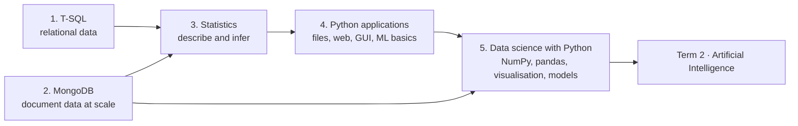

# Term 1 · Data Science Foundations

> 🧭 [Diploma in AI](../README.md) › **Term 1**
>
> Prepared by **Hamna Zahid Khan**, Junior Lecturer

[🏠 Course home](../README.md)

---

## 🌟 About this term

Term 1 builds everything an AI practitioner needs before training a model: getting data out of **relational** and **document** databases, understanding it with **statistics**, and working with it in **Python**. Each module has session notes with runnable examples, lab tasks, quizzes and a practice test.

## 🗂️ Modules

| # | Module | Hours | Sessions | Status |
|---|---|---|---|---|
| 1 | [Data Handling using T-SQL](01-data-handling-using-t-sql/) | 16 | 6 | ✅ Ready |
| 2 | [Managing Large Datasets with MongoDB](02-managing-large-datasets-with-mongodb/) | 32 | 12 | ✅ Ready |
| 3 | Inferential Statistical Analysis | 16 | 6 | 🕒 Coming soon |
| 4 | Application Based Programming in Python | 36 | 15 | 🕒 Coming soon |
| 5 | Data Science with Python | 36 | 15 | 🕒 Coming soon |

## 🧭 How the modules connect

## ✅ How to study a module

1. Read the module `README.md` for the objectives, setup and cheat-sheet.
2. Work through the sessions in order. Sessions with Python examples have an **Open in Colab** badge.
3. Do the lab tasks, then check yourself with the quick quiz at the end of each session.
4. Finish with the module's `practice-test.md` and aim for 16/20 or better.

---

Prepared by Hamna Zahid Khan, Junior Lecturer · Diploma in AI
